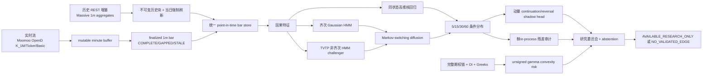

# AXIO7 实时短周期全市场研究系统

版本：2026-07-23  
范围：5、15、30、60 分钟概率预测；全市场、非个性化、研究用途。  
硬边界：不承诺预测必然正确，不输出账户仓位、下单数量、个性化买卖建议或自动订单。

## 0. 核心原则

系统预测的对象不是“某个价格一定会到哪里”，而是给定当前信息集
\(\mathcal F_t\) 后的条件分布：

\[
p(r_{t,t+h}, MFE_{t,t+h}, MAE_{t,t+h}, S_{t+h}\mid \mathcal F_t),
\qquad h\in\{5,15,30,60\}.
\]

每一分钟重新计算一次并不能把若干不确定预测自动变成确定预测。连续滚动只有在以下条件同时成立时才有意义：

1. 每次输入都是真实、已完成、按时可得的数据；
2. 训练和检索只使用该时点以前已经成熟的标签；
3. 连续预测的重叠标签被正确处理；
4. 成本、延迟、缺口、修订和失效都进入审计；
5. 没有足够证据时输出 `NO_VALIDATED_EDGE`，而不是强行找机会。

“千万行代码”不是质量指标。关键是每个 Block 有清晰数据合同、因果边界、拒绝条件、版本、测试和可追溯收据。

## 1. 总体数据流



## 2. Block A：实时数据源和授权

### A1. Massive 历史及增量 REST

用途：

- 多年 1 分钟历史；
- 每次刷新补最近若干天；
- 训练、回测、历史相似环境检索；
- Moomoo 断线后的历史补洞候选，但不同数据源不能无记录地混写。

缓存规则：

- `chunk_end < 当前纽约交易日`：历史日期块可以复用；
- `chunk_end >= 当前纽约交易日`：必须重新请求；
- 网络失败、权限错误或空响应不能用合成数据替代；
- 原始响应、规范化 CSV、SHA-256 和刷新收据必须对应。

Basic REST 轮询不是逐笔流，也不是零延迟 SIP。它适合历史和低频增量，不应被标成交易所直连实时流。

### A2. Moomoo OpenD 持续流

用途：

- `K_1M` 形成中和完成的一分钟 K 线；
- `Ticker/Basic` 心跳及行情状态；
- 前向 shadow 预测的真实 `received_at`；
- 缺口、迟到、缓存回调和 SDK 状态审计。

运行条件：

1. OpenD GUI 已登录；
2. `127.0.0.1:11111` 正在监听；
3. 账户拥有相应美股行情权限；
4. Rust bridge 完成官方 SDK 握手并收到首个回调。

仅 TCP 端口可连接不等于数据有效。首个 Quote 回调、首个 K_1M 回调、订阅代码和行情权限必须分别验证。

### A3. IBKR 连接器

Codex 中的 IBKR 连接器可以用于只读实时快照交叉验证。但它不是本地 Rust 服务可永久复用的 socket，也不自动授予 AXIO7 对外再分发行情的权利。若要让本地服务持续使用 IBKR 数据，需要单独接入 Client Portal Gateway 或 TWS API，并确认账户行情订阅、API 条款和再分发边界。

### A4. 期权数据

gamma 风险层至少需要同一 `as_of` 下的：

- 完整合约定义和 multiplier；
- bid/ask；
- volume；
- point-in-time open interest；
- IV 和 gamma；
- underlying spot；
- 每个字段的 provider、received time、revision/vintage。

缺任一关键 lineage 时，整份 gamma 聚合为 `UNAVAILABLE`；不能把缺失合约当作零暴露。

## 3. Block B：事件时间、可用时间和分钟终结

每条输入至少保留：

- `event_time`：市场事件发生时间；
- `bar_start` / `bar_end`：分钟区间；
- `received_at`：本系统实际收到时间；
- `available_at`：该字段首次可用于计算的时间；
- `source` / `source_version`；
- `quality_status`；
- 原始消息 hash。

Moomoo K_1M 标签是桶结束时间。09:31 标签表示 09:30–09:31 这一分钟。系统将其规范化为：

\[
bar\_start=09{:}30,\qquad bar\_end=09{:}31.
\]

分钟状态：

- `COMPLETE`：时间连续，且在允许延迟内终结；
- `GAPPED`：上一完成分钟到当前分钟之间存在缺口；
- `STALE_OR_CACHED`：收到时间晚于 `bar_end + stale_after_ms`，或来源标明缓存；
- `GAPPED_AND_STALE`：同时满足两者。

只有 `COMPLETE` 数据可以无条件进入实时预测。其他状态默认 fail closed，并写入 append-only gap ledger。

## 4. Block C：严格的点时特征

任何特征只能使用 `available_at <= decision_as_of` 的输入。

核心分钟特征包括：

- 1/3/5/15/30/60 分钟收益；
- 15 分钟价格斜率；
- realized volatility；
- session VWAP residual；
- 相对 session open/high/low；
- bar range、wick、close-location；
- volume z-score、volume acceleration、同分钟 RVOL；
- QQQ/IWM/HYG/TLT/UUP 等跨资产 breadth 和 risk rotation；
- 距离开盘/收盘分钟数；
- 5 分钟桶位置和连续分钟计数。

所有 lag return 必须验证真实时钟连续：

\[
t_i-t_{i-k}=k\text{ minutes}
\]

且区间内每相邻记录恰好相差一分钟。缺一分钟时，跨缺口收益、波动和完成桶标志不能继续计算。

## 5. Block D：四态 GMM 宏观描述器

Two Sigma 公共研究中的四态 GMM 是慢频、描述性模型：

\[
p(x_t)=\sum_{k=1}^{K}\pi_k\mathcal N(x_t;\mu_k,\Sigma_k).
\]

它可以描述当前因子环境更像 crisis、steady、inflation 或 walking-on-ice 的哪个统计成分，但 GMM 本身没有转移矩阵，不直接预测下一状态。

使用条件：

- 完整 point-in-time 因子历史；
- 每个宏观数据 release/vintage 可回放；
- train-only 标准化；
- chronological validation 选择 \(K\)；
- component id 与经济名称分开保存。

在完整 17 因子 PIT 档案没有接入前，四态 GMM 保持研究诊断，不能伪装成实时生产输入。

## 6. Block E：齐次 Gaussian HMM 基线

观测：

\[
X_t\mid S_t=k\sim\mathcal N(\mu_k,\operatorname{diag}(\sigma_k^2)).
\]

齐次转移：

\[
P(S_{t+1}=j\mid S_t=i)=A_{ij}.
\]

实时只使用 forward-filtered posterior：

\[
q_t=P(S_t\mid X_{1:t}),
\]

禁止用 full-sample smoother 或未来 Viterbi path。

状态数不是固定写死为 8。候选 \(K=2,\ldots,10\) 必须参加 chronological held-out likelihood 比较；8 态只是公共历史叙述启发的 challenger。若 8 态未胜出，系统明确记录 `EVALUATED_NOT_SELECTED`。

HMM 只接收完整的 5 分钟桶。桶内缺分钟时，该桶不能更新状态。

## 7. Block F：TVTP 非齐次 HMM challenger

“异马尔可夫”在这里采用更准确的名称：time-varying transition probability HMM，或非齐次 HMM。

\[
P(S_{t+1}=j\mid S_t=i,z_t)
=
\operatorname{softmax}_j\bigl(\beta_{ij}^{\top}[1,z_t]\bigr).
\]

\(z_t\) 可以包含当前已知的：

- realized volatility；
- volume shock；
- cross-asset breadth；
- risk rotation；
- time-of-day；
- event proximity。

训练规则：

1. emission HMM 只在 train prefix 拟合；
2. 使用 train-only Baum–Welch soft \(\xi_t(i,j)\) 拟合转移 logits；
3. covariate 标准化只用 train；
4. validation suffix 只做 forward filtering；
5. 比较齐次和 TVTP 的每观测 held-out log-likelihood；
6. 转移行有效权重不足或 covariate OOD 时拒绝；
7. 未通过外层 OOS 前只能进入 shadow comparison。

未来 \(z\) 未知。若短周期状态预测冻结当前 \(z_t\)，输出必须明确 `FROZEN_COVARIATE_ASSUMPTION`，不能把它描述成观察到的未来路径。

## 8. Block G：同状态高维核回归

HMM 预测状态概率，核回归估计条件收益分布：

\[
w_i \propto
\exp\left(-\frac{1}{2b^2}
(x_t-x_i)^\top\widehat\Sigma^{-1}(x_t-x_i)\right)
\times
g(q_t,q_i).
\]

其中：

- \(\widehat\Sigma\) 是 train-only shrinkage covariance；
- \(g(q_t,q_i)\) 是 filtered regime posterior 的门控；
- query day 和未成熟标签全部排除；
- bandwidth 由训练数据自适应；
- 返回完整邻居证据、日期、距离、权重、ESS 和 concentration。

输出包括：

- weighted mean/median；
- 5/10/25/50/75/90/95 分位数；
- \(P(r>cost)\)、\(P(r<-cost)\)；
- MFE/MAE 分布；
- effective sample size；
- OOD score；
- 最大单日权重和敏感性分析。

ESS 低、权重过度集中、状态后验不确定或 OOD 时必须 abstain。

## 9. Block H：Markov-switching diffusion

短周期价格用对数收益扩散，而不是直接把原始价格强行设为均值回归：

\[
d\log P_t=\mu_{S_t}\,dt+\sigma_{S_t}\,dW_t.
\]

离散到一分钟：

\[
r_{t,t+1}\mid S_{t+1}=k
\sim \mathcal N(\mu_k\Delta t,\sigma_k^2\Delta t).
\]

通过状态转移递推 5/15/30/60 分钟的一、二阶矩，得到：

- terminal state probabilities；
- expected log return；
- variance / standard deviation。

Jump 只做 shadow diagnostic。没有独立验证和足够 jump events 时，不进入预测矩，也不能将普通高波动命名为 jump。

## 10. Block I：VWAP residual OU

OU 只允许用于 session VWAP residual：

\[
Y_t=\log(P_t/VWAP_t),
\]

\[
dY_t=\kappa_{S_t}(\theta_{S_t}-Y_t)\,dt+\eta_{S_t}\,dW_t.
\]

系统拒绝“原始股票价格天然 OU”的假设。若估计的 \(\phi\notin(0,1)\)、有效 pair 不足或设计矩阵退化，则 OU 输出禁用，但趋势扩散仍可单独存在。

## 11. Block J：动量 continuation/reversal shadow head

动量不是把最近上涨直接外推。系统在每个 regime 下估计：

\[
P(\operatorname{sign}(r_{t,t+h})
=\operatorname{sign}(r_{t-k,t})\mid S_t).
\]

使用 Beta-Binomial shrinkage，分别输出 continuation、reversal 和 neutral 概率。只有独立 validation 的 Brier score 优于基线、样本量足够时，才允许作为 shadow comparison；它不单独产生交易许可。

## 12. Block K：鞅、停止时刻和 e-process 审计

附件中的 martingale、Markov chain、stopping time 和 optional stopping 内容用于模型治理。

对已经成熟的预测定义标准化残差：

\[
\epsilon_t=\frac{y_t-\widehat\mu_t}{\widehat\sigma_t}.
\]

若模型校准合理，则在条件意义下不应持续存在可预测漂移。系统按 horizon phase 拆分重叠标签，并构造非负 e-process：

\[
E_t=\prod_{i\le t}(1+\lambda\epsilon_i).
\]

这里的 filtration \(\mathcal F_t\) 只包含时点 \(t\) 已经收到并通过质量检查的数据。
审计停止时刻 \(\tau\) 必须满足
\(\{\tau\le t\}\in\mathcal F_t\)：例如“e-process 首次越过预先固定阈值”是 stopping
time；“找到这一段轨迹的第一个峰值”不是，因为判断峰值需要看到未来。附件中的
roulette/random-walk 例子也不意味着股票价格天然是 martingale；系统只在明确的
校准原假设下检查预测残差是否仍近似 martingale difference。

齐次 Markov 基线的多步状态概率使用 \(q_tA^h\)。TVTP challenger 则使用按时点
变化的矩阵乘积
\(q_tA(z_t)A(z_{t+1})\cdots\)。未来 covariate 未知时只允许冻结当前 \(z_t\)，
并明确标注假设，不能把未知的 \(z_{t+1}\) 当成已观察数据。

当 \(E_t\ge 1/\alpha\) 时触发校准 veto。规则：

- optional stopping 允许在预先定义的 e-process 上持续监控；
- 它不能证明策略必赚；
- 它不能把 stopping rule 本身变成 alpha；
- 鞅审计永远 `approval_granted=false`；
- 它只能否决或要求重新验证模型。

## 13. Block L：gamma convexity feedback risk

在合约链完整时，系统计算无符号凸性规模：

\[
G_c=
|\Gamma_c|\times OI_c\times multiplier
\times spot^2\times 1\%.
\]

聚合输出：

- call/put unsigned exposure；
- expiry 和 strike concentration / HHI；
- ATM 距离；
- 1%、2%、5% moneyness 内的暴露份额；
- 数据覆盖率和新鲜度。

OI 不包含持仓者身份和方向，所以不能从公开 OI 推断“dealer 一定 long/short gamma”。系统只展示四种明确假设的代数情景，且标记 `is_observed=false`。

没有完整链时输出 `UNAVAILABLE`。不得使用“必然 gamma squeeze”“做市商必须买入”等确定性表述。

## 14. Block M：每个 horizon 独立因果截止点

在接近收盘时，5、15、30、60 分钟不能共享一个伪造 cutoff。

对每个 \(h\) 独立寻找当前 session 内最新合法 query：

\[
minutes\_to\_close(t)>h.
\]

因此 15:30 时：

- 5/15 分钟可以使用最新 query；
- 30/60 分钟可能使用更早的合法 query；
- 如果当前 session 没有合法 query，只让该 horizon 返回
  `HORIZON_CROSSES_SESSION_BOUNDARY`；
- 绝不跨到上一交易日假装当前预测。

每份 forecast contract 都有自己的：

- observation cutoff；
- feature hash；
- HMM posterior；
- analog evidence；
- model hash；
- label start/end；
- deterministic prediction id。

重复调用相同输入必须得到相同 prediction id；生成时间不参与身份 hash。

## 15. Block N：研究委员会

当前委员会不是简单多数投票。各头的职责不同：

| 模型 | 职责 | 是否可单独改变输出 |
|---|---|---|
| 齐次 HMM | 基线状态识别与状态路径 | 否 |
| TVTP-HMM | 时变转移 challenger | 只可 shadow |
| 高维核回归 | 主要条件收益分布 | 是，但受全部 veto |
| Switching diffusion | 参数化趋势/波动对照 | 只可 shadow，验证后再晋级 |
| VWAP OU | 残差回归对照 | 只可 shadow |
| Momentum head | continuation/reversal 对照 | 只可 shadow |
| Gamma risk | 凸性反馈风险描述 | 否 |
| Martingale audit | 在线失准检测 | 只能 veto |

任何关键层不可用时都不能用固定默认值冒充真实结果。允许没有机会。

## 16. Block O：回测、前向验证和晋级

必须使用：

- purged chronological walk-forward；
- embargo；
- train/validation/test 三段；
- 所有 preprocessing 在 train 内拟合；
- 交易成本和延迟敏感性；
- 概率校准与 Brier/log score；
- 置信区间、ESS、payoff ratio、drawdown；
- 多 regime 和多时间段稳定性；
- 多重检验/FDR 或 deflated Sharpe；
- append-only forward shadow settlement。

合成数据只能测软件。没有独立外层 test 和足够 forward shadow 样本时，状态始终是 `UNVALIDATED_CANDIDATE` 或 `NO_VALIDATED_EDGE`。

## 17. Block P：批量研究刷新 DAG

一次批量研究刷新按顺序执行：

1. Massive 增量拉取；
2. 规范化、去重、SHA；
3. data capability；
4. predictor train；
5. forecast；
6. regime fit；
7. 检查 manifest、coverage、trained-through、cutoff 和 model hash；
8. 全部通过后逐文件原子替换，最后发布 commit receipt；
9. 任一步失败则回滚已替换文件并保留上一份已验证产物。

这不是跨文件系统事务。读取批量研究产物的消费者必须把
`refresh_receipt_latest.json` 视为最后提交标记，并核对其中的 run id 与
SHA-256；Moomoo 实时流与本批量 DAG 分离，网页机会接口只接受 SDK
`live_shadow_prediction`，不会把本 DAG 生成的 batch artifact 当成实时证据。

运行：

```powershell
npm run quant:data:refresh
```

跳过慢速 regime 重拟合：

```powershell
powershell -NoProfile -ExecutionPolicy Bypass `
  -File scripts/refresh-quant-data.ps1 `
  -LookbackDays 3 `
  -SkipSlowRegime
```

Moomoo 持续前向流：

```powershell
.\scripts\quantctl.ps1 live moomoo-check
.\scripts\quantctl.ps1 live moomoo-capabilities
.\scripts\quantctl.ps1 live moomoo-stream --shadow `
  --bridge ..\scripts\moomoo_quote_bridge.py
```

## 17.1 Forecast contract v4.4：SDE 与概率区间语义

生产 Rust 现在把两套分布证据并列输出，不做未经验证的模型混合：

1. `kernel_regression` 是 12 维、same-regime、train-only
   shrinkage-Mahalanobis + adaptive Gaussian-RBF Nadaraya-Watson 条件估计；
2. `stochastic_research_layer` 是 Markov-switching log-return diffusion +
   VWAP-residual OU 的影子研究层，`affects_decision=false`。

核层方向事件用交易成本带定义：

\[
r_h>c,\quad |r_h|\le c,\quad r_h<-c.
\]

Up/Flat/Down 输出是 kernel-weighted historical frequency。每个频率另附一个
使用 Kish ESS 的 95% Wilson estimate interval。它是未校准的历史频率估计区间，
不是 promoted 概率，也不是策略置信度。只有严格匹配、不可变且生命周期为
`PromotedOos` 的 binary-up calibrator 才能发布 `p_up`；`p_down` 和 `p_flat`
保持空值，禁止从剩余质量中合成。

核层的 80%/90% 区间来自历史 analogue 加权分位数，属于 empirical
conditional outcome range，不声明 conformal 或频率学覆盖保证。SDE 层的
80%/90%/95% 区间来自前两矩的 Gaussian moment match，明确标为
uncalibrated、非 confidence guarantee，且 jump diagnostic 不进入尾部矩。
SDE 的方向事件边界使用两个精确 log-return 阈值：
`lower=ln(1-c)`、`upper=ln(1+c)`，从而与 kernel 的 simple-return `±c`
成本带一致；不再把单个对称 log 阈值当成精确换算。

kernel 的收益标签是 next-minute open 到 horizon close，因此在
observation cutoff 时未来 entry price 尚不可知。v4.4 将歧义
`expected_price` 置空，只发布
`return_definition=NEXT_1M_OPEN_TO_HORIZON_CLOSE_SIMPLE_RETURN` 与明确命名的
`current_close_reference_scenario_*` 算术参考场景。该场景不是
label-aligned expected price、可执行终值或目标价；TypeScript 只能原样展示，
不得重算价格、概率或方向。

## 18. Block Q：产品和监管边界

公共输出只提供固定 universe 的非个性化统计研究：

- probability distribution；
- regime posterior；
- uncertainty / OOD / ESS；
- historical analog evidence；
- data freshness and coverage；
- model validation status。

公共 DTO 不提供：

- `BUY/SELL` 指令；
- 仓位和数量；
- 账户适配；
- 个性化 entry/target/stop；
- 自动订单；
- “保证盈利”或确定性 squeeze 结论。

加一句免责声明不能自动解决产品实质问题，因此代码层同时强制：

- `action=NO_TRADE`；
- `eligible=false`；
- `investment_advice=false`；
- `execution_instruction=false`；
- execution subsystem 默认关闭并与研究服务隔离。

## 19. 当前接入仍需完成的外部条件

1. 在 OpenD GUI 完成登录并让 `127.0.0.1:11111` 监听；
2. 确认 GOOG、MU、SNDK、SPY、QQQ、SOXX 的实时行情权限；
3. 若要真正计算 gamma risk，接入有 point-in-time OI/Greeks 的 OPRA 期权源；
4. 若使用 IBKR 作为本地持续源，提供已授权的 Client Portal/TWS Gateway，而不是仅依赖 Codex 内连接器；
5. 对外产品化前确认 Massive、Moomoo、IBKR 和 OPRA 的展示、存储及再分发许可。

## 20. Block R：网页按需机会扫描接口

持续行情进程负责订阅和完成一分钟 bar；网页请求不临时拼接 Yahoo
日线，也不把历史批量预测改名为实时预测。前端只需调用：

```text
GET /api/quant/intraday/research/opportunities?horizon=15&limit=2
```

可选参数：

- `horizon` / `horizon_minutes`：只能是配置中的 5、15、30、60；
- `limit`：1–20，默认 2；
- `include_unvalidated`：默认 true，但每行明确显示
  `UNVALIDATED_SHADOW_CANDIDATE`；设为 false 时只保留完成独立验证的结果。

服务端每次请求都会重新检查：

- forecast contract 必须属于服务端 allow-list；v4.4 额外强制校验
  next-open→horizon-close return 定义、withheld `expected_price`、
  current-close reference scenario、12D kernel evidence、方向频率 simplex、
  三个 95% estimate intervals、经验结果区间及 SDE 非对称阈值/分布不变量；
- 必须来自 `live_shadow_prediction`，历史 batch/replay/fixture 不得混入；
- `observation_cutoff`、`as_of`、SDK `available_at`、label window 必须因果一致；
- 默认年龄不超过 120 秒，未来时间戳和过期结果直接排除；
- model/feature/data manifest 三个 SHA-256 必须可追溯；
- stochastic layer 和 gamma layer 必须显式存在；gamma 数据不完整时只返回
  `unavailable`，不得推断 squeeze；
- 只有 matching promoted binary-up calibration 才能作为已校准概率超过配置阈值；
  未校准候选只能用 raw historical frequency 明示排序，允许返回零个候选，
  禁止强凑“每日机会”。

返回字段包括 configured universe、覆盖率、逐标的排除原因、raw Up/Flat/Down
频率及其 estimate intervals、可选 promoted binary `P(up)`、Rust
current-close reference scenario、kernel analogue empirical outcome ranges、regime、
SDE/momentum shadow、OOD、不确定性、
校准状态和模型哈希。`research_rank` 只是非个性化统计排序，不是买卖方向、
仓位、目标价或订单。

本接口当前扫描 `production.yaml` 中明确列出的 11 个股票/ETF。扩展 universe
必须同时满足实时订阅权限、对应历史训练数据和供应商展示/再分发许可；“配置了符号”
不等于“已经拿到新鲜结果”。
