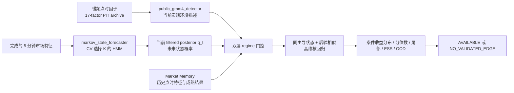

# AXIO7 Regime 模型规范：GMM、HMM、八态 challenger 与同状态核回归

版本：2026-07-22  
产品边界：非个性化、全市场统计研究；不生成订单、仓位、止损、账户适配或个人买卖建议。

## 1. 先分清四件不同的事

### 1.1 Two Sigma 的四态

Two Sigma 公开论文使用美国市场 17 个因子日收益拟合 Gaussian Mixture Model（GMM）。状态数不是先验写死为 4，而是用交叉验证样本外 log-likelihood 选择，最终在其数据和样本期上得到 4 个成分，并事后解释为：

1. Crisis
2. Steady State
3. Inflation
4. Walking on Ice

GMM 把每期观察视为来自若干高斯分布之一。它描述“当前观察更像哪个成分”，没有状态转移矩阵，因此本身不预测下一状态。

来源：[Two Sigma, A Machine Learning Approach to Regime Modeling](https://www.twosigma.com/wp-content/uploads/2021/10/Machine-Learning-Approach-to-Regime-Modeling_.pdf)

### 1.2 公开叙述中的 Simons“最多八态”

可核实的公开叙述只支持：Simons、Baum 等人在 IDA 时期的机密研究曾假设市场存在“最多八个”隐藏状态，并研究状态转移概率。原论文、完整状态定义、输入变量、参数和后来 Medallion 的生产实现都没有公开。

因此 AXIO7 的准确命名是：

> `simons_8_shadow`：受公开历史叙述启发的八态 HMM challenger。

不得命名为“Jim Simons 原版八态模型”“Renaissance 八态复刻”或“Medallion 算法”。

### 1.3 HMM/Markov 预测层

Hidden Markov Model（HMM）增加状态转移：

\[
P(S_t=j\mid S_{t-1}=i)=A_{ij}.
\]

实时状态不是一条硬标签，而是截至当前全部可见历史的过滤概率：

\[
q_t=P(S_t\mid X_{1:t}).
\]

它是模型里的“当前充分状态”。未来状态分布由：

\[
q_{t+h\mid t}=(A^\top)^h q_t
\]

得到。这是模型假设，不是“真实市场必然一阶 Markov”的事实声明。

方法参考：[Hamilton, Regime Switching Models](https://econweb.ucsd.edu/~jhamilto/palgrav1.pdf)

### 1.4 高维状态条件核回归

HMM 预测的是未来状态概率，不直接等于资产未来收益。收益条件分布由历史相似环境估计：

\[
\widehat F_h(y\mid x_t,q_t)
=
\frac{\sum_i w_{i,t}\mathbf 1(Y_{i,h}\le y)}
{\sum_i w_{i,t}}.
\]

这属于公开的多元非参数/局部回归方法。Carmona 的公开教材覆盖相关方法，但 Renaissance 内部具体核函数和工程实现没有公开，所以 AXIO7 使用“regime-gated high-dimensional kernel regression”这一可核实名称，不声称复刻私有实现。

方法参考：[Carmona, Statistical Analysis of Financial Data in R](https://link.springer.com/book/10.1007/978-1-4614-8788-3)

## 2. 四层架构



慢频 GMM 和快频 HMM 并列存在，不能把 4×8 直接硬切成 32 个小桶。样本不足时应保留软后验并停止输出，而不是跨状态回退凑样本。

## 3. Block A：数据合同

### 3.1 宏观 GMM 输入

公开 17 因子 schema 已注册在：

`quant_engine_rs/src/engine/gmm.rs::PUBLIC_GMM4_FACTOR_SCHEMA`

包括 equity、rates、credit、commodities、EM、FX、inflation、carry、trend 和股票风格因子。每行必须有：

- `observation_time`
- `available_time`
- `received_time`
- provider 与数据授权
- vintage/revision
- schema hash 与内容 hash
- 因子构造版本

当前仓库尚未物化完整、可回放的 17 因子 point-in-time 历史。因此 GMM 数学引擎已实现，但 `public_gmm4_detector` 不能被标成生产可用，也不能用今天修订后的宏观序列倒灌历史。

### 3.2 快频 HMM 输入

当前 HMM 每个完成的 5 分钟桶使用：

1. `ret_5m`
2. `dist_vwap`
3. `rolling_realized_vol`
4. `volume_zscore`

只在 `minute_in_5m_bucket == 4` 时形成新观察。未完成 5 分钟桶不能提前进入状态模型。

### 3.3 历史结果标签

历史候选只有在完整未来窗口已经结束且：

\[
label\_available\_at \le decision\_as\_of
\]

时才可进入核回归。查询日、同日未来、尚未成熟标签和重复交易日全部排除。

## 4. Block B：GMM 当前环境描述器

模型：

\[
p(x_t)=\sum_{k=1}^{K}\pi_k\mathcal N(x_t;\mu_k,\Sigma_k).
\]

后验：

\[
\gamma_{t,k}
=
\frac{\pi_k\mathcal N(x_t;\mu_k,\Sigma_k)}
{\sum_j \pi_j\mathcal N(x_t;\mu_j,\Sigma_j)}.
\]

实现采用：

- train-only 标准化；
- diagonal covariance 与 variance floor；
- deterministic multi-start EM；
- log-sum-exp；
- BIC；
- chronological held-out average log-likelihood；
- 训练/验证后按获胜 K 在全部历史训练区重拟合。

输出：

- component posterior；
- dominant raw component；
- posterior entropy；
- train BIC；
- validation average log-likelihood；
- model/schema hash；
- OOD/密度状态。

不输出：

- 下一状态概率；
- 状态持续期；
- 买卖方向；
- 把 component 0–3 自动等同于四个经济名称。

四个经济名称必须基于训练期质心、因子载荷和固定解释规则另行映射，并始终保留 raw component id。

## 5. Block C：HMM/Markov 状态预测器

发射分布：

\[
X_t\mid S_t=k\sim\mathcal N(\mu_k,\operatorname{diag}(\sigma_k^2)).
\]

预测步：

\[
q_t^- = A^\top q_{t-1}.
\]

更新步：

\[
q_t(k)=
\frac{f_k(x_t)q_t^-(k)}
{\sum_j f_j(x_t)q_t^-(j)}.
\]

工程规则：

- Baum–Welch 多重初始化；
- train-only 标准化；
- diagonal covariance，避免 8 态高维完整协方差爆炸；
- fold 内 canonicalization，缓解 label switching；
- 实时和回测只用 forward-filtered posterior；
- full-sample smoothed posterior 和 Viterbi path 仅允许做离线诊断；
- 每个 session 独立起始，跨夜预测必须有显式 overnight model，否则拒绝。

## 6. Block D：K 的选择与“八态”身份

生产研究配置：

```yaml
regime:
  state_candidates: [2, 3, 4, 5, 6, 7, 8, 9, 10]
  validation_fraction: 0.20
  minimum_validation_sessions: 5
  max_iterations: 40
  restarts: 3
  minimum_effective_sample_size: 20
```

选择步骤：

1. prior sessions 按时间分成 fit prefix 与 validation suffix；
2. 对每个 \(K\) 仅在 fit prefix 拟合；
3. 用固定参数计算 validation suffix 的平均 log-likelihood；
4. 选择样本外 log-likelihood 最大的 K；
5. 完全相同时选择较小 K；
6. 只在验证 session 不足时回退至最小 BIC，并在输出中标明 fallback；
7. 用获胜 K 在全部 prior sessions 重拟合；
8. 当前 session 只做过滤，不参与模型选择或参数估计。

如果最高验证分数恰好落在最大候选 K，系统必须输出
`BEST_VALIDATION_SCORE_IS_AT_MAXIMUM_TESTED_K`；这表示最优状态数尚未被候选范围包住，不能把边界赢家宣传成已证明的真实状态数。

八态必须参加比较，但不会因为传记提到“八”而自动获胜。机器可读状态是：

- `SELECTED_BY_CHRONOLOGICAL_MODEL_SELECTION`
- `EVALUATED_NOT_SELECTED`
- `FIT_FAILED_OR_INSUFFICIENT_OBSERVATIONS`

仓库中八个 `StandardStateName` 是稳定的解释词汇：

1. UnclassifiedPriceFlowState
2. LowVolTrendUp
3. LowVolTrendDown
4. HighVolSellOff
5. HighVolRecovery
6. MeanReversion
7. HighActivityHighVolatility
8. RangeCompression

它们不是对私有 Simons 状态的断言，也不是强制一一对应。两个 raw state 可以映射到同一语义名；检索必须比较 raw posterior，不能只比较名称。

## 7. Block E：严格同状态历史检索

每个历史分钟索引拥有一个因果状态后验：

- 完成 5 分钟桶时更新；
- 在同一 session 内向前携带到后续分钟；
- 新 session 开始时清空；
- 第一个完成桶以前保持缺失；
- 禁止用全样本 smoothing 填历史。

候选 \(i\) 必须同时满足：

\[
\arg\max q_i=\arg\max q_t
\]

\[
\max(q_i),\max(q_t)\ge p_{\min}
\]

\[
\cos(q_i,q_t)\ge c_{\min}.
\]

当前配置：

- \(p_{\min}=0.50\)
- \(c_{\min}=0.90\)
- \(ESS_{\min}=20\)
- 同主导 raw state 为强制条件
- 不允许跨 regime fallback

如果同状态独立交易日少于 10、ESS 不足或概率向量缺失，结果为 `NO_RELIABLE_ANALOG`。
每个失败期限仍写入 `unavailable_horizons`（期限、状态、validation flags），不会抛弃证据或用零收益伪装成有效预测。

## 8. Block F：高维核回归

环境距离默认使用 train-only shrinkage Mahalanobis：

\[
d_i^2=(z_i-z_t)^\top\widehat\Sigma_\lambda^{-1}(z_i-z_t).
\]

状态后验重叠加权的 Gaussian kernel：

\[
\widetilde w_i=\cos(q_i,q_t)
\exp\left[-\frac12(d_i/h)^2\right],
\qquad
w_i=\frac{\widetilde w_i}{\sum_j\widetilde w_j}.
\]

带宽默认取第 \(K\) 个邻居距离再乘预注册 multiplier。除 Nadaraya–Watson 均值外，系统同时计算局部线性截距，降低边界偏差。

当前 production-research feature vector 固定为 12 维：

`ret_1m`、`ret_5m`、`ret_15m`、`vwap_distance`、
`realized_volatility`、`normalized_range`、`volume_zscore`、`rvol`、
`session_range_position`、`cross_asset_breadth`、`slope_15m`、
`minute_of_session`。

缩放中位数/MAD、shrinkage covariance、inverse metric 及可选
horizon-specific metric weights 都只能在训练窗口拟合。检索还要求相同主导
raw state、posterior cosine 门槛、相同时间桶、每个历史交易日最多一个邻居，
避免把同一天高度重叠的路径伪装成独立样本。

输出：

- kernel-weighted mean；
- local-linear intercept；
- \(Q_{05},Q_{10},Q_{25},Q_{50},Q_{75},Q_{90},Q_{95}\)；
- cost-band 之上的 raw up、band 内 flat、band 之下 raw down
  kernel-weighted historical frequencies；
- 每个 raw frequency 的 95% Wilson estimate interval，样本量采用 Kish ESS；
- 80%/90% kernel-weighted empirical outcome ranges；
- MFE/MAE 条件分布；
- dispersion；
- analog 时间、距离、权重、状态相似度；
- sensitivity grid；
- ESS：

\[
ESS=\frac{(\sum_iw_i)^2}{\sum_iw_i^2}.
\]

以上 Wilson 区间是探索性的频率估计区间；它不等于 OOS-calibrated probability，
也不包含序列相关、模型选择或分布漂移不确定性。经验 outcome range 也不等于
conformal prediction interval。只有 matching `PromotedOos` calibration artifact
可以发布 binary `P(up)`；在联合三分类 calibrator 通过独立验证前，
`p_down`/`p_flat` 必须为空。

The production return label is
`NEXT_1M_OPEN_TO_HORIZON_CLOSE_SIMPLE_RETURN`. The next-minute entry open is
unknown at the observation cutoff, so `expected_price` and legacy price
quantiles are withheld. Any `current_close_reference_scenario_*` value is only
the arithmetic transformation of that return by the finalized current close;
it is explicitly not a label-aligned expected/executable price.

The SDE shadow maps the same symmetric simple-return event band `[-c,+c]` into
two exact log-return thresholds, `ln(1-c)` and `ln(1+c)`. A single symmetric log
threshold is not used because it would not preserve both simple-return
boundaries exactly.

高维注意：财报事件只有约数十个独立观察时，不能把 17 因子、8 维 posterior、公司特征和宏观变量全部裸塞入核函数。必须先做训练期 PCA/因子压缩或预注册少量变量，否则输出 `INSUFFICIENT_EFFECTIVE_SAMPLE`。

## 9. Block G：失效保护

任一条件触发即停止方向性解释：

- `QUERY_REGIME_PROBABILITIES_MISSING`
- `QUERY_REGIME_PROBABILITIES_INVALID`
- `QUERY_REGIME_POSTERIOR_UNCERTAIN`
- `EXCESSIVE_STATE_ENTROPY`
- `NO_RELIABLE_ANALOG`
- `INSUFFICIENT_INDEPENDENT_ANALOG_DAYS`
- `NO_RELIABLE_ANALOG_INSUFFICIENT_ESS`
- `OUT_OF_DISTRIBUTION`
- `ANALOGS_OVERDEPEND_ON_ONE_PERIOD`
- `MODEL_NOT_PROMOTED_NO_OOS_EDGE`
- point-in-time 数据或 label maturity 无法证明

不得为了每次都给答案而放松阈值、跨状态找邻居或使用未来 smoothing。

## 10. Block H：非个性化研究输出合同

公开 DTO 允许：

```text
state posterior
dominant raw state
entropy
transition probabilities
expected duration
analog dates and similarities
conditional return distribution
quantiles and tail statistics
ESS / OOD / calibration status
data cutoff / trained-through / model hash
statistical_condition
research_status
```

即使所有期限都不可用，根级 `regime_context` 也只能以最后完成的 5 分钟桶作为状态观测截止时点，并保留该时点的 filtered posterior、下一状态概率、熵、主导状态概率和完整 K-selection diagnostics；`prediction_layer` 保持空数组，不能用零值伪造预测。

公开 DTO 禁止：

```text
action / side
eligible
BUY / SELL / LONG / SHORT
qty / quantity
order / order_type
position_size / target_weight / target_notional
stop_loss / target_price
option legs
broker / account adaptation
```

固定元数据：

```json
{
  "product_scope": "IMPERSONAL_WHOLE_MARKET_STATISTICAL_RESEARCH",
  "personalization_used": false,
  "user_portfolio_inputs_used": false,
  "investment_advice": false,
  "execution_instruction": false
}
```

个人持仓、成本、账户规模、收入、税务、风险承受力和流动性需求不能改变模型输出。公开预测路由在序列化时递归删除动作、仓位和订单字段；生产 profile 的 execution 为 disabled。

免责声明只是合同的一部分，不能代替对实际收费方式、营销、交互、人员角色和监管身份的律师审查。“非个性化”不自动构成监管安全港。

监管设计参考：

- [SEC：算法型 robo-adviser 仍涉及披露、适当性与合规义务](https://www.sec.gov/newsroom/press-releases/2017-52)
- [SEC：publisher exclusion 是事实依赖分析，非个性化只是条件之一](https://www.sec.gov/divisions/investment/noaction/1995/venturesearch071195.pdf)
- [FINRA Rule 2111：一般信息只有在不构成具体证券推荐时才排除](https://www.finra.org/rules-guidance/rulebooks/finra-rules/2111)

这些链接是工程边界的依据，不是 AXIO7 已获得任何注册豁免或法律意见的声明。

## 11. 验收标准

### 数学

- 所有 posterior 非负且和为 1；
- 8 态 challenger 确实被拟合和打分；
- K 选择只读 chronological validation suffix；
- `ln(K)` 归一化熵，不再硬编码 `ln(4)`；
- HMM 未来概率只由当前 filtered posterior 与转移矩阵产生。

### 因果

- 给历史序列追加未来数据，不改变旧时点 filtered posterior；
- 候选 label 的 available time 不晚于 query；
- 查询日永不进入 scaler、covariance、HMM 参数或邻居库；
- GMM/HMM 的 validation/test 不参与参数拟合。

### 检索

- 不同 dominant raw state 的候选全部排除；
- 概率不确定候选全部排除；
- 同状态样本不足时不跨状态回退；
- sensitivity 翻转、ESS 不足或 OOD 时为 `NO_VALIDATED_EDGE`。

### 合规产品

- 公共 JSON 不含 forbidden keys；
- UI 使用 `POSITIVE TILT / NEGATIVE TILT / INSUFFICIENT EVIDENCE`，不用实时 `LONG / SHORT`；
- `execution_eligible=false`；
- 输出不读取用户账户或持仓；
- 历史交易表明确标为 simulation。

## 12. 当前实现状态

已完成：

- generic diagonal GMM + EM + BIC + chronological validation；
- HMM 候选 K 的时间顺序验证；
- 8 态强制 challenger；
- 获胜 K 全历史 prior-session refit；
- 因果 filtered posterior 历史对齐；
- 同主导 raw state + posterior cosine 门控；
- Gaussian kernel、局部线性估计、分位数、ESS 与 OOD；
- 公共非建议投影与 forbidden-field stripping；
- 生产 execution disabled；
- UI 研究术语。

仍受数据阻塞：

- 完整 17 因子 point-in-time 档案；
- 宏观 GMM 的正式四态经济语义映射；
- Student-t HMM 与 Gaussian HMM 的 OOS 对照；
- 足够长的跨 regime forward-shadow；
- 财报 consensus、guidance 和 options NBBO 的合法历史授权。

这些阻塞项不会用当前快照、修订后数据或传记描述伪造为已完成能力。

## 13. 真实分钟数据验收结果（截至 2026-07-17）

使用仓库现有两年 SPY/跨资产分钟归档，训练只到 2026-07-16，2026-07-17 仅用于当前过滤。各 K 的 chronological validation average log-likelihood 为：

| K | Validation avg log-likelihood |
|---:|---:|
| 2 | -4.221657 |
| 3 | -3.889270 |
| 4 | -3.679959 |
| 5 | -3.451776 |
| 6 | -3.313599 |
| 7 | -3.213775 |
| 8 | -3.055606 |
| 9 | -2.963922 |
| 10 | -2.850440 |

结论不是“证实 Jim Simons 就是八态”。八态已实际拟合并优于 2–7 态，但 9、10 态继续改善；10 又位于当前候选上边界。因此：

- `8-state = EVALUATED_NOT_SELECTED`
- `selected K = 10`
- `selection status = REGIME_STATE_COUNT_OPTIMUM_UNRESOLVED`
- 该模型只能保持 exploratory/fail-closed，不能因 K=10 暂时最高就宣称市场有十个真实状态。

2026-07-17 收盘过滤结果的主导解释标签为 `MEAN_REVERSION`、raw state 7、后验约 99.96%，但这不是 2026-07-22 的“当前状态”：数据截止早了三个交易日，且状态数仍为边界未决。系统必须显示 2026-07-17 的 `as_of` 并拒绝把它与更新的行情或财报直接拼接。

为了让 60 分钟期限在同一交易日内完整可执行，forecast contract 的共同查询时点是 2026-07-17 15:00 ET（19:00Z），不是收盘。该时点 K=10 的主导 raw state 2 后验只有 45.77%，低于 50% 门槛，归一化熵约 0.464。因此 5/15/30/60 分钟四个期限全部为：

```text
NO_VALIDATED_EDGE
QUERY_REGIME_POSTERIOR_UNCERTAIN
```

这也说明为什么不能把收盘时 99.96% 的集中后验倒填到一小时前的预测决策。
