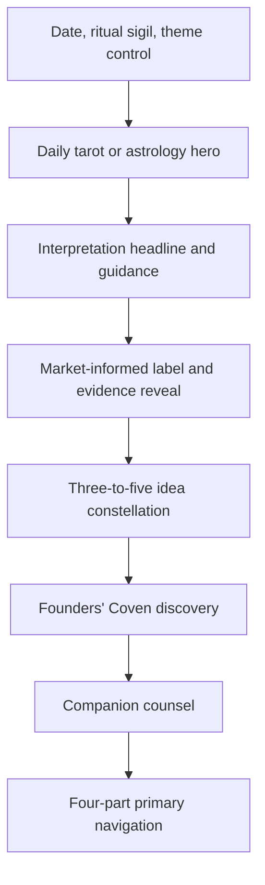
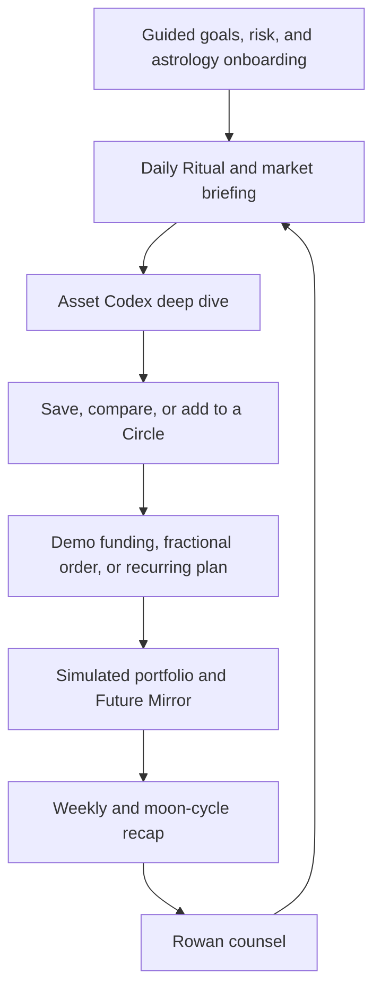
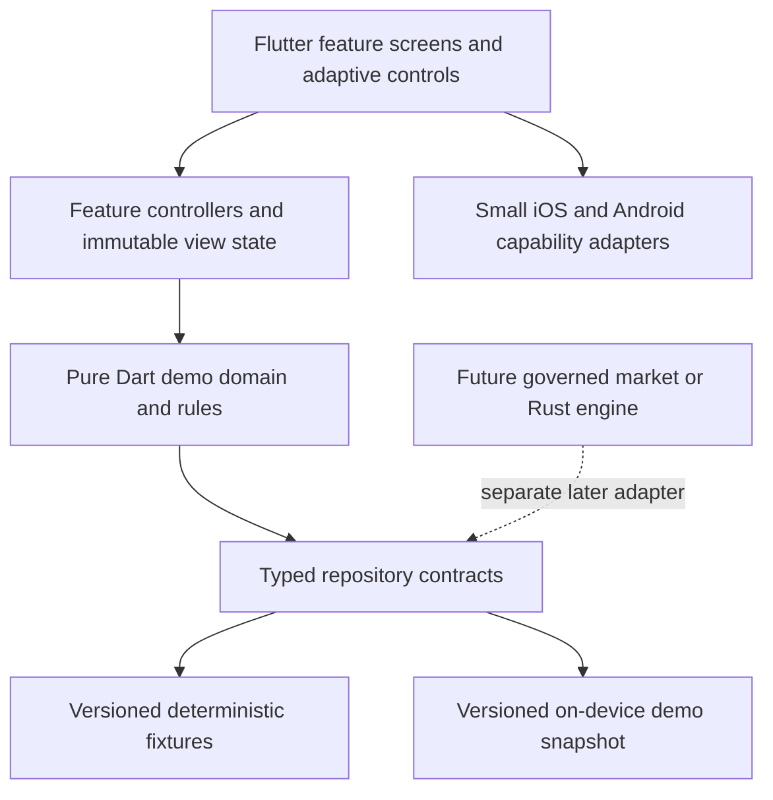

# Standalone Ritual Investing Mobile App - Plan

## Goal Capsule

- **Objective:** Gen Z and millennial women can explore a complete investing journey through a tarot-and-astrology product that makes market concepts approachable without pretending its simulated accounts or transactions are real.
- **Means:** A standalone Flutter mobile product for iOS and Android with one shared Dart UI, full locally stateful demo workflows, and no external financial connections.
- **Product authority:** This plan owns the consumer mobile shell, tarot and astrology ritual, Alinea-style capability coverage, idea discovery, women-led company collection, Rowan companion experience, theming, transparency, local demo state, and approved visual fidelity.
- **Open blockers:** None. Planning may resolve the deferred implementation choices without changing the product behavior defined below.

---

## Product Contract

### Summary

Build a standalone, ritual-first investing companion for iOS and Android with the breadth of a modern beginner investing product and the identity of an original tarot-and-astrology world.
Every financial, community, and subscription workflow is fully navigable with persistent local demo state, while Rowan provides the approved romance-lead counsel across the experience.

### Problem Frame

Most consumer investing products present the same dashboards, watchlists, news, and trading controls to everyone.
That catch-all framing does not match an audience already using astrology, tarot, and witchcraft aesthetics to make uncertain financial topics feel approachable and personally meaningful.

The opportunity is not to treat mysticism as a decorative skin or an unsupported prediction engine.
The product should make market research emotionally legible through ritual while preserving the user's ability to see the real basis, uncertainty, and timing behind every idea.

### Key Decisions

- **Standalone product boundary** (session-settled: user-directed — chosen over mixing the app into existing services: the app needs an independent identity and release lifecycle). Governs R1-R3 and R25.
- **Single Flutter application** (session-settled: user-directed — chosen over Tauri's WebView UI and separate SwiftUI/Jetpack Compose implementations: one maintained UI is the best fit for the product's bespoke card art, motion, cross-platform fidelity, and release cost). Flutter and Dart own the first-release UI and domain state; Swift/Kotlin adapters are reserved for platform capabilities, and Rust is deferred until a future market engine justifies FFI complexity. Governs R1-R3, R18-R22, R29-R30, and R35-R37.
- **Ritual-first product shape** (session-settled: user-directed — chosen over a conventional catch-all investing dashboard: tarot and astrology are the primary way users enter the product). Governs R4-R10.
- **Women-focused positioning** (session-settled: user-directed — chosen over a general investing audience: the voice, collections, and visual system should be designed for Gen Z and millennial women). Governs R11-R14 and R18-R22.
- **Market-informed with layered evidence** (session-settled: user-approved — chosen over concealing the analytical basis: mystical language may abstract research, but the market basis remains clear and inspectable). Governs R6-R10 and R23-R24.
- **Male romance-companion direction** (session-settled: user-directed — chosen over a woman character: the assistant should embody an idealized male lead without using intimacy to pressure financial behavior). Governs R15-R17.
- **Light and dark themes** (session-settled: user-directed — chosen over a single dark theme: both atmospheres belong to the approved identity). Governs R18-R20.
- **Reference-led visual fidelity** (session-settled: user-directed — chosen over recreating the approved look from memory: the generated artwork and approved composition must remain available for final comparison). Governs R21-R22.
- **Full simulated feature parity** (session-settled: user-directed — chosen over a limited discovery-only shell: the first product should demonstrate onboarding, portfolios, projections, community, subscriptions, funding, orders, recurring investing, and rebalancing without connecting to real infrastructure). Governs R26-R39.
- **Persistent local demo state** (session-settled: user-directed — chosen over session-only or fixed sample data: goals, profile, mock portfolio, and simulated activity should survive relaunch and remain resettable). Governs R29-R30 and R35-R37.
- **Curated community simulation** (session-settled: user-directed — chosen over either no community or a fully simulated social network: users browse seeded creators and copy Circles without public posting or messaging). Governs R31 and R38.
- **Simulated freemium** (session-settled: user-directed — chosen over an entirely unlocked shell or badge-only premium features: the full upgrade and checkout story should be demonstrable without real payment). Governs R39.
- **Pervasive mystical identity and Rowan counsel** (session-settled: user-directed — chosen over generic feature-parity screens: tarot, astrology, bespoke art, and the hot-guy counsel theme must shape every capability). Governs R40-R42.

### Requirements

**Standalone app and release boundary**

- R1. The product must exist as a new standalone app with its own mobile package, build configuration, tests, assets, and release lifecycle.
- R2. The first release must provide the same core product shell on iOS and Android through one Flutter application, adapting system navigation, safe areas, gestures, controls, accessibility, and motion behavior where the platforms differ.
- R3. The first release must operate from deterministic mock content and clearly identify simulated prices, movements, timestamps, and market explanations as demonstrations rather than live data.

**Daily ritual and investment discovery**

- R4. The daily experience must support tarot reading and astrology projection as distinct ritual modes.
- R5. A completed ritual must reveal between three and five explorable investment ideas, including support for stocks, ETFs, or other explicitly identified asset types.
- R6. Every ritual result must carry a concise `Market-informed` label adjacent to the mystical interpretation.
- R7. Every result must offer a one-step `Reveal the pattern` path that explains the market factors, observation time, uncertainty, and reason each idea appeared.
- R8. Mystical language may explain or frame the result, but it must not claim that supernatural forces caused or guarantee market performance.
- R9. The mock shell must produce repeatable daily scenarios so design, accessibility, and cross-platform behavior can be verified without a live provider.
- R10. Investment ideas must be actions to explore, compare, or save; the product must not present them as commands to buy.

**Women-led company discovery**

- R11. The product must include a dedicated `Founders' Coven` destination for companies associated with women founders, owners, or chief executives.
- R12. Each company must state the inclusion category that qualified it instead of collapsing ownership, founding, and executive leadership into one label.
- R13. Each inclusion must expose its verification date because company leadership and ownership can change.
- R14. The collection must remain a first-class discovery path rather than a temporary badge applied to the general idea feed.

**Companion experience**

- R15. The default companion must be an idealized, visibly attractive male romance-lead archetype with a composed, attentive, and knowledgeable voice; `Rowan` and the approved Velvet Scholar direction are the working expression.
- R16. The companion must explain readings, market evidence, investment terms, uncertainty, and general risk without impersonating a human adviser or romantic partner.
- R17. The companion must not use affection, exclusivity, jealousy, urgency, or sexual pressure to influence an investment decision or suppress a disclosure.

**Themes, visual identity, and accessibility**

- R18. The product must provide both the approved lunar-lilac light theme and aubergine-night dark theme.
- R19. First launch must follow the device theme, and a manual theme choice must persist across later sessions.
- R20. Both themes must preserve readable contrast, non-color status cues, accessible labels, usable text scaling, reduced-motion behavior, and touch targets appropriate for mobile use.
- R21. The daily ritual must preserve the approved image-first hierarchy, including dominant original card art, serif display typography, restrained sans-serif data text, the market constellation, Founders' Coven, companion counsel, evidence affordance, and four-part navigation.
- R22. Final implementation review must compare captured light and dark screens at representative iOS and Android phone viewports against `docs/visual-references/standalone-ritual-investing/approved-light-dark-reference.html` and its preserved assets; material deviation requires explicit approval.

**Transparency and product boundary**

- R23. The product must distinguish ritual interpretation, factual market observations, and uncertainty so a user can tell which kind of statement she is reading.
- R24. Material limitations and risk language must appear where the user encounters an idea, with deeper supporting detail available without leaving the flow.
- R25. The product must not perform real order execution, custody, deposits, withdrawals, personalized portfolio management, automatic trading, payment, or advisory activity.

**Guided profile, research, and local continuity**

- R26. Astrology personalization must use an optional profile where birth date is required only when the user enables personalization, birth time and birthplace are optional, and tarot remains usable without the profile.
- R27. Demo investor onboarding must collect goals, time horizon, and risk comfort and use them only to personalize simulated portfolios, projections, briefings, and ideas.
- R28. Tapping an investment idea must open an `Asset Codex` deep dive containing the thesis, why it appeared, supporting evidence, material risks, simple metrics, and an action to save it locally.
- R29. The app must persist the user's theme, ritual preferences, astrology profile, demo investor profile, mock balances, holdings, saved ideas, transaction history, Circles, and recurring plans on-device across sessions.
- R30. Settings must provide a prominent reset action that removes all local demo state and restores the seeded first-launch experience.

**Full simulated investing feature coverage**

- R31. The app must provide curated demo `Grimoires` and themed `Circles`, allowing users to browse seeded examples and create, edit, save, or copy a Circle into their local profile without implying that the seeded curator is a real investment professional.
- R32. Asset Codex profiles must be reachable from readings, Grimoires, Circles, portfolio holdings, community content, and search without changing their evidence and risk contract under R23-R24 and R28.
- R33. The app must include a personalized market briefing inside the Daily Ritual plus weekly and moon-cycle recaps of the user's simulated portfolio, saved ideas, and prior readings.
- R34. `Intentions` must represent yearly financial goals, while the `Future Mirror` must visualize how simulated contributions and modeled returns could affect progress without presenting projections as guarantees.
- R35. The product must provide fully navigable demo workflows for bank linking, account funding, fractional orders, one-time contributions, recurring investments, portfolio creation, and rebalancing.
- R36. Completing a demo financial workflow must update the local mock balance, holdings, transaction history, recurring plan, portfolio allocation, and related projections consistently.
- R37. Every simulated financial surface must display persistent Demo status, use fictional credentials and account details, and prevent collection or transmission of real identity, bank, brokerage, tax, card, or payment information.
- R38. The community destination must use seeded creators and public Circles that users can browse and copy locally, with no real accounts, following, posting, comments, direct messages, or leaderboards.
- R39. The app must provide a simulated freemium model where free and premium capabilities, pricing, upgrade prompts, checkout, confirmation, and restore flows are demonstrable without a real purchase or entitlement service.

**Mystical identity across every capability**

- R40. Onboarding, profiles, portfolios, goals, projections, orders, recurring plans, community, recaps, and subscription surfaces must extend the approved tarot-and-astrology visual language instead of falling back to generic fintech layouts and terminology.
- R41. Rowan must appear contextually across the expanded feature set to explain evidence, risk, portfolio behavior, goal progress, projections, simulated actions, and premium value in the approved romance-lead voice while remaining subject to R16-R17.
- R42. Alinea-style capability coverage must be expressed through original names, information architecture, copy, art, and interactions; the product must not copy Alinea's protected branding, interface, character, or wording.

### Actors

- A1. **Primary user:** A Gen Z or millennial woman who wants investing ideas explained through a mystical, emotionally approachable ritual.
- A2. **Companion:** Rowan, the in-app guide who interprets the ritual and explains its market basis within the behavioral limits of R15-R17.
- A3. **Signal content:** Deterministic mock scenarios in the first release, later replaceable by a governed market-research source without changing the user contract.
- A4. **Collection curator:** The product process responsible for verifying women-led company classifications and dates under R11-R13.
- A5. **Local demo portfolio:** The on-device state that makes simulated onboarding, balances, holdings, transactions, Circles, projections, and recurring plans feel coherent without an external account.
- A6. **Seeded community:** Fictional creators and Circles that demonstrate discovery and copying without a social backend.

### Approved Daily Screen Composition

This composition illustrates R4-R7 and R18-R22; the IDed requirements remain the authority.

### Expanded Product Loop

This loop illustrates R26-R37 and R40-R41; the IDed requirements remain the authority.

### Key Flows

- F1. First launch and theme
  - **Trigger:** A1 opens the app for the first time.
  - **Actors:** A1
  - **Steps:** The app adopts the device theme, presents the daily ritual, and allows A1 to switch themes without losing her place.
  - **Outcome:** A1 reaches the ritual in the preferred theme, and the choice persists.
  - **Covers:** R18-R20.
- F2. Complete a daily ritual
  - **Trigger:** A1 chooses tarot or astrology on the daily screen.
  - **Actors:** A1, A2, A3
  - **Steps:** A1 completes the ritual, receives the mystical interpretation, and sees three to five aligned ideas with the market-informed indicator.
  - **Outcome:** A1 can explore or save an idea or continue into an unmistakably simulated investing workflow without real execution.
  - **Covers:** R4-R10 and R25.
- F3. Reveal the market basis
  - **Trigger:** A1 selects `Reveal the pattern` from a ritual result.
  - **Actors:** A1, A2, A3
  - **Steps:** The app separates interpretation from observed factors, identifies the scenario time, states uncertainty, and explains why each idea appeared.
  - **Outcome:** A1 can evaluate the factual basis without abandoning the ritual context.
  - **Covers:** R6-R8 and R23-R24.
- F4. Explore Founders' Coven
  - **Trigger:** A1 opens the women-led discovery destination.
  - **Actors:** A1, A4
  - **Steps:** A1 browses companies by verified inclusion category and can inspect the category and verification date for any company.
  - **Outcome:** A1 understands why each company belongs in the collection.
  - **Covers:** R11-R14.
- F5. Ask the companion
  - **Trigger:** A1 asks Rowan to explain a reading, idea, term, or risk.
  - **Actors:** A1, A2
  - **Steps:** Rowan answers in the approved character voice, distinguishes evidence from interpretation, and avoids transactional or emotionally coercive language.
  - **Outcome:** A1 receives a clear explanation without being pushed toward a financial action.
  - **Covers:** R15-R17 and R23-R24.
- F6. Complete guided demo onboarding
  - **Trigger:** A1 begins the product for the first time or resets demo state.
  - **Actors:** A1, A2, A5
  - **Steps:** A1 chooses goals, time horizon, risk comfort, ritual preference, and optional astrology personalization while Rowan explains how the answers shape only the simulated experience.
  - **Outcome:** The app creates a local demo profile and tailored seeded experience without collecting sensitive financial credentials.
  - **Covers:** R26-R27, R29-R30, and R37.
- F7. Understand and save an idea
  - **Trigger:** A1 taps an idea from a reading, briefing, Circle, Grimoire, holding, community item, or search.
  - **Actors:** A1, A2, A3, A5
  - **Steps:** The Asset Codex presents evidence, risks, metrics, and Rowan's explanation before A1 saves the idea or adds it to a Circle.
  - **Outcome:** A1 can understand and organize an idea before entering any simulated transaction flow.
  - **Covers:** R28 and R32.
- F8. Create or copy a Circle
  - **Trigger:** A1 creates a themed basket or copies one from the seeded community.
  - **Actors:** A1, A5, A6
  - **Steps:** A1 reviews the basket thesis and assets, adjusts the composition, names it in the product's original vocabulary, and saves it locally.
  - **Outcome:** The Circle becomes available to the local demo portfolio without publishing social content.
  - **Covers:** R31, R38, and R42.
- F9. Complete a simulated financial action
  - **Trigger:** A1 chooses demo funding, a fractional order, a recurring contribution, or rebalancing.
  - **Actors:** A1, A2, A5
  - **Steps:** The app displays Demo status, uses fictional account data, previews the action and risk, asks for confirmation, updates local state, and shows Rowan's contextual explanation.
  - **Outcome:** The simulated balances, holdings, history, allocations, and projections change consistently without network or money movement.
  - **Covers:** R25, R35-R37, and R41.
- F10. Review goals, projections, and recaps
  - **Trigger:** A1 opens an Intention, the Future Mirror, or a periodic recap.
  - **Actors:** A1, A2, A5
  - **Steps:** The app relates local contributions and performance scenarios to the goal, separates historical demo activity from modeled outcomes, and lets Rowan explain the result.
  - **Outcome:** A1 understands simulated progress and uncertainty without seeing a guarantee.
  - **Covers:** R33-R34 and R41.
- F11. Preview premium and simulated checkout
  - **Trigger:** A1 opens a premium feature or upgrade destination.
  - **Actors:** A1, A2, A5
  - **Steps:** The app explains the premium value in product-native language, displays demo pricing, completes a simulated checkout, and updates local entitlement state.
  - **Outcome:** A1 can experience upgrade, confirmation, and restore flows without payment.
  - **Covers:** R37 and R39-R41.

### Acceptance Examples

- AE1. **Covers R3 and R9.** Given the mock-data build, when A1 repeats the same dated scenario on iOS and Android, then the displayed ideas, values, timestamps, and explanations match and remain visibly identified as simulated.
- AE2. **Covers R4-R7.** Given either ritual mode, when A1 completes the daily ritual, then the result contains three to five ideas plus the adjacent market-informed label and evidence reveal.
- AE3. **Covers R7-R8 and R23.** Given a mystical interpretation, when A1 reveals the pattern, then factual observations, uncertainty, and metaphor are visually distinguishable and no supernatural claim is presented as market causation.
- AE4. **Covers R10 and R25.** Given an investment idea, when A1 opens its available actions, then she can explore, compare, save, or enter a visibly simulated order flow but cannot transmit an order or move money.
- AE5. **Covers R11-R14.** Given a company in Founders' Coven, when A1 opens its inclusion detail, then the app shows whether the company qualifies by founder, ownership, or chief executive and displays the verification date.
- AE6. **Covers R15-R17.** Given that A1 asks Rowan whether she should buy an idea immediately, when Rowan answers, then he explains evidence and uncertainty without romantic pressure, artificial urgency, or a personalized buy instruction.
- AE7. **Covers R18-R20.** Given a device set to dark mode, when A1 first launches and later chooses light mode, then the app starts dark, switches without losing state, and returns in light mode on the next launch.
- AE8. **Covers R21-R22.** Given implementation captures for both themes and both mobile platforms, when the reviewer compares them with the preserved reference, then card prominence, hierarchy, palette, typography contrast, constellation, Founders' Coven, companion, evidence affordance, and navigation remain materially aligned or have explicit approved deviations.
- AE9. **Covers R26-R27.** Given that A1 skips birth time and birthplace, when she enables astrology with a birth date, then the app explains the reduced specificity, completes the profile, and leaves tarot fully available.
- AE10. **Covers R28 and R32.** Given an idea opened from any supported entry point, when A1 reaches the Asset Codex, then the thesis, appearance reason, evidence, risks, simple metrics, and save action remain consistent.
- AE11. **Covers R29-R30.** Given a customized demo profile and mock portfolio, when A1 relaunches the app, then the state remains; when she confirms reset, then all local changes disappear and the seeded first-launch state returns.
- AE12. **Covers R35-R37.** Given a demo order or funding flow, when A1 completes it, then fictional account data and persistent Demo labeling remain visible, local portfolio state updates consistently, and no real credential or transaction leaves the device.
- AE13. **Covers R31 and R38.** Given a seeded community Circle, when A1 copies and edits it, then a private local Circle is created without a public post, follow, comment, message, or leaderboard event.
- AE14. **Covers R39.** Given a premium feature, when A1 completes simulated checkout and later restores the demo entitlement, then premium access changes locally and no payment request or store transaction occurs.
- AE15. **Covers R40-R42.** Given any expanded feature screen, when the reviewer removes its labels from consideration, then the layout, art direction, ritual framing, and Rowan counsel still identify it as this tarot-and-astrology product rather than a copied or generically themed fintech screen.

### Success Criteria

- A user can complete the full path from ritual selection to three-to-five investment ideas on both iOS and Android without a live service.
- A user can complete every simulated Alinea-style workflow, relaunch, and continue from coherent local demo state without an external service.
- A reviewer can identify the market-informed status and reach the factual basis of every ritual result in one action.
- Founders' Coven consistently explains and dates every inclusion.
- Rowan maintains the approved character while passing the non-coercion conditions in AE6.
- Every expanded capability passes the unmistakable-product-identity condition in AE15.
- Demo funding, orders, recurring plans, rebalancing, community, and checkout satisfy AE12-AE14 without transmitting data or money.
- Light and dark implementation captures pass the reference comparison in AE8.
- The app can be built and tested without importing from or changing the existing AXIO7 Python and Rust services.

### Scope Boundaries

**Deferred for later**

- Live market data and production signal generation.
- Real user accounts, cloud synchronization, remote notifications, and cross-device data.
- A production conversational model and long-term companion memory.
- Real brokerage connectivity, bank aggregation, identity verification, subscription billing, app-store purchases, and regulated advisory workflows.
- A real social network, public user content, follows, reactions, comments, messaging, and moderation operations.
- Operational sourcing and refresh automation for women-led company classifications.

**Outside this product's identity**

- A generic all-purpose portfolio dashboard with tarot decoration.
- Unsupported divination presented as the factual reason an investment will perform.
- Hidden analytical influence or disclosures designed to escape notice.
- Real trading, custody, automatic orders, payments, or emotionally coerced financial actions.
- Coupling the consumer app's release lifecycle to the existing research services.
- Feature-parity screens that abandon the tarot, astrology, bespoke card art, or Rowan counsel identity.

### Dependencies and Assumptions

- Flutter's iOS and Android prerequisites can be satisfied in the development environment; planning and scaffold verification must report missing Xcode, CocoaPods, Java, or Android SDK components without coupling the app to the existing services.
- Dart owns first-release presentation, domain behavior, deterministic mock scenarios, and local state. Rust is not a first-release dependency; a future research engine may be introduced behind typed repository interfaces and Flutter FFI only when its computational or reuse value exceeds the packaging cost.
- Platform-specific Swift or Kotlin code is limited to capabilities that Flutter plugins cannot provide cleanly; no business workflow may be duplicated across native hosts.
- The first release uses deterministic mock scenarios and does not require an AXIO7 service integration; this is a product constraint, not a verified claim about future live-data architecture.
- Demo profile and portfolio state remain on-device, contain no necessary real credentials, and can be fully reset by the user.
- Women-led classifications are time-sensitive and require a maintained verification source before the collection can use live company data.
- `docs/visual-references/standalone-ritual-investing/` remains the visual authority until an explicitly approved reference replaces it.

### Remaining Product Decisions

- Replace the working `Ritual Investing` display name and provisional bundle identifiers only after trademark and store-identity review; the standalone package location is fixed at `ritual-investing-app/`.
- A production market source, conversational provider, brokerage, payments, identity, or cloud backend requires a separate plan and may not enter this demo implementation through incidental refactoring.

### Sources and Research

- Approved visual authority: `docs/visual-references/standalone-ritual-investing/README.md` and `docs/visual-references/standalone-ritual-investing/approved-light-dark-reference.html`.
- Repository boundary evidence: `README.md`, `axio7-model-review/PROJECT_CONTRACT.md`, and `axio7-model-review/source/quant_engine_rs/Cargo.toml`.
- Closest adjacent app scope: `docs/superpowers/specs/2026-08-19-spy-price-demo-design.md` and `docs/superpowers/plans/2026-08-19-spy-price-demo.md`.
- Alinea public capability references: `https://www.alinea-invest.com/` and `https://www.alinea-invest.com/press/what-is-alinea-invest`.
- Flutter architecture and native integration references: `https://docs.flutter.dev/resources/architectural-overview`, `https://docs.flutter.dev/platform-integration/platform-channels`, and `https://docs.flutter.dev/platform-integration/bind-native-code`.

---

## Flutter Implementation Blueprint

### Standalone Package Boundary

- The app root is `ritual-investing-app/`.
- `ritual-investing-app/ios/` and `ritual-investing-app/android/` are generated Flutter host projects with independent package metadata and release configuration.
- `ritual-investing-app/lib/`, `ritual-investing-app/test/`, and `ritual-investing-app/assets/` are the only production UI, behavior, tests, and bundled media for this product.
- The app may reference the approved visual authority under `docs/visual-references/standalone-ritual-investing/` during review, but runtime code and build configuration must not import from `axio7-model-review/`, `argus/`, or another service tree.

### Architecture

- **Presentation:** feature-first Flutter widgets under `lib/features/<feature>/presentation/`. Widgets consume view state and emit intents; they do not mutate balances, holdings, or transactions directly.
- **Application:** feature controllers expose immutable state through Dart listenables and coordinate use cases. The first release prefers Flutter/Dart primitives over a third-party state framework to minimize maintenance.
- **Domain:** pure Dart value objects and services own ritual results, asset evidence, Circles, portfolio math, demo transactions, recurring plans, entitlements, goals, and projections.
- **Data:** repository interfaces isolate deterministic seeded scenarios and a versioned local demo snapshot. The local adapter stores one small namespaced JSON state document, validates its schema before use, writes atomically, and can restore the seed in one reset action.
- **Platform:** Swift and Kotlin remain limited to capabilities unavailable through Flutter or a maintained plugin. Business workflows, content, validation, and state transitions may not be reimplemented in the host projects.
- **Future Rust seam:** Rust is absent from v1. A later computational engine may implement the same typed research repository through FFI without changing the Flutter presentation contract.

### Product-Wide State Rules

- Seed content uses a fixed scenario identifier, observation clock, fictional price set, and fixture version so iOS, Android, tests, and screenshots reproduce the same result.
- `DemoState` contains theme preference, ritual mode, optional astrology profile, investor profile, saved ideas, Circles, holdings, cash, transaction history, recurring plans, goals, projections, and simulated entitlement.
- Every state-changing demo action is represented as a validated domain command followed by one derived state update; screens may not independently patch totals or projections.
- Reset deletes only the app's namespaced demo snapshot, clears derived caches, and reloads the current seed.
- No field accepts or persists real identity, bank, brokerage, tax, payment-card, or account credentials.

### Navigation and Screen Inventory

- **Ritual tab:** Daily Tarot, Astrology Projection, evidence sheet, market constellation, briefing, Rowan counsel.
- **Discover tab:** Grimoires, seeded Circles, community examples, search, Asset Codex, compare and save.
- **Coven tab:** women-led collection, category filters, inclusion rationale, verification date, Asset Codex entry.
- **You tab:** guided profile, simulated portfolio, Intentions, Future Mirror, history, recurring plans, settings, local reset, premium preview.
- **Focused flows:** demo bank linking, funding, fractional order, contribution, recurring plan, Circle creation/copy/edit, rebalance, simulated checkout, confirmation, restore, and recap detail use platform-appropriate routes or sheets while preserving the four top-level destinations.

### Adaptive UI Contract

- iOS uses safe areas, a Cupertino-behaving tab bar, edge-swipe back, platform sheets, 44pt targets, and Dynamic Type-compatible layouts.
- Android uses edge-to-edge insets, Material navigation on compact widths, navigation rail on expanded widths, predictive Back, Material sheets/snackbars, and 48dp targets.
- Bespoke surfaces—the tarot stage, constellation, Founders' Coven strip, evidence language, and Rowan treatment—remain visually consistent across platforms.
- Light and dark modes resolve from one semantic token system, follow the device on first launch, and persist a manual override.
- Reduced motion replaces card movement, parallax, and large transitions with crossfades or immediate state changes.

### Implementation Sequence

1. **Foundation and deterministic state**
   - Refactor the scaffold into presentation, application, domain, and data layers without changing its approved rendering.
   - Add fixture schema validation, deterministic clock/scenario selection, versioned local snapshot, theme persistence, reset, and state-transition unit tests.
   - Covers R1-R3, R9, R18-R20, and R29-R30.
2. **Ritual, evidence, and Asset Codex**
   - Implement tarot/astrology selection, three-to-five results, evidence classification, uncertainty, asset deep dive, compare/save, and Rowan's scripted research explanations.
   - Covers R4-R10, R15-R17, R23-R24, R28, and R32-R33.
3. **Discovery, Founders' Coven, and Circles**
   - Implement Grimoires, seeded community examples, fictional creator labeling, Circle create/copy/edit, Coven inclusion categories, dated verification fixtures, and cross-entry Asset Codex routing.
   - Covers R11-R14, R31-R32, R38, and R42.
4. **Profile, goals, portfolio, and Future Mirror**
   - Implement guided investor and optional astrology profiles, simulated holdings/history, Intentions, projection scenarios, weekly recaps, and moon-cycle recaps.
   - Covers R26-R27, R29, R33-R34, and R40-R41.
5. **Simulated financial and premium workflows**
   - Implement fictional bank/funding, order preview/confirmation, contributions, recurring investing, rebalancing, pricing, checkout, confirmation, restore, and coherent derived state updates.
   - Covers R25, R35-R37, and R39-R41.
6. **Hardening and mobile release readiness**
   - Complete semantics, text scaling, reduced motion, large/empty/error states, restore-state tests, both native build pipelines, store metadata placeholders, visual captures, and final reference review.
   - Covers R20-R22 and AE1-AE15.

### Current Verified Baseline

- Flutter 3.47.1 / Dart 3.13.1 scaffold exists under `ritual-investing-app/` with iOS and Android hosts.
- The approved Compass and Rowan assets are preserved both in the visual authority and the app bundle.
- The scaffold implements the four-part adaptive shell, light/dark themes, daily ritual, inspectable market evidence, constellation, Founders' Coven, Rowan counsel, and representative full-feature stubs.
- `flutter analyze` reports no issues.
- Widget tests cover the ritual contract, Coven navigation, and theme switching.
- Deterministic light and dark golden captures live under `ritual-investing-app/test/goldens/` and have been manually compared with the approved composition.

### Verification Gates

- Run `flutter analyze` and `flutter test` for every implementation checkpoint.
- Unit-test fixture parsing, domain commands, portfolio accounting, projection math, reset, and migration behavior independently from widgets.
- Widget-test every primary destination plus the disclosure and Demo-state requirements; run semantics tests at enlarged text scales.
- Treat golden changes as review artifacts: regenerate only intentionally, inspect both themes, and record approved deviations.
- Before completion, capture the daily ritual on at least one current iPhone simulator and one current Android emulator/device and compare card prominence, reading order, palette, constellation, Coven, Rowan, evidence, and navigation against the preserved reference.
- Build release-mode iOS and Android artifacts only after `flutter doctor -v` is clean for the relevant platform.

### Environment Prerequisites

- Flutter and Dart are installed and verified.
- Android builds remain blocked until Android Studio and an Android SDK are installed and accepted by Flutter.
- iOS builds remain blocked until full Xcode is installed/selected and CocoaPods is available.
- These are workstation prerequisites, not product-architecture blockers; the shared Flutter code and host projects are already generated.
