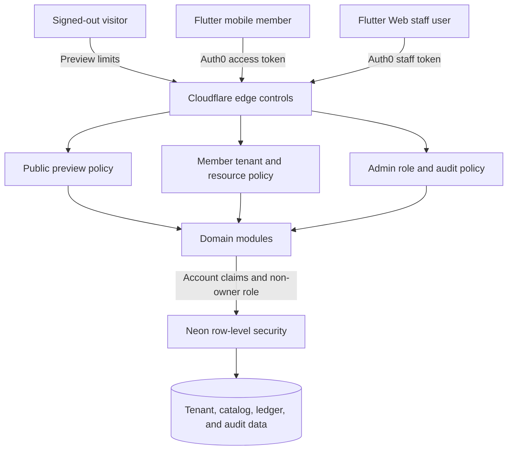
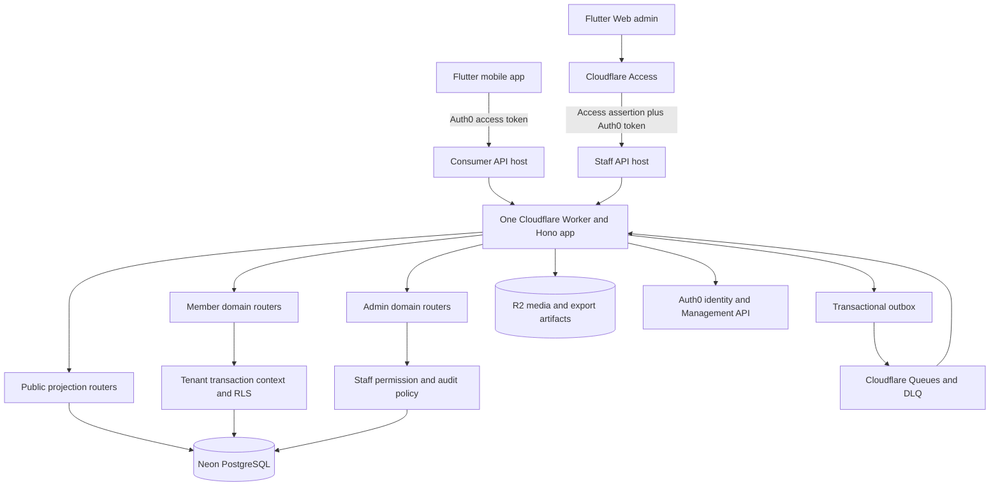
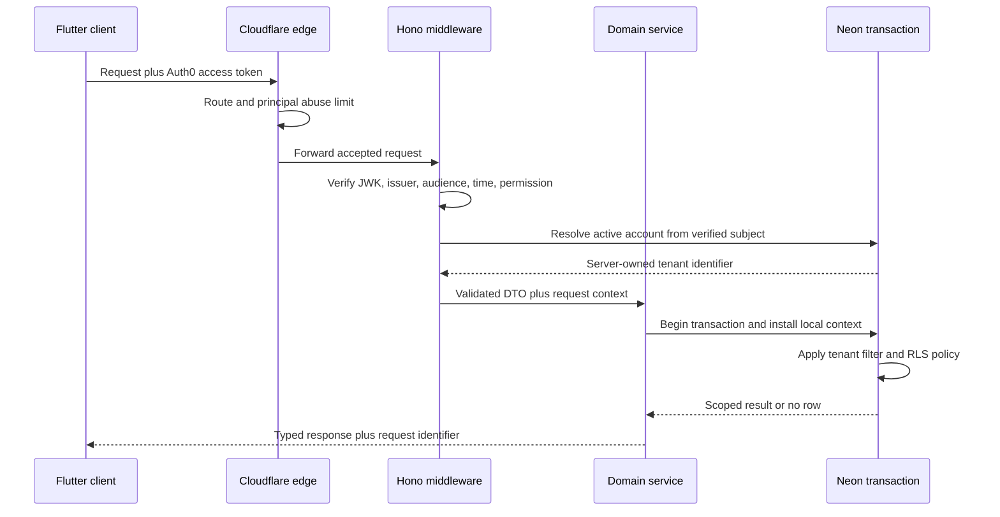
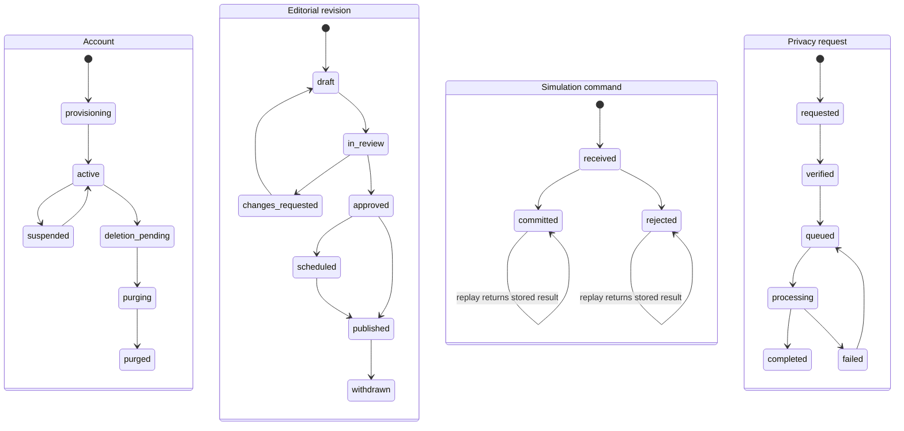

# Ritual Investing Backend Contract - Plan

## Goal Capsule

- **Objective:** Give the Ritual Investing mobile app and its operators a complete, secure, production-stable backend contract for every established product domain while preserving the product's simulated and non-advisory boundaries.
- **Means:** Build the contract-first modular monolith, generated Flutter client, and P1 administration surface defined by KTD1-KTD12.
- **Product authority:** Commit `8365b1ea53ab4e6983db4259fd360b93c66602c9`, `ritual-investing-app/PRODUCT.md`, `ritual-investing-app/DESIGN.md`, and `docs/plans/2026-08-20-1533-feat-standalone-ritual-investing-mobile-app-plan.md` define the product intent and existing demo flows.
- **Open blockers:** None. Planning must resolve the deferred policy parameters without expanding the financial or advisory scope.

---

## Product Contract

### Summary

Add a new contract-first backend and administration surface while refactoring Flutter around generated API repositories and read-only device caching.
The plan defines the canonical data model first, then the complete domain API and its security contract.

### Problem Frame

The authoritative Ritual commit is a standalone Flutter presentation scaffold.
It contains product language and representative screens but no backend, API, authentication, persistence, tenant model, or operator workflow.
The target product is much broader than the implemented shell: it includes personalized ritual experiences, curated research, community collections, simulated financial activity, goals and projections, recaps, premium-demo behavior, and staff-maintained content.
Without a single contract, client screens will invent incompatible state shapes and security behavior while privileged tooling grows outside the same policy boundary.

### Key Decisions

- **Use a contract-first modular monolith.** (session-settled: user-approved — chosen over a content-only backend and GraphQL-first platform: it keeps one source of truth without premature distributed-system or field-authorization complexity.) Governs R1-R3.
- **Keep tenant scope account-based in v1.** (session-settled: user-approved — chosen over organization tenancy: the current product is single-user while server-owned tenant identifiers preserve an upgrade path.) Governs R5, R8, R9.
- **Make personal and simulated product state server-authoritative.** (session-settled: user-approved — chosen over device-local state: cross-device consistency and operational support outweigh offline-only simplicity.) Governs R17-R19.
- **Use managed authentication and security middleware.** (session-settled: user-approved — chosen over bespoke authentication: critical infrastructure needs maintained production behavior.) Governs R4, R6, R9-R13.
- **Permit only a narrow signed-out preview.** (session-settled: user-approved — chosen over login-everywhere: discovery remains accessible while detailed evidence and user state stay protected.) Governs R7, R10, R12.
- **Ship operator capabilities in P1.** (session-settled: user-directed — chosen over deferring administration: the initial backend must be operable, reviewable, and auditable.) Governs R14-R16.

### Actors

- A1. **Visitor:** A signed-out person browsing the permitted public preview.
- A2. **Member:** An authenticated account owner using personalized, saved, community, and simulated-investing features.
- A3. **Content operator:** A staff member who drafts and maintains rituals, research collections, asset records, and seeded demo content.
- A4. **Reviewer:** A staff member who verifies Founders' Coven evidence, approves publishing, and handles moderation decisions.
- A5. **Administrator:** A least-privileged staff role that manages operational policy and staff access without access to consumer credentials.
- A6. **Flutter client:** The mobile or admin application acting for a visitor, member, or authorized staff principal.
- A7. **Backend platform:** Cloudflare, the application service, managed identity provider, and Neon database enforcing edge, application, and row-level controls.

### Requirements

**Contract and domain coverage**

- R1. The planning artifact must define the canonical relational data model before any endpoint contract, including ownership, relationships, lifecycle states, constraints, indexes, retention class, and authoritative versus derived fields.
- R2. The model and API must cover identity and accounts, preferences and onboarding, ritual scenarios and daily readings, evidence and market observations, assets and Asset Codex, Founders' Coven, Grimoires, Circles and community content, saved items, scripted Rowan counsel, simulated portfolios and ledger activity, simulated orders and recurring plans, Intentions and Future Mirror projections, recaps and briefings, demo entitlements, notifications, privacy operations, and administration.
- R3. The API contract must specify versioning, content types, identifiers, timestamps, money and quantity representation, pagination, filtering, ordering, concurrency, idempotency, stable error envelopes, and request/response examples so Flutter code generation does not require inventing behavior.

**Identity, tenancy, and authorization**

- R4. Authentication must use Auth0-managed OAuth/OIDC flows and maintained Flutter and Hono integration points; the application must not handle passwords, implement token cryptography, or create its own session protocol.
- R5. Every tenant-owned server record must carry an immutable, server-assigned account tenant identifier; clients must never select or override tenant ownership.
- R6. Authorization must default to deny and distinguish visitor, member, content operator, reviewer, and administrator capabilities at both route and resource levels.
- R7. Signed-out access is limited to a curated, tightly rate-limited preview of Daily Ritual, Discover, and Founders' Coven; detailed evidence, personalization, saved data, Circles, portfolios, and all mutations require authentication.
- R8. Every tenant-resource lookup and mutation must derive tenant scope from the verified principal and query by both tenant and resource identity, returning non-enumerating responses for inaccessible objects to prevent IDOR.
- R9. Database row-level security must provide a second tenant boundary using a non-owner, non-`BYPASSRLS` runtime role, while privileged admin access uses separately authorized and audited paths rather than disabling isolation globally.

**Security and operational resilience**

- R10. Each route must declare authentication, role policy, tenant/resource guard, rate-limit class, input schema, sanitation rules, idempotency expectations, audit behavior, and sensitive-field handling.
- R11. Boundary validation must reject unknown or overlong fields, malformed identifiers, unsafe search syntax, invalid state transitions, hostile rich text, untrusted URLs, and values outside domain limits before they reach persistence or downstream providers.
- R12. Abuse controls must combine edge limits, principal-aware application limits, bounded pagination, request-size caps, timeouts, safe retries, replay protection, optimistic concurrency, and append-only financial/audit records where history must not be rewritten.
- R13. Secrets, identity-provider credentials, database credentials, and privileged service tokens must remain server-side and be redacted from responses, logs, traces, exports, and operator screens.

**Administration and governance**

- R14. P1 must include a Flutter Web staff dashboard backed only by a separately namespaced `/v1/admin` contract with stricter authentication, authorization, rate limits, and audit requirements than consumer routes.
- R15. Staff tooling must support drafting, reviewing, scheduling, publishing, unpublishing, and versioning deterministic ritual scenarios, Asset Codex entries, Founders' Coven evidence, Grimoires, and seeded community/demo content.
- R16. Administrative actions that change public truth, verification, moderation, access, or policy must record actor, reason, before/after references, timestamp, and correlation identifier in an immutable audit trail.

**State, privacy, and product truth**

- R17. Profiles, preferences, saved content, Circles, simulated portfolios, activity, recurring plans, goals, projections, recaps, and entitlements are server-authoritative; precise birth time and birthplace may remain device-only and must not be required by the API.
- R18. Members must be able to export their server-owned data and request account deletion; access revocation is immediate, tenant data is purged under a bounded retention policy, and retained security/audit evidence is minimized and separated from product data.
- R19. Simulated balances, holdings, orders, contributions, recurring plans, and projections must remain deterministic demo records with consistent ledger-derived totals and explicit uncertainty or simulation labels.
- R20. The backend must not place real orders, hold assets, connect banks, accept deposits or withdrawals, collect payment credentials, provide investment advice, imply guaranteed outcomes, or conceal mystical framing as market fact.
- R21. Rowan responses in this scope must come from reviewed deterministic scripts or templates, preserve user agency, and never use urgency, exclusivity, affection, jealousy, sexual pressure, or financial coercion.
- R22. Demo premium and entitlement workflows may change simulated access state but must not charge a user or integrate a real payment processor.

The core trust boundary is one-way: verified identity establishes account scope, application policy narrows allowed resources, and database policy independently enforces row access.



### Key Flows

- F1. **Public discovery**
  - **Trigger:** A1 opens a supported preview without a session.
  - **Steps:** A7 applies edge limits, serves only published preview fields, and withholds personalized or evidence-detail resources.
  - **Outcome:** A1 can understand the product without gaining access to private state or an enumeration surface.
  - **Covered by:** R6, R7, R10, R12.
- F2. **Authenticated member request**
  - **Trigger:** A2 reads or mutates a protected resource through A6.
  - **Steps:** A7 validates the Auth0 token, derives the account tenant, applies route and resource policy, validates the request, and executes under row-level security.
  - **Outcome:** Only the caller's allowed resource is returned or changed, with retry-safe behavior where applicable.
  - **Covered by:** R4-R12.
- F3. **Simulated investing command**
  - **Trigger:** A2 submits a simulated order, contribution, rebalance, or recurring-plan action.
  - **Steps:** A7 validates intent and limits, deduplicates the command, checks the current version and demo constraints, appends activity, and recomputes projections from authoritative records.
  - **Outcome:** Portfolio totals and history remain internally consistent without moving money or creating brokerage activity.
  - **Covered by:** R3, R12, R19, R20.
- F4. **Editorial publication**
  - **Trigger:** A3 submits a draft and A4 approves a public or member-visible version.
  - **Steps:** A7 enforces separate staff roles, validates evidence and publishability, records immutable audit context, and atomically changes the visible version.
  - **Outcome:** Clients receive a traceable, reviewed content version without exposing draft or privileged fields.
  - **Covered by:** R6, R13-R16.
- F5. **Privacy request**
  - **Trigger:** A2 requests an export or account deletion.
  - **Steps:** A7 reauthenticates sensitive intent, prevents cross-account selection, produces a bounded export or revokes access, and applies the retention policy across tenant-owned domains.
  - **Outcome:** Personal product data is portable or removed while narrowly required security evidence remains isolated.
  - **Covered by:** R8, R13, R18.

### Acceptance Examples

- AE1. **Covers R7, R10.** Given a signed-out caller requests the public Daily Ritual preview, when the request is under the anonymous quota, then only the published preview projection is returned and no tenant identifier, detailed evidence, draft field, or saved-state indicator appears.
- AE2. **Covers R7, R12.** Given the same caller repeatedly requests a preview above its quota, when the limit is exceeded, then the API returns the documented throttling error and retry metadata without falling through to the database-heavy path.
- AE3. **Covers R5, R8, R9.** Given member A supplies a valid resource identifier belonging to member B, when either a read or mutation is attempted, then application and database policy prevent access and the response does not reveal whether the resource exists.
- AE4. **Covers R3, R12, R19.** Given a member retries the same simulated order with one idempotency key, when the first attempt committed but its response was lost, then exactly one ledger effect exists and the retry returns the original command result.
- AE5. **Covers R6, R14-R16.** Given a content operator can edit a Coven record but cannot verify it, when the operator attempts verification or publication, then authorization denies the transition and records the denied privileged attempt without changing public state.
- AE6. **Covers R11, R13.** Given a request contains extra ownership fields, markup with active content, an unapproved external URL, or an oversized search term, when validation runs, then the request is rejected or normalized according to the endpoint contract before persistence and no raw sensitive value is logged.
- AE7. **Covers R17, R18.** Given a member has data across profiles, Circles, portfolios, recaps, and entitlements, when deletion is confirmed, then sign-in access is revoked immediately and all tenant product records enter the documented purge lifecycle without leaving queryable orphan records.
- AE8. **Covers R20-R22.** Given a member completes any investing or premium flow, when state changes, then every resulting record remains labeled as simulated and no brokerage, bank, payment, or advisory integration is invoked.

### Success Criteria

- A cold implementation team can create database migrations and an OpenAPI contract without inventing a product domain, actor, ownership rule, public/private boundary, or failure behavior.
- Every endpoint in the planned contract maps to a named domain and declares the controls required by R10.
- Every tenant-owned table and query path has both application-level and database-level isolation coverage.
- The admin dashboard supports the complete draft-to-publication lifecycle for every curated domain in R15 at P1.
- Security verification includes anonymous abuse, broken-object authorization, privilege escalation, replay, malformed input, concurrency, secret leakage, and deletion-cascade cases.

### Scope Boundaries

**Deferred for later**

- Multi-user organizations, invitations, household accounts, and delegated member access.
- Production market-data ingestion or a governed connection to the AXIO7 research engine.
- Generative or conversational Rowan behavior.
- Push-delivery infrastructure beyond defining notification preferences and delivery records.
- Real billing after an independent legal, compliance, and payment-security plan.

**Outside this product's identity**

- Brokerage execution, custody, bank aggregation, deposits, withdrawals, payment credential storage, financial-adviser behavior, guaranteed outcomes, or supernatural claims presented as financial evidence.
- Consumer credential access or unscoped impersonation from the admin dashboard.

### Dependencies and Assumptions

- Cloudflare Workers is the monolithic service runtime and edge-security boundary.
- Neon PostgreSQL is the system of record and supports row-level tenant policy under a least-privileged runtime role.
- Auth0 is the identity authority; Hono middleware validates JWTs and composes request policy.
- Flutter serves the member clients and the P1 staff dashboard.
- Public ritual, discovery, and Coven content is deterministic, reviewed, versioned, and safe to cache only through explicit public projections.
- The current app's copy, visual references, and demo scenarios remain authorities where the broader product plan does not supersede them.

### Sources and Research

- `ritual-investing-app/PRODUCT.md`
- `ritual-investing-app/DESIGN.md`
- `ritual-investing-app/README.md`
- `docs/plans/2026-08-20-1533-feat-standalone-ritual-investing-mobile-app-plan.md`
- `docs/solutions/architecture-patterns/ritual-investing-app-current-intent-and-architecture.md`
- [Auth0 Flutter Quickstart](https://auth0.com/docs/quickstart/native/flutter)
- [Hono JWK Middleware](https://hono.dev/docs/middleware/builtin/jwk)
- [Cloudflare Workers Rate Limiting](https://developers.cloudflare.com/workers/runtime-apis/bindings/rate-limit/)
- [Neon Serverless Driver](https://neon.com/docs/serverless/serverless-driver)
- [PostgreSQL Row Security](https://www.postgresql.org/docs/17/ddl-rowsecurity.html)
- [OWASP Authorization Cheat Sheet](https://cheatsheetseries.owasp.org/cheatsheets/Authorization_Cheat_Sheet.html)
- [Cloudflare Queues Delivery Guarantees](https://developers.cloudflare.com/queues/reference/delivery-guarantees/)
- [Auth0 API RBAC](https://auth0.com/docs/manage-users/access-control/configure-core-rbac/enable-role-based-access-control-for-apis)
- [OpenAPI 3.1.1](https://spec.openapis.org/oas/v3.1.1.html)

---

## Planning Contract

### Product Contract Preservation

Product Contract restructured, no scope change: the planning-owned questions were resolved in KTD8, KTD10, and KTD12.
All R-, A-, F-, and AE-IDs retain their original meaning.

### Key Technical Decisions

- KTD1. **Use one modular Cloudflare Worker.** (session-settled: user-approved — chosen over a content-only backend and GraphQL-first platform: one Hono application can enforce a single contract while domain routers preserve extraction seams.) The module exports `fetch`, `scheduled`, and `queue` handlers and serves the compiled admin assets on the staff hostname. Governs R1-R3.
- KTD2. **Delegate identity to Auth0 and keep authorization local.** (session-settled: user-approved — chosen over bespoke authentication: Auth0 owns Universal Login, Authorization Code with PKCE, refresh, MFA, attack protection, and account credentials.) Native Flutter and Flutter Web use separate Auth0 applications against one API audience. Hono JWK middleware verifies RS256, issuer, audience, and time claims. Application middleware checks permissions, active account state, tenant ownership, and resource policy. Governs R4, R6, R9-R13.
- KTD3. **Resolve one server tenant from the verified Auth0 subject.** (session-settled: user-approved — chosen over organization tenancy: one immutable tenant per account matches v1 while preserving a future membership seam.) `accounts.auth0_subject` is unique. A narrowly granted identity-resolution function returns only active account and tenant context for the exact verified subject; the runtime role cannot scan the account table. Every protected database transaction then installs the resolved tenant and verified principal as transaction-local context before an RLS query. Governs R5, R8, R9.
- KTD4. **Make the API authoritative and the device cache read-only.** (session-settled: user-approved — chosen over device-local authority: mutations need one cross-device truth.) Flutter may cache immutable published content and the last committed tenant snapshot. It never queues an uncommitted mutation as successful. Retries reuse the original idempotency key. Existing local demo state is not silently merged. Governs R17-R19.
- KTD5. **Generate OpenAPI and Dart from the same Zod schemas.** `OpenAPIHono` and Zod 4 own path, query, header, body, and response schemas. The emitted OpenAPI 3.0.3 snapshot feeds a pinned OpenAPI Generator `dart-dio` client package. Generated files are never edited by hand. Governs R1-R3, R10, R11.
- KTD6. **Use stable Drizzle with Neon request-scoped transactions.** Pin the stable Drizzle 0.x line, Neon serverless driver 1.x, Hono 4.x, Zod 4.x, Wrangler 4.x, and the current Cloudflare Vitest plugin as one tested set. Use Neon HTTP for isolated reads or non-interactive batches. Use a request-local WebSocket connection for interactive transactions and close it before the Worker request ends. Use a direct owner connection only for reviewed migrations. Governs R9, R12, R13.
- KTD7. **Serve public previews through published projections.** (session-settled: user-approved — chosen over login-everywhere: visitors need discovery without access to evidence depth or personal state.) Public handlers query explicit views with allowlisted fields, never domain tables directly. Only an explicit route allowlist can enter shared cache; normalized public parameters and the published revision form the cache key. Authorization and cookie headers are excluded before lookup, and withdrawal changes the pointer and purges the affected revision key. Governs R7, R10, R12.
- KTD8. **Protect the P1 admin surface twice.** (session-settled: user-directed — chosen over deferring administration: operations must ship with the first backend.) Cloudflare Access protects the staff hostname. Every admin request verifies the Access assertion, allowlisted Auth0 admin client (`azp`), API permission, matching active `staff_principals` identity, and revocation epoch. Staff cannot query tenant product tables. A separately approved break-glass support design is deferred. Governs R13-R16.
- KTD9. **Use controlled idempotency and immutable ledgers for simulated money state.** One tenant, reset generation, operation, and idempotency key owns a request fingerprint and guarded `processing` to terminal state machine. Financial commands lock the current reset generation and portfolio version, atomically finalize the command and required cash/position postings, and advance derived projections by ledger watermark. The same key with different input conflicts; work from an old reset generation cannot affect or present as current state. Governs R12, R19, R20.
- KTD10. **Use one typed editorial workflow with high-trust separation of duties.** Stable editorial items own immutable typed revisions. Two-person review is mandatory for Coven verification, ritual evidence, Rowan scripts, and access or policy changes. Ordinary copy changes still require reviewer permission but do not require a different human unless they affect a high-trust field. Governs R14-R16, R21.
- KTD11. **Use a transactional outbox for asynchronous work.** Database changes and versioned outbox records commit together. Cloudflare Queues delivers recap, notification, export, purge, and scheduled-publication jobs at least once. A unique per-consumer receipt prevents duplicate effects; aggregate watermarks and reset generations reject stale delivery. Every topic has bounded concurrency, retry, and a dead-letter queue. R2 stores quarantined media and short-lived privacy exports. Governs R12, R15, R18.
- KTD12. **Adopt bounded privacy defaults.** Export artifacts expire after 7 days. Account deletion revokes product access immediately and purges tenant product data within 30 days. A minimal append-only deletion tombstone and purge receipt survive product-data purge so delayed jobs and restored backups cannot resurrect the tenant. Raw security telemetry expires after 30 days. Pseudonymized security aggregates are retained for 365 days. Editorial provenance and staff audit records are retained for 3 years without consumer payloads. Governs R13, R18.

### High-Level Technical Design

#### Component topology



#### Authenticated tenant request



#### Core lifecycles



### Canonical Data Model

The data model is the authority for the API contract below.
The Mermaid ER model is split into two views for legibility, but both views describe one Neon schema.

#### Modeling conventions

| Concern | Contract |
|---|---|
| Identifiers | Server-generated UUIDs for internal identity; unique lowercase slugs only for public navigation. Clients cannot submit primary keys or `tenant_id` values. |
| Time | PostgreSQL `timestamptz` stored in UTC. Local-day assignment uses the account's validated IANA timezone. API timestamps use RFC 3339. |
| Money | Signed `bigint` minor units plus ISO 4217 currency. No floating-point money. |
| Quantity and ratios | `numeric(30,12)` in PostgreSQL and JSON strings over the API. Allocation and percentage inputs use integer basis points. |
| Concurrency | Mutable aggregates carry `version integer`. PATCH, delete, and state transitions require `If-Match`. |
| Ownership | `G` is global catalog/editorial data. `T` is tenant-owned with forced RLS. `S` is staff/system restricted. `A` is append-only and rejects ordinary update/delete. |
| Tenant foreign keys | Every `T` table except the `tenants` root contains `tenant_id`; `tenants.id` is itself the immutable server-assigned account tenant identifier. Tenant children use composite foreign keys to `(tenant_id, parent_id)` so cross-tenant relationships cannot be stored. |
| Indexes | Every foreign key has a supporting index. Tenant access paths lead with `tenant_id`, then the route's stable sort/filter columns and UUID tie-breaker. Partial indexes cover current/active/open/due rows; unique indexes enforce singleton, idempotency, generation, schedule, and current-publication invariants. Unbounded text and JSON scans are forbidden on request paths. |
| Retention class | `T` defaults to tenant-product lifetime and deletion cascade; `G` editorial truth follows support lifetime; `S` operational records use the explicit retention table; `A` is immutable for ordinary roles but remains subject to its class's purge/retention policy. Per-table exceptions are stated below. |
| Editorial truth | Stable items point to immutable revisions. Only an approved revision can become the current published revision. Editing a published item creates a new draft. |
| Derived data | Positions, balance snapshots, projections, recaps, and search documents are rebuildable. Commands, ledger entries, user intent, and published revisions remain authoritative. |
| Sensitive astrology data | Birth date may be stored only after opt-in. Precise birth time and birthplace never enter this API. A client may send only an allowlisted derived chart profile code and algorithm version. |

#### ER diagram: identity, editorial content, discovery, and Circles

```mermaid
erDiagram
  TENANTS ||--|| ACCOUNTS : owns
  TENANTS ||--o| PROFILES : has
  TENANTS ||--o| PREFERENCES : has
  TENANTS ||--o| ASTROLOGY_PROFILES : opts_into
  TENANTS ||--o| INVESTOR_PROFILES : has
  TENANTS ||--o| ONBOARDING_STATES : advances
  TENANTS ||--o{ CONSENT_RECORDS : records
  TENANTS ||--o{ DAILY_RITUAL_ASSIGNMENTS : receives
  TENANTS ||--o{ CIRCLES : owns
  TENANTS ||--o{ SAVED_ASSETS : saves
  TENANTS ||--o{ SAVED_GRIMOIRES : saves
  TENANTS ||--o{ SAVED_CIRCLE_TEMPLATES : saves
  TENANTS ||--o{ SAVED_COVEN_ENTRIES : saves

  EDITORIAL_ITEMS ||--o{ EDITORIAL_REVISIONS : versions
  EDITORIAL_REVISIONS ||--o{ EDITORIAL_REVIEW_REQUESTS : submits
  EDITORIAL_REVISIONS ||--o{ EDITORIAL_REVIEW_DECISIONS : receives
  EDITORIAL_REVISIONS ||--o{ PUBLICATION_EVENTS : publishes
  MEDIA_ASSETS ||--o{ EDITORIAL_REVISIONS : illustrates

  EDITORIAL_ITEMS ||--o| RITUAL_SCENARIOS : types
  EDITORIAL_REVISIONS ||--o| RITUAL_SCENARIO_REVISIONS : details
  RITUAL_SCENARIO_REVISIONS ||--|{ RITUAL_SCENARIO_IDEAS : contains
  RITUAL_SCENARIO_REVISIONS ||--|{ RITUAL_SCENARIO_EVIDENCE : explains
  RITUAL_SCENARIO_REVISIONS ||--o{ RITUAL_SCHEDULES : schedules
  RITUAL_SCHEDULES ||--o{ DAILY_RITUAL_ASSIGNMENTS : freezes

  EDITORIAL_ITEMS ||--o| ROWAN_SCRIPTS : types
  EDITORIAL_REVISIONS ||--o| ROWAN_SCRIPT_REVISIONS : contains
  ROWAN_SCRIPTS ||--o{ ROWAN_CONTEXT_BINDINGS : binds

  ASSETS ||--o{ ASSET_METRIC_SNAPSHOTS : measures
  ASSETS ||--o| ASSET_CODEX_ENTRIES : documents
  ASSET_CODEX_ENTRIES ||--|| EDITORIAL_ITEMS : owns
  EDITORIAL_REVISIONS ||--o| ASSET_CODEX_REVISIONS : details
  ASSET_CODEX_REVISIONS ||--|{ ASSET_CODEX_RISKS : discloses
  ASSET_CODEX_REVISIONS ||--|{ ASSET_CODEX_EVIDENCE : cites
  ASSETS ||--o{ RITUAL_SCENARIO_IDEAS : appears_in

  EVIDENCE_SOURCES ||--o{ EVIDENCE_CLAIMS : supports
  EVIDENCE_CLAIMS ||--o{ RITUAL_SCENARIO_EVIDENCE : supports
  EVIDENCE_CLAIMS ||--o{ ASSET_CODEX_EVIDENCE : supports
  EVIDENCE_CLAIMS ||--o{ COVEN_VERIFICATION_EVIDENCE : supports

  COMPANIES ||--o| COVEN_ENTRIES : qualifies
  COVEN_ENTRIES ||--|| EDITORIAL_ITEMS : owns
  EDITORIAL_REVISIONS ||--o| COVEN_ENTRY_REVISIONS : describes
  COVEN_ENTRIES ||--|{ COVEN_QUALIFICATIONS : has
  COVEN_QUALIFICATIONS ||--o{ COVEN_VERIFICATIONS : verifies
  COVEN_VERIFICATIONS ||--|{ COVEN_VERIFICATION_EVIDENCE : cites

  GRIMOIRES ||--|| EDITORIAL_ITEMS : owns
  EDITORIAL_REVISIONS ||--o| GRIMOIRE_REVISIONS : details
  GRIMOIRE_REVISIONS ||--|{ GRIMOIRE_REVISION_ASSETS : contains
  ASSETS ||--o{ GRIMOIRE_REVISION_ASSETS : included_in

  SEEDED_CREATORS ||--o{ CIRCLE_TEMPLATES : authors
  CIRCLE_TEMPLATES ||--|| EDITORIAL_ITEMS : owns
  EDITORIAL_REVISIONS ||--o| CIRCLE_TEMPLATE_REVISIONS : details
  CIRCLE_TEMPLATE_REVISIONS ||--|{ CIRCLE_TEMPLATE_ASSETS : contains
  ASSETS ||--o{ CIRCLE_TEMPLATE_ASSETS : included_in
  CIRCLE_TEMPLATES ||--o{ CIRCLES : copied_to
  CIRCLES ||--|{ CIRCLE_ASSETS : contains
  ASSETS ||--o{ CIRCLE_ASSETS : included_in
```



#### ER diagram: simulated investing, goals, recaps, entitlements, and operations

```mermaid
erDiagram
  TENANTS ||--|| TENANT_DEMO_STATES : seeds
  DEMO_SEED_VERSIONS ||--o{ TENANT_DEMO_STATES : initializes
  TENANTS ||--o{ IDEMPOTENCY_RECORDS : scopes
  TENANTS ||--o{ DEMO_PORTFOLIOS : owns
  DEMO_PORTFOLIOS ||--o{ PORTFOLIO_TARGET_ALLOCATIONS : targets
  DEMO_PORTFOLIOS ||--o{ SIMULATION_COMMANDS : receives
  TENANT_DEMO_STATES ||--o{ SIMULATION_COMMANDS : fences
  IDEMPOTENCY_RECORDS ||--o| SIMULATION_COMMANDS : guards
  DEMO_PORTFOLIOS ||--o{ SIMULATED_ORDERS : places
  SIMULATED_ORDERS ||--o{ SIMULATED_ORDER_FILLS : fills
  SIMULATION_COMMANDS ||--o{ LEDGER_TRANSACTIONS : commits
  DEMO_PORTFOLIOS ||--o{ LEDGER_TRANSACTIONS : records
  LEDGER_TRANSACTIONS ||--o{ CASH_LEDGER_ENTRIES : posts
  LEDGER_TRANSACTIONS ||--o{ POSITION_LEDGER_ENTRIES : posts
  ASSETS ||--o{ POSITION_LEDGER_ENTRIES : denominates
  DEMO_PORTFOLIOS ||--o{ PORTFOLIO_POSITIONS : projects
  ASSETS ||--o{ PORTFOLIO_POSITIONS : identifies
  DEMO_PORTFOLIOS ||--o{ PORTFOLIO_BALANCE_SNAPSHOTS : snapshots
  DEMO_PORTFOLIOS ||--o{ RECURRING_PLANS : schedules
  RECURRING_PLANS ||--o{ RECURRING_PLAN_ALLOCATIONS : allocates
  RECURRING_PLANS ||--o{ RECURRING_PLAN_RUNS : executes
  DEMO_PORTFOLIOS ||--o{ REBALANCE_PREVIEWS : previews
  REBALANCE_PREVIEWS ||--o{ REBALANCE_PREVIEW_TRADES : proposes

  TENANTS ||--o{ DEMO_FUNDING_SOURCES : selects
  TENANTS ||--o{ INTENTIONS : owns
  INTENTIONS ||--o{ PROJECTION_RUNS : projects
  PROJECTION_RUNS ||--|{ PROJECTION_POINTS : contains
  TENANTS ||--o{ BRIEFINGS : receives
  BRIEFINGS ||--|{ BRIEFING_SECTIONS : contains

  DEMO_PLANS ||--o{ TENANT_ENTITLEMENTS : grants
  TENANTS ||--o{ TENANT_ENTITLEMENTS : holds
  TENANT_ENTITLEMENTS ||--o{ ENTITLEMENT_EVENTS : changes
  TENANTS ||--o{ DEMO_CHECKOUT_SESSIONS : starts
  DEMO_PLANS ||--o{ DEMO_CHECKOUT_SESSIONS : selects

  TENANTS ||--o{ DEVICE_INSTALLATIONS : registers
  TENANTS ||--o| NOTIFICATION_PREFERENCES : configures
  TENANTS ||--o{ NOTIFICATIONS : receives
  NOTIFICATIONS ||--o{ NOTIFICATION_DELIVERIES : attempts

  TENANTS ||--o{ PRIVACY_REQUESTS : requests
  PRIVACY_REQUESTS ||--o| PRIVACY_EXPORT_ARTIFACTS : produces
  TENANTS ||--o{ CONTENT_REPORTS : submits
  CONTENT_REPORTS ||--o| MODERATION_CASES : opens

  OUTBOX_EVENTS ||--o{ JOB_RUNS : dispatches
  OUTBOX_EVENTS ||--o{ CONSUMER_RECEIPTS : consumed_by
  DELETION_TOMBSTONES ||--o{ PURGE_RECEIPTS : proves
  STAFF_PRINCIPALS ||--o{ ADMIN_AUDIT_EVENTS : acts
```



#### Identity and tenant tables

| Table | Class | Key columns | Constraints and authority |
|---|---|---|---|
| `tenants` | T | `id`, `status`, `seed_version`, `deletion_scheduled_at` | Root tenant row. Status is `provisioning`, `active`, `suspended`, `deletion_pending`, `purging`, or `purged`. A purged tenant is never reactivated. |
| `accounts` | T | `id`, `tenant_id`, `auth0_subject`, `status`, `last_seen_at` | Unique `auth0_subject` and unique `tenant_id` establish v1 one-to-one tenancy. No password, refresh token, or payment identity is stored. |
| `profiles` | T | `tenant_id`, `display_name`, `avatar_media_id`, `locale` | Optional member-facing profile. Text limits and media ownership are validated. |
| `preferences` | T | `tenant_id`, `theme_mode`, `ritual_mode`, `timezone`, `locale`, `version` | Singleton. Timezone is a valid IANA name. Theme and ritual mode use constrained values. |
| `astrology_profiles` | T | `tenant_id`, `birth_date`, `derived_profile_code`, `algorithm_version`, `enabled_at` | Optional and separately deletable. It cannot contain precise birth time, birthplace, coordinates, or free-form location. |
| `investor_profiles` | T | `tenant_id`, `goal_type`, `time_horizon`, `risk_comfort`, `version` | Demo-personalization inputs only. Values are enums and never suitability or advisory records. |
| `onboarding_states` | T | `tenant_id`, `current_step`, `completed_steps`, `completed_at`, `version` | Singleton state machine. The API accepts only next valid transitions. |
| `consent_records` | T,A | `id`, `tenant_id`, `policy_code`, `policy_version`, `decision`, `recorded_at` | Append-only policy history. Unique on tenant, policy, version, and decision timestamp. |
| `device_installations` | T | `id`, `tenant_id`, `platform`, `push_token_ciphertext`, `status`, `last_seen_at` | Token is encrypted and redacted. One active token hash per installation. |
| `notification_preferences` | T | `tenant_id`, `daily_ritual`, `weekly_recap`, `moon_cycle`, `quiet_hours`, `version` | Singleton with validated local quiet-hour range. |

#### Editorial, evidence, and media tables

| Table | Class | Key columns | Constraints and authority |
|---|---|---|---|
| `staff_principals` | S | `id`, `auth0_subject`, `access_identity`, `allowed_client_id`, `status`, `revocation_epoch`, `display_label`, `last_verified_at` | Access and Auth0 identities must match this active row on every admin request. Role grants remain in Auth0; changing status or epoch invalidates an existing staff session. |
| `media_assets` | G,S | `id`, `r2_key`, `mime_type`, `byte_size`, `checksum`, `width`, `height`, `quarantine_status`, `scan_result`, `status` | Only JPEG, PNG, and WebP are accepted in v1. Upload intents are single-use and actor-bound. Quarantined, unscanned, or rejected objects cannot be referenced or served from the public media origin. |
| `editorial_items` | G | `id`, `kind`, `slug`, `current_published_revision_id`, `status` | Stable identity for ritual, Codex, Coven, Grimoire, Circle template, Rowan, and briefing-template content. Kind and slug are immutable. |
| `editorial_revisions` | G,A | `id`, `item_id`, `revision_number`, `state`, `author_staff_id`, `content_hash`, `created_at` | Immutable after submission. Unique item and revision number. The published pointer must reference an approved revision of the same item. |
| `editorial_review_requests` | S,A | `id`, `revision_id`, `requested_by`, `requested_at`, `high_trust` | One open request per revision. High-trust changes require a distinct reviewer. |
| `editorial_review_decisions` | S,A | `id`, `request_id`, `reviewer_id`, `decision`, `reason`, `decided_at` | Decisions are `approved`, `changes_requested`, or `rejected`. Self-approval is blocked where `high_trust=true`. |
| `publication_events` | S,A | `id`, `item_id`, `revision_id`, `action`, `effective_at`, `actor_id`, `reason` | Append-only publish, schedule, withdraw, and supersede history. |
| `assets` | G | `id`, `slug`, `symbol`, `name`, `asset_type`, `currency`, `exchange`, `is_demo`, `status` | Unique slug and normalized symbol/exchange pair. Only allowlisted asset types. |
| `asset_metric_snapshots` | G,A | `id`, `asset_id`, `observed_at`, `price_minor`, `change_bps`, `expense_ratio_bps`, `source_label`, `is_demo` | Immutable point-in-time facts. Currency is inherited from the asset. |
| `evidence_sources` | G | `id`, `canonical_url`, `title`, `publisher`, `published_at`, `retrieved_at`, `source_kind`, `status` | HTTPS URL only. The service never fetches an arbitrary user URL inline. |
| `evidence_claims` | G,A | `id`, `source_id`, `claim_type`, `summary`, `observed_at`, `uncertainty`, `status` | Immutable normalized claim. Changes create a replacement and supersede the prior claim. |

#### Ritual, Rowan, Asset Codex, and Coven tables

| Table | Class | Key columns | Constraints and authority |
|---|---|---|---|
| `ritual_scenarios` | G | `id`, `editorial_item_id`, `scenario_key`, `mode`, `cadence` | One typed row per ritual editorial item. Mode is `tarot` or `astrology`. |
| `ritual_scenario_revisions` | G,A | `revision_id`, `title`, `interpretation`, `guidance`, `market_label`, `art_media_id`, `observation_at`, `uncertainty` | Typed immutable payload. Published copy always retains observation and uncertainty fields. |
| `ritual_scenario_ideas` | G,A | `revision_id`, `asset_id`, `ordinal`, `appearance_reason`, `risk_summary` | Three to five rows per publishable revision. Ordinal is unique within revision. |
| `ritual_scenario_evidence` | G,A | `revision_id`, `claim_id`, `ordinal`, `factor_label` | At least one claim per publishable revision. |
| `ritual_schedules` | G | `id`, `local_date`, `mode`, `revision_id`, `audience`, `state`, `effective_at` | Unique date, mode, and audience. Public preview uses UTC date; member assignment uses account timezone. |
| `daily_ritual_assignments` | T | `id`, `tenant_id`, `local_date`, `mode`, `schedule_id`, `revision_id`, `rowan_revision_id`, `state`, `revealed_at`, `completed_at` | Unique tenant, local date, and mode. The content, evidence time, ideas, and Rowan revision freeze on creation. |
| `rowan_scripts` | G | `id`, `editorial_item_id`, `script_key`, `surface` | Stable deterministic counsel identity. No free-form prompt or model configuration. |
| `rowan_script_revisions` | G,A | `revision_id`, `body_template`, `allowed_tokens`, `risk_footer` | Only allowlisted interpolation tokens. Published scripts pass coercion-language review. |
| `rowan_context_bindings` | G | `id`, `surface`, `context_key`, `script_id`, `priority` | Deterministic resolution by surface and context key. |
| `asset_codex_entries` | G | `id`, `editorial_item_id`, `asset_id` | One Codex item per asset. |
| `asset_codex_revisions` | G,A | `revision_id`, `thesis`, `appearance_reason`, `metrics_as_of`, `limitations` | Typed immutable copy. It cannot contain executable financial instructions. |
| `asset_codex_risks` | G,A | `revision_id`, `ordinal`, `title`, `detail`, `severity` | At least one risk per publishable Codex revision. |
| `asset_codex_evidence` | G,A | `revision_id`, `claim_id`, `ordinal` | Published claims must be active and dated. |
| `companies` | G | `id`, `slug`, `name`, `asset_id`, `website_url`, `is_fictional`, `status` | Optional asset relationship. Website uses validated HTTPS and is never fetched inline. |
| `coven_entries` | G | `id`, `editorial_item_id`, `company_id` | One active entry per company. |
| `coven_entry_revisions` | G,A | `revision_id`, `summary`, `inclusion_rationale`, `limitations` | Editorial copy is separate from qualification truth. |
| `coven_qualifications` | G | `id`, `entry_id`, `category`, `person_name`, `valid_from`, `valid_to`, `current_verification_id` | Category is `founder`, `owner`, or `chief_executive`. |
| `coven_verifications` | G,S,A | `id`, `qualification_id`, `status`, `effective_as_of`, `verified_at`, `verified_by`, `supersedes_id` | A verified result requires a different reviewer from its submitter. Old results remain immutable. |
| `coven_verification_evidence` | G,A | `verification_id`, `claim_id`, `ordinal` | At least one dated evidence claim is required for verified status. |

#### Discovery, seeded community, and private Circle tables

| Table | Class | Key columns | Constraints and authority |
|---|---|---|---|
| `grimoires` | G | `id`, `editorial_item_id`, `theme_code` | Stable curated collection. |
| `grimoire_revisions` | G,A | `revision_id`, `title`, `description`, `curator_label`, `art_media_id` | Immutable typed revision. Curator labels cannot imply a real adviser. |
| `grimoire_revision_assets` | G,A | `revision_id`, `asset_id`, `ordinal`, `note` | Unique asset within revision. |
| `seeded_creators` | G | `id`, `slug`, `display_name`, `bio`, `avatar_media_id`, `is_fictional`, `status` | `is_fictional` is always true in v1. No authentication or follow graph exists. |
| `circle_templates` | G | `id`, `editorial_item_id`, `creator_id`, `theme_code` | Public seeded Circle identity. |
| `circle_template_revisions` | G,A | `revision_id`, `title`, `description`, `art_media_id` | Immutable typed revision. |
| `circle_template_assets` | G,A | `revision_id`, `asset_id`, `ordinal`, `weight_bps`, `note` | Weights total 10,000 basis points when provided. |
| `circles` | T | `id`, `tenant_id`, `title`, `description`, `source_template_id`, `source_revision_id`, `version`, `archived_at` | Private only. Copy freezes source revision and provenance. No public visibility field exists. |
| `circle_assets` | T | `id`, `tenant_id`, `circle_id`, `asset_id`, `ordinal`, `weight_bps`, `note` | Maximum 50 assets. Composite tenant foreign key prevents cross-tenant attachment. |
| `saved_assets` | T | `tenant_id`, `asset_id`, `source_kind`, `source_id`, `saved_at` | Unique tenant and asset. The target asset must be active or historically referenced. |
| `saved_grimoires` | T | `tenant_id`, `grimoire_id`, `revision_id`, `saved_at` | Unique tenant and Grimoire. Saved revision preserves context. |
| `saved_circle_templates` | T | `tenant_id`, `template_id`, `revision_id`, `saved_at` | Unique tenant and template. |
| `saved_coven_entries` | T | `tenant_id`, `entry_id`, `verification_id`, `saved_at` | Unique tenant and entry. |

#### Simulated portfolio and ledger tables

| Table | Class | Key columns | Constraints and authority |
|---|---|---|---|
| `demo_seed_versions` | G,A | `id`, `version`, `fixture_hash`, `published_at` | Immutable initial demo state. One current seed version. |
| `tenant_demo_states` | T | `tenant_id`, `seed_version_id`, `reset_generation`, `version`, `reset_at` | Singleton reset boundary. Reset increments generation and re-seeds in one transaction. |
| `demo_portfolios` | T | `id`, `tenant_id`, `name`, `currency`, `status`, `version` | At least one seeded default portfolio. No brokerage account identifier. |
| `portfolio_target_allocations` | T | `tenant_id`, `portfolio_id`, `asset_id`, `target_bps`, `version` | Active targets total 10,000 basis points. |
| `idempotency_records` | T | `id`, `tenant_id`, `reset_generation`, `operation`, `key`, `request_hash`, `state`, `claim_owner`, `lease_until`, `command_id`, `response_hash`, `terminal_response`, `expires_at` | Unique tenant, reset generation, operation, and key. Key and request hash are immutable; a guarded lease permits only `processing` to `completed` or `rejected`. Crash recovery derives a committed result from the linked command and never re-executes it. |
| `simulation_commands` | T,A | `id`, `tenant_id`, `reset_generation`, `portfolio_id`, `idempotency_id`, `command_type`, `status`, `rejection_code`, `committed_at` | Terminal result is `committed` or `rejected`. The generation must equal the locked `tenant_demo_states.reset_generation`. Replays never execute again. |
| `demo_funding_sources` | T | `id`, `tenant_id`, `fixture_key`, `display_label`, `fictional_last4`, `status` | Created only from server fixture keys. No routing, account, bank, tax, or identity fields. |
| `simulated_orders` | T,A | `id`, `tenant_id`, `portfolio_id`, `command_id`, `asset_id`, `side`, `order_type`, `requested_notional_minor`, `requested_quantity`, `status`, `quote_snapshot_id` | V1 supports deterministic fractional market demos only. Accepted orders have exactly one atomic fill or reject with no ledger effect. |
| `simulated_order_fills` | T,A | `id`, `tenant_id`, `order_id`, `quantity`, `price_minor`, `filled_at` | Exactly one immutable fill per accepted v1 order, enforced by unique order ID. Quantity and notional reconcile to the frozen quote under the documented rounding rule. |
| `ledger_transactions` | T,A | `id`, `tenant_id`, `reset_generation`, `portfolio_id`, `command_id`, `entry_type`, `effective_at`, `description_code` | Immutable authoritative event. One committed transaction per command; a reviewed commit function validates the transaction-type posting pattern, currency, asset, cash, and quantity invariants before terminalizing the command. |
| `cash_ledger_entries` | T,A | `id`, `tenant_id`, `transaction_id`, `currency`, `amount_minor` | Signed cash movement. Transaction-level constraints prevent unsupported currencies. |
| `position_ledger_entries` | T,A | `id`, `tenant_id`, `transaction_id`, `asset_id`, `quantity`, `unit_price_minor` | Signed position movement. No direct holding mutation exists. |
| `portfolio_positions` | T | `tenant_id`, `portfolio_id`, `asset_id`, `quantity`, `cost_basis_minor`, `as_of_transaction_id` | Rebuildable projection. Unique portfolio and asset. |
| `portfolio_balance_snapshots` | T,A | `id`, `tenant_id`, `portfolio_id`, `as_of_transaction_id`, `projection_generation`, `as_of`, `cash_minor`, `market_value_minor`, `source_hash` | Derived snapshot used by recaps and projections. A current pointer advances only to a newer ledger watermark. |
| `recurring_plans` | T | `id`, `tenant_id`, `portfolio_id`, `plan_type`, `amount_minor`, `frequency`, `next_run_at`, `status`, `version` | State is `active`, `paused`, `cancelled`, or `completed`. Frequency uses a constrained weekly or monthly rule. |
| `recurring_plan_allocations` | T | `tenant_id`, `plan_id`, `asset_id`, `weight_bps` | Active weights total 10,000 basis points. |
| `recurring_plan_runs` | T,A | `id`, `tenant_id`, `reset_generation`, `plan_id`, `scheduled_for`, `command_id`, `status`, `attempted_at` | Unique plan, reset generation, and scheduled time prevents duplicate queue delivery effects. Old-generation work is rejected. |
| `rebalance_previews` | T | `id`, `tenant_id`, `reset_generation`, `portfolio_id`, `input_version`, `expires_at`, `status` | Expires after 15 minutes and becomes invalid after portfolio version or Demo reset generation changes. |
| `rebalance_preview_trades` | T | `id`, `tenant_id`, `preview_id`, `asset_id`, `side`, `quantity`, `notional_minor` | Immutable while preview is active. Execution creates one simulation command. |

#### Goals, recaps, entitlements, notifications, privacy, and operations

| Table | Class | Key columns | Constraints and authority |
|---|---|---|---|
| `intentions` | T | `id`, `tenant_id`, `title`, `target_minor`, `target_date`, `status`, `version` | Goal currency matches the linked portfolio or account default. |
| `projection_runs` | T,A | `id`, `tenant_id`, `intention_id`, `as_of_transaction_id`, `projection_generation`, `input_hash`, `model_version`, `generated_at`, `status` | Immutable derived run with named assumptions and uncertainty bands. A delayed run cannot replace a newer current watermark. |
| `projection_points` | T,A | `tenant_id`, `run_id`, `point_date`, `low_minor`, `mid_minor`, `high_minor` | Ordered points. Low cannot exceed mid; mid cannot exceed high. |
| `briefings` | T | `id`, `tenant_id`, `briefing_type`, `period_start`, `period_end`, `generation`, `supersedes_id`, `source_watermark`, `source_hash`, `generated_at`, `read_at`, `is_current` | Immutable generations. Same source hash reuses one generation; a partial unique index permits one current tenant/type/period row, switched only after all sections and the related outbox event commit. |
| `briefing_sections` | T,A | `id`, `tenant_id`, `briefing_id`, `section_type`, `ordinal`, `payload` | Structured snapshot with schema version. No arbitrary HTML. |
| `demo_plans` | G | `id`, `code`, `display_name`, `price_copy`, `feature_codes`, `status` | Copy-only pricing. It has no processor or price identifier. |
| `tenant_entitlements` | T | `id`, `tenant_id`, `plan_id`, `status`, `starts_at`, `ends_at`, `version` | Source is always `demo`. One active entitlement per tenant. |
| `entitlement_events` | T,A | `id`, `tenant_id`, `entitlement_id`, `event_type`, `occurred_at`, `command_id` | Immutable grant, restore, downgrade, and expiry events. |
| `demo_checkout_sessions` | T | `id`, `tenant_id`, `plan_id`, `status`, `expires_at`, `idempotency_id` | Contains no card, billing, tax, or real identity field. |
| `notifications` | T | `id`, `tenant_id`, `kind`, `title`, `body`, `deep_link`, `scheduled_at`, `read_at` | Deep links are allowlisted app routes. Content is plain text. |
| `notification_deliveries` | T,A | `id`, `tenant_id`, `notification_id`, `installation_id`, `status`, `attempt`, `provider_code`, `sent_at` | Provider response bodies and tokens are never stored. |
| `privacy_requests` | T | `id`, `tenant_id`, `request_type`, `status`, `snapshot_at`, `source_watermark`, `archive_schema_version`, `verified_at`, `queued_at`, `completed_at`, `failure_code` | One active request per type. Export reads one repeatable snapshot. Verified deletion takes precedence, revokes delivery, and moves tenant state before enqueue. |
| `privacy_export_artifacts` | T | `id`, `tenant_id`, `request_id`, `r2_key`, `manifest_checksum`, `publication_state`, `expires_at`, `downloaded_at` | Encrypted object published only after the complete manifest commits. Signed download URL is short-lived and single-purpose; deletion revokes it and removes the object retry-safely. |
| `content_reports` | T | `id`, `tenant_id`, `target_kind`, `target_id`, `reason_code`, `detail`, `created_at` | Targets global published content only. Reporter identity is hidden from editors. |
| `moderation_cases` | S | `id`, `report_id`, `status`, `assignee_id`, `resolution_code`, `resolved_at` | Covers factual/content reports only. No member-generated public content exists. |
| `admin_audit_events` | S,A | `id`, `actor_staff_id`, `action`, `target_kind`, `target_id`, `before_hash`, `after_hash`, `reason`, `request_id`, `outcome`, `created_at` | No token, birth data, profile, portfolio, Circle, or export payload. |
| `security_events` | S,A | `id`, `principal_hash`, `route_class`, `event_type`, `outcome`, `ip_prefix_hash`, `created_at` | Pseudonymous telemetry with 30-day raw retention. |
| `outbox_events` | S,A | `id`, `topic`, `aggregate_kind`, `aggregate_id`, `aggregate_version`, `tenant_id`, `reset_generation`, `dedupe_key`, `payload`, `available_at`, `published_at` | Unique topic and dedupe key. Payload is schema-versioned and minimal. Tenant events carry the source generation/version so consumers reject stale work. |
| `job_runs` | S,A | `id`, `outbox_id`, `consumer`, `status`, `attempt`, `lease_until`, `next_attempt_at`, `correlation_id`, `failure_code` | Attempt history for at-least-once delivery, bounded retries, DLQ, and manual retry audit. |
| `consumer_receipts` | S,A | `id`, `outbox_id`, `consumer`, `aggregate_version`, `outcome_hash`, `completed_at` | Unique event and consumer. The receipt and consumer effect commit together; distinct consumers receive independently. |
| `deletion_tombstones` | S,A | `id`, `tenant_id`, `subject_hash`, `effective_at`, `purge_generation`, `status` | Minimal durable denial record outside tenant-product cascades. It blocks subject reprovisioning, writes, delayed jobs, and restore traffic without retaining profile data. |
| `purge_receipts` | S,A | `id`, `tombstone_id`, `purge_generation`, `started_at`, `completed_at`, `outcome_hash`, `failure_code` | One stable receipt per tombstone generation. Only the verified purge function may bypass product append-only guards after tenant state is `purging`. |

#### RLS and database-role matrix

| Surface | Database role and context | Allowed data | Required defense |
|---|---|---|---|
| Public preview | `ritual_public` with SELECT on published views only | Explicit preview columns from current published revisions | No tenant context; no base-table grants; cache key includes revision and representation variants. |
| Account resolution | `ritual_identity_resolver` with EXECUTE on one reviewed function | Active account ID, tenant ID, status, and revocation state for the exact verified Auth0 subject | No table SELECT; fixed search path; exact subject parameter; one-row result; denial and duplicate-subject tests. |
| Authenticated member | `ritual_runtime` without ownership or `BYPASSRLS` | `T` rows matching transaction-local tenant plus approved `G` rows | Application query includes tenant and resource ID. RLS uses `USING` and `WITH CHECK`. Missing context is default-deny. |
| Admin editorial | `ritual_staff` without `BYPASSRLS` | `G` and `S` editorial rows allowed by permission | Cloudflare Access, Auth0 permission, active staff row, state transition policy, and audit event. No grants on tenant product tables. |
| Scheduled processing | Narrow function-execution role | Due work identifiers returned by reviewed database functions | Function validates job lease and resolves one tenant before tenant work. No arbitrary cross-tenant SELECT. |
| Privacy purge | Narrow `privacy_purge` function role | One tenant named by a verified deletion tombstone | Function verifies `purging` state and generation, revokes tenant access, cancels asynchronous work, removes R2 artifacts, bypasses append-only guards only for that tenant, cascades product rows, pseudonymizes retained events, and records one purge receipt. |
| Migration | Direct owner credential outside request runtime | Schema and migrations | CI or operator only. Never bound to the Worker or Flutter apps. |

Tenant tables use forced RLS.
Owners and migrations are not used to prove RLS behavior in tests.
RLS integration tests connect as the same restricted roles used in production.

#### Retention and deletion

| Data class | Retention | Deletion behavior |
|---|---|---|
| Tenant product state | Active account lifetime | Cascade purge within 30 days of verified deletion. Simulated ledgers have no financial-record retention exception. |
| Privacy export | 7 days from completion | Delete R2 object and artifact row after expiry or first confirmed download when policy requires. |
| Raw operational and security logs | 30 days | Remove principal and IP-derived fields on expiry. |
| Pseudonymous security aggregates | 365 days | Retain only non-reversible principal and prefix hashes. |
| Editorial revisions and publication history | While content remains supported | Retain immutable public-truth history. Remove retired media when no retained revision references it. |
| Staff audit events | 3 years | Pseudonymize deactivated staff labels where required. Never retain consumer payloads. |
| Deletion tombstones and purge receipts | Account deletion plus backup-retention horizon, then policy review | Retain only tenant UUID, non-reversible subject hash, effective time, generation, and outcome proof. Never retain product payload. Replay before restored data can receive traffic. |
| Neon backups and point-in-time restore | Configured maximum of 30 days | Document that deleted rows may age out through backup retention and are not restored into production without replaying deletion tombstones. |

### API Contract

The API prefix is `/v1`.
Auth0 endpoints are not proxied through this API.
Flutter uses Auth0 Universal Login and sends an access token for the Ritual API audience.

#### Global wire contract

| Concern | Contract |
|---|---|
| Media types | JSON requests use `application/json`. Responses use `application/json`. Export downloads use `application/zip`. Media uploads use short-lived R2 signed requests. |
| Success envelope | Object responses use `{ "data": T, "meta": { "request_id": string } }`. Collection responses add `next_cursor` and `has_more`. Empty success uses `204`. |
| Error envelope | Errors use `{ "error": { "code": string, "message": string, "request_id": string, "field_errors": [], "retryable": boolean, "retry_after_seconds": integer? } }`. Messages are safe for members and never contain SQL, tokens, stack traces, or provider bodies. |
| Identifiers | Path object IDs are UUID strings. Public navigation may use lowercase slugs. Unknown, malformed, foreign-tenant, and inaccessible IDs do not disclose existence. |
| Pagination | Opaque signed cursor with a stable sort key and UUID tie-breaker. Default page size is 20. Maximum is 50. No unbounded collection response exists. |
| Filtering and sorting | Every endpoint defines an enum allowlist. Raw column names, SQL fragments, regex, and arbitrary field selection are rejected. |
| Optimistic concurrency | Mutable resources return `ETag: "v<N>"`. PATCH operations, state transitions, and versioned aggregate deletes require `If-Match`. Route-declared idempotent membership/save/device removals are exempt. Stale versions return `version_conflict`. |
| Idempotency | Named command endpoints require `Idempotency-Key`, 16-64 visible ASCII characters. The key is scoped to tenant and operation and retained for 24 hours, except simulation and privacy records that persist with the command. |
| Retry behavior | GET, HEAD, PUT saves, and DELETE are retry-safe. A POST is retry-safe only when its row requires an idempotency key. Flutter retries network failures with the same key. |
| Request limits | Consumer JSON is limited to 64 KiB. Admin JSON is limited to 256 KiB. Requests with unsupported content encoding or content type are rejected before body parsing. |
| Cache behavior | Only `PUBLIC` read projections may use shared caching. Authenticated and admin responses use `Cache-Control: private, no-store`. Errors with user or staff context are never cached. |
| Browser boundary | CORS uses exact mobile-web/admin origins, methods, and headers; wildcard origins are forbidden. The API authorizes only bearer access tokens, never Auth0 or Access cookies alone, so a cross-site request cannot gain API authority from ambient cookies. Admin CSP, frame, referrer, and permissions policies are deny-by-default. |
| Demo truth | Research and simulation DTOs include `demo.is_demo=true`, `observed_at`, `source_label`, and `limitations` where relevant. No client can suppress the Demo marker. |

#### Authentication and permissions

| Policy | Required principal | Required Auth0 permission | Additional checks |
|---|---|---|---|
| `PUBLIC` | None | None | Published projection only. No optional token behavior. |
| `MEMBER-R` | Active member access token | `read:self` | Resolve account and tenant from `sub`; deny suspended, deleting, and purged accounts. |
| `MEMBER-W` | Active member access token | `write:self` | `MEMBER-R` checks plus mutation schema and concurrency guard. |
| `SIMULATE` | Active member access token | `simulate:self` | `MEMBER-W` checks plus idempotency, portfolio lock, and Demo-only invariant. |
| `PRIVACY` | Active member access token | `privacy:self` | Recent authentication within 5 minutes and one active request per type. |
| `EDITOR` | Staff token through Cloudflare Access | `admin:content:write` | Verified Access assertion, allowlisted admin `azp`, matching active staff row/revocation epoch, and no tenant-table grants. |
| `REVIEWER` | Staff token through Cloudflare Access | `admin:content:review` or narrower verification permission | Reviewer separation for high-trust changes. |
| `PUBLISHER` | Staff token through Cloudflare Access | `admin:content:publish` | Approved revision, state transition, reason, idempotency, and audit. |
| `MODERATOR` | Staff token through Cloudflare Access | `admin:moderation:write` | Content reports only. No member-content browsing. |
| `PRIVACY-OPS` | Staff token through Cloudflare Access | `admin:privacy:read` or `admin:privacy:retry` | Operational metadata only. Export payload and member tables remain inaccessible. |
| `OPS` | Staff token through Cloudflare Access | `admin:operations:read` or `admin:operations:retry` | Job and health metadata only. Every retry is audited. |
| `AUDITOR` | Staff token through Cloudflare Access | `admin:audit:read` | Bounded date range. No consumer payload. |

Auth0 API RBAC adds the `permissions` claim to access tokens.
The API never authorizes with an ID token.
Admin routes reject consumer-client tokens even when the human also has a staff identity; the access assertion, Auth0 subject, authorized-party client, and internal staff row must agree.
Rules and Hooks are not used because Auth0 retires them in 2026; use Auth0 Actions only if a future token customization is required.

#### Rate-limit classes

Every externally reachable path has a rate-limit class.
Cloudflare bindings enforce abuse limits, not billing, entitlements, idempotency, or exact quotas.
The Worker checks both the route key and the best available actor key.

| Class | Edge limit | Key | Use |
|---|---|---|---|
| `RL-HEALTH` | 60 requests per 60 seconds | IP prefix and route | Liveness and OpenAPI. Liveness does not query Neon. |
| `RL-PUBLIC` | 30 requests per 60 seconds | IP prefix and route | Cached Daily Ritual, Discover, and Coven previews. |
| `RL-SEARCH` | 15 requests per 60 seconds | IP or subject and normalized route | Search, compare, and other query-amplifying reads. |
| `RL-MEMBER-R` | 120 requests per 60 seconds | Auth0 subject and route; 180 per IP prefix | Normal authenticated reads. |
| `RL-MEMBER-W` | 30 requests per 60 seconds | Subject and route; 60 per tenant | Normal member writes. |
| `RL-COMMAND` | 10 requests per 60 seconds | Tenant and operation | Orders, contributions, rebalances, recurring-plan transitions, reset, and demo checkout. |
| `RL-SENSITIVE` | 5 requests per 60 seconds | Subject, IP prefix, and operation | Export, deletion, upload completion, and other sensitive actions. Database uniqueness supplies the longer business gate. |
| `RL-ADMIN-R` | 60 requests per 60 seconds | Staff subject and route | Staff reads and previews. |
| `RL-ADMIN-W` | 20 requests per 60 seconds | Staff subject and route | Staff drafts, edits, reports, and schedule mutations. |
| `RL-ADMIN-HIGH` | 5 requests per 60 seconds | Staff subject and operation | Publish, withdraw, verify, retry, and privacy operations. |
| `RL-UPLOAD` | 5 requests per 60 seconds | Staff subject | R2 upload requests and completion. |

Rate-limit responses use `429`, `Retry-After`, and the stable `rate_limited` code.
Security-critical routes fail closed when the binding or policy check errors.
Normal cached public reads may fail with `service_unavailable` rather than bypassing the control.

#### Input-sanitation profiles

Every request uses strict Zod objects and rejects unknown fields.
Parameterization through Drizzle is mandatory; no input chooses a raw SQL identifier.

| Profile | Rules |
|---|---|
| `S-BASE` | Validate content type, body size, UUIDs, enum values, RFC 3339 timestamps, and unknown fields. Normalize text to Unicode NFC and remove control characters except allowed whitespace. |
| `S-PAGE` | `S-BASE` plus signed cursor, page size 1-50, allowlisted sort and filter values, and date range no longer than 366 days. |
| `S-SEARCH` | `S-PAGE` plus trimmed query length 2-100, no regex, no SQL operators, and bounded token count. Search uses parameterized PostgreSQL full-text/trigram functions. |
| `S-TEXT` | `S-BASE` plus titles 1-120, labels 1-80, notes 0-2,000, and descriptions 0-10,000 characters. Plain text only. |
| `S-RICH` | `S-TEXT` plus Markdown subset with raw HTML, scripts, iframes, data URLs, event handlers, and embedded forms disabled. Admin preview and Flutter render the same allowlist. |
| `S-URL` | HTTPS only, maximum 2,048 characters, normalized host, no embedded credentials, no localhost/private/link-local IP literal, and no inline server fetch. |
| `S-MONEY` | ISO currency enum, integer minor units within Demo caps, decimal quantity string with maximum 12 fractional digits, and basis points 0-10,000. Reject NaN, infinity, exponent notation, and negative values unless the command permits them. |
| `S-STATE` | `S-BASE` plus `If-Match`, allowed current state, allowed next state, actor permission, and non-empty reason for privileged transitions. |
| `S-FIXTURE` | Server-published fixture key enum only. Reject bank, brokerage, tax, routing, account, card, and payment-like fields by schema. |
| `S-UPLOAD` | Single-use actor-bound upload intent; allowlisted MIME, extension, magic-byte agreement, maximum 10 MiB, decoded-pixel/dimension limits, checksum, quarantine ownership, and managed malware/image safety result. SVG, HTML, polyglots, decompression bombs, and active content are excluded in v1. Only an approved derivative can move to the public media origin. |

#### Tenant, IDOR, and audit profiles

| Profile | Rule |
|---|---|
| `G-PUBLISHED` | Query an explicit current-published view. Draft, withdrawn, review, evidence-source internals, and staff fields are absent from its response schema. |
| `G-MEMBER` | Target is global, but it must be active or an immutable version already referenced by the caller. |
| `T-COLLECTION` | Tenant comes only from the verified subject. Query includes tenant predicate and runs under RLS. |
| `T-OBJECT` | Resolve by tenant, resource ID, and parent ID where present in one scoped query under RLS. Post-fetch ownership checks are forbidden. Missing and foreign resources return the same `not_found` response. Child writes use composite tenant foreign keys. |
| `T-MIXED` | Tenant-owned wrapper references an allowlisted active global object. Validate both the owned wrapper and the global target. |
| `A-GLOBAL` | Staff permission, active staff row, allowed state transition, and immutable audit event. No tenant product query is possible through this role. |
| `A-HIGH` | `A-GLOBAL` plus Cloudflare Access, high-trust reviewer separation, reason, idempotency key, and stricter limit. |
| `AUDIT-MEMBER` | Record only command code, object ID, request ID, result, and pseudonymous principal. Never record request bodies or birth/profile data. |
| `AUDIT-ADMIN` | Record actor, action, target, before/after hashes, reason, request ID, and outcome. Denied privileged attempts are also recorded. |

#### Core DTO components

| Component | Required fields |
|---|---|
| `DemoDisclosure` | `is_demo=true`, `observed_at`, `source_label`, `limitations[]`. |
| `Money` | `minor_units` as JSON integer, `currency` as ISO code. |
| `Quantity` | `value` as canonical decimal string, `scale`. |
| `EvidenceSummary` | `claim_id`, `factor_label`, `summary`, `observed_at`, `uncertainty`; source URL appears only in authenticated detail. |
| `SessionBootstrap` | `account`, `profile`, `preferences`, `onboarding`, `entitlement`, `default_portfolio`, `server_time`, `contract_version`. It never returns `tenant_id` as a writable field. |
| `DailyRitualPreview` | `date`, `mode`, `title`, `art`, `interpretation_excerpt`, `market_label`, `idea_teasers`, `demo`. No detailed factors or source URLs. |
| `DailyRitualDetail` | Frozen `assignment_id`, `date`, `mode`, `revision`, full interpretation, ideas, evidence summaries, Rowan counsel, reveal/completion state, `demo`. |
| `AssetCodexDetail` | Asset identity, thesis, appearance reason, evidence, risks, simple metrics, saved state, revision, `demo`. |
| `CovenEntryDetail` | Company, distinct qualifications, verified-as-of date, evidence, limitations, saved state, revision, `demo`. |
| `CircleView` | `id`, title, description, assets, private flag, source template and revision, version, timestamps. |
| `PortfolioView` | `id`, name, currency, cash, positions, target allocation, latest valuation, version, `demo`. |
| `SimulationResult` | `command_id`, terminal status, affected portfolio version, ledger transaction IDs, order or contribution summary, updated projection links, `demo`. |
| `FutureMirrorView` | Intention, named assumptions, low/mid/high series, generated time, model version, uncertainty copy, `demo`. |
| `BriefingView` | Type, period, immutable sections, source as-of values, read state, Rowan counsel, `demo`. |
| `EditorialRevisionView` | Item identity, typed payload, revision number, workflow state, content hash, author label, review state, publication state, version/ETag. |

### API Domain: Platform, Session, and Account

| Method and path | Input to output | Auth / limit | Security contract |
|---|---|---|---|
| `GET /v1/health/live` | No input to liveness and build revision | `PUBLIC` / `RL-HEALTH` | `S-BASE`; no database or provider call. |
| `GET /v1/openapi.json` | No input to OpenAPI 3.0.3 document | `PUBLIC` / `RL-HEALTH` | `S-BASE`; revision ETag; no secrets or environment values. |
| `POST /v1/session/bootstrap` | No body to `SessionBootstrap` | `MEMBER-W` / `RL-SENSITIVE` | `S-BASE`; subject-unique provisioning transaction; `T-COLLECTION`; first call creates tenant, account, defaults, and demo seed atomically. Suspended or deleting subjects are denied. |
| `GET /v1/me` | No input to account and profile summary | `MEMBER-R` / `RL-MEMBER-R` | `S-BASE`; `T-COLLECTION`; `Cache-Control: no-store`. |
| `PATCH /v1/me/profile` | Display profile patch to profile | `MEMBER-W` / `RL-MEMBER-W` | `S-TEXT`; `T-COLLECTION`; `If-Match`; forbid role, subject, tenant, status, and entitlement fields. |
| `PATCH /v1/me/preferences` | Theme, ritual mode, timezone, locale patch to preferences | `MEMBER-W` / `RL-MEMBER-W` | `S-STATE`; `T-COLLECTION`; IANA timezone allowlist; `If-Match`. |
| `GET /v1/me/onboarding` | No input to onboarding state | `MEMBER-R` / `RL-MEMBER-R` | `S-BASE`; `T-COLLECTION`. |
| `PATCH /v1/me/onboarding` | Next step and completed values to onboarding state | `MEMBER-W` / `RL-MEMBER-W` | `S-STATE`; `T-COLLECTION`; next-transition validation; `If-Match`. |
| `GET /v1/me/astrology-profile` | No input to optional astrology profile | `MEMBER-R` / `RL-MEMBER-R` | `S-BASE`; `T-COLLECTION`; response excludes precise time/place by construction. |
| `PUT /v1/me/astrology-profile` | Birth date, derived code, algorithm version to profile | `MEMBER-W` / `RL-MEMBER-W` | `S-STATE`; `T-COLLECTION`; reject location/time and unknown derived codes; `If-Match` when replacing. |
| `DELETE /v1/me/astrology-profile` | `If-Match` to `204` | `MEMBER-W` / `RL-MEMBER-W` | `S-STATE`; `T-COLLECTION`; idempotent delete. |
| `GET /v1/me/investor-profile` | No input to Demo investor profile | `MEMBER-R` / `RL-MEMBER-R` | `S-BASE`; `T-COLLECTION`; Demo disclosure. |
| `PUT /v1/me/investor-profile` | Goal, horizon, risk-comfort enums to profile | `MEMBER-W` / `RL-MEMBER-W` | `S-STATE`; `T-COLLECTION`; no free-form financial identity; `If-Match`. |
| `POST /v1/me/consents` | Policy code, version, decision to receipt | `MEMBER-W` / `RL-MEMBER-W` | `S-BASE`; `T-COLLECTION`; idempotent by policy/version/decision; `AUDIT-MEMBER`. |
| `POST /v1/me/demo-reset` | Confirmation and seed version to new bootstrap snapshot | `SIMULATE` / `RL-COMMAND` | `S-STATE`; `T-COLLECTION`; `Idempotency-Key`; atomic purge/reseed; preserve account and consent; `AUDIT-MEMBER`. |

### API Domain: Public Preview

| Method and path | Input to output | Auth / limit | Security contract |
|---|---|---|---|
| `GET /v1/public/rituals/daily` | Optional `date`, `mode` to `DailyRitualPreview` | `PUBLIC` / `RL-PUBLIC` | `S-PAGE`; `G-PUBLISHED`; date limited to current and prior 7 days; revision ETag; no detailed evidence. |
| `GET /v1/public/discover` | Optional cursor to featured Grimoire, Circle-template, asset, and Coven teasers | `PUBLIC` / `RL-PUBLIC` | `S-PAGE`; `G-PUBLISHED`; maximum 20 items; no personalization or saved indicators. |
| `GET /v1/public/coven` | Category and cursor to Coven teasers | `PUBLIC` / `RL-PUBLIC` | `S-PAGE`; `G-PUBLISHED`; only company, category, verified-as-of, teaser, and Demo fields. |
| `GET /v1/public/coven/{slug}` | Lowercase slug to Coven teaser detail | `PUBLIC` / `RL-PUBLIC` | `S-PAGE`; `G-PUBLISHED`; source URLs and internal verification notes excluded. |

If no publication exists, preview collection routes return an empty typed collection and the daily route returns `content_unavailable` with a safe retry time.
Withdrawn revisions stop appearing under a new revision-based cache key.

### API Domain: Daily Ritual and Rowan

| Method and path | Input to output | Auth / limit | Security contract |
|---|---|---|---|
| `GET /v1/rituals/daily` | Optional local date and mode to frozen `DailyRitualDetail` | `MEMBER-R` / `RL-MEMBER-R` | `S-PAGE`; `T-COLLECTION`; first request creates one assignment in a transaction; later calls return the same revisions. |
| `GET /v1/rituals/{assignment_id}` | Assignment UUID to `DailyRitualDetail` | `MEMBER-R` / `RL-MEMBER-R` | `S-BASE`; `T-OBJECT`; foreign and missing IDs are indistinguishable. |
| `GET /v1/rituals/{assignment_id}/evidence` | Assignment UUID to detailed evidence and sources | `MEMBER-R` / `RL-MEMBER-R` | `S-BASE`; `T-OBJECT`; response property allowlist; evidence stays frozen to assignment revision. |
| `POST /v1/rituals/{assignment_id}/reveal` | `If-Match` to revealed detail | `MEMBER-W` / `RL-MEMBER-W` | `S-STATE`; `T-OBJECT`; idempotent state transition; no arbitrary timestamp input. |
| `POST /v1/rituals/{assignment_id}/complete` | `If-Match` to completed detail | `MEMBER-W` / `RL-MEMBER-W` | `S-STATE`; `T-OBJECT`; completion requires reveal; idempotent. |
| `GET /v1/rituals/history` | Mode, date range, cursor to assignment summaries | `MEMBER-R` / `RL-MEMBER-R` | `S-PAGE`; `T-COLLECTION`; maximum 366-day range. |
| `GET /v1/rowan/counsel` | Allowlisted `surface`, optional owned `resource_id`, and context code to scripted counsel | `MEMBER-R` / `RL-SEARCH` | `S-SEARCH`; `T-MIXED`; surface-specific ownership resolver; no prompt text, chat history, or generative model. |

### API Domain: Assets, Asset Codex, Search, and Founders' Coven

| Method and path | Input to output | Auth / limit | Security contract |
|---|---|---|---|
| `GET /v1/assets` | Type, symbol prefix, cursor to asset summaries | `MEMBER-R` / `RL-MEMBER-R` | `S-PAGE`; `G-MEMBER`; active catalog only. |
| `GET /v1/assets/{asset_id}` | Asset UUID to `AssetCodexDetail` | `MEMBER-R` / `RL-MEMBER-R` | `S-BASE`; `G-MEMBER`; current published Codex revision or historical revision already referenced by caller. |
| `GET /v1/assets/{asset_id}/evidence` | Asset UUID to detailed claims and sources | `MEMBER-R` / `RL-MEMBER-R` | `S-BASE`; `G-MEMBER`; source response allowlist. |
| `GET /v1/assets/{asset_id}/metrics` | Asset UUID and optional `as_of` to bounded snapshots | `MEMBER-R` / `RL-MEMBER-R` | `S-PAGE`; `G-MEMBER`; maximum 90 snapshots; Demo disclosure. |
| `POST /v1/assets/compare` | Two to five asset UUIDs to normalized comparison | `MEMBER-R` / `RL-SEARCH` | `S-SEARCH`; `G-MEMBER`; exact item cap; no arbitrary metric field list. |
| `PUT /v1/me/saved-assets/{asset_id}` | Optional source context to saved receipt | `MEMBER-W` / `RL-MEMBER-W` | `S-BASE`; `T-MIXED`; idempotent; verify active or historically referenced asset. |
| `DELETE /v1/me/saved-assets/{asset_id}` | Asset UUID to `204` | `MEMBER-W` / `RL-MEMBER-W` | `S-BASE`; `T-MIXED`; idempotent. |
| `GET /v1/search` | Query, kinds, cursor to mixed published results | `MEMBER-R` / `RL-SEARCH` | `S-SEARCH`; `G-MEMBER`; kinds allowlist; result fields use per-kind response schemas. |
| `GET /v1/coven` | Category, verified-as-of, cursor to entries | `MEMBER-R` / `RL-MEMBER-R` | `S-PAGE`; `G-MEMBER`; published and currently verified entries only by default. |
| `GET /v1/coven/{entry_id}` | Entry UUID to `CovenEntryDetail` | `MEMBER-R` / `RL-MEMBER-R` | `S-BASE`; `G-MEMBER`; distinct qualification categories and dated evidence. |
| `GET /v1/coven/{entry_id}/evidence` | Entry UUID to verification evidence | `MEMBER-R` / `RL-MEMBER-R` | `S-BASE`; `G-MEMBER`; internal notes and staff identity excluded. |
| `PUT /v1/me/saved-coven/{entry_id}` | Entry UUID to saved receipt | `MEMBER-W` / `RL-MEMBER-W` | `S-BASE`; `T-MIXED`; current verification frozen in save row. |
| `DELETE /v1/me/saved-coven/{entry_id}` | Entry UUID to `204` | `MEMBER-W` / `RL-MEMBER-W` | `S-BASE`; `T-MIXED`; idempotent. |

### API Domain: Discover, Grimoires, Seeded Community, and Private Circles

| Method and path | Input to output | Auth / limit | Security contract |
|---|---|---|---|
| `GET /v1/discover` | Cursor and section filters to personalized discovery sections | `MEMBER-R` / `RL-MEMBER-R` | `S-PAGE`; `T-MIXED`; personalization uses enum profile values and never hides Demo or risk disclosures. |
| `GET /v1/grimoires` | Theme and cursor to published summaries | `MEMBER-R` / `RL-MEMBER-R` | `S-PAGE`; `G-MEMBER`. |
| `GET /v1/grimoires/{grimoire_id}` | UUID to published Grimoire and assets | `MEMBER-R` / `RL-MEMBER-R` | `S-BASE`; `G-MEMBER`; referenced asset details retain Codex contract. |
| `PUT /v1/me/saved-grimoires/{grimoire_id}` | UUID to saved receipt | `MEMBER-W` / `RL-MEMBER-W` | `S-BASE`; `T-MIXED`; freezes published revision. |
| `DELETE /v1/me/saved-grimoires/{grimoire_id}` | UUID to `204` | `MEMBER-W` / `RL-MEMBER-W` | `S-BASE`; `T-MIXED`; idempotent. |
| `GET /v1/community/creators` | Cursor to fictional seeded creator summaries | `MEMBER-R` / `RL-MEMBER-R` | `S-PAGE`; `G-MEMBER`; every result exposes `is_fictional=true`; no follow action. |
| `GET /v1/circle-templates` | Theme, creator, cursor to published templates | `MEMBER-R` / `RL-MEMBER-R` | `S-PAGE`; `G-MEMBER`. |
| `GET /v1/circle-templates/{template_id}` | UUID to template detail | `MEMBER-R` / `RL-MEMBER-R` | `S-BASE`; `G-MEMBER`; includes creator Demo label and published revision. |
| `PUT /v1/me/saved-circle-templates/{template_id}` | UUID to saved receipt | `MEMBER-W` / `RL-MEMBER-W` | `S-BASE`; `T-MIXED`; freezes revision. |
| `DELETE /v1/me/saved-circle-templates/{template_id}` | UUID to `204` | `MEMBER-W` / `RL-MEMBER-W` | `S-BASE`; `T-MIXED`; idempotent. |
| `POST /v1/circle-templates/{template_id}/copies` | Optional private title to new `CircleView` | `MEMBER-W` / `RL-MEMBER-W` | `S-TEXT`; `T-MIXED`; `Idempotency-Key`; copies published assets and provenance into private tenant rows. |
| `GET /v1/circles` | Archived filter and cursor to private Circles | `MEMBER-R` / `RL-MEMBER-R` | `S-PAGE`; `T-COLLECTION`; staff cannot use this route. |
| `POST /v1/circles` | Title, description, initial assets to `CircleView` | `MEMBER-W` / `RL-MEMBER-W` | `S-TEXT`; `T-COLLECTION`; `Idempotency-Key`; 50-asset cap; weights validated. |
| `GET /v1/circles/{circle_id}` | UUID to `CircleView` | `MEMBER-R` / `RL-MEMBER-R` | `S-BASE`; `T-OBJECT`; nonenumerating not-found. |
| `PATCH /v1/circles/{circle_id}` | Title/description patch to `CircleView` | `MEMBER-W` / `RL-MEMBER-W` | `S-TEXT`; `T-OBJECT`; `If-Match`. |
| `DELETE /v1/circles/{circle_id}` | UUID and `If-Match` to `204` | `MEMBER-W` / `RL-MEMBER-W` | `S-STATE`; `T-OBJECT`; archive by default; hard delete only through account purge/reset. |
| `PUT /v1/circles/{circle_id}/assets/{asset_id}` | Ordinal, weight, note to `CircleView` | `MEMBER-W` / `RL-MEMBER-W` | `S-MONEY`; `T-MIXED`; `If-Match`; active global asset; cap and total checks. |
| `DELETE /v1/circles/{circle_id}/assets/{asset_id}` | IDs and `If-Match` to `CircleView` | `MEMBER-W` / `RL-MEMBER-W` | `S-STATE`; `T-MIXED`; nonenumerating circle lookup. |

No endpoint creates a real creator, public member Circle, follow, post, comment, direct message, or leaderboard.

### API Domain: Demo Portfolios, Funding, Orders, Recurring Plans, and Rebalancing

| Method and path | Input to output | Auth / limit | Security contract |
|---|---|---|---|
| `GET /v1/portfolios` | Cursor to portfolio summaries | `MEMBER-R` / `RL-MEMBER-R` | `S-PAGE`; `T-COLLECTION`; derived totals include source transaction. |
| `POST /v1/portfolios` | Name, currency, optional target allocation to portfolio | `SIMULATE` / `RL-COMMAND` | `S-MONEY`; `T-COLLECTION`; `Idempotency-Key`; Demo cap on portfolio count. |
| `GET /v1/portfolios/{portfolio_id}` | UUID to `PortfolioView` | `MEMBER-R` / `RL-MEMBER-R` | `S-BASE`; `T-OBJECT`; no direct balance input. |
| `PATCH /v1/portfolios/{portfolio_id}` | Name and target allocation to portfolio | `SIMULATE` / `RL-COMMAND` | `S-MONEY`; `T-OBJECT`; `If-Match`; targets total 10,000 basis points. |
| `DELETE /v1/portfolios/{portfolio_id}` | UUID and `If-Match` to `204` | `SIMULATE` / `RL-COMMAND` | `S-STATE`; `T-OBJECT`; cannot delete default or portfolio with active recurring plans; archive only. |
| `GET /v1/portfolios/{portfolio_id}/holdings` | UUID and cursor to positions | `MEMBER-R` / `RL-MEMBER-R` | `S-PAGE`; `T-OBJECT`; derived from ledger; Demo disclosure. |
| `GET /v1/portfolios/{portfolio_id}/activity` | Type, date range, cursor to immutable activity | `MEMBER-R` / `RL-MEMBER-R` | `S-PAGE`; `T-OBJECT`; maximum 366-day range. |
| `GET /v1/portfolios/{portfolio_id}/snapshots` | Date range and cursor to balance snapshots | `MEMBER-R` / `RL-MEMBER-R` | `S-PAGE`; `T-OBJECT`; maximum 366 points. |
| `GET /v1/demo-funding-sources` | No input to selected fictional sources and available fixtures | `MEMBER-R` / `RL-MEMBER-R` | `S-BASE`; `T-COLLECTION`; fixture-only response. |
| `POST /v1/demo-funding-sources` | Fixture key to fictional source | `SIMULATE` / `RL-COMMAND` | `S-FIXTURE`; `T-COLLECTION`; `Idempotency-Key`; reject credential-like fields. |
| `DELETE /v1/demo-funding-sources/{source_id}` | UUID to `204` | `SIMULATE` / `RL-COMMAND` | `S-BASE`; `T-OBJECT`; idempotent; no active plan may depend on source. |
| `POST /v1/portfolios/{portfolio_id}/contributions` | Positive `Money`, fixture source, effective date to `SimulationResult` | `SIMULATE` / `RL-COMMAND` | `S-MONEY`; `T-MIXED`; `Idempotency-Key`; lock portfolio; append cash ledger once. |
| `POST /v1/portfolios/{portfolio_id}/order-previews` | Asset, side, notional or quantity to expiring preview | `SIMULATE` / `RL-COMMAND` | `S-MONEY`; `T-MIXED`; portfolio version and metric snapshot frozen; no ledger effect. |
| `POST /v1/portfolios/{portfolio_id}/orders` | Preview ID and portfolio version to `SimulationResult` | `SIMULATE` / `RL-COMMAND` | `S-STATE`; `T-OBJECT`; `Idempotency-Key`; validate expiry, funds/position, and version; fill and ledger commit are atomic. |
| `GET /v1/orders` | Portfolio, status, cursor to tenant orders | `MEMBER-R` / `RL-MEMBER-R` | `S-PAGE`; `T-COLLECTION`; portfolio filter is verified inside tenant scope. |
| `GET /v1/orders/{order_id}` | UUID to immutable order and fills | `MEMBER-R` / `RL-MEMBER-R` | `S-BASE`; `T-OBJECT`; nonenumerating not-found. |
| `GET /v1/portfolios/{portfolio_id}/recurring-plans` | Status and cursor to plans | `MEMBER-R` / `RL-MEMBER-R` | `S-PAGE`; `T-OBJECT`. |
| `POST /v1/portfolios/{portfolio_id}/recurring-plans` | Type, amount, frequency, allocations to plan | `SIMULATE` / `RL-COMMAND` | `S-MONEY`; `T-OBJECT`; `Idempotency-Key`; fixture source and weights validated. |
| `GET /v1/recurring-plans/{plan_id}` | UUID to plan and recent runs | `MEMBER-R` / `RL-MEMBER-R` | `S-BASE`; `T-OBJECT`. |
| `PATCH /v1/recurring-plans/{plan_id}` | Amount, frequency, allocations to plan | `SIMULATE` / `RL-COMMAND` | `S-MONEY`; `T-OBJECT`; `If-Match`; cannot edit cancelled plan. |
| `POST /v1/recurring-plans/{plan_id}/pause` | `If-Match` to paused plan | `SIMULATE` / `RL-COMMAND` | `S-STATE`; `T-OBJECT`; idempotent transition. |
| `POST /v1/recurring-plans/{plan_id}/resume` | `If-Match` to active plan | `SIMULATE` / `RL-COMMAND` | `S-STATE`; `T-OBJECT`; recompute next run without backfilling missed runs. |
| `DELETE /v1/recurring-plans/{plan_id}` | `If-Match` to `204` | `SIMULATE` / `RL-COMMAND` | `S-STATE`; `T-OBJECT`; terminal cancel; prior runs retained. |
| `POST /v1/portfolios/{portfolio_id}/rebalance-previews` | Target allocations to expiring trade set | `SIMULATE` / `RL-COMMAND` | `S-MONEY`; `T-OBJECT`; no ledger effect; 15-minute expiry and version freeze. |
| `POST /v1/portfolios/{portfolio_id}/rebalances` | Preview ID and portfolio version to `SimulationResult` | `SIMULATE` / `RL-COMMAND` | `S-STATE`; `T-OBJECT`; `Idempotency-Key`; lock and commit all trade effects or none. |

Insufficient Demo cash, position, stale preview, and version conflicts produce stable domain errors without partial ledger entries.
Cloudflare rate limits never decide whether a financial command already ran; the idempotency table does.

### API Domain: Intentions and Future Mirror

| Method and path | Input to output | Auth / limit | Security contract |
|---|---|---|---|
| `GET /v1/intentions` | Status and cursor to goal summaries | `MEMBER-R` / `RL-MEMBER-R` | `S-PAGE`; `T-COLLECTION`. |
| `POST /v1/intentions` | Title, target money, target date to Intention | `MEMBER-W` / `RL-MEMBER-W` | `S-MONEY`; `T-COLLECTION`; `Idempotency-Key`; target date and Demo caps validated. |
| `GET /v1/intentions/{intention_id}` | UUID to goal and latest progress | `MEMBER-R` / `RL-MEMBER-R` | `S-BASE`; `T-OBJECT`. |
| `PATCH /v1/intentions/{intention_id}` | Goal patch to Intention | `MEMBER-W` / `RL-MEMBER-W` | `S-MONEY`; `T-OBJECT`; `If-Match`; triggers projection outbox event. |
| `DELETE /v1/intentions/{intention_id}` | UUID and `If-Match` to `204` | `MEMBER-W` / `RL-MEMBER-W` | `S-STATE`; `T-OBJECT`; archive and retain past projections until account purge. |
| `POST /v1/intentions/{intention_id}/future-mirror` | Named contribution/return assumption set to queued or completed projection | `SIMULATE` / `RL-COMMAND` | `S-MONEY`; `T-OBJECT`; `Idempotency-Key`; bounded assumption ranges; never a guarantee. |
| `GET /v1/intentions/{intention_id}/future-mirror/latest` | UUID to `FutureMirrorView` | `MEMBER-R` / `RL-MEMBER-R` | `S-BASE`; `T-OBJECT`; no-store; input hash and model version included. |
| `GET /v1/intentions/{intention_id}/future-mirror/{run_id}` | Goal and run UUIDs to historical projection | `MEMBER-R` / `RL-MEMBER-R` | `S-BASE`; both resources resolved under `T-OBJECT`; cross-goal run returns not-found. |

### API Domain: Briefings and Recaps

| Method and path | Input to output | Auth / limit | Security contract |
|---|---|---|---|
| `GET /v1/briefings` | Type, period, cursor to briefing summaries | `MEMBER-R` / `RL-MEMBER-R` | `S-PAGE`; `T-COLLECTION`. |
| `GET /v1/briefings/daily` | Optional local date to Daily Ritual briefing | `MEMBER-R` / `RL-MEMBER-R` | `S-PAGE`; `T-COLLECTION`; returns generated record or `briefing_pending`; GET does not perform heavy generation. |
| `GET /v1/briefings/{briefing_id}` | UUID to `BriefingView` | `MEMBER-R` / `RL-MEMBER-R` | `S-BASE`; `T-OBJECT`; immutable sections and source-as-of values. |
| `PUT /v1/briefings/{briefing_id}/read-state` | Boolean read state to receipt | `MEMBER-W` / `RL-MEMBER-W` | `S-STATE`; `T-OBJECT`; idempotent. |

Weekly and moon-cycle briefings are generated by scheduled outbox jobs.
Queue retries use tenant, briefing type, and period as the deduplication key.

### API Domain: Demo Entitlements

| Method and path | Input to output | Auth / limit | Security contract |
|---|---|---|---|
| `GET /v1/demo-plans` | No input to free and premium Demo plan copy | `MEMBER-R` / `RL-MEMBER-R` | `S-BASE`; `G-MEMBER`; no processor or real price identifier. |
| `GET /v1/me/entitlements` | No input to current Demo entitlement | `MEMBER-R` / `RL-MEMBER-R` | `S-BASE`; `T-COLLECTION`; Demo disclosure. |
| `POST /v1/demo-checkout-sessions` | Demo plan code to session | `SIMULATE` / `RL-COMMAND` | `S-FIXTURE`; `T-COLLECTION`; `Idempotency-Key`; reject payment and billing fields. |
| `GET /v1/demo-checkout-sessions/{session_id}` | UUID to checkout state | `MEMBER-R` / `RL-MEMBER-R` | `S-BASE`; `T-OBJECT`. |
| `POST /v1/demo-checkout-sessions/{session_id}/confirm` | `If-Match` to entitlement and confirmation | `SIMULATE` / `RL-COMMAND` | `S-STATE`; `T-OBJECT`; `Idempotency-Key`; append entitlement event once. |
| `POST /v1/me/entitlements/restore` | No body to restored current Demo entitlement | `SIMULATE` / `RL-COMMAND` | `S-BASE`; `T-COLLECTION`; `Idempotency-Key`; no external store call. |
| `POST /v1/me/entitlements/downgrade` | `If-Match` to free entitlement | `SIMULATE` / `RL-COMMAND` | `S-STATE`; `T-COLLECTION`; `Idempotency-Key`; feature state is retained but gated. |

### API Domain: Notifications and Content Reports

| Method and path | Input to output | Auth / limit | Security contract |
|---|---|---|---|
| `GET /v1/me/notification-preferences` | No input to preferences | `MEMBER-R` / `RL-MEMBER-R` | `S-BASE`; `T-COLLECTION`. |
| `PATCH /v1/me/notification-preferences` | Channel and quiet-hour patch to preferences | `MEMBER-W` / `RL-MEMBER-W` | `S-STATE`; `T-COLLECTION`; `If-Match`; timezone validated. |
| `POST /v1/me/devices` | Platform and push token to installation receipt | `MEMBER-W` / `RL-SENSITIVE` | `S-BASE`; `T-COLLECTION`; `Idempotency-Key`; encrypted token; token hash uniqueness; never log token. |
| `DELETE /v1/me/devices/{installation_id}` | UUID to `204` | `MEMBER-W` / `RL-MEMBER-W` | `S-BASE`; `T-OBJECT`; idempotent. |
| `GET /v1/notifications` | Read filter and cursor to notifications | `MEMBER-R` / `RL-MEMBER-R` | `S-PAGE`; `T-COLLECTION`. |
| `PUT /v1/notifications/{notification_id}/read-state` | Boolean to receipt | `MEMBER-W` / `RL-MEMBER-W` | `S-STATE`; `T-OBJECT`; idempotent. |
| `POST /v1/notifications/read-all` | Optional before timestamp to count | `MEMBER-W` / `RL-MEMBER-W` | `S-PAGE`; `T-COLLECTION`; `Idempotency-Key`; maximum bounded update. |
| `POST /v1/content-reports` | Published target, reason enum, optional detail to receipt | `MEMBER-W` / `RL-MEMBER-W` | `S-TEXT`; `T-MIXED`; `Idempotency-Key`; target must be published; no report of private users or Circles. |

### API Domain: Privacy

| Method and path | Input to output | Auth / limit | Security contract |
|---|---|---|---|
| `POST /v1/me/privacy/exports` | Format enum to accepted export request | `PRIVACY` / `RL-SENSITIVE` | `S-STATE`; `T-COLLECTION`; `Idempotency-Key`; one active export; `AUDIT-MEMBER`. |
| `GET /v1/me/privacy/exports/{request_id}` | UUID to status and short-lived download link when ready | `PRIVACY` / `RL-SENSITIVE` | `S-BASE`; `T-OBJECT`; signed URL expires within 10 minutes; artifact expires after 7 days; no-store. |
| `POST /v1/me/privacy/deletion-requests` | Confirmation and reauth evidence to accepted deletion receipt | `PRIVACY` / `RL-SENSITIVE` | `S-STATE`; `T-COLLECTION`; `Idempotency-Key`; mark tenant deletion-pending and revoke access before enqueue; no cancellation after purge begins. |

After a deletion request is accepted, product routes deny the subject.
The deletion response is the terminal client receipt because the Auth0 identity is removed or blocked as part of immediate revocation.

### API Domain: Admin Session, Health, and Audit

| Method and path | Input to output | Auth / limit | Security contract |
|---|---|---|---|
| `GET /v1/admin/me` | No input to staff label and effective permissions | Any staff policy / `RL-ADMIN-R` | `S-BASE`; `A-GLOBAL`; Access assertion and active staff row required. |
| `GET /v1/admin/health/ready` | No input to dependency readiness summary | `OPS` / `RL-ADMIN-R` | `S-BASE`; `A-GLOBAL`; redacted Neon, Queue, R2, and Auth0 state; no credential or full URL. |
| `GET /v1/admin/audit-events` | Actor, action, target, bounded date range, cursor to events | `AUDITOR` / `RL-ADMIN-R` | `S-SEARCH`; `A-GLOBAL`; maximum 31-day range; no consumer payload. |

### API Domain: Admin Editorial Workflow

The following base paths each emit distinct typed OpenAPI operations even though they share one workflow implementation:

- `/v1/admin/ritual-scenarios`
- `/v1/admin/asset-codex`
- `/v1/admin/coven-entries`
- `/v1/admin/grimoires`
- `/v1/admin/circle-templates`
- `/v1/admin/rowan-scripts`
- `/v1/admin/briefing-templates`

For each `{base}` above, the complete workflow contract is:

| Method and path | Input to output | Auth / limit | Security contract |
|---|---|---|---|
| `GET {base}` | State, author, search, cursor to items | `EDITOR` / `RL-ADMIN-R` | `S-SEARCH`; `A-GLOBAL`; response includes drafts only within staff permission. |
| `POST {base}` | Kind-specific stable identity and first typed draft to item | `EDITOR` / `RL-ADMIN-W` | `S-RICH`; `A-GLOBAL`; `Idempotency-Key`; slug and kind immutable; `AUDIT-ADMIN`. |
| `GET {base}/{item_id}` | UUID to item and revision summary | `EDITOR` / `RL-ADMIN-R` | `S-BASE`; `A-GLOBAL`; inaccessible kind or item is nonenumerating. |
| `POST {base}/{item_id}/revisions` | Typed draft payload and source revision to new revision | `EDITOR` / `RL-ADMIN-W` | `S-RICH`; `A-GLOBAL`; `Idempotency-Key`; source revision belongs to item; `AUDIT-ADMIN`. |
| `GET {base}/{item_id}/revisions/{revision_id}` | IDs to typed `EditorialRevisionView` | `EDITOR` / `RL-ADMIN-R` | `S-BASE`; `A-GLOBAL`; revision must belong to item. |
| `PATCH {base}/{item_id}/revisions/{revision_id}` | Typed draft patch to revision | `EDITOR` / `RL-ADMIN-W` | `S-RICH`; `A-GLOBAL`; draft only; `If-Match`; `AUDIT-ADMIN`. |
| `GET {base}/{item_id}/revisions/{revision_id}/preview` | IDs to member/public preview projections | `EDITOR` / `RL-ADMIN-R` | `S-BASE`; `A-GLOBAL`; no public cache; render through production serializers. |
| `POST {base}/{item_id}/revisions/{revision_id}/review-requests` | High-trust declaration and note to request | `EDITOR` / `RL-ADMIN-W` | `S-STATE`; `A-GLOBAL`; `Idempotency-Key`; automatic high-trust classification cannot be downgraded by input; `AUDIT-ADMIN`. |
| `POST {base}/{item_id}/revisions/{revision_id}/review-decisions` | Decision and reason to reviewed revision | `REVIEWER` / `RL-ADMIN-HIGH` | `S-STATE`; `A-HIGH` when high trust; self-review rule; `Idempotency-Key`; `AUDIT-ADMIN`. |
| `POST {base}/{item_id}/revisions/{revision_id}/publications` | Effective time and reason to publication event | `PUBLISHER` / `RL-ADMIN-HIGH` | `S-STATE`; `A-HIGH`; approved revision only; `Idempotency-Key`; atomic published-pointer update and outbox event. |
| `POST {base}/{item_id}/withdrawals` | Reason to withdrawal event | `PUBLISHER` / `RL-ADMIN-HIGH` | `S-STATE`; `A-HIGH`; `Idempotency-Key`; emergency withdrawal allowed; published view and cache key change atomically. |

### API Domain: Admin Assets, Evidence, Coven Verification, and Scheduling

| Method and path | Input to output | Auth / limit | Security contract |
|---|---|---|---|
| `GET /v1/admin/assets` | Status, type, search, cursor to assets | `EDITOR` / `RL-ADMIN-R` | `S-SEARCH`; `A-GLOBAL`. |
| `POST /v1/admin/assets` | Symbol, identity, type, currency, exchange to asset | `EDITOR` / `RL-ADMIN-W` | `S-TEXT`; `A-GLOBAL`; `Idempotency-Key`; normalized uniqueness; `AUDIT-ADMIN`. |
| `GET /v1/admin/assets/{asset_id}` | UUID to catalog identity, current Codex link, and metrics summary | `EDITOR` / `RL-ADMIN-R` | `S-BASE`; `A-GLOBAL`; typed staff-safe response. |
| `PATCH /v1/admin/assets/{asset_id}` | Catalog patch to asset | `EDITOR` / `RL-ADMIN-W` | `S-STATE`; `A-GLOBAL`; `If-Match`; symbol history protection; `AUDIT-ADMIN`. |
| `POST /v1/admin/assets/{asset_id}/metric-snapshots` | As-of Demo metrics to immutable snapshot | `EDITOR` / `RL-ADMIN-W` | `S-MONEY`; `A-GLOBAL`; `Idempotency-Key`; observed-at cannot be future; `AUDIT-ADMIN`. |
| `GET /v1/admin/evidence-sources` | Search and cursor to sources | `EDITOR` / `RL-ADMIN-R` | `S-SEARCH`; `A-GLOBAL`. |
| `POST /v1/admin/evidence-sources` | Source metadata to source | `EDITOR` / `RL-ADMIN-W` | `S-URL`; `A-GLOBAL`; `Idempotency-Key`; no inline fetch; `AUDIT-ADMIN`. |
| `GET /v1/admin/evidence-sources/{source_id}` | UUID to source and claim references | `EDITOR` / `RL-ADMIN-R` | `S-BASE`; `A-GLOBAL`; no inline fetch or provider metadata. |
| `PATCH /v1/admin/evidence-sources/{source_id}` | Metadata/status patch to source | `EDITOR` / `RL-ADMIN-W` | `S-URL`; `A-GLOBAL`; `If-Match`; published citations cannot be silently repointed. |
| `GET /v1/admin/evidence-claims` | Source, state, search, cursor to claims | `EDITOR` / `RL-ADMIN-R` | `S-SEARCH`; `A-GLOBAL`; bounded lookup for editorial attachment. |
| `POST /v1/admin/evidence-claims` | Source, type, summary, time, uncertainty to claim | `EDITOR` / `RL-ADMIN-W` | `S-RICH`; `A-GLOBAL`; `Idempotency-Key`; immutable after use; `AUDIT-ADMIN`. |
| `GET /v1/admin/evidence-claims/{claim_id}` | UUID to claim, source, and publication references | `EDITOR` / `RL-ADMIN-R` | `S-BASE`; `A-GLOBAL`; staff-safe reference summary. |
| `POST /v1/admin/coven-entries/{entry_id}/qualifications` | Category, person, effective dates to qualification draft | `EDITOR` / `RL-ADMIN-W` | `S-TEXT`; `A-GLOBAL`; `Idempotency-Key`; category enum; `AUDIT-ADMIN`. |
| `POST /v1/admin/coven-qualifications/{qualification_id}/verifications` | Evidence IDs, as-of date, decision, reason to verification | `REVIEWER` with `admin:coven:verify` / `RL-ADMIN-HIGH` | `S-STATE`; `A-HIGH`; evidence active and dated; distinct reviewer; immutable result; `AUDIT-ADMIN`. |
| `GET /v1/admin/ritual-schedules` | Date range, mode, state, cursor to schedules | `EDITOR` / `RL-ADMIN-R` | `S-PAGE`; `A-GLOBAL`; maximum 366-day range. |
| `POST /v1/admin/ritual-schedules` | Date, mode, audience, approved revision to schedule | `PUBLISHER` / `RL-ADMIN-HIGH` | `S-STATE`; `A-HIGH`; unique schedule key; `Idempotency-Key`; `AUDIT-ADMIN`. |
| `PATCH /v1/admin/ritual-schedules/{schedule_id}` | Approved revision or effective time patch to schedule | `PUBLISHER` / `RL-ADMIN-HIGH` | `S-STATE`; `A-HIGH`; `If-Match`; cannot rewrite existing member assignments. |
| `DELETE /v1/admin/ritual-schedules/{schedule_id}` | UUID and reason to `204` | `PUBLISHER` / `RL-ADMIN-HIGH` | `S-STATE`; `A-HIGH`; withdrawal semantics; existing assignments retain frozen revision. |

### API Domain: Admin Media, Seeded Community, Moderation, Privacy, and Jobs

| Method and path | Input to output | Auth / limit | Security contract |
|---|---|---|---|
| `POST /v1/admin/media/upload-requests` | MIME, size, checksum, dimensions to short-lived R2 upload request | `EDITOR` / `RL-UPLOAD` | `S-UPLOAD`; `A-GLOBAL`; `Idempotency-Key`; object key is server-generated; `AUDIT-ADMIN`. |
| `POST /v1/admin/media/{media_id}/complete` | Checksum confirmation to quarantined scan job | `EDITOR` / `RL-UPLOAD` | `S-UPLOAD`; `A-GLOBAL`; verify single-use intent and object metadata; `Idempotency-Key`; not attachable until approved; `AUDIT-ADMIN`. |
| `GET /v1/admin/media` | Status, MIME, search, cursor to media | `EDITOR` / `RL-ADMIN-R` | `S-SEARCH`; `A-GLOBAL`; no signed write URL in list. |
| `GET /v1/admin/media/{media_id}` | UUID to quarantine, scan, references, and derivative status | `EDITOR` / `RL-ADMIN-R` | `S-BASE`; `A-GLOBAL`; no signed write URL or raw scanner payload. |
| `DELETE /v1/admin/media/{media_id}` | UUID, `If-Match`, reason to `204` | `EDITOR` / `RL-ADMIN-W` | `S-STATE`; `A-GLOBAL`; deny referenced media; audit. |
| `GET /v1/admin/seeded-creators` | Search, state, cursor to fictional creators | `EDITOR` / `RL-ADMIN-R` | `S-SEARCH`; `A-GLOBAL`. |
| `POST /v1/admin/seeded-creators` | Display fields and media to fictional creator | `EDITOR` / `RL-ADMIN-W` | `S-RICH`; `A-GLOBAL`; force `is_fictional=true`; `Idempotency-Key`; `AUDIT-ADMIN`. |
| `GET /v1/admin/seeded-creators/{creator_id}` | UUID to creator and published-template references | `EDITOR` / `RL-ADMIN-R` | `S-BASE`; `A-GLOBAL`; fictional status cannot be hidden. |
| `PATCH /v1/admin/seeded-creators/{creator_id}` | Display/status patch to creator | `EDITOR` / `RL-ADMIN-W` | `S-RICH`; `A-GLOBAL`; `If-Match`; `AUDIT-ADMIN`. |
| `GET /v1/admin/moderation/reports` | Status, target kind, date range, cursor to reports | `MODERATOR` / `RL-ADMIN-R` | `S-PAGE`; `A-GLOBAL`; reporter identity masked; no private member content. |
| `POST /v1/admin/moderation/reports/{report_id}/cases` | Assignee and note to case | `MODERATOR` / `RL-ADMIN-W` | `S-TEXT`; `A-GLOBAL`; `Idempotency-Key`; `AUDIT-ADMIN`. |
| `GET /v1/admin/moderation/cases/{case_id}` | UUID to case, redacted report, and decision history | `MODERATOR` / `RL-ADMIN-R` | `S-BASE`; `A-GLOBAL`; no reporter identity or private member content. |
| `PATCH /v1/admin/moderation/cases/{case_id}` | State, resolution, reason to case | `MODERATOR` / `RL-ADMIN-W` | `S-STATE`; `A-GLOBAL`; `If-Match`; `AUDIT-ADMIN`. |
| `GET /v1/admin/privacy/requests` | Type, status, date range, cursor to operational metadata | `PRIVACY-OPS` / `RL-ADMIN-R` | `S-PAGE`; `A-GLOBAL`; no export body, profile, portfolio, or Circle data. |
| `GET /v1/admin/privacy/requests/{request_id}` | UUID to attempts, deadlines, and redacted failure state | `PRIVACY-OPS` / `RL-ADMIN-R` | `S-BASE`; `A-GLOBAL`; no archive link, subject, or product payload. |
| `POST /v1/admin/privacy/requests/{request_id}/retry` | Failure code acknowledgement and reason to queued job | `PRIVACY-OPS` / `RL-ADMIN-HIGH` | `S-STATE`; `A-HIGH`; retry only failed job; `Idempotency-Key`; `AUDIT-ADMIN`. |
| `GET /v1/admin/jobs` | Topic, status, date range, cursor to job summaries | `OPS` / `RL-ADMIN-R` | `S-PAGE`; `A-GLOBAL`; payload redacted. |
| `GET /v1/admin/jobs/{job_id}` | UUID to attempts and failure codes | `OPS` / `RL-ADMIN-R` | `S-BASE`; `A-GLOBAL`; no tenant payload. |
| `POST /v1/admin/jobs/{job_id}/retry` | Reason to new attempt | `OPS` / `RL-ADMIN-HIGH` | `S-STATE`; `A-HIGH`; terminal failed/DLQ jobs only; `Idempotency-Key`; `AUDIT-ADMIN`. |

#### Representative request and response contracts

Public preview response:

```json
{
  "data": {
    "date": "2026-08-23",
    "mode": "tarot",
    "title": "The Compass",
    "interpretation_excerpt": "Direction, not urgency.",
    "market_label": "Market-informed",
    "idea_teasers": [
      { "asset_id": "5cd8a7e3-6a42-4b8a-a7a9-a3af763a0341", "symbol": "VIG", "name": "Vanguard Dividend Appreciation ETF", "asset_type": "etf" }
    ],
    "demo": {
      "is_demo": true,
      "observed_at": "2026-08-23T13:35:00Z",
      "source_label": "Deterministic demonstration",
      "limitations": ["Detailed evidence requires sign-in."]
    }
  },
  "meta": { "request_id": "01K3RITUALPREVIEW" }
}
```

Simulated order commit request:

```json
{
  "preview_id": "177d4327-ae5e-407a-a18b-570ed4cbed04",
  "portfolio_version": 14
}
```

The request includes `Idempotency-Key` and `If-Match: "v14"` headers.
The response includes one `SimulationResult`; a replay returns the same command and ledger identifiers.

Version conflict error:

```json
{
  "error": {
    "code": "version_conflict",
    "message": "This Demo resource changed. Refresh it before trying again.",
    "request_id": "01K3VERSIONCONFLICT",
    "field_errors": [],
    "retryable": false
  }
}
```

Admin publication request:

```json
{
  "effective_at": "2026-08-24T04:00:00Z",
  "reason": "Reviewed Daily Ritual release for August 24."
}
```

The publication response returns the immutable event, current published revision, updated ETag, and request identifier.

### Output Structure

- `ritual-investing-api/`
  - Worker configuration, package lock, TypeScript configuration, and environment types.
  - `src/contracts/` for common Zod/OpenAPI schemas and the emitted document.
  - `src/middleware/` for request context, JWK verification, permissions, tenant resolution, Cloudflare Access, rate limits, validation, errors, and security headers.
  - `src/db/` for Drizzle schema modules, request transactions, RLS context, and projections.
  - `src/domains/` with one router, service, repository, and typed schema group per API domain.
  - `src/jobs/` for scheduled, queue, outbox, privacy, recap, notification, and publication handlers.
  - `drizzle/` for reviewed SQL migrations and role/policy definitions.
  - `openapi/` for the generated and validated v1 contract snapshot.
  - `test/` for unit, contract, Worker-runtime, PostgreSQL/RLS, queue, and security suites.
- `ritual-investing-api-client/`
  - Generated Dart Dio client and a handwritten Auth0 token adapter in separate source trees.
  - Contract-compilation and unknown-enum tests.
- `ritual-investing-app/`
  - Existing presentation plus new core authentication/API/cache boundaries and feature application/domain/data layers.
  - Existing widget and golden tests plus repository/controller tests.
- `ritual-investing-admin/`
  - Flutter Web staff application with Auth0 login, generated API client, editorial forms, review queues, scheduling, moderation, media, privacy-job, and audit views.
  - Widget, route-guard, permission, and workflow tests.
- `.github/workflows/ritual-investing.yml`
  - Locked dependency install, schema/OpenAPI drift, Worker, PostgreSQL/RLS, Dart client, Flutter mobile, admin web, and dry-run deployment checks.

### System-Wide Impact

- **Members:** Login and cross-device state become real product dependencies. Current screens must retain their approved visual hierarchy while loading typed server state and showing offline/stale status.
- **Staff:** P1 adds a separate operational product with stronger access, review, audit, and failure-recovery requirements than the consumer app.
- **Data lifecycle:** The project moves from compiled widget copy to versioned public truth, tenant data, immutable Demo ledgers, and bounded deletion.
- **Security:** Auth0, Cloudflare Access, Hono middleware, application resource checks, database RLS, and constrained database roles form independent layers. Consumer identity never implies staff authority; admin requests bind Access identity, Auth0 subject/client, active staff state, permission, and revocation epoch.
- **Caching and browser entry points:** Shared caching exists only for allowlisted public projections. Authenticated/admin responses, errors, and Flutter Web API traffic default to no-store, exact-origin CORS, and bearer-only authorization.
- **Asynchronous failure:** A transaction may succeed while delivery is delayed or repeated. Outbox events, consumer receipts, reset/deletion generations, ledger watermarks, DLQ recovery, and redacted operator state make retry behavior observable without permitting stale effects.
- **Operations:** Cloudflare Worker, Queues, R2, Auth0, and Neon now require environment-specific configuration, monitoring, credential rotation, migration compatibility, queue kill switches, and incident/revocation/restore drills.
- **Existing local plan:** The earlier versioned local snapshot becomes an optional read cache and deterministic fixture source. It no longer owns mutation truth.

### Risks and Mitigations

| Risk | Impact | Mitigation |
|---|---|---|
| Pooled connection retains tenant context | Cross-tenant data exposure | Install context with transaction-local settings, use request-local interactive connections, force RLS, test missing and switched contexts as restricted roles. |
| Auth0 token configuration drifts | Valid users denied or excess permissions accepted | Contract-test exact issuer, audience, algorithm, token dialect, and permission claim. Pin Actions rather than Rules/Hooks. Monitor Auth0 lifecycle notices. |
| Consumer or stale staff identity reaches admin routes | Privilege escalation or post-revocation mutation | Verify Access assertion plus allowlisted Auth0 admin client, subject, permission, active staff identity, and revocation epoch on every request. Test consumer-token, Access-only, mismatched-identity, disabled-staff, and live-revocation cases before writes are enabled. |
| Object ownership is checked after fetching by UUID | IDOR enumeration or tenant data exposure | Require one tenant/parent-scoped query under forced RLS; prohibit post-fetch ownership checks. Generate read/write/delete negative cases from every resource-ID path and gate each domain on the matrix. |
| Generated Dart client drifts from Hono schemas | Mobile and admin compile against stale behavior | Generate OpenAPI from runtime schemas, pin OpenAPI Generator, fail CI on spec or generated-client diff, compile both Flutter consumers. |
| Cloudflare rate limiter is permissive or location-local | Distributed abuse or expensive queue/database work | Treat edge counters as coarse protection. Add database idempotency/cooldowns, per-tenant caps, bounded queue concurrency, WAF/Auth0 attack protection, backlog alerts, and route kill switches for authoritative limits. |
| Public cache admits a member/admin representation or stale withdrawal | Tenant data leak or continued distribution of withdrawn content | Default to no-store; allowlist cacheable routes; normalize public-only keys; strip ambient auth/cookies before lookup; key and purge by published revision. Use tenant canaries and an emergency-withdrawal purge drill before canary-enabling each route. |
| Queue duplicate, reorder, or stale aggregate version | Duplicate effects or projection/briefing regression | Transactional outbox, unique per-consumer receipts, aggregate/reset version compare-before-apply, monotonic ledger watermarks, bounded retry, and DLQ tests. |
| Demo reset races an in-flight command | Old activity contaminates the reseeded ledger or an old replay appears current | Lock and increment reset generation atomically. Stamp commands, keys, ledgers, plans, previews, and events; reject pre-reset work and never surface its response as current. |
| Idempotency claimant crashes before or after command commit | Stuck key or duplicate ledger effect | Use a leased controlled state transition, immutable request hash, command reference, and terminal recovery from committed authority. Test every crash window and conflicting hash under concurrency. |
| Editorial generic workflow weakens domain validation | Invalid content reaches publication | Keep workflow tables generic but revision payload tables and OpenAPI routes typed by domain. Publishability checks query typed rows and evidence constraints. |
| Admin privileges grow into support impersonation or audit mutation | Private member data exposure or untraceable privileged change | No tenant-table grants, consumer search, or impersonation. Commit privileged action and immutable audit together; deny staff update/delete on audit and checkpoint it to a separately restricted sink. Plan break-glass support separately. |
| Hostile media leaves quarantine | Active content, malware, decompression abuse, or trusted-origin delivery | Use actor-bound single-use intents, size/pixel/type checks, managed scanning and safe derivative generation, isolated quarantine, reference-state constraints, adversarial corpus tests, and cleanup/scan-failure alerts. |
| Wide first contract delays useful proof | Security defects surface late | Implement one contribution vertical slice through auth, RLS, idempotency, ledger, OpenAPI, and Flutter before broad domain expansion. |
| Privacy purge races queued work, export links, or restore | Incomplete deletion or data resurrection | Revoke access first; persist a tombstone/generation; cancel due work; make every write/consumer check it; remove R2 objects and links; allow append-only bypass only in the scoped purge function; replay tombstones before restored traffic. |
| Expand/contract migration overlaps old Worker traffic | Availability loss or silent contract mismatch | Separate expand, resumable backfill, verify, switch, and contract phases. Run N-1 and N Worker suites on the expanded schema; contract only after compatibility proof and a forward-fix/restore decision. |

### Documentation and Operational Notes

- Add an Auth0 setup guide covering native and SPA applications, API audience, RBAC permissions, callback URLs, logout URLs, refresh-token rotation, MFA, attack protection, and Actions-only customization.
- Add a Cloudflare environment guide covering custom domains, Access policy, bindings, secrets, compatibility date, rate-limit bindings, Queue/DLQ, R2, cron triggers, static assets, and fail-closed behavior.
- Add a Neon runbook covering owner and runtime URLs, pooled versus direct connections, expand/backfill/verify/switch/contract migrations, restricted roles, forced RLS, branch-based integration tests, backup retention, deletion-tombstone replay, and forward-fix versus restore criteria.
- Add API consumer guidance generated from OpenAPI, including error handling, idempotent retry, version conflicts, no-store behavior, and stale/offline presentation.
- Add operator runbooks for scheduled-publication failure, Queue/DLQ replay, privacy-job/export races, media quarantine/scan failure, emergency withdrawal/cache purge, staff access revocation, audit reconciliation, route kill switches, and credential rotation.
- Emit structured logs with request ID, route class, latency, status, cache outcome, rate-limit outcome, queue attempt, and pseudonymous principal. Never log tokens, request bodies, birth data, push tokens, financial-like fixture values, or export links.

---

## Implementation Units

### Delivery sequence across units

Keep U-IDs stable, but execute early vertical slices before broad domain completion:

1. Complete U1-U3 foundations and denial proofs.
2. Implement the U4 Daily Ritual/public-projection slice, then the U5 generated-client/Auth0/mobile read slice.
3. Implement the U6 idempotent Demo contribution slice and the U8 Ritual draft-review-publish admin slice in either order once their dependencies pass.
4. Complete U4-U6 domain breadth, then U7 asynchronous/privacy behavior and the remaining U8 operations surfaces.
5. Run U9 continuously for each slice; production promotion remains last.

This sequence proves public projection, member identity/RLS, ledger commands, generated Flutter integration, and P1 staff publishing before the plan accumulates breadth.

### U1. Worker, OpenAPI, and contract foundation

**Goal:** Create the Cloudflare/Hono modular-monolith shell and the common contract primitives that every domain uses.

**Requirements:** R1-R3, R10-R13; KTD1, KTD5, KTD6.

**Dependencies:** None.

**Files:**

- `ritual-investing-api/package.json`
- `ritual-investing-api/package-lock.json`
- `ritual-investing-api/wrangler.jsonc`
- `ritual-investing-api/tsconfig.json`
- `ritual-investing-api/src/index.ts`
- `ritual-investing-api/src/app.ts`
- `ritual-investing-api/src/config/env.ts`
- `ritual-investing-api/src/contracts/common.ts`
- `ritual-investing-api/src/contracts/openapi.ts`
- `ritual-investing-api/src/generated/env.d.ts`
- `ritual-investing-api/src/middleware/error-handler.ts`
- `ritual-investing-api/src/middleware/request-context.ts`
- `ritual-investing-api/scripts/generate-openapi.ts`
- `ritual-investing-api/vitest.config.ts`
- `ritual-investing-api/openapi/ritual-investing-v1.yaml`
- `ritual-investing-api/test/contracts/common-contract.test.ts`
- `ritual-investing-api/test/contracts/openapi.test.ts`
- `ritual-investing-api/test/worker/bindings.test.ts`
- `ritual-investing-api-client/openapitools.json`
- `ritual-investing-api-client/pubspec.yaml`
- `ritual-investing-api-client/lib/generated/`
- `ritual-investing-api-client/test/contract_client_test.dart`

**Approach:**

1. Create a module Worker whose default export contains fetch, scheduled, and queue handlers.
2. Compose one Hono app from domain routers and common middleware without domain logic in the entrypoint.
3. Define the success, error, pagination, money, quantity, Demo, ETag, and idempotency schemas once.
4. Make registered Zod route schemas the sole source of truth, emit and validate OpenAPI 3.0.3, and check the YAML artifact into the repo.
5. Generate the minimal pinned Dart Dio package in U1 so every later domain unit can regenerate the contract and compile affected consumers instead of postponing drift detection to U5/U9.
6. Generate Cloudflare binding types, validate required bindings, pin the compatible dependency set from KTD6, and document compatibility-date upgrades.

**Execution note:** Start with failing contract tests for the common envelopes and OpenAPI security declarations.

**Patterns to follow:** Use the shared error shape and typed-extractor discipline seen in `axio7-model-review/source/quant_engine_rs/src/api.rs`, but split routers by domain rather than repeating its large single-file structure.

**Test scenarios:**

- A valid object and collection response matches the common envelope and includes one request ID.
- An unknown request property fails validation and produces field errors without echoing sensitive input.
- OpenAPI marks public preview routes anonymous and protected routes with the Auth0 OAuth security scheme.
- The document includes every shared error response and lower-case `idempotency-key` header schema.
- The Worker handles fetch, scheduled, and queue entrypoints without mutable global request state.
- The emitted OpenAPI snapshot is deterministic across two generations.
- A no-op Dart generation is deterministic and the generated package compiles before any feature repository depends on it.

**Verification:** The Worker type-checks under Cloudflare bindings, the contract snapshot is stable, and common errors contain no stack or provider detail.

### U2. Neon schema, migrations, tenant context, and RLS

**Goal:** Implement the canonical data model, restricted roles, migrations, projections, and tenant defense in depth.

**Requirements:** R1, R5, R8, R9, R12, R17-R19; F2, AE3; KTD3, KTD6, KTD9, KTD12.

**Dependencies:** U1.

**Files:**

- `ritual-investing-api/drizzle.config.ts`
- `ritual-investing-api/src/db/client.ts`
- `ritual-investing-api/src/db/request-transaction.ts`
- `ritual-investing-api/src/db/request-context.ts`
- `ritual-investing-api/src/db/schema/identity.ts`
- `ritual-investing-api/src/db/schema/editorial.ts`
- `ritual-investing-api/src/db/schema/discovery.ts`
- `ritual-investing-api/src/db/schema/simulation.ts`
- `ritual-investing-api/src/db/schema/member.ts`
- `ritual-investing-api/src/db/schema/operations.ts`
- `ritual-investing-api/src/db/schema/index.ts`
- `ritual-investing-api/drizzle/0001_ritual_foundation.sql`
- `ritual-investing-api/drizzle/0002_roles_and_rls.sql`
- `ritual-investing-api/test/db/migrations.test.ts`
- `ritual-investing-api/test/db/migration-compatibility.test.ts`
- `ritual-investing-api/test/db/constraints.test.ts`
- `ritual-investing-api/test/security/rls.test.ts`
- `ritual-investing-api/test/security/tenant-idor.test.ts`

**Approach:**

1. Translate the table catalog and two Mermaid ER views into Drizzle schemas and reviewed SQL migrations.
2. Create direct migration, public projection, member runtime, staff editorial, scheduled-function, and privacy-purge roles with minimum grants.
3. Force RLS on every tenant table and install both visibility and write-check policies.
4. Add composite tenant foreign keys, controlled idempotency transitions, command/posting invariants, consumer receipts, deletion tombstones/receipts, immutable-table triggers, and watermark-aware projection rebuild support.
5. Implement a narrowly granted account-resolution function and a transaction helper that sets local context and never exposes an unscoped client.
6. Structure rollout as expand, resumable backfill, verify, switch, and later contract phases; destructive changes live in separate migrations and require N-1/N compatibility evidence.

**Execution note:** Establish migrations and restricted-role tests before any domain handler uses Neon.

**Patterns to follow:** Carry forward the unique idempotency keys, checks, foreign keys, and append-only protection from `axio7-model-review/source/ledger/schema.sql` while replacing application-created schema with reviewed migrations.

**Test scenarios:**

- Covers AE3. Tenant A cannot read, update, delete, attach, or infer an object owned by tenant B through application queries or direct restricted-role SQL.
- A tenant query with no request context returns no rows and cannot insert.
- `WITH CHECK` rejects an insert or update whose tenant does not match local context.
- A tenant child cannot reference a parent with the same UUID under another tenant.
- A published projection excludes drafts, review notes, staff identity, tenant columns, and detailed evidence fields.
- Runtime and staff roles cannot disable RLS, use owner grants, or query forbidden table classes.
- Append-only ledger, consent, evidence, revision, publication, and audit rows reject ordinary update and delete.
- An empty database migrates successfully and exposes the expected constraints, indexes, roles, policies, and views.
- A failed migration leaves the prior schema version usable and does not partially grant a role.
- The N-1 and N Worker contract suites both pass on the expanded schema; interrupted backfill/verification phases resume without duplicate or missing data.
- Only the scoped purge function can bypass append-only guards, and only for one tombstoned tenant in `purging` state.

**Verification:** A fresh Neon test branch and an upgrade fixture both migrate, and all isolation tests run through production-equivalent restricted roles.

### U3. Auth0, account lifecycle, authorization, and edge security

**Goal:** Add managed authentication, account provisioning, permission middleware, tenant resolution, Cloudflare Access checks, rate limits, and security headers.

**Requirements:** R4-R13, R17, R18; F1, F2, F5; AE1-AE3, AE6, AE7; KTD2, KTD3, KTD7, KTD8.

**Dependencies:** U1, U2.

**Files:**

- `ritual-investing-api/src/middleware/auth0-jwk.ts`
- `ritual-investing-api/src/middleware/permissions.ts`
- `ritual-investing-api/src/middleware/account-tenant.ts`
- `ritual-investing-api/src/middleware/cloudflare-access.ts`
- `ritual-investing-api/src/middleware/rate-limit.ts`
- `ritual-investing-api/src/middleware/security-headers.ts`
- `ritual-investing-api/wrangler.jsonc`
- `ritual-investing-api/src/generated/env.d.ts`
- `ritual-investing-api/src/domains/session/routes.ts`
- `ritual-investing-api/src/domains/session/service.ts`
- `ritual-investing-api/src/domains/session/repository.ts`
- `ritual-investing-api/src/domains/session/schemas.ts`
- `ritual-investing-api/test/security/authentication.test.ts`
- `ritual-investing-api/test/security/authorization.test.ts`
- `ritual-investing-api/test/security/rate-limit.test.ts`
- `ritual-investing-api/test/worker/security-bindings.test.ts`
- `ritual-investing-api/test/domains/session.test.ts`

**Approach:**

1. Configure Hono JWK verification with a fixed Auth0 JWKS URL, RS256 allowlist, issuer, audience, and temporal validation.
2. Treat `permissions` as API capability and map verified `sub` to one active server account and tenant.
3. Provision the tenant, account, preferences, onboarding, entitlement, and seeded portfolio once under subject uniqueness.
4. Enforce a verified Cloudflare Access assertion plus allowlisted Auth0 admin client, matching subject/Access identity, active staff row, revocation epoch, and permission for the admin hostname.
5. Apply the rate-limit classes before expensive validation and database work while preserving stable error envelopes.
6. Reject suspended, deletion-pending, purging, and purged accounts before domain service execution.

**Execution note:** Prove token and tenant denial paths before enabling a member mutation.

**Patterns to follow:** Use dependency-injected authorization like `axio7-model-review/source/intraday_quant/src/intraday_quant/api/app.py`, but rely on Auth0 and Hono middleware for credential and JWT handling.

**Test scenarios:**

- A valid RS256 access token with exact issuer, audience, time claims, and permission reaches the intended route.
- Wrong issuer, wrong audience, expired token, future token, missing permission, unexpected algorithm, ID token, and malformed token are denied.
- Two simultaneous first-login bootstrap calls create one account, one tenant, and one seeded state.
- A suspended or deletion-pending subject cannot bootstrap or reach product data.
- A valid member token cannot reach an admin path.
- A valid staff Auth0 token without a Cloudflare Access assertion or active staff row cannot reach an admin path.
- An Access-only request, consumer-client token, mismatched Access/Auth0 identity, and a token minted before the current staff revocation epoch cannot reach an admin path.
- Rate-limit keys isolate routes and principals, return retry metadata, and do not act as exact command accounting.
- A rate-limit binding failure denies sensitive and admin-high requests instead of bypassing the limit.
- Security responses set CSP, HSTS on production hosts, no-sniff, frame restrictions, and no-store where applicable.

**Verification:** Authentication and authorization fail closed, and no route handler reads unverified claims or a client-supplied tenant identifier.

### U4. Editorial catalog, Ritual, research, discovery, and public projections

**Goal:** Implement deterministic curated content, published projections, authenticated evidence detail, Daily Ritual assignment, Rowan scripts, Asset Codex, Coven, Grimoires, seeded creators, and Circle templates.

**Requirements:** R2, R7, R10-R13, R15, R19-R21; F1, F2; AE1, AE2, AE6, AE8; KTD7, KTD10.

**Dependencies:** U1-U3.

**Files:**

- `ritual-investing-api/src/domains/editorial/{routes,schemas,service,repository}.ts`
- `ritual-investing-api/src/domains/rituals/{routes,schemas,service,repository}.ts`
- `ritual-investing-api/src/domains/public-preview/{routes,schemas,service,repository}.ts`
- `ritual-investing-api/src/domains/{rowan,assets,coven,discover,search}/{routes,schemas,service,repository}.ts`
- `ritual-investing-api/drizzle/0003_editorial_seed.sql`
- `ritual-investing-api/openapi/ritual-investing-v1.yaml`
- `ritual-investing-api-client/lib/generated/`
- `ritual-investing-api/test/domains/rituals.test.ts`
- `ritual-investing-api/test/domains/assets.test.ts`
- `ritual-investing-api/test/domains/coven.test.ts`
- `ritual-investing-api/test/domains/discover.test.ts`
- `ritual-investing-api/test/domains/public-preview.test.ts`

**Approach:**

1. Add typed domain repositories behind the shared editorial identity and revision workflow.
2. Seed the current Compass, VIG, XLV, WOMN, Grimoire, creator, Circle-template, and Coven demonstration records through migrations or fixtures.
3. Build public preview serializers separately from authenticated serializers.
4. Freeze ritual, evidence, idea, observation, and Rowan revisions on first local-day assignment.
5. Use account timezone for member assignment and UTC publication date for public preview.
6. Implement bounded search over published projections only.
7. Regenerate OpenAPI and Dart after the Daily/public slice and after the remaining domain routes; compile the client at both checkpoints.

**Execution note:** Preserve the current deterministic screen values as the first contract fixtures before expanding the catalog.

**Patterns to follow:** Retain the evidence adjacency and fixed Ritual hierarchy defined in `ritual-investing-app/DESIGN.md`; preserve local semantic image behavior from `ritual-investing-app/lib/features/ritual/presentation/daily_ritual_screen.dart`.

**Test scenarios:**

- Covers AE1. The public Daily Ritual contains only the approved preview fields and no evidence source, saved indicator, tenant value, or draft data.
- Covers AE2. Preview throttling returns retry metadata before a database-heavy path runs.
- The first member request in an IANA timezone creates one assignment for that local date, and later requests return the same frozen revisions.
- A republish or withdrawal changes future assignments but never rewrites an existing assignment.
- An astrology assignment can use an allowlisted derived profile code without receiving precise time or birthplace.
- Each published ritual has three to five ideas, evidence, observation time, uncertainty, and Demo disclosure.
- Each Coven qualification retains its distinct category, effective date, verified-as-of date, and evidence.
- A withdrawn or superseded item disappears from current lists but remains available to a tenant row that froze its revision.
- Search rejects raw field names, long queries, regex-like input, and unsupported kinds.
- Rowan resolution returns only a reviewed script and rejects prompt text or unsupported interpolation tokens.
- A member response seeded with a tenant canary never appears through a public route or cache key, and a withdrawal purge removes the old public revision before the route is enabled for shared caching.

**Verification:** Public, member, and historical serializers produce distinct allowlisted shapes while maintaining deterministic content and evidence lineage.

### U5. Member profiles, saves, private Circles, generated client, and Flutter integration

**Goal:** Implement member-owned non-financial state and connect the existing Flutter app through Auth0, generated repositories, controllers, and a read cache.

**Requirements:** R2-R8, R10-R13, R17, R18; F2, F5; AE3, AE6, AE7; KTD2-KTD5.

**Dependencies:** U1-U4.

**Files:**

- `.gitignore`
- `scripts/check-no-ignored-sources.sh`
- `ritual-investing-api/src/domains/accounts/`
- `ritual-investing-api/src/domains/circles/`
- `ritual-investing-api/src/domains/saves/`
- `ritual-investing-api/test/domains/accounts.test.ts`
- `ritual-investing-api/test/domains/circles.test.ts`
- `ritual-investing-api-client/lib/ritual_auth_interceptor.dart`
- `ritual-investing-api-client/test/contract_client_test.dart`
- `ritual-investing-app/pubspec.yaml`
- `ritual-investing-app/lib/main.dart`
- `ritual-investing-app/lib/app/ritual_investing_app.dart`
- `ritual-investing-app/lib/core/config/runtime_config.dart`
- `ritual-investing-app/lib/core/bootstrap/dependency_container.dart`
- `ritual-investing-app/lib/core/auth/{auth_controller,auth0_session_repository}.dart`
- `ritual-investing-app/lib/core/api/ritual_api.dart`
- `ritual-investing-app/lib/core/cache/{cache_entry,read_cache}.dart`
- `ritual-investing-app/lib/features/ritual/{application/daily_ritual_controller,domain/daily_ritual,data/daily_ritual_repository}.dart`
- `ritual-investing-app/lib/features/{coven,discover,profile}/{application/controller,domain/model,data/repository}.dart`
- `ritual-investing-app/lib/features/ritual/presentation/daily_ritual_screen.dart`
- `ritual-investing-app/lib/features/coven/presentation/coven_screen.dart`
- `ritual-investing-app/lib/features/discover/presentation/discover_screen.dart`
- `ritual-investing-app/lib/features/profile/presentation/profile_screen.dart`
- `ritual-investing-app/lib/features/shell/presentation/app_shell.dart`
- `ritual-investing-app/android/app/build.gradle.kts`
- `ritual-investing-app/android/app/src/main/AndroidManifest.xml`
- `ritual-investing-app/ios/Runner/Info.plist`
- `ritual-investing-app/ios/Runner/AppDelegate.swift`
- `ritual-investing-app/ios/Runner/SceneDelegate.swift`
- `ritual-investing-app/test/api_repository_test.dart`
- `ritual-investing-app/test/auth_controller_test.dart`
- `ritual-investing-app/test/offline_state_test.dart`
- `ritual-investing-app/test/widget_test.dart`
- `ritual-investing-app/test/visual_reference_test.dart`

**Approach:**

1. Implement profile, preference, onboarding, optional astrology, investor profile, consent, save, and private Circle endpoints.
2. Generate a Dart Dio client from the checked OpenAPI snapshot with unknown-enum fallback and optional-field settings pinned.
3. Integrate `auth0_flutter` Credentials Manager and inject only access tokens for the configured API audience.
4. Refactor each Flutter feature toward presentation, application, domain, and data layers without changing approved rendering.
5. Cache committed reads with freshness metadata. Require connectivity for mutation and show retryable failure without optimistic success.
6. Discard stale legacy local Demo mutation state on first authenticated bootstrap unless a later explicit import contract is approved.
7. Add explicit `.gitignore` exceptions for Flutter `lib/**/data/` directories and extend the ignored-source guard across Ritual API, generated client, mobile, and admin source/test trees before adding those directories.
8. Keep dependency composition injectable: production uses Auth0/API/cache implementations while widget and golden tests use deterministic fakes and can still construct the root app without platform login.

**Execution note:** Add repository and controller tests before replacing literal screen data.

**Patterns to follow:** Preserve immutable view-state and `copyWith` conventions from `ritual-investing-app/lib/app/theme/app_theme.dart`, constructor-injected callbacks from current feature screens, and deterministic widget/golden test setup.

**Test scenarios:**

- Covers AE3. A forged Circle UUID from another tenant returns the same not-found response as an unknown UUID for GET, PATCH, DELETE, and asset mutation.
- Circle creation rejects more than 50 assets, duplicate assets, cross-tenant children, and invalid weight totals.
- Copying a template freezes the published source revision and remains stable after template republish.
- Astrology input rejects precise time, birthplace, coordinates, and unknown derived profile codes.
- Auth0 credentials refresh through the SDK and the client never stores a refresh token in custom persistence.
- A generated unknown enum maps to the configured fallback instead of crashing an older Flutter client.
- An offline read can show cached data and freshness, while an offline mutation remains uncommitted and retryable.
- A response lost after a committed write retries with the same idempotency key and shows one result.
- Existing Ritual, Coven navigation, theme-switching, and light/dark golden behavior remain unchanged after repository wiring.
- Android and iOS callback configuration compiles, and fake composition keeps widget/golden tests independent of Auth0 platform channels.
- The ignored-source guard proves no new Ritual source or test file is hidden by repository-wide `data/`, `build/`, `logs/`, or `reports/` rules.

**Verification:** Mobile screens render server-backed state with explicit loading, stale, empty, forbidden, throttled, conflict, and retry states while preserving the approved visual contract.

### U6. Simulated ledger, portfolios, orders, recurring plans, Intentions, Future Mirror, and entitlements

**Goal:** Implement every server-authoritative simulated financial and goal workflow without adding real financial rails.

**Requirements:** R2, R3, R10-R13, R17, R19, R20, R22; F3; AE4, AE8; KTD4, KTD9.

**Dependencies:** U1-U3, U5.

**Files:**

- `ritual-investing-api/src/domains/{portfolios,simulation,orders,recurring-plans,intentions,projections,entitlements}/{routes,schemas,service,repository}.ts`
- `ritual-investing-api/src/db/projections/portfolio.ts`
- `ritual-investing-api/src/db/projections/future-mirror.ts`
- `ritual-investing-api/test/domains/simulation-contribution.test.ts`
- `ritual-investing-api/test/domains/simulation-order.test.ts`
- `ritual-investing-api/test/domains/simulation-rebalance.test.ts`
- `ritual-investing-api/test/domains/recurring-plans.test.ts`
- `ritual-investing-api/test/domains/intentions.test.ts`
- `ritual-investing-api/test/domains/entitlements.test.ts`
- `ritual-investing-api/test/security/idempotency-concurrency.test.ts`
- `ritual-investing-api/test/security/idempotency-crash-recovery.test.ts`
- `ritual-investing-api/test/security/demo-reset-generation.test.ts`
- `ritual-investing-api/test/db/ledger-reconciliation.test.ts`

**Approach:**

1. Implement contribution as the first vertical slice through token, tenant, RLS, leased idempotency claim, reset-generation lock, ledger commit, terminal recovery, response, OpenAPI, and Flutter client.
2. Extend the same reviewed command/posting boundary to one-fill fractional order preview/commit, generation-fenced recurring-plan runs, and all-or-nothing rebalance.
3. Derive cash, position, balance, activity, Intention progress, and Future Mirror inputs from committed ledger state, and advance current projections only by monotonic ledger watermark.
4. Persist projection assumptions and uncertainty bands with a model version, source watermark, generation, and input hash; stale queued rebuilds remain historical and cannot become current.
5. Keep Demo funding sources, checkout, entitlement, restore, and downgrade on fixture-only schemas.
6. Reject credential-like unknown fields before domain execution.

**Execution note:** Implement financial state transitions test-first and run concurrency tests against real PostgreSQL rather than mocks.

**Patterns to follow:** Reuse the append-only and idempotency principles in `axio7-model-review/source/ledger/schema.sql`; do not inherit brokerage semantics or automatic execution from adjacent AXIO7 systems.

**Test scenarios:**

- Covers AE4. A response-lost retry with the same tenant, operation, key, and request hash returns the original command and creates one ledger transaction.
- The same idempotency key with a different request hash returns a conflict and creates no new effect.
- Two concurrent orders against the same portfolio version cannot overspend Demo cash or double-sell a position.
- A stale order or rebalance preview creates no ledger entry and returns the documented conflict.
- A multi-trade rebalance commits every cash and position entry or rolls back all of them.
- Failure injected after each command/fill/posting boundary leaves no terminal command with partial postings; rebuilding the portfolio exactly matches the current projection.
- A claimant crash before command commit can recover its lease; a crash after ledger commit recovers the same terminal result without a second command.
- An order, replay, recurring delivery, or preview created under reset generation N is rejected after generation N+1 is seeded and never appears as current state.
- Duplicate and reordered recurring-plan queue deliveries create one run for one scheduled time.
- Pausing and resuming a plan does not backfill missed runs.
- Projection low, mid, and high bands remain ordered and include assumptions, model version, and non-guarantee copy.
- Covers AE8. Funding, order, checkout, restore, and downgrade reject real bank, routing, tax, card, brokerage, and payment fields.
- Portfolio projections rebuild from ledger entries and match transactionally maintained projections.
- Processing projection source N+1 before N never regresses the current portfolio, Future Mirror, or recap watermark.

**Verification:** All simulated workflows update one authoritative history, every total reconciles to the ledger, and no schema or integration can move money or collect credentials.

### U7. Outbox, Queues, recaps, notifications, media, export, and deletion

**Goal:** Implement repeatable asynchronous work, R2 artifacts, briefings, notification records, and recoverable privacy workflows.

**Requirements:** R2, R10-R13, R15, R18, R19; F4, F5; AE5-AE8; KTD11, KTD12.

**Dependencies:** U2-U6.

**Files:**

- `ritual-investing-api/wrangler.jsonc`
- `ritual-investing-api/src/generated/env.d.ts`
- `ritual-investing-api/src/jobs/outbox.ts`
- `ritual-investing-api/src/jobs/queue-consumer.ts`
- `ritual-investing-api/src/jobs/scheduled.ts`
- `ritual-investing-api/src/jobs/retry-policy.ts`
- `ritual-investing-api/src/jobs/consumer-receipts.ts`
- `ritual-investing-api/src/domains/{briefings,notifications,media,privacy}/{routes,schemas,service,repository}.ts`
- `ritual-investing-api/test/worker/async-bindings.test.ts`
- `ritual-investing-api/test/jobs/outbox.test.ts`
- `ritual-investing-api/test/jobs/queue-consumer.test.ts`
- `ritual-investing-api/test/jobs/scheduled.test.ts`
- `ritual-investing-api/test/domains/briefings.test.ts`
- `ritual-investing-api/test/domains/notifications.test.ts`
- `ritual-investing-api/test/domains/media.test.ts`
- `ritual-investing-api/test/domains/privacy.test.ts`
- `ritual-investing-api/test/domains/privacy-export-snapshot.test.ts`
- `ritual-investing-api/test/domains/deletion-tombstone-restore.test.ts`

**Approach:**

1. Create an outbox row in the same transaction as every asynchronous trigger.
2. Publish to topic-specific Queues and record lease, attempt, backoff, terminal status, correlation ID, aggregate version, tenant reset generation, and deletion generation where applicable.
3. Commit a unique event/consumer receipt with each effect, compare aggregate watermarks before apply, reject stale/reset/deleted work, and configure bounded concurrency, retry, DLQ, and kill switches.
4. Generate Daily, weekly, and moon-cycle briefings as immutable generations from one input snapshot and reviewed Rowan scripts; switch the current generation only after all sections and notification outbox work commit.
5. Store only allowlisted notification content and encrypted device tokens.
6. Keep media in an isolated R2 quarantine until the actor-bound intent, metadata, decoded limits, managed scan, and approved derivative pass. Build exports from one repeatable snapshot with a versioned manifest; keep artifacts encrypted, short-lived, and single-purpose.
7. Give verified deletion precedence over export delivery, persist the tombstone before enqueue, revoke Auth0/product access, cancel tenant work, remove R2 objects/links, run the generation-scoped purge, pseudonymize retained events, and record one stable receipt.

**Execution note:** Use duplicate-delivery and partial-failure tests before enabling scheduled triggers.

**Patterns to follow:** Keep provider and delivery details behind the backend seam described in `docs/solutions/architecture-patterns/ritual-investing-app-current-intent-and-architecture.md`.

**Test scenarios:**

- A domain transaction that rolls back creates no outbox record or queue effect.
- Two deliveries of one outbox event produce one recap, notification, export, publication, purge, or recurring run.
- The same event delivered concurrently produces one effect per named consumer, while distinct consumers each record their own receipt; delivering aggregate N+1 before N never regresses state.
- A poison message exhausts bounded retries, enters the DLQ, and exposes a redacted job failure to authorized operations staff.
- A Daily briefing read does not perform heavy generation and returns a pending state until the queued record exists.
- Notification delivery never persists provider bodies or raw push tokens.
- Media completion rejects MIME/magic-byte mismatch, wrong checksum, oversized/over-pixel or decompression-bomb input, active/polyglot content, SVG/HTML, malware/scan failure, or another staff upload object; quarantined IDs cannot attach to a publishable revision.
- Covers AE7. Verified deletion revokes access before queueing and purges every tenant product table without queryable orphans.
- A failed purge can retry without restoring product access or duplicating retained audit evidence.
- Export includes one coherent repeatable tenant snapshot and versioned manifest, excludes server secrets and other tenants, and expires on schedule.
- Deletion started at any export phase prevents later link issuance, revokes an issued link, and removes partial or completed R2 artifacts retry-safely.
- Replaying pre-reset or pre-deletion Queue items after reset/purge creates no tenant row, R2 object, notification, or current projection.
- Backup-restore verification reapplies deletion tombstones before production traffic resumes.

**Verification:** Queue retries cannot duplicate user-visible or ledger effects, and privacy workflows have recoverable states with bounded retention.

### U8. P1 admin API and Flutter Web dashboard

**Goal:** Deliver the audited staff dashboard and all P1 content, verification, scheduling, moderation, media, privacy-job, audit, and operations tooling.

**Requirements:** R3, R6, R10-R16, R21; A3-A5; F4; AE5, AE6; KTD8, KTD10-KTD12.

**Dependencies:** U1-U4 for the Ritual editorial slice; U7 for media, privacy, and job-operation surfaces. U5/U6 may proceed in parallel with the first admin slice.

**Files:**

- `ritual-investing-api/wrangler.jsonc`
- `ritual-investing-api/src/generated/env.d.ts`
- `ritual-investing-api/src/domains/admin/{routes,schemas,service,repository}.ts`
- `ritual-investing-api/src/domains/admin/ritual-scenarios/{routes,schemas,service,repository}.ts`
- `ritual-investing-api/src/domains/{moderation,operations}/{routes,schemas,service,repository}.ts`
- `ritual-investing-api/test/worker/admin-host-bindings.test.ts`
- `ritual-investing-api/test/admin/editorial-workflow.test.ts`
- `ritual-investing-api/test/admin/coven-verification.test.ts`
- `ritual-investing-api/test/admin/authorization.test.ts`
- `ritual-investing-api/test/admin/audit.test.ts`
- `ritual-investing-api/test/admin/operations.test.ts`
- `ritual-investing-admin/pubspec.yaml`
- `ritual-investing-admin/lib/main.dart`
- `ritual-investing-admin/lib/core/auth/{admin_auth_controller,admin_session_repository}.dart`
- `ritual-investing-admin/lib/core/api/admin_api.dart`
- `ritual-investing-admin/lib/core/navigation/admin_router.dart`
- `ritual-investing-admin/lib/core/bootstrap/dependency_container.dart`
- `ritual-investing-admin/lib/features/editorial/`
- `ritual-investing-admin/lib/features/coven_verification/`
- `ritual-investing-admin/lib/features/scheduling/`
- `ritual-investing-admin/lib/features/media/`
- `ritual-investing-admin/lib/features/moderation/`
- `ritual-investing-admin/lib/features/privacy_jobs/`
- `ritual-investing-admin/lib/features/audit/`
- `ritual-investing-admin/lib/features/operations/`
- `ritual-investing-admin/web/index.html`
- `ritual-investing-admin/web/manifest.json`
- `ritual-investing-admin/test/route_guard_test.dart`
- `ritual-investing-admin/test/editorial_workflow_test.dart`
- `ritual-investing-admin/test/coven_verification_test.dart`
- `ritual-investing-admin/test/operations_test.dart`
- `ritual-investing-admin/integration_test/admin_browser_workflows_test.dart`

**Approach:**

1. Implement separate typed OpenAPI routes over the shared editorial workflow for each content domain.
2. Enforce editor, reviewer, publisher, Coven verifier, moderator, privacy-ops, auditor, and operations permissions on each route.
3. Render draft previews through the same serializers and Markdown allowlist used by consumer clients.
4. Require two-person review for high-trust fields and audit allowed and denied privileged transitions.
5. Build the Flutter Web dashboard on the regenerated client, protect navigation as a UX layer in addition to server authorization, and configure the Access-protected staff host/static assets explicitly.
6. Expose only redacted operational metadata for privacy and jobs. Do not add member search, support impersonation, or tenant-table views.
7. Enable the first staff environment read-only, prove active-session revocation and audit reconciliation, then enable the Ritual publish slice before the remaining writes.

**Execution note:** Build one complete Ritual draft-review-publish vertical slice before repeating the workflow across typed domains.

**Patterns to follow:** Reuse the mobile app's semantic themes and adaptive Flutter conventions where appropriate, while treating admin information density and keyboard navigation as separate requirements.

**Test scenarios:**

- Covers AE5. An editor without verification or publish permission cannot perform the transition, and the denied attempt is audited without state change.
- A high-trust author cannot approve her own Coven verification, ritual evidence, Rowan script, or access/policy change.
- A reviewer can request changes, and an editor can create a new draft without mutating the reviewed revision.
- Two editors using the same stale ETag cannot overwrite one another.
- Scheduled publication is atomic, and emergency withdrawal changes the public pointer while preserving existing member assignments.
- Admin roles cannot call member profile, Circle, portfolio, export-download, or simulation endpoints through any identifier.
- Admin list and search routes remain bounded and redact payload, token, tenant, and provider fields.
- Media, moderation, job retry, privacy retry, and audit interactions are hidden in the UI when permission is absent and denied by the API when invoked directly.
- A privileged mutation and its audit event either both commit or both roll back; staff and application roles cannot update or delete audit history.
- Revoking a staff principal or advancing its revocation epoch denies the next read and mutation from an already-open dashboard session.
- Flutter Web routes require both an Auth0 staff session and the Cloudflare Access-protected origin.
- A real-browser integration run proves keyboard traversal, focus order, validation messages, route guards, responsive layout, and WCAG 2.2 AA contrast for each P1 workflow.

**Verification:** Staff can complete every required draft-to-publication and recovery flow, while authorization tests prove that the dashboard cannot become a consumer-data backdoor.

### U9. CI, security regression, observability, and production rollout

**Goal:** Make the complete stack reproducible, reviewable, monitored, and safe to promote across environments.

**Requirements:** R1-R22; F1-F5; AE1-AE8.

**Dependencies:** U1-U8.

**Files:**

- `.gitignore`
- `.github/workflows/ritual-investing.yml`
- `scripts/check-no-ignored-sources.sh`
- `ritual-investing-api/scripts/check-openapi-drift.ts`
- `ritual-investing-api/scripts/check-migration-upgrade.ts`
- `ritual-investing-api/test/integration/postgres-fixture.ts`
- `ritual-investing-api/test/security/authorization-regression.test.ts`
- `ritual-investing-api/test/security/resource-path-idor-matrix.test.ts`
- `ritual-investing-api/test/security/input-fuzz.test.ts`
- `ritual-investing-api/test/security/secret-redaction.test.ts`
- `ritual-investing-api/test/integration/end-to-end.test.ts`
- `docs/ritual-investing/auth0-setup.md`
- `docs/ritual-investing/cloudflare-runbook.md`
- `docs/ritual-investing/neon-runbook.md`
- `docs/ritual-investing/api-consumer-guide.md`
- `docs/ritual-investing/admin-operations-runbook.md`
- `docs/ritual-investing/privacy-runbook.md`

**Approach:**

1. Add locked installs and separate checks for Worker, real PostgreSQL/RLS, generated client, mobile, and admin.
2. Use a pinned PostgreSQL service fixture for restricted-role migration, policy, concurrency, reset, projection, and N-1/N upgrade tests; repeat the deployment-sensitive suite on an ephemeral Neon branch in staging.
3. Generate OpenAPI and the Dart client in CI and fail on an uncommitted diff.
4. Add authorization regression cases for every route class and object path.
5. Emit redacted structured telemetry and alerts for error rate, latency, rate limits, RLS denials, idempotency conflicts, reset/deletion stale-work rejection, Queue/DLQ, privacy deadlines, media quarantine, publication/cache-purge failures, and Auth0/Neon dependency health. Reconcile immutable admin audit counts with a separately restricted checkpoint sink.
6. Promote schema, Worker, and clients through development, staging, and production with expand/backfill/verify/switch/contract migrations, canary-enabled public caching, low initial queue concurrency, and route kill switches.
7. Build Android and no-codesign iOS artifacts so Auth0 callbacks/platform configuration compile, build Flutter Web admin, and run the P1 workflow suite in a real browser.
8. Extend the repository ignored-source guard to all Ritual API/client/mobile/admin source and test trees and fail before builds if a source file is excluded.

**Execution note:** Prefer runtime and deployment smoke proof for environment configuration, then run the full security suite before production promotion.

**Patterns to follow:** Keep the existing Flutter analyze/test/golden discipline and add contract, database, and Worker gates rather than replacing it.

**Test scenarios:**

- Every protected path has at least one anonymous denial, missing-permission denial, and allowed-role case. Every resource-ID path is inventoried into cross-tenant read/write/delete cases, including mismatched parent/child identifiers.
- Structured fuzz cases cover oversized input, unknown fields, Unicode controls, hostile Markdown, unsafe URLs, decimal edge values, cursor tampering, and sort injection.
- Logs and traces generated by representative auth, profile, astrology, order, upload, privacy, and admin failures contain no secrets or sensitive payloads.
- Empty and prior-version databases pass migrations; rollback or forward-fix behavior is documented for a failed production migration.
- Expanded schema passes both N-1 and N Worker contracts, interrupted resumable phases recover, and destructive contract is withheld until old traffic is gone.
- Generated OpenAPI and Dart output stay unchanged after a no-op generation and change together after a contract edit.
- Public preview stays cacheable and bounded while authenticated/admin responses remain no-store.
- End-to-end member and staff flows work in staging with production-equivalent Auth0, Access, rate-limit, Queue, R2, and restricted Neon bindings.
- Alert fixtures fire for DLQ depth, purge deadline, publication failure, high authorization denial rate, and dependency outage.
- Android, no-codesign iOS, mobile widget/golden, generated Dart, admin web, and real-browser admin workflow builds all pass from a clean checkout with no ignored sources.

**Verification:** CI prevents contract, schema, generated-client, security, or Flutter drift, and staging provides evidence for every external binding before production receives traffic.

---

## Verification Contract

| Surface | Commands | Required proof | Units |
|---|---|---|---|
| Worker contracts and unit tests | `cd ritual-investing-api && npm ci && npm run typecheck && npm test` | Hono/Zod behavior, domain rules, stable errors, route permissions, and deterministic fixtures pass. | U1, U3-U8 |
| OpenAPI and generated Dart | `cd ritual-investing-api && npm run openapi:check` and `cd ritual-investing-api-client && dart pub get && dart analyze && dart test` | Spec validates, regeneration is clean after every domain slice, unknown enums work, and the generated package compiles. | U1, U4-U9 |
| Migrations and RLS | `cd ritual-investing-api && npm run db:migrate:check && npm run test:postgres` | Fresh, N-1/N compatible, interrupted/resumed, and upgrade migrations pass against restricted roles; cross-tenant, context, command/posting, generation, watermark, purge-bypass, and concurrency cases pass. | U2, U3, U6, U7, U9 |
| Cloudflare runtime and bindings | `cd ritual-investing-api && npm run test:workers && npm run deploy:dry-run` | Current Cloudflare Vitest plugin exercises Worker, rate-limit, cache, Queue, R2, scheduled, and static-asset bindings; Wrangler dry run passes. | U1, U3, U7-U9 |
| Flutter mobile | `cd ritual-investing-app && flutter pub get && flutter analyze && flutter test`, plus CI native build jobs | Repository/controller behavior, auth, offline states, existing widget/goldens, Android callback, and no-codesign iOS callback compilation pass. | U5, U6, U7, U9 |
| Flutter admin | `cd ritual-investing-admin && flutter pub get && flutter analyze && flutter test && flutter build web`, plus the real-browser integration job | Permission guards, editorial workflows, active-session revocation, keyboard/focus behavior, responsive/accessibility checks, and production web compilation pass. | U8, U9 |
| Security regression | `cd ritual-investing-api && npm run test:security` | Route-inventory IDOR, RLS, client/Access confusion, staff revocation, public-cache canaries, privilege escalation, malformed input/upload, replay/reset races, audit atomicity, secret leakage, and tombstone deletion suites pass. | U2-U9 |
| Full CI | Repository Ritual Investing workflow | Locked installs, all checks above, generated drift, docs links, and dry-run deployment pass without environment secrets appearing in output. | U9 |

Release validation also requires:

- Public preview p95 application latency below 250 ms on cache miss and below 100 ms on cache hit under the agreed staging load.
- Authenticated read p95 below 400 ms and command p95 below 1,000 ms excluding queued completion.
- Zero cross-tenant rows or forbidden properties in the authorization corpus.
- Zero duplicate ledger effects under idempotency, concurrency, and Queue replay tests.
- Zero stale effects after Demo reset or account deletion, including replayed Queue work and restored backups.
- Current portfolio, projection, and briefing pointers never regress when jobs arrive out of order.
- All P1 admin workflows usable by keyboard at representative desktop and tablet web widths.
- Privacy export and purge complete within their contract deadlines in staging drills.
- Emergency public withdrawal removes the prior revision from edge delivery within the documented purge objective.

---

## Definition of Done

### Global completion

- The Product Contract remains preserved, and every R-, F-, and AE-ID that affects implementation is covered by a unit or verification gate.
- The data model, Mermaid ER diagrams, Drizzle schemas, migrations, OpenAPI, generated Dart client, and endpoint implementation agree.
- Every externally reachable path declares authentication, rate limit, sanitation, tenant/IDOR, idempotency, audit, and cache behavior.
- All tenant tables use forced RLS and production-equivalent restricted-role tests.
- The mobile app and P1 admin dashboard use generated contracts and expose the required error, stale, retry, conflict, and permission states.
- No real trading, custody, bank aggregation, money movement, payment, credential collection, advisory, public member social, or generative Rowan capability exists.
- Operational runbooks, redacted telemetry, alerts, retention jobs, DLQ handling, and deletion-tombstone restore behavior are reviewed.
- All commands in the Verification Contract pass in CI and on the staging environment where external bindings are required.
- Abandoned approaches, generated experiments, dead routes, unused policies, temporary fixtures, and debug logging are removed before handoff.

### Unit completion matrix

| Unit | Done signal |
|---|---|
| U1 | One typed Worker contract emits a stable OpenAPI document and common request/response behavior. |
| U2 | The canonical schema migrates compatibly, enforces tenant/posting/generation invariants, and denies cross-tenant access under restricted roles. |
| U3 | Auth0, tenant, permission, Access, and rate-limit middleware fail closed across their negative matrix. |
| U4 | Deterministic public and member research domains preserve published truth, evidence, and frozen assignments. |
| U5 | Flutter mobile authenticates, consumes generated APIs, caches reads, and preserves approved rendering without offline mutation ambiguity. |
| U6 | Every simulated financial, goal, projection, and entitlement workflow reconciles to one generation-fenced, idempotent Demo history. |
| U7 | Queued work, R2 artifacts, recaps, notifications, export, and deletion are receipt-backed, monotonic, idempotent, and recoverable. |
| U8 | Staff can operate all P1 content and recovery flows without access to private member data. |
| U9 | CI, security regression, observability, runbooks, and staging promotion prove the complete system. |
