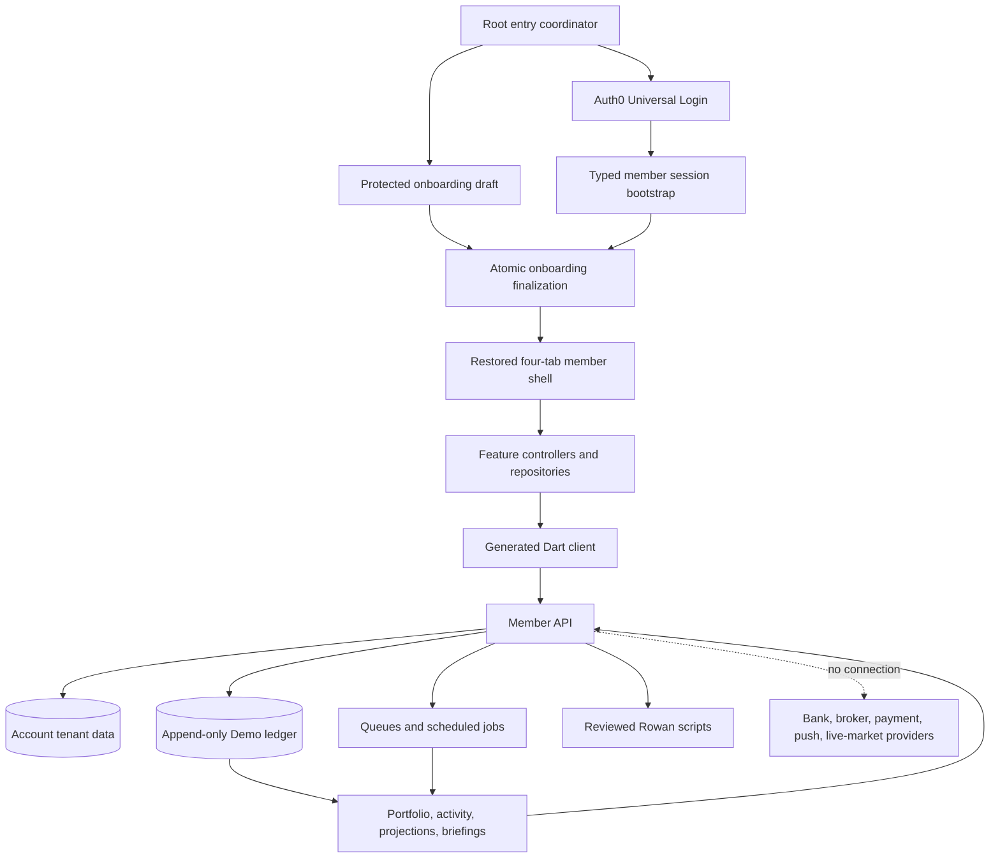
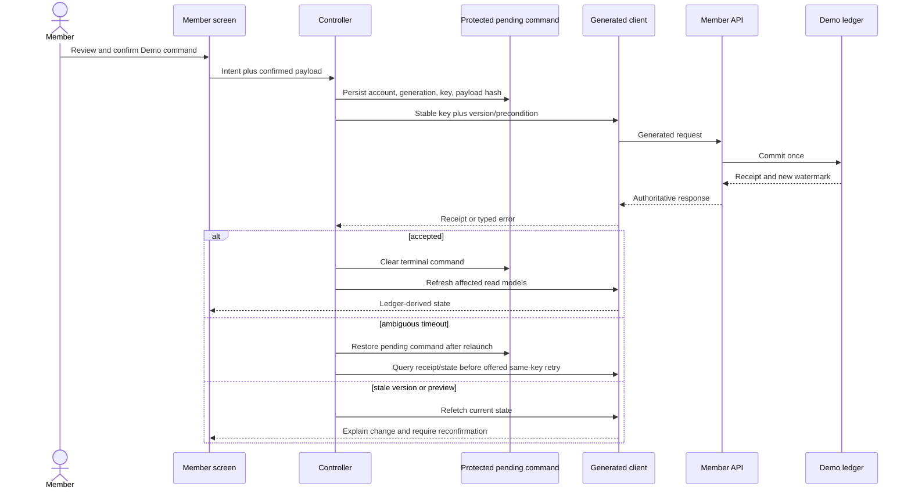

# Ritual Investing Simulated Member Experience - Plan

## Goal Capsule

- **Objective:** The existing Ritual Investing member app provides a coherent, provider-free experience from guided onboarding through ritual research, community, simulated investing, goals, recaps, Demo membership, and account controls on iOS and Android.
- **Means:** Extend the current Flutter feature architecture and the server-authoritative Demo API through generated contracts, typed session state, nested member navigation, and dependency-ordered vertical slices. See KTD1-KTD12.
- **Authority:** This plan owns the follow-on scope. The standalone mobile plan owns product identity and experience intent. The backend contract plan owns API, tenant, ledger, idempotency, and operational invariants. This plan's session-settled decisions and explicit conflict resolutions supersede older local-only implementation guidance.
- **Execution profile:** Code work across `ritual-investing-app/`, member-facing routes in `ritual-investing-api/`, the generated `ritual-investing-api-client/`, mobile CI, and supporting documentation.
- **Stop conditions:** Stop and rescope if a slice requires real banking, brokerage, payment, market-data, push-delivery, or advisory providers; collection of real financial credentials; or expansion of the staff admin dashboard.
- **Tail ownership:** Mobile and API maintainers jointly own beta runtime enablement, production-shaped member-flow verification, and rollback of any member contract or background-job activation.

---

## Product Contract

### Summary

Evolve the existing Flutter member app into the full Ritual Investing Demo experience. A new member first completes a guided investing and ritual-preference questionnaire, then uses Auth0 sign-up or sign-in, and enters the existing Ritual, Discover, Coven, and You shell only after server onboarding completes. All financial activity remains fictional, labeled Demo, and derived from the backend Demo ledger.

### Problem Frame

The backend and generated client expose most member capabilities, but the Flutter app wires only session bootstrap, a handful of read screens, portfolios, and an orphaned contribution adapter. The current root sends authenticated sessions directly to the main shell, discards the bootstrap snapshot, loads every tab eagerly, and has no complete detail-route or command workflow. The older mobile plan also treated local state as authoritative, which conflicts with the implemented tenant, ledger, reset, and generated-contract architecture.

### Key Decisions

- **Evolve the current member app** (session-settled: user-approved — chosen over replacing it or shipping a second app: the current feature layers and four-tab shell are the correct base). Governs R1-R2 and R27-R30.
- **Ask new-member questions before Auth0** (session-settled: user-directed — chosen over the current auth-first gate: the user requested investing, spirituality, and astrology onboarding before sign-up/sign-in). Governs R2-R7.
- **Use the server-authoritative provider-free Demo** (session-settled: user-approved — chosen over production local-only fixtures: the implemented tenant and Demo ledger already provide coherent cross-session state). Governs R8 and R15-R26.
- **Keep this follow-on member-facing** (session-settled: user-directed — chosen over admin-dashboard expansion: the requested experience is the actual user app). Governs R1 and the Scope Boundaries.

### Requirements

**Member app and entry**

- R1. The work must evolve `ritual-investing-app/` and preserve Ritual, Discover, Coven, and You as the only top-level destinations; it must not create a replacement app or expand the staff dashboard.
- R2. A clean install must present Welcome, guided questionnaire, editable review, Auth0 Create account or Sign in, authenticated onboarding finalization, and then the main Ritual screen in that order.
- R3. Investing onboarding must collect only experience, goal, time horizon, risk comfort, and preferred contribution rhythm, with no default risk selection and no income, debt, net-worth, bank, tax, card, brokerage, or government-identity input.
- R4. Ritual onboarding must treat spirituality as optional product-language and content preferences, offer practical-only and prefer-not-to-say choices, and never ask for or infer a religion.
- R5. Astrology personalization must require a separate opt-in and birth date only when enabled; birth time and birthplace remain deferred until a visible feature uses them, while tarot and non-personalized astrology remain available when the user skips.
- R6. Returning members must have a direct Sign in path, completed accounts must bypass the questionnaire, incomplete accounts must resume the first missing server step, and canceled authentication must return to the reviewed local draft.
- R7. The app must attach a new member's reviewed answers atomically after Auth0, erase the protected draft only after success, keep the shell gated on server `complete`, and discard a completed account's anonymous draft before offering any later changes through Settings.
- R8. Profile, preferences, onboarding, entitlement, default portfolio, and account identity must be server-authoritative; local persistence is limited to protected credentials, a short-lived onboarding draft, an account/reset-generation pending-command journal, and account/reset-generation read caches that can be marked stale.

**Ritual, research, and community**

- R9. The Daily Ritual must support tarot and astrology modes, deterministic dated scenarios, reveal and complete lifecycle, history, three to five explorable ideas, and an adjacent Market-informed Demo label.
- R10. Every ritual and idea surface must distinguish interpretation, observed evidence, observation time, uncertainty, material risks, and limitations without claiming supernatural causation or presenting a buy command.
- R11. One reusable Asset Codex experience must support detail, evidence, metrics, comparison, save state, and search, and remain consistent when opened from rituals, Discover, Grimoires, Circles, Coven, holdings, briefings, notifications, or saved content.
- R12. Discover must provide personalized mixed results, Grimoires, Circle templates, seeded creators, and Founders' Coven details that preserve qualification category and verification date.
- R13. Members must be able to browse and copy seeded public Circles and create, edit, reorder, and archive private Circles without real public accounts, posts, follows, comments, messages, or leaderboards.
- R14. Rowan must remain reviewed deterministic read-only counsel on the currently supported daily-ritual, evidence, Asset Codex, and Coven surfaces; unsupported surfaces use reviewed static explanations and never gain a free-form prompt or mutation path.

**Simulated investing**

- R15. The app must provide server-backed portfolio list, default portfolio, detail, holdings, activity, snapshots, create, rename, and archive flows using integer minor units and authoritative versions.
- R16. Funding and contribution flows must use only allowlisted fictional sources and Demo amounts, create one ledger effect per confirmed command, and never render or transmit real routing, account, card, or brokerage credentials.
- R17. Fractional orders must use preview, editable review, explicit Demo confirmation, idempotent commit, receipt, and authoritative portfolio refresh.
- R18. Recurring plans and rebalancing must expose their complete Demo lifecycle, including create or preview, confirm, list/detail, edit where supported, pause/resume/cancel, conflict refresh, and explicit reconfirmation.
- R19. Financial screens must never patch balances, holdings, activity, allocation, or projections optimistically; they must refresh ledger-derived read models by watermark after an accepted command and resolve timeout or version conflict without duplicate effects.
- R20. Every financial, performance, projection, and entitlement surface must display persistent Demo status and contextual language that no real money moves, with no banking, brokerage, payment, purchase, or market-data SDK.

**Goals, engagement, membership, and control**

- R21. Intentions and Future Mirror must support goal lifecycle, current and historical generations, editable assumptions, uncertainty bands, model/source time, ledger watermark, and no-guarantee disclosures.
- R22. Daily, weekly, and moon-cycle briefings must reflect committed Demo state, saved research, and prior rituals and must expose list, detail, and read state.
- R23. The member app must provide an in-app notification feed, preferences, read/read-all state, and allowlisted internal deep links while external push registration and delivery remain disabled.
- R24. Demo membership must show free and premium plans, capability gates, upgrade prompt, simulated checkout, confirmation, restore, and downgrade without App Store, Play Store, or payment-provider calls.
- R25. Privacy controls must support export request, recent-authenticated status/download resume, private local-file share, recent-authenticated deletion, and clear pending/error states without logging or persisting tokenized URLs.
- R26. Logout, account switch, Demo reset, and accepted deletion must clear the correct account/reset-generation controllers, caches, protected draft, pending commands, and Rowan cache; reset or deletion must generation-fence older jobs before re-bootstrap or sign-out.

**Design and quality**

- R27. Expanded screens must preserve the ritual-first hierarchy, original names, Rowan voice, lunar-lilac light theme, aubergine-night dark theme, image-first daily composition, and adjacent evidence and risk access.
- R28. Both platforms must support device-first theme, persisted manual choice, safe areas, adaptive back behavior, text scaling, screen readers, reduced motion, non-color cues, and 44-point iOS or 48-dp Android targets.
- R29. Every read and mutation must have deliberate loading, empty, stale-cache, offline, validation, forbidden, conflict, throttled, retryable, and terminal states appropriate to that operation.
- R30. The experience may match the source plan's capability coverage but must use original information architecture, copy, visuals, characters, and interactions rather than Alinea branding or protected expression.

### Actors

- A1. **New member** completes guided questions, Auth0, and server onboarding.
- A2. **Returning member** restores or signs in and resumes server-owned state without cross-account leakage.
- A3. **Flutter member app** owns presentation, protected draft recovery, navigation, generated-client orchestration, and explicit confirmations.
- A4. **Auth0 Universal Login** owns credentials, hosted sign-up/sign-in, callback recovery, logout, and recent authentication.
- A5. **Member API and background runtime** own tenant state, onboarding finalization, Demo ledger, read projections, jobs, export, reset, and contract metadata.
- A6. **Rowan counsel service** returns reviewed read-only scripts for allowlisted surfaces and fails without blocking the underlying member flow.

### Key Flows

- F1. **New-member entry**
  - **Trigger:** A1 selects Get started on a clean install.
  - **Steps:** A3 collects R3-R5, shows editable review and Demo/privacy consent, invokes A4 for Create account or Sign in, bootstraps A5, finalizes onboarding, clears the draft, and routes to Ritual.
  - **Covered by:** R2-R8.
- F2. **Returning or interrupted entry**
  - **Trigger:** A2 restores credentials, selects direct Sign in, cancels Auth0, or has incomplete server onboarding.
  - **Steps:** A3 reconciles protected draft and server state, lets completed server state win, resumes the first incomplete step when needed, and never flashes the main shell early.
  - **Covered by:** R6-R8 and R26.
- F3. **Ritual to research**
  - **Trigger:** A1 or A2 reveals or completes the Daily Ritual.
  - **Steps:** A3 commits the lifecycle version, opens evidence or Asset Codex, optionally saves or compares, and can request non-blocking A6 counsel on an allowlisted resource.
  - **Covered by:** R9-R14.
- F4. **Discover and organize**
  - **Trigger:** A2 searches or opens Discover, a Grimoire, Coven entry, creator, or Circle template.
  - **Steps:** A3 preserves mixed result identity and disclosure metadata, opens shared Asset Codex routes, saves content, or copies it into an editable private Circle.
  - **Covered by:** R11-R13.
- F5. **Simulated financial command**
  - **Trigger:** A2 contributes, previews an order, creates a recurring plan, or previews a rebalance.
  - **Steps:** A3 collects Demo-only inputs, shows review, creates one command key, asks for explicit confirmation, sends the generated request, resolves timeout/conflict, and refreshes A5 read models by watermark.
  - **Covered by:** R15-R20.
- F6. **Goal and recap loop**
  - **Trigger:** A2 creates an Intention, generates Future Mirror, or opens a briefing.
  - **Steps:** A3 shows current assumptions and uncertainty, persists the authoritative result, then opens related assets or activity through shared routes.
  - **Covered by:** R21-R23.
- F7. **Demo membership**
  - **Trigger:** A2 opens a gated capability or membership settings.
  - **Steps:** A3 shows plan comparison, runs Demo checkout/confirm or restore/downgrade, refreshes entitlement, and returns to the original capability.
  - **Covered by:** R20 and R24.
- F8. **Privacy and reset**
  - **Trigger:** A2 requests export, deletion, logout, or Demo reset.
  - **Steps:** A3 performs recent authentication where required, executes the server workflow, clears local account state at the correct boundary, and exposes retry or signed-out results.
  - **Covered by:** R25-R26.

### Acceptance Examples

- AE1. **Covers R2-R7.** Given a clean install, when a new member reviews investing and optional ritual/astrology answers and completes hosted sign-up, then the answers persist once, the protected draft is erased, and Ritual appears only after server onboarding reports `complete`.
- AE2. **Covers R4-R6.** Given a member selects practical-only or skips astrology, when onboarding completes, then no birth data is required and tarot plus non-personalized astrology remain usable.
- AE3. **Covers R6-R8.** Given Auth0 is canceled, the process is killed, or a completed existing account signs in after a stale draft, when the app resumes, then it restores or expires the draft safely and never overwrites completed server preferences without review.
- AE4. **Covers R8 and R26.** Given account A logs out and account B signs in, when the shell loads, then no profile, cache, draft, portfolio, entitlement, or Rowan data from A appears for B.
- AE5. **Covers R9-R10.** Given either ritual mode, when the member reveals and completes a dated ritual, then three to five ideas, Market-informed evidence, observation time, uncertainty, risks, and Demo limitations remain distinguishable.
- AE6. **Covers R11-R13.** Given an asset opens from any supported route, when the member saves or compares it and later copies a Circle, then identity and disclosures stay consistent and the private Circle changes without a public social event.
- AE7. **Covers R14.** Given Rowan receives an unsupported context, foreign resource, 429, or 503, when counsel fails, then the underlying screen remains usable and no mutation or free-form context is sent.
- AE8. **Covers R15-R20.** Given a fictional source and a Demo amount, when the member confirms a contribution or order and the first response is lost, then receipt lookup or same-key retry produces one ledger effect and refreshed holdings/activity match the new watermark.
- AE9. **Covers R17-R19.** Given an order or rebalance preview becomes stale, when commit returns a conflict, then the app invalidates the preview, refreshes state, explains the change, and requires fresh review and confirmation.
- AE10. **Covers R18-R20.** Given an active recurring plan, when the member pauses, resumes, edits, or cancels it, then authoritative status and future schedule update without real money or provider traffic.
- AE11. **Covers R21.** Given an Intention and contribution assumptions, when Future Mirror completes, then the view shows scenarios, bands, model/source time, watermark, and limitations without a guarantee.
- AE12. **Covers R22-R23.** Given external notification delivery is disabled, when a briefing or eligible event is generated, then the in-app notification appears, deep-links only to an allowlisted member route, and can be read without device registration.
- AE13. **Covers R24.** Given a premium gate, when the member confirms Demo checkout and later restores or downgrades, then entitlement changes server-side and no store or payment SDK is invoked.
- AE14. **Covers R25-R26.** Given a privacy export, Demo reset, or deletion request, when the workflow completes or fails, then the correct poll/download, re-bootstrap, signed-out, and local-clear behavior occurs without leaking tokens or another account's state.
- AE15. **Covers R27-R30.** Given large text, screen reader, reduced motion, platform back gestures, and both themes, when reviewers traverse every major flow, then controls remain usable and the screens still read as Ritual Investing rather than generic or copied fintech.

### Success Criteria

- A production-shaped new-member run reaches the existing Ritual screen through questionnaire, hosted sign-up, atomic onboarding finalization, and typed bootstrap without fixture-only substitutions.
- Every scoped member domain is reachable through a handwritten repository/controller seam backed by the generated Dart client; generated files remain reproducible from OpenAPI.
- Duplicate, timeout, conflict, reset-generation, and account-switch tests prove one-command/one-ledger-effect behavior and zero cross-account cache leakage.
- Network and dependency review finds no bank, broker, payment, purchase, live market-data, or push-delivery SDK or host in the member app.
- iOS and Android build, accessibility, real-device Auth0 callback, light/dark visual, and representative end-to-end member-flow gates pass before beta enablement.

### Scope Boundaries

**In scope**

- Existing member app screens, member-facing API corrections, generated-client changes, mobile CI, and the background/runtime configuration required for the provider-free Demo.
- A transactional onboarding-finalization contract and bounded investing/ritual preference fields.
- In-app notification records and deep links without external delivery.

**Deferred to Follow-Up Work**

- Optional birth time and birthplace capture, storage, and interpretation until a visible astrology feature uses those fields.
- External push provider selection, notification device registration, and remote delivery.
- Rich or generative Rowan counsel beyond the four currently allowlisted surfaces.
- Store release identity, production app-store billing, and public launch operations.

**Outside this product's identity**

- Real deposits, withdrawals, custody, brokerage execution, card processing, bank credential collection, automatic investment management, or personalized investment advice.
- Real public social accounts, follows, posts, comments, direct messages, or leaderboards.
- Religion classification, supernatural market causation, guaranteed outcomes, romantic pressure, or autonomous Rowan transactions.
- Staff admin-dashboard feature work beyond ensuring existing member contracts remain compatible.

---

## Planning Contract

### Key Technical Decisions

- KTD1. **Retain feature-first layers and the four-tab shell.** Extend the current presentation/application/domain/data pattern and place detail routes above independent tab stacks (session-settled: user-approved — chosen over a replacement or parallel app architecture: current production wiring already follows the target boundary). Governs R1 and R27-R30.
- KTD2. **Make OpenAPI the only member contract source.** Correct backend schemas and generator compatibility, regenerate the whole Dart package, and keep handwritten mapping in feature data layers; never hand-edit generated output. Governs R7-R26.
- KTD3. **Finalize onboarding in one idempotent tenant transaction.** After Auth0 provisions identity, derive the tenant from the token, require an incomplete schema-versioned onboarding state, validate active policy versions and cross-field consent, bind the full canonical questionnaire hash to the command key, and return a completed bootstrap envelope (session-settled: user-directed — chosen over a client-side multi-endpoint saga: the requested pre-auth flow must not expose a partially provisioned shell). Governs R2-R8.
- KTD4. **Use typed bootstrap as an immutable routing envelope.** Root state owns account ID, reset generation, onboarding gate, entitlement gate, default portfolio ID, server time, and contract version; feature repositories hydrate their own state, caches key by account plus reset generation, and lazy feature factories remain in the dependency container. Governs R6-R8, R15, and R26.
- KTD5. **Keep Auth0 behind member-auth boundaries and verify the client identity.** Define sign-up/sign-in/recent-auth/recovery intents without SDK types, require an allowlisted member `azp` on bootstrap and every member route, then gate the 2.x SDK and verifiable HTTPS callback migration with native compatibility and rollback proof. Governs R2, R6-R7, and R25.
- KTD6. **Use restored nested member navigation.** Add `go_router` 17.x with a restored stateful shell and independent branch stacks while preserving the four top-level destinations; record observer behavior explicitly. Governs R1, R6, R11-R13, R21-R25, and R28.
- KTD7. **Treat financial mutations as durable explicit commands.** Before sending, persist account, reset generation, operation, key, precondition, canonical payload hash, and creation time in a protected journal; after restart, reconcile authoritative state before offering the same-key/same-payload retry, and require reconfirmation after any edit or stale preview. Governs R16-R20 and R26.
- KTD8. **Enforce provider-free Demo inputs and effects across app and runtime.** Use allowlisted fictional data, strict schemas, shared Demo disclosures, an allowlist of internal job effects, generation fencing, disabled external handlers, and dependency/host/egress checks across Flutter and the API. Governs R16 and R20-R24.
- KTD9. **Keep Rowan deterministic and outside command boundaries.** Send only allowlisted surface/context/resource identifiers, cache by account and script revision, and use product-authored static explanation elsewhere. Governs R14 and R26-R30.
- KTD10. **Separate in-app notification creation from external delivery.** Use distinct writer and delivery capabilities; in in-app-only mode, persist one feed row, reject device registration, emit no delivery request, and require no provider binding. Governs R22-R23 and R29.
- KTD11. **Prove vertical slices through the production chain.** Each major flow must include generated-response mapping, controller/widget coverage, and at least one integration path using real generated Dio requests rather than `RitualInvestingApp.fixture()`. Governs R2-R29.
- KTD12. **Accept privacy commands only when their processors are ready.** Export and deletion fail before mutation when their queue/storage processor is unavailable; accepted deletion is irrevocable, deadline-monitored, generation-fenced, and treats a later `account_inactive` bootstrap as terminal success after an ambiguous response. Governs R25-R26 and R29.

### High-Level Technical Design

The diagrams define the load-bearing boundaries and sequence. Exact type and file names remain implementation-owned.

```mermaid
stateDiagram-v2
  [*] --> Restoring
  Restoring --> MainShell: valid session and onboarding complete
  Restoring --> AuthenticatedOnboarding: valid session and onboarding incomplete
  Restoring --> Welcome: no valid session
  Welcome --> Questionnaire: Get started
  Welcome --> Authenticating: returning-member Sign in
  Questionnaire --> Review
  Review --> Authenticating: Create account or Sign in
  Authenticating --> Review: cancel or recoverable failure
  Authenticating --> Bootstrapping: authenticated
  Bootstrapping --> DraftConflict: completed account plus anonymous draft
  DraftConflict --> MainShell: discard draft; later edits use Settings
  Bootstrapping --> AuthenticatedOnboarding: incomplete server state
  AuthenticatedOnboarding --> MainShell: atomic finalization and refreshed complete
  MainShell --> Welcome: logout, deletion, or account transition
```

### System-Wide Impact

| Area | Impact | Planning response |
|---|---|---|
| Identity and callbacks | Auth0 SDK, hosted intents, member-client `azp`, Android App Links, iOS Universal Links, recent-auth claims, and logout allowlists change together. | Land the repository/authz boundary before SDK migration; retain native compatibility, rollback, and real-device callback gates. |
| Member data lifecycle | Anonymous sensitive preferences and pending commands transition across identity, account, reset, and process lifecycles. | U1 owns atomic finalization; U2-U3 own device-only TTL storage, install binding, account/reset-generation scoping, and clearing. |
| API/client compatibility | Discovery unions, save state, new onboarding fields, and response enums affect OpenAPI and generated Dart decoding. | U1 changes schemas, generator output, compatibility fixtures, and contract tests as one unit. |
| Financial consistency | Contributions, orders, recurring plans, rebalances, projections, and briefings consume shared ledger state across process death and reset. | U2 owns neutral invalidation and the protected KTD7 journal; each feature refreshes only its reads and all old-generation work fails closed. |
| Background runtime | Briefings, recurring execution, notifications, export, and deletion depend on queues, buckets, schedules, and capability switches. | U9 and U11 enable only provider-free effects after readiness proof; notification write/delivery are separate and privacy rejects before mutation when processors are unavailable. |
| Product/design | Many new routes can dilute the ritual-first hierarchy or become generic fintech. | Each feature uses shared Demo/evidence components and U12 performs cross-flow visual and accessibility review. |

### Dependencies and Risks

| Dependency or risk | Mitigation |
|---|---|
| Auth0 2.x migration, member/admin client confusion, and 2026 callback enforcement can break or broaden member access. | Hide SDK types behind the auth repository, enforce `AUTH0_MEMBER_CLIENT_IDS`/`azp`, document callback and client allowlists, and require native migration/rollback smoke tests. |
| Spirituality and birth data can reveal sensitive philosophical information. | Use separate consent, device-only non-syncing and non-backed-up TTL storage with install binding, server policy-version allowlists, minimal retention, no answer telemetry, and store privacy review. |
| OpenAPI unions currently generate invalid mixed Discover/Search models. | Repair the schema or generator seam reproducibly and decode every discriminator variant in client contract tests before UI work. |
| A large cross-feature release can hide integration regressions. | Land dependency-ordered vertical slices, keep every slice releasable behind incomplete navigation, and use U12 for full-chain release proof rather than a late architectural rewrite. |
| Beta cron capacity and committed kill switches can make background features look complete while inactive. | Seed current recaps for deterministic UX, test job handlers directly, document unavailable beta schedules, and enable only bindings/effects proven in the target environment. |
| Legacy completed onboarding records predate new fields and policy receipts. | Version the questionnaire by account cohort, preserve legacy completion without invented answers or consent, and require explicit Settings edits for later adoption. |
| Privacy export and deletion have asynchronous, one-time-link, readiness, and recent-auth failure modes. | Step up and resume status/download, store request IDs rather than tokenized links, share private local files, reject when processors are unavailable, and alert accepted purge deadlines. |

### Alternative Approaches Considered

- **Replace the current app or ship a second member app:** Rejected by the user and current repo evidence; it would duplicate working authentication, generated transport, feature layers, theme, and the approved shell.
- **Make fixtures or an on-device snapshot authoritative:** Rejected because the backend already owns tenant state, the append-only Demo ledger, idempotency, reset generation, and cross-session projections.
- **Submit onboarding through existing endpoints as a client saga:** Rejected because partial success can expose inconsistent consent/profile state and complicate resume; KTD3 creates one transactional boundary.
- **Expand Rowan to every new screen:** Deferred because the current counsel contract allowlists only four surfaces and has no safe context or ownership resolver for financial and private projection data.
- **Integrate real providers for realism:** Rejected as outside scope; fictional sources, server jobs, Demo checkout, and ledger projections provide the intended experience without credentials or money movement.

### Delivery Sequence

1. **Contract and entry foundation:** U1-U3.
2. **Daily value and research:** U4-U5.
3. **Simulated portfolio and commands:** U6-U7.
4. **Goals, recaps, and membership:** U8-U10.
5. **Privacy and release proof:** U11-U12.

### Sources and Research

- Product authority: `docs/plans/2026-08-20-1533-feat-standalone-ritual-investing-mobile-app-plan.md`, `ritual-investing-app/PRODUCT.md`, `ritual-investing-app/DESIGN.md`, and `CONCEPTS.md`.
- Technical authority: `docs/plans/2026-08-23-2029-feat-ritual-investing-backend-contract-plan.md`, `docs/ritual-investing/api-consumer-guide.md`, `docs/ritual-investing/beta-environment.md`, and `.github/workflows/ritual-investing.yml`.
- Current seams: `ritual-investing-app/lib/core/bootstrap/dependency_container.dart`, `ritual-investing-app/lib/core/api/ritual_api.dart`, `ritual-investing-app/lib/features/shell/presentation/app_shell.dart`, `ritual-investing-api/src/domains/accounts/schemas.ts`, and `ritual-investing-api/src/domains/simulation/`.
- Auth0: [Flutter quickstart](https://auth0.com/docs/quickstart/native/flutter), [SDK changelog](https://pub.dev/packages/auth0_flutter/changelog), [v2 migration guide](https://github.com/auth0/auth0-flutter/blob/main/auth0_flutter/MIGRATION_GUIDE.md), [signup behavior](https://github.com/auth0/auth0-flutter/blob/main/auth0_flutter/EXAMPLES.md#sign-up), [recent authentication](https://auth0.com/docs/authenticate/login/max-age-reauthentication), and [verifiable callback migration](https://auth0.com/docs/troubleshoot/product-lifecycle/deprecations-and-migrations/non-verifiable-callback-uri-end-user-confirmation).
- Flutter: [go_router stateful navigation](https://pub.dev/documentation/go_router/latest/topics/Configuration-topic.html), [state restoration](https://pub.dev/documentation/go_router/latest/topics/State%20restoration-topic.html), [go_router changes](https://pub.dev/packages/go_router/changelog), [secure storage 10.3.1](https://pub.dev/packages/flutter_secure_storage/versions/10.3.1), [integration testing](https://docs.flutter.dev/testing/integration-tests), and [accessibility](https://docs.flutter.dev/ui/accessibility).
- Privacy and safety: [European Commission data minimization](https://commission.europa.eu/law/law-topic/data-protection/rules-business-and-organisations/principles-gdpr/overview-principles/what-data-can-we-process-and-under-which-conditions_en), [Apple App Privacy data types](https://developer.apple.com/app-store/app-privacy-details/), [OWASP MASVS](https://mas.owasp.org/MASVS/), and [Google Play User Data policy](https://support.google.com/googleplay/android-developer/answer/10144311?hl=en).

---

## Implementation Units

| Unit | Title | Primary files | Depends on |
|---|---|---|---|
| U1 | Converge member contracts and generation | Account/editorial schemas, migration, OpenAPI, generated client | None |
| U2 | Establish session, auth, cache, and navigation foundation | App root, Auth0, bootstrap, router, cache | U1 |
| U3 | Deliver guided onboarding and member settings | Onboarding/account feature modules | U1-U2 |
| U4 | Complete Daily Ritual, Asset Codex, search, and Rowan | Ritual, Asset Codex, search, Rowan modules | U1-U3 |
| U5 | Complete Discover, Coven, Grimoires, and Circles | Discover, Coven, Circles modules | U1-U4 |
| U6 | Complete portfolios, fictional funding, and contributions | Portfolio and funding modules | U1-U3 |
| U7 | Complete orders, recurring plans, and rebalancing | Order, recurring, rebalance modules | U6 |
| U8 | Complete Intentions and Future Mirror | Intention and projection modules | U6-U7 |
| U9 | Complete briefings and in-app notifications | Briefing/notification modules and job runtime | U4-U8 |
| U10 | Complete Demo membership and checkout | Entitlement module | U2-U9 |
| U11 | Complete privacy and reset | Privacy/settings and async privacy runtime | U3-U10 |
| U12 | Complete release hardening | CI, docs, provider audit, end-to-end tests | U3-U11 |

### U1. Converge member contracts and generation

- **Goal:** Make the member API and generated Dart package safe and complete for onboarding, mixed discovery, saved state, and later vertical slices.
- **Requirements:** R2-R8, R11-R12, R29; supports F1-F4 and AE1-AE6.
- **Dependencies:** None.
- **Files:** `ritual-investing-api/src/db/schema/identity.ts`, `ritual-investing-api/src/domains/accounts/schemas.ts`, `ritual-investing-api/src/domains/accounts/routes.ts`, `ritual-investing-api/src/domains/accounts/repository.ts`, `ritual-investing-api/src/domains/accounts/access.ts`, `ritual-investing-api/src/domains/session/schemas.ts`, `ritual-investing-api/src/domains/session/repository.ts`, `ritual-investing-api/src/domains/session/routes.ts`, `ritual-investing-api/src/domains/editorial/schemas.ts`, `ritual-investing-api/src/domains/editorial/postgres-repository.ts`, `ritual-investing-api/src/domains/discover/schemas.ts`, `ritual-investing-api/src/domains/discover/routes.ts`, `ritual-investing-api/src/domains/search/schemas.ts`, `ritual-investing-api/src/contracts/mobile-compatibility.ts`, `ritual-investing-api/src/config/env.ts`, `ritual-investing-api/drizzle/0012_member_experience.sql`, `ritual-investing-api/openapi/ritual-investing-v1.yaml`, `ritual-investing-api/scripts/generate-client.mjs`, `ritual-investing-api/test/domains/accounts.test.ts`, `ritual-investing-api/test/domains/discover.test.ts`, `ritual-investing-api/test/contracts/openapi.test.ts`, `ritual-investing-api/test/contracts/mobile-compatibility.test.ts`, `ritual-investing-api/test/security/authentication.test.ts`, `ritual-investing-api/test/security/authorization-regression.test.ts`, `ritual-investing-api-client/lib/generated/`, `ritual-investing-api-client/test/contract_client_test.dart`.
- **Approach:**
  1. Extend bounded member personalization with investing experience, contribution rhythm, ritual familiarity/interests, and a practical/prefer-not-to-say path per R3-R5; keep raw religion and unused birth-place/time fields out.
  2. Add the KTD3 atomic onboarding-finalization command, server-derived deterministic astrology profile, current-policy allowlist, server timestamps, consent cross-field rules, expected version, canonical payload hash, and completed session response in one tenant transaction.
  3. Make the Discover/Search union generator-safe, decode all asset/Coven/Grimoire/Circle-template variants, add authoritative save state or a saved-items read, and fix `low/moderate/high` personalization mapping.
  4. Version onboarding by schema/account cohort so legacy completed accounts keep completion without invented answers or consent, and add reset generation to the bootstrap envelope.
  5. Enforce KTD5's member-client `azp` allowlist on bootstrap and all member middleware, update the accepted mobile schema/client versions, then regenerate OpenAPI and the complete Dart client through KTD2.
- **Patterns to follow:** Account version/conflict behavior in `ritual-investing-api/src/domains/accounts/`; simulation idempotency and reset-generation tests in `ritual-investing-api/test/security/`; generated-client drift workflow in `docs/ritual-investing/api-consumer-guide.md`.
- **Execution note:** Start with failing API and generated-client contract tests for atomic onboarding and every Discover/Search discriminator variant.
- **Test scenarios:**
  - Covers AE1. A new tenant submits one valid reviewed questionnaire twice with the same key and receives one completed profile/consent set and the same result.
  - A completed tenant submits an anonymous-draft finalization without an explicit apply mode and receives a non-destructive conflict.
  - A stale onboarding version returns a typed conflict with no partial preference, consent, investor, or astrology write.
  - Forged or stale policy versions, declined astrology with birth date, client-supplied derived astrology fields, and same-key/different-answer payloads fail with no audit/outbox or partial data.
  - A legacy completed account migrates without fabricated risk, ritual, astrology, or consent choices and can enter the shell under its cohort rule.
  - Missing, wrong, or admin-client `azp` fails every member route while the configured mobile client succeeds.
  - Practical-only and prefer-not-to-say values persist without a religion field; astrology opt-out persists without birth data.
  - Each mixed Discover/Search discriminator decodes in Dart with only its matching payload, preserved IDs/revisions, and unknown-enum fallback.
  - Grimoire and Circle-template detail or the saved-items read returns authoritative bookmark state after save/unsave.
  - Risk values `low`, `moderate`, and `high` produce the intended personalized Discover branch.
  - Migration, RLS, reset generation, API snapshot, N-1 compatibility, and regenerated-client compilation remain clean.
- **Verification:** The member contract can represent every planned onboarding answer and mixed research result, repeated finalization has one effect, and generated output is reproducible with no handwritten changes.

### U2. Establish session, auth, cache, and navigation foundation

- **Goal:** Create the only valid app entry path and shared runtime primitives before feature expansion.
- **Requirements:** R1-R8, R15, R26-R29; supports F1-F2 and AE1-AE4.
- **Dependencies:** U1.
- **Files:** `ritual-investing-app/pubspec.yaml`, `ritual-investing-app/pubspec.lock`, `ritual-investing-app/lib/app/ritual_investing_app.dart`, `ritual-investing-app/lib/core/auth/auth0_session_repository.dart`, `ritual-investing-app/lib/core/auth/auth_controller.dart`, `ritual-investing-app/lib/core/bootstrap/dependency_container.dart`, `ritual-investing-app/lib/core/api/ritual_api.dart`, `ritual-investing-app/lib/core/api/view_state.dart`, `ritual-investing-app/lib/core/api/state_status.dart`, `ritual-investing-app/lib/core/api/idempotent_mutation.dart`, `ritual-investing-app/lib/core/api/pending_command_store.dart`, `ritual-investing-app/lib/core/api/invalidation_bus.dart`, `ritual-investing-app/lib/core/cache/read_cache.dart`, `ritual-investing-app/lib/core/cache/cached_read.dart`, `ritual-investing-app/lib/core/cache/cache_entry.dart`, `ritual-investing-app/lib/core/navigation/app_router.dart`, `ritual-investing-app/lib/core/navigation/member_routes.dart`, `ritual-investing-app/lib/core/presentation/demo_disclosure.dart`, `ritual-investing-app/lib/features/shell/presentation/app_shell.dart`, `ritual-investing-app/lib/features/ritual/data/daily_ritual_repository.dart`, `ritual-investing-app/lib/features/discover/data/repository.dart`, `ritual-investing-app/lib/features/coven/data/repository.dart`, `ritual-investing-app/lib/features/profile/data/repository.dart`, `ritual-investing-app/lib/features/portfolio/data/repository.dart`, `ritual-investing-app/android/app/build.gradle.kts`, `ritual-investing-app/android/app/src/main/AndroidManifest.xml`, `ritual-investing-app/android/app/src/main/res/xml/backup_rules.xml`, `ritual-investing-app/ios/Runner/Runner.entitlements`, `ritual-investing-app/ios/Runner/Info.plist`, `ritual-investing-app/ios/Runner.xcodeproj/project.pbxproj`, `ritual-investing-app/integration_test/support/member_test_app.dart`, `ritual-investing-app/test_driver/integration_test.dart`, `ritual-investing-app/test/support/fixture_services.dart`, `ritual-investing-app/test/auth0_session_repository_test.dart`, `ritual-investing-app/test/bootstrap_test.dart`, `ritual-investing-app/test/app_router_test.dart`, `ritual-investing-app/test/account_cache_test.dart`, `ritual-investing-app/test/pending_command_store_test.dart`.
- **Approach:**
  1. Define SDK-free member-auth intents and `azp` expectations, then apply KTD5's gated Auth0 upgrade, credential recovery, and Android/iOS HTTPS callback migration with a rollback path.
  2. Return KTD4's immutable bootstrap envelope, apply its routing/default identifiers, stop eager tab loads, and keep feature state inside lazy feature repositories/scopes rather than the router or root.
  3. Apply KTD6 with one restored route registry shared by guards, notifications, and feature links; persist stable IDs only and define deleted/invalid-resource fallback.
  4. Key reads and KTD7 pending commands by account plus reset generation, add neutral watermark/invalidation events, and dispose feature scopes before account or generation transition.
  5. Evolve the existing read/mutation/failure abstractions in place, decompose generated adapters into feature `data/` modules, and move production fixtures out of the dependency container.
  6. Establish the real-Dio integration harness, injectable protected-storage seams, and shared Demo/money/time presentation before U3.
- **Patterns to follow:** Current dependency container and `ViewState<T>`; admin `go_router` setup as an adjacent pattern; generated Dio adapter mapping in `ritual-investing-app/test/api_repository_test.dart`.
- **Test scenarios:**
  - Auth0 method-channel tests distinguish sign-in, `screen_hint=signup` plus forced login, and recent-auth `maxAge` behavior.
  - Recovered Android credentials resume bootstrap once after process death without losing the pending entry route.
  - A typed bootstrap applies theme, account ID, completed/incomplete onboarding, entitlement, and default portfolio rather than discarding them.
  - Account A cached reads never render after logout and account B sign-in; reset clears only the active account plus unowned draft state.
  - A pre-reset queued invalidation or restored pending command cannot write or render after the bootstrap reset generation changes.
  - A detail route opened under each tab preserves that tab's back stack and restores after process recreation.
  - A deleted or unauthorized restored resource falls back to its owning tab without a route loop or leaked identifier.
  - Offline cached reads show stale status; offline mutations never show committed success.
  - Process death restores a pending command's same key and payload hash, queries authoritative state first, and never auto-submits or reuses the key after an edit.
  - Unknown generated error codes map to a safe terminal state without parsing server message text.
- **Verification:** Both native hosts complete verifiable Auth0 callback/logout flows, root routing is bootstrap-driven, inactive tabs are lazy, and shared runtime primitives have account-isolation coverage.

### U3. Deliver guided onboarding and member settings

- **Goal:** Implement the requested investing, spirituality, astrology, Auth0, server-finalization, and main-app handoff experience.
- **Requirements:** R2-R8, R25-R29; supports F1-F2 and AE1-AE4.
- **Dependencies:** U1-U2.
- **Files:** `ritual-investing-app/lib/core/bootstrap/entry_coordinator.dart`, `ritual-investing-app/lib/features/onboarding/domain/onboarding_draft.dart`, `ritual-investing-app/lib/features/onboarding/data/onboarding_draft_store.dart`, `ritual-investing-app/lib/features/onboarding/data/onboarding_repository.dart`, `ritual-investing-app/lib/features/onboarding/application/onboarding_controller.dart`, `ritual-investing-app/lib/features/onboarding/presentation/onboarding_flow.dart`, `ritual-investing-app/lib/features/profile/domain/model.dart`, `ritual-investing-app/lib/features/profile/data/repository.dart`, `ritual-investing-app/lib/features/profile/application/controller.dart`, `ritual-investing-app/lib/features/profile/presentation/profile_screen.dart`, `ritual-investing-app/test/entry_coordinator_test.dart`, `ritual-investing-app/test/onboarding_draft_store_test.dart`, `ritual-investing-app/test/onboarding_controller_test.dart`, `ritual-investing-app/test/onboarding_flow_test.dart`, `ritual-investing-app/test/profile_repository_test.dart`, `ritual-investing-app/integration_test/member_onboarding_test.dart`.
- **Approach:**
  1. Keep the entry coordinator limited to credential restore, auth result, bootstrap gate, draft/account reconciliation, and shell routing; keep questionnaire/edit/review state in the onboarding controller and finalization in its repository.
  2. Store the pre-auth draft atomically in non-synchronizing iOS device-only Keychain storage and Android encrypted storage excluded from backup, with schema/install-instance binding and TTL checked on every read.
  3. Apply KTD3 only after Auth0 and explicit incomplete-account reconciliation, refresh typed bootstrap, clear the draft only after server `complete`, and discard completed-account drafts before shell entry.
  4. Expose saved answers, theme/ritual preferences, astrology opt-out/delete, consents, and logout as focused You routes without making `ProfileScreen` or root session a duplicate state owner.
- **Patterns to follow:** Existing profile feature layers; Auth gate state tests in `ritual-investing-app/test/auth_gate_test.dart`; input/accessibility rules in `ritual-investing-app/DESIGN.md`.
- **Execution note:** Implement the root state machine and protected-store tests before visual questionnaire polish.
- **Test scenarios:**
  - Covers AE1. A clean install completes every required question, hosted sign-up, atomic finalization, refreshed bootstrap, draft deletion, and Ritual landing.
  - Covers AE2. Practical-only or astrology skip never asks for birth data and keeps both core ritual modes usable.
  - A member who enables astrology cannot continue without birth date but can continue without birth time/place.
  - Auth0 cancel or recoverable network error returns to editable review with the unexpired draft intact.
  - Expired, corrupted, undecryptable, restored-from-backup, orphaned-after-reinstall, or locked-device draft routes to a safe restart or authenticated incomplete-onboarding recovery.
  - Returning Sign in bypasses questions; completed server state discards a stale draft and later changes occur only through Settings.
  - A conflict or partial transport failure keeps the shell gated, preserves the draft, refetches server state, and supports same-key retry.
  - Required terms/privacy/Demo decline blocks completion; optional astrology decline removes birth data and affects only personalization.
  - Large text, screen reader, reduced motion, back, Skip, Retry, Discard, and semantic Step N of M remain usable.
- **Verification:** New and returning member flows reach the existing shell only from authoritative complete state, and sensitive draft lifecycle tests cover attach, cancel, expiry, logout, account switch, reset, and deletion.

### U4. Complete Daily Ritual, Asset Codex, search, and Rowan

- **Goal:** Turn the current Daily Ritual read into the complete ritual-to-evidence research loop.
- **Requirements:** R9-R11, R14, R20, R27-R30; supports F3 and AE5-AE7.
- **Dependencies:** U1-U3.
- **Files:** `ritual-investing-app/lib/features/ritual/`, `ritual-investing-app/lib/features/asset_codex/domain/model.dart`, `ritual-investing-app/lib/features/asset_codex/data/repository.dart`, `ritual-investing-app/lib/features/asset_codex/application/controller.dart`, `ritual-investing-app/lib/features/asset_codex/presentation/asset_codex_screen.dart`, `ritual-investing-app/lib/features/search/`, `ritual-investing-app/lib/features/rowan/`, `ritual-investing-app/test/ritual_lifecycle_test.dart`, `ritual-investing-app/test/asset_codex_test.dart`, `ritual-investing-app/test/search_controller_test.dart`, `ritual-investing-app/test/rowan_counsel_test.dart`, `ritual-investing-app/integration_test/ritual_asset_save_test.dart`.
- **Approach:**
  1. Wire reveal, complete, assignment detail, history, and evidence with assignment version and refresh semantics.
  2. Create one Asset Codex route and domain model that preserves asset/revision IDs, Demo disclosure, evidence, metrics, risks, saved state, and source context.
  3. Add debounced two-character search, kind filters, opaque cursor pagination, rate-limit UI, compare, and save/unsave through KTD2.
  4. Apply KTD9 with contextual Explain affordances on only the four supported surfaces; keep counsel failure non-blocking and analytics bounded to enum/revision/resource IDs.
- **Patterns to follow:** Existing Ritual controller/repository, `cachedRead`, controller failure tests, approved Daily screen composition, and backend Rowan allowlists.
- **Test scenarios:**
  - Covers AE5. Reveal and complete send the current assignment version once and history reflects the authoritative lifecycle after refresh.
  - Asset Codex opened from a ritual preserves evidence, risks, observed time, saved state, and Demo disclosure.
  - Search ignores one-character input, cancels stale debounces, paginates one filter context, and handles 429 `Retry-After`.
  - Save/unsave timeout resolves from authoritative detail without duplicate or misleading optimistic state.
  - Covers AE7. Rowan accepts only supported surface/context/resource combinations, rejects foreign IDs, and never sends prompt text or client-composed snapshots.
  - Rowan 404/429/503 leaves Ritual, evidence, Asset Codex, and Coven actions usable.
  - Light/dark and accessibility tests preserve evidence semantic order and do not present ideas as buy commands.
- **Verification:** A production-shaped member can reveal a ritual, inspect evidence, open/search/save an asset, and request safe counsel through the generated-client chain.

### U5. Complete Discover, Coven, Grimoires, and Circles

- **Goal:** Deliver the full research and private organization experience without real social networking.
- **Requirements:** R11-R13, R20, R27-R30; supports F4 and AE6.
- **Dependencies:** U1-U4.
- **Files:** `ritual-investing-app/lib/features/discover/`, `ritual-investing-app/lib/features/coven/`, `ritual-investing-app/lib/features/grimoires/`, `ritual-investing-app/lib/features/circles/`, `ritual-investing-app/test/discover_repository_test.dart`, `ritual-investing-app/test/coven_detail_test.dart`, `ritual-investing-app/test/grimoire_detail_test.dart`, `ritual-investing-app/test/circle_controller_test.dart`, `ritual-investing-app/integration_test/discover_circle_test.dart`.
- **Approach:**
  1. Replace summary-only mappings with IDs, revisions, discriminator data, save state, creator fiction labels, qualification evidence, and Demo metadata.
  2. Render personalized mixed Discover and complete Grimoire, Circle-template, creator, Coven detail/evidence, and shared Asset Codex links.
  3. Implement private Circle list/detail/create/copy/rename/description/assets/reorder/archive with idempotency and version conflicts.
  4. Keep reports and public content read-only; omit all real social interactions per R13.
- **Patterns to follow:** Existing Discover/Coven feature layers, generated mixed-result contract from U1, Circle backend ETag/idempotency routes.
- **Test scenarios:**
  - Mixed Discover renders all four result kinds with stable navigation and risk-profile personalization.
  - Coven detail shows founder/owner/chief-executive category and verified-as-of date next to evidence.
  - Grimoire and Circle-template saves hydrate correctly across relaunch and another device session.
  - Covers AE6. Copying a seeded Circle creates one private Circle that can be edited without a public event.
  - Stale Circle edit or asset reorder returns conflict, preserves the member's draft, reloads authoritative version, and requests review.
  - Empty, archived, offline-cached, forbidden, and rate-limited collections render deliberate states.
  - Every asset reference opens the U4 Asset Codex with unchanged disclosure behavior.
- **Verification:** Discover and community paths provide complete browse/save/copy/private-edit behavior through authoritative member APIs and no social-write surface exists.

### U6. Complete portfolios, fictional funding, and contributions

- **Goal:** Establish the server-backed portfolio read model and first complete Demo ledger command slice.
- **Requirements:** R15-R16 and R19-R20; supports F5 and AE8.
- **Dependencies:** U1-U3.
- **Files:** `ritual-investing-app/lib/features/portfolio/`, `ritual-investing-app/lib/features/funding/`, `ritual-investing-app/test/portfolio_repository_test.dart`, `ritual-investing-app/test/portfolio_controller_test.dart`, `ritual-investing-app/test/funding_source_test.dart`, `ritual-investing-app/test/contribution_flow_test.dart`, `ritual-investing-app/integration_test/portfolio_contribution_test.dart`.
- **Approach:**
  1. Preserve default flag, IDs, versions, currency, watermark, Demo disclosure, holdings, activity, and snapshots in portfolio models; select bootstrap default rather than list position.
  2. Add create/rename/archive and focused routes while keeping one portfolio state owner.
  3. Build fictional funding-source list/create/delete with allowlisted institution labels and no credential-shaped fields.
  4. Connect the existing contribution adapter to controller, review/confirm/receipt UI, KTD7, and portfolio-owned refreshes; publish the neutral U2 watermark invalidation so later features refresh themselves without portfolio imports.
- **Patterns to follow:** Existing portfolio repository and tests; simulation contribution route and ledger reconciliation tests; shared Demo disclosure from U2.
- **Execution note:** Treat contribution as the proving slice for command, receipt, watermark, and cross-read refresh behavior before U7.
- **Test scenarios:**
  - Bootstrap default portfolio is selected even when it is not the first list item.
  - Portfolio create/rename/archive respects version and never archives the only required active default without a server-supported transition.
  - Funding forms reject routing/account/card-like fields and accept only allowlisted labels plus Demo amounts.
  - Covers AE8. A lost contribution response followed by receipt lookup or same-key retry produces one ledger event.
  - Accepted contribution refreshes portfolio-owned cash, valuation, activity, and snapshot/watermark reads without optimistic math, then publishes the neutral watermark event for later feature subscribers.
  - Offline confirmation remains uncommitted and retryable; validation, forbidden, conflict, throttled, and terminal responses map distinctly.
  - Relaunch and account switch show server-derived portfolio state with no cross-tenant cache.
- **Verification:** A member can manage a Demo portfolio, choose a fictional source, confirm a contribution once, and observe consistent ledger-derived reads.

### U7. Complete orders, recurring plans, and rebalancing

- **Goal:** Deliver the remaining simulated investing commands on the proven portfolio command boundary.
- **Requirements:** R17-R20; supports F5 and AE8-AE10.
- **Dependencies:** U6.
- **Files:** `ritual-investing-app/lib/features/orders/`, `ritual-investing-app/lib/features/recurring/`, `ritual-investing-app/lib/features/rebalancing/`, `ritual-investing-app/test/order_flow_test.dart`, `ritual-investing-app/test/recurring_plan_test.dart`, `ritual-investing-app/test/rebalance_flow_test.dart`, `ritual-investing-app/integration_test/simulated_investing_commands_test.dart`.
- **Approach:**
  1. Build fractional order preview, editable review, explicit confirmation, commit receipt, list/detail, and shared refresh on KTD7.
  2. Build recurring list/detail/create/edit/pause/resume/cancel against funding source and authoritative schedule/status.
  3. Build rebalance preview/allocation review/confirm/receipt with portfolio version and expired-preview handling.
  4. Keep Rowan and background jobs outside confirmation; no command auto-submits after conflict or recovery.
- **Patterns to follow:** Backend order/rebalance repositories and tests; U6 contribution command/refresh seam; generated version and error contracts.
- **Test scenarios:**
  - Order preview handles fractional boundaries, insufficient Demo cash, unknown asset, and changed price/portfolio version.
  - Covers AE9. Stale or expired order/rebalance preview reloads state and requires a new preview plus confirmation.
  - Same-key duplicate order or rebalance commit returns one receipt and one ledger effect.
  - Recurring create requires an active fictional source; pause/resume/edit/cancel transitions match server state and reject invalid transitions.
  - Covers AE10. Recurring lifecycle updates the next Demo schedule without any provider or credential traffic.
  - Accepted commands refresh portfolio-owned holdings, activity, allocation, valuation, snapshots, and watermark reads, then publish the neutral watermark event for later feature subscribers.
  - App termination between confirmation and response resolves from authoritative order/plan state rather than resubmitting a new key.
- **Verification:** All simulated commands use preview/confirm or explicit lifecycle intent, reconcile ambiguous outcomes, and leave every portfolio read model consistent.

### U8. Complete Intentions and Future Mirror

- **Goal:** Connect simulated investing state to goals and uncertainty-aware projections.
- **Requirements:** R19-R21 and R27-R29; supports F6 and AE11.
- **Dependencies:** U6-U7.
- **Files:** `ritual-investing-app/lib/features/intentions/`, `ritual-investing-app/lib/features/future_mirror/`, `ritual-investing-app/test/intention_controller_test.dart`, `ritual-investing-app/test/future_mirror_test.dart`, `ritual-investing-app/integration_test/intention_future_mirror_test.dart`.
- **Approach:**
  1. Implement portfolio-bound Intention list/detail/create/edit/archive with versions and meaningful empty states.
  2. Implement Future Mirror assumptions, generate/pending/latest/history/detail, polling, and a feature-owned subscription to U2 watermark invalidation.
  3. Present bands, assumptions, model/source time, watermark, Demo status, and limitations adjacent to results; use static reviewed explanation because Rowan lacks this surface.
- **Patterns to follow:** Backend intention and projection schemas/tests; U2 invalidation primitive; PRODUCT rule that counsel remains subordinate to evidence.
- **Test scenarios:**
  - Intention create/edit/archive persists authoritative versions and handles stale updates without losing input.
  - Future Mirror validates contribution/return assumptions and shows server field errors next to the correct control.
  - Covers AE11. Completed generation displays low/base/high bands, assumptions, model/source time, watermark, and no-guarantee disclosure.
  - Pending generation resumes polling after relaunch and stops on complete, terminal failure, logout, or route exit.
  - A new contribution/order watermark refreshes portfolio-bound Intention progress, marks an old projection stale, and offers regeneration without rewriting the old result.
  - Empty, offline-cached, rate-limited, and failed-generation states preserve the Intention and source data.
  - Static explanatory copy cannot submit or modify an Intention, assumption, or financial command.
- **Verification:** Members can create a goal and inspect reproducible, historically preserved Demo projections that reconcile with authoritative portfolio state.

### U9. Complete briefings and in-app notifications

- **Goal:** Deliver recurring recaps and an in-app engagement loop without a push provider.
- **Requirements:** R11, R22-R23, R27-R29; supports F6 and AE12.
- **Dependencies:** U4-U8.
- **Files:** `ritual-investing-app/lib/features/briefings/`, `ritual-investing-app/lib/features/notifications/`, `ritual-investing-app/test/briefing_controller_test.dart`, `ritual-investing-app/test/notification_controller_test.dart`, `ritual-investing-app/integration_test/briefing_notification_test.dart`, `ritual-investing-api/src/config/env.ts`, `ritual-investing-api/src/jobs/queue-runtime.ts`, `ritual-investing-api/src/jobs/handlers.ts`, `ritual-investing-api/src/domains/notifications/routes.ts`, `ritual-investing-api/src/domains/notifications/service.ts`, `ritual-investing-api/wrangler.jsonc`, `ritual-investing-api/wrangler.beta.jsonc`, `ritual-investing-api/test/jobs/managed-effects.test.ts`, `ritual-investing-api/test/jobs/queue-consumer.test.ts`, `ritual-investing-api/test/domains/notifications.test.ts`, `ritual-investing-api/test/security/bindings.test.ts`.
- **Approach:**
  1. Replace hard-coded recap stubs with daily/weekly/moon-cycle list/detail/read state, a feature-owned U2 invalidation subscription, and shared routes to related assets, rituals, and activity.
  2. Implement notification list/preferences/read/read-all with a closed allowlist of internal route payloads and no device registration UI.
  3. Apply KTD10 with separate writer/delivery flags and binding validation; in in-app-only mode, create no delivery job, reject device registration, and require no provider key.
  4. Keep push delivery, device tokens, and provider-specific failure states absent from the member release.
- **Patterns to follow:** Existing job outbox/consumer receipt handling; notification route deep-link validation; beta activation documentation.
- **Test scenarios:**
  - Daily, weekly, and moon-cycle briefings show committed source data, watermark/model time, Demo disclosure, and read state.
  - Covers AE12. With external delivery disabled, the writer creates one in-app row and read/read-all works without a registered device.
  - Writer-on/delivery-off performs no provider call, emits no parked delivery event, and rejects device registration with a typed fail-closed response.
  - Unknown, foreign, or non-allowlisted notification routes fail closed and cannot open admin or external URLs.
  - Duplicate or pre-reset queue delivery produces at most one current-generation briefing/notification effect through consumer receipts.
  - A new ledger watermark invalidates cached briefing source state and refreshes it through the feature-owned subscription without importing a portfolio controller.
  - Disabled schedules or unavailable storage show existing seeded/current recaps and an honest stale/unavailable state rather than fabricated freshness.
  - Offline cached list/detail preserves read-state uncertainty until authoritative refresh.
  - Notification preference changes do not imply external push availability.
- **Verification:** Provider-free background effects create and deep-link in-app recaps reliably, while external delivery remains disabled by both UI and runtime configuration.

### U10. Complete Demo membership and checkout

- **Goal:** Make free/premium capability gates and the entire fictional upgrade lifecycle demonstrable without store billing.
- **Requirements:** R20 and R24, R27-R29; supports F7 and AE13.
- **Dependencies:** U2-U9.
- **Files:** `ritual-investing-app/lib/features/entitlements/`, `ritual-investing-app/test/entitlement_controller_test.dart`, `ritual-investing-app/test/demo_checkout_test.dart`, `ritual-investing-app/integration_test/demo_membership_test.dart`.
- **Approach:**
  1. Map plans, entitlement, capability codes, price copy, and Demo disclosure from generated responses.
  2. Build gate-to-plan comparison, checkout session, review/confirm/receipt, restore, and downgrade routes with return-to-capability context.
  3. Refresh KTD4 entitlement after every transition and use server capability codes rather than client plan-name assumptions.
  4. Keep the dependency graph free of store and payment SDKs through KTD8.
- **Patterns to follow:** Backend entitlement/checkout state tests; U7 command-state presentation for review, confirmation, ambiguous failure, and receipt.
- **Test scenarios:**
  - Free capability opens normally while a premium capability routes to its original-context upgrade screen.
  - Covers AE13. Demo checkout confirmation changes server entitlement once and returns to the requested capability without store traffic.
  - Cancel, expired session, same-key retry, restore, and downgrade produce authoritative entitlement and clear user feedback.
  - Relaunch and another device read the same server entitlement through bootstrap.
  - Unknown capability/plan values fail closed without accidentally granting access.
  - Every plan, checkout, confirmation, and receipt surface retains persistent Demo/no-charge language.
- **Verification:** The complete membership lifecycle works through generated Demo endpoints and dependency/traffic review proves there is no billing provider.

### U11. Complete privacy and reset

- **Goal:** Finish export, deletion, reset, and account-transition semantics across the app and asynchronous runtime.
- **Requirements:** R25-R26 and R29; supports F8 and AE4, AE14.
- **Dependencies:** U3-U10.
- **Files:** `ritual-investing-app/pubspec.yaml`, `ritual-investing-app/lib/features/privacy/`, `ritual-investing-app/lib/features/profile/presentation/profile_screen.dart`, `ritual-investing-app/test/privacy_controller_test.dart`, `ritual-investing-app/test/demo_reset_test.dart`, `ritual-investing-app/integration_test/privacy_reset_test.dart`, `ritual-investing-api/src/domains/privacy/routes.ts`, `ritual-investing-api/src/jobs/queue-runtime.ts`, `ritual-investing-api/src/jobs/handlers.ts`, `ritual-investing-api/src/jobs/consumer-receipts.ts`, `ritual-investing-api/src/jobs/deletion-restore.ts`, `ritual-investing-api/test/jobs/managed-effects.test.ts`, `ritual-investing-api/test/db/u7-async-privacy-migration.test.ts`, `ritual-investing-api/test/security/demo-reset-generation.test.ts`.
- **Approach:**
  1. Preserve an account-scoped export request ID across relaunch, step up and resume any status/download request that returns `recent_auth_required`, stop on terminal state, consume only the latest one-time link, and share a private ephemeral local file rather than a tokenized URL.
  2. Apply KTD12 before accepting export/deletion; once deletion is accepted, keep purge irrevocable, retryable across runtime changes, deadline-alerted, and generation-fenced.
  3. Treat a post-request `account_inactive` bootstrap as accepted deletion after an ambiguous response, then clear local state and sign out rather than retrying.
  4. Implement server Demo reset, dispose feature scopes, clear account/reset-generation caches, drafts, journals, counsel, and ephemeral exports, then re-bootstrap the seeded generation.
  5. Keep `ProfileScreen` as a You summary/menu and place privacy/reset in focused routes.
- **Patterns to follow:** Existing privacy route/service and deletion-restore handling; reset-generation security tests; U2 account/generation disposal boundary.
- **Test scenarios:**
  - An export older than the recent-auth window steps up during status or download, resumes by request ID, uses only the newest link, and clears the private file after share/logout/account change.
  - Link rotation, one-time download race, relaunch, terminal failure, and expired token never expose or persist a tokenized URL.
  - New export/deletion fails with typed 503 before mutation when its processor is unavailable.
  - Accepted deletion remains irrevocable, alerts before `purge_by`, and a lost 202 followed by `account_inactive` becomes terminal signed-out success.
  - Pre-reset or pre-deletion recurring, briefing, notification, and projection jobs cannot recreate current-generation rows.
  - Covers AE14. Demo reset advances generation, clears all feature scopes/caches/drafts/journals/counsel/export files, reboots bootstrap, and restores the seeded experience.
  - Account switch or logout during an export/reset cannot poll, download, retry, or render the former account's state.
- **Verification:** Privacy and reset workflows are recoverable, processor-gated, generation-safe, recently authenticated where required, and locally clean at every account boundary.

### U12. Complete release hardening

- **Goal:** Prove the whole member app is safe, accessible, original, provider-free, and operational on both platforms.
- **Requirements:** R20 and R27-R30; verifies R2-R26 and completes F1-F8 and AE1-AE15.
- **Dependencies:** U3-U11.
- **Files:** `ritual-investing-app/test/visual_reference_test.dart`, `ritual-investing-app/test/accessibility_test.dart`, `ritual-investing-app/integration_test/member_experience_test.dart`, `ritual-investing-app/test_driver/integration_test.dart`, `scripts/check-member-provider-boundaries.sh`, `.github/workflows/ritual-investing.yml`, `docs/ritual-investing/auth0-setup.md`, `docs/ritual-investing/api-consumer-guide.md`, `docs/ritual-investing/beta-environment.md`, `docs/ritual-investing/member-data-inventory.md`, `ritual-investing-app/README.md`.
- **Approach:**
  1. Add an emulator/simulator CI job with an ephemeral member tenant and injected test identity for real generated Dio flows; keep hosted Auth0 as a separate real-device gate.
  2. Add KTD8 provider dependency/host/egress checks across Flutter and the API/runtime, and include the audit script in workflow path filters.
  3. Review all routes against PRODUCT/DESIGN, visual references, disclosure adjacency, screen-reader order, text scaling, reduced motion, platform back behavior, and original-expression R30.
  4. Document sensitive onboarding fields, consent/retention/deletion, member `azp`, Auth0 migration/rollback and callbacks, beta schedule limitations, capability switches, processor readiness, and rollback.
  5. Remove obsolete stubs, central adapters, eager controller wiring, duplicate state types, unused dependencies, and abandoned experiments.
- **Patterns to follow:** Mobile and adjacent admin CI jobs, visual/golden tests, Flutter accessibility guidelines, API consumer guide, and beta handoff.
- **Execution note:** Treat this as cross-slice proof and cleanup; do not use it to postpone unit-local tests or redesign settled architecture.
- **Test scenarios:**
  - Full new-user and returning-user flows traverse every feature through an ephemeral/test tenant and real generated Dio serialization without fixture service substitution.
  - Real-device Android/iOS tests cover signup, sign-in, member-client ID, callback, cancellation, process recovery, recent auth, logout, and universal/app links.
  - Accessibility guidelines pass under large text and both themes; VoiceOver/TalkBack smoke tests preserve step, error, disclosure, and confirmation order.
  - Visual comparison preserves the approved Daily hierarchy and extends its original ritual language across finance, goals, recaps, membership, and privacy.
  - Provider checks find no prohibited dependency, host, worker effect, or egress; capture shows only Auth0 plus the configured Ritual API.
  - Beta readiness verifies each enabled queue/schedule/bucket independently and leaves unavailable provider effects fail-closed.
- **Verification:** Native auth, integration, accessibility, visual authority, provider isolation, builds, runtime readiness, documentation, and cleanup gates all pass.

---

## Verification Contract

| Gate | Commands or evidence | Done signal | Units |
|---|---|---|---|
| API static and domain | `cd ritual-investing-api && npm run typecheck && npm test && npm run test:security` | Member `azp`, routes, strict inputs, idempotency, tenant/generation isolation, Rowan failure, notification split, and privacy behavior pass. | U1, U4-U12 |
| Database and migrations | `cd ritual-investing-api && npm run db:migrate:check && npm run db:migrate && npm run db:migrate && npm run db:upgrade:check && npm run test:postgres` | Fresh apply, no-op reapply, N-1 migration, legacy cohort preservation, RLS, atomic onboarding, ledger reconciliation, reset/deletion generation, and queue effects pass. | U1, U6-U12 |
| OpenAPI and Dart client | `cd ritual-investing-api && npm run openapi:check && npm run drift:check`; `cd ritual-investing-api-client && dart analyze && dart test` | Snapshot is reproducible, N-1 compatibility holds, every union decodes, and generated package compiles. | U1, U4-U12 |
| Flutter static/widget | `cd ritual-investing-app && flutter analyze && flutter test` | Controllers, widgets, storage/journal lifecycle, accessibility guidelines, goldens, error states, and feature-owned generated mappings pass. | U2-U12 |
| Member integration | `cd ritual-investing-app && flutter test integration_test` in the U2 emulator/simulator harness | New/returning, ritual/research, Circle, finance, projection, briefing, membership, reset, export, and deletion flows use an ephemeral/test identity and real generated Dio serialization. | U3-U12 |
| Native builds | Existing CI Android debug APK and iOS no-codesign build jobs with required Dart defines | Both native hosts compile callbacks, links, secure storage, download/share, routing, and all feature modules. | U2-U12 |
| Real-device Auth0 | Documented iOS and Android smoke evidence against beta Auth0 | Signup, sign-in, member-client ID, cancel, process recovery, recent auth, logout, HTTPS callbacks, and rollback path succeed; external browser UI is not falsely claimed by integration tests. | U2-U3, U11-U12 |
| Runtime readiness | `cd ritual-investing-api && npm run test:workers && npm run deploy:dry-run && npm run deploy:beta:dry-run`, plus beta health/readiness and selective capability checklist | Provider-free recurring-plan execution and other jobs operate in the target environment, notification delivery stays off, and privacy requests reject before mutation when processors are unavailable. | U7, U9, U11-U12 |
| Provider and design review | `scripts/check-member-provider-boundaries.sh`, dependency/traffic/egress inspection, preserved visual captures, VoiceOver/TalkBack checklist | No prohibited provider or runtime effect exists and the product remains Demo-labeled, accessible, original, and ritual-first. | U3-U12 |

---

## Definition of Done

### Global

- Every R-ID is implemented or remains explicitly deferred under Scope Boundaries, and AE1-AE15 pass at their owning unit or full-flow gate.
- The only entry to the main shell is a typed authenticated session whose server onboarding state is `complete`.
- All member mutations use generated contracts and their required idempotency/version semantics; confirmed financial commands survive process death through the protected journal and no widget owns authoritative state.
- No real provider, credential field, money movement, advisory instruction, public social action, or autonomous Rowan mutation is present.
- OpenAPI, generated client, API, migrations, Flutter tests, integration flows, native builds, Auth0 smoke, accessibility, provider-boundary, and runtime-readiness gates pass.
- Documentation reflects callback configuration, sensitive data, retention/deletion, beta limitations, provider isolation, and rollout/rollback.
- Abandoned attempts, duplicate state owners, unused stubs, hand-edited generated output, temporary feature flags, and dead dependencies are removed before completion.

### Per-unit completion

| Unit | Complete when |
|---|---|
| U1 | Contract gaps, atomic onboarding, migration, OpenAPI, N-1 rules, and all generated discriminator decoders pass. |
| U2 | Auth0 recovery/HTTPS callbacks, typed bootstrap, account cache, root router, lazy loading, and shared runtime primitives are proven. |
| U3 | New, returning, canceled, expired-draft, conflict, consent, settings, and shell-gating paths pass with protected data lifecycle. |
| U4 | Ritual lifecycle, evidence, Asset Codex, search/save/compare, and supported Rowan counsel work through production adapters. |
| U5 | Discover/Coven/Grimoire/creator/Circle browse, save, copy, edit, conflict, archive, and shared asset routes pass. |
| U6 | Portfolio reads/manage, fictional funding, contribution receipt, one ledger effect, and watermark refresh reconcile. |
| U7 | Order, recurring, and rebalance lifecycle, duplicate, timeout, conflict, and refresh scenarios pass. |
| U8 | Intention lifecycle and Future Mirror pending/history/staleness/disclosure scenarios pass. |
| U9 | Briefings and in-app notifications work with external delivery disabled and runtime activation documented. |
| U10 | Gates, Demo checkout, confirm, restore, downgrade, relaunch, and no-provider proof pass. |
| U11 | Export step-up/download, processor-gated deletion, reset, generation fencing, ambiguous-response recovery, and local cleanup pass. |
| U12 | Full integration, native Auth0, accessibility, visuals, provider/runtime boundary, CI, documentation, and cleanup pass. |
