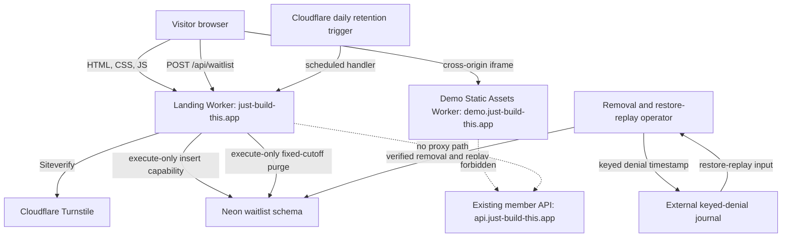
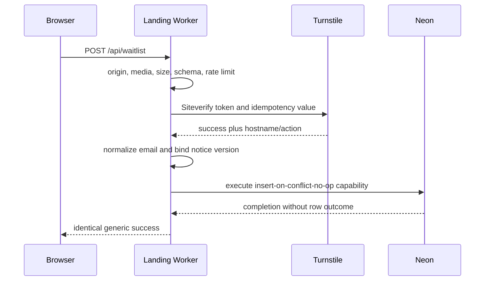
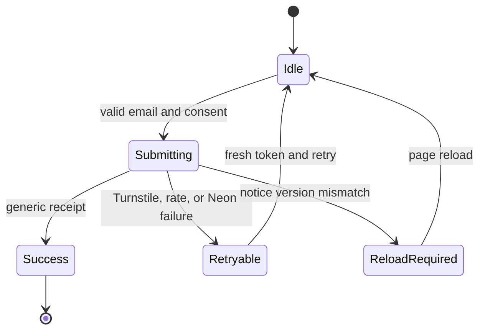
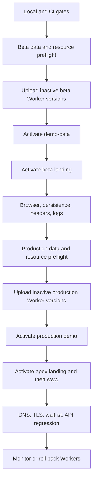

# Cloudflare Landing, Embedded Demo, and Neon Waitlist - Plan

## Goal Capsule

- **Objective:** A visitor to `just-build-this.app` can understand Ritual Investing, try a safe product demo without an account, and submit an email with a clear launch-contact consent assertion.
- **Means:** Use an apex landing/waitlist Worker, a separately isolated Flutter demo Worker, and a dedicated Neon waitlist capability while leaving the member API unchanged (KTD1-KTD8).
- **Authority:** Product Requirements govern user-visible behavior. Key Technical Decisions govern implementation mechanisms. Implementation Units cannot weaken either contract.
- **Execution profile:** Deep, security-sensitive, privacy-sensitive, cross-surface code delivery.
- **Stop conditions:** Stop release if the demo reaches Auth0 or a member API, if application telemetry contains waitlist PII, if privacy contact delivery is unverified, if provider/binding identifiers overlap across environments, or if a custom-domain change threatens an existing host.
- **Tail ownership:** Name a landing/demo release owner, Cloudflare/DNS owner, Neon security owner, privacy data steward, production verifier, and rollback executor in the release record. One person may hold multiple roles, but each checkpoint must have an owner.

---

## Product Contract

### Summary

Add a semantic landing page at `just-build-this.app` with a cross-origin embedded demo and an email waitlist.
The demo will reuse the current Ritual Investing interface through deterministic in-memory services and will enter the member shell without user authentication.
The waitlist will store only an unverified email/consent submission in a dedicated Neon data boundary. A later mailbox-confirmation workflow must run before any launch contact.

### Problem Frame

The repository has a production-oriented mobile member app and an authenticated API, but no apex website or browser demo.
Publishing the member build with an auth bypass would weaken a mature access-control boundary.
Using member data for anonymous visitors would also create unnecessary privacy and isolation risk.
The launch surface therefore needs its own deployable boundary, a web-safe demo composition, and a minimal waitlist lifecycle.

### Key Decisions

- **The auth-free experience is an isolated demo.** (session-settled: user-approved — chosen over a blanket auth bypass: public access must not weaken authenticated member routes or data.) Governs R4-R7 and R15.
- **The demo adapts the existing product experience.** (session-settled: user-approved — chosen over a separate scripted tour: visitors should experience the real shell and visual language.) Governs R4 and R7.
- **Demo state is disposable and isolated.** (session-settled: user-approved — chosen over shared anonymous visitor state: no visitor may observe or inherit another visitor's activity.) Governs R6.
- **The waitlist captures email and consent only.** (session-settled: user-approved — chosen over CRM, administration, or outbound-marketing scope: the first release only needs a privacy-respecting launch list.) Governs R8-R11 and R16-R18.
  - **Security qualification:** The v1 row records the submitter's assertion but does not prove mailbox ownership. It cannot authorize outbound contact until the deferred confirmation workflow succeeds.

### Actors

| ID | Actor | Responsibility |
|---|---|---|
| A1 | Visitor | Reads the landing page, uses the demo, and chooses whether to join the waitlist. |
| A2 | Landing Worker | Serves the apex site and processes only the waitlist API route. |
| A3 | Demo Worker | Serves the auth-free Flutter build and reports bounded readiness state to the parent page. |
| A4 | Cloudflare Turnstile | Supplies an abuse signal that the Landing Worker validates server-side. |
| A5 | Neon Postgres | Persists the minimal provisional submission through execute-only database capabilities. |
| A6 | Site operator | Coordinates resource provisioning, activation evidence, and rollback ownership. |

### Requirements

**Landing and product framing**

- R1. `https://just-build-this.app/` must be a semantic, responsive, keyboard-accessible, and crawlable HTML landing page whose primary content does not depend on Flutter.
- R2. The landing page must use the current Ritual Investing vocabulary and visual system while identifying the experience as Demo, simulated investing, and not financial advice.
- R3. The landing page must embed the demo with a descriptive frame title, a bounded ready timeout, Retry, Reset, and Open Demo fallbacks, and no focus trap.

**Auth-free demo**

- R4. The demo must expose a curated version of the existing four-branch member shell with Daily Ritual, Discover and Asset Codex, Coven and Grimoire, and portfolio/Profile content.
- R5. The demo must reach its ready shell without constructing or invoking the production auth/session lifecycle, Auth0, `/v1/session/bootstrap`, or any `api*.just-build-this.app` host.
- R6. Each iframe or direct demo load must start from canonical fixtures, keep all visitor state in memory, disable navigation restoration, and return to baseline on Reset, reload, or history navigation.
- R7. Every visible demo control must complete through a coherent simulated path; unsupported account, privacy, funding-provider, notification, purchase, upload, or production-side-effect controls must be absent.

**Waitlist and privacy**

- R8. The waitlist form must accept an email only after an initially unchecked consent assertion tied to the rendered privacy notice version, without representing mailbox ownership as verified.
- R9. The Landing Worker must reject invalid origin, method, media type, body size, schema, rate-limit, and Turnstile checks before Neon access.
- R10. A valid new or duplicate email submission must produce the same generic success response, while a duplicate is an immutable no-op against one case-insensitive normalized row.
- R11. The active waitlist table must store only normalized email, notice version, and the server submission timestamp.
- R16. The privacy lifecycle must remove a mailbox-possession-verified address from the active table through an idempotent, non-enumerating operation.
- R17. The active waitlist must purge each provisional submission before it reaches 24 months.
- R18. Neon restore history must never reactivate a removed or expired row when waitlist traffic resumes.

**Hosting, operations, and release**

- R12. Production and beta must use separate landing, demo, Turnstile, rate-limit, and dedicated waitlist Neon projects while preserving `api.just-build-this.app` and `api-beta.just-build-this.app` behavior.
- R13. The landing, demo, and beta hosts must have host-specific CSP, framing, cache, canonical, and indexing behavior, with `www.just-build-this.app` redirecting to the apex.
- R14. Allowlisted application telemetry must distinguish landing availability, demo readiness, validation failure, Turnstile failure, throttling, and Neon failure without recording email, token, request body, raw IP, user agent, or connection data.
- R15. Release proof must cover mobile-auth regression, demo isolation, waitlist persistence and failure behavior, browser accessibility, DNS/TLS, monitoring, and independent Worker rollback.

### Key Flows

- F1. Landing and demo
  - **Trigger:** A1 opens the apex landing page.
  - **Actors:** A1, A2, A3
  - **Steps:** A2 serves meaningful HTML before the demo is ready. A3 starts from the dedicated shell runtime and emits a versioned ready message after initial Ritual data paints. The parent accepts the message only from the expected origin, environment, frame attempt, and window. A1 navigates supported product content or uses Reset/Open Demo.
  - **Outcome:** The visitor can explore a fresh, disclosed demo without an account or member data.
  - **Covered by:** R1-R7
- F2. Waitlist submission
  - **Trigger:** A1 submits a valid email with consent.
  - **Actors:** A1, A2, A4, A5
  - **Steps:** A2 validates the request boundary and layered abuse controls. A4 validates the one-time token, hostname, and action. A2 normalizes the email and invokes the execute-only insert capability. A2 returns a non-enumerating result.
  - **Outcome:** The UI announces receipt without claiming mailbox verification or email delivery.
  - **Covered by:** R8-R11 and R14
- F3. Beta-to-production release
  - **Trigger:** All local and CI gates pass.
  - **Actors:** A2, A3, A4, A5, A6
  - **Steps:** Provision beta schema, roles, secrets, and rate limits. Deploy beta demo and landing. Run deployed browser and persistence proof. Promote production demo before production landing. Verify apex, demo, waitlist, and existing API hosts.
  - **Outcome:** Production becomes available with an additive schema and independently reversible Worker versions.
  - **Covered by:** R12-R15

### Acceptance Examples

- AE1. **Covers R1-R3.** Given the demo host does not become ready, when the landing timeout expires, then the product copy and waitlist remain usable and the page presents Retry and Open Demo actions.
- AE2. **Covers R4-R5.** Given a clean browser context, when the demo loads directly or in the iframe, then it reaches the curated shell without an auth/session object and the network trace contains no Auth0, member API, Neon, or non-static third-party request.
- AE3. **Covers R6-R7.** Given a visitor completes a supported simulated action, when they Reset, hard reload, or use browser history, then the same canonical fixture state returns and no cookie, local/session storage, IndexedDB, service worker, or restoration state contains visitor state.
- AE4. **Covers R8-R10.** Given a valid new email, current notice version, allowed origin, and valid Turnstile token, when the form submits, then one normalized unverified row exists and the UI announces generic receipt.
- AE5. **Covers R10-R11.** Given two concurrent submissions whose emails normalize to the same value, when both complete, then one immutable row exists, its original timestamp/version are unchanged, and both receive the same status and body.
- AE6. **Covers R9.** Given an expired, replayed, wrong-host, or wrong-action Turnstile token, when the request reaches the Worker, then Neon is not called and the UI can obtain a fresh token for retry.
- AE7. **Covers R9 and R14.** Given Neon is unavailable after successful Turnstile validation, when the form submits, then the Worker returns a sanitized retryable failure, the form preserves the email locally, and logs contain no submitted data.
- AE8. **Covers R8-R9.** Given an old cached page submits an obsolete notice version, when the Worker validates it, then the request is rejected without a write and the UI asks the visitor to reload.
- AE9. **Covers R12-R15.** Given the beta smoke suite succeeds, when production deploys, then apex and demo TLS/routing work, the existing API health behavior is unchanged, and prior Worker versions remain available for rollback.
- AE10. **Covers R16-R18.** Given a verified removal or retention purge followed by a Neon restore, when traffic is considered for reactivation, then the independent denial/retention replay removes the restored row before the endpoint is enabled.

### Scope Boundaries

**In scope**

- Apex landing copy, design, accessibility, SEO metadata, embedded-demo controls, privacy notice, and waitlist states.
- A dedicated Flutter web demo composition that reuses current product views with curated in-memory services.
- Cloudflare Workers Static Assets, custom domains, Turnstile, rate limiting, observability, beta resources, and rollback instructions.
- Dedicated production/beta Neon waitlist projects, migration history, runtime capability, retention/removal controls, and integration tests.

**Deferred to Follow-Up Work**

- Mailbox confirmation, launch announcements, newsletters, unsubscribe automation, and other outbound email workflows. Mailbox confirmation is a prerequisite to any contact, not a claim satisfied by v1.
- Waitlist administration, export, segmentation, analytics, referral attribution, and CRM integration.
- Live public-preview data in the demo, a production web member app, or changes to member authentication.
- Flutter Wasm, desktop redesign, offline demo state, or cross-device demo continuity.

**Outside this product's identity**

- Real-money execution, brokerage custody, personalized financial advice, guaranteed outcomes, or coercive engagement mechanics.

---

## Planning Contract

### Key Technical Decisions

- KTD1. **Separate the three runtime surfaces.** The new `ritual-investing-site` package owns the apex landing and same-origin `POST /api/waitlist`. A second Static Assets deployment owns `demo.just-build-this.app`. The existing member API remains unchanged. This gives the iframe a real origin boundary and prevents public waitlist availability from depending on member API configuration or restore cutover. Governs R3, R5, R9, and R12-R15.
- KTD2. **Split an auth-independent member-shell runtime from the production entry lifecycle.** (session-settled: user-approved — chosen over a blanket auth bypass: the generated demo bundle must never construct production authentication, session, or API adapters.) `RitualInvestingApp` and member routes depend on a provider-neutral app-runtime port. The production router layers the Auth0/`EntryCoordinator` entry lifecycle around that port. `lib/demo_main.dart` supplies the port directly from a completed bootstrap and uses member-only routes. Demo-reachable ports and cached repositories must not import generated adapters. Governs R4-R5.
- KTD3. **Promote a curated fixture capability into production-owned demo services.** (session-settled: user-approved — chosen over a separate scripted tour: the real shell, controllers, theme, and disclosures remain the presentation authority.) Use `test/support/fixture_services.dart` as design evidence, not a shipping import. Expose only the controllers whose in-memory service paths are complete. Governs R4 and R7.
- KTD4. **Treat each frame as the demo session boundary.** (session-settled: user-approved — chosen over shared anonymous state: iframe recreation is the reset operation and no persistent store participates.) Disable app/router restoration for the demo. Define ready as: completed member bootstrap, established feature scope, satisfied member gate, successful initial Ritual data load, mounted shell, and a painted frame. Exchange only environment, event type, protocol version, and current-frame attempt identity. Production and beta peers trust only their matching environment, and each landing release supports the current and immediately previous protocol version for rollback. Governs R3, R5-R6.
- KTD5. **Give the waitlist physically isolated, execute-only Neon capabilities.** (session-settled: user-approved — chosen over CRM or member-schema reuse: the runtime needs only a minimal provisional submission insert.) Use separate production and beta waitlist Neon projects, each with its own migration ledger, lock namespace, owner, and schema. Grant the Worker role execute access only to a parameterized insert function and a no-argument fixed-cutoff purge function. Both use fixed trusted `search_path`, revoked `PUBLIC` access, database-owned time, and no PII return; the insert uses conflict-no-op semantics. Run purge daily against a database-owned 23-month-29-day cutoff, with retry and overdue alerts, so active rows cannot cross 24 months. Use Drizzle 0.45.2 with `neon-http` for one-shot invocation and a direct owner URL for committed migrations. Governs R8-R12 and R16-R18.
- KTD6. **Make abuse and consent validation a fail-closed request protocol.** Route only `/api/*` through Worker code. Enforce exact production/beta origins, strict JSON, a small body cap, pseudonymous per-source and route-wide throttles, a WAF/budget ceiling, Turnstile Siteverify, expected hostname/action, and one atomic insert capability. Fail closed when any abuse-control binding is unavailable, and provide a submission-only kill switch that preserves landing/demo availability. Use an opaque idempotency value for a bounded Siteverify retry. Governs R8-R10 and R14.
- KTD7. **Use environment-specific static security, privacy, and cache policies.** The landing/privacy CSP denies framing and permits only the exact demo, Turnstile, form, and connection needs. Each demo CSP permits only its matching landing origin, denies unnecessary browser permissions/connections, and sends no conflicting `X-Frame-Options`. Prohibit domain-scoped credentials on `.just-build-this.app`; security cookies must be HostOnly and use the `__Host-` contract. Disable Cloudflare invocation logs and emit only allowlisted custom application events. Derive the enforced demo CSP from a Flutter 3.47.1 JavaScript release build after report-only validation. Revalidate entry files, cache fingerprinted assets immutably, self-host runtime assets, publish no source maps, and add no demo service worker. Governs R1-R3 and R12-R15.
- KTD8. **Separate deployment from activation and promote through beta.** Provision and verify data/resources first, upload inactive Worker versions second, then activate beta demo, beta landing, production demo, production landing, and `www` in order. Freeze unrelated secret/key rotation during the release. Keep the schema and provisional rows during code rollback, retain current/previous landing-demo protocol compatibility, and prefer Worker-version rollback over DNS detachment. A partially applied migration requires forward repair before traffic, not an automatic down-migration. Governs R12-R18.

### High-Level Technical Design

The diagrams fix the component boundary, request order, UI states, and rollout gates. Exact class and helper names remain local to implementation.









### Output Structure

```text
ritual-investing-app/
  lib/
    demo_main.dart
    demo/
      demo_bootstrap.dart
      demo_shell_runtime.dart
      demo_services.dart
    core/bootstrap/
      app_runtime.dart
      dependency_container.dart
      member_shell_runtime.dart
      production_dependency_container.dart
  web/
    index.html
    manifest.json
  integration_test/
    demo_browser_workflows_test.dart

ritual-investing-site/
  src/
    index.ts
    config.ts
    observability.ts
    db/
      client.ts
      schema.ts
    waitlist/
      repository.ts
      route.ts
      schemas.ts
      turnstile.ts
    retention/
      scheduled.ts
  public/
    index.html
    styles.css
    landing.js
    _headers
    robots.txt
    sitemap.xml
    privacy/waitlist/index.html
  drizzle/
    0000_waitlist.sql
  scripts/
    build-assets.ts
    resource-manifest.ts
    check-migrations.ts
    provision-waitlist-role.sql.example
    record-removal.ts
    replay-removals.ts
    smoke-hosts.ts
    check-retention.ts
    baseline-release.ts
  test/
  drizzle.config.ts
  package.json
  wrangler.jsonc
  wrangler.beta.jsonc
  wrangler.demo.jsonc
  wrangler.demo-beta.jsonc
```

Generated `dist/` and Flutter build outputs remain uncommitted.
The site build consumes the app-owned Flutter output through a hashed manifest; copied demo assets are never edited in `ritual-investing-site`.

### Alternative Approaches Considered

- **Serve the demo beneath `/demo/` on the apex Worker.** This reduces deployment count, but `allow-scripts` plus `allow-same-origin` would not provide a meaningful iframe sandbox and the Flutter CSP/cache policy would share the marketing origin.
- **Put the waitlist in `ritual-investing-api`.** This reuses mature Hono and migration patterns, but it couples an anonymous launch form to member API binding validation, restore-cutover middleware, OpenAPI/client churn, and the member deployment rollback path.
- **Build a separate scripted product tour.** This reduces Flutter web work, but it conflicts with the settled requirement to adapt the current experience and creates a second presentation implementation that can drift.

### Dependencies and Prerequisites

- The Cloudflare zone for `just-build-this.app` must be active, and read-only DNS inspection must confirm that the apex, `www`, demo, beta, and demo-beta changes do not conflict with existing records.
- Production and beta Turnstile widgets, site keys, secret keys, and distinct Cloudflare rate-limit namespace IDs must exist before deployment.
- Neon must provide separate production and beta waitlist projects, with no branch or database cloned from member or production PII.
- `privacy@just-build-this.app` must route to a verified operator mailbox before the waitlist is enabled.
- The checked-in notice identifier is `waitlist-v1-2026-08-25`; a copy change must create a new identifier instead of rewriting the accepted record's meaning.
- A zone cookie inventory must confirm that no credential is scoped to `.just-build-this.app`; any future credential must be HostOnly and follow the `__Host-` cookie contract.

### System-Wide Impact

- **Authentication:** Mobile production keeps `main.dart`, Auth0 session restoration, and the generated API client around the new provider-neutral shell runtime. The demo constructs only that shell runtime and never changes API authorization middleware.
- **Data lifecycle:** Waitlist PII lives in dedicated production/beta Neon projects. Runtime cannot read rows. Removal uses a separate maintenance capability and a versioned keyed-denial record outside Neon's restore history. Retention replay gates every restore.
- **Deployment:** The repository gains two deployment families comprising four Worker services and two waitlist Neon projects. Beta and production resource names, trust, keys, roles, and data remain pairwise isolated.
- **Developer workflow:** CI gains Flutter web, site Worker, Postgres, browser, asset-budget, and provider-boundary gates. Existing mobile and API jobs remain regression authorities.
- **Visitor experience:** The landing page remains useful when Flutter, Turnstile, or Neon is unavailable. Demo and waitlist failures never block the core marketing content.

### Risks and Mitigations

| Risk | Severity | Mitigation |
|---|---|---|
| A shared Flutter import pulls auth/session, `dart:io`, or member API code into the demo bundle. | High | Extract a provider-neutral shell runtime and feature ports, validate the transitive import graph, inspect release assets, and capture browser network traffic. |
| Visible fixture controls call an incomplete service and dead-end. | High | Curate optional controllers, add a route/control inventory test, and require one complete simulated mutation. |
| Flutter CSP or caching prevents startup or strands stale hashed assets. | High | Validate release output in report-only mode, revalidate entry files, deploy atomically, and check asset references before promotion. |
| Turnstile, origin checks, or eventually consistent rate limits are treated as authoritative identity or cost control. | High | Treat rows as unverified, layer pseudonymous and route-wide budgets with WAF/kill-switch controls, and preserve the member API boundary unchanged. |
| Duplicate or concurrent submissions corrupt consent provenance. | Medium | Use a unique normalized-email key and an insert-on-conflict-no-op capability that cannot update the original timestamp/version. |
| PII leaks through errors, invocation logs, tests, provider consoles, or operational scripts. | High | Disable invocation logs, allowlist custom events, use synthetic addresses, inspect provider consoles, and never serialize request/provider objects. |
| Custom-domain activation disrupts the apex or an existing API host. | High | Inspect exact DNS records first, deploy beta hosts, preserve API host smoke tests, and keep independent rollback commands ready. |
| A domain-scoped cookie or permissive CSP weakens iframe isolation. | High | Prohibit domain cookies, enforce pairwise frame ancestry and narrow directives, use exact message target origins, and test effective deployed policies. |
| A removal or expired row returns through Neon restore history. | High | Purge before 24 months, retain a keyed denial timestamp outside Neon for the provider restore window, and block traffic until restore replay succeeds. |

### Resource and Trust Matrix

The implementation and runbook must record the following for each environment. A production row may trust only production peers, and a beta row may trust only beta peers.

| Environment | Landing service/host | Demo service/host | Waitlist data | Abuse and consent resources | Rollback peer |
|---|---|---|---|---|---|
| Production | Apex Worker / `just-build-this.app` | Demo Worker / `demo.just-build-this.app` | Production waitlist Neon project, owner, execute role, migration head | Production Turnstile widget, source/route limits, WAF rule, denial journal, kill switch | Current and immediately previous compatible landing/demo pair |
| Beta | Beta Worker / `beta.just-build-this.app` | Demo-beta Worker / `demo-beta.just-build-this.app` | Beta waitlist Neon project, owner, execute role, migration head | Beta Turnstile widget, source/route limits, WAF rule, denial journal, kill switch | Current and immediately previous compatible beta pair |

### Rollout Gates and Initial Alerts

- **Preflight stop:** Stop on unexplained DNS/wildcard routes, migration/checksum drift, grant/default-privilege drift, domain-scoped credentials, missing privacy delivery, production/beta identifier overlap, or an API-host baseline mismatch.
- **Activation stop:** Stop on any forbidden demo request, invalid-request database write, application PII/token log, pairwise-trust violation, effective-CSP failure, or existing API synthetic failure.
- **Rollback threshold:** Roll back the affected Worker version after three consecutive synthetic failures, or when relevant Worker/Neon/Turnstile-provider failures exceed 1 percent for five minutes with at least 20 attempts.
- **Investigation threshold:** Investigate demo ready timeouts above 1 percent for 15 minutes with at least 20 sessions, or p95 endpoint latency above twice the beta baseline for 15 minutes with at least 50 attempts.
- **Evidence cadence:** Record redacted proof before activation, within five minutes of each host activation, and at +1 hour, +4 hours, and +24 hours. Separate ordinary validation, bot, and throttle outcomes from provider availability failures.

### Documentation and Operational Notes

- Treat `docs/solutions/architecture-patterns/ritual-investing-app-current-intent-and-architecture.md` as product/design guidance, not a current file inventory.
- Apply the deployed-edge lesson in `docs/solutions/integration-issues/empty-bootstrap-post-rejected-at-cloudflare-edge.md`: beta proof must inspect actual response headers, browser console, and request shapes rather than relying only on mocks.
- Update stale migration counts and missing beta secret-script aliases while documenting the new site resources; do not edit historical applied SQL migrations.
- The privacy page must identify the `just-build-this.app` operator, describe the row as an unverified launch-contact submission, link `privacy@just-build-this.app`, explain mailbox-possession removal, state the active-store and provider restore-window lifecycle, and disclose Cloudflare/Turnstile/Neon processing.
- Use production marketing indexing only for the apex landing page. Demo, beta, demo-beta, and Worker preview hosts must be `noindex`.
- Freeze unrelated secret rotation during activation. Worker rollback does not restore Turnstile secrets, hostname/action settings, rate-limit namespaces, WAF rules, R2 bindings, or Neon credentials.

---

## Implementation Units

### U1. Extract an auth-independent member-shell runtime

- **Goal:** Make the member shell constructible without any auth/session/provider lifecycle while preserving production mobile composition around it.
- **Requirements:** R5 and R15; KTD2.
- **Dependencies:** None.
- **Files:** `ritual-investing-app/lib/core/bootstrap/app_runtime.dart`, `ritual-investing-app/lib/core/bootstrap/dependency_container.dart`, `ritual-investing-app/lib/core/bootstrap/member_shell_runtime.dart`, `ritual-investing-app/lib/core/bootstrap/production_dependency_container.dart`, `ritual-investing-app/lib/core/bootstrap/member_feature_scope.dart`, `ritual-investing-app/lib/app/ritual_investing_app.dart`, `ritual-investing-app/lib/core/navigation/app_router.dart`, `ritual-investing-app/lib/features/asset_codex/data/repository.dart`, `ritual-investing-app/lib/features/circles/data/repository.dart`, `ritual-investing-app/lib/features/creators/data/repository.dart`, `ritual-investing-app/lib/features/grimoires/data/repository.dart`, `ritual-investing-app/lib/main.dart`, `ritual-investing-app/test/bootstrap_test.dart`, `ritual-investing-app/test/demo_dependency_boundary_test.dart`
- **Approach:**
  1. Introduce a provider-neutral app-runtime port for the member gate, active shell scope, navigation-facing controllers, theme state, and lifecycle notifications; it must expose no auth/session operation.
  2. Extract shell bootstrap, feature-scope ownership, branch loading, and disposal into a provider-neutral runtime that receives a completed `MemberBootstrap` and feature ports directly.
  3. Make the production `DependencyContainer` implement the app-runtime port and keep entry/auth actions in the production route layer. The demo must not instantiate that container, `AuthController`, `SessionRepository`, `EntryCoordinator`, or entry routes.
  4. Split provider-neutral ports/cached repositories from generated-client adapters in every file reachable through `MemberFeatureScope`.
  5. Move Auth0, generated API client, protected storage, path-provider, onboarding-draft, and private-export construction into the mobile production factory.
  6. Keep `main.dart` on the same production path and do not add a runtime skip-auth flag.
  7. Add a transitive Dart import-graph check that fails before build if demo code reaches auth, generated clients, mobile providers, `dart:io`, or provider-colocated repository modules.
- **Execution note:** Add characterization coverage for production entry transitions and shell scope ownership before extracting the runtime.
- **Patterns to follow:** `ritual-investing-app/lib/core/bootstrap/member_feature_scope.dart`, `ritual-investing-app/lib/core/bootstrap/production_member_feature_scope_factory.dart`, `scripts/check-member-provider-boundaries.sh`
- **Test scenarios:**
  - Existing mobile configuration creates the same Auth0-backed production container and preserves signed-out/member gate behavior.
  - A shell runtime built from platform-neutral ports starts from a completed bootstrap without creating or calling any auth/session object.
  - The transitive graph reachable from the shell runtime excludes `dart:io`, path-provider, secure storage, Auth0, generated clients, and generated-adapter imports.
  - Demo-reachable repository ports remain usable when generated adapters are absent from the build graph.
  - Missing production runtime configuration still renders the existing configuration failure and cannot select the demo factory.
- **Verification:** Flutter analysis and existing bootstrap, auth-gate, router, Android, and iOS build gates pass, while the provider-free shell runtime passes the import-graph boundary.

### U2. Build the curated in-memory Flutter demo

- **Goal:** Produce a release-buildable demo entrypoint that reuses the current product shell and has no external state or member-provider dependency.
- **Requirements:** R2-R7 and R15; KTD2-KTD4 and KTD7.
- **Dependencies:** U1.
- **Files:** `ritual-investing-app/lib/demo_main.dart`, `ritual-investing-app/lib/demo/demo_bootstrap.dart`, `ritual-investing-app/lib/demo/demo_shell_runtime.dart`, `ritual-investing-app/lib/demo/demo_services.dart`, `ritual-investing-app/lib/app/ritual_investing_app.dart`, `ritual-investing-app/lib/core/navigation/app_router.dart`, `ritual-investing-app/lib/features/shell/presentation/app_shell.dart`, `ritual-investing-app/web/index.html`, `ritual-investing-app/web/manifest.json`, `ritual-investing-app/test/demo_entrypoint_test.dart`, `ritual-investing-app/test/demo_services_test.dart`, `ritual-investing-app/integration_test/demo_browser_workflows_test.dart`, `ritual-investing-app/test_driver/integration_test.dart`
- **Approach:**
  1. Promote only the deterministic fixture data and services needed for the curated surface from `test/support/fixture_services.dart` into `lib/demo/`.
  2. Construct the provider-neutral shell runtime directly from a completed local bootstrap; do not use fake sign-in, session restoration, `DependencyContainer.bootstrap()`, or `bootstrapOnStart` as the bypass mechanism.
  3. Enable Flutter web semantics and expose the four member branches plus the listed content in R4.
  4. Include at least one coherent memory-only mutation and omit optional controllers whose operations are incomplete or imply a production side effect.
  5. Disable restoration IDs/history persistence for the demo without changing the production restoration path.
  6. Emit the KTD4 ready event only after initial Ritual data has loaded and the usable shell has painted; echo the environment and current-frame attempt identity without privileged data.
  7. Build normal JavaScript output with self-hosted assets and no service-worker state.
- **Execution note:** Start with failing widget tests for direct shell entry and the curated route/control inventory.
- **Patterns to follow:** `ritual-investing-app/test/support/fixture_services.dart`, `ritual-investing-app/lib/app/ritual_investing_app.dart`, `ritual-investing-app/test/visual_reference_test.dart`, `ritual-investing-admin/integration_test/admin_browser_workflows_test.dart`
- **Test scenarios:**
  - A clean demo entry reaches Daily Ritual without constructing an auth/session lifecycle or rendering Welcome, onboarding, login, entitlement recovery, or configuration-failure UI.
  - A visitor can navigate Ritual, Discover/Asset Codex, Coven/Grimoire, and You/portfolio content at a 430 by 932 viewport.
  - One supported simulated action changes visible state, while every exposed control completes without `UnimplementedError` or an external call.
  - Recreating the frame, reloading, or navigating browser history restores canonical fixtures and leaves cookies, local/session storage, IndexedDB, service-worker, and restoration state empty.
  - Startup emits ready only after member scope, gate, initial Ritual data, mounted shell, and paint are complete; it emits no sensitive detail on a forced initialization failure.
  - The Flutter 3.47.1 release build contains no Auth0 configuration, member API hostname, source map, or unsupported web import.
- **Verification:** The dedicated web target builds and its widget/browser tests pass while all existing mobile tests remain green.

### U3. Scaffold the apex and demo Cloudflare deployments

- **Goal:** Create a deployable site package with separate production/beta landing and demo Workers and deterministic asset assembly.
- **Requirements:** R1-R3 and R12-R18; KTD1, KTD5, KTD7, and KTD8.
- **Dependencies:** None.
- **Files:** `ritual-investing-site/package.json`, `ritual-investing-site/package-lock.json`, `ritual-investing-site/tsconfig.json`, `ritual-investing-site/src/index.ts`, `ritual-investing-site/src/config.ts`, `ritual-investing-site/src/retention/scheduled.ts`, `ritual-investing-site/scripts/build-assets.ts`, `ritual-investing-site/scripts/resource-manifest.ts`, `ritual-investing-site/wrangler.jsonc`, `ritual-investing-site/wrangler.beta.jsonc`, `ritual-investing-site/wrangler.demo.jsonc`, `ritual-investing-site/wrangler.demo-beta.jsonc`, `ritual-investing-site/test/routing.test.ts`, `ritual-investing-site/test/config.test.ts`, `ritual-investing-site/test/retention/scheduled.test.ts`, `.gitignore`
- **Approach:**
  1. Pin Node 22, Wrangler 4.125.0, Hono 4.13.3, Drizzle 0.45.2, and Neon serverless 1.1.0 to match the validated repository stack.
  2. Configure the landing Worker with Static Assets plus `run_worker_first` only for `/api/*`; return a deliberate JSON 404 for unknown API routes and a deliberate asset 404 elsewhere.
  3. Configure the demo deployments as asset-only Workers on `demo.just-build-this.app` and `demo-beta.just-build-this.app`.
  4. Assemble app-owned Flutter output by verified hash manifest into separate uncommitted landing/demo directories, and fail when asset counts, individual sizes, hashes, or references violate the deploy contract.
  5. Declare pairwise environment resources: source and route-wide rate limits, WAF/budget rule, denial-journal binding, submission kill switch, Turnstile settings, and waitlist project credentials.
  6. Register a daily scheduled handler that can call only the database-owned retention cutoff and reports aggregate success/failure.
  7. Enable allowlisted custom telemetry with invocation logs disabled, and disable `workers.dev`/preview exposure unless a documented beta proof needs it.
- **Execution note:** Establish packaging, HTTP routing, and scheduled-retention dispatch before adding submission-endpoint behavior.
- **Patterns to follow:** `ritual-investing-api/wrangler.jsonc`, `ritual-investing-api/wrangler.beta.jsonc`, `ritual-investing-api/src/index.ts`
- **Test scenarios:**
  - A static landing request is served from assets without constructing a database client.
  - `/api/unknown` reaches Worker code and returns JSON 404 rather than `index.html`.
  - A missing static path returns the intended asset 404 without a global SPA fallback.
  - Production and beta hostnames, Turnstile resources, database projects/roles, rate-limit namespaces, denial journals, WAF rules, and protocol peers cannot overlap.
  - A missing abuse-control binding or disabled kill switch fails submissions closed while static landing/demo assets remain available.
  - A scheduled purge retries transient failure, alerts when overdue, cannot accept a caller-supplied cutoff, and does not affect static or submission routing.
  - The demo build fails if any file exceeds the Cloudflare per-file limit or a referenced asset is absent.
- **Verification:** Type checks, Worker routing tests, asset assembly, and dry-run deploys pass for all four configurations.

### U4. Implement the landing, iframe lifecycle, and privacy UI

- **Goal:** Deliver the public product narrative, accessible embedded-demo controls, waitlist presentation, and versioned privacy notice.
- **Requirements:** R1-R3, R8, R11, R13-R14, and R16-R18; KTD4, KTD6, and KTD7.
- **Dependencies:** U2 and U3.
- **Files:** `ritual-investing-site/public/index.html`, `ritual-investing-site/public/styles.css`, `ritual-investing-site/public/landing.js`, `ritual-investing-site/public/_headers`, `ritual-investing-site/public/robots.txt`, `ritual-investing-site/public/sitemap.xml`, `ritual-investing-site/public/privacy/waitlist/index.html`, `ritual-investing-site/test/landing.test.ts`, `ritual-investing-site/test/browser/landing.spec.ts`
- **Approach:**
  1. Build the landing with semantic HTML and small progressive-enhancement JavaScript; do not add a client framework.
  2. Reuse canonical product terms, theme tokens, local fonts/assets, Demo disclosure, market-evidence posture, and non-advice language from repository authorities.
  3. Embed the demo cross-origin with `sandbox="allow-scripts allow-same-origin"`, a descriptive title, responsive phone frame, and full-screen link; grant no forms, popups, downloads, modals, or top navigation.
  4. Generate a unique frame-attempt identity and accept only a compatible KTD4 message from the matching environment, expected demo origin, exact source window, and current attempt. Use an exact target origin for parent messages and render only fixed local error copy.
  5. Reset by replacing the iframe node with a fresh URL instance instead of sending privileged commands into the frame.
  6. Render an email field, unchecked consent-assertion control, Turnstile mount, field errors, retry states, and an `aria-live` receipt region without implying mailbox verification or delivery.
  7. Publish the versioned privacy notice and provision copy for the verified removal address and retention rule.
- **Patterns to follow:** `ritual-investing-app/DESIGN.md`, `ritual-investing-app/lib/app/theme/app_theme.dart`, `ritual-investing-app/lib/core/presentation/demo_disclosure.dart`, `ritual-investing-app/lib/features/ritual/presentation/daily_ritual_screen.dart`, `CONCEPTS.md`
- **Test scenarios:**
  - Landing content, waitlist labels, privacy link, canonical URL, and disclosures remain readable with JavaScript disabled and the iframe unavailable.
  - A valid compatible ready message from the expected environment, origin, window, and current attempt reveals the demo controls; `null`, missing, stale-frame, cross-environment, later-version, hostile-string, or malformed messages are ignored.
  - A ready timeout presents Retry and Open Demo without hiding the waitlist, and Retry creates a new iframe.
  - Reset after a simulated action recreates the frame and returns canonical state.
  - Keyboard users can enter and leave the iframe, reach every form/control, and hear validation and success messages without a focus trap.
  - Production apex is indexable and canonical; privacy is linked; demo/beta assets are not indexed.
  - Landing/privacy cannot be framed; each demo can be framed only by its matching landing; nested framing and wildcard/unsafe CSP relaxations fail the header contract.
  - The deployed zone has no `.just-build-this.app` credential cookie, and the demo creates no cookie or other persistent browser state.
- **Verification:** Browser tests at desktop and mobile widths pass with no serious/critical accessibility violations, valid metadata, and effective headers.

### U5. Add isolated Neon projects and execute-only submission capability

- **Goal:** Create an additive, physically isolated, independently testable persistence boundary for provisional waitlist submissions and their privacy lifecycle.
- **Requirements:** R8, R10-R12, R14, and R16-R18; KTD5 and KTD8.
- **Dependencies:** U3.
- **Files:** `ritual-investing-site/src/db/schema.ts`, `ritual-investing-site/src/db/client.ts`, `ritual-investing-site/drizzle/0000_waitlist.sql`, `ritual-investing-site/drizzle/meta/`, `ritual-investing-site/drizzle.config.ts`, `ritual-investing-site/scripts/provision-waitlist-role.sql.example`, `ritual-investing-site/scripts/check-migrations.ts`, `ritual-investing-site/scripts/record-removal.ts`, `ritual-investing-site/scripts/replay-removals.ts`, `ritual-investing-site/test/postgres/migration.test.ts`, `ritual-investing-site/test/postgres/role-boundary.test.ts`, `ritual-investing-site/test/postgres/waitlist-repository.test.ts`, `ritual-investing-site/test/postgres/restore-replay.test.ts`
- **Approach:**
  1. Provision separate production and beta waitlist Neon projects; do not share or clone the member database or production waitlist data into beta.
  2. Create a waitlist-owned migration ledger, advisory-lock namespace, owner, schema, and table keyed by normalized email with immutable notice version and server submission timestamp.
  3. Create a parameterized `SECURITY DEFINER` insert function with fixed trusted `search_path`, no dynamic SQL, revoked default execution, insert-on-conflict-no-op behavior, and no row/outcome return.
  4. Create a no-argument purge function that deletes only rows at or beyond the database-owned 23-month-29-day threshold and returns only an aggregate count.
  5. Grant the runtime role only connect plus execute on those two functions. Revoke direct table DML/SELECT, schema creation, inherited/default privileges, and `BYPASSRLS`.
  6. Give verified-removal tooling a separate maintenance credential. Record each removal as a versioned keyed digest plus deletion timestamp in an environment-specific Cloudflare journal outside Neon.
  7. Require daily purge retry/overdue alerts and denial plus retention replay before any restored project resumes traffic.
  8. Commit checksum-checked migration history, repeat-migration proof, effective-grant snapshots, provider restore-window handling, and forward-repair instructions for partial migration.
- **Execution note:** Implement migration, effective-grant, conflict immutability, and restore-replay tests before the Worker repository.
- **Patterns to follow:** `ritual-investing-api/drizzle/0002_roles_and_rls.sql`, `ritual-investing-api/scripts/migrate.ts`, `ritual-investing-api/ops/provision-runtime-roles.sql.example`, `docs/ritual-investing/neon-runbook.md`
- **Test scenarios:**
  - A fresh Postgres 17 database migrates successfully and a second migration run is a no-op.
  - Mixed-case and surrounding-space variants normalize to one row while plus aliases and dots remain unchanged.
  - Concurrent and later duplicate inserts leave one row whose original notice version and submission timestamp never change.
  - The runtime role can invoke only the bounded insert and fixed-cutoff purge functions; direct `SELECT`, `INSERT`, `UPDATE`, `DELETE`, object creation, role inheritance, default/public privileges, and owner capabilities all fail.
  - Hostile and overlength function inputs cannot alter SQL structure, leak PII, or bypass table constraints.
  - A verified removal deletes only the target active row and records a keyed denial with no plaintext address. The daily retention function cannot delete a row before its database-owned cutoff or print addresses.
  - Restoring a project cannot enable traffic until denial timestamps and the current retention cutoff have been replayed; a resubmission newer than its prior denial is not deleted.
  - The waitlist migration ledger and lock are independent, and no waitlist project contains a member schema or production-to-beta data clone.
- **Verification:** Migration, repeatability, conflict immutability, effective privilege, retention, and restore-replay tests pass against Postgres 17 and both isolated waitlist projects.

### U6. Implement the fail-closed provisional waitlist endpoint

- **Goal:** Accept valid provisional submissions without enumeration, PII logging, or access to the member API.
- **Requirements:** R8-R10 and R12-R14; KTD1, KTD5, KTD6, and KTD7.
- **Dependencies:** U3 and U5.
- **Files:** `ritual-investing-site/src/index.ts`, `ritual-investing-site/src/config.ts`, `ritual-investing-site/src/observability.ts`, `ritual-investing-site/src/waitlist/schemas.ts`, `ritual-investing-site/src/waitlist/turnstile.ts`, `ritual-investing-site/src/waitlist/repository.ts`, `ritual-investing-site/src/waitlist/route.ts`, `ritual-investing-site/wrangler.jsonc`, `ritual-investing-site/wrangler.beta.jsonc`, `ritual-investing-site/test/waitlist/route.test.ts`, `ritual-investing-site/test/waitlist/turnstile.test.ts`, `ritual-investing-site/test/worker/waitlist.test.ts`, `ritual-investing-site/test/observability.test.ts`
- **Approach:**
  1. Define strict request and response contracts for `POST /api/waitlist`; reject unknown fields and any consent/notice mismatch.
  2. Apply the submission kill switch, exact-origin, method, content-type, body-size, schema, pseudonymous per-source limit, and route-wide budget before Siteverify or database work. Discard the raw source value after key derivation.
  3. Validate Turnstile server-side with a timeout, expected hostname, expected `waitlist` action, and bounded idempotent retry behavior.
  4. Normalize email with trim plus case-insensitive identity only, bind the deployed notice version, and invoke the KTD5 function without reading or classifying the row outcome.
  5. Return identical receipt for new/duplicate outcomes. Return sanitized field, throttle, stale-notice, disabled, Turnstile, and dependency failures that let the client choose reload or fresh-token retry.
  6. Emit only allowlisted aggregate events for the R14 categories. Never serialize `Request`, `Response`, environment, provider payloads, exceptions, or database values.
- **Execution note:** Start with failing Worker integration tests for the gate order and no-write failure paths.
- **Patterns to follow:** `ritual-investing-api/src/middleware/security-headers.ts`, `ritual-investing-api/src/middleware/rate-limit.ts`, `ritual-investing-api/src/middleware/responses.ts`, `ritual-investing-api/src/observability/telemetry.ts`
- **Test scenarios:**
  - A valid first submission and duplicate submission return byte-equivalent status/body while telemetry records only accepted requests and never classifies the database outcome.
  - Missing consent, malformed email, unknown fields, stale notice, wrong origin, wrong method/media type, and oversized body produce no Siteverify or Neon call when their earlier gate fails.
  - Expired, replayed, malformed, wrong-host, wrong-action, timed-out, and unavailable Turnstile responses produce no Neon call and a retry-safe public response.
  - Source or route-wide throttling returns `429` with a retry hint and does not call Turnstile or Neon; binding outage fails closed and distributed bursts trigger the WAF/budget alert.
  - Disabling submissions returns the documented unavailable state without affecting landing or demo assets, and re-enabling restores the full gate sequence.
  - A committed insert followed by a lost response can be retried with a fresh token and still produces one row.
  - Neon timeout, missing secret, or missing schema returns sanitized `503` and no response, custom event, or provider-console application log contains email, token, SQL, or connection data.
  - A cross-origin browser preflight or POST cannot use the endpoint, while the exact apex and beta origins follow their environment contract.
- **Verification:** Worker-runtime, Turnstile, Postgres integration, redaction, and configuration-isolation tests pass for beta and production bindings.

### U7. Add cross-surface browser, boundary, and CI gates

- **Goal:** Make demo isolation, waitlist behavior, accessibility, asset limits, and mobile/API regression mandatory before release.
- **Requirements:** R1-R18; all KTDs.
- **Dependencies:** U1-U6.
- **Files:** `.github/workflows/ritual-investing.yml`, `scripts/check-demo-provider-boundaries.sh`, `scripts/test-check-demo-provider-boundaries.sh`, `ritual-investing-site/test/browser/end-to-end.spec.ts`, `ritual-investing-site/test/browser/security-headers.spec.ts`, `ritual-investing-site/test/browser/network-boundary.spec.ts`, `ritual-investing-site/test/browser/accessibility.spec.ts`, `ritual-investing-site/package.json`
- **Approach:**
  1. Add Node/site jobs for type checks, Worker tests, Postgres 17 migration/role tests, browser tests, asset assembly, and Wrangler dry runs.
  2. Add a Flutter web job pinned to 3.47.1 for analysis, existing tests, dedicated release build, and Chrome integration flow.
  3. Scan the transitive demo import graph, source/build artifacts, browser network traffic, and browser storage for auth/session providers, API hosts, credentials, source maps, external runtime assets, restoration, and persistence APIs.
  4. Exercise the full landing-to-demo ready/reset flow and mocked waitlist states in local browser CI.
  5. Extend the workflow-dispatch staging gate with deployed beta landing/demo/waitlist, abuse-control outage, kill-switch, grant, provider-console, restore-replay, and rollback-compatibility proof while keeping existing mobile/API jobs unchanged.
- **Execution note:** Treat the forbidden-provider checks as fail-closed repository boundaries with self-tests, not best-effort grep output.
- **Patterns to follow:** `.github/workflows/ritual-investing.yml`, `scripts/check-member-provider-boundaries.sh`, `scripts/test-check-member-provider-boundaries.sh`, `ritual-investing-admin/integration_test/admin_browser_workflows_test.dart`
- **Test scenarios:**
  - Browser tracing across every curated demo route and action contains only demo-host static requests and the bounded parent ready message, with no restoration/session state after reload or history navigation.
  - A crafted forbidden import/hostname fixture makes the boundary self-test fail, while the clean demo passes.
  - Landing, iframe loading/failure, waitlist validation/success/failure, and privacy pages have no serious or critical automated accessibility findings.
  - Chrome, Firefox, Safari-equivalent WebKit, and mobile-width runs preserve iframe sizing, keyboard escape, pairwise CSP, cookie isolation, hostile-message rejection, and waitlist state behavior.
  - The production member/API regression gates pass and the existing API host receives no new route or anonymous capability.
  - CI fails on public source maps, stale/missing or hash-mismatched Flutter assets, an oversized asset, an immutable entry file, an invocation-log setting, or a wildcard/unsafe security-policy relaxation.
- **Verification:** Pull requests cannot pass until app, site, database, Worker, browser, boundary, and existing regression jobs are green.

### U8. Document and rehearse activation, privacy, restore, and rollback operations

- **Goal:** Make deployment and the waitlist data lifecycle executable without hidden operator knowledge.
- **Requirements:** R11-R18; KTD5, KTD7, and KTD8.
- **Dependencies:** U3, U5-U7.
- **Files:** `docs/ritual-investing/site-demo-runbook.md`, `docs/ritual-investing/cloudflare-runbook.md`, `docs/ritual-investing/neon-runbook.md`, `docs/ritual-investing/beta-environment.md`, `docs/ritual-investing/deployment-handoff.md`, `ritual-investing-site/scripts/smoke-hosts.ts`, `ritual-investing-site/scripts/check-retention.ts`, `ritual-investing-site/scripts/baseline-release.ts`, `ritual-investing-site/test/operations/runbook-contract.test.ts`
- **Approach:**
  1. Record a redacted signed baseline of exact DNS/wildcard routes, Custom Domain ownership, Worker versions, TLS/host response contracts, existing API behavior, resource identifiers, migration heads/checksums, effective grants, Turnstile pairing, cookie inventory, and privacy delivery.
  2. Fix stale migration counts and beta script aliases, then document separate production/beta projects, roles, secrets, Turnstile keys, rate limits, WAF rules, denial journals, kill switches, protocol pairs, and rollback identifiers.
  3. Split upload from activation and apply the KTD8 sequence. Verify the affected host and both existing API hosts after every Custom Domain mutation before continuing.
  4. Before public traffic, prove the production table baseline. Within five minutes of activation, create one synthetic row, prove duplicate/invalid cases, and remove it back to baseline without placing its email in evidence.
  5. Document mailbox-possession removal, keyed denial timestamps, purge cadence before 24 months, overdue alerts, provider restore-window expiry, and mandatory denial/retention replay before service after restore.
  6. Freeze unrelated credential rotation, rehearse compatible landing/demo Worker rollback, and preserve the additive schema and provisional rows. If writes must stop, restore the prior landing version and revoke/rotate only the waitlist capability.
  7. Apply the rollout thresholds and evidence cadence, with named role owners and a final go/no-go owner in the release record.
- **Execution note:** DNS and deployed-edge checks must resolve exact targets before any custom-domain or secret mutation.
- **Patterns to follow:** `docs/ritual-investing/cloudflare-runbook.md`, `docs/ritual-investing/neon-runbook.md`, `docs/ritual-investing/beta-environment.md`, `docs/ritual-investing/deployment-handoff.md`
- **Test scenarios:**
  - Runbook validation fails when a baseline fingerprint, owner, host, secret, role, rate/WAF resource, Turnstile pair, journal, protocol peer, privacy contact, or rollback identifier is missing or overlaps another environment.
  - Beta smoke verifies TLS, landing content, iframe ready/navigation/reset, insert/conflict immutability, invalid zero-write cases, kill-switch/binding outage, effective headers, custom events, provider consoles, and continued API health.
  - Current and previous landing/demo versions interoperate through the ready protocol and frame policy; an incompatible pair cannot be activated.
  - A rollback rehearsal restores the prior Worker versions while schema/rows remain and both existing API hosts stay healthy; DNS detachment is used only as a documented last resort.
  - A synthetic mailbox-possession removal deletes only its target, writes no plaintext to the journal/evidence, and remains deleted after a restore replay.
  - A retention run removes rows before 24 months, alerts on overdue work, and a dry run reports only aggregate counts.
  - Production smoke returns the synthetic table count to its baseline and meets the +5-minute, +1-hour, +4-hour, and +24-hour evidence gates.
- **Verification:** A second operator can follow the runbooks through beta proof and rollback without undocumented credentials, commands, or decisions.

---

## Verification Contract

| Gate | Applies to | Required proof | Done signal |
|---|---|---|---|
| `flutter analyze` and `flutter test` | U1-U2, U7 | Production lifecycle, provider-neutral shell, transitive import boundary, router, visual, and accessibility coverage | No analyzer issue, boundary escape, or failing app test. |
| `flutter build web --release -t lib/demo_main.dart` and Chrome integration flow | U2, U4, U7 | Provider-free compile graph, curated journey, fully loaded ready signal, mutation, reset, history, and empty browser state | Release assets build with Flutter 3.47.1 and the browser flow passes. |
| Existing Android/iOS build and member integration jobs | U1-U2, U7 | Production Auth0/member behavior did not regress | Existing mobile jobs pass unchanged. |
| Site type check and unit/Worker suites | U3-U4, U6 | Routing, pairwise config isolation, layered abuse gates, kill switch, Turnstile, endpoint responses, and allowlisted events | All site tests pass in the Cloudflare runtime harness, including binding-outage fail-closed cases. |
| Site Postgres 17 migration and role suites | U5-U6 | Independent ledger, immutable conflict, execute-only grants, retention, removal, and restore replay | Database/effective-grant tests pass twice with no migration drift or direct table privilege. |
| Asset build and Wrangler dry runs for four configs | U2-U3, U7 | Hashed landing/demo assembly, binding completeness, file limits, log posture, pairwise policy, and deployability | All assets/hashes resolve and every dry run succeeds. |
| Demo/member provider-boundary scripts | U1-U2, U7 | Forbidden dependency/host fixtures fail closed and clean sources pass | Both boundary self-tests and production boundary checks pass. |
| Cross-browser end-to-end and accessibility suites | U4, U7 | Landing, hostile/stale frame messages, pairwise CSP, cookie isolation, waitlist states, keyboard, semantics, and mobile width | Chromium, Firefox, WebKit, effective-header, and accessibility gates pass. |
| Deployed beta smoke and rollback rehearsal | U8 | Baselines, real DNS/TLS, protocol compatibility, Turnstile, zero-write failures, Neon restore replay, custom/provider log inspection, alerts, API preservation, and rollback | Redacted evidence meets every stop/rollback threshold with synthetic data only. |

The implementation must also run `npm audit` for the new site package and review direct findings; audit noise is not a substitute for the behavioral security gates above.

---

## Definition of Done

- Every R-ID is implemented and demonstrated by its cited unit tests, Acceptance Examples, or deployed beta proof.
- U1-U8 meet their unit Verification outcomes, and all Verification Contract gates pass.
- The demo bundle contains no production auth/session/provider graph, and its runtime produces zero Auth0, member API, Neon, analytics, or other non-static third-party requests.
- Valid concurrent duplicate submissions leave one immutable normalized row and receive indistinguishable public responses; no duplicate refreshes the timestamp or notice version.
- No application response, custom event, trace, test artifact, screenshot, or runbook evidence contains a submitted email, Turnstile token, raw request body, IP, user agent, SQL detail, or connection string. Cloudflare invocation logs are disabled and processor metadata is disclosed and access-controlled.
- Production and beta Cloudflare/Turnstile/Neon resources are disjoint, and existing API hosts pass regression smoke checks before and after deployment.
- The release record names every operational role, preserves the redacted preflight baseline, and satisfies the +5-minute, +1-hour, +4-hour, and +24-hour stop/go gates.
- `privacy@just-build-this.app` is verified, the notice identifies submissions as unverified, and no outbound contact occurs before mailbox confirmation.
- Removal, pre-24-month purge, overdue alerting, provider restore-window expiry, and denial/retention replay are rehearsed with synthetic data.
- Landing and demo Workers can roll back independently across the tested current/previous protocol window without changing schema, provisional rows, or secrets.
- Documentation reflects the current migration count, scripts, resource names, alert paths, and operator ownership.
- Generated, abandoned, superseded, debug, source-map, and experimental implementation artifacts are removed from the final diff.

---

## Appendix

### Local Sources

- `CONCEPTS.md` — canonical Ritual Investing vocabulary and Demo/evidence boundaries.
- `ritual-investing-app/PRODUCT.md` and `ritual-investing-app/DESIGN.md` — product scope, accessibility, disclosures, and visual authority.
- `ritual-investing-app/lib/core/bootstrap/dependency_container.dart` and `ritual-investing-app/test/support/fixture_services.dart` — production composition and the existing auth-free test seam.
- `ritual-investing-app/lib/core/bootstrap/member_feature_scope.dart` — optional capability gates for curated demo controls.
- `ritual-investing-api/src/app.ts`, `ritual-investing-api/src/middleware/security-headers.ts`, and `ritual-investing-api/src/middleware/rate-limit.ts` — request, telemetry, CORS, and abuse-control patterns to adapt without adding an API route.
- `.github/workflows/ritual-investing.yml` and `ritual-investing-admin/integration_test/admin_browser_workflows_test.dart` — pinned toolchain and browser-test precedent.
- `docs/solutions/architecture-patterns/ritual-investing-app-current-intent-and-architecture.md` and `docs/solutions/integration-issues/empty-bootstrap-post-rejected-at-cloudflare-edge.md` — intent boundaries and deployed-edge verification lessons.

### External Sources

- [Cloudflare Workers Static Assets routing](https://developers.cloudflare.com/workers/static-assets/routing/worker-script/), [headers](https://developers.cloudflare.com/workers/static-assets/headers/), and [Custom Domains](https://developers.cloudflare.com/workers/configuration/routing/custom-domains/)
- [Cloudflare Wrangler deprecations](https://developers.cloudflare.com/workers/wrangler/deprecations/) and [Worker rollback](https://developers.cloudflare.com/workers/versions-and-deployments/rollbacks/)
- [Cloudflare Turnstile server-side validation](https://developers.cloudflare.com/turnstile/get-started/server-side-validation/) and [CSP guidance](https://developers.cloudflare.com/turnstile/reference/content-security-policy/)
- [Cloudflare Workers Rate Limiting semantics](https://developers.cloudflare.com/workers/runtime-apis/bindings/rate-limit/) and [Workers Logs behavior](https://developers.cloudflare.com/workers/observability/logs/workers-logs/)
- [Flutter web embedding](https://docs.flutter.dev/platform-integration/web/embedding-flutter-web), [initialization](https://docs.flutter.dev/platform-integration/web/initialization), and [deployment](https://docs.flutter.dev/deployment/web)
- [Neon serverless driver](https://neon.com/docs/serverless/serverless-driver), [connection pooling](https://neon.com/docs/connect/connection-pooling), and [Drizzle Neon connection](https://orm.drizzle.team/docs/connect-neon)
- [PostgreSQL `INSERT` privilege rules](https://www.postgresql.org/docs/current/sql-insert.html) and [Neon project/restore behavior](https://neon.com/docs/manage/projects)
- [W3C iframe title technique](https://www.w3.org/WAI/WCAG22/Techniques/html/H64) and [CSP Level 3](https://www.w3.org/TR/CSP3/)
