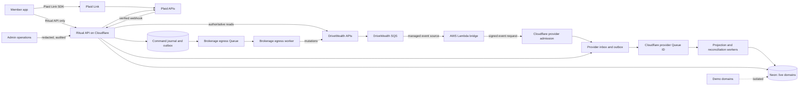
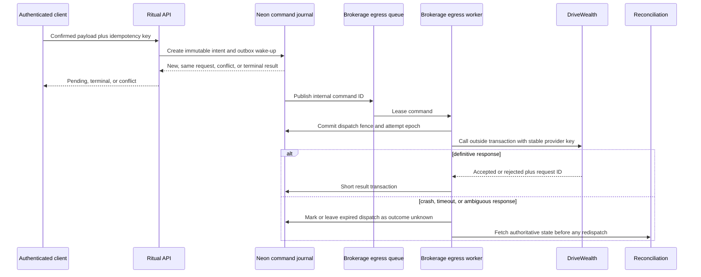
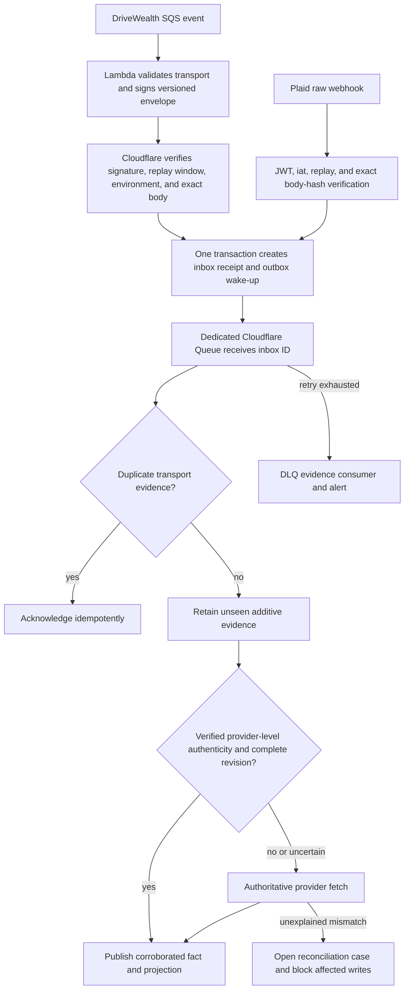
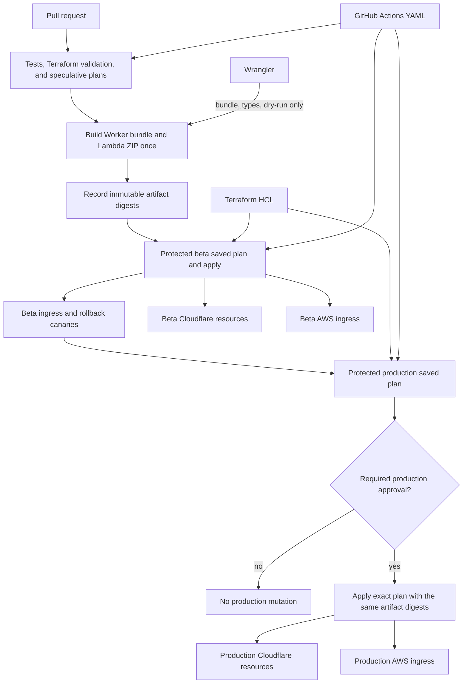
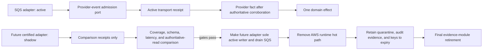
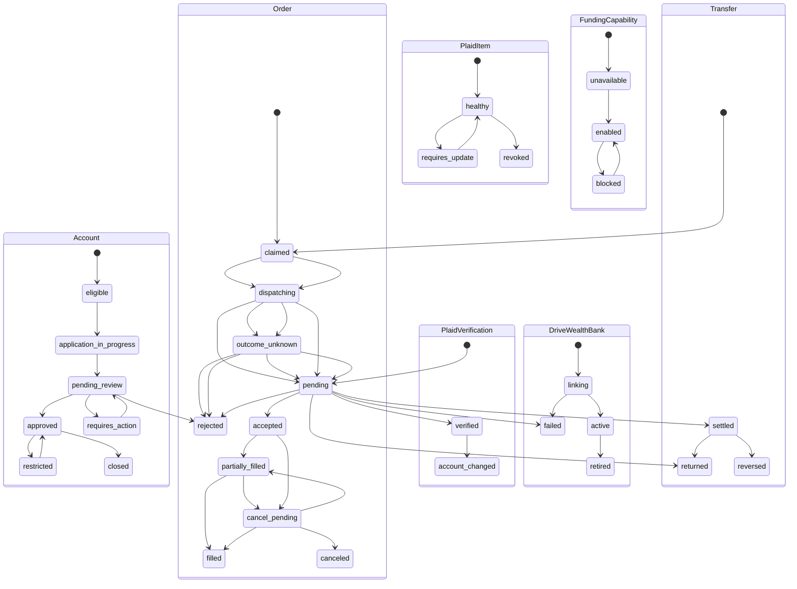
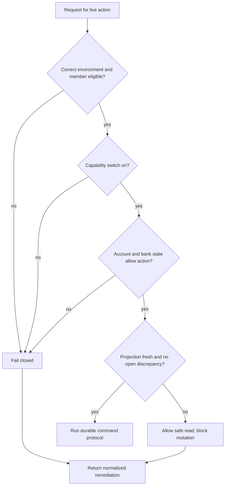

# DriveWealth and Plaid Brokerage Backend - Plan

## Goal Capsule

**Objective:** Eligible U.S. members can open, fund, use, and close a real brokerage account with recoverable financial operations, while the existing Demo experience remains available and cannot affect real assets.

**Means:** Add separate live brokerage and banking bounded contexts around DriveWealth and Plaid, keep the application runtime on Cloudflare, isolate DriveWealth's required SQS transport in a small event-driven AWS adapter, and manage the owned cloud estate through Terraform and protected GitHub Actions (KTD1, KTD3, KTD5, KTD7, KTD17-KTD20).

**Authority hierarchy:** Product behavior is owned by the Requirements below. DriveWealth is authoritative for brokerage identity, accounts, cash, transfers, orders, positions, activity, restrictions, and regulated records. Plaid is authoritative only for the health and identifiers of a member-authorized bank connection. Ritual stores provider-neutral operational state and read projections; it does not create brokerage truth. Demo state is never an authority for live behavior.

**Stop conditions:** Do not enable production mutations until the contracted DriveWealth GA surface, Individual Funding model, source-queue ARN and Region, dedicated producer-policy evidence, cross-account IAM and KMS access, source retention/redrive ownership, event inventory and maximum size, DriveWealth KYC capture route, Plaid production access, compliance approvals, disclosure versions, legal and quarantine retention schedules, incident contacts, environment-specific credentials, import-only Terraform adoption, protected deployment path, and provider-event corroboration rule are documented and exercised in UAT. These are launch prerequisites, not open planning questions.

**Execution profile:** Implement contract-first and test-first. Land each U-ID as an independently reviewable change. Keep each environment's mutation egress disabled until U9 recovery paths exist and U12 opens the applicable gate.

**Tail ownership:** Brokerage engineering owns command and reconciliation correctness. Platform engineering owns Terraform state, cloud-resource ownership, CI trust, the AWS ingress adapter, and infrastructure drift. Operations owns provider incidents and reconciliation cases. Compliance and legal own disclosures, KYC policy, eligibility policy, and retained-record schedules. Mobile owns Plaid Link and live-account presentation without taking provider authority.

---

## Product Contract

### Summary

Add a production brokerage backend in which DriveWealth supplies the regulated brokerage account, custody, funding, trading, positions, activity, and ledger. Use Plaid Auth to let a member authorize one external U.S. bank account and create a DriveWealth-compatible processor token. Preserve the current Demo product as a separate mode. Release live behavior only through server-owned eligibility and operational gates.

### Problem Frame

Argus currently defines Ritual Investing as a simulated product. Its API, mobile command journal, reset fence, privacy deletion promise, provider-boundary checks, and operational tooling all assume no real credentials or money movement. Connecting vendor endpoints to those existing paths would mix fictional and regulated state, create ambiguous retry behavior, and make current purge semantics incorrect.

DriveWealth and Plaid also use different asynchronous contracts. DriveWealth currently delivers brokerage events only through SQS; its documented alternative is REST polling, not webhooks. Plaid sends signed webhooks whose body must be verified exactly. Both can retry and reorder work. A local success response therefore cannot be treated as financial finality.

An application Worker must not poll DriveWealth continuously. AWS's managed SQS event-source mapping performs the long polling and invokes a small Lambda only when work is available. The Lambda forwards each event to an authenticated Cloudflare Worker admission route because DriveWealth does not publish a maximum event size and SQS messages can exceed Cloudflare Queue's 128,000-byte limit. The Worker durably receipts the event and queues only an inbox reference.

### Key Decisions

- **DriveWealth owns every post-link money-movement command and lifecycle.** (session-settled: user-approved — chosen over a separate Plaid Transfer money-movement system: one brokerage ledger and transfer authority avoids split financial truth.) Governs R1, R9, R10, R11, R12.
- **DriveWealth is the only brokerage KYC/CIP authority.** (session-settled: user-approved — chosen over a competing Plaid identity authority: bank ownership evidence must not create a second brokerage identity decision.) Governs R2, R6, R7.
- **Demo and live brokerage coexist behind separate eligibility and operational gates.** (session-settled: user-approved — chosen over a direct Demo cutover: staged access preserves the existing product and contains regulated rollout risk.) Governs R3, R4, R20, R21, R25.
- **The first live release is a cash, long-only U.S. equities/ETF product.** Market/DAY orders support notional buys and quantity sells only; extended hours, queued orders, margin, options, shorting, crypto, and live recurring execution are excluded. Governs R4, R13.
- **Regulated retention is separated from product deletion.** The current broad purge promise cannot erase records that DriveWealth or Ritual must retain by law or contract. Governs R7, R22.

### Actors

- A1. **Member:** An authenticated account tenant who may use Demo and, if eligible, enroll in live brokerage.
- A2. **Ritual API:** The only application backend allowed to call DriveWealth and Plaid server APIs or expose canonical live state.
- A3. **Plaid:** The bank-link and connection-health provider; it does not hold funds or approve brokerage identity.
- A4. **DriveWealth:** The regulated brokerage, custody, money-movement, order, position, activity, and ledger authority.
- A5. **Provider event bridge:** An environment-isolated, event-source-mapped AWS Lambda that signs and relays DriveWealth SQS events to a dedicated Cloudflare Worker admission route without interpreting brokerage state.
- A6. **Operations and compliance:** Authorized staff who monitor, reconcile, restrict, and audit the live product without editing financial truth.
- A7. **Rowan:** A read-only counsel surface that can explain normalized status and remediation copy but cannot inspect secrets, give personalized advice, or initiate a financial command.

### Requirements

#### Provider authority and product boundary

- R1. The live product MUST use DriveWealth's Individual Funding model as the authority for brokerage accounts, custody, cash, ACH transfers, orders, positions, transactions, and brokerage records.
- R2. The live product MUST use Plaid Auth only to authorize and verify a member-selected bank relationship and to create a DriveWealth processor token; Plaid Transfer is out of scope.
- R3. Demo and live brokerage MUST use separate routes, permissions, persistence, command journals, queues, capability switches, analytics namespaces, and reset behavior.
- R4. Live access MUST be additive and limited to server-eligible U.S. members with USD cash accounts and DriveWealth-enabled U.S. equities or ETFs.
- R5. Production integration MUST use contracted GA provider surfaces and MUST exclude deprecated DriveWealth Subscriptions endpoints and unapproved beta APIs.

#### Brokerage onboarding and sensitive data

- R6. DriveWealth MUST make every brokerage KYC/CIP, account approval, restriction, rejection, and closure decision, and Ritual MUST recheck the applicable status before each live mutation.
- R7. Ritual MUST minimize regulated PII, prefer DriveWealth-hosted capture when contracted, encrypt any unavoidable server-held secret or sensitive value, and keep it out of ordinary profile, log, event, audit, analytics, export, outbox, DLQ, ticket, and Terraform payloads; raw quarantine requires a separate key, enforced expiry, dual-control access, and immutable access evidence.
- R8. Required disclosures and agreements MUST be versioned, recorded with timestamp and actor, and completed before DriveWealth account activation or trading.

#### Bank linking and money movement

- R9. A member MAY have one active bank relationship; the server MUST exchange the Plaid public token, protect the Plaid access token, use a fresh DriveWealth processor token immediately, and never persist public or processor tokens.
- R10. New money movement MUST stop when Plaid reports a revoked, removed, consent-expired, or login-required Item, while in-flight DriveWealth transfers continue to reconcile.
- R11. Deposits MUST remain pending until DriveWealth reports settlement, and local code MUST NOT manufacture buying power or withdrawable cash.
- R12. Withdrawals MUST require recent authentication, explicit member review, an active bank, DriveWealth-reported withdrawable cash, and satisfaction of provider holds or seasoning.

#### Orders and brokerage state

- R13. Each live order MUST require an explicit member confirmation, an approved unrestricted account, current provider capabilities, and a stable idempotency key bound to the exact reviewed payload.
- R14. Order submission and cancellation MUST be modeled as asynchronous requests whose fills, partial fills, rejection, cancellation, and restriction states come from DriveWealth.
- R15. Live positions, cash, buying power, withdrawable cash, activity, statements, and document availability MUST remain traceable to DriveWealth and expose projection timestamps and staleness.

#### Reliability, reconciliation, and operations

- R16. Every financial mutation MUST be durably claimed before the provider call, executed outside a database transaction, and resolved by provider lookup or reconciliation before any ambiguous retry.
- R17. Provider events MUST be authenticated where the provider supplies event-level authenticity, environment-bound, durably evidenced, tolerant of additive fields and unknown enums, and safe under duplicate, missing, injected, or out-of-order delivery without discarding unseen financial facts. SQS provenance and an Argus bridge signature do not prove DriveWealth authored the payload; an uncorroborated DriveWealth event MUST NOT unlock capabilities, settle a command, or change a balance, position, restriction, KYC decision, or other authoritative lifecycle state.
- R18. Ritual MUST ingest DriveWealth events through a native SQS-to-Lambda mapping and an authenticated Cloudflare admission route, ingest Plaid events through exact-body JWT verification, durably receipt both before acknowledgment, and enqueue only inbox references for asynchronous application.
- R19. Scheduled and event-triggered reconciliation MUST compare DriveWealth accounts, restrictions, balances, positions, orders, transfers, and transactions against local projections and open an auditable case for every unexplained mismatch.
- R20. Separate fail-closed capability switches MUST control live enrollment, bank linking, deposits, withdrawals, orders, provider receipt admission, projection application, and reconciliation for each environment; receipt admission remains on after a live account exists unless security containment requires quarantine.

#### Security, privacy, compatibility, and counsel

- R21. Live routes MUST derive tenant ownership server-side, use least-privilege live scopes and recent-auth where required, preserve N-1 additive API compatibility, and expose no provider credential or direct DriveWealth host to a client.
- R22. Product deletion, Plaid token revocation, brokerage closure, and legally required record retention MUST be separate workflows with member-visible outcomes and an approved retention schedule.
- R23. Operations MUST receive redacted correlation IDs, backlog and staleness signals, reconciliation case state, and audited controls without a routine raw-payload view or a manual ledger-edit action. Quarantine decryption MUST be denied to runtime and ordinary operations identities, require audited dual-control break-glass approval, prohibit export to general tooling, and expire automatically under the approved schedule.
- R24. Rowan MAY receive only allowlisted server-generated live status and remediation enums with an opaque tenant resource reference; it MUST NOT receive amounts, balances, positions, symbols, accounts, provider identifiers, KYC data, secrets, free-form provider text, or command capability.
- R25. Production writes MUST remain disabled until sandbox/UAT certification, compliance and legal approval, provider production enablement, incident runbooks, alert routing, and a rollback rehearsal are complete.

#### Infrastructure and delivery

- R26. Every provider-supported Ritual-owned AWS, Cloudflare, Neon, and GitHub delivery-control resource MUST be represented in Terraform with explicit resource ownership, separate beta and production state, import-only adoption of existing resources, a machine-checked application-to-infrastructure binding contract, and no secret values stored in configuration, plans, or state. Provider-owned or currently unsupported controls MUST remain named external contracts in `infra/OWNERSHIP.md` with an owner, drift check, launch gate, and migration trigger rather than untracked console state.
- R27. The DriveWealth AWS edge MUST remain event-driven, transport-only, and removable; downstream event identity, ordering, reconciliation, and domain behavior MUST NOT depend on SQS, Lambda, or AWS receipt metadata.

### Key Flows

- F1. **Eligibility and onboarding:** A1 requests live enrollment; A2 checks R4 and R20, records disclosures under R8, completes the R6 DriveWealth flow, and projects the provider result without changing Demo.
- F2. **Bank link and remediation:** A2 creates a tenant-bound single-account Plaid Link session; A1 completes Link; A2 performs R9 and later uses update mode when R10 applies.
- F3. **ACH deposit or withdrawal:** A2 validates R6, R10, R11, or R12, claims the R16 command, submits it to A4, and waits for R18 or R19 to establish the outcome.
- F4. **Order or cancellation:** A1 confirms the current review; A2 applies R13 and R16, sends the command to A4, and follows R14 through its terminal provider state.
- F5. **DriveWealth event:** AWS invokes A5 for an SQS batch; A5 signs and posts each versioned envelope to the environment-bound A2 admission route; A2 commits the durable inbox and wake-up, retains unseen evidence, and performs the R17/R18 authoritative read before any claimed lifecycle or financial effect unless DriveWealth later supplies verified event-level authenticity.
- F6. **Plaid event:** A2 verifies the exact raw request under R18, acknowledges after durable receipt, then fetches authoritative Item state and applies R10.
- F7. **Reconciliation case:** A2 detects an R19 mismatch, blocks affected mutations, and lets A6 inspect redacted evidence, trigger authoritative reads, and record resolution under R23.
- F8. **Closure and deletion:** A1 requests closure or deletion; A2 fences new live mutations, resolves open financial work, closes the A4 account, revokes A3 access, and applies R22 without resetting or erasing Demo incorrectly.

### Acceptance Examples

- AE1. Covers R3, R20. Given a Demo member with no live capability, a Demo reset changes only Demo state and no live route, provider adapter, live queue, or live table is invoked.
- AE2. Covers R6, R8. Given a submitted application in `pending_review`, order and funding commands fail closed until DriveWealth reports an approved, unrestricted account and the required agreement versions are present.
- AE3. Covers R9. Given one selected Plaid account, the server exchanges its public token, uses a new processor token to create the DriveWealth bank relationship, and retains only encrypted Plaid access-token ciphertext plus provider-neutral references.
- AE4. Covers R10. Given `ITEM_LOGIN_REQUIRED` while an ACH deposit is pending, new transfers are disabled, the existing deposit continues to reconcile, and update-mode Link is offered without duplicating the transfer.
- AE5. Covers R11. Given an accepted ACH deposit that has not settled, the member sees a pending transfer and only DriveWealth-reported buying power; no local credit is added.
- AE6. Covers R12. Given cash subject to a withdrawal hold, the withdrawal review explains the normalized hold and submission is rejected even if a stale local projection showed cash.
- AE7. Covers R13, R16. Given an order request whose network response is lost, the same reviewed payload and idempotency key are reconciled before retry, while a changed payload requires a new review and key.
- AE8. Covers R14, R17. Given a cancellation request followed by a fill and then a delayed cancellation event, authoritative DriveWealth reads corroborate the fill, and the projection does not move backward to `canceled` from the uncorroborated delayed event.
- AE9. Covers R17, R18. Given a duplicate or older DriveWealth event, the inbox deduplicates the same fact, retains any unseen fill or transaction, and fetches current provider state without replaying a mutation or regressing the projection.
- AE10. Covers R17, R18. Given a Plaid webhook with an invalid signature, stale JWT, or body-hash mismatch, the endpoint rejects it before parsing; an identical valid delivery that is already durable acknowledges idempotently.
- AE11. Covers R19, R23. Given a balance discrepancy, affected writes stop, an operations case contains redacted correlations and authoritative reads, and no operator can patch the local or provider ledger manually.
- AE12. Covers R22. Given product deletion while regulated records remain subject to retention, access and Plaid tokens are revoked, the brokerage closure state remains visible through the approved channel, and retained records follow the legal schedule.
- AE13. Covers R24. Given any live-account state, Rowan receives only a normalized status/remediation pair plus the allowed opaque tenant resource reference and cannot obtain monetary values, provider text, provider or other non-allowlisted identifiers, or a financial action.
- AE14. Covers R25. Given valid production credentials but any incomplete release gate, live provider writes remain disabled and synthetic checks cannot target production accounts.
- AE15. Covers R18. Given a mixed DriveWealth SQS batch in which one admission succeeds and another times out, Lambda returns only the failed message ID; a retry after a lost success response creates one provider fact and one domain effect.
- AE16. Covers R26. Given the existing beta and production Cloudflare, Neon, and GitHub delivery estate, each adoption plan imports supported resources with no remote create, update, replace, destroy, retarget, or activation delta; the controlled Queue-consumer handover is isolated and reversible, binding parity holds, and no secret enters state or plan artifacts.
- AE17. Covers R27. Given a future DriveWealth-supported event transport in shadow mode, trusted environment configuration designates exactly one active writer. The shadow adapter creates comparison receipts only and cannot enqueue application work; after completeness and authoritative-read comparison gates pass, the new adapter becomes the sole active writer before SQS is drained.

### Success Criteria

- Every certified mutation can be traced from authenticated member intent through one local command, one provider idempotency key, provider request IDs, resulting events or reads, projection state, and audit facts.
- Sandbox/UAT certification passes every AE and the provider failure matrix with no unexplained financial discrepancy, duplicate financial effect, cross-tenant access, or cross-environment event.
- Production rollout can disable any mutation family without disabling provider ingress or reconciliation, and rollback rehearsal proves state convergence after re-enable.
- No application process polls DriveWealth continuously; the AWS bridge is invoked by the managed SQS event source, has bounded concurrency and cost alarms, and its runtime hot path can be removed without changing the provider inbox or domain reducers while required evidence remains retained.
- A second Terraform plan after each apply is empty; beta and production share no environment state or environment-scoped runtime identifier; explicitly shared containers such as the Neon project are owned by the shared root; and the same signed Worker and Lambda artifact digests are promoted without rebuilding.
- Compliance, legal, operations, mobile, and backend reviewers can approve their owned gates from the plan's artifacts and runbooks without relying on raw provider payloads.

### Scope Boundaries

#### In Scope

- U.S. individual cash brokerage accounts, DriveWealth KYC/account lifecycle, Plaid Auth bank linking, USD ACH deposits and withdrawals, scoped live orders, brokerage projections, provider events, reconciliation, security, audit, retention, operations, and gated rollout.
- Minimum API and mobile integration needed for provider-hosted onboarding, Plaid Link, explicit order/funding review, status display, and Demo/live coexistence.
- DriveWealth-sourced quote or instrument capability data only where required to validate the scoped order flow.
- Terraform adoption of the owned Ritual Cloudflare, Neon, and GitHub delivery control planes plus the new AWS runtime/evidence edge, including state bootstrap, resource inventory/import, binding parity, deployment identities, cost controls, and protected beta/production CI/CD.

#### Deferred to Follow-Up Work

- Live recurring investing after a separate scheduler and compliance design; the deprecated DriveWealth Subscriptions API is not an option.
- ACATS, wires, checks, joint or entity accounts, beneficiaries, advanced tax-lot selection, full statement/tax-document UX, and automated account liquidation or transfer-out.
- Broader live UI redesign, personalized advice, recommendation automation, rebalancing, editorial market-data sourcing, and Rowan financial actions.
- Non-U.S. members, non-USD funding, omnibus or cashless funding, margin, options, shorting, crypto, extended hours, and advisory programs.
- Implementation of a replacement DriveWealth webhook or stream before DriveWealth officially supports and certifies one; only the adapter boundary and cutover proof belong in this plan.

#### Outside This Plan

- Replacing Auth0/Clerk identity boundaries, changing Demo economics, or treating Plaid Identity as brokerage KYC.
- A Plaid Transfer integration or any client-to-DriveWealth API path.
- Replacing DriveWealth with Alpaca or another broker, migrating the product runtime to AWS, or running a continuously polling Cloudflare Worker as the primary event path.

---

## Planning Contract

### Key Technical Decisions

- KTD1. Route every deposit and withdrawal through a DriveWealth adapter after a Plaid-backed bank relationship is active; the Plaid adapter has no money-movement method. (session-settled: user-approved — chosen over two provider command engines: a single mutation seam preserves DriveWealth ledger authority.) Implements R1, R2, R9-R12.
- KTD2. Represent DriveWealth KYC/account state in a provider-neutral state machine and use the least-PII contracted capture route; do not add brokerage identity fields to existing member profile tables. (session-settled: user-approved — chosen over a parallel Plaid identity decision path: only DriveWealth may approve or restrict the brokerage account.) Implements R6-R8.
- KTD3. Build live brokerage as new domains, tables, permissions, client journals, and environment-scoped queue/DLQ families for command egress, provider-event application, and reconciliation; keep every existing Demo identifier and reset fence unchanged. (session-settled: user-approved — chosen over replacing Demo in place: isolation makes staged rollout and failure containment enforceable.) Implements R3, R4, R20, R21.
- KTD4. Define provider-neutral Hono/Zod contracts first, generate the Dart client from OpenAPI, and keep mobile changes as handwritten adapters over generated services. Implements R15, R21.
- KTD5. Use a durable egress protocol: the request transaction creates immutable intent plus an outbox wake-up, a dedicated worker fences `dispatching` before the external call, and a short result transaction records `accepted`, `rejected`, or `outcome_unknown`; an expired dispatch fence always reconciles and never automatically redispatches. Implements R13, R16, R19.
- KTD6. Persist money as exact signed 64-bit or wider database values exposed through a lossless API representation, and persist quantities/prices as canonical bounded decimal strings; define scale, overflow, exponent, and reject-versus-round rules per field, and never use binary floating point or unsafe JavaScript integers. Implements R11-R16.
- KTD7. Use one durable provider-admission protocol for both vendors. A standard on-demand SQS event-source mapping invokes a transport-only Lambda, the Lambda signs each bounded DriveWealth envelope with an environment-scoped asymmetric AWS KMS key, and an environment-specific Cloudflare Worker route verifies the exact request before one transaction creates the inbox receipt and outbox wake-up; the Worker then queues only the inbox ID and returns success. Plaid enters through its exact-body verified public webhook. The signing key has `next`, `active`, and `revoked` states, bounded verifier caching, immediate containment propagation, and cross-environment rejection. No Worker or application process polls SQS. (session-settled: user-directed — chosen over a continuously polling Worker and direct Queue push: managed SQS invocation avoids idle polling, while Worker admission avoids Cloudflare Queue's smaller payload limit.) Implements R17-R20, R27.
- KTD8. Treat provider events as evidence and invalidation hints unless DriveWealth provides verified event-level authenticity or an authoritative provider read corroborates the claimed state. A bridge signature proves only that an Argus-controlled Lambda admitted the SQS record. Always retain unseen additive evidence, but never unlock capabilities, settle commands, or change balances, positions, restrictions, KYC decisions, or authoritative lifecycles from an uncorroborated DriveWealth event; fetch authoritative provider state for those changes, unsequenced lifecycle events, unknown states, foreign messages, or missing predecessors. Implements R5, R17-R19.
- KTD9. Separate the last observed complete provider snapshot from local read projections. Stage paginated reads, atomically publish only complete snapshots, expose provider and projection timestamps, and let stale or discrepant state preserve safe reads while blocking affected writes. Implements R15, R19, R20.
- KTD10. Store provider tokens only as versioned ciphertext under a dedicated brokerage-secret key, map provider identifiers through narrow database functions, and assign distinct least-privilege roles to member runtime, provider ingress, provider egress, reconciliation, retained records, and redacted operations. Implements R7, R9, R21-R23.
- KTD11. Split product deletion, provider-token revocation, brokerage closure, and retained regulated records in both schema and member disclosures; retained rows use a restricted pseudonymous brokerage subject outside the tenant cascade, and U1 supplies a field-level legal schedule before U3 finalizes the schema. Implements R7, R22.
- KTD12. Keep Rowan outside provider adapters and command routes. Supply only a server-authored status/remediation allowlist after normalizing the existing Rowan context taxonomy. Implements R24.
- KTD13. Pin the contracted GA API surface and provider idempotency window during U1; keep local command keys beyond that window, record provider request IDs, subscribe to provider change feeds, and test unknown additive fields. Implements R5, R16, R17.
- KTD14. Domain modules own provider-neutral ports, result types, and errors. Vendor DTOs remain private to `src/providers/*`; adapters cannot update repositories or projections, and the banking service alone orchestrates Plaid exchange into DriveWealth bank linkage. Implements R1, R2, R9, R21.
- KTD15. Model Plaid Item health, Plaid account verification, and DriveWealth linked-bank status as independent provider-owned axes, then derive one provider-neutral funding capability for the composite relationship. Implements R2, R9-R12.
- KTD16. Enforce financial invariants structurally with environment-qualified unique keys, immutable request hashes and provider keys, append-only fact tables, partial uniqueness for active relationships, and role-level update/delete denials. Implements R3, R9, R13, R16-R19, R22.
- KTD17. Make HCL Terraform the sole definition authority for every provider-supported Ritual-owned AWS, Cloudflare, Neon, and GitHub delivery-control resource, including existing Ritual API, site, Demo, project, branch, compute, protected environment, and branch-control infrastructure after inventory and import. Record provider-owned or currently unsupported controls as owned external contracts with drift evidence and a migration gate until a safe Terraform resource exists. Treat the DriveWealth queue as a provider-owned contract input. Keep database schema, RLS, databases, login roles, and credentials under migrations and reviewed SQL. A versioned binding manifest owns application logical names and types; Terraform maps them to environment resources, local Wrangler files are generated without production identifiers, and CI rejects parity drift. (session-settled: user-directed — chosen over CDK/CDKTF, console provisioning, and a brokerage-only IaC island: one declarative ownership model prevents drift across the full Ritual delivery footprint.) Implements R26, R27.
- KTD18. Keep GitHub Actions YAML as the CI/CD orchestration authority while Terraform owns GitHub environments, protection rules, and other delivery controls through a separately bootstrapped admin identity. Build the Worker and Lambda once, pass immutable content digests to Terraform, deploy the stable Cloudflare Worker script and AWS function resources through saved environment plans, and reduce Wrangler to local development, generated bindings, and deterministic bundle/dry-run work. No remote resource has both Terraform and Wrangler as a mutating owner. Credential-bearing workflows run only protected, CODEOWNERS-approved code and deny provisioners, external executors, unapproved providers/modules, and unreviewed workflow or provider-lock changes. (session-settled: user-directed — chosen over ad hoc Wrangler deployment and Terraform-managed workflow YAML: protected plans remain reviewable while delivery controls remain auditable.) Implements R25-R27.
- KTD19. Define a transport-neutral provider-event admission port and conformance fixtures. SQS message IDs, receipt handles, queue ARNs, receive counts, and Lambda types stop at the AWS adapter; provider-fact identity is derived independently. Trusted environment configuration marks an adapter `active` or `shadow`; exactly one active writer may create facts or application wake-ups, while shadow adapters create comparison receipts only. If DriveWealth supplies no stable cross-transport identity, compare the shadow stream through authoritative reads rather than cross-writing the inbox. Retire AWS in two phases: disable, drain, reconcile, and destroy only the runtime hot path, then retain quarantine evidence, audit logs, and their independent keys until their schedules permit final removal. (session-settled: user-directed — chosen over embedding SQS in the domain: a future provider transport can replace the bridge without rewriting financial state handling or prematurely destroying evidence.) Implements R17-R19, R27.
- KTD20. Bootstrap an encrypted, versioned S3 backend through a one-time audited local bootstrap state, immediately migrate it to a dedicated protected backend key, verify lineage and object version, and retain independent recovery credentials. Use native S3 lockfiles and keep beta and production in separate root modules, state prefixes, KMS permissions, and roles; the shared root cannot read or write environment state. Enforce TLS-only access, CloudTrail object-data events, tamper alerts, and tested state-integrity recovery. GitHub assumes environment-scoped AWS roles through OIDC; Cloudflare and Neon use separate scoped environment tokens. For each secret-bearing provider resource, either protected CI owns the whole object/value or Terraform owns only a stable external container reference whose later applies are proven not to clear the injected value; sensitive flags alone are insufficient. Implements R21, R25, R26.

### High-Level Technical Design

The diagrams define the component, authority, protocol, and lifecycle shape.

#### Component topology



#### Onboarding and bank-link sequence

```mermaid
sequenceDiagram
    participant M as Member
    participant A as Ritual API
    participant D as DriveWealth
    participant P as Plaid
    M->>A: Start live enrollment
    A->>A: Check eligibility, gates, disclosures
    A->>D: Create or resume KYC/account
    D-->>A: Pending, action required, or approved
    M->>A: Start bank link after approval
    A->>P: Create single-account Link token
    P-->>M: Plaid Link flow
    M->>A: Public token and selected account
    A->>P: Exchange token and create DriveWealth processor token
    A->>D: Create linked bank with processor token
    D-->>A: Bank relationship result
    A->>A: Discard public and processor tokens; retain encrypted access token
```

#### Durable financial-command protocol



#### Provider-event and reconciliation data flow



#### Infrastructure ownership and delivery



#### Replaceable DriveWealth transport



#### Canonical live state lifecycles



#### Capability and rollout gate



### Output Structure

```text
ritual-investing-api/
  src/domains/brokerage/
  src/domains/banking/
  src/domains/provider-webhooks/
  src/domains/admin-brokerage/
  src/providers/drivewealth/
  src/providers/plaid/
  src/db/schema/brokerage.ts
  test/brokerage/
  test/banking/
  test/provider-events/
ritual-investing-drivewealth-bridge/
  src/handler.ts
  src/schema.ts
  test/handler.test.ts
  package.json
  package-lock.json
  tsconfig.json
provider-contracts/
  drivewealth-ingress-envelope.schema.json
  fixtures/
infra/
  OWNERSHIP.md
  bindings/ritual-bindings.json
  bindings/ritual-bindings.schema.json
  bootstrap/
  modules/aws-drivewealth-runtime/
  modules/aws-drivewealth-evidence/
  modules/cloudflare-runtime/
  modules/github-delivery-controls/
  modules/github-aws-oidc/
  modules/neon-control-plane/
  modules/observability-cost-controls/
  environments/shared/
  environments/beta/
  environments/production/
ritual-investing-app/lib/features/brokerage/
ritual-investing-app/lib/features/banking/
ritual-investing-admin/lib/features/brokerage_operations/
```

### System-Wide Impact

- **Product authority:** `ritual-investing-app/PRODUCT.md`, `CONCEPTS.md`, and current Demo-only plans must distinguish the preserved Demo contract from the new live contract. Earlier plans remain historical artifacts and are superseded only where they prohibit the approved live expansion.
- **Data lifecycle:** Tenant deletion can no longer be one unconditional cascade. Regulated records and provider closure state need a restricted retention partition with a legal schedule.
- **Authentication and authorization:** New live scopes, recent-auth checks, provider-ingest roles, and redacted operations permissions extend the existing tenant/RLS model without reusing `simulate:self`.
- **Infrastructure:** Terraform becomes the definition authority for the owned Ritual Cloudflare estate, Neon projects/branches/computes, and a minimal event-driven AWS bridge. Database schema and security roles remain migration/SQL-owned. DriveWealth's source queue remains an external provider contract. No VPC, NAT gateway, provisioned polling, or full-runtime AWS migration is introduced by default.
- **Delivery:** GitHub Actions gains separate validation, protected apply, immutable promotion, and alert-only drift workflows. Existing manual Wrangler and dashboard ownership is removed only after inventory, import, and beta cutover prove parity.
- **Clients:** OpenAPI and the generated Dart client remain authoritative. Demo does not import or initialize the Plaid Link bridge.
- **Counsel:** Rowan gains safe, normalized read contexts only after the existing runtime/admin context taxonomy mismatch is resolved.

### Dependencies and Prerequisites

- Executed DriveWealth and Plaid agreements for the selected product and environments, including DriveWealth Individual Funding, DO_KYC or the contracted equivalent, SQS delivery, ACH, fractional trading, market/DAY order support, documents, rate limits, and idempotency retention.
- Compliance-approved eligibility, disclosures, KYC remediation, bank-ownership policy, order review, ACH settlement and seasoning copy, restricted-account behavior, and Rowan status copy.
- Legal-approved privacy notice, account agreement flow, product deletion semantics, field-level records schedule, and data-processing inventory before U3 schema finalization.
- AWS account ownership, same-Region DriveWealth queue access, compatible cross-account KMS grants, least-privilege SQS/Lambda roles, Cloudflare account-token ownership, GitHub environment protection, Terraform backend bootstrap, a scoped Neon API token for control-plane reads/applies, Neon database key management, alert routing, provider incident contacts, and environment inventory.
- Plaid Identity Match or other ownership-risk signal remains optional until compliance and risk explicitly approve it; it cannot change DriveWealth KYC authority.

### Risks and Mitigations

| Risk | Consequence | Mitigation |
|---|---|---|
| Ambiguous provider timeout | Duplicate order or transfer | KTD5, stable request hashes, provider lookup, and no blind replay |
| Duplicate, missing, or reordered events | Lost financial fact, projection regression, or false finality | KTD7-KTD9, immutable fact identity, provider revisions, fetch-back, complete snapshot publication |
| A non-DriveWealth principal injects a valid-looking SQS record | False KYC, balance, restriction, or command state | Dedicated producer-policy evidence, bridge provenance treated as transport-only, authoritative read before effect, and foreign-message drills |
| Provider schema or lifecycle change | Parser failure or wrong state | KTD8, KTD13, permissive additions, unknown-state quarantine, change-feed ownership |
| Demo/live contamination | Real assets affected by Demo action | KTD3, separate stores and scopes, boundary tests, cross-mode certification |
| PII or token leakage | Regulatory and security incident | KTD2, KTD10, minimized storage, exact redaction tests, dedicated keys |
| Privacy promise conflicts with retention | Unlawful deletion or misleading member claim | KTD11 and a launch-blocking legal schedule |
| SQS-to-Cloudflare bridge outage | Stale brokerage state | Dedicated DLQ/alerts, ingress health, reconciliation fallback, write freshness gates |
| DriveWealth event exceeds Cloudflare Queue limit | Event rejection or lost fact | KTD7 Worker admission accepts the bounded SQS envelope and enqueues only an inbox ID |
| Terraform and Wrangler both mutate a resource | Destructive drift or rollback ambiguity | KTD17-KTD18 ownership matrix, CI guard, import-first adoption, and binding-parity tests |
| Terraform state or plan exposes secrets | Credential or regulated-data disclosure | KTD20, value injection outside Terraform, restricted state paths, sentinel scans, and short plan retention |
| Cross-environment state tampering | A later approved apply mutates production from poisoned state | Prefix and KMS denies, object-data audit, tamper alerts, signed state-bound plan manifests, and tested integrity recovery |
| Credentialed CI executes attacker-controlled infrastructure code | State or cloud-token exfiltration | Protected CODEOWNERS-reviewed workflows, approved providers/modules only, no provisioners/external executors, and pre-credential policy gates |
| Raw poison messages become an ungoverned PII store | Unbounded sensitive-data access or retention | Separate quarantine CMK, runtime denial, dual-control break-glass, immutable audit, export prohibition, and enforced expiry |
| Community Neon Terraform provider changes behavior | Project, branch, or compute replacement | Exact provider pin, import-first beta proof, protected lifecycle policy, and SQL ownership of roles and credentials |
| Provider-owned queue policy is incompatible | Lambda cannot receive or delete events | U1 contract gate for Region, IAM, KMS, visibility, retention, redrive, and UAT receive/delete proof |
| AWS footprint grows beyond the event edge | Higher fixed cost and larger blast radius | Separate runtime/evidence modules, no VPC/NAT/provisioned polling, bounded concurrency, budgets, anomaly alerts, and phased removal runbook |
| Plaid Item degrades mid-transfer | Unsafe new transfer or lost visibility | Block new movement, continue DriveWealth reconciliation, update-mode recovery |
| Operator retries an unknown command | Duplicate financial effect | Narrow admin actions, authoritative no-effect proof, audited dual control |
| Provider sandbox differs from production | False confidence | Contracted prod enablement checklist, small gated cohort, read-first validation, rollback rehearsal |
| Rollback follows a provider-accepted effect | Schema reversal or lost evidence | Stop egress, preserve ingress, reconcile, repair forward, and never down-migrate live financial data |

### Alternative Approaches Considered

- **Migrate the product runtime to AWS:** Rejected because DriveWealth requires only an AWS identity and SQS consumer. Moving the API, queues, and data plane would add cost and migration risk without improving brokerage authority or recovery.
- **Poll DriveWealth from a Cloudflare Worker:** Rejected because DriveWealth's REST APIs are a reconciliation fallback, not an event stream. Continuous short polling adds empty work, latency, rate-limit pressure, and weaker delivery semantics.
- **Push Lambda output directly to Cloudflare Queue:** Rejected as the default because Cloudflare Queue messages are capped at 128,000 bytes while SQS supports 1 MiB and DriveWealth publishes no event-size maximum. The authenticated Worker route accepts the bounded SQS envelope and queues only an inbox ID.
- **Use CDK or CDKTF:** Rejected because Terraform HCL is the user-directed infrastructure contract and CDKTF is no longer supported. A second IaC language would also weaken the one-owner model.

### Deferred Implementation Notes

- U1 must pin the exact contracted DriveWealth API version, supported KYC capture surface, event identifiers, idempotency retention, order capabilities, ACH limits, settlement, seasoning, and production rate limits. Research documentation is not a substitute for the signed integration profile.
- U3 may adjust migration names and normalized table boundaries after inspecting the final contracted fields, but it must preserve KTD3, KTD6, KTD10, and KTD11.
- U9 may choose the exact deterministic TypeScript bundler after measuring the bridge package, but Terraform owns the Node.js 24 Lambda resource and artifact digest. CDKTF and SAM templates are not alternatives in this plan.
- U13 must inventory deployed values before normalizing tracked Wrangler placeholders. Unsupported or provider-owned controls stay documented external contracts until a safe Terraform resource exists; they never become untracked console state by omission.
- The existing Cloudflare Queue consumer cannot be imported with the current provider. U13 must adopt it through a beta-first pause, drain, controlled recreation, validation, and rollback procedure after every importable resource reaches a no-op plan.
- Domain-specific freshness thresholds and reconciliation cadence are configuration owned by operations and compliance. Defaults start conservative and become production values during UAT evidence review.

### Sources and Research

#### Repository anchors

- `ritual-investing-app/PRODUCT.md` and `CONCEPTS.md` define the existing Demo-only authority that U1 must extend without erasing.
- `ritual-investing-api/src/app.ts`, `src/contracts/openapi.ts`, `compatibility/mobile-client-n-minus-1.json`, and `docs/ritual-investing/api-consumer-guide.md` define contract-first routing and N-1 compatibility.
- `ritual-investing-api/src/jobs/consumer-receipts.ts`, `src/jobs/queue-runtime.ts`, and `src/jobs/retry-policy.ts` supply receipt and retry concepts; KTD5 rejects holding their transaction pattern across provider calls.
- `ritual-investing-app/lib/core/api/financial_command_journal.dart` and `ritual-investing-app/lib/features/orders/application/order_controller.dart` supply explicit confirmation and protected-retry patterns for a new live journal.
- `ritual-investing-api/src/domains/admin-operations/`, `src/observability/`, `docs/ritual-investing/admin-operations-runbook.md`, and `docs/ritual-investing/privacy-runbook.md` anchor audited operations, alerts, and the retention conflict.
- `docs/solutions/integration-issues/empty-bootstrap-post-rejected-at-cloudflare-edge.md` requires exact raw-request contract fixtures and target-environment correlation for public provider ingress.

#### First-party provider and platform references

- DriveWealth: [Plaid partner flow](https://developer.drivewealth.com/apis/docs/using-plaid), [integration models](https://developer.drivewealth.com/apis/docs/choosing-your-integration-model), [customer verification](https://developer.drivewealth.com/apis/docs/customer-verification), [order lifecycle](https://developer.drivewealth.com/apis/docs/creating-an-order), [SQS events](https://developer.drivewealth.com/apis/v1.82.0/reference/sqs-events), [transactions](https://developer.drivewealth.com/apis/docs/showing-historical-transactions), [balances and positions](https://developer.drivewealth.com/apis/docs/getting-balances-and-positions), [idempotency](https://developer.drivewealth.com/apis/reference/idempotent-requests), [API lifecycle](https://developer.drivewealth.com/apis/docs/api-lifecycle-guide), and [deprecated Subscriptions](https://developer.drivewealth.com/apis/reference/post_subscriptions).
- Plaid: [DriveWealth partnership](https://plaid.com/docs/auth/partnerships/drivewealth/), [Auth](https://plaid.com/docs/auth/), [Link](https://plaid.com/docs/link/), [OAuth](https://plaid.com/docs/link/oauth/), [update mode](https://plaid.com/docs/link/update-mode/), [webhook verification](https://plaid.com/docs/api/webhooks/webhook-verification/), [Items](https://plaid.com/docs/api/items/), [Auth coverage](https://plaid.com/docs/auth/coverage/), [Identity](https://plaid.com/docs/identity/), and [launch checklist](https://plaid.com/docs/launch-checklist/).
- DriveWealth transport: [Events via SQS](https://developer.drivewealth.com/apis/v1.82.0/reference/sqs-events) and [API update subscription](https://developer.drivewealth.com/apis/docs/subscribe-to-api-updates).
- AWS and Cloudflare ingress: [Lambda with SQS](https://docs.aws.amazon.com/lambda/latest/dg/with-sqs.html), [cross-account SQS](https://docs.aws.amazon.com/lambda/latest/dg/with-sqs-cross-account-example.html), [partial batch failures](https://docs.aws.amazon.com/lambda/latest/dg/services-sqs-errorhandling.html), [Cloudflare Queue limits](https://developers.cloudflare.com/queues/platform/limits/), [delivery guarantees](https://developers.cloudflare.com/queues/reference/delivery-guarantees/), and [DLQs](https://developers.cloudflare.com/queues/configuration/dead-letter-queues/).
- Terraform and delivery: [Cloudflare infrastructure as code](https://developers.cloudflare.com/workers/platform/infrastructure-as-code/), [Cloudflare Queue Terraform resources](https://developers.cloudflare.com/api/terraform/resources/queues/), [Terraform S3 backend](https://developer.hashicorp.com/terraform/language/backend/s3), [sensitive-data handling](https://developer.hashicorp.com/terraform/language/manage-sensitive-data), [GitHub OIDC for AWS](https://docs.github.com/en/actions/how-tos/secure-your-work/security-harden-deployments/oidc-in-aws), and [GitHub Actions secure use](https://docs.github.com/en/actions/reference/security/secure-use).
- Neon control plane: [Neon project model and management](https://neon.com/docs/manage/projects) and the import-capable pinned [Neon Terraform provider](https://registry.terraform.io/providers/kislerdm/neon/latest/docs/resources/project). The provider is community-maintained, so U13 keeps database security objects and credentials out of its ownership boundary.

---

## Implementation Units

### Unit Index

Execute units in the dependency order shown here. Stable IDs keep U9's detailed body after U8 and append new U13-U14 bodies after U12, but the dependency table is authoritative: Terraform adoption and protected delivery precede provider ingress, and U9 must be deployed before any U5-U8 provider mutation is enabled.

| U-ID | Title | Primary files | Depends on |
|---|---|---|---|
| U1 | Establish live authority and provider prerequisites | `PRODUCT.md`, `CONCEPTS.md`, provider-boundary scripts | — |
| U13 | Adopt Terraform ownership without replacing live resources | `infra/`, Wrangler configs, infrastructure runbooks | U1 |
| U2 | Define live contracts and state machines | API schemas, OpenAPI, compatibility fixtures | U1 |
| U3 | Add live persistence and tenant security | Drizzle migration and brokerage schema | U2 |
| U4 | Build provider adapters and durable commands | `src/providers/`, command services | U2, U3 |
| U9 | Ingest provider events | provider admission, inbox Queue, and SQS bridge | U3, U4, U13 |
| U14 | Add protected infrastructure and release pipelines | infrastructure workflow, release workflow, artifact checks | U9, U13 |
| U5 | Implement DriveWealth onboarding | `src/domains/brokerage/` | U3, U4, U9 |
| U6 | Implement Plaid bank linking | `src/domains/banking/` | U3-U5, U9 |
| U7 | Implement ACH funding | banking transfer services and routes | U4-U6, U9 |
| U8 | Implement orders and live projections | brokerage order/read services | U4, U5, U7, U9 |
| U10 | Add reconciliation, operations, and retention | admin, observability, privacy services | U5-U9 |
| U11 | Integrate generated and Flutter clients | API client, member app, admin app | U2, U5-U10 |
| U12 | Certify and roll out production | workflows, runbooks, environment config | U1-U11, U13, U14 |

### U1. Establish live authority and provider prerequisites

**Goal:** Make the approved live product and provider boundary authoritative before code can accidentally reuse Demo assumptions.

**Requirements:** R1-R5, R20, R22, R25-R27.

**Dependencies:** None.

**Files:**

- Modify `ritual-investing-app/PRODUCT.md`
- Modify `CONCEPTS.md`
- Create `docs/ritual-investing/live-brokerage-authority.md`
- Create `docs/ritual-investing/provider-integration-inventory.md`
- Modify `docs/ritual-investing/member-data-inventory.md`
- Modify `scripts/check-member-provider-boundaries.sh`
- Modify `scripts/check-demo-provider-boundaries.sh`
- Modify `scripts/test-check-demo-provider-boundaries.sh`
- Create or modify `scripts/test-check-member-provider-boundaries.sh`
- Modify `.github/workflows/ritual-investing.yml`

**Approach:**

1. Update current product authority to describe Demo and live as distinct bounded contexts per KTD3; mark prior Demo-only prohibition as superseded only for approved live paths.
2. Record the provider authority matrix, contracted GA surfaces, environments, capabilities, rate and idempotency limits, contacts, release feed, data classes, and launch prerequisites. For DriveWealth SQS, pin the queue ARN, account, Region, type, dedicated-queue producer policy and allowed principals, IAM and KMS grants, visibility timeout, retention, maximum receive count, DLQ/redrive and replay owner, event inventory, event identity, maximum payload size, and whether DriveWealth supplies any event-level authenticity. Treat each item as provider-owned evidence rather than a Terraform resource.
3. Approve a field-level retention matrix that classifies each planned live field as purgeable, operationally retained, or legally retained and names its owner, duration, deletion trigger, legal-hold behavior, and encryption-key lifetime.
4. Change provider-boundary checks from a global Plaid/DriveWealth ban to an allowlist of reviewed server adapters, the DriveWealth bridge, and the mobile Plaid Link boundary; retain direct-host and secret bans elsewhere.
5. Add CI fixtures that prove the allowlist is narrow and that Demo cannot import the live bridge or provider packages.

**Execution note:** Begin with failing boundary-script fixtures for one allowed server import and several forbidden client/Demo imports.

**Patterns to follow:** `scripts/check-provider-boundaries.sh`, `scripts/check-demo-provider-boundaries.sh`, `scripts/test-check-demo-provider-boundaries.sh`, and the current product-authority sections in `ritual-investing-app/PRODUCT.md`.

**Test scenarios:**

- A DriveWealth host in `ritual-investing-api/src/providers/drivewealth/` passes, while the same host in a route, mobile file, Demo file, or Rowan file fails.
- A reviewed Plaid Link bridge import in the member app passes, while a Plaid secret or server API host in the app fails.
- A Demo import of a live brokerage, banking, or Plaid Link module fails with a stable diagnostic.
- A deprecated DriveWealth Subscriptions endpoint fixture fails the provider-surface check.
- An integration inventory missing the DriveWealth queue Region, dedicated producer-policy evidence, compatible KMS grant, redrive owner, maximum payload, event-authenticity status, or receive/delete proof blocks U13 and U9 provider enablement.
- The recorded DriveWealth release-feed owner detects a simulated transport deprecation or addition and opens a review without changing the active adapter automatically.
- Every planned live table and sensitive field has one retention class and owner; an unclassified field blocks U3 schema finalization.
- Existing unrelated provider-boundary fixtures keep their previous outcome.

**Verification:** Product and data documents no longer promise that all future account state is simulated or unconditionally purgeable. CI proves that only the named integration seams can reference either vendor.

### U2. Define live contracts and canonical state machines

**Goal:** Freeze additive provider-neutral contracts for eligibility, onboarding, bank health, transfers, orders, projections, documents, and remediation before persistence or provider code.

**Requirements:** R3-R6, R8-R15, R17, R20, R21, R24; F1-F4.

**Dependencies:** U1.

**Files:**

- Create `ritual-investing-api/src/domains/brokerage/schemas.ts`
- Create `ritual-investing-api/src/domains/banking/schemas.ts`
- Create `ritual-investing-api/src/domains/admin-brokerage/schemas.ts`
- Modify `ritual-investing-api/src/contracts/openapi.ts`
- Modify `ritual-investing-api/src/app.ts`
- Create `ritual-investing-api/test/brokerage/contracts.test.ts`
- Create `ritual-investing-api/test/banking/contracts.test.ts`
- Modify `ritual-investing-api/test/contracts/mobile-compatibility.test.ts`
- Modify `ritual-investing-api/compatibility/mobile-client-n-minus-1.json`
- Create `ritual-investing-api/openapi/examples/live-brokerage.json`

**Approach:**

1. Define separate `/v1/brokerage/*`, `/v1/banking/*`, and redacted `/v1/admin/brokerage/*` route families under KTD3 and KTD4.
2. Make the account, bank, transfer, order, projection freshness, reconciliation, and remediation states explicit. Unknown provider states map to a non-actionable quarantine state rather than a false terminal value.
3. Require member idempotency keys and exact request hashes for mutation contracts. Return conflicts, pending outcomes, and reconciliation-required outcomes as distinct responses.
4. Add a live capability envelope to the session contract without changing Demo fields or defaults.
5. Normalize Rowan's runtime and admin authoring context taxonomy before adding the R24 allowlist.

**Execution note:** Start with failing schema and compatibility tests. Generate the OpenAPI artifact only after the request and response examples are agreed.

**Patterns to follow:** `ritual-investing-api/src/domains/simulation/schemas.ts`, `src/contracts/openapi.ts`, `test/contracts/mobile-compatibility.test.ts`, and `docs/ritual-investing/api-consumer-guide.md`.

**Test scenarios:**

- Covers AE1. A session without live eligibility has unchanged Demo fields and a disabled live capability envelope.
- Covers AE2. Each onboarding status has an explicit set of allowed transitions and normalized remediation; transitions outside that set fail validation.
- Single-account bank-link input rejects zero accounts, multiple accounts, unsupported account types, and client-supplied tenant or provider IDs.
- Deposit, withdrawal, order, and cancel payloads reject missing confirmation, invalid minor-unit amounts, invalid decimal strings, changed request hashes, and unsupported order types.
- Order contracts accept market/DAY notional buys and quantity sells and reject limit, extended-hours, short, option, crypto, and recurring inputs.
- Projection responses include provider and projection timestamps, staleness, capability, and reconciliation state without raw provider fields.
- An N-1 client fixture can parse additive live fields and retain its existing Demo behavior.
- Rowan schemas reject amounts, symbols, free-form text, provider IDs, command IDs, and executable actions.

**Verification:** OpenAPI expresses every planned member and admin `/v1` route and state without provider-specific leakage; provider-ingress routes use U9's separate envelope schema and ingress tests rather than the generated client; existing Demo compatibility fixtures pass unchanged; and contract tests make unsupported v1 behavior unrepresentable.

### U3. Add live persistence, RLS, secrets, and retention partitions

**Goal:** Store live operational state in a tenant-safe schema that separates commands, events, projections, secrets, audit, and legally retained records from Demo data.

**Requirements:** R3, R7-R9, R15-R19, R21-R23.

**Dependencies:** U2.

**Files:**

- Create `ritual-investing-api/drizzle/0013_brokerage_and_banking.sql`
- Create `ritual-investing-api/src/db/schema/brokerage.ts`
- Modify `ritual-investing-api/src/db/schema/index.ts`
- Create `ritual-investing-api/src/domains/brokerage/repository-contract.ts`
- Create `ritual-investing-api/src/domains/brokerage/repository.ts`
- Create `ritual-investing-api/src/domains/banking/repository-contract.ts`
- Create `ritual-investing-api/src/domains/banking/repository.ts`
- Create `ritual-investing-api/src/domains/provider-webhooks/repository.ts`
- Create `ritual-investing-api/test/brokerage/repository.postgres.test.ts`
- Create `ritual-investing-api/test/banking/repository.postgres.test.ts`
- Create `ritual-investing-api/test/provider-events/repository.postgres.test.ts`
- Modify `ritual-investing-api/test/security/rls.test.ts`

**Approach:**

1. Add distinct tables for enrollment, DriveWealth account mapping, agreement receipts, encrypted Plaid Items, composite bank relationships, transfers and state history, orders and fills, staged provider snapshots, projections, provider commands, provider inbox receipts, reconciliation runs/cases, and append-only financial audit facts.
2. Enforce KTD6 and KTD16 with database constraints for one provider identity/account per tenant/environment, one active composite bank relationship, immutable command hashes/keys, unique transfer/order/fill facts, and append-only history.
3. Apply KTD10 roles and KTD11 retention classes. Store retained records under a pseudonymous brokerage subject outside the purgeable tenant foreign-key graph.
4. Replace the current tenant-purge function in the additive migration so purge is denied while provider closure is unconfirmed, financial work is nonterminal, a reconciliation case is open, or retained-record detachment lacks evidence.
5. Put tenant-facing rows under existing RLS patterns. Give each provider worker only the environment-and-provider mapping or secret operation it needs; no provider role may scan tenants or update projections directly.
6. Make inbox and command uniqueness include provider environment. Store minimized normalized fields, body hashes, and correlation IDs rather than raw payloads.
7. Add migration and upgrade checks for a fresh database and for existing active, deletion-pending, and purging tenants with Demo state.

**Execution note:** Implement repository behavior test-first against Postgres; treat migration rollback as a pre-production exercise, not a destructive production promise.

**Patterns to follow:** Existing files in `ritual-investing-api/src/db/schema/`, tenant RLS migrations, `src/jobs/consumer-receipts.ts`, and append-only audit repositories.

**Test scenarios:**

- Covers AE1. Demo reset, tenant reset generation, and Demo cascades cannot read, update, or delete live rows.
- Two tenants with identical provider-shaped inputs cannot read or mutate each other's mappings, commands, events, projections, or cases.
- A provider event resolves only through the narrow environment/provider account mapping and rejects unknown or cross-environment identifiers.
- Direct database writes cannot create duplicate provider identities, active bank relationships, transfers, orders, fills, or mutable command/audit facts under concurrent workers or privileged runtime roles.
- A duplicate command key with the same request hash returns the original claim; the same key with a different hash conflicts.
- Duplicate provider event identity or hash is idempotent, while distinct events for one entity remain separately auditable.
- Token ciphertext, key version, and rotation metadata persist without plaintext appearing in returned rows, audit entries, or test logs.
- Lossless money and canonical decimal strings round-trip around the JavaScript safe-integer boundary, configured maximums, fractional precision, and equivalent input spellings; unsupported precision is rejected or quarantined without truncation.
- Product deletion is denied for each independent live blocker, then removes purgeable member data while retained brokerage rows remain inaccessible except through the approved role.
- Expiry, legal hold, key rotation, purge receipt, and late provider event after tenant deletion preserve the retained partition without recreating the tenant.
- Existing-database and empty-database migration paths produce the same schema and RLS policy inventory.

**Verification:** Postgres integration tests prove structural financial invariants, role denials, tenant isolation, Demo/live fencing, exact numeric storage, purge guards, and the regulated-retention partition. A failed deployment rolls forward with live egress disabled; it never reverse-drops financial tables.

### U4. Build provider adapters and the durable command protocol

**Goal:** Create typed, observable provider seams and one safe execution protocol for every DriveWealth mutation.

**Requirements:** R1, R2, R5, R7, R9, R13, R16, R17, R21, R23.

**Dependencies:** U2, U3.

**Files:**

- Create `ritual-investing-api/src/providers/drivewealth/client.ts`
- Create `ritual-investing-api/src/providers/drivewealth/contracts.ts`
- Create `ritual-investing-api/src/providers/drivewealth/errors.ts`
- Create `ritual-investing-api/src/providers/plaid/client.ts`
- Create `ritual-investing-api/src/providers/plaid/contracts.ts`
- Create `ritual-investing-api/src/providers/plaid/errors.ts`
- Create `ritual-investing-api/src/domains/brokerage/command-service.ts`
- Create `ritual-investing-api/src/domains/brokerage/drivewealth-port.ts`
- Create `ritual-investing-api/src/domains/banking/plaid-port.ts`
- Create `ritual-investing-api/src/jobs/brokerage-egress-queue.ts`
- Create `ritual-investing-api/src/jobs/brokerage-egress-consumer.ts`
- Modify `ritual-investing-api/src/config/env.ts`
- Modify `ritual-investing-api/wrangler.jsonc`
- Modify `ritual-investing-api/wrangler.beta.jsonc`
- Create `ritual-investing-api/test/providers/drivewealth-client.test.ts`
- Create `ritual-investing-api/test/providers/plaid-client.test.ts`
- Create `ritual-investing-api/test/brokerage/command-service.postgres.test.ts`
- Create `ritual-investing-api/test/jobs/brokerage-egress-consumer.postgres.test.ts`
- Create `ritual-investing-api/test/security/provider-adapter-boundary.test.ts`

**Approach:**

1. Define domain-owned ports under KTD14, then implement them in narrow provider adapters from the contracted inventory. Keep vendor DTOs private to adapters and forbid adapters from importing repositories or projections.
2. Make configuration environment-explicit and fail closed when a capability is on without the correct endpoint, credential, account, encryption key, or event environment.
3. Make the request transaction create immutable command intent and an outbox wake-up, then return `pending`. Publish only an internal command ID to the dedicated environment-scoped egress queue.
4. Implement the KTD5 worker with a committed dispatch fence, attempt epoch, stable provider key, captured request IDs, bounded pre-dispatch retry, and `outcome_unknown` after any crash or timeout that may follow send.
5. Resolve expired dispatch fences and ambiguous outcomes through command-specific authoritative lookup. After the provider idempotency window, require the U1 evidence interval and account activity proof; inability to prove no effect makes the command permanently non-resubmittable.
6. Apply KTD8 and KTD13 to parser evolution, error mapping, rate limits, timeouts, and correlation.
7. Add log and error serializers that prove R7 and R23 redaction.

**Execution note:** Start with adapter contract tests against saved synthetic first-party shapes, then add Postgres concurrency tests for the command protocol.

**Patterns to follow:** `ritual-investing-api/src/config/env.ts`, existing typed external-provider clients, `src/observability/`, and outbox repositories; do not reuse a queue consumer transaction across a network call.

**Test scenarios:**

- Valid contracted responses become canonical results; additive unknown fields do not fail parsing.
- Missing required fields or unknown lifecycle values produce a quarantinable adapter error and preserve the provider request ID.
- A transient pre-send failure may retry within policy, while timeout after possible acceptance becomes `outcome_unknown` and is not resubmitted.
- Covers AE7. Concurrent same-key/same-hash calls create one immutable intent and egress wake-up; same-key/different-hash calls conflict.
- Crash injection before dispatch, after the dispatch fence, after provider acceptance, and before result apply never permits a blind second dispatch; stale attempt epochs cannot apply a result.
- A command whose provider retention window has elapsed remains locally discoverable and becomes non-resubmittable unless the command-specific evidence interval proves no effect.
- Routes and domains cannot import raw provider contracts, and provider adapters cannot import repositories, projections, or cross-provider orchestration.
- Environment mismatch, missing encryption key, production credential in beta, or enabled capability without its event path fails startup or the specific write gate.
- Logs and thrown errors contain correlation IDs and error classes but no access token, processor token, KYC value, raw body, account number, or provider authorization header.
- Simulated rate limiting respects provider backoff and exposes a redacted operational signal without changing command identity.

**Verification:** Adapter tests prove the current contracted shapes and dependency direction. Concurrency, deploy interruption, and crash-boundary tests prove stable intent, no blind second dispatch, and at-most-one economic effect under the provider idempotency contract. Egress stays disabled until U9 receipt and targeted-read paths are deployed.

### U5. Implement DriveWealth eligibility, KYC, and account lifecycle

**Goal:** Let an eligible member start, resume, remediate, and view a DriveWealth-owned brokerage application without exposing regulated data to Demo or ordinary profile paths.

**Requirements:** R4, R6-R8, R20-R22, R24; F1; AE2.

**Dependencies:** U3, U4, U9. The domain can be implemented earlier behind disabled egress, but no provider-enabled test may run before U9.

**Files:**

- Create `ritual-investing-api/src/domains/brokerage/access.ts`
- Create `ritual-investing-api/src/domains/brokerage/service.ts`
- Create `ritual-investing-api/src/domains/brokerage/routes.ts`
- Create `ritual-investing-api/src/domains/brokerage/kyc-service.ts`
- Modify `ritual-investing-api/src/app.ts`
- Create `ritual-investing-api/test/brokerage/onboarding.test.ts`
- Create `ritual-investing-api/test/brokerage/onboarding.postgres.test.ts`
- Modify `ritual-investing-api/test/security/authorization.test.ts`

**Approach:**

1. Add server-owned eligibility and capability checks with live scopes distinct from `simulate:self`.
2. Implement create-or-resume KYC/account commands through KTD2 and KTD5, record R8 agreement facts, and store only provider references and normalized status unless the contracted capture boundary requires an isolated sensitive field.
3. Fetch or reconcile DriveWealth status for remediation, restriction, rejection, and ongoing monitoring. Every downstream command consumes the canonical access result.
4. Return only normalized member remediation and the R24 Rowan projection; no provider reason text reaches a general client.

**Execution note:** Drive the account state machine with failing service tests before enabling provider calls in routes.

**Patterns to follow:** Existing `access.ts` and recent-auth middleware patterns, onboarding finalization receipts, no-store financial responses, and tenant-scoped repositories.

**Test scenarios:**

- Covers AE2. Eligible enrollment moves through application, action-required, pending-review, approved, rejected, restricted, and closed states only when DriveWealth permits the transition.
- Ineligible jurisdiction, disabled enrollment switch, missing disclosure version, or absent live scope rejects before any provider call.
- Repeated create-or-resume requests reuse the original provider identity/account command and do not create a second DriveWealth user.
- Hosted capture callbacks or isolated field submissions bind to the authenticated tenant and reject replay, wrong environment, or expired session.
- A member who abandons onboarding can resume at the provider-authoritative remediation state without resubmitting completed agreements.
- A restriction arriving after approval leaves safe reads available and blocks bank, funding, and order mutations.
- A provider outage returns a recoverable normalized status and does not turn a stale approval into authority.
- KYC values and provider reason text are absent from logs, audit details, analytics, exports, Demo tables, and Rowan context.

**Verification:** Routes, repository tests, and provider fixtures prove one DriveWealth identity per tenant/environment, authoritative transitions, disclosure evidence, least-PII storage, and fail-closed downstream access.

### U6. Implement Plaid Link, bank verification, and update-mode recovery

**Goal:** Create and maintain one member-authorized bank relationship that DriveWealth can use for ACH without making Plaid a transfer or KYC authority.

**Requirements:** R2, R6, R7, R9, R10, R20-R22; F2; AE3, AE4.

**Dependencies:** U3, U4, U5, U9. Contract and UI work may proceed behind disabled egress, but Link completion requires U9 receipt and targeted-read recovery.

**Files:**

- Create `ritual-investing-api/src/domains/banking/access.ts`
- Create `ritual-investing-api/src/domains/banking/service.ts`
- Create `ritual-investing-api/src/domains/banking/routes.ts`
- Create `ritual-investing-api/src/domains/banking/secret-service.ts`
- Modify `ritual-investing-api/src/app.ts`
- Create `ritual-investing-api/test/banking/link.test.ts`
- Create `ritual-investing-api/test/banking/link.postgres.test.ts`
- Create `ritual-investing-api/test/banking/token-redaction.test.ts`

**Approach:**

1. Create short-lived, tenant-bound Plaid Link tokens for Auth and one supported checking or savings account. Support OAuth return and only approved instant or microdeposit verification methods.
2. Treat Link completion and public-token exchange as a one-time saga. Persist encrypted access-token state before processor-token creation, and force a fresh Link flow plus orphan-cleanup case if the exchange outcome is ambiguous.
3. Create a fresh processor token scoped to the selected account and immediately create the DriveWealth linked bank under KTD1. Discard public and processor tokens.
4. Persist the independent KTD15 axes for Plaid Item health, Plaid verification, and DriveWealth linked-bank status, then derive funding capability without flattening provider authority.
5. Model login-required, consent-expired, pending-disconnect, revoked, removed-account, microdeposit, and ownership-risk states. Use Plaid update mode and regenerate the processor token when the institution flow requires it.
6. Prevent bank replacement while a transfer is nonterminal; retire the old relationship only after safe reconciliation.

**Execution note:** Write tests around token lifetime and failure cleanup before implementing the happy path.

**Patterns to follow:** The encrypted-token lifecycle in `ritual-investing-api/src/domains/notifications/service.ts`, recent-auth middleware, and no-store response helpers; use a new brokerage key rather than the push-token key.

**Test scenarios:**

- Covers AE3. Single-account Link completes through DriveWealth bank creation and persists no public or processor token.
- Multiple account selection, unsupported account type, wrong Link session, expired public token, duplicate callback, and cross-tenant callback fail without a bank relationship.
- Plaid exchange success plus DriveWealth link failure retains only encrypted access-token state and a later intentional retry creates a new processor token.
- Crashes before exchange, after exchange response, after ciphertext persistence, after processor-token creation, and after DriveWealth bank creation produce one recoverable saga state; an ambiguous one-time exchange never enters generic command retry.
- OAuth return resumes the original tenant-bound Link session and rejects a mismatched environment or redirect state.
- Automated microdeposit remains pending until the approved Plaid event or authoritative read confirms it; failed verification blocks DriveWealth linking.
- Covers AE4. Login-required or pending-disconnect disables new ACH, preserves the in-flight transfer, and produces update-mode remediation.
- A healthy DriveWealth bank with an unhealthy Plaid Item, a verified Plaid account with failed DriveWealth linkage, and a revoked Plaid Item with an in-flight DriveWealth transfer preserve all three provider states and derive the correct funding capability.
- PNC-style update mode regenerates the processor token and refreshes the DriveWealth relationship when required.
- Bank replacement is blocked while a transfer is pending and succeeds after terminal reconciliation without deleting the old audit trail.
- Decrypt, rotate, revoke, Item removal, privacy export, and log paths never expose token plaintext or provider account numbers.

**Verification:** Integration tests prove the exact Plaid-to-DriveWealth handoff, one-active-bank invariant, safe update-mode recovery, ciphertext-only storage, and absence of Plaid money-movement methods.

### U7. Implement ACH deposits and withdrawals

**Goal:** Let approved members move USD through DriveWealth with settlement, return, hold, and ambiguous-outcome behavior that never invents cash.

**Requirements:** R1, R6, R10-R12, R15-R17, R19-R21; F3; AE5, AE6.

**Dependencies:** U4, U5, U6, U9.

**Files:**

- Create `ritual-investing-api/src/domains/banking/transfer-service.ts`
- Create `ritual-investing-api/src/domains/banking/transfer-routes.ts`
- Modify `ritual-investing-api/src/domains/banking/repository.ts`
- Modify `ritual-investing-api/src/domains/banking/schemas.ts`
- Create `ritual-investing-api/test/banking/transfers.test.ts`
- Create `ritual-investing-api/test/banking/transfers.postgres.test.ts`
- Create `ritual-investing-api/test/banking/transfers-provider.test.ts`

**Approach:**

1. Apply the account, bank, capability, freshness, amount, provider limit, and recent-auth checks owned by the cited requirements.
2. Route deposits and withdrawals through KTD5 and the DriveWealth adapter only. Persist provider transfer identity, status history, request IDs, availability fields, and normalized hold reasons.
3. Treat accepted, pending, settled, returned, reversed, rejected, canceled, and outcome-unknown as explicit observations. Unseen return/reversal facts are never discarded, and unsequenced lifecycle events trigger a fetch under KTD8; local requests may not manufacture a terminal result.
4. Preserve DriveWealth cash, buying power, and withdrawable-cash distinctions in projections and responses.

**Execution note:** Implement the transfer state machine and ambiguous timeout tests before wiring routes.

**Patterns to follow:** Existing financial-command journal semantics, exact ledger arithmetic, recent-auth middleware, and no-store API responses; do not post to the Demo ledger.

**Test scenarios:**

- Covers AE5. An accepted unsettled deposit appears as pending and does not increase local buying power or withdrawable cash.
- A settled deposit updates the provider-backed cash projection only after an authoritative DriveWealth read corroborates the state; an SQS event may trigger that read but cannot settle cash by itself.
- Returned or reversed ACH changes transfer status and opens the required operational signal without rewriting prior state history.
- Covers AE6. A withdrawal above provider-reported withdrawable cash or under seasoning is rejected before provider submission.
- Withdrawal requires recent auth, explicit review, active bank, approved account, current freshness, and its own enabled switch.
- An account restriction or bank remediation between review and submit returns conflict/remediation and requires a new review.
- Network timeout after possible acceptance produces one outcome-unknown command; reconciliation finds the existing transfer or proves no effect before any resubmit.
- Duplicate same-key requests return the original transfer; changed amount, direction, account, or bank relationship conflicts.
- Bank unlink or replacement cannot orphan a nonterminal transfer, and reconciliation continues through its original provider relationship.
- Holidays, provider limits, and cutoff metadata affect normalized estimates without local settlement promises.
- Every permutation of settle, return, reversal, restriction, and delayed delivery converges to the same result as the final authoritative DriveWealth snapshot while retaining each unseen financial fact.

**Verification:** Transfer tests prove DriveWealth-only submission, exact amount handling, safe retries, provider-authoritative availability, and every nonterminal-to-terminal branch including returns and holds.

### U8. Implement live orders, positions, cash, and activity projections

**Goal:** Support the scoped live order lifecycle and provider-traceable account reads without reusing Demo ledger authority.

**Requirements:** R4-R6, R13-R17, R19-R21; F4; AE7, AE8.

**Dependencies:** U4, U5, U7, U9.

**Files:**

- Create `ritual-investing-api/src/domains/brokerage/order-service.ts`
- Create `ritual-investing-api/src/domains/brokerage/order-routes.ts`
- Create `ritual-investing-api/src/domains/brokerage/projection-service.ts`
- Create `ritual-investing-api/src/domains/brokerage/read-routes.ts`
- Modify `ritual-investing-api/src/domains/brokerage/repository.ts`
- Create `ritual-investing-api/test/brokerage/orders.test.ts`
- Create `ritual-investing-api/test/brokerage/orders.postgres.test.ts`
- Create `ritual-investing-api/test/brokerage/projections.test.ts`
- Create `ritual-investing-api/test/brokerage/orders-provider.test.ts`

**Approach:**

1. Build a nonbinding review from current DriveWealth account restrictions, asset capabilities, market status, buying power, and positions. Bind confirmation to the exact reviewed command.
2. Submit market/DAY notional buys and quantity sells through KTD5. Request no order queuing and reject unsupported or stale reviews.
3. Model accepted, partial fill, fill, reject, cancel-pending, canceled, and fill-during-cancel without treating cancellation request acceptance as cancellation finality.
4. Persist fills and transactions as immutable provider facts, fetch back for unsequenced lifecycle events, and project cash, positions, activity, order history, and document metadata under KTD8 and KTD9.
5. Deliver statements or tax documents only through authenticated no-store provider retrieval or short-lived provider links when that surface is contracted.

**Execution note:** Characterize the existing Demo order confirmation/journal behavior, then implement the live state machine in separate tests and files.

**Patterns to follow:** `ritual-investing-app/lib/core/api/financial_command_journal.dart`, `ritual-investing-app/lib/features/orders/application/order_controller.dart`, provider-neutral generated services, and current no-store financial responses.

**Test scenarios:**

- A valid market/DAY notional buy and quantity sell can be reviewed and confirmed against an approved unrestricted account.
- Limit, queued, extended-hours, margin, short, option, crypto, recurring, and unsupported fractional orders fail before provider submission.
- Review expiry, changed buying power, asset capability, position, account restriction, or payload returns conflict and requires a new confirmation.
- Covers AE7. A lost response resolves the original DriveWealth order by idempotency and authoritative read before retry.
- Partial fills update filled and remaining quantities exactly without advancing to filled early.
- Covers AE8. A fill received during cancel-pending remains authoritative when an older canceled event arrives later.
- Cancel of a terminal order returns the terminal provider state and does not create a second mutation.
- Positions, cash, transactions, and order projections expose provider and projection timestamps and never query the Demo ledger.
- A stale projection remains readable with an explicit warning, while an open discrepancy or exceeded freshness threshold blocks submit and cancel.
- Unknown provider asset or order status is quarantined and triggers fetch-back without disappearing from operations evidence.
- Every permutation of partial fill, fill, cancel request, cancellation, restriction, and delayed event converges to the final provider snapshot without losing a previously unseen fill.

**Verification:** Provider fixtures and integration tests prove the complete scoped order lifecycle, exact partial fills, cancellation races, projection provenance, stale-read behavior, and Demo isolation.

### U9. Ingest Plaid webhooks and DriveWealth SQS events

**Goal:** Deliver authenticated, lossless, deduplicated, environment-bound provider events into a durable inbox without continuous polling or transport-specific domain behavior.

**Requirements:** R7, R10, R16-R20, R23, R26, R27; F5, F6; AE9, AE10, AE15, AE17; KTD7, KTD19.

**Dependencies:** U3, U4, U13.

**Files:**

- Create `ritual-investing-api/src/domains/provider-webhooks/routes.ts`
- Create `ritual-investing-api/src/domains/provider-webhooks/schemas.ts`
- Create `ritual-investing-api/src/domains/provider-webhooks/admission-auth.ts`
- Create `ritual-investing-api/src/domains/provider-webhooks/service.ts`
- Create `ritual-investing-api/src/domains/provider-webhooks/outbox.ts`
- Create `ritual-investing-api/src/domains/provider-webhooks/consumer.ts`
- Create `ritual-investing-api/src/domains/provider-webhooks/targeted-read-service.ts`
- Modify `ritual-investing-api/src/app.ts`
- Modify `ritual-investing-api/src/index.ts`
- Modify `ritual-investing-api/src/config/env.ts`
- Regenerate `ritual-investing-api/src/generated/env.d.ts`
- Modify `ritual-investing-api/src/jobs/scheduled.ts`
- Modify `ritual-investing-api/package.json`
- Modify `ritual-investing-api/vitest.worker.config.ts`
- Modify `ritual-investing-api/wrangler.jsonc`
- Modify `ritual-investing-api/wrangler.beta.jsonc`
- Create `ritual-investing-api/test/provider-events/plaid-webhook.test.ts`
- Create `ritual-investing-api/test/provider-events/drivewealth-admission.test.ts`
- Create `ritual-investing-api/test/provider-events/consumer.postgres.test.ts`
- Modify `ritual-investing-api/test/worker/async-bindings.test.ts`
- Modify `ritual-investing-api/test/config/beta-isolation.test.ts`
- Modify `ritual-investing-api/test/security/bindings.test.ts`
- Create `ritual-investing-drivewealth-bridge/package.json`
- Create `ritual-investing-drivewealth-bridge/package-lock.json`
- Create `ritual-investing-drivewealth-bridge/tsconfig.json`
- Create `ritual-investing-drivewealth-bridge/src/handler.ts`
- Create `ritual-investing-drivewealth-bridge/src/schema.ts`
- Create `ritual-investing-drivewealth-bridge/test/handler.test.ts`
- Create `ritual-investing-drivewealth-bridge/README.md`
- Create `provider-contracts/drivewealth-ingress-envelope.schema.json`
- Create `provider-contracts/fixtures/drivewealth-ingress-envelope.json`

**Approach:**

1. Verify Plaid's ES256 JWT, fetched JWK, issue time, and SHA-256 hash of the exact bounded raw body before parsing. Persist the receipt and outbox wake-up in one transaction; fetch Item state asynchronously.
2. Define the KTD19 versioned envelope and provider-admission port with shared conformance fixtures. Keep provider-fact identity separate from transport-receipt identity. Lambda may validate the contracted size, environment, and transport fields, but it may not resolve tenants, classify lifecycle state, or interpret brokerage fields.
3. Run the Node.js 24 Lambda through U13's standard on-demand SQS event-source mapping with a zero batching window, bounded maximum concurrency, and `ReportBatchItemFailures`. Process records independently, sign the exact body digest plus method, path, schema version, environment, queue ARN, SQS message ID, timestamp, and key ID with an asymmetric KMS key, and return only failed message IDs. Expose no Function URL or public invoke path; only the exact source mapping may invoke it, and the runtime role can receive/delete only that queue and use only the exact signing key without key-management privilege.
4. Expose the DriveWealth admission route on a dedicated environment hostname outside `/v1/*`. Verify host, method, exact-body signature, public-key ID, replay window, queue/environment binding, and payload bound before parsing. Use a dedicated database role. Support `next` and `active` public keys, reject `revoked` keys within the bounded cache interval, alarm on signing anomalies, and provide a containment mode that preserves evidence while rejecting a compromised key.
5. In one Neon transaction, insert or deduplicate the provider receipt and create its outbox wake-up. Publish only the inbox ID and allowlisted metadata to a dedicated provider Queue. Return success to Lambda only after the transaction is durable and Queue dispatch is accepted; a valid duplicate must recreate or republish any missing wake-up before success. Reuse an existing scheduler invocation for pending-outbox recovery rather than adding a sixth Cloudflare cron.
6. Classify timeouts, rate limits, Cloudflare failures, and authentication/configuration mismatch as retryable. A structurally invalid or oversized DriveWealth message may be acknowledged only after its exact source payload is durably stored in Argus-owned encrypted quarantine under the evidence module's quarantine-specific CMK, enforced short expiry, immutable access audit, redacted alert, and reconciliation-case trigger. Runtime and routine operations roles cannot decrypt it; audited dual-control break-glass is the only read path, and raw bytes cannot be copied to DLQs, tickets, logs, exports, or Terraform artifacts. A quarantine failure returns that item as failed.
7. Insert events under KTD8. Prefer provider event identity; otherwise use a typed natural key with environment, entity, event type, provider sequence/time, and canonical evidence hash so same-shaped distinct facts do not collapse. Record every unseen additive fact as evidence, but resolve any authoritative lifecycle, command, capability, restriction, cash, position, or KYC change through a DriveWealth read unless the provider contract supplies verified event-level authenticity. A schema-valid foreign message opens fetch-back and a reconciliation case without applying state.
8. Route the provider Queue separately from the strict internal job Queue and its global kill switch. Receipt admission and outbox recovery remain active after a live account exists. If projection application is paused, mark the inbox row deferred, acknowledge the Queue pointer, and let the durable recovery sweep resume it without exhausting Queue retries.
9. Keep the future transport path disabled until DriveWealth officially supports it. Trusted environment configuration must designate exactly one `active` adapter. A `shadow` adapter passes the same parsing fixtures but writes comparison receipts only, cannot create provider facts or Queue wake-ups, and compares coverage and latency through a stable provider identity or authoritative reads. Promote it to the sole active writer only after the KTD19 gates pass; then disable, drain, and reconcile SQS before removing the AWS runtime module while retaining the evidence module to expiry.

**Execution note:** Start with raw HTTP, signing, crash-window, and duplicate/out-of-order tests. Exercise the bridge against synthetic cross-account SQS batches before enabling the provider event-source mapping.

**Patterns to follow:** `ritual-investing-api/src/jobs/outbox.ts`, `src/jobs/queue-runtime.ts`, `src/jobs/retry-policy.ts`, `src/jobs/consumer-receipts.ts`, `src/index.ts`, raw-request lessons in `docs/solutions/integration-issues/empty-bootstrap-post-rejected-at-cloudflare-edge.md`, AWS partial batch response, and Cloudflare DLQ conventions.

**Test scenarios:**

- Covers AE10. Valid Plaid JWT and exact raw-body hash are accepted; invalid algorithm, key, issue time, body hash, oversized body, and malformed input are rejected before application, while a valid acknowledged retry succeeds idempotently.
- Plaid key retrieval uses bounded caching and fails closed on unknown key ID or key-service outage without accepting an unverifiable webhook.
- A valid webhook is durably receipted with an outbox wake-up before acknowledgment and results in an authoritative Item read, not direct account mutation from webhook fields.
- Covers AE9. Duplicate events do not duplicate facts, and older lifecycle events do not regress a projection; an unseen fill or transaction remains recorded and triggers fetch-back.
- Two distinct provider facts with the same visible body shape remain distinct under the contracted event ID or typed natural key.
- An unknown account, cross-environment identifier, unknown event type, missing predecessor, or additive field enters the correct ignore, quarantine, or fetch-back path.
- Tampered body or signature, stale timestamp, wrong host or path, unknown or revoked key, replay, queue mismatch, and cross-environment request never acknowledge SQS; `next`/`active` rotation keeps one valid path, emergency revocation beats a stale verifier cache, and recovery succeeds under the replacement key.
- A schema-valid foreign SQS message is durably evidenced, triggers authoritative fetch-back and a reconciliation case, and cannot unlock a capability, settle a command, or change KYC, restrictions, balances, positions, or other authoritative state.
- Covers AE15. A mixed batch retries only timeout, rate-limit, 5xx, or invalid-admission records. A timeout after durable acceptance produces a duplicate receipt and one provider fact.
- A crash before receipt commit, after commit but before Queue send, and after Queue send but before response converges to one inbox row and at least one inbox-ID delivery.
- Messages at 127,999, 128,000, and 128,001 bytes all use the HTTP admission plus ID-only Queue path; the contracted maximum succeeds, while maximum-plus-one enters lossless quarantine without unbounded buffering.
- Quarantine success acknowledges only that source item. Quarantine failure returns that item as failed. Runtime and ordinary operations identities cannot decrypt or export it; dual-control break-glass access is immutably audited, expiry deletes it on schedule, and logs, traces, DLQs, tickets, alerts, Terraform output, and general administration contain only hashes and redacted correlations.
- The Terraform plan never creates or controls DriveWealth's source queue. Cross-account receive/delete succeeds only in the contracted Region with the approved KMS and queue policies.
- The dedicated provider Queue and pending-outbox recovery continue when generic Queue, scheduler, order, and ACH switches are paused. Deferred inbox rows drain exactly once after application resumes.
- A provider Queue failure reaches its configured DLQ, whose consumer persists evidence and alerts before the platform retention window expires.
- Covers AE17. A shadow adapter creates comparison receipts only and cannot enqueue application work. Exactly one environment-designated active adapter creates the provider fact and effect; without a stable cross-transport identity, comparison uses authoritative reads. Cutover changes the designation before SQS drain.

**Verification:** Exact-body security tests, provider-inbox and outbox Postgres crash tests, synthetic cross-account SQS batches, binding-isolation tests, quarantine drills, and DLQ exercises prove event-driven at-least-once ingestion with no lost fact, projection regression, continuous application polling, or provider mutation.

### U10. Add reconciliation, operations, observability, closure, and retention

**Goal:** Make provider truth recoverable and operable through redacted, audited workflows that also handle closure and regulated retention.

**Requirements:** R6, R10, R15-R20, R22, R23, R25; F7, F8; AE11, AE12.

**Dependencies:** U5-U9.

**Files:**

- Create `ritual-investing-api/src/domains/brokerage/reconciliation-service.ts`
- Create `ritual-investing-api/src/domains/admin-brokerage/routes.ts`
- Create `ritual-investing-api/src/domains/admin-brokerage/service.ts`
- Create `ritual-investing-api/src/domains/admin-brokerage/repository.ts`
- Create `ritual-investing-api/src/domains/brokerage/closure-service.ts`
- Modify `ritual-investing-api/src/observability/alerts.ts`
- Modify `ritual-investing-api/src/domains/privacy/repository.ts`
- Modify `ritual-investing-api/src/domains/privacy/schemas.ts`
- Modify `ritual-investing-api/src/domains/privacy/service.ts`
- Create `ritual-investing-api/test/brokerage/reconciliation.postgres.test.ts`
- Create `ritual-investing-api/test/brokerage/closure.postgres.test.ts`
- Create `ritual-investing-api/test/admin/brokerage-operations.test.ts`
- Modify `ritual-investing-api/test/domains/privacy-service.test.ts`
- Modify `ritual-investing-api/test/jobs/privacy-export-inventory.test.ts`
- Modify `ritual-investing-api/test/db/u7-async-privacy-migration.test.ts`
- Modify `docs/ritual-investing/admin-operations-runbook.md`
- Modify `docs/ritual-investing/privacy-runbook.md`

**Approach:**

1. Extend U9 targeted reads with scheduled comparisons for accounts, restrictions, banks, transfers, orders, positions, balances, and transactions under KTD9.
2. Stage every paginated provider read with cursors, request IDs, page counts, provider timestamps, totals, and completeness evidence. Publish one snapshot atomically; a failed or drifting scan leaves the previous snapshot readable as stale and discrepant.
3. Enforce at most one open case per environment, entity, and invariant code. Store append-only observations and require resolution evidence from an authoritative read newer than the discrepancy.
4. Extend admin operations with distinct brokerage permissions for viewing redacted state, changing narrow switches, triggering reads, replaying safe event application, and resubmitting only after authoritative no-effect proof.
5. Add queue lag, webhook verification failure, command age, projection staleness, mismatch, DLQ, provider availability, and switch-state telemetry with environment and correlation labels but no high-cardinality provider secrets.
6. Implement KTD11 closure: block new work, resolve open orders and transfers, require assets and cash to be resolved, close at DriveWealth, revoke Plaid, then apply purgeable and retained-record policies.
7. Freeze each brokerage privacy export to one database/projection version with provider and projection timestamps, reconciliation state, and a content checksum so concurrent updates cannot mix pages.

**Execution note:** Build discrepancy and ambiguous-command recovery tests before exposing any admin control.

**Patterns to follow:** `ritual-investing-api/src/domains/admin-operations/`, dual-auth admin middleware, `src/observability/`, privacy service tests, and the current admin operations runbook.

**Test scenarios:**

- Covers AE11. A balance, position, transfer, order, or transaction mismatch opens one case, blocks affected writes, and preserves safe timestamped reads.
- A later event cannot silently close an unexplained mismatch; authoritative fetch plus an audited resolution is required.
- Concurrent reconcilers create one open case per invariant, and a stale worker cannot close it with evidence older than the discrepancy.
- Page failure, duplicate cursor, provider mutation during pagination, or deploy interruption never publishes a partial snapshot; the previous snapshot remains visible as stale/discrepant.
- Replaying every supported event permutation and then fetching the same authoritative snapshot produces the same projection and immutable fact set.
- An operator can trigger a read or event reapplication but cannot edit a ledger, projection value, KYC result, or provider terminal state.
- An outcome-unknown command can be resubmitted only after DriveWealth proves no effect and only with the original key and payload; all actions are dual-authenticated and audited.
- Queue lag, stale projection, DLQ, repeated webhook failure, provider outage, and reconciliation backlog cross configured thresholds and route to the correct environment alert.
- A kill switch disables only its mutation family; ingress and reconciliation keep converging state.
- Covers AE12. Closure with open order, position, cash, or transfer remains blocked or in progress until provider conditions are resolved.
- Product deletion revokes access promptly but preserves the restricted regulated partition until the approved schedule permits deletion.
- Privacy export contains normalized member-visible brokerage data and closure state but no tokens, raw events, internal risk flags, or provider secrets.
- A concurrent financial update cannot mix export pages; interrupted export/resume reproduces the same declared snapshot and checksum.
- Demo reset and Demo account deletion retain their existing scope and cannot launch live closure.

**Verification:** Failure drills prove every discrepancy and ambiguous command has a safe operator path. Closure and privacy tests prove provider sequencing, member-visible state, retention controls, and the absence of manual financial edits.

### U11. Integrate generated clients, member Flutter flows, admin operations, and Rowan

**Goal:** Expose the new backend through generated contracts and minimal separated client surfaces without turning the app, Demo, admin, or Rowan into a provider authority.

**Requirements:** R3, R7-R10, R12-R15, R20-R24; F1-F4, F7; AE1, AE4-AE6, AE13.

**Dependencies:** U2, U5-U10.

**Files:**

- Modify `ritual-investing-api/openapi/ritual-investing-v1.yaml`
- Create generated `ritual-investing-api-client/lib/generated/api/brokerage_api.dart`
- Create generated `ritual-investing-api-client/lib/generated/api/banking_api.dart`
- Create generated `ritual-investing-api-client/lib/generated/api/admin_brokerage_api.dart`
- Modify `ritual-investing-api-client/test/contract_client_test.dart`
- Modify `ritual-investing-app/lib/core/api/ritual_api.dart`
- Create `ritual-investing-app/lib/features/brokerage/domain/model.dart`
- Create `ritual-investing-app/lib/features/brokerage/data/generated_brokerage_api_service.dart`
- Create `ritual-investing-app/lib/features/brokerage/data/repository.dart`
- Create `ritual-investing-app/lib/features/brokerage/application/brokerage_controller.dart`
- Create `ritual-investing-app/lib/features/brokerage/application/live_order_controller.dart`
- Create `ritual-investing-app/lib/features/brokerage/presentation/brokerage_screen.dart`
- Create `ritual-investing-app/lib/features/banking/domain/model.dart`
- Create `ritual-investing-app/lib/features/banking/data/generated_banking_api_service.dart`
- Create `ritual-investing-app/lib/features/banking/data/repository.dart`
- Create `ritual-investing-app/lib/features/banking/application/bank_link_controller.dart`
- Create `ritual-investing-app/lib/features/banking/application/transfer_controller.dart`
- Create `ritual-investing-app/lib/features/banking/presentation/banking_screen.dart`
- Create `ritual-investing-app/lib/features/banking/infrastructure/plaid_link_bridge.dart`
- Modify `ritual-investing-app/ios/Podfile`
- Modify `ritual-investing-app/ios/Runner/AppDelegate.swift`
- Modify `ritual-investing-app/ios/Runner/Info.plist`
- Modify `ritual-investing-app/android/app/build.gradle.kts`
- Modify `ritual-investing-app/android/app/src/main/AndroidManifest.xml`
- Modify `ritual-investing-app/android/app/src/main/kotlin/com/ritualinvesting/ritual_investing_app/MainActivity.kt`
- Modify `ritual-investing-app/lib/core/api/financial_command_journal.dart`
- Create `ritual-investing-app/test/features/brokerage/brokerage_controller_test.dart`
- Create `ritual-investing-app/test/features/brokerage/live_order_controller_test.dart`
- Create `ritual-investing-app/test/features/banking/bank_link_controller_test.dart`
- Create `ritual-investing-app/test/features/banking/transfer_controller_test.dart`
- Modify `ritual-investing-demo/tool/check_demo_import_boundary.dart`
- Create `ritual-investing-admin/lib/features/brokerage_operations/domain/models.dart`
- Create `ritual-investing-admin/lib/features/brokerage_operations/data/gateway.dart`
- Create `ritual-investing-admin/lib/features/brokerage_operations/application/controller.dart`
- Create `ritual-investing-admin/lib/features/brokerage_operations/ui/workspace.dart`
- Create `ritual-investing-admin/test/features/brokerage_operations/controller_test.dart`
- Modify `ritual-investing-api/src/domains/rowan/schemas.ts`
- Modify `ritual-investing-api/src/domains/rowan/service.ts`
- Modify `ritual-investing-admin/lib/domain/admin_models.dart`
- Modify `ritual-investing-admin/lib/data/admin_gateway.dart`
- Modify `ritual-investing-admin/lib/application/workspace_controller.dart`
- Create `ritual-investing-api/test/rowan/live-context.test.ts`

**Approach:**

1. Generate the Dart API client from U2 and wrap it in separate banking and brokerage adapters. Do not hand-author provider DTOs in Flutter.
2. Add only the UI and orchestration required to start/resume enrollment, launch Plaid Link, review and confirm funding/orders, display live status/projections, remediate bank access, and request closure.
3. Fence the mobile financial command journal by live authority, account, operation, request hash, and state version rather than Demo reset generation.
4. Keep Plaid Link behind a reviewed platform bridge and a web/Demo-safe stub. No access token, processor token, Plaid secret, DriveWealth SDK, or DriveWealth host enters Flutter.
5. Add a redacted admin brokerage workspace over U10 and an R24 Rowan adapter after the context taxonomy is normalized.

**Execution note:** Generate contracts before client code, then write controller and boundary tests before platform integration smoke tests.

**Patterns to follow:** `ritual-investing-app/lib/core/api/ritual_api.dart`, feature data/application layering, `financial_command_journal.dart`, existing native platform bridges, admin gateway/controller patterns, and `ritual-investing-demo/tool/check_demo_import_boundary.dart`.

**Test scenarios:**

- Generated clients parse every live canonical state and retain N-1 Demo behavior.
- Covers AE1. Demo builds and runs without importing, initializing, or requesting permissions from Plaid Link or any live feature.
- Member controllers display pending, stale, restricted, remediation, ambiguous, and terminal states without manufacturing a financial result.
- Covers AE4. Bank remediation presents update mode while an in-flight transfer remains visible and cannot be duplicated.
- Covers AE5. An unsettled deposit remains visibly pending and never appears as locally available buying power.
- Covers AE6. A withdrawal hold presents normalized explanation, and recent-auth completion or changed state invalidates the old review before resuming.
- Funding and order confirmation binds to the reviewed account, amount/order, authority, and state version; changed state requires a fresh review.
- Plaid Link success sends only the public token and selected account reference once; exit, OAuth return, update mode, and native error paths remain recoverable.
- App logs, crash reports, offline stores, and command journal contain no provider secret, raw webhook data, KYC field, or bank account number.
- Admin permissions separate brokerage view, switch, reconcile, and approved resubmit actions and render only redacted evidence.
- Covers AE13. Rowan handles every allowlisted status/remediation pair and opaque tenant resource reference, and rejects or omits amounts, symbols, provider text, provider or other non-allowlisted IDs, and command actions.
- A live account restriction or capability switch change invalidates cached mutation review and leaves safe reads available.

**Verification:** Generated-client drift is clean, Flutter and admin tests prove separated live behavior, Demo provider-boundary checks remain green, and mobile platform smoke tests complete Plaid sandbox Link without exposing server credentials.

### U12. Certify sandbox/UAT and gate production rollout

**Goal:** Prove the complete provider, security, operations, and rollback contract before any production financial write is enabled.

**Requirements:** R5, R17-R27; all flows and acceptance examples.

**Dependencies:** U1-U11, U13, U14.

**Files:**

- Modify `.github/workflows/ritual-investing.yml`
- Modify `.github/workflows/ritual-investing-infra.yml`
- Modify `.github/workflows/ritual-investing-release.yml`
- Create `ritual-investing-api/test/provider-uat/provider-certification.test.ts`
- Create `ritual-investing-api/test/provider-uat/environment-guard.test.ts`
- Create `ritual-investing-api/scripts/verify-live-brokerage-invariants.ts`
- Create `ritual-investing-api/test/provider-uat/invariant-evidence.test.ts`
- Create `ritual-investing-api/operations/live-brokerage-readiness.md`
- Create `ritual-investing-api/operations/live-brokerage-rollback.md`
- Create `docs/ritual-investing/live-brokerage-runbook.md`
- Create `docs/ritual-investing/provider-incident-runbook.md`
- Create `docs/ritual-investing/reconciliation-runbook.md`
- Create `docs/ritual-investing/drivewealth-ingress-runbook.md`
- Modify `docs/ritual-investing/privacy-runbook.md`
- Modify `docs/ritual-investing/admin-operations-runbook.md`
- Modify `ritual-investing-api/wrangler.beta.jsonc`
- Modify production environment configuration after all approvals

**Approach:**

1. Add an opt-in provider sandbox suite that uses synthetic/UAT credentials, deterministic test identities, and cleanup routines. It must be unable to resolve production endpoints or accounts.
2. Certify onboarding remediation, Link/OAuth/update mode, microdeposit if approved, deposits, withdrawals, returns, holds, order fills, partial fills, cancellation races, event duplicates/order gaps, cross-account SQS receive/delete, KMS signature rotation, bridge partial retry/quarantine/DLQ, reconciliation, closure, and secret redaction.
3. Rehearse independent kill switches, provider outage, stale projections, queue backlog, key rotation, rollback, low-concurrency resume, and incident escalation.
4. Produce signed, versioned, read-only invariant evidence before enablement. Prove every acknowledged SQS record has a durable receipt or quarantine record, every receipt has a delivered or recoverable outbox wake-up, each provider fact has at most one applied effect, accepted commands are resolved or linked to an open reconciliation case, no cross-environment or Demo/live mapping exists, and no receipt, outbox row, projection, command, Queue, or DLQ item exceeds its approved age threshold. Record source visible/in-flight counts, oldest-message age, retention margin, Lambda result/error/throttle signals, receipt lag, quarantine failures, role/policy inventories, and relevant state/resource fingerprints.
5. Obtain explicit provider, security, compliance, legal, operations, backend, and mobile sign-off against R25.
6. Open the mapping gate only in this order: apply schema and the dedicated ingress role; prove the provider inbox, outbox recovery, dedicated Cloudflare Queue consumer, and DLQ evidence consumer healthy; install `next`/`active` verification keys and prove revocation; prove quarantine, expiry, access audit, and alerts operational; verify U14's attested Lambda version and alias; post an exact production-key signed canary and prove durable receipt plus processing; prove cross-account receive/delete and source-key permissions; record source backlog and retention margin; then enable the mapping at concurrency one through a protected apply. Keep every mutation switch off during this gate.
7. Enable internal onboarding and bank link, then deposits, withdrawals, and orders as separate gates. Each gate requires zero unexplained discrepancy, zero DLQ item, zero unresolved unknown command, and acceptable queue lag and provider error rates for the UAT-defined observation window.
8. Re-run and sign the invariant evidence within five minutes after mapping enablement and at 15 minutes, 1 hour, 24 hours, and 7 days with named operations and engineering owners. Stop and do not expand on any signature/environment mismatch, quarantine failure, DLQ growth, unexplained receipt-to-fact or fact-to-effect delta, unresolved command, cross-environment mapping, or oldest-message age that breaches the UAT-defined retention margin.
9. Prefer rollback of the Lambda alias while continuing receipt admission. If admission is unavailable and the mapping must be disabled, confirm the mapping is disabled, in-flight Lambda executions are zero, no source record was purged or acknowledged without a receipt/quarantine record, and source retention exceeds measured recovery time. Track mapping state, last processing result, Lambda errors/throttles, visible/in-flight source counts, oldest-message age, receipt lag, quarantine failures, and Cloudflare DLQ depth. Resume at concurrency one only after a signed canary and state convergence. Never down-migrate or erase accepted provider effects.

**Execution note:** Treat production configuration as the last change. No test or smoke path may create an unrestricted production financial command.

**Patterns to follow:** Existing beta dry-run and release checks in `.github/workflows/ritual-investing.yml`, `ritual-investing-api/operations/`, U13's Terraform environment roots, bundle-only Wrangler configuration, and the current incident runbook format.

**Test scenarios:**

- Covers AE14. Production credentials plus an incomplete approval, environment, event, alert, or rollback gate still leave every live write switch off.
- The UAT suite refuses a production base URL, account namespace, token marker, or missing synthetic-identity flag.
- Every AE passes through the deployed beta path with mobile-to-API-to-provider-to-event/reconciliation correlation.
- Duplicate, reordered, missing, and poison events converge or open an alert/case without duplicate financial effects.
- A simulated DriveWealth, Plaid, AWS bridge, Cloudflare Queue, or Neon outage produces the documented safe state and recovery path.
- Covers AE15. A mixed SQS batch, an admission timeout after acceptance, an invalid signature, and a quarantined poison record all preserve the correct per-record acknowledgment and one-effect invariant.
- Covers AE16. The production import/adoption record has no remote delta, the applied saved-plan manifest matches the approved commit, artifact and provider-lock digests, state lineage and serial, the second plan is empty, and sentinel secrets are absent from state, plan JSON, logs, and artifacts.
- Covers AE17. Transport conformance fixtures and a simulated shadow cutover prove comparison-only shadow receipts, exactly one active writer, SQS drain, two-phase runtime/evidence retirement, and rollback without requiring an unsupported production webhook.
- Kill-switch rehearsal disables one action family while ingress, safe reads, and reconciliation remain available.
- Credential and encryption-key rotation preserves decryptability or revokes old tokens according to the runbook without logging secrets.
- Rollback and resume preserve pending commands and events, reconcile before reopening writes, and use a low-concurrency cohort.
- Privacy, closure, and retained-record drills match approved member copy and the legal schedule.
- Pre-deploy and post-deploy invariants detect unexpected live rows, duplicate active relationships, broken purge guards, role drift, stale projections, unknown commands, reconciliation cases, queue lag, or DLQ growth before the next gate.
- A rollback after a provider-accepted command disables egress, preserves ingress, retains evidence, reconciles the effect, and repairs forward without reversing the live schema.
- Disabling a broken mapping waits for zero in-flight invocations, preserves unacknowledged source records within the measured retention margin, and resumes at concurrency one only after an exact-key signed canary.
- Signed invariant artifacts before enablement and at five minutes, 15 minutes, 1 hour, 24 hours, and 7 days prove receipt/quarantine coverage, recoverable wake-ups, at-most-one effects, command resolution, environment isolation, and approved age thresholds; any unexplained result blocks the next gate.

**Verification:** The signed readiness record links every R, F, AE, invariant baseline, alert threshold, checkpoint, runbook, owner, and environment result. Production remains disabled until the record has no unresolved blocking item, and each cohort expansion waits for its 15-minute, 1-hour, 24-hour, and 7-day evidence.

### U13. Adopt Terraform ownership without replacing live resources

**Goal:** Make Terraform the auditable resource authority for the existing Ritual Cloudflare, Neon, and GitHub delivery control planes plus the isolated DriveWealth AWS runtime/evidence edge without changing imported live resources or capturing secrets in state.

**Requirements:** R3, R7, R17-R21, R23, R25-R27; F5; AE1, AE15-AE17; KTD17, KTD20.

**Dependencies:** U1.

**Files:**

- Create `.terraform-version`
- Create `.tflint.hcl`
- Modify `.gitignore`
- Create `infra/README.md`
- Create `infra/OWNERSHIP.md`
- Create `infra/bootstrap/versions.tf`
- Create `infra/bootstrap/.terraform.lock.hcl`
- Create `infra/bootstrap/main.tf`
- Create `infra/bootstrap/outputs.tf`
- Create `infra/bindings/ritual-bindings.json`
- Create `infra/bindings/ritual-bindings.schema.json`
- Create `infra/modules/aws-drivewealth-runtime/main.tf`
- Create `infra/modules/aws-drivewealth-runtime/variables.tf`
- Create `infra/modules/aws-drivewealth-runtime/outputs.tf`
- Create `infra/modules/aws-drivewealth-evidence/main.tf`
- Create `infra/modules/aws-drivewealth-evidence/variables.tf`
- Create `infra/modules/aws-drivewealth-evidence/outputs.tf`
- Create `infra/modules/cloudflare-runtime/main.tf`
- Create `infra/modules/cloudflare-runtime/variables.tf`
- Create `infra/modules/cloudflare-runtime/outputs.tf`
- Create `infra/modules/github-delivery-controls/main.tf`
- Create `infra/modules/github-delivery-controls/variables.tf`
- Create `infra/modules/github-delivery-controls/outputs.tf`
- Create `infra/modules/github-aws-oidc/main.tf`
- Create `infra/modules/github-aws-oidc/variables.tf`
- Create `infra/modules/github-aws-oidc/outputs.tf`
- Create `infra/modules/neon-control-plane/main.tf`
- Create `infra/modules/neon-control-plane/variables.tf`
- Create `infra/modules/neon-control-plane/outputs.tf`
- Create `infra/modules/observability-cost-controls/main.tf`
- Create `infra/modules/observability-cost-controls/variables.tf`
- Create `infra/environments/beta/backend.tf`
- Create `infra/environments/beta/.terraform.lock.hcl`
- Create `infra/environments/beta/versions.tf`
- Create `infra/environments/beta/main.tf`
- Create `infra/environments/beta/imports.tf`
- Create `infra/environments/beta/variables.tf`
- Create `infra/environments/beta/outputs.tf`
- Create `infra/environments/production/backend.tf`
- Create `infra/environments/production/.terraform.lock.hcl`
- Create `infra/environments/production/versions.tf`
- Create `infra/environments/production/main.tf`
- Create `infra/environments/production/imports.tf`
- Create `infra/environments/production/variables.tf`
- Create `infra/environments/production/outputs.tf`
- Create `infra/environments/shared/backend.tf`
- Create `infra/environments/shared/.terraform.lock.hcl`
- Create `infra/environments/shared/versions.tf`
- Create `infra/environments/shared/main.tf`
- Create `infra/environments/shared/imports.tf`
- Create `infra/environments/shared/variables.tf`
- Create `infra/environments/shared/outputs.tf`
- Create `infra/tests/environment-isolation.tftest.hcl`
- Create `infra/tests/drivewealth-ingress.tftest.hcl`
- Create `infra/tests/state-access.tftest.hcl`
- Create `scripts/generate-local-wrangler-bindings.ts`
- Create `scripts/check-binding-manifest.ts`
- Modify `ritual-investing-api/wrangler.jsonc`
- Modify `ritual-investing-api/wrangler.beta.jsonc`
- Modify `ritual-investing-site/wrangler.jsonc`
- Modify `ritual-investing-site/wrangler.beta.jsonc`
- Modify `ritual-investing-site/wrangler.demo.jsonc`
- Modify `ritual-investing-site/wrangler.demo-beta.jsonc`
- Modify `scripts/check-no-ignored-sources.sh`
- Create `scripts/check-infrastructure-ownership.sh`
- Create `scripts/test-check-infrastructure-ownership.sh`
- Create `docs/ritual-investing/infrastructure-runbook.md`
- Modify `docs/ritual-investing/cloudflare-runbook.md`
- Modify `docs/ritual-investing/deployment-handoff.md`
- Modify `docs/ritual-investing/beta-environment.md`
- Modify `docs/ritual-investing/neon-runbook.md`
- Modify `docs/ritual-investing/site-demo-runbook.md`

**Approach:**

1. Inventory remote beta and production Workers, active versions and digests, routes, queues, consumers, DLQs, R2 and KV resources, Analytics datasets, rate limits, triggers, bindings, variables, GitHub delivery controls, and Neon control-plane identifiers. Record remote fingerprints plus the pre-adoption state lineage, serial, object version, and checksum. Treat deployed state and signed runbook evidence as authority; do not copy tracked placeholder values into Terraform.
2. Apply the bootstrap root once through an audited break-glass procedure using a tightly protected temporary local state. Create a versioned, encrypted, public-blocked, TLS-only S3 state bucket with native `use_lockfile` locking, environment-separated prefixes and KMS permissions, GitHub OIDC provider and initial roles, CloudTrail object-data events, tamper alarms, and independently held recovery access. Immediately migrate the bootstrap state to its dedicated backend key, verify lineage, serial, checksum, and object version, then remove the local copy only under the runbook. Protect the bucket, keys, audit trail, and recovery path against self-destroy and lockout.
3. Pin Terraform 1.15 and exact tested AWS 6.x, Cloudflare 5.x, community Neon 0.15.x, and GitHub provider selections in committed lockfiles. Upgrade each provider only in a dedicated change after beta validation and an empty second plan.
4. Define one owner for every resource in `infra/OWNERSHIP.md`. The shared root owns only irreducibly shared containers such as the existing Neon project and Terraform-managed GitHub delivery controls bootstrapped with a separate admin identity. Environment roots own their branches, compute endpoints, AWS edge, and Cloudflare resources. `cloudflare_workers_script` owns the Worker bundle, settings, bindings, and routes. Drizzle and reviewed SQL own database schema, RLS, databases, SQL-created runtime roles, and credentials. GitHub Actions YAML owns workflow orchestration only.
5. Make `infra/bindings/ritual-bindings.json` the versioned logical name/type contract. Terraform maps each logical binding to an environment resource. Generate local Wrangler binding stubs without beta or production IDs and fail CI when Worker types, Terraform mappings, or generated local configuration diverge.
6. Import every supported existing resource through adoption-only plans separated from all bootstrap and new AWS resources. Every imported resource must have an import action but no remote `before`/`after` delta; Worker digests, routes, bindings, Queue/DLQ IDs and triggers, Neon ancestry and compute settings, and GitHub controls must fingerprint identically before and after. Preserve the pre-adoption state evidence, follow with a zero-change second plan, and restore state after partial failure only when independent remote fingerprints prove nothing changed. Keep import and moved blocks as durable address history.
7. Migrate the currently non-importable Cloudflare Queue consumer separately. Pause every producer: admission dispatch, pending-outbox recovery, schedulers, and operator replay. Require zero visible messages, zero in-flight deliveries after the maximum acknowledgement/visibility interval, zero DLQ items, and zero pending outbox rows. Preserve Queue/DLQ IDs and the old consumer fingerprint; detach only the old binding, create exactly one Terraform consumer binding, and run success, retry, and DLQ canaries. Restore the recorded old binding before any producer resumes if a canary fails; production is no-go until beta proves unchanged Queue identity and one active consumer.
8. Define two AWS modules around the external DriveWealth queue contract. The runtime module declares least-privilege roles, a disabled mapping, Lambda configuration, environment-scoped signing key, alarms, budget, and cost tags, but U13 does not deploy placeholder function code or enable the mapping. The evidence module owns a separate quarantine CMK, encrypted quarantine, immutable access audit, enforced expiry, retained log evidence, and break-glass policy. No Function URL, VPC, NAT, provisioned poller, unrelated queue/key permission, or public invocation is allowed. U9 supplies code; U14 deploys the attested version and alias with the mapping absent or disabled; U12 alone may enable it.
9. Use separate deploy and runtime roles. Limit runtime to receive/delete on the exact queue and `kms:Sign` on the exact active key without key administration; limit deployment to infrastructure mutation without signing. Prove the policies with IAM simulation, Access Analyzer, and negative direct-invoke, cross-queue, cross-key, and deploy-role-signing checks.
10. Decide secret ownership resource by resource. If a provider object couples binding metadata and value, protected injection owns the whole object and Terraform references only a stable external name. Terraform may own a container or write-only/ephemeral field only after state inspection proves the value is absent and a later apply proves it is preserved. Reject secret-bearing variable files and scan state, saved plans, JSON plans, logs, and artifacts with sentinels.
11. Preserve physical beta/production isolation with separate root modules, state keys, Cloudflare and Neon tokens, AWS roles, KMS permissions, resource identifiers, and provider inputs. Deny beta, shared, drift, and ordinary recovery roles from production state `GetObject`, `PutObject`, and lockfile operations; deny the shared root any environment-state write. Do not use Terraform CLI workspaces. Exercise state-tamper detection and integrity recovery; a second plan after each root apply must be empty.
12. Keep the AWS runtime and evidence modules independently removable. Retirement disables the mapping, drains and reconciles, revokes runtime access, destroys the runtime module, and retains evidence/key custody until legal and security schedules permit a separately approved final evidence-module removal.

**Execution note:** Start with a read-only inventory and import rehearsal. Adoption plans may add state addresses only; they must not create, update, replace, destroy, retarget, or activate an existing remote resource. Bootstrap, new AWS foundations, application artifacts, and mapping enablement use separate plans and gates.

**Patterns to follow:** The resource inventories and release order in `docs/ritual-investing/deployment-handoff.md`, `docs/ritual-investing/beta-environment.md`, and `docs/ritual-investing/site-demo-runbook.md`; the isolation assertions in `ritual-investing-api/test/config/beta-isolation.test.ts` and `ritual-investing-site/scripts/resource-manifest.ts`; the SQL-role boundary in `docs/ritual-investing/neon-runbook.md`.

**Test scenarios:**

- Covers AE16. Each adoption-only plan imports addresses with no remote `before`/`after` delta; Worker digest, route, binding, Queue/DLQ, trigger, Neon ancestry/compute, and GitHub-control fingerprints match before and after, and a second plan is empty.
- A tracked Wrangler placeholder that differs from remote state is reported and cannot overwrite the deployed value during import.
- A binding-manifest mismatch across application types, Terraform mappings, or generated local Wrangler stubs fails CI; no generated local file contains a beta or production resource ID.
- The controlled Queue-consumer handover pauses every producer, proves zero visible/in-flight/DLQ/outbox work, preserves Queue identity, creates one active consumer, passes success/retry/DLQ canaries, and can restore the previous binding before producer resume.
- Beta and production cannot share a state key, Worker name, route, queue, bucket, rate-limit namespace, Neon branch/compute, AWS role, KMS key, or DriveWealth queue input; the shared state cannot contain any of those environment runtime objects.
- Importing the existing Neon project, production branch, beta branch, and compute endpoints changes no branch ancestry, compute size, suspend behavior, database, SQL role, or credential.
- Terraform refuses a DriveWealth queue in a different Region, a source queue declared as Argus-owned, missing KMS grant evidence, or visibility/redrive settings outside the U1 contract.
- Removing a protected production resource block fails the plan policy even if `prevent_destroy` would no longer apply.
- Sentinel credentials never appear in HCL, variable files, state, binary plan, plan JSON, output, logs, or stored artifacts, and an apply after protected value injection preserves that value.
- IAM simulation, Access Analyzer, and negative tests reject public/direct Lambda invocation, cross-queue access, cross-key signing, deploy-role signing, runtime key administration, and unrelated resource access.
- The AWS runtime module has no VPC, NAT, provisioned poller, unbounded concurrency, indefinite log retention, or untagged cost-bearing resource by default. Its mapping remains absent or disabled until U12, and the deployed Lambda digest later must match U14's attested artifact.
- Runtime and routine operations roles cannot decrypt or export quarantine; dual-control break-glass access is alerted and audited, expiry is enforced, and runtime-module removal cannot destroy retained evidence or its key.
- Beta, shared, drift, and routine recovery roles fail production state read, write, and lock operations; TLS-only access, object-data audit, state-tamper alerts, and independent integrity recovery are exercised.
- The existing five-trigger Cloudflare Free budget remains unchanged; brokerage recovery fans out from an existing scheduler invocation unless a reviewed plan upgrade is present.
- A post-apply plan is empty in both environments, while an out-of-band dashboard edit produces alertable drift and no automatic repair.

**Verification:** The ownership matrix has one mutating owner per resource. Cloudflare, Neon, and GitHub adoption evidence plus beta cutover prove exact parity; environment-state and key boundaries survive negative tests; secret scans and preservation checks pass; database security ownership stays in SQL; and the separate AWS runtime/evidence plans contain only the bounded DriveWealth edge and its controls.

### U14. Add protected infrastructure and release pipelines

**Goal:** Make every infrastructure and application release reproducible, reviewable, environment-gated, and promotable by immutable digest without static AWS credentials or an interruptible Terraform apply.

**Requirements:** R21, R25-R27; AE14-AE16; KTD18, KTD20.

**Dependencies:** U9, U13.

**Files:**

- Modify `.github/workflows/ritual-investing.yml`
- Create `.github/workflows/ritual-investing-infra.yml`
- Create `.github/workflows/ritual-investing-release.yml`
- Create `scripts/check-release-artifacts.ts`
- Create `scripts/check-terraform-plan.ts`
- Create `scripts/create-terraform-plan-manifest.ts`
- Create `scripts/check-credentialed-infra-code.ts`
- Modify `scripts/check-infrastructure-ownership.sh`
- Modify `scripts/test-check-infrastructure-ownership.sh`
- Modify `ritual-investing-api/package.json`
- Modify `ritual-investing-site/package.json`
- Modify `ritual-investing-drivewealth-bridge/package.json`
- Modify `docs/ritual-investing/infrastructure-runbook.md`
- Create `docs/ritual-investing/infrastructure-rollback.md`

**Approach:**

1. Keep the existing test workflow cancelable, but add `infra/**`, bridge, provider-contract, workflow, provider-lock, module-source, and ownership-guard paths. Pin every third-party action to a reviewed full commit SHA and keep `GITHUB_TOKEN` read-only by default. Apply Terraform-managed GitHub environments, branch protections, CODEOWNERS enforcement, and delivery controls from the shared root through a separately held admin identity before granting application workflows any cloud credential.
2. Let fork and untrusted pull requests run only offline format, validation, module tests, provider-lock, policy, ownership, secret-sentinel, and bundle checks. A credential-bearing speculative plan is trusted only when branch-protected, CODEOWNERS-approved code runs the protected workflow. Deny Terraform provisioners and external executors, unapproved providers or remote modules, mutable module sources, and workflow, lockfile, policy, or repository-script changes lacking security review. Read-only plan identities cannot read runtime secret values.
3. Build the API Worker bundle, site/Demo bundles, and Lambda ZIP once for an exact commit. Record SHA-256 digests and provenance. Terraform consumes those immutable files through content hashes; beta and production cannot rebuild them. After U9 implements the bridge, deploy the Lambda version and alias only from this attested ZIP and keep the event-source mapping absent or disabled; never deploy placeholder code.
4. Refresh the root and require a zero-unexplained-drift baseline immediately before planning. Generate a signed manifest binding the saved plan to environment, root, commit, artifact digests, provider-lock digest, state lineage and serial, creation/expiry time, and GitHub run. Apply shared-container changes separately before environment plans. At apply time discard and re-plan on expiry, lineage/serial change, infrastructure audit or drift alert, or any digest mismatch; the replacement requires renewed review. Retain restricted binary/JSON plan artifacts only for the approved short window, then delete them under the runbook.
5. Apply beta through a Terraform-managed GitHub environment and non-canceling per-environment concurrency group. Grant `id-token: write` only to the trusted AWS job, validate the repository's actual immutable OIDC subject, use beta-scoped Cloudflare and Neon tokens, inject runtime secret values under the U13 whole-object ownership rule, and run admission, Queue, database, health, isolation, secret-preservation, and rollback canaries with mutation gates off.
6. Promote the same artifact digests through a protected production environment with branch restrictions, required reviewers, prevention of self-review, and no administrator bypass where supported. Apply only the saved production plan generated in that run; a newer run waits rather than canceling an active apply.
7. Derive `BUILD_REVISION` from the promoted artifact and keep compatible prior Worker and Lambda versions available for rollback. Rollback changes traffic or code version while preserving ingress, Terraform state, additive financial schema, and provider evidence.
8. Run scheduled `terraform plan -detailed-exitcode` drift checks with read-only identities. Alert on code or dashboard drift, ownership conflict, provider-lock change, and stale apply evidence. Never auto-apply drift remediation.
9. Remove or hard-fail remote `wrangler deploy` scripts after Terraform cutover. Keep secret injection and rotation as audited protected jobs that preserve named bindings without putting values in Terraform state.

**Execution note:** Prove the complete pipeline in beta with a no-op infrastructure change and synthetic bridge artifact before granting production apply permissions.

**Patterns to follow:** Existing clean-checkout gates in `.github/workflows/ritual-investing.yml`, immutable upload/activation and rollback order in `docs/ritual-investing/site-demo-runbook.md`, environment evidence in `docs/ritual-investing/beta-environment.md`, and current dry-run scripts in the API and site packages.

**Test scenarios:**

- A fork pull request, untrusted branch, or non-CODEOWNERS-approved change cannot receive AWS OIDC credentials, Cloudflare or Neon tokens, production state access, secret values, or a provider-backed saved plan.
- Malicious HCL, provisioner/external executor, unapproved provider or module, provider-lock change, workflow change, and credentialed repository-script change are rejected before any OIDC, state, Cloudflare, or Neon credential is issued.
- The AWS trust policy rejects another repository, owner, branch, environment, audience, and obsolete OIDC subject format; only the measured repository/environment claim succeeds.
- Two beta applies and two production applies serialize independently, and a superseding run cannot cancel an apply already in progress.
- A Worker or Lambda artifact rebuilt after beta, modified after planning, or paired with a different commit fails the production digest gate; the Lambda version digest equals the attested artifact and its mapping remains absent or disabled until U12.
- Covers AE16. Beta and production use identical application and bridge digests but different plans, states, credentials, resources, and DriveWealth inputs.
- A saved plan with a protected replacement, destroy, secret sentinel, excessive retention, or mismatched environment is rejected before approval. An expired plan, changed state lineage/serial, provider-lock or artifact digest mismatch, or intervening drift/audit event forces a renewed plan and approval.
- The Cloudflare plan token cannot mutate resources, the beta apply token cannot mutate production, and the bridge runtime identity cannot edit Workers, DNS, or unrelated queues.
- A failed beta canary leaves production unavailable for promotion and preserves the prior active versions. A production code rollback leaves ingress and financial data intact.
- A manual dashboard change produces a drift alert with redacted resource identity; the workflow does not repair it automatically.
- Direct remote Wrangler deployment and an unreviewed console mutation fail the ownership guard after cutover.

**Verification:** A clean-checkout run proves offline PR safety, exact saved-plan application, non-canceling environment locks, OIDC and token least privilege, secret absence, immutable beta-to-production promotion, post-apply no-op plans, drift alerting, and rollback to the recorded prior artifacts.

---

## Verification Contract

Run these gates for the units that touch each surface. The full set is required before U12 sign-off.

### API and database

- `cd ritual-investing-api && npm run typecheck`
- `cd ritual-investing-api && npm test`
- `cd ritual-investing-api && npm run test:workers`
- `cd ritual-investing-api && npm run test:security`
- `cd ritual-investing-api && npm run openapi:check`
- `cd ritual-investing-api && npm run drift:check`
- `cd ritual-investing-api && npm run db:migrate:check`
- `cd ritual-investing-api && npm run db:upgrade:check`
- `cd ritual-investing-api && npm run test:postgres`
- `cd ritual-investing-api && npm run deploy:dry-run`
- `cd ritual-investing-api && npm run deploy:beta:dry-run`
- `cd ritual-investing-api && npm run capacity:check`

### Generated and Flutter clients

- `cd ritual-investing-api-client && dart analyze`
- `cd ritual-investing-api-client && dart test`
- `cd ritual-investing-app && flutter analyze`
- `cd ritual-investing-app && flutter test`
- `cd ritual-investing-demo && flutter analyze`
- `cd ritual-investing-admin && flutter analyze`
- `cd ritual-investing-admin && flutter test`

### Boundaries and bridge

- `./scripts/check-member-provider-boundaries.sh`
- `./scripts/check-demo-provider-boundaries.sh`
- `./scripts/test-check-member-provider-boundaries.sh`
- `./scripts/test-check-demo-provider-boundaries.sh`
- `./scripts/check-infrastructure-ownership.sh`
- `./scripts/test-check-infrastructure-ownership.sh`
- `npx tsx scripts/check-binding-manifest.ts`
- `npx tsx scripts/check-credentialed-infra-code.ts`
- `cd ritual-investing-drivewealth-bridge && npm ci`
- `cd ritual-investing-drivewealth-bridge && npm run typecheck`
- `cd ritual-investing-drivewealth-bridge && npm test`
- `cd ritual-investing-drivewealth-bridge && npm run build`
- `cd ritual-investing-drivewealth-bridge && npm run test:synthetic-sqs`
- Run the repository ignored-source and generated-client drift checks used by `.github/workflows/ritual-investing.yml`.

### Infrastructure and delivery

- `terraform fmt -check -recursive infra`
- `terraform -chdir=infra/bootstrap init -backend=false`
- `terraform -chdir=infra/bootstrap validate`
- `terraform -chdir=infra/environments/shared init -backend=false`
- `terraform -chdir=infra/environments/shared validate`
- `terraform -chdir=infra/environments/beta init -backend=false`
- `terraform -chdir=infra/environments/beta validate`
- `terraform -chdir=infra/environments/production init -backend=false`
- `terraform -chdir=infra/environments/production validate`
- `terraform -chdir=infra/environments/shared test -test-directory=../../tests`
- `terraform -chdir=infra/environments/beta test -test-directory=../../tests`
- `terraform -chdir=infra/environments/production test -test-directory=../../tests`
- `tflint --chdir=infra --recursive`
- `actionlint .github/workflows/ritual-investing.yml .github/workflows/ritual-investing-infra.yml .github/workflows/ritual-investing-release.yml`
- Run `terraform plan -detailed-exitcode` with the protected read-only identity for each environment; adoption plans must pass `scripts/check-terraform-plan.ts` with import actions only and no remote create, update, replace, destroy, retarget, or activation delta.
- Generate and verify the signed plan manifest with `scripts/create-terraform-plan-manifest.ts`; refuse an expired manifest, state lineage/serial change, drift/audit event, or commit, artifact, provider-lock, environment, or root mismatch.
- After each protected apply, require an empty second plan, matching artifact digests, state-access negative tests, binding-manifest parity, secret-value preservation, and a clean sentinel scan of state, plan JSON, logs, and retained artifacts.

### Provider certification

- Run the opt-in beta/UAT provider suite only with synthetic identities and environment-locked credentials.
- Capture correlation evidence for every Acceptance Example and every provider failure drill.
- Exercise Plaid OAuth and update mode on real supported sandbox institutions, including the processor-token refresh branch.
- Exercise DriveWealth event duplicates, out-of-order delivery, delayed delivery, ambiguous mutation lookup, ACH return/hold, partial fill, and cancellation race.
- Exercise the DriveWealth cross-account mapping, IAM invocation/signing boundaries, `next`/`active`/`revoked` key lifecycle, mixed-batch partial failure, admission crash windows, foreign-message corroboration, dual-control encrypted quarantine, provider Queue/DLQ consumer, and disabled-mapping rollout order.
- Run `ritual-investing-api/scripts/verify-live-brokerage-invariants.ts` before enablement and at the five-minute, 15-minute, 1-hour, 24-hour, and 7-day checkpoints; preserve signed results.
- Confirm all dashboards, alerts, DLQs, reconciliation cases, kill switches, runbooks, privacy actions, and closure actions against deployed beta infrastructure.

No local mock result can replace a failed deployed-beta provider, ingress, security, or reconciliation gate.

---

## Definition of Done

### Global completion

- Product authority, provider contracts, environment inventory, legal retention, disclosures, ownership, and incident contacts are approved and match the implementation.
- R1-R27, F1-F8, and AE1-AE17 are implemented or explicitly evidenced by the owning U-ID with no contradictory Demo behavior.
- DriveWealth remains the only brokerage and money-movement authority; Plaid remains a bank-link authority; Ritual remains a recoverable canonical projection and operations layer.
- Every financial command is durable, idempotent, auditable, redacted, tenant-safe, and recoverable after timeout, duplicate delivery, reordered events, deploy, or provider outage.
- Demo reset, Demo deletion, Demo build, and Demo tests prove that live state and provider code are unreachable.
- Security review finds no client secret, direct DriveWealth client path, plaintext provider token, unbounded raw-body handling, cross-tenant mapping, or raw provider payload in general logs or admin surfaces.
- Operations can detect, contain, reconcile, and recover each planned failure without manually editing financial truth or blindly replaying a mutation.
- Terraform has one recorded owner for every owned AWS, Cloudflare, Neon, and GitHub delivery-control resource; import-only adoption preserves the live estate exactly; database schema/security remain migration-owned; binding-manifest parity passes; environment state and KMS permissions are isolated; and every post-apply plan is empty.
- The AWS footprint contains separate removable runtime and retained-evidence modules for the DriveWealth ingress edge. No application poller, public Lambda invocation, VPC, NAT gateway, provisioned SQS polling, unrelated queue/key access, or routine quarantine-decrypt path exists without a separately approved measured need.
- GitHub Actions promotes identical Worker and Lambda artifact digests through protected non-canceling applies, uses OIDC instead of static AWS keys, binds each apply to a signed fresh plan manifest, exposes no secret in Terraform state or retained plan output, and issues credentials only to approved workflow/infrastructure code.
- DriveWealth SQS records cannot create authoritative financial or KYC effects without verified event-level authenticity or a corroborating DriveWealth read; foreign-message, signer-revocation, quarantine, and source-retention drills pass.
- Product deletion and brokerage closure follow approved member disclosures and the legal retention schedule.
- The Verification Contract passes, provider certification evidence is signed, and production gates remain fail-closed until all R25 owners approve.
- Documentation and generated artifacts match deployed behavior, and abandoned experiments, temporary credentials, fixtures with sensitive data, dead adapters, and superseded implementation attempts are removed from the final diff.

### Per-unit completion

- Each U-ID's listed files, tests, and verification outcome are complete before a dependent U-ID begins provider-enabled work.
- Each feature-bearing U-ID lands its happy path, boundary, failure, integration, security, and observability scenarios that apply to that unit.
- Each schema or contract change is additive or has an approved compatibility window, regenerated clients, drift proof, and N-1 coverage.
- Each external integration unit records the contracted provider surface and deployed environment evidence rather than relying only on mocks.
- Each operational unit identifies its owner, alert, runbook, kill switch, audit event, and recovery proof.
