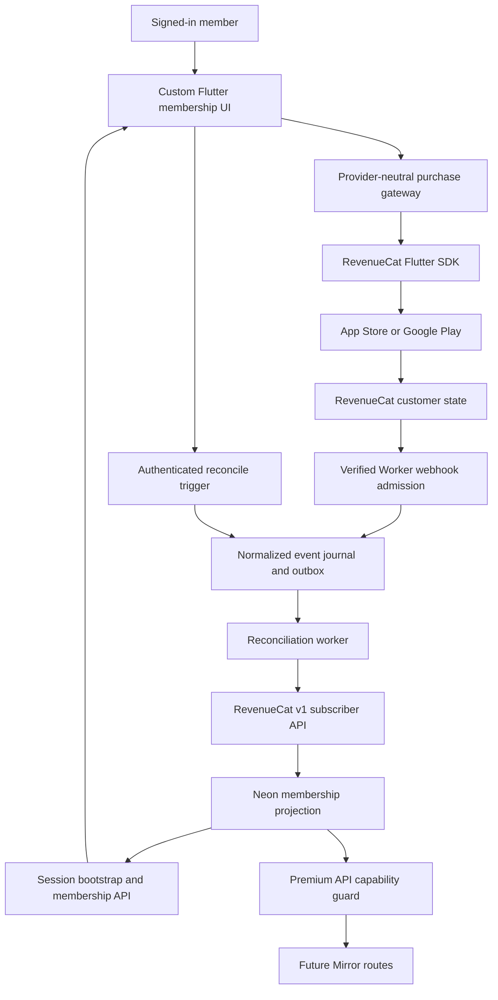
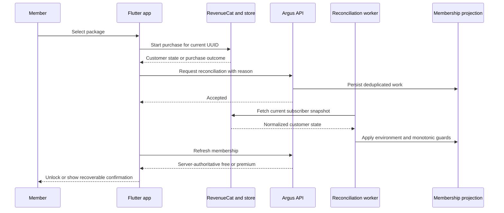
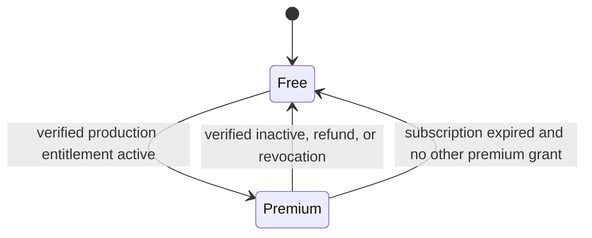
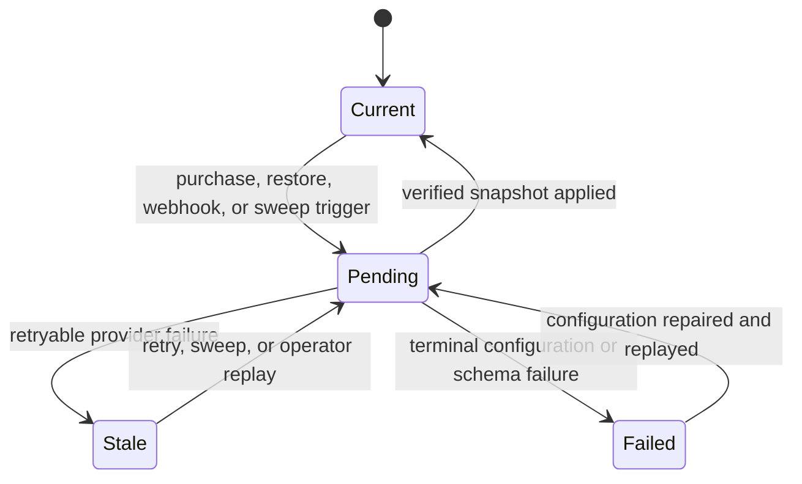
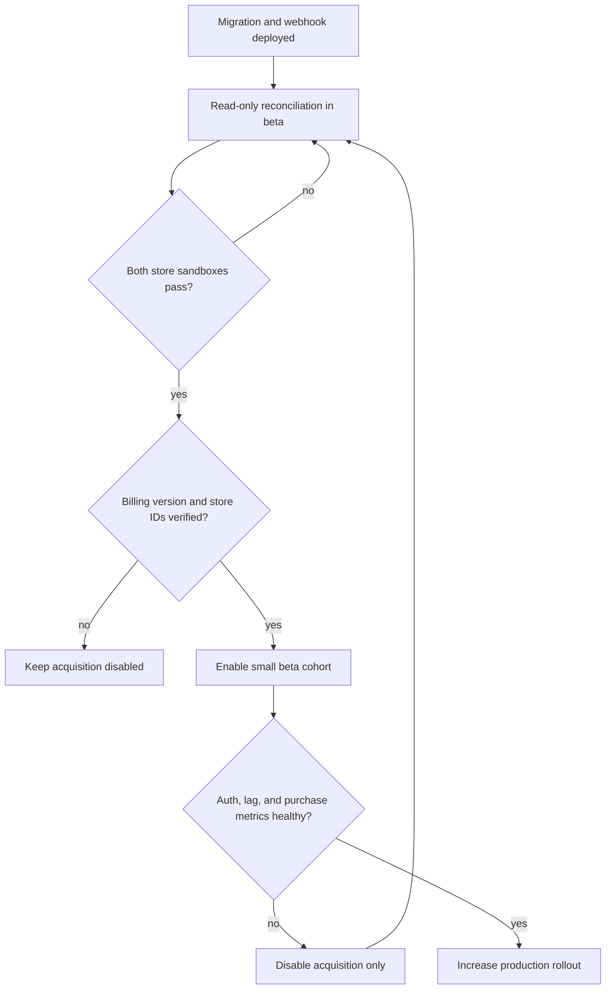

# RevenueCat Mobile Membership - Plan

## Goal Capsule

- **Objective:** Signed-in members can purchase, restore, and manage premium access on iOS and Android, and paid access remains correct across devices, app restarts, renewals, refunds, expirations, and account changes.
- **Means:** Use RevenueCat for StoreKit and Google Play Billing orchestration, with a server-side Argus membership projection as the authorization authority (KTD1, KTD4).
- **Authority:** Apple and Google own payment and transaction settlement. RevenueCat owns normalized purchase and entitlement state. The Argus backend owns authorization decisions from a verified RevenueCat snapshot. The Flutter client owns presentation only.
- **Execution profile:** Cross-platform mobile, Cloudflare Worker, Neon/Postgres, store-console configuration, and operational rollout.
- **Stop conditions:** Do not enable production acquisition until final store identifiers are approved, the Google Billing dependency meets the current Play deadline, both platform sandboxes pass, and server-side premium enforcement is proven.
- **Tail ownership:** Mobile owns purchase UX and SDK lifecycle. API owns synchronization and enforcement. Release operations owns store configuration, secrets, alerts, and staged enablement. Support owns restore conflicts and account recovery.

---

## Product Contract

### Summary

Replace the simulated premium checkout in the production Flutter app with real iOS and Android purchases serviced by RevenueCat. Offer monthly and annual auto-renewing subscriptions plus a one-time non-consumable lifetime unlock. Keep the existing custom membership UI while moving purchase execution, restore, localized pricing, and subscription management to the platform stores through RevenueCat.

Real membership is separate from the fictional Demo investing environment. Premium access unlocks the existing premium capability, but does not make Demo portfolios, orders, gains, or balances real.

### Problem Frame

The current membership flow creates a simulated, no-charge checkout and stores a Demo entitlement tied to reset generations. That model cannot represent App Store or Play purchases, renewal lifecycles, refunds, cross-device restore, or store-managed subscription changes. It also authorizes premium features only in Flutter, so direct API calls are not protected.

The repository currently bans purchase providers and describes mobile membership as fictional. Introducing RevenueCat therefore requires an intentional product-policy change, a new production membership data model, and release evidence that Demo isolation remains intact.

### Key Decisions

- **Use RevenueCat for iOS and Android commerce** (session-settled: user-directed — chosen over direct StoreKit and Play Billing integrations: one vendor normalizes the cross-platform purchase lifecycle). The choice passed a compatibility pressure test against the current Flutter, Auth0, Cloudflare, and Neon architecture. Governs R1-R19.
- **Keep custom Argus purchase screens** (session-settled: user-approved — chosen over RevenueCat Paywalls and Customer Center: the existing app-owned experience remains the product surface). Governs R5, R8, R9.
- **Support subscriptions and a lifetime unlock** (session-settled: user-approved — chosen over subscription-only billing: both recurring and permanent premium ownership are required). Consumables and web billing are deferred. Governs R2-R4, R11.
- **Require an authenticated Argus account before commerce** (session-settled: user-approved — chosen over anonymous purchase identities: ownership must bind to the signed-in account and backend mirror). Governs R6, R7, R12.
- **Keep real membership separate from Demo investing** (session-settled: user-approved — chosen over coupling purchase state to Demo state: payment is real while portfolios and transactions remain fictional). Governs R10, R13, R14.

### Actors

- A1. **Member:** A signed-in iOS or Android user who views offerings, purchases, restores, or manages premium access.
- A2. **Mobile app:** Presents custom UI, invokes RevenueCat, and waits for server-authoritative access.
- A3. **RevenueCat and platform stores:** Settle purchases and expose normalized customer and entitlement state.
- A4. **Argus API and operations:** Verify notifications, mirror membership, enforce capabilities, monitor health, and support recovery.

### Requirements

**Products and purchase experience**

- R1. Production mobile commerce must use RevenueCat as the only in-app purchase orchestration vendor for iOS and Android.
- R2. The initial product catalog must expose one monthly auto-renewing subscription, one annual auto-renewing subscription, and one non-consumable lifetime unlock through one stable `premium` entitlement.
- R3. The app must render localized product title, price, billing period, and product type from store-backed RevenueCat offerings rather than hardcoded commerce copy.
- R4. A successful purchase must enter a confirming state until the Argus backend reports active premium access; RevenueCat client state alone must not authorize protected API behavior.
- R5. Purchase cancellation must return to a usable membership screen without an error alarm, while pending, unavailable, and failed purchases must show an accurate recoverable state.

**Identity, restore, and management**

- R6. RevenueCat must receive the canonical Argus account UUID from authenticated session bootstrap, never the Auth0 subject, email address, or a locally generated identifier.
- R7. The app must not allow offerings, purchase, restore, or customer-state calls until the RevenueCat SDK is associated with the current canonical account UUID.
- R8. The membership screen must provide a user-initiated Restore Purchases action and must not trigger store restore automatically at startup.
- R9. Subscription owners must be able to open the platform management destination; lifetime owners must see permanent ownership without misleading cancellation or renewal controls.
- R10. A receipt already assigned to another Argus account must remain with its original account and route the member to account recovery or support instead of silently transferring premium access.

**Authorization and lifecycle**

- R11. Active monthly, annual, or lifetime ownership must grant the same premium capability; expiration, refund, revocation, billing failure, grace, hold, pause, and product change must resolve from the latest verified provider snapshot.
- R12. Premium API routes must enforce the tenant-scoped server membership projection and return a stable `403 entitlement_required` response when access is absent.
- R13. Demo reset, Demo seed, and Demo checkout behavior must never create, mutate, revoke, or duplicate real paid membership.
- R14. A free member must still enter and use the free app when RevenueCat or store services are unavailable.

**Security, privacy, and operations**

- R15. RevenueCat webhooks must pass the configured authorization-header check and HMAC verification over the raw body before any event is accepted.
- R16. Webhook and member-initiated reconciliation must be idempotent, tolerate duplicate and out-of-order triggers, and prevent sandbox transactions from granting production access.
- R17. Argus must retain only normalized purchase and entitlement metadata needed for authorization, audit, support, and privacy obligations; it must not store raw provider payloads, receipts, purchase tokens, or payment-card data.
- R18. New acquisition must be independently disableable while webhook ingestion, reconciliation, restore, management, and access for existing purchasers remain operational.
- R19. Production release must include Apple sandbox or TestFlight evidence, a Play-distributed license-tester or closed-track purchase, and a verified Google Billing Library version accepted after the 2026-08-31 deadline.

### Key Flows

- F1. Authenticated SDK association
  - **Trigger:** A1 completes Auth0 sign-in and session bootstrap returns an account UUID.
  - **Actors:** A1, A2, A3
  - **Steps:** A2 associates RevenueCat with the UUID, attaches the current-account listener, and then exposes purchase actions. On account change, A2 switches directly to the new UUID before any customer call.
  - **Outcome:** No anonymous RevenueCat identity is created or used for commerce.
  - **Covered by:** R6, R7, R14
- F2. Purchase and authorization confirmation
  - **Trigger:** A1 selects a package in the custom membership screen.
  - **Actors:** A1, A2, A3, A4
  - **Steps:** A2 starts the store purchase. A3 returns customer state. A2 requests a server reconciliation trigger with a non-empty reason body. A4 fetches the current RevenueCat subscriber snapshot and updates the projection. A2 refreshes membership until access is authoritative or the confirmation window expires.
  - **Outcome:** A1 enters the protected destination only after server premium is active.
  - **Covered by:** R2-R5, R11, R12, R16
- F3. Lifecycle synchronization
  - **Trigger:** RevenueCat emits a purchase lifecycle webhook.
  - **Actors:** A3, A4
  - **Steps:** A4 verifies both webhook credentials, durably deduplicates the normalized trigger, acknowledges promptly, and processes reconciliation outside the admission transaction. The worker fetches the current subscriber snapshot and applies it with a monotonic write guard.
  - **Outcome:** Renewal, expiry, refund, revocation, billing, and product changes converge on current provider state.
  - **Covered by:** R11, R15-R18
- F4. Restore and receipt conflict
  - **Trigger:** A1 taps Restore Purchases.
  - **Actors:** A1, A2, A3, A4
  - **Steps:** A2 invokes restore for the current UUID. Matching ownership enters the same confirmation flow as purchase. Conflicting original ownership remains assigned and surfaces recovery guidance.
  - **Outcome:** Legitimate ownership is recovered without cross-account transfer.
  - **Covered by:** R8, R10, R16
- F5. Logout and account switch
  - **Trigger:** A1 logs out or authenticates as a different account in the same process.
  - **Actors:** A1, A2, A3
  - **Steps:** A2 removes listeners and clears all app-facing customer and offering state. It does not call RevenueCat logout because that creates an anonymous identity. After the next verified bootstrap, it switches directly to the new UUID and then reloads state.
  - **Outcome:** The old account cannot leak purchase state or authorize the new session.
  - **Covered by:** R6, R7, R14, R17

### Acceptance Examples

- AE1. **Covers R2-R4.** Given a signed-in free member and valid annual offering, when the annual purchase succeeds and the server snapshot grants `premium`, then the UI leaves confirming state and Future Mirror becomes available.
- AE2. **Covers R4, R12.** Given RevenueCat client state reports active but the server projection is free, when the member opens Future Mirror or calls its API directly, then the client stays gated and the API returns `403 entitlement_required`.
- AE3. **Covers R5.** Given a member cancels the store sheet, when control returns to the app, then no failure banner or entitlement change is shown and the purchase options remain usable.
- AE4. **Covers R5, R14.** Given RevenueCat offerings cannot load, when a free member opens Membership, then the app shows a retryable unavailable state and the rest of the free shell remains usable.
- AE5. **Covers R8, R10.** Given the same canonical account UUID owns a prior purchase, when the member explicitly restores, then the backend confirms premium; given the receipt belongs to another UUID, the app shows account-recovery guidance and does not transfer access.
- AE6. **Covers R9, R11.** Given an active subscription, when the member taps Manage Subscription, then the platform management destination opens and cancellation does not revoke access before provider expiry.
- AE7. **Covers R9, R11.** Given lifetime-only ownership, when the member opens Membership, then ownership is permanent and no cancellation control appears; if a subscription is still renewing alongside lifetime ownership, its management control remains until provider state reports it inactive.
- AE8. **Covers R11, R16.** Given duplicate or out-of-order webhooks for the same member, when reconciliation jobs finish in either order, then the newest verified subscriber snapshot wins and the projection contains one current result.
- AE9. **Covers R13.** Given a paid member resets Demo data, when reset completes, then paid membership is unchanged and only simulated investing data is reseeded.
- AE10. **Covers R15-R17.** Given a webhook has a missing or stale signature, an invalid authorization header, an oversized body, or a non-UUID app user ID, when it reaches the Worker, then it cannot enqueue reconciliation or change membership and no sensitive body is logged.
- AE11. **Covers R16.** Given a production account also has a RevenueCat sandbox transaction, when the production projection reconciles, then sandbox ownership cannot grant production premium.
- AE12. **Covers R6, R7, R17.** Given account A logs out and account B signs in without terminating the app, when B opens Membership, then B sees only B's offering and ownership state and no anonymous RevenueCat ID is created.
- AE13. **Covers R18.** Given acquisition is disabled after an incident, when an existing subscriber opens Membership, then purchase buttons are hidden while restore, management, webhook updates, and active premium access continue.
- AE14. **Covers R19.** Given a release candidate, when its Android release dependency graph is inspected, then it resolves to Billing Library 8 or newer and contains no direct legacy billing dependency.

### Success Criteria

- At least 99% of successful platform-sandbox purchase and restore test sessions reach server-authoritative premium within 30 seconds.
- Every protected Future Mirror endpoint rejects free, expired, revoked, and cross-tenant requests in direct API tests.
- Duplicate, delayed, sandbox, and replayed webhook fixtures produce no incorrect authorization transition.
- The standalone Demo dependency and artifact audits remain provider-free after `purchases_flutter` is added to the production app.
- Release evidence contains one full subscription lifecycle and one lifetime purchase on each store-backed platform environment.

### Scope Boundaries

#### In Scope

- iOS App Store and Google Play purchases through RevenueCat.
- Monthly and annual auto-renew subscriptions plus a non-consumable lifetime unlock.
- Custom Flutter purchase, restore, confirmation, status, and management UI.
- Auth0-to-account-UUID association, RevenueCat webhooks, server reconciliation, Neon projection, and server authorization.
- Privacy inventory, observability, incident controls, support guidance, sandbox testing, and staged release.

#### Deferred to Follow-Up Work

- Web billing, Stripe, promotional web checkout, and cross-provider receipt migration.
- Consumable products, virtual currency, tipping, gifting, family or organization plans, introductory experiments, and offer-code campaigns.
- RevenueCat Paywalls, Customer Center, Experiments, and remotely authored UI.
- New premium features beyond the current Future Mirror capability.
- Automated refund issuance and revenue-recognition reporting.

#### Outside This Product's Identity

- Real brokerage, custody, securities execution, market-data trading, or bank-account linking.
- Any copy that represents Demo holdings, orders, gains, or balances as real financial assets.

---

## Planning Contract

### Key Technical Decisions

- KTD1. **Use a three-authority model** (session-settled: user-approved — chosen over client-only RevenueCat state: protected access requires the confirmed backend mirror). Store transactions settle payment, RevenueCat normalizes ownership, and the Argus projection alone authorizes protected backend behavior. Supports R4, R11, R12.
- KTD2. **Use one stable `premium` entitlement across products.** Monthly, annual, and lifetime store products map to the same business capability, so product identifiers and store metadata never enter authorization logic. Supports R2, R3, R11.
- KTD3. **Use only canonical authenticated account UUIDs** (session-settled: user-approved — chosen over anonymous or Auth0-sub identities: commerce ownership must match the backend account UUID). Configure the SDK after the first verified bootstrap, switch accounts with a direct RevenueCat login, detach listeners on logout, and never call RevenueCat logout because it creates an anonymous ID. Supports R6, R7, R14, R17.
- KTD4. **Mirror current RevenueCat subscriber snapshots, not webhook event semantics.** Every verified trigger that resolves an active provider link queues a RevenueCat v1 subscriber fetch. A snapshot can update only that link and can never create an account or link. A bounded sweep verifies every active premium row within 24 hours so missed webhooks converge without member activity. Supports R11, R15-R17.
- KTD5. **Keep receipts with the original App User ID.** Set RevenueCat restore behavior to keep ownership with the original UUID. Recovery means regaining the original Auth0 and Argus account; support does not reassign the receipt to a new UUID. Supports R8, R10.
- KTD6. **Use additive production membership storage.** Tenant membership, provider links, transitions, and work rows remain independent from Demo `reset_generation`. A project-scoped ingress journal can reference a resolved tenant but cannot create one. Supports R11-R13, R17.
- KTD7. **Admit first, reconcile through a generation-fenced executor.** Admission persists a normalized trigger and increments one account-and-environment work generation. The executor leases work, fetches outside any database transaction, and atomically applies only a current generation. A newer trigger received in flight remains pending. Supports R15-R18.
- KTD8. **Use the same queued reconciliation path after purchase and restore.** An authenticated, rate-limited endpoint accepts a non-empty reason body, enqueues member reconciliation, and returns an accepted state. The app polls the membership read model instead of trusting the purchase callback. Supports R4, R8, R11, R16.
- KTD9. **Isolate RevenueCat behind the production dependency factory.** Shared domain, router, and standalone Demo graphs depend on a provider-neutral purchase gateway. Only production mobile bootstrap imports and initializes `purchases_flutter`. Supports R1, R13, R14.
- KTD10. **Separate acquisition control from entitlement continuity.** A mobile acquisition flag and backend reconciliation kill switch can stop new purchases or outbound work independently, but webhook admission and existing membership reads stay on. Supports R14, R18.
- KTD11. **Pin release compatibility at the native dependency graph.** Start with `purchases_flutter` 10.10.0, make native minimums explicit, and fail CI if the resolved Android billing client misses Play's current submission requirement. Supports R1, R19.
- KTD12. **Store normalized commerce metadata only.** Persist provider IDs, environment, entitlement state, product type, store, expiry, status reason, and reconciliation timestamps. Never persist provider request bodies, receipts, purchase tokens, authorization headers, or card data. Supports R17.

### High-Level Technical Design

The diagrams fix ownership, data direction, and gates. Exact class, table, and helper names remain implementation choices within those boundaries.

#### Component and data ownership

#### Purchase confirmation protocol

#### Access and synchronization lifecycle

Access and synchronization are orthogonal. `Pending`, `Stale`, or `Failed` never grants premium. A verified subscription stops authorizing at its stored expiry even during an outage. A verified lifetime unlock remains active while stale until a verified refund or revocation, and its stale age triggers operations alerts.

#### Rollout and incident gates

### Data Model and Protocol Notes

- The tenant projection derives free from the absence of a verified production row. Its unique identity is tenant, account, and provider environment. It separates `access_state` from `sync_state` and records entitlement, product type, store, original and current product, expiry, status reason, provider snapshot time, applied generation, and last reconciled time.
- A provider-customer link has a composite tenant-and-account foreign key and one project-wide RevenueCat App User ID. Environment partitions the projection, work, and ingress rows because one RevenueCat customer can contain sandbox and production transactions. Callbacks and snapshots can resolve only an existing active link and can never create an account or link.
- An append-only normalized transition ledger records each changed access decision with an account-local version. Applying the same normalized snapshot is a no-op and creates no duplicate transition.
- The project-scoped webhook ingress journal deduplicates on provider environment and RevenueCat event ID. It stores event type, provider event time, admission time, payload fingerprint, disposition, opaque work ID, and nullable resolved tenant/account references. Unknown or deleted identity material is stored only as a keyed hash and is never exposed through tenant roles.
- One reconciliation-work row per tenant, account, and environment tracks requested, started, and last-applied generations plus lease state. Every trigger atomically advances the requested generation. A worker applies only its captured generation and requeues when a newer generation arrived in flight.
- Reconciliation normalizes the bounded provider response outside a transaction. A short apply transaction locks or compares the environment-specific row, commits access, transition, work, and receipt changes atomically, and never lets an older generation overwrite a newer one.
- Production reads ignore sandbox ownership. Beta uses sandbox events and separate webhook configuration, secrets, and telemetry dimensions.
- Unknown webhook fields are ignored after raw-body verification. A structurally valid new event type is recorded as normalized metadata and can trigger a snapshot fetch when its App User ID is a valid known UUID.
- Deletion-pending fences new purchase and reconciliation triggers. Workers recheck the tenant deletion generation immediately before apply; late webhooks for deleted identities are acknowledged and dispositioned without recreating tenant data.

### System-Wide Impact

- **Authentication:** RevenueCat lifecycle becomes subordinate to verified Auth0 bootstrap. SDK identity transitions are serialized and verified after completion. Logout clears app-facing commerce state without creating an anonymous vendor identity.
- **Authorization:** Future Mirror moves from client-only gating to a shared tenant-scoped API guard. Bootstrap and generated clients gain real membership state.
- **Data lifecycle:** Tenant projections, transitions, links, and work participate in RLS, export, deletion, audit, backup, and migration-upgrade tests but never Demo reset. The project ingress journal is operator-only and stores unresolved identities only as keyed hashes.
- **Dependency policy:** The provider boundary changes from a blanket purchase-SDK ban to an exact RevenueCat allowance. Direct StoreKit wrappers, `in_app_purchase`, Stripe, brokers, banks, market-data vendors, and push SDKs remain prohibited.
- **Demo isolation:** The standalone Demo must receive provider stubs and fail if the native RevenueCat plugin enters its dependency graph or compiled artifact.
- **Operations:** RevenueCat introduces public mobile keys, paired webhook credentials, a server API secret, a Pro-plan webhook dependency, bounded outbound egress, queue and scheduled work, alerts, store-console configuration, and support procedures.
- **Privacy:** Argus becomes a controller of normalized purchase metadata while Apple, Google, and RevenueCat process transaction data. Account deletion does not cancel a store subscription and must say so before confirmation.

### Dependencies and Prerequisites

- A release owner approves final iOS and Android application identifiers before any durable store product or RevenueCat app is created. The current identifiers remain provisional and differ by platform.
- A product owner approves the monthly, annual, and lifetime SKU names, price tiers, availability, and subscription-group/base-plan configuration. The app always displays localized store metadata.
- RevenueCat project access includes Pro webhooks, HMAC signing, separate public iOS and Android SDK keys, a server v1 secret, and separate beta and production webhook credentials.
- App Store Connect agreements, tax, banking, IAP capability, subscription products, and server notifications are active.
- Play Console merchant configuration, subscriptions/base plans, one-time product, service credentials, real-time developer notifications, license testers, and a closed/internal test track are active.

### Risks and Mitigations

| Risk | Impact | Mitigation |
|---|---|---|
| Provisional bundle identifiers change after store setup | Products and purchase history attach to the wrong store app | Freeze identifiers before store and RevenueCat configuration; make approval a U1 completion gate. |
| RevenueCat identity is configured before bootstrap, logged out anonymously, or a late login wins | Purchases alias to the wrong or anonymous customer | Enforce KTD3 with serialized generations, post-login identity verification, and active-store-sheet account switching tests. |
| Webhook delivery is delayed, duplicated, or permanently missed | Confirmation lags or a lifetime refund remains stale | Use KTD4, KTD7, KTD8, event-ID dedupe, member reconciliation, and a scheduled premium freshness sweep. |
| A trigger arrives while reconciliation is in flight | The new provider state is lost after an older fetch applies | Advance requested generations atomically and requeue whenever requested exceeds the applied generation. |
| RevenueCat or queue outage occurs after store success | The member paid but server access remains unconfirmed | Show a recoverable confirming state, preserve purchase evidence only in the SDK, retry reconciliation, and alert on lag. Support can replay by UUID. |
| Sandbox ownership leaks into production | Test purchases grant real access | Partition webhook credentials and projection environment; reject sandbox in production reads and test mixed-environment customers. |
| Lifetime and subscription products overlap | UI offers confusing duplicate purchases or revokes permanent access | Gate on the single entitlement, suppress purchase options for current lifetime owners, and derive access from the complete subscriber snapshot. |
| Play rejects an outdated transitive billing client after 2026-08-31 | Android release is blocked | Pin a current SDK and add a release dependency-graph gate for Billing Library 8 or newer. |
| Provider allowance weakens Demo or finance-provider guardrails | Unreviewed SDKs enter production or Demo | Allowlist exact RevenueCat packages, host, subscriber-fetch callsite, and vendor-deletion callsite; retain all other prohibitions and fail-closed count tests. |
| Account deletion races queued or future callbacks | Deleted membership or identifiers are recreated | Fence apply by deletion generation, deny deleted identity hashes, purge ordinary work, and acknowledge late callbacks without tenant mutation. |
| Account deletion leaves vendor data or active billing | Privacy harm and support escalation | Add a managed RevenueCat deletion effect, disclose retained store records, warn that deletion does not cancel, and link store management before deletion. |

### Alternative Approaches Considered

- **Direct StoreKit and Google Play Billing integrations:** Rejected because the team would own two purchase state machines, receipt handling, cross-platform identity, and lifecycle normalization. RevenueCat provides the needed vendor boundary without changing the platform stores' payment authority.
- **Client-only RevenueCat authorization:** Rejected because cached or tampered client state cannot protect direct API access and cannot satisfy tenant-scoped enforcement.
- **Webhook payload as the database mutation contract:** Rejected because event shapes differ and can arrive out of order. A full subscriber snapshot creates one normalized projection path.
- **Webhook-only confirmation:** Rejected because it creates a visible 5-to-60-second delivery dependency with no member-driven recovery. The authenticated reconcile trigger closes the common purchase and restore window.
- **Automatic receipt transfer between Argus accounts:** Rejected because it makes a shared Apple or Google account capable of moving premium access between unrelated Argus identities. Recovery remains explicit.
- **Repurpose Demo entitlement tables:** Rejected because those rows are tied to reset generations and simulated checkout semantics.

### Phased Delivery

1. Freeze commerce identifiers, product policy, and provider boundaries while U9 configures store sandboxes in parallel.
2. Deploy additive membership storage, webhook admission, generation-fenced reconciliation, the scheduled sweep, and read-only observability without gating users.
3. Add server membership reads and premium enforcement behind a server flag; prove no Demo reset coupling.
4. Integrate the production-only Flutter gateway and custom UI against RevenueCat Test Store and fakes.
5. Prove Apple sandbox/TestFlight and Play-distributed tester flows, then enable a small beta cohort.
6. Increase production rollout only while authorization, webhook lag, reconciliation, and purchase metrics remain within thresholds.

### Operational Metrics

- Alert when the oldest production reconciliation job exceeds five minutes or p95 purchase-to-authority time exceeds 30 seconds for 15 minutes.
- Alert when reconciliation failures exceed 2% for 15 minutes, excluding member cancellation and platform-pending outcomes.
- Alert when any active projection exceeds 24 hours since verification and page when stale lifetime ownership exceeds 26 hours because it has no natural expiry.
- Page on any invariant violation that applies sandbox ownership to a production projection or associates one provider identity with multiple canonical accounts.
- Page if a callback or worker attempts to create a provider link, apply after deletion, or advance an older generation over a newer one.
- Track purchase starts, member cancellations, pending outcomes, provider failures, restore conflicts, reconcile duration, webhook admission failures, dedupe hits, projection transitions, and management-link outcomes without product IDs or account UUIDs in metric labels.
- Keep acquisition disabled when alerts are unresolved. Existing membership reads and webhook admission remain available during rollback.

### Sources and Research

- Repository architecture: `docs/solutions/architecture-patterns/ritual-investing-app-current-intent-and-architecture.md`, `ritual-investing-app/lib/core/bootstrap/production_member_feature_scope_factory.dart`, `ritual-investing-app/lib/features/entitlements/`, and `ritual-investing-api/src/domains/entitlements/routes.ts`.
- Provider guardrails: `scripts/check-member-provider-boundaries.sh`, `scripts/check-demo-provider-boundaries.sh`, and `.github/workflows/ritual-investing.yml`.
- Data and release constraints: `docs/ritual-investing/member-data-inventory.md`, `docs/ritual-investing/member-release-gates.md`, `docs/ritual-investing/privacy-runbook.md`, and `ritual-investing-app/AGENTS.md`.
- RevenueCat identity and custom App User IDs: https://www.revenuecat.com/docs/customers/identifying-customers
- RevenueCat restore behavior: https://www.revenuecat.com/docs/projects/restore-behavior
- RevenueCat Flutter installation and current package: https://www.revenuecat.com/docs/getting-started/installation/flutter and https://pub.dev/packages/purchases_flutter
- RevenueCat offerings and entitlements: https://www.revenuecat.com/docs/offerings/overview and https://www.revenuecat.com/docs/getting-started/entitlements
- RevenueCat webhook verification and reconciliation: https://www.revenuecat.com/docs/integrations/webhooks
- RevenueCat subscriber API v1: https://www.revenuecat.com/docs/api-v1
- Apple subscriptions and review requirements: https://developer.apple.com/app-store/subscriptions/ and https://developer.apple.com/app-store/review/guidelines/
- Google Play Billing integration, security, and deprecation schedule: https://developer.android.com/google/play/billing/integrate, https://developer.android.com/google/play/billing/security, and https://developer.android.com/google/play/billing/deprecation-faq

---

## Implementation Units

### U1. Freeze the commerce contract and provider boundaries

- **Goal:** Freeze the local commerce contract and exact repository allowances so backend and mobile work can proceed without waiting for store administration.
- **Requirements:** R1-R3, R10, R18, R19; KTD2, KTD5, KTD10, KTD11.
- **Dependencies:** None.
- **Files:**
  - `ritual-investing-app/README.md`
  - `ritual-investing-app/PRODUCT.md`
  - `ritual-investing-app/pubspec.yaml`
  - `ritual-investing-app/pubspec.lock`
  - `scripts/check-member-provider-boundaries.sh`
  - `scripts/test-check-member-provider-boundaries.sh`
  - `scripts/check-demo-provider-boundaries.sh`
  - `scripts/test-check-demo-provider-boundaries.sh`
  - `.github/workflows/ritual-investing.yml`
  - `docs/ritual-investing/member-release-gates.md`
- **Approach:**
  1. Obtain release-owner approval for final bundle and application IDs and record the monthly, annual, lifetime, Offering, and `premium` entitlement contract.
  2. Add `purchases_flutter` 10.10.0 while preserving exact prohibitions for direct purchase, payment, bank, broker, market-data, and push providers.
  3. Extend provider-boundary fixtures for the reviewed RevenueCat SDK, subscriber fetch, and vendor-deletion egress shapes. Add a resolved Android billing-version gate for R19.
  4. Update product and release documents so real membership commerce and fictional Demo investing are described together without contradiction.
- **Execution note:** Treat the bundle identifiers and store product matrix as irreversible release inputs. Do not create production products until their approval evidence is attached to the release checklist.
- **Patterns to follow:** Exact provider allowlists and fail-closed counts in `scripts/check-member-provider-boundaries.sh`; release evidence structure in `docs/ritual-investing/member-release-gates.md`.
- **Test scenarios:**
  - Adding `purchases_flutter` at the approved version passes the production audit, while adding `in_app_purchase`, Stripe, or an unreviewed RevenueCat host still fails.
  - Adding the RevenueCat plugin to the standalone Demo graph fails the Demo dependency and artifact audits.
  - An Android release dependency graph that resolves Billing Library 7 fails the release gate; Billing Library 8 or newer passes.
  - Missing approved application identifiers or product-to-entitlement mappings keeps acquisition disabled.
- **Verification:** The approved identifier and product contract are documented; provider audits remain fail-closed; CI proves the resolved billing version.

### U9. Configure Apple, Google, and RevenueCat environments

- **Goal:** Create the external store and RevenueCat configuration needed for platform sandbox and production operation.
- **Requirements:** R1-R3, R8-R11, R15, R16, R18, R19; KTD2, KTD4, KTD5, KTD10, KTD11.
- **Dependencies:** U1.
- **Files:**
  - `docs/ritual-investing/revenuecat-operations.md`
  - `docs/ritual-investing/member-release-gates.md`
  - `docs/ritual-investing/staging-evidence-template.md`
- **Approach:**
  1. Create App Store Connect and Play Console apps from the approved identifiers, then configure agreements, merchant settings, IAP capability, subscription products, base plans, the one-time product, testers, and platform notifications.
  2. Create separate RevenueCat iOS and Android apps. Attach the three store products to the shared `premium` entitlement and current Offering.
  3. Configure KTD5 restore behavior, platform credentials, separate beta and production webhook integrations, HMAC signing, and server API access.
  4. Record public-key and secret ownership without placing server secrets in mobile build configuration or documentation.
  5. Verify store metadata and RevenueCat mappings against the U1 contract before giving keys to U5 or endpoints to U8.
- **Execution note:** External setup can run in parallel with U2-U4 after U1. Production acquisition stays disabled until U8 completes.
- **Patterns to follow:** Secret ownership and release evidence conventions in `docs/ritual-investing/beta-environment.md` and `docs/ritual-investing/member-release-gates.md`.
- **Test scenarios:**
  - The iOS and Android products resolve to the same RevenueCat package and entitlement contract with correct product types.
  - Beta webhooks accept sandbox events only; production membership cannot derive access from the sandbox configuration.
  - Restore behavior retains a conflicting receipt on its original canonical UUID.
  - A missing product mapping, platform notification, HMAC setting, credential owner, or final application ID blocks the environment gate.
- **Verification:** Store-console and RevenueCat evidence proves the approved identifiers, product mappings, entitlement, Offering, notifications, webhook partitions, restore policy, and credential ownership.

### U2. Add a production membership projection independent from Demo reset

- **Goal:** Create the tenant-scoped persistence and read model for real membership without changing simulation-owned entitlement rows.
- **Requirements:** R11-R14, R16, R17; KTD1, KTD2, KTD6, KTD12.
- **Dependencies:** U1.
- **Files:**
  - `ritual-investing-api/drizzle/0013_revenuecat_membership.sql`
  - `ritual-investing-api/src/db/schema/membership.ts`
  - `ritual-investing-api/src/db/schema/index.ts`
  - `ritual-investing-api/src/domains/membership/repository.ts`
  - `ritual-investing-api/src/domains/membership/schemas.ts`
  - `ritual-investing-api/src/domains/session/repository.ts`
  - `ritual-investing-api/src/domains/session/schemas.ts`
  - `ritual-investing-api/test/domains/membership.test.ts`
  - `ritual-investing-api/test/security/rls.test.ts`
  - `ritual-investing-api/test/security/demo-reset-generation.test.ts`
  - `ritual-investing-api/test/db/migration-upgrade.test.ts`
- **Approach:**
  1. Add environment-specific membership, provider-customer links, transition history, project ingress, and generation-fenced reconciliation work with composite foreign keys, uniqueness, checks, RLS, and audit timestamps.
  2. Derive `free` from the absence of a verified production membership row. Do not backfill free rows.
  3. Define one normalized entitlement resolution function that separates access from sync health and applies environment filtering, expiry, idempotence, and subscription-versus-lifetime precedence.
  4. Update session bootstrap to expose real membership status and capabilities while keeping Demo reset metadata separate.
  5. Ensure existing Demo reset triggers, cleanup, and reseeding cannot reference the new production tables.
- **Execution note:** Start with migration, RLS, and Demo-reset characterization tests before changing bootstrap reads.
- **Patterns to follow:** Tenant ownership in `ritual-investing-api/src/db/schema/identity.ts`; migration and reset-generation guarantees in `ritual-investing-api/src/db/schema/member.ts` and `ritual-investing-api/drizzle/0006_simulated_ledger.sql`.
- **Test scenarios:**
  - A new eligible account with no purchase rows bootstraps as free and enters the shell.
  - A verified production subscription or lifetime snapshot resolves to premium for only its tenant and account.
  - A sandbox-only snapshot in production resolves to free.
  - A slower older reconciliation cannot overwrite a newer snapshot.
  - Reapplying the same normalized snapshot is a no-op with no version bump or duplicate transition.
  - A refunded or revoked lifetime product removes access when no other active product grants `premium`.
  - A stale subscription stops authorizing at its verified expiry, while a stale lifetime unlock remains active and observable until a verified revocation.
  - Cross-environment reuse of an event ID deduplicates independently and cannot join two provider-customer links.
  - Resetting Demo data changes simulation generations and rows but leaves all real membership rows unchanged.
  - Cross-tenant reads and writes fail under RLS and repository authorization.
  - An upgrade from the current migration head preserves existing accounts and Demo state while deriving free membership; an old binary ignores the retained additive tables.
- **Verification:** Migration upgrade, code-and-flag rollback, RLS, bootstrap, lifecycle, idempotence, and Demo-reset tests prove an additive production boundary without a destructive down migration after writes begin.

### U3. Implement secure webhook admission and queued subscriber reconciliation

- **Goal:** Convert RevenueCat lifecycle triggers into idempotent, current, and auditable membership snapshots.
- **Requirements:** R4, R11, R15-R18; KTD4, KTD7, KTD8, KTD10, KTD12.
- **Dependencies:** U1, U2.
- **Files:**
  - `ritual-investing-api/src/domains/membership/routes.ts`
  - `ritual-investing-api/src/domains/membership/revenuecat-webhook.ts`
  - `ritual-investing-api/src/domains/membership/revenuecat-client.ts`
  - `ritual-investing-api/src/domains/membership/service.ts`
  - `ritual-investing-api/src/jobs/queue-consumer.ts`
  - `ritual-investing-api/src/jobs/queue-runtime.ts`
  - `ritual-investing-api/src/jobs/consumer-receipts.ts`
  - `ritual-investing-api/src/jobs/handlers.ts`
  - `ritual-investing-api/src/jobs/outbox.ts`
  - `ritual-investing-api/src/index.ts`
  - `ritual-investing-api/src/config/env.ts`
  - `ritual-investing-api/src/contracts/openapi.ts`
  - `ritual-investing-api/wrangler.jsonc`
  - `ritual-investing-api/wrangler.beta.jsonc`
  - `ritual-investing-api/test/domains/revenuecat-webhook.test.ts`
  - `ritual-investing-api/test/domains/revenuecat-reconciliation.test.ts`
  - `ritual-investing-api/test/worker/revenuecat-reconciliation.test.ts`
  - `ritual-investing-api/test/security/secrets.test.ts`
  - `ritual-investing-api/test/config/bindings.test.ts`
- **Approach:**
  1. Add a dedicated webhook route with body and media limits, authorization-header comparison, raw-body HMAC verification, timestamp tolerance, and defensive envelope parsing.
  2. Resolve only an existing active provider link. Persist normalized ingress metadata, advance its opaque work generation, and create outbox work in one transaction. Return success for duplicates without duplicating transitions.
  3. Add a two-phase reconciliation executor instead of running provider I/O inside the current receipt transaction. Lease one generation, fetch outside a transaction, then conditionally apply and receipt in a short transaction.
  4. Pin the RevenueCat HTTPS host and project context. Disable redirects, bound time and response bytes, validate a strict schema, verify requested identity or approved aliases, and evaluate environment per entitlement or transaction.
  5. Apply the snapshot through U2's resolution and generation guards. Retry 429, 5xx, and timeouts without projection mutation. Alert on 401, 403, or malformed responses. Treat subscriber-not-found as free only after its documented contract is verified.
  6. Schedule a bounded freshness sweep that verifies each active premium row at least every 24 hours and prioritizes stale rows and subscriptions near expiry. Enforce one outstanding reconciliation per account and environment plus global concurrency and provider rate budgets.
  7. Add separate beta and production webhook authorization, HMAC, and server API secrets. Ensure production projection rejects sandbox state.
  8. Keep webhook admission enabled during acquisition rollback. A reconciliation outage preserves only previously verified access subject to expiry, retains replayable DLQ work, and pages before any terminal work is discarded.
- **Execution note:** Start with raw-body signature, duplicate-event, and out-of-order integration tests. The secure admission contract must fail before the route implementation exists.
- **Patterns to follow:** Outbox and consumer receipts in `ritual-investing-api/src/jobs/`; secret redaction in `ritual-investing-api/src/config/env.ts`; the hosted edge-shaped request lesson in `docs/solutions/integration-issues/empty-bootstrap-post-rejected-at-cloudflare-edge.md`.
- **Test scenarios:**
  - A valid authorization header and HMAC over the exact raw body admits one normalized event and one reconciliation job.
  - A body parsed and reserialized before HMAC comparison does not pass the signature fixture.
  - Missing, malformed, stale, or wrong signatures and authorization headers return an authentication failure without persistence or logs containing secrets.
  - An oversized or invalid JSON body fails before event persistence.
  - RevenueCat retrying the same event ID returns success and creates no duplicate projection transition.
  - Two different out-of-order events fetch current snapshots and cannot regress the projection when the older request finishes last.
  - A new trigger received during an in-flight fetch advances the generation and remains pending after the older generation applies.
  - Crashes between admission and publish, publish and fetch, fetch and apply, and apply and receipt retain exactly one replayable outcome.
  - Unknown fields and a new event type do not break admission; a known canonical UUID can still queue snapshot reconciliation.
  - A non-UUID, unknown, cross-tenant, or deleted App User ID is stored only as a hashed orphan disposition and cannot create or mutate a link, account, or membership row.
  - RevenueCat timeout, 429, and 5xx responses retry without holding a database transaction; terminal 4xx configuration errors alert and do not grant access.
  - A redirect, oversized response, identity mismatch, ambiguous alias, malformed date or enum, or mixed-environment snapshot is rejected without forwarding credentials or mutating membership.
  - A provider timeout leaves no database transaction open.
  - A permanently missed lifetime refund webhook converges through the scheduled sweep without member activity.
  - DLQ exhaustion preserves replayable work and pages an operator.
  - A sandbox subscriber response reaches beta state but cannot grant production premium.
- **Verification:** Worker, route, security, queue, scheduler, and environment tests prove exact-body verification, durable acknowledgment, two-phase external I/O, generation safety, scheduled convergence, bounded provider input, idempotency, and secret hygiene.

### U4. Expose membership APIs and enforce premium server-side

- **Goal:** Make the Argus projection the shared membership contract and protect every Future Mirror route from direct free-account access.
- **Requirements:** R4, R11-R14, R16, R18; KTD1, KTD8, KTD10.
- **Dependencies:** U2, U3.
- **Files:**
  - `ritual-investing-api/src/domains/membership/routes.ts`
  - `ritual-investing-api/src/domains/membership/capability-guard.ts`
  - `ritual-investing-api/src/domains/intentions/routes.ts`
  - `ritual-investing-api/src/domains/simulation/route-support.ts`
  - `ritual-investing-api/src/domains/simulation/access.ts`
  - `ritual-investing-api/src/domains/session/routes.ts`
  - `ritual-investing-api/openapi/ritual-investing-v1.yaml`
  - `ritual-investing-api-client/lib/`
  - `ritual-investing-app/lib/core/api/ritual_api.dart`
  - `ritual-investing-api/test/domains/membership.test.ts`
  - `ritual-investing-api/test/domains/intentions.test.ts`
  - `ritual-investing-api/test/security/tenant-idor.test.ts`
  - `ritual-investing-api/test/contracts/openapi.test.ts`
  - `ritual-investing-api-client/test/`
- **Approach:**
  1. Add an authenticated membership read route and an authenticated reconciliation-trigger route with a typed non-empty reason body, per KTD8.
  2. Rate-limit and deduplicate member-triggered reconciliation by tenant and account so repeated polling cannot amplify RevenueCat egress.
  3. Add one shared Future Mirror wrapper after `secureRoute` and simulation access resolve Auth0, tenant, and account, but before any intentions repository action.
  4. Apply that wrapper to Future Mirror create, latest-read, and historical-read operations with one stable error contract. Leave unrelated simulation routes free.
  5. Update session bootstrap and OpenAPI schemas for real membership status, server-authority freshness, and confirming states. Regenerate and validate the Dart client.
  6. Keep the enforcement rollout flag independent from acquisition so reads can be observed before rejection is enabled.
- **Execution note:** Add direct API authorization tests before applying the guard to all three Future Mirror operations.
- **Patterns to follow:** Authenticated route and tenant resolution patterns in `ritual-investing-api/src/domains/session/`; generated client workflow in `ritual-investing-api/package.json`.
- **Test scenarios:**
  - An active premium account can create and read current and historical Future Mirror records.
  - Free, expired, refunded, and revoked accounts receive `403 entitlement_required` from all three operations.
  - One table-driven route test proves create, latest read, and historical read traverse the same guard while unrelated simulation routes remain available to free members.
  - A lifetime owner remains authorized when a separate subscription expires but the verified entitlement remains active.
  - A valid token for tenant A cannot read or trigger reconciliation for tenant B.
  - A malformed, empty, or replay-amplified reconciliation request is rejected or coalesced without excess provider jobs.
  - When enforcement is disabled for observation, authorization decisions are logged as sanitized would-deny outcomes; when enabled, the same requests are rejected.
  - OpenAPI generation and Dart client regeneration produce no contract drift.
- **Verification:** Direct route tests prove server enforcement and tenant isolation; the generated client exposes the same membership and reconciliation states as the API.

### U5. Add the production-only RevenueCat mobile session and native configuration

- **Goal:** Associate the RevenueCat SDK with the verified account lifecycle without contaminating shared or standalone Demo graphs.
- **Requirements:** R1, R6-R8, R13, R14, R17, R19; KTD3, KTD9, KTD11.
- **Dependencies:** U1, U4.
- **Files:**
  - `ritual-investing-app/lib/core/config/runtime_config.dart`
  - `ritual-investing-app/lib/core/bootstrap/production_dependency_container.dart`
  - `ritual-investing-app/lib/core/bootstrap/production_member_feature_scope_factory.dart`
  - `ritual-investing-app/lib/core/bootstrap/member_shell_runtime.dart`
  - `ritual-investing-app/lib/core/bootstrap/member_feature_scope.dart`
  - `ritual-investing-app/lib/features/entitlements/data/purchase_gateway.dart`
  - `ritual-investing-app/lib/features/entitlements/data/revenuecat_purchase_gateway.dart`
  - `ritual-investing-app/ios/Podfile`
  - `ritual-investing-app/ios/Runner.xcodeproj/project.pbxproj`
  - `ritual-investing-app/android/app/src/main/AndroidManifest.xml`
  - `ritual-investing-app/android/app/build.gradle.kts`
  - `ritual-investing-demo/pubspec_overrides.yaml`
  - `ritual-investing-demo/tool/provider_stubs/`
  - `ritual-investing-app/test/core/config/runtime_config_test.dart`
  - `ritual-investing-app/test/core/bootstrap/member_shell_runtime_test.dart`
  - `ritual-investing-app/test/features/entitlements/revenuecat_purchase_gateway_test.dart`
  - `ritual-investing-app/test/demo_dependency_boundary_test.dart`
  - `ritual-investing-app/test/demo_package_boundary_test.dart`
- **Approach:**
  1. Add platform-specific public SDK keys and acquisition configuration to typed runtime config. Prevent Test Store or wrong-platform keys from release builds.
  2. Define a provider-neutral gateway for offerings, customer info, purchase, restore, listener updates, and management destinations.
  3. Implement the RevenueCat adapter only in the production mobile graph. Keep SDK-specific types out of domain, router, and shared Demo code.
  4. Add a root-scoped session coordinator with a mutex and session generation. It performs first configuration after bootstrap, serializes later identity switches, removes listeners on logout, and rejects late completions from an older session.
  5. After every configure or login, re-read the RevenueCat App User ID and expose commerce only when it equals the current bootstrap UUID. Never call RevenueCat logout, and let free shell bootstrap continue when association fails.
  6. Block account switching while a store sheet is active. If logout begins after the platform finishes, complete confirmation only for the captured account generation and never expose its result to the next session.
  7. Enable the iOS In-App Purchase capability, make iOS 15 explicit in CocoaPods, retain Android `singleTop`, add required billing permission, and verify platform minimums.
  8. Add provider stubs and compiled-artifact checks so the standalone Demo stays web-safe and provider-free.
- **Execution note:** Implement the gateway and coordinator against fakes first. Native sandbox proof belongs in U8, not in the aggregate provider-free integration suite.
- **Patterns to follow:** Production provider construction in `ritual-investing-app/lib/core/bootstrap/`; Demo provider stubs and import checks under `ritual-investing-demo/tool/` and `ritual-investing-app/tool/`.
- **Test scenarios:**
  - A verified bootstrap configures RevenueCat with the canonical account UUID and the correct platform public key before any offering call.
  - Missing bootstrap identity or an invalid UUID keeps commerce unavailable and makes no SDK call.
  - Account A logout clears listeners and app-facing state; account B login switches directly to B and never displays A state or creates an anonymous ID.
  - A delayed account A login completion arrives after B requests login; commerce remains blocked until the SDK reports B and cannot switch back to A.
  - Logout or account-switch input during an active store sheet is blocked; a late purchase result remains scoped to the captured account generation.
  - RevenueCat configuration failure leaves the member in the free shell with a retryable membership state.
  - A late listener callback from a disposed account is ignored.
  - A release configuration containing a Test Store key or wrong-platform key fails validation.
  - iOS resolves the current plugin at an explicit supported deployment target and has the In-App Purchase capability.
  - Android preserves `singleTop`, includes billing permission, and resolves Billing Library 8 or newer.
  - The standalone Demo builds and its dependency graph and compiled plugin registry contain no RevenueCat native plugin.
- **Verification:** Unit, boundary, native-build, and dependency-graph evidence proves authenticated identity ordering, account isolation, platform setup, and Demo exclusion.

### U6. Replace simulated checkout with custom production membership UX

- **Goal:** Deliver custom purchase, restore, confirmation, ownership, and management flows backed by the production gateway and server authority.
- **Requirements:** R2-R14, R18; KTD1-KTD3, KTD5, KTD8, KTD9.
- **Dependencies:** U4, U5.
- **Files:**
  - `ritual-investing-app/lib/features/entitlements/domain/model.dart`
  - `ritual-investing-app/lib/features/entitlements/data/repository.dart`
  - `ritual-investing-app/lib/features/entitlements/data/generated_entitlement_api_service.dart`
  - `ritual-investing-app/lib/features/entitlements/application/entitlement_controller.dart`
  - `ritual-investing-app/lib/features/entitlements/presentation/membership_screen.dart`
  - `ritual-investing-app/lib/features/entitlements/presentation/demo_membership_screen.dart`
  - `ritual-investing-app/lib/core/router/member_routes.dart`
  - `ritual-investing-app/lib/features/profile/you_routes.dart`
  - `ritual-investing-app/test/entitlement_controller_test.dart`
  - `ritual-investing-app/test/membership_presentation_test.dart`
  - `ritual-investing-app/test/app_router_test.dart`
  - `ritual-investing-app/test/accessibility_test.dart`
  - `ritual-investing-app/integration_test/member_experience_test.dart`
- **Approach:**
  1. Replace Demo plan and checkout models with provider-neutral offerings, packages, purchase outcomes, ownership state, server-authority freshness, and management actions.
  2. Remove simulated checkout creation, confirmation, fake receipt, local downgrade, and `FinancialCommandJournal` behavior from production membership.
  3. Retain fail-closed capability routing, return-context validation, and custom cards. Render all commerce metadata from offerings and label lifetime versus recurring products clearly.
  4. Drive purchase and restore through the gateway. Treat user cancellation as neutral, block duplicate taps, preserve pending and background-verification state, and enter KTD8 confirmation after any ownership-changing outcome.
  5. Unlock only from refreshed server membership. When confirmation times out, keep a visible Check Access and support path without claiming the purchase failed.
  6. Use RevenueCat customer management URL for subscriptions. Hide recurring management for lifetime-only ownership, retain it when a still-renewing subscription coexists with lifetime ownership, and suppress new purchase options for a current lifetime owner.
  7. Remove production fake-payment routes and copy. Keep an adjacent disclosure that the paid premium feature still operates on fictional Demo investing data.
  8. Respect the acquisition flag while leaving restore, management, membership status, and existing premium navigation active.
- **Execution note:** Implement controller transitions test-first, then widget states, then provider-free integration coverage.
- **Patterns to follow:** `ListenableBuilder`, 48dp controls, semantic labels, theme typography, and validated return destinations in `demo_membership_screen.dart`; existing authority refresh in `entitlement_controller.dart`.
- **Test scenarios:**
  - Covers AE1. Monthly, annual, and lifetime packages render localized metadata and a successful purchase unlocks only after server confirmation.
  - Covers AE2. Active client CustomerInfo with a free server projection remains gated.
  - Covers AE3. Store cancellation returns to idle without an error alert or navigation loss.
  - A double tap starts one purchase; the second action is disabled until the first resolves.
  - A platform-pending or background verification flow survives app pause and resumes in a confirming or retryable state.
  - Covers AE4. Empty or failed offerings show retry UI while free navigation remains available.
  - Covers AE5. Manual restore succeeds for the current account; an original-owner conflict directs the member to regain that original Argus account and never promises receipt reassignment.
  - Covers AE6. Subscription management opens the returned platform URL and keeps access until verified expiry.
  - Covers AE7. Lifetime ownership shows permanent access with no cancellation control or repurchase option.
  - Lifetime plus a still-renewing subscription shows permanent ownership and retains the subscription-management action until the provider reports that recurring product inactive.
  - A confirmation timeout keeps Check Access, restore, and support available and does not state that the store purchase failed.
  - Covers AE9. Demo reset and Demo disclosures remain independent from paid membership.
  - Covers AE13. Acquisition-off state hides purchase actions but preserves existing access, restore, and management.
  - Screen-reader order identifies recurring period, localized price, lifetime ownership, restore, error, and confirming state; all actions meet touch-target requirements.
- **Verification:** Controller, widget, router, accessibility, and provider-free integration tests cover every visible commerce state and authority transition.

### U7. Complete privacy, observability, support, and incident controls

- **Goal:** Make vendor data handling, lifecycle operations, monitoring, deletion, and recovery supportable before acquisition is enabled.
- **Requirements:** R10, R14-R19; KTD5, KTD7, KTD10, KTD12.
- **Dependencies:** U2, U3, U4, U5.
- **Files:**
  - `ritual-investing-api/src/domains/privacy/service.ts`
  - `ritual-investing-api/src/jobs/handlers.ts`
  - `ritual-investing-api/src/observability/telemetry.ts`
  - `ritual-investing-api/ops/alert-fixtures.v1.json`
  - `ritual-investing-api/scripts/beta-secret-tools.ts`
  - `ritual-investing-api/test/domains/privacy.test.ts`
  - `ritual-investing-api/test/observability/telemetry.test.ts`
  - `ritual-investing-api/test/observability/alert-fixtures.test.ts`
  - `ritual-investing-api/test/config/beta-secret-tools.test.ts`
  - `docs/ritual-investing/member-data-inventory.md`
  - `docs/ritual-investing/privacy-runbook.md`
  - `docs/ritual-investing/revenuecat-operations.md`
  - `docs/ritual-investing/staging-evidence-template.md`
- **Approach:**
  1. Export the current projection and append-only transition ledger at the existing privacy snapshot boundary. Exclude the project ingress journal from tenant export except for resolved tenant-owned audit references.
  2. Mark the provider link and tenant deletion-pending before purge. Block new commerce and reconciliation, fence in-flight apply by deletion generation, cancel ordinary work, and prevent late signed callbacks from recreating membership.
  3. Add an idempotent RevenueCat customer-deletion effect. Retain the App User ID only in the protected effect until provider success or not-found, then replace it with a non-identifying receipt and a keyed deletion-deny hash.
  4. Warn during account deletion that deleting Argus does not cancel an App Store or Play subscription. Offer store management before deletion without blocking the deletion right.
  5. Document RevenueCat, Apple, and Google processing in the data inventory and platform privacy disclosures without implying that Argus stores card details.
  6. Emit sanitized outcomes for webhook admission, sweep freshness, reconciliation lag and failure, projection transitions, orphan identities, restore conflicts, purchase confirmation, and dependency health.
  7. Add alerts and runbooks for signature failures, queue backlog, provider outage, account collision, sandbox leakage, stale lifetime access, acquisition rollback, and replayable DLQ work.
  8. Rotate webhook secrets with blue/green integrations because HMAC rotation invalidates the old secret immediately. Accept two complete authorization-and-HMAC credential pairs during overlap, reject cross-paired credentials, and dedupe duplicate delivery.
  9. Define support lookup and replay by canonical UUID with least-privilege access and no receipt or token exposure. Recovery restores the original account and never reassigns store ownership.
- **Patterns to follow:** Managed privacy effects in `ritual-investing-api/src/domains/privacy/service.ts`; telemetry and alert fixtures under `ritual-investing-api/src/observability/` and `ritual-investing-api/ops/`.
- **Test scenarios:**
  - Export includes a consistent current projection and transition ledger at one snapshot boundary and excludes raw webhook bodies, receipts, tokens, headers, secrets, and the global ingress journal.
  - Account deletion fences an in-flight webhook, fetch, and apply; no race can recreate the link, membership, work, or account row after purge.
  - Vendor deletion timeout survives local purge, retries with the protected identifier, then erases it after provider success or not-found.
  - A late webhook or restored backup matching the deletion-deny hash is acknowledged without restoring personal data.
  - An active subscriber sees the non-cancellation warning and store-management option before deletion, but can still confirm deletion.
  - Telemetry labels contain outcomes and environment but no account UUID, product ID, receipt, token, email, or raw provider error body.
  - Webhook backlog, repeated reconciliation failures, sandbox leakage, and account collision trigger the documented alert severities.
  - Acquisition rollback hides new purchases while existing membership reads and webhook admission remain healthy.
  - Blue/green rotation accepts each complete credential pair, rejects crossed authorization and HMAC secrets, deduplicates overlapping event IDs, and redacts all values.
- **Verification:** Privacy export/purge, secret, telemetry, and alert-fixture tests pass; runbooks cover replay, rollback, restore conflict, provider outage, and deletion.

### U8. Prove store-backed behavior and stage the release

- **Goal:** Produce release evidence that the complete purchase lifecycle works on Apple and Google infrastructure without weakening provider-free automated suites.
- **Requirements:** R2-R19; all KTDs.
- **Dependencies:** U1-U7, U9.
- **Files:**
  - `.github/workflows/ritual-investing.yml`
  - `ritual-investing-app/README.md`
  - `docs/ritual-investing/member-release-gates.md`
  - `docs/ritual-investing/staging-evidence-template.md`
  - `docs/ritual-investing/revenuecat-operations.md`
  - `ritual-investing-app/integration_test/member_experience_test.dart`
  - `ritual-investing-api/test/integration/end-to-end.test.ts`
- **Approach:**
  1. Keep unit, widget, aggregate integration, and loopback suites provider-free by injecting the purchase gateway.
  2. Use RevenueCat Test Store for rapid development checks, but do not accept it as release evidence.
  3. Run the iOS matrix on App Store sandbox or TestFlight with a real store account. Include subscription purchase, renewal or expiry, cancellation, restore, lifetime purchase, management, relaunch, offline recovery, and account switch.
  4. Run the Android matrix from a Play-distributed signed build with license testing. Include bank-app/background verification, pending payment, subscription lifecycle, one-time ownership, restore, management, refund, and account switch.
  5. Verify webhook-to-snapshot-to-projection timing and direct API enforcement for both platforms. Exercise duplicate, delayed, replayed, and missed-webhook recovery.
  6. Start with production acquisition disabled. Enable beta read-only reconciliation, then enforcement, then a small acquisition cohort, with rollback rehearsed at each gate.
  7. Attach evidence for bundle IDs, product mappings, store credentials, privacy disclosures, Billing Library version, alerts, and support ownership before production expansion.
- **Execution note:** Treat hosted store evidence as a release gate. Simulator and Test Store evidence can diagnose the app but cannot prove platform commerce.
- **Patterns to follow:** Layered iOS evidence in `docs/solutions/developer-experience/xcodebuildmcp-ios-simulator-auth0-workflow.md`; release checklist and staging evidence documents under `docs/ritual-investing/`.
- **Test scenarios:**
  - Apple monthly and annual subscriptions purchase, renew or expire, cancel without early revocation, restore after reinstall, and open the correct management destination.
  - Apple lifetime purchase grants premium after server confirmation and cannot be repurchased.
  - Google subscription purchase survives bank-app/background verification and pending payment without duplicate billing or early unlock.
  - Google lifetime purchase, refund, and real-time developer notification converge on the correct server projection.
  - Same-account cross-device and reinstall flows recover access; different-account restore remains with the original owner.
  - A missed or delayed webhook is recovered by authenticated reconciliation; duplicate replay is idempotent.
  - A refund or revocation webhook suppressed for the entire provider retry window still converges through the scheduled sweep without client activity.
  - Webhook credential blue/green cutover accepts each paired integration, rejects crossed credentials, and creates one transition during overlap.
  - Direct Future Mirror API calls reject free, expired, revoked, sandbox-only, and cross-tenant identities in the hosted beta environment.
  - Acquisition rollback blocks new purchase starts while active subscribers retain access and lifecycle updates continue.
  - Covers AE14. The signed Android release uses an accepted Billing Library version and the production application ID.
- **Verification:** Both platform evidence matrices, hosted API checks, operational dashboards, and rollback rehearsal satisfy every release gate before acquisition expands.

---

## Verification Contract

| Layer | Commands or evidence | Proves | Units |
|---|---|---|---|
| Provider boundaries | `./scripts/test-check-member-provider-boundaries.sh`, `./scripts/check-member-provider-boundaries.sh`, `./scripts/test-check-demo-provider-boundaries.sh`, `./scripts/check-demo-provider-boundaries.sh` | Exact RevenueCat allowance, continued provider prohibitions, Demo isolation | U1, U5 |
| Store configuration | App Store Connect, Play Console, and RevenueCat configuration evidence against the approved product matrix | Final identifiers, product mappings, notifications, environment partition, restore policy, and credential ownership | U9 |
| Flutter static and unit/widget | `flutter pub get --enforce-lockfile`, `flutter analyze`, `flutter test` in `ritual-investing-app` | Gateway, coordinator, controller, UI, routing, accessibility, and configuration behavior | U5, U6 |
| Standalone Demo | `flutter analyze`, `flutter test`, and release web build in `ritual-investing-demo` | No native RevenueCat dependency or plugin registry enters Demo | U1, U5, U6 |
| API static and unit/integration | `npm run typecheck`, `npm test`, `npm run test:workers`, `npm run test:security` in `ritual-investing-api` | Webhook, two-phase reconciliation, scheduled convergence, authorization, deletion fences, privacy, secrets, and telemetry | U2-U7 |
| Database | `npm run db:migrate:check`, `npm run db:migrate`, `npm run db:upgrade:check`, `npm run test:postgres` in `ritual-investing-api` | Additive migration, RLS, generation safety, idempotent transitions, upgrade and old-code compatibility, Demo independence | U2, U3, U7 |
| API contract | `npm run openapi:check`, `npm run drift:check`, then `dart analyze` and `dart test` in `ritual-investing-api-client` | Membership and reconciliation contracts remain generated and synchronized | U4 |
| Native builds | Android debug/release dependency inspection and CI APK build; `flutter build ios --debug --no-codesign` plus Xcode build settings inspection | Native minimums, billing permission and version, IAP capability, platform keys | U1, U5 |
| Provider-free integration | `flutter test integration_test/member_experience_test.dart -d <device-id>` with the injected fake gateway | End-to-end app membership states without external purchase dependency | U6, U8 |
| Store-backed iOS | Signed App Store sandbox or TestFlight evidence on a real device | Store sheet, lifecycle, restore, management, account switch, webhook confirmation | U8, U9 |
| Store-backed Android | Play-distributed license-tester or closed-track evidence on a real device | Billing flow, background verification, pending state, refund, one-time ownership | U8, U9 |
| Hosted beta | Edge-shaped webhook fixtures, purchase reconciliation, scheduled missed-webhook recovery, direct API enforcement, deletion race, alert observation, credential cutover, and rollback rehearsal | Cloudflare admission, Neon projection, Auth0 tenancy, non-resurrection, operational safety | U3, U4, U7-U9 |

The existing CI aggregate remains provider-free. Store-backed checks are manual release gates until stable signed-device automation exists. A release candidate fails if either platform lacks current sandbox evidence or if Google Billing compatibility cannot be proven from the resolved release graph.

---

## Definition of Done

- U1 is done when store identities and the product contract are approved, provider audits allow only the intended SDK and egress, billing compatibility passes, and production acquisition remains disabled.
- U9 is done when Apple, Google, and RevenueCat environments match the approved contract and prove notifications, environment partition, restore behavior, and credential ownership.
- U2 is done when additive migrations, RLS, bootstrap, access-versus-sync state, idempotent transitions, generation invariants, and Demo-reset independence pass upgrade and isolation tests.
- U3 is done when authenticated and HMAC-signed webhooks admit durable idempotent work, external I/O occurs outside database transactions, generations cannot lose triggers, scheduled reconciliation recovers missed events, and sandbox cannot grant production access.
- U4 is done when the generated membership contract is current and every Future Mirror API operation enforces the tenant-scoped projection.
- U5 is done when RevenueCat is production-mobile-only, serialized identity association exactly matches the current UUID before commerce, active-store-sheet switching is safe, native configuration passes, and the standalone Demo contains no plugin.
- U6 is done when custom purchase, restore, confirmation, ownership, management, and failure states pass controller, widget, accessibility, router, and integration coverage with no fake-payment production flow left.
- U7 is done when snapshot-consistent export, deletion fencing, non-resurrection, vendor deletion, paired secret rotation, telemetry, alerts, rollback, replay, and original-account recovery procedures are implemented and tested.
- U8 is done when Apple and Google store-backed evidence covers subscriptions and lifetime ownership, hosted enforcement and recovery pass, and staged enablement or rollback is rehearsed.
- All R1-R19 requirements and AE1-AE14 examples are traceable to passing tests or release evidence.
- No production code path authorizes premium from client state, Demo state, sandbox state, or a noncanonical identity.
- No callback or provider snapshot can create an account, provider link, or membership row, and no in-flight work can apply after deletion begins.
- A reconciliation provider call holds no database transaction; every newer requested generation remains replayable until applied.
- No raw RevenueCat body, receipt, purchase token, authorization header, API secret, card data, email, or account UUID is present in logs or metric labels.
- Documentation, privacy disclosures, store metadata, on-call ownership, and support recovery guidance match the shipped behavior.
- Abandoned adapters, temporary flags, fake checkout routes, stale Demo membership copy, and dead-end migration code are removed before merge.
