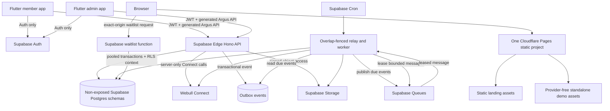
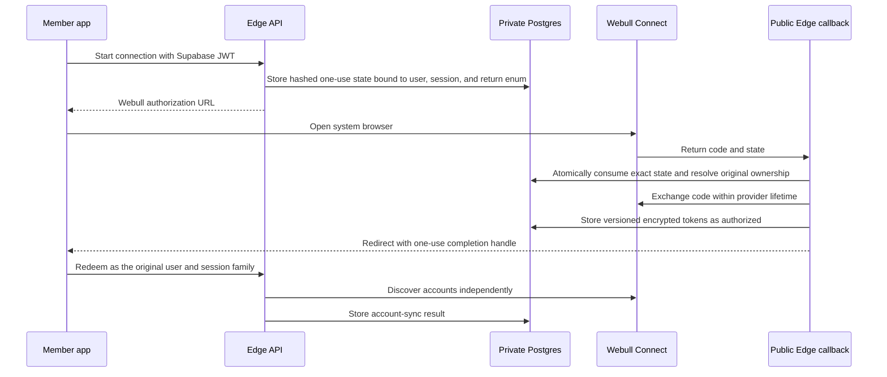
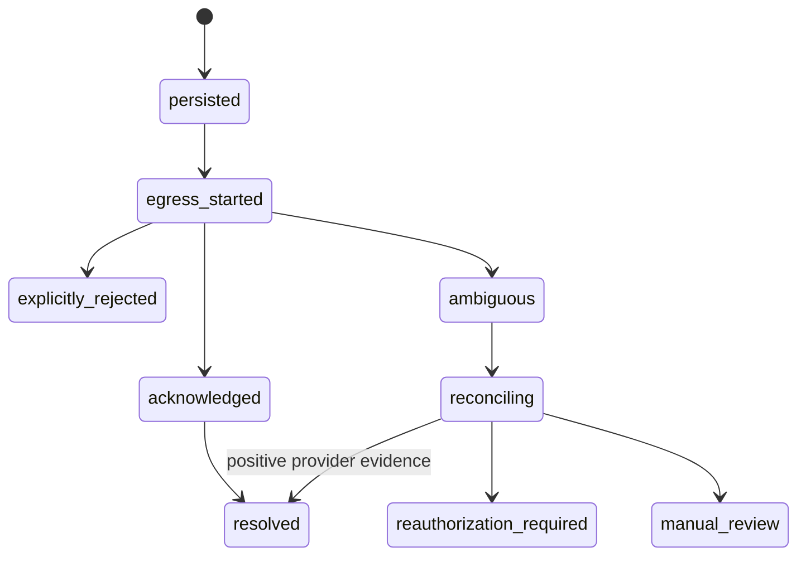
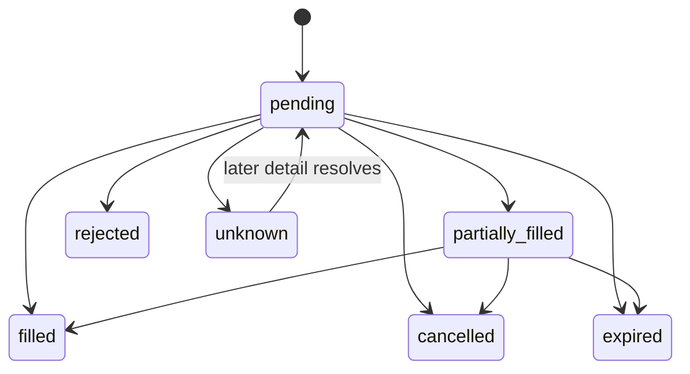
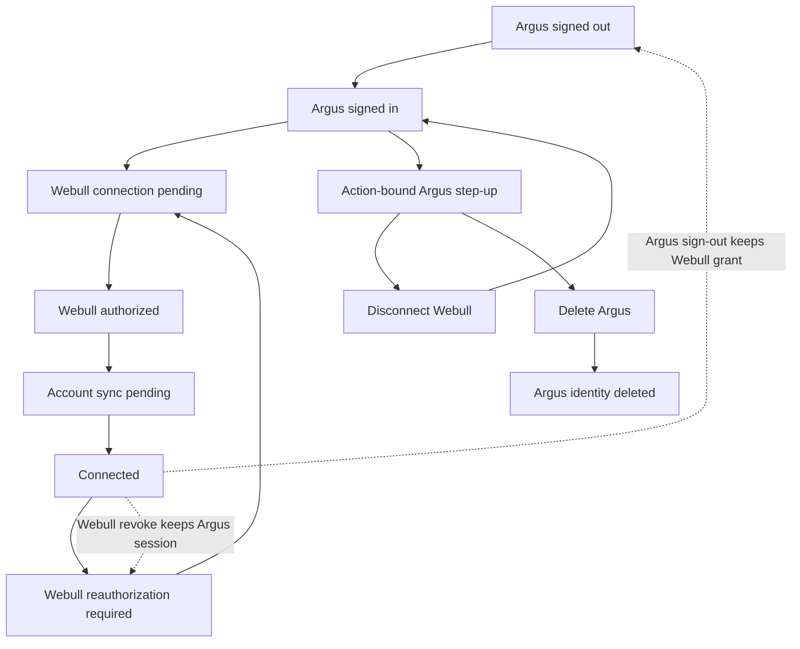
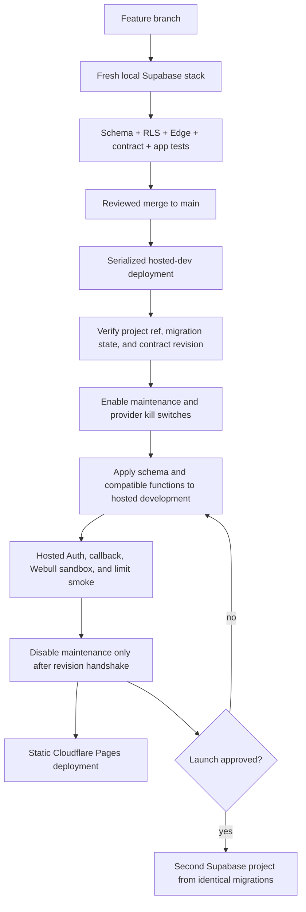

# Webull and Supabase Re-architecture - Plan

## Goal Capsule

- **Objective:** Argus members can connect an existing Webull brokerage relationship, understand their current account state, and complete supported manual order actions without Argus becoming a second brokerage ledger or weakening the product's agency and safety rules.
- **Means:** Replace Auth0, Neon, Cloudflare Workers, Worker Queues, Cron, and R2 with Supabase Auth, Postgres, Edge Functions, Queues, Cron, and Storage while retaining Cloudflare Pages only for static landing and demo assets (KTD1-KTD12).
- **Authority:** The confirmed Product Contract governs behavior. The current Webull Connect sandbox contract and written partner confirmation govern provider protocol details. `CONCEPTS.md` and `ritual-investing-app/PRODUCT.md` govern product language and safety after U1 resolves their obsolete Demo-only statements.
- **Execution profile:** Deep, cross-cutting, security-sensitive, financial, external-API re-architecture across the member app, admin app, API, database, background work, demo, site, CI, and operations.
- **Stop conditions:** Do not enable a live Webull route until U5 resolves the current Connect documentation conflicts in writing and in sandbox. Do not expose funding, account opening, automated trading, or unverified streaming. Do not remove the last working development backend until its Supabase replacement passes the U13 cutover gates.
- **Tail ownership:** U13 owns final dependency removal, hosted-development acceptance, secret and route inventory, and the launch-readiness record.

---

## Product Contract

### Summary

Argus becomes a Supabase-backed frontend for existing Webull brokerage accounts through the Webull Connect API.
Supabase owns Argus identity, application data, server compute, durable jobs, and operational state.
Webull owns brokerage accounts, balances, positions, restrictions, and orders.
The standalone demo remains synthetic, provider-free, and static on Cloudflare Pages.

### Problem Frame

The current system is built around Auth0, Neon, Cloudflare Workers, Cloudflare Queues, R2, and an internally authoritative Demo ledger.
Its member models, API routes, background jobs, documentation, and tests assume that no real brokerage exists.
That architecture cannot safely become a Webull frontend through adapter renaming because live authorization, rotating provider tokens, stale market state, pending orders, partial fills, ambiguous network outcomes, and multi-account ownership have different semantics.

All stored data is synthetic and the project is not in production.
The migration therefore needs a clean target schema and a verified cutover, not data backfill, dual writes, or backward compatibility for deployed clients.

### Key Decisions

- **Keep the existing DriveWealth/Plaid plan as historical material and exclude it from this implementation.** (session-settled: user-directed — chosen over adapting or deleting it: the user wants the file preserved but does not want its architecture to shape this work.) Governs R20.
- **Use Webull Connect for third-party account access.** The Trading API is for a platform's own account and the Broker API capabilities are outside the confirmed product scope. Governs R2-R7.
- **Keep the standalone Demo as a separate product surface.** The production member app becomes Webull-backed while the demo remains fictional, ephemeral, and provider-free. Governs R12-R13.
- **Keep non-brokerage member surfaces available without a Webull connection.** Only brokerage account and order actions are connection-gated. Governs R1 and R11.

### Actors

| ID | Actor | Responsibility |
|---|---|---|
| A1 | Member | Signs into Argus, connects Webull, selects an account, reads brokerage state, and explicitly confirms supported manual order actions. |
| A2 | Staff member | Manages editorial and operational data through the admin app with database-backed authorization and redacted brokerage diagnostics. |
| A3 | Flutter member app | Presents Argus and Webull-derived state without holding Webull credentials or calling Webull directly. |
| A4 | Supabase platform | Authenticates Argus identities and hosts Postgres, Edge Functions, Queues, Cron, Storage, and normalized projections served only through the Argus API. |
| A5 | Webull Connect | Authorizes the connection and remains authoritative for brokerage accounts, capabilities, balances, positions, and orders. |
| A6 | Cloudflare Pages | Serves only static landing and standalone demo artifacts. |

### Requirements

**Identity and connection**

- R1. A member can sign up, sign in, restore, reauthenticate, and sign out with Supabase Auth without requiring a Webull connection to use non-brokerage Argus surfaces.
- R2. A signed-in member can create one Webull authorization per Argus account and can select one active brokerage account from the accounts returned by that authorization.
- R3. Supabase Auth and Webull authorization remain separate lifecycles, and no Webull credential, authorization code, signing secret, or raw provider payload reaches Flutter, logs, analytics, exports, public database objects, or queue payloads.
- R4. A Webull connection exposes explicit connected, denied, failed, disconnected, temporarily unavailable, and reauthorization-required states.
- R5. Explicit disconnect and Argus deletion require a short-lived, action-bound, one-use step-up receipt tied to the current Supabase user and session, destroy local provider credentials, and never claim to close a Webull account or cancel Webull orders.

**Brokerage reads and commands**

- R6. Webull remains authoritative for supported accounts, balances, positions, restrictions, and orders, while Argus projections always expose provider and fetch timestamps plus a freshness state.
- R7. A member can list accounts, select an account, and view capability-gated balances, positions, and order history through the Argus API contract.
- R8. Stale or partially unavailable brokerage data may remain visible with clear timestamps, but all order mutations are disabled until authoritative account capability and restriction state is fresh.
- R9. A member can preview, review, place, modify, and cancel only sandbox-approved manual order combinations, with the reviewed payload bound to a short-lived preview and an explicit confirmation.
- R10. Every order mutation has a durable provider command before network egress, returns the existing command only when a duplicate app idempotency key has the same verified owner, connection, account, operation, and normalized payload, rejects conflicting reuse, and reconciles ambiguous outcomes by the original `client_order_id` without a blind write retry.
- R11. Argus blocks new order mutations for an account while an earlier command for that account is ambiguous, and it represents pending, partial, filled, cancelled, rejected, expired, and unknown provider states without inventing terminality.

**Argus product and demo**

- R12. Daily Ritual, discovery, Circle, Grimoire, Founders' Coven, preferences, Intentions, Future Mirror, notifications, privacy, and editorial workflows remain Argus-owned and retain their existing product vocabulary and agency rules.
- R13. Rowan cannot issue financial commands and cannot receive Webull credentials, raw provider payloads, balances, or positions as prompt context.
- R14. The standalone demo remains clearly synthetic, memory-only, auth-free, provider-free, credential-free, and network-isolated after production dependencies change.
- R15. Production navigation and copy remove Demo ledger, Demo funding, Demo membership, recurring investment execution, and rebalance execution assumptions.

**Supabase platform and security**

- R16. A clean Supabase migration baseline replaces the synthetic Neon schema without copying data, dual writes, shadow reads, or legacy mobile compatibility routes.
- R17. Every exposed platform object has an explicit grant and an ownership-aware RLS or equivalent authorization policy, while all Argus application, brokerage, provider, command, and job state stays outside the Data API in non-exposed schemas.
- R18. The existing versioned Hono/Zod OpenAPI contract and generated Dart client remain the only member and admin data boundary; Flutter and the admin app use Supabase directly only for Auth and approved Storage transport.
- R19. Retained durable work uses private Supabase Queues and Cron with transactional enqueue, bounded consumers, idempotency, visibility handling, attempt records, recovery sweeps, kill switches, and dead-letter outcomes.
- R20. Architecture, product, data inventory, native auth, release, privacy, admin, and operations documentation reflects the new authority boundaries without treating the historical DriveWealth/Plaid plan as an implementation source.

**Hosting and delivery**

- R21. Cloudflare Pages deploys only static landing and demo output, with no Pages Functions, `_worker.js`, Worker route, Worker binding, Queue, Cron, R2, or stateful request handling.
- R22. If retained, waitlist submission calls a narrowly scoped Supabase Edge Function with server-side Turnstile validation, exact-origin CORS, generic duplicate responses, consent versioning, and no email logging.
- R23. Every branch and pull request validates against a fresh local Supabase CLI stack, while only serialized main or manual deployments mutate one hosted development project.
- R24. A separate production Supabase project, production Webull registration, custom SMTP, reliability decisions, backups, limits, and admin hosting are launch gates rather than requirements for pre-production development.
- R25. Neon, Auth0, Cloudflare backend compute, Cloudflare Queues, R2, Drizzle migration tooling, and obsolete simulation code are removed only after the corresponding Supabase and Webull paths pass replacement gates.

### Key Flows

- F1. **Argus session restore**
  - **Actors:** A1, A3, A4
  - **Steps:** Restore the secure Supabase session, wait for a current token, bootstrap Argus-owned member data, and enter the member shell or recover through a visible auth state.
  - **Covered by:** R1, R3, R17.
- F2. **Connect Webull**
  - **Actors:** A1, A3, A4, A5
  - **Steps:** Create user-and-session-bound one-use state with an allowlisted return target, open Webull in the system browser, consume the exact callback, exchange the code server-side, store versioned encrypted credentials, and return a one-use completion result before account discovery continues independently.
  - **Covered by:** R2-R5.
- F3. **Read brokerage state**
  - **Actors:** A1, A3, A4, A5
  - **Steps:** Select an authorized account, coalesce a rate-limited Webull read, normalize provider state, store or return a timestamped projection, and present fresh, stale, empty, or unavailable state without creating a ledger.
  - **Covered by:** R6-R8.
- F4. **Submit and reconcile an order command**
  - **Actors:** A1, A3, A4, A5
  - **Steps:** Obtain a capability-aware preview, freeze the reviewed intent, confirm, persist the command, call Webull once, and reconcile ambiguous or nonterminal outcomes by the stable provider identifier.
  - **Covered by:** R9-R11, R19.
- F5. **Process retained background work**
  - **Actors:** A2, A4
  - **Steps:** Commit domain state and an outbox record, enqueue privately, process a bounded batch, record a receipt, archive success, and recover retryable or poison work through Cron.
  - **Covered by:** R12, R17, R19.
- F6. **Promote without Supabase branching**
  - **Actors:** A2, A4, A6
  - **Steps:** Reset and verify local Supabase per branch, merge, serialize hosted-development deployment, run hosted smoke checks, publish static Pages output, and create production from the same migrations only at launch.
  - **Covered by:** R21-R25.

### Acceptance Examples

- AE1. **Covers R1 and R3.** Given an expired stored Supabase session, when the app launches, then protected API work waits for refresh and the member sees a recoverable signed-out or offline state rather than an unhandled auth error.
- AE2. **Covers R2-R4.** Given a Webull callback whose state is expired, replayed, or owned by another Argus user, when the callback arrives, then no credential is stored and the app receives only a generic failure result.
- AE3. **Covers R3-R4.** Given two concurrent calls with an expiring access token, when Webull rotates the refresh token, then one fenced refresh commits and both calls use the winning token version or return reauthorization-required.
- AE4. **Covers R6-R8.** Given fresh balances and stale positions, when the account screen loads, then each panel exposes its authoritative timestamp and all order mutations remain disabled until a coherent fresh authority check succeeds.
- AE5. **Covers R9-R10.** Given a member changes quantity after preview or confirms after preview expiry, when submission is attempted, then the server rejects the stale review and requires a new preview.
- AE6. **Covers R10-R11.** Given Webull accepts an order but the response is lost, when the member retries or a recovery job runs, then Argus queries order detail with the original `client_order_id` and never submits a second order.
- AE7. **Covers R10-R11.** Given cancel races with a partial or final fill, when Webull reports the newer state, then Argus preserves the provider outcome and does not overwrite it with a locally assumed cancellation.
- AE8. **Covers R17.** Given authenticated user B requests user A's projection, command, object, or Realtime topic, when Supabase evaluates the request, then it denies access even if B supplies a valid object identifier.
- AE9. **Covers R5 and R20.** Given a member deletes Argus while Webull has an open order and callback, refresh, and queue work are in flight, when deletion is confirmed, then a deletion epoch prevents later credential or member-data resurrection and Argus never claims to close the brokerage account or cancel the order.
- AE10. **Covers R14 and R21.** Given the released demo artifact runs in a fresh browser, when all core flows are exercised, then it creates no durable browser state and makes no Supabase, Webull, Auth0, Neon, or Cloudflare compute request.
- AE11. **Covers R21-R22.** Given an untrusted origin submits the waitlist form, when the Supabase function evaluates CORS and Turnstile, then it refuses the request and emits no email or secret in logs.
- AE12. **Covers R23-R25.** Given a pull request from an empty local database, when CI runs, then it replays the complete schema and passes database, Edge, contract, Flutter, admin, demo, and static-site gates without a hosted Supabase branch.

### Success Criteria

- An approved Webull sandbox member can connect, select an authorized account, view timestamped balances and positions, and complete one approved manual order lifecycle through the generated Argus client.
- A lost Webull write response and a duplicate member confirmation produce one provider command and at most one Webull order.
- The anon, authenticated owner, authenticated non-owner, staff, revoked-staff, and privileged-service authorization matrix passes for every exposed database and Storage surface.
- A clean checkout can reset and verify Supabase locally without using a paid Supabase branch or mutating the hosted development project.
- The Cloudflare Pages artifacts contain no compute entry point, and the production dependency and secret inventory contains no required Neon, Auth0, Worker Queue, Cron, or R2 backend.
- The standalone demo passes its provider, import, network, persistence, accessibility, and browser behavior gates after the production member app adopts Supabase and Webull dependencies.

### Scope Boundaries

**In scope**

- Supabase Auth, Postgres, Edge Functions, Queues, Cron, Storage, local development, hosted-development deployment, and production promotion design.
- Webull Connect authorization, authorized account discovery, balances, positions, restrictions, order list/detail, preview, place, modify, cancel, token refresh, rate limits, and reconciliation for the partner-approved subset.
- Member, admin, API, generated client, site, demo, CI, documentation, security, privacy, and operational changes required by the authority shift.

**Deferred to Follow-Up Work**

- Additional Webull asset classes, order types, extended-hours behavior, market data entitlements, and streaming after Webull grants and sandbox-proves them.
- A production admin host outside Cloudflare Pages.
- Additional Supabase Auth social providers beyond the sandbox baseline.
- Capacity-driven external processing for media or privacy exports if bounded Edge implementations fail hosted limit tests.

**Outside this product's identity**

- Brokerage account opening, bank linking, ACH or wire movement, deposits, withdrawals, and any feature that requires Webull Broker API entitlement.
- Autonomous, recurring, background, Rowan-triggered, recommendation-triggered, or rebalance-triggered financial execution.
- An Argus-owned cash, position, fill, settlement, tax-lot, transaction, or brokerage statement ledger.
- Direct Webull access from Flutter, the admin app, the standalone demo, or Cloudflare Pages.
- Supabase Pro branching as a delivery requirement.

### Dependencies and Prerequisites

- Webull must register Argus for Connect, issue current sandbox credentials, register the hosted Supabase callback, provide the current Connect contract fixture, and confirm paths, required signatures, PKCE support, refresh semantics, revocation, scopes, rate-limit precedence, and approval tests.
- Developers and CI need Docker-compatible local Supabase CLI support.
- One hosted Supabase development project is required for callback, Auth, Edge, and limit behavior that local emulation cannot prove.
- The launch phase needs a second Supabase project, Webull production approval, custom SMTP, backup and recovery choices, an admin host, and reviewed privacy and compliance retention.

---

## Planning Contract

### Key Technical Decisions

- KTD1. **Extract a portable Hono application core behind a Supabase Edge backend-for-frontend.** `ritual-investing-api` owns contracts, domain and application services, and runtime ports. `supabase/functions/**` owns Deno, Supabase, Webull HTTP, secret, and deployment adapters. The core cannot import Cloudflare bindings, Auth0, Neon, R2, Wrangler, or Supabase function modules, and clients never call the Data API for application data.
- KTD2. **Create a clean Supabase baseline with no application Data API surface.** Put Argus and brokerage state in non-exposed schemas. The Edge gateway uses a pooled, transaction-capable database adapter with a dedicated non-bypass runtime role, verified JWT context, RLS defense in depth, and explicit owner or staff checks. Client roles receive no application schema usage, table grants, or function execution.
- KTD3. **Replace Auth0 identities instead of migrating them and define one step-up contract.** Preserve `SessionRepository`, `AuthController`, and token-provider seams, implement Supabase Auth with PKCE/deep links and secure session storage, and use email OTP or magic-link auth as the sandbox baseline. Sensitive member actions use an action-bound one-use step-up receipt. Staff actions additionally require AAL2, active staff membership, and a per-request permission check.
- KTD4. **Treat the current Webull sandbox contract as a blocking protocol discovery gate for real provider calls.** The docs conflict on token paths, signing headers, PKCE, hosts, and aggregate versus endpoint rate limits. U5 freezes partner-confirmed fixtures before it enables a real adapter, while U1-U4, U10-U12, and U14 proceed against local Supabase and mocks.
- KTD5. **Keep Webull credentials server-only with versioned authenticated encryption and fenced rotation.** Store per-connection data-key ciphertext, wrapped key, nonce, tag, associated ownership data, and key version in private tables. Keep wrapping keys in Edge secrets, read old and write new during rotation, bind connection state to the initiating Supabase user and session, and use a database lease plus compare-and-swap token version for refresh.
- KTD6. **Model brokerage reads as per-resource immutable projection generations, not a ledger.** Accounts, balances, positions, restrictions, and orders each carry `provider_observed_at`, `fetched_at`, `expires_at`, and availability. Replace one resource generation atomically, coalesce refreshes with distributed Postgres leases, and require a fresh server-side capability and restriction check for mutations.
- KTD7. **Separate durable provider commands from provider order projections.** Persist the stable `client_order_id`, owner, connection, account, operation, capability version, exact reviewed-payload hash, idempotency key, immutable attempts, and `egress_started_at` before Webull egress. Initial submission is synchronous; not-found during lookup cannot terminalize ambiguity; modify and cancel are new commands against an owned provider order.
- KTD8. **Use an outbox relay plus logged Supabase Queues and Cron as at-least-once infrastructure.** A domain transaction writes `outbox_events`. An overlap-fenced Cron relay publishes due events to pgmq and records publication. A bounded authenticated Edge worker leases messages, uses receipts to deduplicate effects, archives success, and moves exhausted work to a dead-letter outcome. Reconciliation may inspect commands but cannot create or resubmit an order placement.
- KTD9. **Do not require Realtime for correctness.** Initial brokerage reads use explicit fetch and refresh. If Realtime is added, private Broadcast only hints that state changed and the client refetches through the API.
- KTD10. **Use local environments instead of Supabase branches.** Each branch owns a disposable local stack; one hosted development project receives serialized main deployments; production is recreated from the same migrations at launch. Dashboard-only DDL is prohibited.
- KTD11. **Make Cloudflare Pages provably static.** Move waitlist state and retention to Supabase, publish only built assets, fail CI if `_worker.js` or a root `functions` directory exists, and keep preview waitlist submission disabled unless explicitly configured for the shared sandbox.
- KTD12. **Cut over replacement-first and delete legacy authority.** Because all data is synthetic, use one clean reset and breaking contract regeneration after replacement verification. Do not retain dual auth, dual databases, old Demo APIs, or fictitious N-1 compatibility.

### High-Level Technical Design

The diagrams define component and lifecycle boundaries.
Implementation details may refine names and grouping, but must preserve R1-R25 and KTD1-KTD12.

**Target component topology**

**Webull connection sequence**

**Provider command state**

**Provider order projection state**

**Independent identity and connection lifecycle**

**No-branch delivery flow**

### Planning Assumptions

- One Argus account owns at most one active Webull authorization, which may expose multiple brokerage accounts and one active UI selection.
- A member may use non-brokerage Argus surfaces without connecting Webull.
- The first live order subset includes only partner-approved manual preview, place, list, detail, modify, and cancel operations.
- All order mutations for one Webull account pause while an earlier command for that account remains ambiguous.
- Cached financial values are hidden after explicit disconnect or confirmed external revocation and are purged on a bounded schedule.
- Privacy exports include Argus-owned data and retained normalized projections with timestamps, but exclude credentials, OAuth state, raw provider payloads, and provider audit bodies.
- Before production, deletion purges synthetic provider-command and audit rows after recovery work is neutralized. Production launch requires a reviewed retention schedule; retained security or command evidence must be minimized, stripped of credentials and financial values, and detached from the deleted Auth identity.
- Development admin access is local or hosted-development only. Production hosting is a launch decision and cannot use the Cloudflare Pages demo project.
- Pages preview builds do not submit real waitlist entries by default.
- One Cloudflare Pages project serves the landing assets and provider-free demo under the production hostname. Preview deployment origins are untrusted and have waitlist submission disabled.

### System-Wide Impact

| Surface | Change | Required protection |
|---|---|---|
| Identity | Auth0 sessions become Supabase Auth sessions in member and admin clients while Webull authorization stays independent. | Secure local storage, exact deep-link handlers, fresh-token gating, action-bound step-up, AAL2 staff access, and DB staff recheck. |
| Brokerage | Demo authority becomes Webull-derived reads, immutable projections, and durable provider commands. | Server-only URL allowlist, no Data API surface, capability gating, freshness, decimal fidelity, monotonic command state, and ambiguity reconciliation. |
| Database | Twelve Neon/Drizzle migrations become one reviewed Supabase baseline. | Dedicated non-bypass runtime role, explicit grants, RLS context, private schemas, fixed `search_path`, restricted functions, and no data copy or dual write. |
| API contract | Cloudflare-bound Hono code becomes a portable core plus Supabase Edge adapters. | One dependency direction, import-boundary tests, transactional repository ports, preserved envelopes, ETags, `If-Match`, idempotency, bodyless POST semantics, OpenAPI generation, and client drift checks. |
| Async work | Worker Queue and scheduled handlers become outbox, pgmq, Cron relay, and authenticated Edge consumers. | Opaque versioned messages, dedicated rotatable invocation secret, bounded batches, receipts, overlap leases, poison handling, recovery sweeps, and no client queue privileges. |
| Storage and privacy | R2-backed media and exports move to Supabase Storage where retained. | Private buckets, signed access, allowlist telemetry, deletion epochs, retention, redaction, capacity proof, and deletion ordering. |
| Product UI | Demo portfolio, funding, entitlement, recurring, and rebalance assumptions leave the production member flow. | Preserve ritual/editorial semantics and standalone demo isolation. |
| Admin | Cloudflare Access and Auth0 permissions disappear. | Supabase Auth AAL2, active staff table, action-bound step-up, request-time permission checks, redacted diagnostics, and no trade control. |
| Site | Worker-rendered landing and waitlist become static Pages plus Supabase waitlist function. | Exact CORS, Turnstile, CSP, preview disablement, static-artifact audit. |
| Delivery | Hosted preview branches are unavailable. | Secret-free untrusted CI, local per-branch reset, protected and serialized dev promotion, exact project allowlists, contract revision handshake, negative probes, external credential revocation, and a separate production launch checklist. |

### Risks and Mitigations

| Risk | Mitigation |
|---|---|
| Webull documentation changes or conflicts after code is written. | Make U5 a partner-confirmed sandbox contract gate, pin fixtures, and isolate all provider details behind one adapter. |
| A rotating refresh token is used twice, swapped, tampered with, or its response is lost. | Use versioned AEAD envelope encryption, ownership-bound associated data, fenced refresh, compare-and-swap ciphertext, key rotation tests, and reauthorization after ambiguous rotation. |
| A lost order response creates a duplicate financial effect. | Persist monotonic commands and immutable attempts before egress, bind idempotency to owner, account, operation and payload, keep a stable `client_order_id`, never auto-retry writes, and reconcile by detail lookup. |
| RLS, function, or role grants expose cross-tenant brokerage data. | Keep brokerage outside the Data API, revoke default client privileges, use a non-bypass runtime role with JWT context, and test owner, non-owner, staff, and privileged matrices from a clean reset. |
| Webull egress is redirected or influenced toward an unapproved host. | Freeze exact schemes, hosts, ports, paths, headers, query canonicalization, and redirect behavior in U5. No client or stored provider field may become a URL. |
| Edge limits break media, exports, or large queue batches. | Keep functions I/O-bound, bound batches, test hosted limits, and require an approved external managed processor before launch if retained jobs exceed limits. |
| Shared hosted development drifts or concurrent deploys collide. | Make migrations Git-owned, serialize main deployments, compare migration state before push, and prohibit dashboard-only DDL. |
| Stale snapshots appear live or permit invalid commands. | Carry source and fetch timestamps, distinguish partial/stale state, and require fresh capabilities and restrictions before mutation. |
| Demo imports production providers transitively. | Preserve and extend import, provider, network, persistence, and build-artifact audits. |
| Cloudflare Pages silently deploys compute. | Reject `/functions`, `_worker.js`, and Worker bindings in CI and verify unknown routes remain static 404s. |
| Argus deletion races OAuth, refresh, jobs, or exports and recreates data. | Set a deletion epoch first, invalidate handles, fence refresh, cryptographically destroy credentials, neutralize queued work, require worker epoch rechecks, and delete Auth last. |
| Auth logout or Argus deletion is mistaken for Webull account closure. | Use explicit copy and tests, destroy local authorization material, and never promise provider account or order cancellation. |
| Telemetry, dead letters, audits, or exports leak financial or identity data. | Emit only allowlisted fields and opaque correlation IDs, inject canary secrets and brokerage values in tests, and assert absence across every controlled sink. |
| CI or decommissioning leaves usable external credentials and routes. | Keep untrusted jobs secret-free, protect deploy environments, revoke external credentials, negative-probe old endpoints, and prohibit rollback to dual auth or legacy financial authority. |
| Free-tier email, pause, backup, and reliability limits are mistaken for launch readiness. | Keep them in the production gate and require custom SMTP plus reliability and recovery decisions before launch. |

### Delivery Phases

1. **Product and foundation:** U1, U2, U14, U3, and U4 establish current product truth, the Supabase schema, portable repositories, the Edge API, and member Auth without waiting for Webull approval.
2. **Brokerage vertical slices:** U5-U9 implement the frozen Webull connection, read, order, and member-app behavior.
3. **Remaining platform surfaces:** U10-U12 migrate non-financial durable work, Storage, admin operations, landing, waitlist, and standalone demo boundaries in parallel with Webull work.
4. **Brokerage recovery and cutover:** U15 adds provider recovery work, and U13 proves the complete local and hosted path, removes obsolete authority, and records launch gates.

---

## Implementation Units

| Unit | Title | Primary files | Depends on |
|---|---|---|---|
| U1 | Freeze product and data-authority truth | `ritual-investing-app/PRODUCT.md`, `docs/ritual-investing/member-data-inventory.md` | None |
| U2 | Establish the Supabase schema baseline | `supabase/config.toml`, `supabase/migrations/`, `supabase/tests/` | U1 |
| U14 | Port retained repositories and transactions | `ritual-investing-api/src/domains/`, `ritual-investing-api/src/db/` | U2 |
| U3 | Port the contract-first API to Edge Functions | `supabase/functions/api/`, `ritual-investing-api/src/app.ts` | U14 |
| U4 | Replace member Auth0 with Supabase Auth | `ritual-investing-app/lib/core/auth/` | U2, U3 |
| U5 | Freeze and implement Webull connection and token custody | `supabase/functions/webull-callback/`, `ritual-investing-api/src/domains/brokerage-connections/` | U1-U4 |
| U6 | Implement authoritative account and asset reads | `ritual-investing-api/src/domains/brokerage-accounts/` | U5 |
| U7 | Implement manual order commands and reconciliation | `ritual-investing-api/src/domains/brokerage-orders/` | U5, U6 |
| U8 | Replace member connection and portfolio UX | `ritual-investing-app/lib/features/brokerage_connection/`, `ritual-investing-app/lib/features/portfolio/` | U4-U6 |
| U9 | Replace member order UX and remove live simulation authority | `ritual-investing-app/lib/features/orders/`, `ritual-investing-app/lib/features/funding/` | U7, U8 |
| U10 | Migrate non-financial jobs and Storage | `supabase/functions/worker/`, `ritual-investing-api/src/jobs/` | U2, U3, U14 |
| U15 | Add Webull recovery and refresh workers | `ritual-investing-api/src/jobs/webull-reconciliation.ts`, `supabase/functions/worker/` | U5-U7, U10 |
| U11 | Migrate admin Auth and editorial operations | `ritual-investing-admin/lib/`, `ritual-investing-api/src/domains/admin/` | U3, U4, U10 |
| U12 | Make landing and demo hosting static | `ritual-investing-site/`, `ritual-investing-demo/` | U3, U4, U10 |
| U13 | Rebuild delivery and decommission legacy authority | `.github/workflows/ritual-investing.yml`, `docs/ritual-investing/` | U1-U12, U14-U15 |

### U1. Freeze product and data-authority truth

- **Goal:** Replace Demo-only architecture claims with the confirmed Webull/Supabase authority model and classify every current data and behavior owner.
- **Requirements:** R2, R6, R12-R16, R20, R24.
- **Dependencies:** None.
- **Files:**
  - Modify `ritual-investing-app/PRODUCT.md`.
  - Modify `ritual-investing-app/README.md`.
  - Modify `ritual-investing-site/PRODUCT.md`.
  - Modify `docs/solutions/architecture-patterns/ritual-investing-app-current-intent-and-architecture.md`.
  - Modify `docs/ritual-investing/member-data-inventory.md`.
  - Create `ritual-investing-api/test/contracts/product-authority.test.ts`.
- **Approach:**
  1. State Webull, Argus, Supabase, Demo, and Pages authority in product vocabulary and preserve the evidence-adjacent, non-coercive, and non-advisory rules.
  2. Inventory every current live-app Demo authority and classify it as retained Argus state, replaced Webull state, standalone-demo-only state, or deleted behavior.
  3. Classify every current route, table, background handler, Storage object, mobile feature, admin surface, site endpoint, dependency, secret, and runbook as retained, replaced, standalone-demo-only, or deleted.
  4. Keep `docs/plans/2026-08-26-0121-feat-drivewealth-plaid-backend-plan.md` unchanged and outside the source and dependency lists.
- **Patterns to follow:** Use `CONCEPTS.md` as the canonical vocabulary and preserve the generated-contract discipline documented by `ritual-investing-api/scripts/generate-openapi.ts`.
- **Test scenarios:**
  - Product and architecture contract tests reject obsolete claims that the production member app is Demo-only or that Argus owns a brokerage ledger.
  - The inventory accounts for every current database table, API domain, background handler, live financial feature, and provider dependency exactly once.
  - Documentation checks preserve the independent standalone Demo and the Rowan safety boundary.
- **Verification:** Product documents agree on live Webull versus standalone Demo authority, and the inventory has no unclassified current data, compute, client, or operations surface.

### U2. Establish the Supabase schema baseline

- **Goal:** Create the clean, resettable Supabase database, security, queue, Cron, and Storage foundation that replaces Neon and the internally authoritative Demo ledger.
- **Requirements:** R3, R6, R10, R16-R17, R19, R23-R25.
- **Dependencies:** U1.
- **Files:**
  - Create `supabase/config.toml`.
  - Create `supabase/migrations/`.
  - Create `supabase/seed.sql`.
  - Create `supabase/tests/schema.test.sql`.
  - Create `supabase/tests/grants_and_rls.test.sql`.
  - Create `supabase/tests/brokerage_private.test.sql`.
  - Create `supabase/tests/queues_and_cron.test.sql`.
  - Create `supabase/tests/storage_policies.test.sql`.
- **Approach:**
  1. Write one reviewed target baseline for profiles, preferences, onboarding, consent, astrology, saved and community content, editorial data, ritual assignments, Rowan content, Intentions, Future Mirror, notifications, audit data, and justified operations.
  2. Keep profiles, community data, brokerage connection status, selected accounts, projections, provider commands, and operational state in non-exposed schemas behind the Argus API.
  3. Put OAuth state, versioned encrypted tokens, Webull mappings, refresh leases, rate limits, exact command payload hashes, immutable attempts, reconciliation, deletion epochs, outbox, queue, and sensitive audit fields in the private schema.
  4. Delete Demo funding, checkout, entitlement, portfolio, cash, position, fill, settlement, transaction, recurring execution, rebalance execution, and reset authority from the target schema.
  5. Create a dedicated runtime database role without RLS bypass, pass verified JWT claims into each transaction, revoke default client privileges, and restrict every security-definer function with a fixed search path, revoked public execution, and internal owner or staff checks.
  6. Declare explicit grants, RLS, queue privacy, supported Cron scheduling functions, Storage buckets, retention, deletion fencing, and seed fixtures in migrations.
  7. Use `auth.uid()` ownership and database-backed staff authorization. Do not use mutable user metadata, deprecated `auth.role()`, or blanket anon or authenticated grants.
- **Execution note:** Start with a clean-reset and cross-user authorization matrix before porting repositories.
- **Patterns to follow:** Preserve constraints, idempotency, audit, privacy, and outbox intent from `ritual-investing-api/drizzle/` and `ritual-investing-api/test/security/`, but rewrite the custom Neon roles and transaction-local identity settings for Supabase.
- **Test scenarios:**
  - Empty local reset applies every migration and deterministic non-brokerage seed without consulting Neon or dashboard state.
  - Anon, user A, user B, active staff, revoked staff, runtime, and privileged migration roles receive exactly the declared grants for each schema, table, view, function, Storage bucket, queue, and Realtime topic.
  - User B cannot read or mutate user A's selection, projection, command status, privacy object, or community-private record by guessing identifiers.
  - All application relations and functions plus OAuth state, token ciphertext, command attempts, queue internals, and rate-limit state are absent from the Data API and inaccessible to client roles.
  - An update without an ownership-compatible select policy, `USING`, or `WITH CHECK` fails the security test.
  - A domain transaction that rolls back leaves no orphaned outbox message, and the queue schema remains private.
  - A security-definer function with a mutable search path, public execution, missing ownership check, or default privilege fails the database security gate.
  - A deletion epoch prevents a late callback, refresh, or worker write from recreating credentials or member state.
- **Verification:** A clean Supabase reset and database test suite proves target schema, grants, RLS, queues, Cron declarations, and Storage policies without data copy or legacy database access.

### U14. Port retained repositories and transaction boundaries

- **Goal:** Replace Neon and Cloudflare-bound persistence across every retained API domain with portable, transaction-capable Supabase Postgres repositories before changing the HTTP runtime.
- **Requirements:** R12, R16-R19, R23, R25.
- **Dependencies:** U2.
- **Files:**
  - Modify `ritual-investing-api/src/db/client.ts`.
  - Modify `ritual-investing-api/src/db/request-context.ts`.
  - Modify `ritual-investing-api/src/db/request-transaction.ts`.
  - Modify retained repositories under `ritual-investing-api/src/domains/session/`.
  - Modify retained repositories under `ritual-investing-api/src/domains/accounts/`.
  - Modify retained repositories under `ritual-investing-api/src/domains/editorial/`, `briefings/`, `circles/`, `coven/`, `discover/`, `media/`, `moderation/`, `notifications/`, `privacy/`, `public-preview/`, `rituals/`, `search/`, `admin/`, and `admin-operations/`.
  - Modify retained database and domain tests under `ritual-investing-api/test/db/`, `ritual-investing-api/test/domains/`, `ritual-investing-api/test/admin/`, and `ritual-investing-api/test/security/`.
  - Create `ritual-investing-api/test/db/supabase-repository-integration.test.ts`.
- **Approach:**
  1. Define repository, transaction, storage, queue, rate-limit, and clock ports inside the portable API core.
  2. Connect through the Supabase transaction pooler with the dedicated runtime role from U2 and set verified request claims only inside the owning transaction.
  3. Port every retained repository named by U1 and delete no Neon repository until its Supabase integration tests cover owner, staff, conflict, rollback, and error behavior.
  4. Preserve multi-statement atomicity, ETag and revision conflicts, idempotency, outbox writes, privacy ordering, and audit semantics.
  5. Keep Supabase function modules, Deno globals, environment bindings, and provider clients outside the domain and repository interfaces.
- **Execution note:** Port one retained read and one retained multi-statement mutation first to prove the database seam before applying it across domains.
- **Patterns to follow:** Current injected repositories in `ritual-investing-api/src/app.ts`, request transactions under `ritual-investing-api/src/db/`, and the retained Postgres integration tests.
- **Test scenarios:**
  - Each retained domain reads and mutates the U2 schema through the new repository without a Neon URL or Cloudflare binding.
  - Owner, non-owner, active staff, revoked staff, revision conflict, constraint failure, and rollback preserve existing contract behavior.
  - A multi-statement mutation and its audit or outbox record commit atomically and leave no partial state on failure.
  - Request claims cannot leak across pooled transactions, and a client-supplied owner ID never overrides the verified JWT identity.
  - Import-boundary tests reject Supabase function, Deno, Cloudflare, Auth0, Neon, Wrangler, and R2 modules from the portable API core.
- **Verification:** Every retained domain selected in U1 has a Supabase repository and integration evidence, and no accepted API path needs a Neon client or Cloudflare runtime type.

### U3. Port the contract-first API to Edge Functions

- **Goal:** Run the provider-neutral Hono API as a Supabase Edge Function while preserving the Argus OpenAPI and generated Dart-client contract.
- **Requirements:** R3, R17-R18, R23, R25.
- **Dependencies:** U14.
- **Files:**
  - Create `supabase/functions/api/index.ts`.
  - Create `supabase/functions/api/deno.json`.
  - Create `supabase/functions/_shared/auth.ts`.
  - Create `supabase/functions/_shared/database.ts`.
  - Create `supabase/functions/_shared/http.ts`.
  - Modify `ritual-investing-api/src/app.ts`.
  - Modify `ritual-investing-api/src/config/env.ts`.
  - Modify `ritual-investing-api/src/middleware/`.
  - Modify `ritual-investing-api/openapi/ritual-investing-v1.yaml` through generation only.
  - Modify `ritual-investing-api/scripts/generate-openapi.ts`.
  - Modify `ritual-investing-api/scripts/generate-client.mjs`.
  - Create `ritual-investing-api/test/edge/api-edge-integration.test.ts`.
  - Create `ritual-investing-api/test/architecture/runtime-import-boundary.test.ts`.
  - Modify `ritual-investing-api/test/contracts/`.
  - Modify `ritual-investing-api-client/.ritual-contract.json` through generation only.
- **Approach:**
  1. Extract a runtime-neutral application factory and inject the U14 repositories plus auth, rate-limit, storage, queue, clock, request-ID, logging, and provider ports at the function entrypoint.
  2. Use current Deno-compatible pinned dependencies and the Supabase Hono routing contract, including the function base path.
  3. Verify Supabase JWTs at the route boundary, derive identity there, and use narrowly named transaction adapters that atomically apply verified identity plus ownership or staff checks.
  4. Preserve strict schemas, error envelopes, bodyless POST transport behavior, ETags, `If-Match`, idempotency semantics, OpenAPI generation, and client drift checks.
  5. Keep Webull routes absent or fixture-backed until U5's protocol gate is satisfied.
- **Execution note:** Add characterization coverage for the current public contract before changing the runtime adapter.
- **Patterns to follow:** `ritual-investing-api/src/app.ts`, `ritual-investing-api/src/domains/**/routes.ts`, and `docs/solutions/integration-issues/empty-bootstrap-post-rejected-at-cloudflare-edge.md`.
- **Test scenarios:**
  - An authenticated owner reaches an unchanged Argus route through the Edge base path and receives the same generated envelope and headers.
  - A missing, expired, malformed, or wrong-audience Supabase token is denied before a repository or provider call.
  - A privileged route rejects nonstaff, revoked staff, and stale-claim staff after the database recheck.
  - A bodyless bootstrap POST reaches the handler as a zero-byte request without a dummy JSON body.
  - OpenAPI regeneration and Dart client regeneration produce no unexplained drift.
  - The deployed Edge bundle imports one portable API source of truth, and the import-boundary test rejects runtime adapters in the core dependency direction.
  - Canary tokens, codes, emails, brokerage values, raw URLs, and provider payloads are absent from success and error telemetry.
  - The function remains within hosted memory, CPU, wall-clock, and idle limits for representative I/O-bound calls.
- **Verification:** Existing provider-neutral contract tests and the new Edge integration profile pass through the Supabase entrypoint, and the generated client can target `/functions/v1/api` without hand edits.

### U4. Replace member Auth0 with Supabase Auth

- **Goal:** Migrate member identity to Supabase Auth while preserving app recovery, step-up, bootstrap, and provider-neutral session seams.
- **Requirements:** R1-R5, R17-R18, R24-R25.
- **Dependencies:** U2, U3.
- **Files:**
  - Create `ritual-investing-app/lib/core/auth/supabase_session_repository.dart`.
  - Modify `ritual-investing-app/lib/core/auth/member_auth.dart`.
  - Modify `ritual-investing-app/lib/core/auth/auth_controller.dart`.
  - Delete `ritual-investing-app/lib/core/auth/auth0_session_repository.dart` after parity passes.
  - Modify `ritual-investing-app/lib/core/config/runtime_config.dart`.
  - Modify `ritual-investing-app/lib/core/bootstrap/production_dependency_container.dart`.
  - Modify `ritual-investing-app/pubspec.yaml`.
  - Modify `ritual-investing-app/ios/Runner/` and `ritual-investing-app/android/app/src/main/` callback configuration.
  - Delete `ritual-investing-app/ios/Flutter/Auth0.xcconfig.example` after replacement.
  - Modify `ritual-investing-app/AGENTS.md`.
  - Create `ritual-investing-app/test/supabase_session_repository_test.dart`.
  - Modify `ritual-investing-app/test/native_auth_config_test.dart`.
  - Modify `ritual-investing-app/test/runtime_config_test.dart`.
  - Modify `ritual-investing-app/integration_test/`.
- **Approach:**
  1. Initialize Supabase with a publishable key, persist sessions through secure local storage, and gate protected work on a current token rather than initialization completion alone.
  2. Map sign-in, sign-up, restore, recent-auth, recovery, logout, and auth-stream failures into the existing provider-neutral controller states.
  3. Configure exact, distinct Argus Auth and Webull completion scheme, host, and path allowlists, prefer claimed HTTPS links, and reject arbitrary return URLs, duplicate parameters, and ambiguous encoding.
  4. Issue short-lived, action-bound, one-use step-up receipts tied to user and Supabase session for disconnect, deletion, and other sensitive member actions.
  5. Remove member Auth0 native and Flutter configuration only after hosted-auth smoke tests pass. U11 owns staff migration and U13 owns final shared cleanup.
- **Execution note:** Prove cold-start and warm-app callback behavior on iOS Simulator and Android before deleting Auth0 setup.
- **Patterns to follow:** `ritual-investing-app/lib/core/auth/member_auth.dart`, `ritual-investing-app/lib/core/bootstrap/entry_coordinator.dart`, and `docs/solutions/developer-experience/xcodebuildmcp-ios-simulator-auth0-workflow.md` after updating it for Supabase.
- **Test scenarios:**
  - Sign-in, sign-up, restore, recent-auth, local logout, global logout, cancellation, and recovery map to stable controller states.
  - Cold-start, warm-app, background-resume, malformed, replayed, and wrong-scheme deep links reach only the intended Auth handler.
  - An expired restored session waits for refresh before member bootstrap, while offline refresh emits a handled recoverable state.
  - A Supabase Auth callback after account switch cannot attach a session to the wrong active app state.
  - A replayed, expired, wrong-session, or wrong-action step-up receipt cannot authorize disconnect or deletion.
  - Malicious return targets, alternate callback hosts or schemes, duplicated parameters, and intercepted completion handles are rejected without reflection or secret logging.
  - The compiled member artifact contains no secret or service key.
- **Verification:** Member hosted-auth smoke evidence covers native callbacks, recovery, logout, step-up, and strict link handling, and member Auth0 dependencies are removable.

### U5. Freeze and implement Webull connection and token custody

- **Goal:** Freeze the partner-confirmed Connect contract and add secure Webull authorization, account enumeration, disconnect, refresh, and reauthorization.
- **Requirements:** R2-R5, R17-R18, R24.
- **Dependencies:** U1-U4.
- **Files:**
  - Create `supabase/functions/webull-callback/index.ts`.
  - Create `supabase/functions/webull-callback/deno.json`.
  - Create `supabase/functions/_shared/webull/client.ts`.
  - Create `supabase/functions/_shared/webull/signing.ts`.
  - Create `supabase/functions/_shared/webull/tokens.ts`.
  - Create `ritual-investing-api/src/domains/brokerage-connections/`.
  - Create `docs/ritual-investing/webull-connect-contract.md`.
  - Create `ritual-investing-api/test/fixtures/webull/`.
  - Create `ritual-investing-api/test/webull/connect-contract.test.ts`.
  - Create `ritual-investing-api/test/webull/signing.test.ts`.
  - Create `ritual-investing-api/test/webull/oauth.test.ts`.
  - Create `ritual-investing-api/test/webull/token-rotation.test.ts`.
  - Create `ritual-investing-api/test/domains/brokerage-connections.test.ts`.
- **Approach:**
  1. Obtain and record current hosts, paths, canonical signing, headers, body bytes, OAuth and refresh behavior, scopes, PKCE, revocation, redirect rules, rate limits, capabilities, sandbox cases, and sanitized versioned fixtures before enabling real egress.
  2. Create authenticated start, connection status, account selection, reconnect, and step-up-protected disconnect routes in the Argus contract.
  3. Store only a hash of high-entropy one-use state with initiating user, Supabase session, expiry, allowlisted return-target enum, and partner-confirmed PKCE material.
  4. Atomically consume exact callback parameters, exchange the short-lived code only in the public HTTPS callback, emit `no-store` and no-referrer responses, and return a short-lived one-use completion handle redeemable only by the original user and session family.
  5. Use versioned AEAD envelope encryption with ownership-bound associated data and keep plaintext tokens inside the Webull adapter only.
  6. Refresh under a database lease with compare-and-swap token and key versions. Treat lost rotation responses, invalid refresh, and expiry as reauthorization-required.
  7. Build provider URLs only from partner-confirmed schemes, hosts, ports, and paths. Disable redirects or revalidate every hop, and canonicalize path, query, headers, and body once before signing and sending.
  8. Enforce the stricter intersection of confirmed aggregate and endpoint rate limits and record sanitized connection health.
- **Patterns to follow:** Existing request idempotency and security logging patterns in `ritual-investing-api/src/middleware/` and `ritual-investing-api/test/security/`.
- **Test scenarios:**
  - Valid state connects the original Argus owner, encrypts tokens, enumerates all authorized accounts, and returns no secret to the client.
  - Expired, replayed, double-consumed, wrong-user, cancelled, and invalid-code callbacks produce no connection.
  - Starting a new attempt invalidates the prior pending attempt, and a callback after app logout remains bound to the original Argus user.
  - Concurrent refreshes produce one winning rotation, while the other requests re-read the winning version.
  - A lost refresh response, expired refresh token, external revoke, or unsupported account moves the connection to a safe terminal or recovery state.
  - Known signing fixtures reproduce the partner-published result, and the exact body bytes hashed are the bytes sent.
  - Obsolete paths, unknown contract versions, duplicate callback fields, percent-encoding ambiguity, arbitrary return URLs, alternate ports, path traversal, absolute-URL injection, and redirects to private or unapproved hosts fail closed.
  - Completion handle interception, callback-after-logout, wrong-session redemption, replay, and provider-error reflection reveal no connection or secret.
  - Ciphertext swapping across users, connections, or token types, tampering, missing key versions, and key rotation concurrent with refresh fail without plaintext exposure.
  - Disconnect destroys local credentials, purges projections on schedule, and never claims to revoke the provider grant unless U5 confirms a revocation endpoint.
- **Verification:** Partner-approved sandbox callbacks, refresh concurrency, reconnect, disconnect, rate limiting, log redaction, and account enumeration pass through hosted Supabase functions.

### U6. Implement authoritative account and asset reads

- **Goal:** Expose Webull accounts, capabilities, balances, positions, and restrictions as normalized, timestamped Argus responses.
- **Requirements:** R6-R8, R17-R18.
- **Dependencies:** U5.
- **Files:**
  - Create `ritual-investing-api/src/domains/brokerage-accounts/`.
  - Create `ritual-investing-api/src/domains/brokerage-assets/`.
  - Create `ritual-investing-api/src/domains/brokerage-projections/`.
  - Create `ritual-investing-api/test/domains/brokerage-accounts.test.ts`.
  - Create `ritual-investing-api/test/domains/brokerage-assets.test.ts`.
  - Create `ritual-investing-api/test/webull/read-contract.test.ts`.
  - Modify `ritual-investing-api/openapi/ritual-investing-v1.yaml` through generation only.
  - Regenerate `ritual-investing-api-client/`.
- **Approach:**
  1. Map Webull decimal strings, currency, market timezone, provider timestamps, restrictions, capabilities, and unknown enum values into stable Argus contract types.
  2. Create immutable generations per account, balance, position, and restriction resource with provider observation, fetch, expiry, and availability state.
  3. Replace one resource generation atomically and coalesce distributed refreshes with a private Postgres lease keyed by connection, account, and resource.
  4. Store only the projections needed for UX, recovery, and operations, with a bounded purge policy and no Data API exposure.
  5. Use polling and refetch for authority. Do not claim Realtime is a Webull stream.
- **Patterns to follow:** Current stale-state handling in `ritual-investing-app/lib/features/portfolio/` and generated service boundaries in `ritual-investing-app/lib/core/api/ritual_api.dart`.
- **Test scenarios:**
  - Account discovery returns multiple accounts, preserves capabilities, rejects account IDs outside the connection, and persists one valid active selection.
  - Fresh, empty, stale-cache, partially unavailable, offline, rate-limited, disconnected, and reauthorization-required responses carry distinct state and timestamps.
  - Concurrent balance or position refreshes coalesce and stay under both aggregate and endpoint rate limits.
  - One resource response never mixes rows from different generations, and a fresh balance cannot substitute for a fresh restriction or capability check.
  - Unknown asset and restriction enums survive normalization without being misclassified as supported.
  - Decimal quantities and money round-trip without binary floating-point conversion.
  - An external account removal or revoked grant invalidates selection and disables brokerage mutation surfaces.
- **Verification:** Mock contract and opt-in sandbox tests show that Argus responses preserve provider authority, precision, capability, freshness, and ownership across account switches and provider failures.

### U7. Implement manual order commands and reconciliation

- **Goal:** Add normalized order list and detail reads plus safe manual preview, place, modify, cancel, and reconciliation behavior for the sandbox-approved Webull subset.
- **Requirements:** R8-R11, R17-R19.
- **Dependencies:** U5, U6.
- **Files:**
  - Create `ritual-investing-api/src/domains/brokerage-orders/`.
  - Create `ritual-investing-api/test/domains/brokerage-orders.test.ts`.
  - Create `ritual-investing-api/test/webull/order-contract.test.ts`.
  - Create `ritual-investing-api/test/security/provider-command-idempotency.test.ts`.
  - Modify `ritual-investing-api/openapi/ritual-investing-v1.yaml` through generation only.
  - Regenerate `ritual-investing-api-client/`.
- **Approach:**
  1. Build a server-side capability matrix from U5 fixtures and require fresh account restrictions before preview or mutation.
  2. Bind each preview and idempotency key to verified user, connection, account, operation, normalized payload, capability or policy version, provider preview identifier, and expiry.
  3. Persist a globally unique provider command, stable Webull-compatible `client_order_id`, immutable attempt, and `egress_started_at` before bytes leave the process.
  4. Submit once with automatic mutation retries disabled, record acknowledgement, explicit rejection, or ambiguity, and enqueue only a reference to existing nonterminal work.
  5. Model provider commands and provider order projections separately. Normalize order list and authoritative detail responses into immutable, timestamped order generations; modify and cancel are new commands that prove the target order belongs to the authorized account.
  6. Resolve listings that lag, lost responses, partial fills, and modify or cancel races from positive detail evidence without terminalizing ambiguity from not-found alone.
  7. Block all order mutations for the affected account until ambiguity resolves or reaches manual review and provide staff-visible redacted reconciliation state.
- **Execution note:** Start with failure-first integration coverage for duplicate confirmation and a lost provider response.
- **Patterns to follow:** `ritual-investing-app/lib/core/api/financial_command_journal.dart`, `ritual-investing-app/lib/core/api/pending_command_store.dart`, and current controller-level ambiguous-mutation handling as client-side defense in depth.
- **Test scenarios:**
  - Supported preview and unchanged explicit confirmation create one durable command and one provider submission.
  - Unsupported asset, order type, fractional or notional combination, restricted account, closed-market rule, or stale authority is rejected before egress.
  - Changed inputs, expired preview, or replayed preview require a new review.
  - Duplicate taps, duplicate app idempotency keys, app reinstall, and a second device return the existing command.
  - Reusing an idempotency key with a different owner, account, operation, or payload returns conflict rather than the prior command.
  - Cross-user or cross-account preview replay and modify or cancel target-order IDOR are denied before egress.
  - Timeout, 5xx, 429, crash after egress, and delayed order listing never trigger a blind place, modify, or cancel retry.
  - Crash injection immediately before egress, after bytes leave, after provider acceptance, and before response persistence produces monotonic, non-resubmittable command state.
  - Detail reconciliation handles accepted, pending, partial, filled, cancelled, rejected, expired, and unknown states plus cancel or modify racing a fill.
  - Order list and detail normalization preserves unknown provider states without misclassifying them as supported or terminal, and detail supersedes a lagging list.
  - An ambiguous command blocks further mutations only for its owning Webull account and releases the gate after authoritative resolution.
- **Verification:** Sandbox and fault-injected tests prove at-most-one submission per command, separate monotonic command and order states, owner-bound idempotency, account-scoped mutation blocking, and operator-visible reconciliation inputs for U15.

### U8. Replace member connection and portfolio UX

- **Goal:** Replace member bootstrap and portfolio assumptions with Webull connection, account selection, freshness, capability, and read-only recovery states.
- **Requirements:** R1-R8, R12-R15, R18.
- **Dependencies:** U4-U6.
- **Files:**
  - Create `ritual-investing-app/lib/features/brokerage_connection/`.
  - Modify `ritual-investing-app/lib/features/portfolio/`.
  - Modify `ritual-investing-app/lib/core/bootstrap/entry_coordinator.dart`.
  - Modify `ritual-investing-app/lib/core/bootstrap/production_member_feature_scope_factory.dart`.
  - Modify `ritual-investing-app/lib/core/bootstrap/production_dependency_container.dart`.
  - Modify `ritual-investing-app/lib/core/api/ritual_api.dart`.
  - Create `ritual-investing-app/test/brokerage_connection_controller_test.dart`.
  - Modify `ritual-investing-app/test/portfolio_controller_test.dart`.
  - Modify `ritual-investing-app/test/entry_coordinator_test.dart`.
  - Modify `ritual-investing-app/integration_test/`.
  - Modify relevant `ritual-investing-app/test/goldens/`.
- **Approach:**
  1. Replace Demo entitlement, default portfolio, and reset-generation bootstrap fields with connection state, authorized accounts, active selection, capabilities, and last authoritative observation.
  2. Allow disconnected members to reach ritual and discovery surfaces while brokerage surfaces show a connect or reconnect path.
  3. Drive account selection and fresh, empty, stale, partial, rate-limited, and reauthorization views from generated contract models.
  4. Keep displayed stale values visibly timestamped and make mutation availability derive from server-provided fresh capability state.
  5. Keep Supabase and Webull provider construction in production-only composition roots so the standalone demo does not initialize them.
- **Patterns to follow:** Existing feature-layer separation, `ritual-investing-app/lib/core/bootstrap/app_runtime.dart`, `member_shell_runtime.dart`, and current portfolio stale-state tests.
- **Test scenarios:**
  - A signed-in disconnected member can use ritual and discovery but sees connect CTAs on brokerage surfaces.
  - Successful, cancelled, expired, failed, no-account, and reauthorization connection results recover without cross-account attachment.
  - Multiple Webull accounts can be selected, and switching accounts clears prior pending UI state before new data appears.
  - Fresh, empty, stale, partial, offline, and rate-limited account panels expose correct copy, timestamp, refresh behavior, and disabled actions.
  - Cold and warm Webull completion links refetch connection state without carrying a raw code or token.
  - Production dependency injection includes Supabase and Webull-backed repositories while the demo dependency graph remains provider-free.
- **Verification:** Member controller, integration, native callback, accessibility, and golden evidence covers the complete connect, reconnect, account-switch, stale-read, and no-connection experience.

### U9. Replace member order UX and remove live simulation authority

- **Goal:** Present the manual provider-command lifecycle in Flutter and remove production behaviors that imply Argus-owned funding, recurring execution, rebalancing execution, or a Demo ledger.
- **Requirements:** R8-R15, R18.
- **Dependencies:** U7, U8.
- **Files:**
  - Modify `ritual-investing-app/lib/features/orders/`.
  - Modify `ritual-investing-app/lib/core/api/financial_command_journal.dart`.
  - Modify `ritual-investing-app/lib/core/api/pending_command_store.dart`.
  - Modify `ritual-investing-app/lib/features/intentions/`.
  - Modify `ritual-investing-app/lib/features/future_mirror/`.
  - Remove live navigation and production wiring for `ritual-investing-app/lib/features/funding/`.
  - Remove live navigation and production wiring for `ritual-investing-app/lib/features/recurring/`.
  - Remove live navigation and production wiring for `ritual-investing-app/lib/features/rebalancing/`.
  - Remove live Demo membership wiring from `ritual-investing-app/lib/features/entitlements/`.
  - Modify `ritual-investing-app/test/order_flow_test.dart`.
  - Modify `ritual-investing-app/test/simulated_investing_presentation_test.dart`.
  - Modify `ritual-investing-app/test/pending_command_store_test.dart`.
  - Modify `ritual-investing-app/test/financial_command_journal_test.dart`.
  - Modify `ritual-investing-app/test/app_router_test.dart`.
  - Modify `ritual-investing-app/test/bootstrap_test.dart`.
  - Modify related funding, recurring, rebalancing, intention, Future Mirror, navigation, and golden tests under `ritual-investing-app/test/`.
  - Replace `ritual-investing-app/integration_test/u7_simulated_investing_test.dart` with Webull command integration coverage.
- **Approach:**
  1. Replace frozen fictional quote and synchronous Demo commit models with server previews, immutable review fields, explicit confirmation, provider command IDs, and nonterminal states.
  2. Keep the local command journal as second-device and duplicate-tap UX defense, but treat Supabase as command authority.
  3. Disable account order actions during stale authority or account-scoped ambiguity and show reconciliation status without promising settlement.
  4. Remove funding, recurring investment, rebalance execution, reset, and Demo membership from production routes, bootstraps, service factories, and copy.
  5. Keep Intentions and Future Mirror scenario language separate from brokerage facts and preserve R13 at the Rowan boundary.
- **Execution note:** Preserve the existing no-auto-retry behavior with characterization tests before replacing Demo response models.
- **Patterns to follow:** Current review and confirm UI, command journal, pending-command recovery, accessibility, and golden-test conventions.
- **Test scenarios:**
  - Capability-driven order entry exposes only the server-approved fields and displays provider currency, precision, restrictions, and timestamps.
  - Review displays the frozen payload, and changed input or expired preview returns the member to a new preview.
  - Duplicate confirm, process restart, app reinstall, and second-device status fetch all converge on the server command.
  - Pending, partial, ambiguous, filled, cancelled, rejected, expired, and unknown states have non-misleading copy and available actions.
  - Cancel or modify racing with a fill displays the provider outcome and never synthesizes success.
  - Production navigation exposes no funding, recurring execution, rebalance execution, Demo membership, or Demo reset path.
  - Rowan requests and analytics payloads exclude balances, positions, provider payloads, credentials, and financial command tools.
- **Verification:** Flutter tests and interactive flows prove the reviewed-command lifecycle, durable recovery, removed simulation authority, and preserved ritual and safety behavior.

### U9B. Restore retained Intentions and Future Mirror on Supabase

- **Goal:** Close the retained-scenario gap discovered during U9 by moving Intentions and Future Mirror off deleted simulation and portfolio APIs onto owner-scoped Supabase repositories and retained Edge contracts.
- **Requirements:** R3, R12-R13, R17-R19, R24-R25.
- **Dependencies:** U2-U4, U9, U14.
- **Files:**
  - Modify the Intentions and Future Mirror tables, functions, grants, and tests under `supabase/migrations/`, `supabase/tests/`, and `supabase/seed.sql` only where the U2 baseline is insufficient.
  - Modify `ritual-investing-api/src/retained-app.ts` and create or port provider-neutral Intentions/Future Mirror repositories and services under `ritual-investing-api/src/domains/`.
  - Modify `ritual-investing-api/test/domains/`, `ritual-investing-api/test/db/`, and retained Edge integration tests.
  - Regenerate `ritual-investing-api/openapi/ritual-investing-v1.yaml` and `ritual-investing-api-client/`.
  - Modify production adapters, controllers, screens, bootstrap composition, navigation, and focused tests under `ritual-investing-app/lib/features/intentions/`, `ritual-investing-app/lib/features/future_mirror/`, and `ritual-investing-app/test/`.
- **Approach:**
  1. Make Intentions member-scoped rather than portfolio-scoped in production. Persist only member-entered targets and dates with optimistic versions, stable idempotency, deletion epochs, and owner authorization.
  2. Build deterministic hypothetical Future Mirror runs from reviewed member-entered baseline and assumptions. Do not read Webull balances, positions, orders, provider identifiers or payloads, credentials, or command state.
  3. Return exact integer-minor-unit scenario values, explicit model and assumption versions, timestamps, and uncertainty disclosure. Never label projections as brokerage performance or advice.
  4. Preserve the standalone demo through demo-only composition. Production copy uses `hypothetical scenario` language and contains no Demo-ledger or simulated-brokerage authority.
  5. Keep Rowan and analytics boundaries identifier-only and tool-free; scenario requests may not acquire brokerage context indirectly.
- **Test scenarios:**
  - Cross-tenant reads and writes, stale versions, idempotency-key reuse with a different payload, deletion races, and forged identifiers fail closed.
  - Duplicate create or projection delivery converges, while a changed reviewed payload conflicts and never reuses an old result.
  - Future Mirror output is deterministic for the same reviewed input and changes only when an explicit assumption or model version changes.
  - Request, response, database, log, Rowan, and analytics scans contain no brokerage balances, positions, orders, provider payloads, credentials, or command tools.
  - Production Flutter compiles without the deleted portfolio, simulation, Intention, or Future Mirror generated APIs; standalone demo behavior remains provider-free.
- **Verification:** Supabase reset and pgTAP, API and Edge tests, OpenAPI and Dart drift checks, focused Flutter analysis and tests, demo boundary audit, and forbidden-field scans pass before U10 begins.

### U10. Migrate non-financial jobs and Storage

- **Goal:** Replace Cloudflare Queue, scheduled events, and R2 with bounded Supabase outbox relay, Queues, Cron, workers, and Storage for retained non-financial work.
- **Requirements:** R3, R5, R12-R13, R17, R19, R22, R25.
- **Dependencies:** U2, U3, U14.
- **Files:**
  - Create `supabase/functions/worker/index.ts`.
  - Create `supabase/functions/worker/deno.json`.
  - Create `supabase/functions/_shared/jobs/`.
  - Modify `ritual-investing-api/src/jobs/queue-consumer.ts`.
  - Modify `ritual-investing-api/src/jobs/scheduled.ts`.
  - Modify `ritual-investing-api/src/jobs/queue-runtime.ts`.
  - Modify `ritual-investing-api/src/jobs/handlers.ts`.
  - Modify `ritual-investing-api/src/jobs/outbox.ts`.
  - Modify media and privacy repositories under `ritual-investing-api/src/domains/`.
  - Create `ritual-investing-api/test/jobs/supabase-queue-runtime.test.ts`.
  - Create `ritual-investing-api/test/jobs/cron-recovery.test.ts`.
  - Modify `ritual-investing-api/test/jobs/`.
  - Modify `ritual-investing-api/test/domains/privacy-service.test.ts`.
  - Modify `ritual-investing-api/test/jobs/privacy-export-inventory.test.ts`.
- **Approach:**
  1. Retain briefing, notification, moderation, privacy export and purge, media scan and cleanup, editorial publish, and waitlist retention only where the Product Contract requires them.
  2. Delete `recurring-plan-delivery` and every background path capable of initiating a financial effect.
  3. Use a transactional outbox, overlap-fenced Cron relay, logged private queues, bounded authenticated workers, explicit visibility windows, receipt and attempt rows, poison-message state, dead-letter handling, and recovery sweeps.
  4. Put only an opaque internal ID and message schema version in each queue message. Use a dedicated rotatable worker secret, an allowlisted handler set, and fixed batch limits. Store the Cron invocation credential in Supabase Vault and resolve it only through a tightly restricted database function; keep plaintext out of migrations, Cron definitions, logs, and errors, and rotate current and next values with bounded overlap.
  5. Move retained media and privacy objects to private Supabase Storage buckets with short-lived signed access and explicit retention.
  6. Implement the provider-neutral deletion state machine: write a tombstone and epoch, neutralize retained non-financial work, purge Argus projections and Storage, apply the Planning Assumptions retention rule, and delete the Auth identity last. U15 adds Webull-specific fencing.
  7. Require every worker to recheck the deletion epoch immediately before external effects and persistence.
  8. Prove hosted Edge capacity for each retained job or route the oversized job to the deferred managed-processor decision before launch.
- **Patterns to follow:** Preserve the behavioral guarantees in `ritual-investing-api/src/jobs/`, `ritual-investing-api/test/security/idempotency-crash-recovery.test.ts`, and the privacy ambiguity states in the Flutter controller.
- **Test scenarios:**
  - A transaction commits domain state and outbox together, while rollback publishes neither.
  - Crash before effect, crash after effect, duplicate delivery, visibility timeout, and Cron overlap converge through receipts and idempotency.
  - A poison message reaches a dead-letter state with redacted diagnostics and does not starve later work.
  - All recurring financial consumers and schedules are absent.
  - Privacy export excludes provider tokens, OAuth state, raw provider responses, and secrets, while provider-neutral deletion prevents queued Argus work from recreating member data.
  - Private Storage objects deny anon and non-owner access, signed links expire, and retention removes objects on schedule.
  - Forged worker calls, queue injection, unknown message versions, oversized batches, cross-tenant receipt reuse, and secret-rotation overlap fail closed.
  - Migrations, schema dumps, Cron definitions, pg_net records, logs, and errors contain no plaintext worker invocation credential.
  - Canary email, identity, credential, and financial values are absent from queue, receipt, dead-letter, audit, log, trace, and export records.
- **Verification:** Local and hosted job tests demonstrate bounded at-least-once behavior, capacity, kill switches, recovery, privacy ordering, Storage authorization, and absence of background financial execution.

### U15. Add Webull recovery and refresh workers

- **Goal:** Add bounded provider-token, projection, and order-reconciliation work that can recover existing Webull state but can never initiate or retry a financial command.
- **Requirements:** R4-R11, R17, R19.
- **Dependencies:** U5-U7, U10.
- **Files:**
  - Create `ritual-investing-api/src/jobs/webull-token-refresh.ts`.
  - Create `ritual-investing-api/src/jobs/webull-projection-refresh.ts`.
  - Create `ritual-investing-api/src/jobs/webull-reconciliation.ts`.
  - Modify `supabase/functions/worker/index.ts`.
  - Modify `supabase/functions/_shared/jobs/`.
  - Create `ritual-investing-api/test/jobs/webull-token-refresh.test.ts`.
  - Create `ritual-investing-api/test/jobs/webull-projection-refresh.test.ts`.
  - Create `ritual-investing-api/test/jobs/webull-reconciliation.test.ts`.
- **Approach:**
  1. Enqueue only opaque references to existing connections, projection refresh leases, and provider commands under the U10 worker contract.
  2. Extend deletion fencing to invalidate OAuth attempts and completion handles, acquire refresh ownership, cryptographically destroy credentials, neutralize Webull work, and recheck connection ownership, deletion epoch, credential version, command state, account mutation gate, and provider kill switch immediately before provider access and persistence.
  3. Refresh tokens under KTD5, refresh projections under KTD6, and reconcile only existing commands under KTD7.
  4. Treat provider not-found, rate limits, outages, and reauthorization as recoverable or manual-review outcomes without constructing a new placement, modify, or cancel request.
  5. Expose only redacted status and opaque correlation IDs to operations.
- **Patterns to follow:** U10's relay, receipts, dead-letter, worker-auth, and capacity controls plus existing reconciliation and crash-recovery tests.
- **Test scenarios:**
  - Duplicate delivery, crash, visibility timeout, and Cron overlap converge on one token version, one projection generation, or one reconciliation attempt.
  - No queue message or handler can create or resubmit an order placement, modify, or cancel command.
  - Not-found after an ambiguous write retains ambiguity, while positive order detail advances the provider projection monotonically.
  - Deletion racing callback, refresh response, projection refresh, reconciliation, or queue redelivery cannot recreate credentials, projections, or member data.
  - Expired refresh, external revoke, 401, 403, 417, 429, timeout, and unknown provider state produce bounded retry, reauthorization, or manual-review outcomes.
  - Worker and dead-letter telemetry contains no tokens, provider bodies, emails, positions, balances, or reviewed order payloads.
- **Verification:** Fault-injected and hosted sandbox evidence proves bounded recovery, deletion fencing, redaction, and the absolute absence of background financial command initiation.

### U11. Migrate admin Auth and editorial operations

- **Goal:** Replace admin Auth0 and Cloudflare Access, then run retained editorial and operational administration through Supabase Auth, database authorization, Supabase-backed repositories, and redacted brokerage diagnostics.
- **Requirements:** R3, R12-R13, R17-R20, R24-R25.
- **Dependencies:** U4, U10.
- **Files:**
  - Modify `ritual-investing-admin/lib/application/admin_session_controller.dart`.
  - Modify `ritual-investing-admin/lib/core/runtime_config.dart`.
  - Modify `ritual-investing-admin/lib/main.dart`.
  - Modify `ritual-investing-admin/pubspec.yaml`.
  - Modify admin feature repositories under `ritual-investing-admin/lib/`.
  - Modify `ritual-investing-api/src/domains/admin/`.
  - Modify `ritual-investing-api/src/domains/editorial/`.
  - Modify `ritual-investing-api/test/admin/`.
  - Create `ritual-investing-admin/test/supabase_admin_session_test.dart`.
  - Create `ritual-investing-admin/integration_test/supabase_admin_integration_test.dart`.
  - Modify `docs/ritual-investing/admin-operations-runbook.md`.
- **Approach:**
  1. Replace Auth0 permissions and Cloudflare Access identity with Supabase staff sessions plus AAL2, action-bound step-up, active-staff, and permission checks on each request.
  2. Preserve editorial revision, conflict, evidence, publication, audit, and teardown behavior on Supabase repositories.
  3. Expose only redacted connection health, provider command status, reconciliation cases, and job operations needed for support.
  4. Do not expose credentials, raw request or response bodies, full brokerage values, or order-entry controls to staff.
  5. Keep the admin local or pointed at hosted development until the production hosting launch decision is complete.
- **Patterns to follow:** `ritual-investing-admin/lib/application/admin_session_controller.dart`, current editorial conflict tests, and API audit conventions.
- **Test scenarios:**
  - Signed-out, nonstaff, revoked staff, stale-claim staff, and insufficient-permission sessions are denied and clear sensitive admin state.
  - AAL2 plus an action-bound step-up gates sensitive support and privacy operations.
  - Step-up replay, wrong-session use, wrong-action use, expiry, deleted Auth session, global logout, and permission downgrade fail before the privileged operation.
  - Editorial draft, review, conflict, publish, rollback, and audit flows preserve current behavior after repository migration.
  - Brokerage diagnostics redact identifiers and values according to role and never expose a financial command control.
  - Permission changes take effect at the next request despite an unexpired JWT.
- **Verification:** Admin Flutter, API, database authorization, and hosted-development tests prove editorial parity, denial teardown, request-time role enforcement, auditability, and redacted operations.

### U12. Make landing and demo hosting static

- **Goal:** Leave Cloudflare Pages as a static asset host while moving waitlist state to Supabase and preserving the standalone demo's provider-free boundary.
- **Requirements:** R14, R20-R22, R24-R25.
- **Dependencies:** U3, U4, U10.
- **Files:**
  - Modify `ritual-investing-site/public/index.html`.
  - Modify `ritual-investing-site/public/_headers`.
  - Modify `ritual-investing-site/scripts/build-assets.ts`.
  - Delete `ritual-investing-site/src/index.ts` after static parity passes.
  - Delete `ritual-investing-site/src/db/` after waitlist replacement.
  - Delete `ritual-investing-site/src/retention/` after Cron replacement.
  - Delete `ritual-investing-site/drizzle/` after reset proof.
  - Replace `ritual-investing-site/wrangler*.jsonc` with static Pages deployment configuration.
  - Create `supabase/functions/waitlist/index.ts`.
  - Create `supabase/functions/waitlist/deno.json`.
  - Create `supabase/functions/waitlist/waitlist.test.ts`.
  - Delete `ritual-investing-site/test/waitlist/route.test.ts` after server-route parity passes.
  - Modify `ritual-investing-site/test/operations/runbook-contract.test.ts`.
  - Modify `ritual-investing-site/test/` browser and network tests.
  - Modify `scripts/check-demo-provider-boundaries.sh`.
  - Modify `scripts/check-member-provider-boundaries.sh`.
  - Modify `scripts/check-demo-import-boundary.sh`.
  - Modify `ritual-investing-app/tool/check_demo_import_boundary.dart`.
  - Modify `ritual-investing-demo/` only where production dependency isolation requires it.
- **Approach:**
  1. Build and publish only landing and demo assets. Reject any Pages Functions directory, `_worker.js`, Worker binding, or Worker route.
  2. Send waitlist requests to an injected exact Supabase function URL only in configured environments and disable submissions in Pages previews by default.
  3. Preserve server-side Turnstile, exact-origin CORS, generic duplicate responses, consent versions, pseudonymous rate keys, dependency failure behavior, and no email logging.
  4. Update CSP `connect-src` and `form-action` for the exact function origin and retain static security headers.
  5. Extend demo and member boundary audits so Webull hosts are allowed only in server-side Edge code and Supabase or Webull production providers cannot initialize in the standalone demo.
- **Patterns to follow:** Existing static assets, `ritual-investing-site/test/waitlist/route.test.ts`, and all current demo boundary scripts.
- **Test scenarios:**
  - Landing and demo static assets load, unknown routes return static failures, and no request invokes Cloudflare compute.
  - Trusted production origin with valid consent and Turnstile receives a generic success, including duplicates.
  - Untrusted origin, invalid Turnstile, missing consent, rate-limit breach, database failure, and disabled preview submission fail without leaking email or dependency detail.
  - The built artifact contains no `_worker.js`, root `functions`, Worker binding, Neon URL, Auth0 identifier, Supabase secret, or Webull credential.
  - A fresh-browser demo session uses memory only and makes no Supabase, Webull, Auth0, Neon, or Cloudflare compute request.
  - Production member code cannot call Webull directly, while the server allowlist accepts only the partner-confirmed Connect hosts.
- **Verification:** Static-host smoke, CSP, waitlist, browser, accessibility, network-boundary, persistence, and artifact-inspection tests pass for all Pages targets.

### U13. Rebuild delivery and decommission legacy authority

- **Goal:** Make local Supabase the branch workflow, serialize hosted-development promotion, verify the complete replacement, and remove obsolete backend dependencies and runbooks.
- **Requirements:** R16-R25.
- **Dependencies:** U1-U12, U14-U15.
- **Files:**
  - Modify `.github/workflows/ritual-investing.yml`.
  - Create `scripts/check-supabase-deploy-target.ts`.
  - Create `scripts/check-legacy-backend-removal.sh`.
  - Create `ritual-investing-api/test/operations/cutover-inventory.test.ts`.
  - Modify `ritual-investing-api/package.json`.
  - Modify `ritual-investing-site/package.json`.
  - Delete `ritual-investing-api/wrangler.jsonc` and `ritual-investing-api/wrangler.beta.jsonc`.
  - Delete `ritual-investing-api/src/index.ts` after Edge acceptance.
  - Delete `ritual-investing-api/src/generated/env.d.ts` after bindings are gone.
  - Delete obsolete Drizzle and Neon runtime files under `ritual-investing-api/` after Supabase reset proof.
  - Delete obsolete Worker, Queue, R2, Cloudflare Access, Auth0, and simulation tests after replacement coverage exists.
  - Delete `docs/ritual-investing/auth0-setup.md` after Supabase Auth docs exist.
  - Replace `docs/ritual-investing/cloudflare-runbook.md` and `docs/ritual-investing/neon-runbook.md` with Supabase and static Pages operations documentation.
  - Modify `docs/ritual-investing/privacy-runbook.md`.
  - Modify `docs/ritual-investing/member-release-gates.md`.
  - Modify `docs/ritual-investing/site-demo-runbook.md`.
  - Create `docs/ritual-investing/supabase-runbook.md`.
  - Create `docs/ritual-investing/webull-operations-runbook.md`.
  - Create `docs/ritual-investing/production-launch-gates.md`.
- **Approach:**
  1. Replace Postgres service jobs, Worker tests, Wrangler deploy checks, Auth0 build defines, and Neon secrets with package-scoped local Supabase reset, database tests, Edge checks, generated-contract checks, Flutter or admin tests, and static Pages artifact checks.
  2. Give pull requests and forks no hosted Supabase, Webull, SMTP, Pages, or deployment credentials. Run hosted smoke and deploy jobs only from protected main or manual environments.
  3. Add a serialized hosted-development deployment that allowlists the exact project ref and hostname, verifies migration and contract revisions, enables maintenance and provider kill switches, applies compatible schema and functions in declared order, runs hosted Auth, Webull sandbox, queue, Storage, and limit smoke tests, and re-enables traffic only after the revision handshake passes.
  4. Record free-plan pause, backups, SMTP, quotas, production project, Webull approval, admin hosting, privacy retention, monitoring, and recovery as explicit launch gates.
  5. Revoke external Auth0, Neon, Cloudflare Worker, Queue, R2, obsolete Supabase, and obsolete Webull sandbox credentials before deleting local references. Negative-probe old routes and bindings after removal.
  6. Audit repository and deployed infrastructure so Cloudflare owns only Pages assets and Supabase owns all remaining application state and compute. Rollback can use compatible Supabase revisions and kill switches but can never restore dual auth or legacy financial authority.
- **Execution note:** Treat deletion as the last step and keep each removal paired with replacement evidence.
- **Patterns to follow:** Preserve the current workflow's contract, Flutter, admin, demo, browser, accessibility, golden, native simulator, and release-smoke gates while replacing their infrastructure assumptions.
- **Test scenarios:**
  - A pull request resets Supabase and passes the full test matrix without hosted credentials or a Supabase branch.
  - A fork or untrusted PR cannot read hosted credentials from its environment, logs, cache, artifact, or generated bundle.
  - Two simultaneous main deployments serialize so only one can mutate the hosted development project.
  - Migration drift or a mismatched linked project stops deployment before remote changes.
  - Hosted-development smoke covers Supabase Auth, Webull callback, token refresh, rate limits, queue redelivery, Storage access, and Edge limits.
  - Static Pages deployment contains no compute artifact and has no Worker route on its hostname.
  - Repository and secret scans find no required Neon, Auth0, Cloudflare backend, Drizzle migration, or simulation authority after cutover.
  - Old endpoints deny requests, external credentials are invalid after revocation, and a wrong-project or wrong-host deployment fails before remote mutation.
  - Replaying the same migrations into a blank launch candidate produces the same schema, policies, functions, and non-secret configuration as hosted development.
- **Verification:** CI, hosted-development smoke, deployed-route inventory, secret inventory, migration replay, and launch-gate review prove a complete Supabase backend and static-only Cloudflare boundary.

---

## Verification Contract

| Gate | Applies to | Evidence |
|---|---|---|
| Supabase clean-room schema | U2, U10, U13-U15 | From the repo root, `supabase db reset` and `supabase test db` apply all migrations and pass schema, grant, RLS, queue, Cron, and Storage tests from empty state. |
| Edge and TypeScript | U3, U5-U7, U10-U12, U14-U15 | Each function's pinned `deno.json` check and test tasks pass. In `ritual-investing-api`, `npm run typecheck` and `npm test` pass for the one portable API source. |
| Security | U2-U7, U10-U11, U14-U15 | In `ritual-investing-api`, `npm run test:security` plus pgTAP prove token, authorization, IDOR, idempotency, SSRF, redaction, callback, role, worker, and private-schema boundaries. |
| Contract generation | U3, U5-U9 | In `ritual-investing-api`, `npm run openapi:check` and `npm run drift:check` pass. In `ritual-investing-api-client`, `dart analyze` and `dart test` pass, and generated files have no hand edits. |
| Member Flutter | U4, U8-U9 | In `ritual-investing-app`, `flutter analyze`, `flutter test`, named integration tests, accessibility, and goldens pass with Supabase and Webull sandbox configuration. |
| Native auth | U4-U5, U8 | XcodeBuildMCP iOS Simulator evidence and the Android integration profile cover cold and warm Argus Auth and Webull completion links, restore, recovery, recent auth, and logout. |
| Admin Flutter | U11 | In `ritual-investing-admin`, `flutter analyze`, `flutter test`, the Supabase admin integration test, permission teardown, and hosted-development editorial smoke pass. |
| Webull contract | U5-U7 | Mock fixtures always run; the opt-in hosted sandbox job proves partner-confirmed authentication, signing, token, rate-limit, read, and order contracts. |
| Queue and capacity | U10, U13, U15 | Worker function tests and fault injection prove redelivery, idempotency, dead-letter and overlap behavior, and hosted tests remain within current Free Edge limits. |
| Demo boundaries | U8-U9, U12-U13 | `scripts/check-demo-provider-boundaries.sh`, `scripts/check-demo-import-boundary.sh`, and the Dart import audit pass with browser network and persistence checks. |
| Site and Pages | U12-U13 | In `ritual-investing-site`, `npm run assets:build`, `npm test`, and `npm run test:browser` plus waitlist function tests, CSP checks, and artifact scans prove waitlist safety and static-only deployment. |
| Full CI and hosted smoke | U13 | `.github/workflows/ritual-investing.yml` passes locally repeatable jobs before the serialized hosted-development and static Pages deployment gates run. |

No unit may satisfy a required provider, native, RLS, or deployed-boundary gate with mocks alone.
Webull sandbox and hosted Supabase tests are opt-in during ordinary branch work but mandatory before U5-U7, U15, or U13 is declared complete.

---

## Definition of Done

### Global Completion

- Every R-ID is implemented by at least one completed U-ID and proven by the applicable Verification Contract gate.
- Webull sandbox evidence resolves the U5 protocol checklist and covers the approved connection, read, and manual-order subset.
- Supabase is the sole database, auth, server-compute, queue, Cron, and retained object-storage platform for Argus.
- Cloudflare owns only static Pages assets for the landing page and standalone demo.
- No Webull secret or raw authorization material is present in a client artifact, exposed database object, log, analytics event, export, or queue message.
- No application relation or function is reachable through the Supabase Data API, and every gateway transaction derives ownership from a verified JWT rather than a client-supplied identifier.
- Cross-user and revoked-staff tests cover every exposed object and privileged route.
- Production member flows have no Demo ledger, funding, recurring execution, rebalance execution, Demo membership, or reset authority.
- The standalone demo remains synthetic, provider-free, network-isolated, and behaviorally complete.
- All obsolete Auth0, Neon, Cloudflare backend, Drizzle migration, and simulation authority is removed with replacement evidence.
- Documentation and runbooks describe current behavior, launch gates, recovery, and ownership without relying on the historical DriveWealth/Plaid plan.
- Abandoned experiments, temporary adapters, compatibility shims, fixtures that contain secrets, and dead-end code are removed from the final diff.

### Per-Unit Completion

| Unit | Done signal |
|---|---|
| U1 | Product truth and data classification agree across product, architecture, inventory, and contract tests. |
| U2 | Empty reset produces the target schema and the complete grants, RLS, private-schema, queue, Cron, and Storage matrix passes. |
| U14 | Every retained domain uses portable Supabase repositories and atomic transactions without a Neon or runtime-adapter dependency. |
| U3 | Supabase Edge serves the unchanged Argus contract and regenerated Dart client without Cloudflare runtime dependence. |
| U4 | Member Supabase Auth works across native recovery, strict links, and action-bound step-up, with member Auth0 removable. |
| U5 | Hosted sandbox connection, rotation, reconnect, disconnect, redaction, and account enumeration pass. |
| U6 | Account and asset reads preserve ownership, precision, capabilities, freshness, and rate limits. |
| U7 | Manual order commands are durable, at-most-once at provider egress, capability-gated, and reconciled from provider detail. |
| U8 | Member connection and portfolio UX covers every connection, account, freshness, and recovery state. |
| U9 | Member manual-order UX matches provider state and production exposes no simulated financial authority. |
| U10 | Non-financial work and Storage pass bounded failure, privacy, redelivery, deletion-fence, worker-auth, and capacity gates. |
| U15 | Webull refresh and reconciliation workers recover existing state without any background financial command initiation. |
| U11 | Admin Supabase Auth, editorial parity, and redacted operations pass AAL2, step-up, current-role, and denial-teardown checks. |
| U12 | Pages is static-only, waitlist state is in Supabase, and the standalone demo passes all provider boundaries. |
| U13 | Full CI, hosted-development smoke, deployment inventory, dependency removal, migration replay, and launch records pass. |

---

## Appendix

### Sources and Research

**Repository grounding**

- `CONCEPTS.md` for canonical product and backend vocabulary.
- `ritual-investing-app/PRODUCT.md` for audience, ritual-first experience, evidence framing, agency, and Rowan safety.
- `docs/solutions/architecture-patterns/ritual-investing-app-current-intent-and-architecture.md` for the existing feature-layer seams and the implementation inventory that U1 must update.
- `docs/solutions/developer-experience/xcodebuildmcp-ios-simulator-auth0-workflow.md` for the native hosted-auth proof pattern that U4 must adapt.
- `docs/solutions/integration-issues/empty-bootstrap-post-rejected-at-cloudflare-edge.md` for generated-client and zero-byte POST contract preservation.
- `ritual-investing-api/src/app.ts`, `ritual-investing-api/src/jobs/`, `ritual-investing-app/lib/core/bootstrap/`, and the provider-boundary scripts for the seams preserved by KTD1, KTD7-KTD8, and KTD11.

**Current official platform sources**

- [Webull Connect overview](https://developer.webull.com/apis/docs/connect-api/about-connect-api/)
- [Webull Connect authentication](https://developer.webull.com/apis/docs/connect-api/authentication/)
- [Webull API signing](https://developer.webull.com/apis/docs/authentication/signature/)
- [Webull rate limits](https://developer.webull.com/apis/docs/rate-limits/)
- [Webull API changelog](https://developer.webull.com/apis/docs/changelog/)
- [Supabase local development](https://supabase.com/docs/guides/local-development/cli-workflows)
- [Supabase deployment workflow](https://supabase.com/docs/guides/deployment)
- [Supabase database security](https://supabase.com/docs/guides/api/securing-your-api)
- [Supabase RLS](https://supabase.com/docs/guides/database/postgres/row-level-security)
- [Supabase Edge routing with Hono](https://supabase.com/docs/guides/functions/routing)
- [Supabase Edge Function security](https://supabase.com/docs/guides/functions/auth)
- [Supabase Edge limits](https://supabase.com/docs/guides/functions/limits)
- [Supabase Queues](https://supabase.com/docs/guides/queues)
- [Supabase Cron](https://supabase.com/docs/guides/cron)
- [Supabase Flutter native deep links](https://supabase.com/docs/guides/auth/native-mobile-deep-linking)
- [Supabase Auth sessions](https://supabase.com/docs/guides/auth/sessions)
- [Supabase billing and Free-plan constraints](https://supabase.com/docs/guides/platform/billing-on-supabase)
- [Supabase breaking changes](https://supabase.com/changelog?types=breaking-change)

### Deferred Implementation Decisions

- U5 must settle the exact Webull Connect token paths, signature requirements, PKCE availability, revocation endpoint, rate-limit precedence, scopes, callbacks, IP restrictions, and sandbox capability matrix before real integration is enabled.
- U10 must measure media and privacy workloads under hosted Edge limits before choosing a bounded Edge implementation or invoking the deferred external managed processor.
- U13 must select production admin hosting, custom SMTP, monitoring, backup, recovery, retention, and Free-to-Pro criteria before launch. These do not block pre-production implementation.
