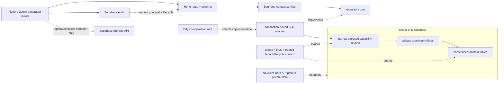
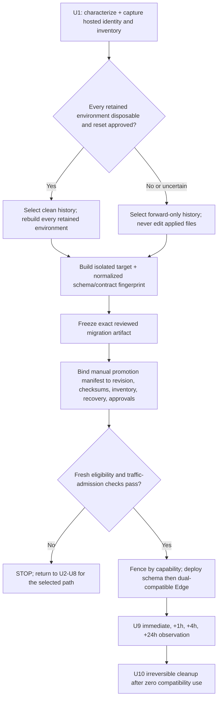
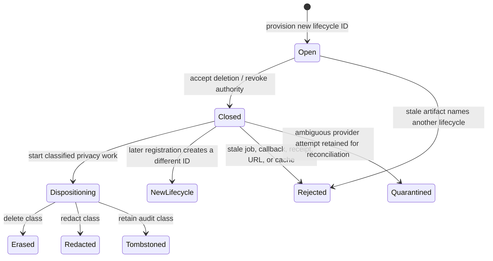
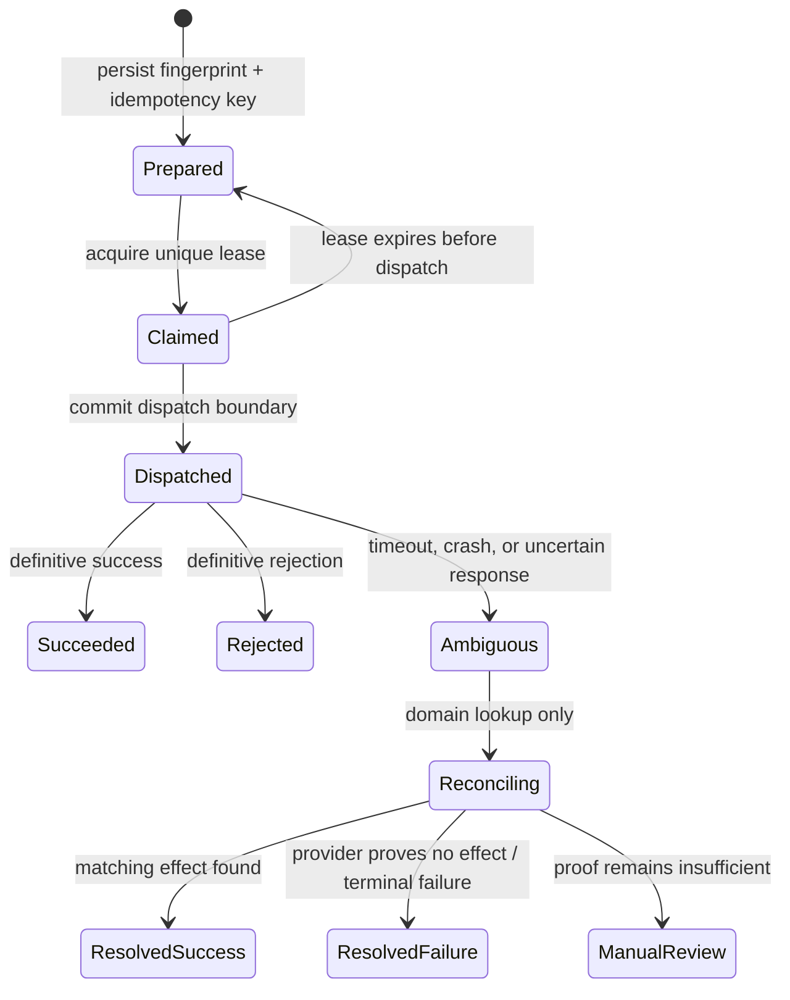
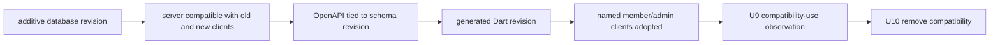

# Supabase Architecture Remediation - Plan

## Goal Capsule

- **Objective:** Argus developers and operators can change the Supabase-backed product without reintroducing cross-tenant access, financial-command ambiguity, lifecycle leakage, or migration hotfix chains, while members and staff retain the current product meaning and all behavior except the contract changes explicitly named in R18-R19 and U8.
- **Means:** Replace shortcut-driven database and application boundaries with a composed, domain-owned architecture and a characterized Supabase baseline (KTD1-KTD14).
- **Authority:** The Product Contract in this plan governs scope and behavior. `CONCEPTS.md` governs domain language. `ritual-investing-app/PRODUCT.md` and `docs/solutions/architecture-patterns/ritual-investing-app-current-intent-and-architecture.md` govern current product and authority boundaries. The current migrations and code are evidence to inventory, not design authority.
- **Execution profile:** Deep, cross-cutting, security-sensitive refactor across Postgres, Supabase managed services, Edge Functions, the Hono API, generated contracts, Flutter consumers, CI, and operations.
- **Stop conditions:** Do not rewrite applied migration history or reset a hosted project until U1 proves that exact target is disposable and records approval. Any real-user activity or non-synthetic dependency stops destructive execution and requires a separate retention and zero-downtime migration plan. Do not weaken tenant isolation, expose private schemas through the Data API, move external I/O into database transactions, generalize Webull write recovery, or claim malware scanning without an approved scanner.
- **Tail ownership:** U9 owns controlled promotion and observation. U10 owns irreversible cleanup, final documentation, and closure of the remediation register.

---

## Product Contract

### Summary

Remediate every material shortcut revealed by the Supabase migration chain and its downstream consumers. The work covers relational design, lifecycle ownership, privileges, RLS, functions, queues, Cron, Storage, Edge workers, API repositories, domain services, generated contracts, clients, tests, CI, and operations.

Preserve the current Argus, Supabase, and Webull authority model. Use Supabase/Postgres best practices and composition as acceptance criteria. Do not limit the work to SQL cleanup, and do not use the refactor to redesign unrelated product behavior.

### Problem Frame

The current 21-migration chain was created in one day and contains several large migrations followed by corrective replacements. Functions such as `claim_next_argus_job`, `begin_member_deletion`, `prepare_member_purge`, `relay_outbox`, and `enforce_live_member_epoch` were replaced multiple times. The universal lifecycle trigger now branches on table identity and compares JSON representations of rows to permit special transitions.

Relational shortcuts have propagated beyond Postgres. UUID arrays, polymorphic IDs, and generic JSON payloads drive kind-switch SQL materializers, fallback parsing, raw-map admin editing, application-side filtering, and monolithic repositories. Member ownership and job-handler registries are duplicated across SQL, TypeScript, tests, and documentation. Some Storage operations execute while database transactions remain open. Current tests prove many security boundaries, but they do not systematically prove object ownership, lifecycle completeness, privilege allowlists, relational integrity, query plans, or crash recovery.

The project is pre-production and its data is documented as synthetic. That makes a clean baseline preferable, but the hosted development project contains Auth, Storage, queues, secrets, custom roles, and applied migration history. Destructive replacement therefore needs an evidence gate and a forward-only fallback.

### Key Decisions

- **Create a separate corrective plan instead of editing the original Webull/Supabase re-architecture plan.** (session-settled: user-directed — chosen over updating the original plan: the user requested a distinct remediation artifact.) Governs R1-R20.
- **Treat migrations as the starting evidence, not the scope boundary.** (session-settled: user-directed — chosen over SQL-and-data-model-only cleanup: the shortcuts have downstream architecture and behavior consequences.) Governs R1-R20.
- **Use Supabase/Postgres best practices and composition as enforceable design criteria.** (session-settled: user-directed — chosen over patch-by-patch cleanup: the resulting system must remain maintainable after this refactor.) Governs R2-R20.
- **Preserve current product and authority boundaries.** Supabase remains authoritative for Argus identity, application state, compute, jobs, and Storage; Webull remains authoritative for brokerage state and orders; clients continue through the versioned Argus API except for approved Auth and Storage transport. Governs R3, R11-R15, R18.

### Actors

| ID | Actor | Responsibility |
|---|---|---|
| A1 | Argus member | Uses identity, editorial, ritual, community, media, privacy, and brokerage flows without seeing internal schema changes. |
| A2 | Argus staff member | Reviews and publishes content and uses administrative operations through explicit staff capabilities. |
| A3 | Argus developer or operator | Authors migrations, runs local verification, promotes the hosted environment, and responds to failed work. |
| A4 | Supabase platform | Hosts Auth, Postgres, Edge Functions, Queues, Cron, Storage, Vault contracts, and managed schemas. |
| A5 | Webull Connect | Remains authoritative for brokerage connections, account state, and order outcomes. |

### Requirements

#### Architecture and migration ownership

- R1. Every current migration object, corrective replacement, managed-service bootstrap action, downstream compatibility branch, and placeholder job behavior has one recorded disposition: preserve, redesign, replace, or defer with rationale.
- R2. The target database is a dependency-ordered composition of cohesive domain modules, and every table, constraint, policy, function, trigger, role, queue, schedule, bucket, and bootstrap action has one owning module.
- R3. PostgreSQL owns durable state, declarative integrity, authorization, idempotency, and atomic transitions, while Hono/Edge owns external I/O, retry classification, orchestration, and response shaping.
- R4. Migration-history replacement occurs only for an audited disposable environment. A retained environment that remains eligible under this plan receives forward-only remediation without rewriting applied history. Any environment with real-user activity or a non-synthetic dependency stops this plan and requires the separate retention and zero-downtime migration plan named in Scope Boundaries.

#### Relational model and lifecycle integrity

- R5. Data that is independently identified, ordered, joined, filtered, constrained, updated, or referenced uses typed tables and constraints instead of UUID arrays, untyped polymorphic IDs, or application-enforced JSON conventions.
- R6. JSONB remains only for opaque provider snapshots, immutable versioned documents, or genuinely variable metadata, with typed envelope columns, schema versions, validation, size boundaries, and query-specific indexes where needed.
- R7. Every durable relationship has reviewed nullability, uniqueness, foreign-key, deletion, ordering, and indexing semantics, including composite ownership relationships that prevent cross-parent references.
- R8. Member-owned state binds to an explicit identity lifecycle so deletion permanently closes one lifecycle and re-registration cannot revive old rows, jobs, receipts, signed-object access, callbacks, caches, or provider credentials.

#### Security and managed Supabase boundaries

- R9. Grants, RLS, function execution, default privileges, ownership, request context, and Data API exposure form one least-privilege capability model that denies access when identity or context is absent, malformed, stale, or cross-tenant.
- R10. Security-definer routines are exceptional, narrowly owned, fully schema-qualified with an empty search path, granted by exact signature, and protected from public execution and obsolete overloads.
- R11. Managed `auth`, `storage`, `realtime`, `pgmq`, `cron`, `net`, and Vault boundaries use supported APIs and extension contracts without custom objects or direct internal-table mutation that Supabase can reject or invalidate.

#### Durable work and financial safety

- R12. Outbox, handler, schedule, payload-version, ownership, export, purge, retry, and dead-letter metadata have one source or a generated parity contract instead of independent SQL and TypeScript registries.
- R13. Queue consumers tolerate duplicate delivery, lease expiry, worker crashes, and completion races through durable idempotency, explicit attempt state, bounded leases, archive/delete-after-success, and reconciliable completion.
- R14. Storage, Auth, Webull, and other network effects execute outside database transactions through prepare/effect/complete sagas that preserve a documented consistency guarantee.
- R15. Webull commands retain durable-command-before-egress, immutable attempts, account-scoped ambiguity fencing, lookup-only recovery, no generic worker execute capability, and manual review for unresolved outcomes.
- R16. Media state describes only the validation actually performed; structural checks cannot mark an object malware-clear without an approved scanner attestation.

#### Application composition and contracts

- R17. API code is composed by bounded context into types and policy, repository ports, transaction-bound SQL adapters, services, route/schema modules, and thin Edge composition roots, following the existing brokerage-domain pattern.
- R18. Member and staff behavior stays compatible unless this plan explicitly changes a contract; OpenAPI, the generated Dart client, admin adapters, member adapters, and schema/build revision checks change atomically when a contract changes.
- R19. Search, filtering, and pagination execute against normalized indexed data with deterministic ordering and stable versioned keyset cursors instead of application-side filtering, biased concatenation, offset paging, or rejected cursors.

#### Verification and operations

- R20. Local and hosted verification covers replay, drift, lint, advisors, catalog invariants, capability-role RLS, query plans, concurrency, managed-service behavior, generated contracts, clients, provider fences, observability, and rollback or fix-forward rehearsal.

### Key Flows

- F1. **Author and promote a database change**
  - **Actors:** A3, A4
  - **Steps:** Update one domain-owned migration module, reset from empty state, run database and downstream contracts, compare the expected inventory, fence external work, verify the exact hosted target, apply the chosen history strategy, run hosted acceptance, and resume work only after acceptance.
  - **Covered by:** R1-R4, R9-R11, R20.
- F2. **Create, delete, and re-register a member**
  - **Actors:** A1, A3, A4
  - **Steps:** Provision one identity lifecycle, scope all member state to it, fence it at deletion, complete cross-system purge and Auth deletion, then create a new lifecycle for any later registration without addressability to the old one.
  - **Covered by:** R7-R10, R12-R14.
- F3. **Publish and read editorial content**
  - **Actors:** A1, A2, A4
  - **Steps:** Create a typed revision, attach ordered assets and evidence through constrained relationships, review and publish atomically, preserve the immutable published representation, and serve deterministic member and public reads.
  - **Covered by:** R5-R7, R9-R10, R17-R19.
- F4. **Process durable external work**
  - **Actors:** A3, A4
  - **Steps:** Commit state and an outbox event, enqueue through one adapter, claim a leased attempt, commit a prepared checkpoint, perform the external effect, record completion or reconciliation, and archive only after durable success.
  - **Covered by:** R11-R14, R16, R20.
- F5. **Submit and recover a Webull command**
  - **Actors:** A1, A3, A4, A5
  - **Steps:** Persist the reviewed command before egress, call Webull once, record the response or unknown outcome, block conflicting account commands, and reconcile by the original provider identifier without write retry.
  - **Covered by:** R13-R15, R17-R18.
- F6. **Roll out an API contract**
  - **Actors:** A1-A4
  - **Steps:** Change normalized storage and a domain adapter, preserve or deliberately version the Hono contract, regenerate committed artifacts, verify member and admin consumers, deploy schema and Edge revision in order, then admit traffic only when revision compatibility succeeds.
  - **Covered by:** R17-R20.

### Acceptance Examples

- AE1. **Covers R1-R4 and R20.** Given an empty local Supabase stack, when the curated baseline is replayed twice, then both runs produce the same object, role, policy, extension, queue, schedule, bucket, and seed inventory without relying on the old corrective chain.
- AE2. **Covers R4 and R20.** Given a hosted environment whose disposability or migration lineage is not proven, when U2 selects the history strategy, then destructive reset is refused and forward-only history becomes the one reviewed artifact.
- AE3. **Covers R8-R10.** Given member B supplies identifiers owned by member A, when B reads, inserts, updates, deletes, upserts, or requests `RETURNING`, then the real runtime capability denies the operation without leaking row existence.
- AE4. **Covers R8-R10 and R12-R14.** Given a deleted member later registers with the same email, when stale JWTs, jobs, callbacks, signed URLs, or receipts from the old lifecycle are presented, then none can read or mutate the new lifecycle.
- AE5. **Covers R5-R7 and R18.** Given a published editorial revision, when its normalized asset and evidence relationships are introduced, then the historical document renders identically and cannot reference another revision's private or unpublished children.
- AE6. **Covers R12-R14.** Given a worker crashes after an external effect but before completion, when the lease expires and work is redelivered, then the durable idempotency key reconciles the existing effect and no duplicate effect is created.
- AE7. **Covers R8 and R14.** Given owner data changes while a privacy export runs, when the export completes, then its manifest identifies one logical cutoff, deterministic collection counts, and no duplicate or silently omitted page caused by offset drift.
- AE8. **Covers R14 and R16.** Given an uploaded object passes structural validation but no malware scanner has attested to it, when the worker completes, then the object remains truthfully classified and cannot be represented as malware-clear.
- AE9. **Covers R13-R15.** Given Webull accepts an order and the response is lost, when recovery runs, then Argus performs lookup-only reconciliation with the original identifier and never submits a second order.
- AE10. **Covers R17-R19.** Given more than one page of mixed discovery results, when a member follows the returned cursor, then ordering is deterministic, no result is skipped or repeated, and category weighting does not change because data was concatenated in application memory.
- AE11. **Covers R18 and R20.** Given a schema or OpenAPI revision that is incompatible with the deployed Edge or generated Dart revision, when hosted acceptance runs, then traffic stays fenced and the deployment fails closed.
- AE12. **Covers R1, R9-R10, and R20.** Given a new member-owned table, function, event type, or external-effect handler, when CI runs, then catalog and parity checks fail until ownership, lifecycle, export/purge, privileges, policies, payload version, handler, and verification coverage are declared.

### Success Criteria

- The remediation register classifies 100% of objects and behaviors introduced by the current migration chain and names their downstream consumers and target owners.
- Every member-owned relation is classified exactly once for lifecycle, read, write, export, purge, and retention behavior.
- Every security-definer routine, capability role, default privilege, RLS policy, managed schema object, and Data API exposure is present in an allowlisted catalog contract.
- The clean-history branch contains a composed migration set with no table-dispatching lifecycle trigger, repeated corrective ownership of the same routine, or blanket all-table runtime or worker DML grant. The forward-only branch preserves every applied file unchanged and proves that the final catalog plus every newly authored remediation module contains none of those shortcuts or a new corrective hotfix chain.
- No Storage, Auth, Webull, or other network request runs while a database transaction or row lock remains open.
- Local reset is reproducible, local and hosted lint/advisors have no unexplained findings, critical query plans meet recorded budgets at representative volume, and every generated contract and client check passes.
- The current member, staff, and Webull safety acceptance suite passes through the new domain boundaries without a legacy parsing or compatibility fallback.

### Scope Boundaries

**In scope**

- All current Supabase migrations, schemas, constraints, indexes, roles, grants, policies, functions, triggers, seeds, Queues, Cron, Storage, Vault contracts, and extension usage.
- Edge job and provider orchestration, Hono repositories and services, retained routes, OpenAPI, generated clients, member/admin consumers, database tests, application tests, CI, runbooks, and architecture/data-inventory documentation affected by the corrected boundaries.
- Removal of placeholder semantics that misstate what the system has done, including the current media-scan claim.

**Deferred to Follow-Up Work**

- Selecting and integrating a malware-scanning vendor; until then U6 preserves quarantine and truthful structural-validation state.
- Selecting a notification delivery provider; U6 creates a truthful delivery port and state contract without inventing an external provider.
- Queue sharding or higher concurrency until U6 records capacity evidence that the current bounded worker cannot meet.
- Making Supabase declarative schemas the authoritative source while pg-delta remains public alpha and incomplete for this project's grants, policies, managed services, and DML.
- A zero-downtime production data migration if Argus becomes live before this plan executes; that event requires a new migration and retention plan.

**Outside this product's identity**

- Changes to Daily Ritual, Founders' Coven, Rowan, Grimoire, Circle, Asset Codex, or Demo product meaning that are not required to preserve current behavior through the refactor.
- An Argus-owned brokerage ledger, blind financial retries, automated trading, or any expansion of Webull capabilities.
- Direct member/admin access to private application, brokerage, provider, command, or job state through the Supabase Data API.

### Dependencies and Prerequisites

- U1 needs read access to the exact hosted development project's migration ledger, schema inventory, Auth counts, Storage inventory, queue state, custom roles, extension versions, and secret-name contract. Secret values must not enter the repository or evidence bundle.
- Docker-compatible local Supabase development remains required.
- U2 must pin a reviewed Supabase CLI release at or above the versions that provide `db query` and `db advisors`; the researched target is 2.115.0.
- U6 must record the local and hosted `pgmq`, `pg_cron`, and `pg_net` behavior because extension version pinning is no longer authoritative.
- Destructive hosted reset requires named approval after U1 proves the target disposable. Lack of approval selects the forward-only path and does not block the rest of the plan.

---

## Planning Contract

### Key Technical Decisions

- KTD1. Select one migration-history strategy after U1 and commit only that strategy. Use a curated clean history only when every retained environment will be rebuilt; otherwise append forward-only modules without editing an applied file. A failed U9 eligibility recheck stops promotion and returns work to U2-U8 instead of switching branches during deployment. (session-settled: user-approved — chosen over assuming a clean reset is always safe: the repository is pre-production but still has a persistent hosted development project.) Governs R1-R4 and R20.
- KTD2. Keep one exact reviewed migration artifact authoritative in either KTD1 branch. Modules are ordinary checksum-stable Supabase migration files ordered by timestamp and dependency; a target manifest fingerprints definitions, privileges, function properties, reference data, extensions, and managed resources. Do not use blind squash output or a committed declarative mirror as a second authority. Governs R2, R4, R11, and R20.
- KTD3. Enforce one-way composition: constrained tables own state, grants and RLS guard access, private routines own atomic primitives, exposed capability routines compose one transaction, and Edge services own external I/O. Tenant and lifecycle authority comes only from authenticated or server-controlled context, never a caller-supplied identifier. (session-settled: user-directed — chosen over cross-layer shortcut fixes: the user required composition and general design-pattern discipline.) Governs R2-R3, R9-R17.
- KTD4. Make normalized tables authoritative for addressable domain facts, ownership, relationships, and search. At publication, seal an append-only editorial rendering document derived from the same normalized transaction; it is canonical only for historical presentation and is never an independent write path. Provider snapshots use a separate opaque, versioned, private envelope and never become financial-command authority. Governs R5-R7 and R18-R19.
- KTD5. Replace the deletion-epoch convention with an immutable member lifecycle/incarnation identifier. Closing a lifecycle removes authority immediately and never reopens it; privacy erasure, retention, redaction, and tombstoning then follow each resource's classified disposition. Every owned row and durable capability artifact binds to tenant plus lifecycle. Governs R7-R8 and R12-R14.
- KTD6. Preserve the capability-role shape but narrow it by use case. Invoker routines rely on RLS under trusted context. Definer routines exist only for reviewed cross-row atomic capabilities, perform explicit tenant/lifecycle authorization, use an empty search path and qualified references, and receive controlled ownership plus exact-signature grants. Governs R9-R11.
- KTD7. Model external work as a durable state machine: prepared, claimed, dispatched, succeeded, rejected, ambiguous, reconciling, resolved, or manual review. Persist the immutable request fingerprint and idempotency key before dispatch; an ambiguous effect is never reissued without domain proof that no effect occurred. Governs R12-R14 and R16.
- KTD8. Make Webull a brokerage-owned specialization of KTD7. The generic worker may share claims and observability but cannot submit financial effects; brokerage owns approval evidence, provider-account generation, submission, identifier/economic matching, ambiguity fencing, lookup-only recovery, and manual review. Governs R13-R15.
- KTD9. Give each bounded context ownership of its policy/types, repository port, SQL adapter, service, and route/schema stack; the existing brokerage subdomains are the reference implementation. Routes own transport validation, services depend on ports, adapters own domain SQL, and only the composition root selects concrete adapters. Governs R17-R19.
- KTD10. Keep existing endpoint semantics compatible until named consumers adopt a versioned change. Only designated endpoints gain keyset/search behavior; cursors are opaque, versioned, uniquely ordered, and bound to tenant plus query context. Generate OpenAPI and clients from one reviewed source revision and remove compatibility only after observation. Governs R18-R20.
- KTD11. Upgrade the Supabase toolchain in an isolated unit and verify behavior before schema work depends on it. Pin CLI 2.115.0, review pg-delta changes, require nonzero pgTAP execution, and run local plus hosted lint/advisors because managed settings can differ. Governs R11 and R20.
- KTD12. Materialize each privacy export as an immutable generation in a short database transaction. Seal normalized row payloads plus immutable Storage object identifiers and content hashes into a private, lifecycle-scoped manifest. External assembly reads only that manifest; a missing or changed object seals the generation failed, and a later retry creates a new generation. Governs R8 and R14.
- KTD13. Use expand/verify/contract for the forward-only branch with one write authority. Profile legacy cohorts, create source-to-target mappings, backfill resumably, quarantine untransformable rows, route all writes through one transaction, cut readers over after parity, and retain the legacy source read-only through U9 observation. Governs R4-R8 and R18-R20.
- KTD14. Admit a remediation release through a protected manual promotion manifest, not the automatic main-push path. The manifest binds project identity, Git revision, migration checksums, fresh inventories, recovery coverage, approvals, traffic admission, test evidence, and individual fence states; any bound change invalidates it. Governs R4 and R20.

### High-Level Technical Design









```mermaid
sequenceDiagram
    participant B as Brokerage service
    participant D as Postgres command capability
    participant W as Webull
    participant R as Brokerage recovery
    B->>D: Persist principal, tenant/lifecycle, account generation, approval evidence, economics fingerprint, stable command ID
    D-->>B: Commit prepared command
    B->>W: Submit once outside the transaction
    alt definitive response
        W-->>B: Accepted or rejected
        B->>D: Record immutable outcome
    else timeout or transport uncertainty
        B->>D: Mark ambiguous; block conflicting account effects
        R->>W: Lookup by original provider identifier
        alt identifiers and economics match
            R->>D: Resolve observed outcome
        else missing or mismatched evidence
            R->>D: Keep ambiguous or require manual review
        end
    end
```



These diagrams make responsibility, state transitions, and ordering authoritative. Exact SQL object and file names remain implementation details. KTD1 selects one history; the unselected history is not maintained as a second migration authority. KTD3 forbids direct client access to private state and cross-context adapter imports. KTD7 governs generic uncertainty, while KTD8 adds the stricter Webull evidence and recovery boundary.

### Planning Assumptions

- The current architecture record is correct that all existing data is synthetic and no production member depends on it.
- The hosted development project may contain state worth preserving even when its application data is synthetic; U1 treats it as non-disposable until proven otherwise.
- Existing member and staff behavior is the compatibility baseline. Current implementation shortcuts are not automatically behavior worth preserving.
- PostgreSQL 17 remains the local and hosted major version during this refactor.
- Exact table and index names may change during implementation after U1 completes the disposition and query-shape inventories; R-IDs and KTDs govern those choices.

### System-Wide Impact

| Surface | Impact | Required control |
|---|---|---|
| Member identity and privacy | Ownership moves from an implicit epoch convention to an explicit lifecycle. | Old tokens, work, objects, and provider state must never cross deletion or re-registration. |
| Editorial and community data | Arrays and JSON-backed relationships become typed domain relations. | Preserve immutable published rendering and staff authorization. |
| Brokerage state | Parent relationships and indexes become explicit. | Preserve Webull authority and the no-blind-retry command contract. |
| Background work | Handler metadata and external effects move to composed saga boundaries. | Prove redelivery, crash, lease, reconciliation, and dead-letter behavior. |
| API and clients | Monolithic retained adapters split and some list contracts gain real cursors. | Regenerate all artifacts and gate schema/build compatibility. |
| Operations | CLI, migration history, managed services, and hosted promotion change. | Fence egress, verify exact target, compare inventories, and rehearse restore/fix-forward. |
| Developers | Schema ownership becomes domain-based and catalog-enforced. | Document the change workflow and fail CI for unclassified objects. |

### Risks and Mitigations

| Risk | Consequence | Mitigation |
|---|---|---|
| Hosted history is rewritten on the wrong project. | Auth, Storage, queues, secrets, or recoverable evidence is lost. | KTD1 hard gate, exact-target guard, inventory snapshot, backup/restore rehearsal, named approval, and forward-only default. |
| Clean and forward histories become parallel authorities. | Later migrations apply twice, skip work, or drift by environment. | KTD1 selects one mutually exclusive repository history; KTD2 fingerprints its exact artifact and rejects deploy-time branch switching. |
| Forward-only normalization loses or misparents legacy rows. | Counts, ordering, ownership, or publication history silently changes. | KTD13 source-to-target mappings, dirty fixtures, quarantine reports, resumable backfill, parity after writes, and read-only rollback source. |
| Normalization changes historical editorial rendering. | Published rituals or public previews drift. | Preserve immutable versioned documents, add constrained read models, and compare old/new renderings before cutover. |
| Narrower grants break a hidden caller. | Member, staff, worker, or callback flows fail after deployment. | Move callers to final capability entrypoints first, then narrow grants; test with real login roles and catalog allowlists. |
| Queue redelivery duplicates an external effect. | Duplicate Storage, notification, privacy, or provider action occurs. | KTD7 checkpoints, stable idempotency, crash-window tests, and reconciliation before archive. |
| Member lifecycle redesign leaks old state. | Deleted identity data becomes visible after re-registration. | Parent-qualified lifecycle keys, fail-closed context, old-token tests, signed-object tests, and purge/export classification. |
| Supabase CLI or extension behavior changed. | Local success differs from hosted behavior. | KTD11 isolated upgrade, recorded extension versions, contract tests, hosted advisors, and managed-service acceptance. |
| Managed-schema customization is rejected. | Storage, Auth, or Realtime deployment fails. | Use supported APIs and policies only; verify the documented Storage-index conflict on a hosted branch before adding an index. |
| Repository splitting becomes cosmetic. | Cross-domain SQL and fallback parsing remain hidden behind more files. | Sequence U7 after domain models and make each adapter depend only on its domain port and transaction executor. |
| Schema and Edge revisions are mixed while users can send traffic. | Compatible requests fail or unsafe old code reaches new state. | KTD14 manual traffic-admission gate, old/new compatibility matrix, revision handshake, and fenced failure state. |
| Backup coverage excludes managed or external state. | A nominal restore leaves Auth, Storage, roles, queues, secrets, or functions inconsistent. | U1 recovery matrix, isolated restore drill, explicit exclusions/reconstruction, and state-class-specific restore versus fix-forward rules. |
| Cleanup begins before all consumers and work have moved. | Rollback loses the last complete representation or stale workers corrupt new state. | U9 observation with compatibility-use telemetry; U10 cleanup only after release-owner signoff and zero unexpected use. |

### Delivery Phases

1. **Characterize and decide:** U1 captures the full disposition, behavior, security, query, managed-service, and hosted-state evidence; U2 upgrades tooling and selects the history path.
2. **Build the foundation:** U3 establishes lifecycle, privileges, RLS, function, and request-context composition.
3. **Normalize domains:** U4 corrects Argus editorial/community data; U5 corrects brokerage relationships without changing Webull command authority.
4. **Compose durable work:** U6 corrects queues, jobs, privacy, media, Storage, Cron, and external-effect transactions.
5. **Cut over consumers:** U7 decomposes Hono repositories and services; U8 updates list/search contracts, generated clients, admin, and member consumers.
6. **Promote and observe:** U9 admits the selected artifact through the protected manual workflow, proves hosted behavior, and completes the observation window.
7. **Remove and close:** U10 removes obsolete surfaces, proves no compatibility dependency remains, and closes documentation plus operational evidence.

---

## Implementation Units

| U-ID | Unit | Primary files | Depends on |
|---|---|---|---|
| U1 | Inventory shortcuts and characterize behavior | `docs/ritual-investing/supabase-remediation-register.md`, `supabase/tests/`, `scripts/` | None |
| U2 | Upgrade toolchain and establish migration ownership | `.github/workflows/ritual-investing.yml`, `supabase/config.toml`, `supabase/migrations/` | U1 |
| U3 | Replace lifecycle and security shortcuts | `supabase/migrations/`, `supabase/tests/`, `ritual-investing-api/src/db/` | U1, U2 |
| U4 | Normalize Argus domains | `supabase/migrations/`, `supabase/tests/`, `member-data-inventory.md` | U3 |
| U5 | Strengthen brokerage relationships | `supabase/migrations/`, `ritual-investing-api/src/domains/brokerage-*` | U3 |
| U6 | Compose durable external work | `supabase/migrations/`, `ritual-investing-api/src/jobs/`, `supabase/functions/_shared/jobs/` | U3-U5 |
| U7 | Decompose retained API domains | `ritual-investing-api/src/domains/`, `supabase/functions/api/index.ts` | U4-U6 |
| U8 | Cut over contracts and clients | `ritual-investing-api/openapi/`, `ritual-investing-api-client/`, Flutter consumers | U7 |
| U9 | Promote and observe | hosted workflow, deployment scripts, operations runbook | U2-U8 |
| U10 | Remove obsolete surfaces and close | migrations, legacy adapters, tests, architecture docs | U9 |

### U1. Inventory shortcuts and characterize current behavior

**Goal:** Create the evidence and executable behavioral contract that lets later units replace shortcuts without losing intended behavior.

**Requirements:** R1, R4, R8-R20.

**Dependencies:** None.

**Files:**

- Create `docs/ritual-investing/supabase-remediation-register.md`.
- Create `scripts/audit-supabase-architecture.sql`.
- Create `scripts/check-supabase-architecture-contract.sh`.
- Create `supabase/tests/architecture_contract.test.sql`.
- Create `supabase/tests/member_lifecycle.test.sql`.
- Modify `supabase/tests/schema.test.sql`.
- Modify `supabase/tests/grants_and_rls.test.sql`.
- Modify `ritual-investing-api/test/` characterization suites for retained repositories, jobs, privacy, editorial, and brokerage commands.
- Modify `docs/ritual-investing/supabase-operations-runbook.md`.

**Approach:**

1. Build an object register from every file in `supabase/migrations/`. Record object owner, domain owner, downstream consumers, replacement history, managed-service dependency, security mode, and target disposition.
2. Classify every member-owned relation for lifecycle, read, write, export, purge, retention, and object-storage behavior. Replace duplicated manual inventories with a failing parity contract before changing them.
3. Record all foreign keys, missing parent-qualified constraints, referencing-side indexes, RLS predicates, grants, function ACLs, owners, search paths, overloads, triggers, queues, schedules, buckets, Vault secret names, extension versions, and Data API exposure.
4. Capture representative query shapes and plans for owner lists, editorial publication, search/discovery, outbox claims, job claims, retries, privacy export/purge, brokerage projections, and recovery.
5. Replace tests that inspect migration filenames or source text with catalog, pgTAP, and black-box behavior assertions wherever semantics can be observed.
6. Capture the exact hosted target's project and branch identity, migration checksums, Git revision, inventory timestamp, application/Auth/Storage/queue counts, custom roles, extensions, managed resources, and non-secret configuration. Mark it disposable only if every retained data class has an approved disposition and no real-user or non-synthetic dependency exists (KTD1).
7. Create a recovery coverage matrix for database state, Auth metadata, Storage objects, queues, Cron, custom roles, Vault-name contracts, Edge secrets, and deployed functions. Record what each backup excludes, how excluded state is reconstructed, and evidence from an isolated restore drill.

**Execution note:** Add characterization and catalog coverage before editing a migration, function, repository, or handler that it protects.

**Patterns to follow:** `supabase/tests/grants_and_rls.test.sql`, `scripts/check-supabase-deploy-target.ts`, `scripts/fence-supabase-deployment.sql`, and the hosted acceptance workflow in `.github/workflows/ritual-investing.yml`.

**Test scenarios:**

- Covers AE1. An empty local stack produces a complete deterministic catalog and managed-service inventory.
- Covers AE2. An unknown project ref, unmatched migration checksum, nonempty retained data class, or absent approval marks destructive reset ineligible.
- Any observed real-user activity or non-synthetic dependency makes destructive eligibility false and routes to a separate retention/zero-downtime plan.
- Covers AE3. Owner, non-owner, staff, worker, anonymous, table-owner, and privileged-service cases are asserted through their real capabilities.
- Covers AE4. Old-lifecycle JWT, job, callback, receipt, object, and provider mapping cases are captured before lifecycle code changes.
- Covers AE5. Published revisions and their member/public renderings have golden behavioral fixtures independent of migration text.
- Covers AE6 and AE9. Crash windows for ordinary jobs and Webull recovery are distinct characterization suites.
- Covers AE12. Adding an unclassified relation, function, event type, or handler makes the architecture contract fail.

**Verification:** The remediation register covers every current migration object and known downstream compatibility branch. Characterization tests fail when a current security, lifecycle, editorial, job, contract, or Webull invariant is intentionally perturbed.

### U2. Upgrade the Supabase toolchain and establish migration ownership

**Goal:** Make migration generation, replay, lint, advisors, and history decisions reproducible before the target schema depends on newer Supabase behavior.

**Requirements:** R2, R4, R11, R20.

**Dependencies:** U1.

**Files:**

- Modify `.github/workflows/ritual-investing.yml`.
- Modify `supabase/config.toml`.
- Modify `supabase/migrations/` according to the KTD1 branch selected after U1.
- Create `scripts/check-supabase-migration-inventory.sh`.
- Create `docs/ritual-investing/supabase-schema-authoring.md`.
- Modify `docs/ritual-investing/supabase-operations-runbook.md`.
- Test with `supabase/tests/architecture_contract.test.sql`.

**Approach:**

1. Upgrade and pin Supabase CLI 2.115.0 in a dedicated change. Record differences in reset, migration order, pg-delta coverage, zero-test failure, lint, and advisor output before accepting the pin (KTD11).
2. Define one target dependency order: extensions/ownership roles → schemas/domains → identity lifecycle → Argus domains → brokerage → constraints/indexes → private primitives → capability entrypoints → grants/RLS → managed-service bootstrap → seeds.
3. Keep `schema_paths` disabled as an authority while pg-delta is incomplete. Permit generated declarative output only as a noncommitted review artifact with strict coverage reporting (KTD2).
4. If U1 approves reset, select a clean history and replace the old chain with manually reviewed cohesive modules. Every retained environment must rebuild from it; no persistent environment may continue on the discarded ledger (KTD1).
5. If U1 does not approve reset, select forward-only history, preserve every applied file unchanged, and apply KTD13 to each later domain. Do not keep a second clean migration line in the repository.
6. Create the KTD2 target manifest from normalized definitions, ACLs, function metadata, reference data, extension behavior, and managed-resource desired state. Assign each managed object to migration-owned, supported API-owned, or out-of-band provisioning with one dependency order and idempotency contract.
7. Classify custom roles as Supabase-managed, non-login owner, runtime login, or legacy. Inventory memberships, owned objects, grants, login state, connection settings, and statement/idle timeouts before any disable or drop decision.
8. Fail replay on unexpected preexisting objects instead of hiding drift behind pervasive catalog guards or `IF NOT EXISTS` clauses.

**Patterns to follow:** Existing local-reset and hosted-fence jobs in `.github/workflows/ritual-investing.yml`; Supabase CLI workflows and migration-squash caveats listed in the Appendix.

**Test scenarios:**

- Covers AE1. Two fresh resets under CLI 2.115.0 produce the same migration and object inventory and execute a nonzero pgTAP suite.
- Covers AE2. The history script refuses a clean replacement when the target identity, checksum inventory, or approval record differs.
- A generated pg-delta review reports unsupported coverage as a finding and never silently becomes the deployable source.
- Cron jobs, queues, buckets, Vault secret-name contracts, roles, grants, and default privileges exist after reset even though squash/declarative tools omit some of them.
- The chosen history produces the KTD2 target fingerprint, and a new sentinel migration applies exactly once to a rebuilt database and to the selected hosted-history shape.
- No role or managed resource remains unclassified or differs from the desired-state allowlist.
- A deliberately preexisting conflicting object causes replay to fail instead of passing through a guard.

**Verification:** The CLI upgrade is independently green. The schema-authoring guide assigns one owner to every object class. The KTD1-selected history is replayable and promotable, and the clean path cannot execute without U1 evidence. The unselected branch remains documented decision logic rather than a second repository artifact.

### U3. Replace lifecycle and security shortcuts with explicit capabilities

**Goal:** Establish the identity-lifecycle, request-context, role, grant, RLS, and function foundation used by every normalized domain.

**Requirements:** R3, R7-R11, R17, R20.

**Dependencies:** U1, U2.

**Files:**

- Modify `supabase/migrations/` identity, role, function, grant, and RLS modules.
- Modify `supabase/tests/grants_and_rls.test.sql`.
- Modify `supabase/tests/member_lifecycle.test.sql`.
- Create `supabase/tests/function_security.test.sql`.
- Create `supabase/tests/request_context.test.sql`.
- Modify `ritual-investing-api/src/db/database-port.ts`.
- Modify `ritual-investing-api/src/db/request-transaction.ts`.
- Modify `supabase/functions/_shared/database.ts`.
- Modify `ritual-investing-api/test/db/` request-transaction tests.

**Approach:**

1. Introduce an immutable member lifecycle/incarnation parent before any dependent cutover. Require rows, queues/events, idempotency keys, callbacks, Storage paths/manifests, signed access, caches, receipts, credentials, and financial attempts to reference tenant plus lifecycle (KTD3, KTD5).
2. Replace `enforce_live_member_epoch` and its table-specific branches with foreign-key deletion rules, row-local constraints, purpose-specific transitions, and narrow table triggers only where declarative constraints cannot express behavior.
3. Define capability-specific runtime, staff, worker, callback, and migration roles. Preserve non-login ownership roles and remove blanket all-table DML grants (KTD6).
4. Make RLS command-specific and fail-closed. Derive authority from verified server context, never a caller-supplied owner or lifecycle ID. Use explicit `USING` and `WITH CHECK`, index leading policy predicates, and prove owner, non-owner, lifecycle, and staff behavior with real roles (KTD3).
5. Make security invoker the default. Audit security-definer owners, empty search paths, qualified references, public/default execution revocation, exact-signature grants, and obsolete overload removal.
6. Require one checked-out transaction-pooler connection for `BEGIN`, transaction-local request context, every repository statement, and completion. No nested adapter may switch to a global pool.

**Patterns to follow:** `ritual-investing-api/src/db/request-transaction.ts`, `ritual-investing-api/src/db/database-port.ts`, `supabase/functions/_shared/database.ts`, and the current private-schema/capability-role structure where it already follows KTD6.

**Test scenarios:**

- Covers AE3. Each command in the role-by-table matrix proves positive owner access and negative cross-owner access, including `UPDATE`, `UPSERT`, and `RETURNING` behavior.
- Covers AE4. Closed lifecycles reject old request context, jobs, callbacks, signed-object manifests, step-up receipts, and provider mappings after same-email re-registration.
- Missing, malformed, spoofed, session-scoped, or leaked request context fails closed across transaction-pool reuse.
- A security-definer function with a writable search path, `PUBLIC` execution, privileged owner, unqualified relation, or stale overload fails the catalog test.
- A new foreign key without a reviewed deletion action or supporting query/RLS index fails architecture review.
- Concurrent lifecycle close and member mutation produces one valid terminal state without deadlock or resurrection.

**Verification:** No universal lifecycle trigger remains. Catalog tests show narrow capability grants, expected default privileges, forced RLS where required, safe function metadata, and transaction-local context isolation.

### U4. Normalize Argus editorial, ritual, community, and member data

**Goal:** Replace queryable arrays, polymorphic references, and generic domain payloads with constrained domain-owned relations while preserving immutable published behavior.

**Requirements:** R2-R10, R17-R20.

**Dependencies:** U3.

**Files:**

- Modify `supabase/migrations/` Argus domain and editorial modules.
- Modify `supabase/seed.sql`.
- Create `supabase/tests/argus_domain_model.test.sql`.
- Create `supabase/tests/editorial_publication.test.sql`.
- Modify `supabase/tests/architecture_contract.test.sql`.
- Modify `docs/ritual-investing/member-data-inventory.md`.
- Test through `ritual-investing-api/test/` editorial, ritual, Circle, Grimoire, Coven, briefing, saved-item, report, and publication fixtures.

**Approach:**

1. Use the U1 register and `member-data-inventory.md` to define bounded tables for Asset Codex revisions, evidence, metrics, Coven qualifications and verifications, Circle-template assets, Grimoire-revision assets, ritual scenario assets and evidence, briefings, saved items, reports, and publication relationships.
2. Replace UUID arrays with ordered junctions that enforce target existence, parent ownership, uniqueness, and position semantics (KTD4).
3. Replace known polymorphic identifiers with typed association tables or constrained domain references. Keep generic event envelopes only when KTD4's boundary rule applies.
4. Keep one immutable, versioned editorial document where historical rendering needs it. Materialize constrained domain links and read models atomically with publication rather than parsing a mutable generic payload later.
5. Replace the large kind-switch materializer with domain-specific commands and shared atomic primitives. Each command validates only its owned document and relationships (KTD3, KTD4).
6. Review nullability, checks, unique constraints, composite parents, delete actions, referencing-side indexes, RLS predicates, publication pointers, and current-revision ownership for every table.
7. In the forward-only path, profile legacy cohorts and freeze source-to-target mapping rules before backfill. Quarantine untransformable rows instead of coercing unknown values, preserve ordering and cardinality, and record a source-to-target identity map (KTD13).
8. Make normalized drafts and relationships the only editable authority. Seal the historical rendering document from the same publication transaction and expose every legacy representation as read-only or route its mutation through that transaction (KTD4).
9. Run resumable backfill and parity after each mutation, then fence obsolete writes and cut readers over. Retain the legacy source read-only through U9 observation before U10 removes it (KTD13).

**Patterns to follow:** The typed revision and relationship vocabulary in `docs/ritual-investing/member-data-inventory.md`; current brokerage command normalization as a separation example, not as a domain model to copy literally.

**Test scenarios:**

- Covers AE5. Existing published fixtures render byte-for-byte or field-for-field equivalently after normalization, including historical revisions and public preview.
- An ordered asset or evidence relation rejects duplicates, missing targets, another parent's private child, and invalid position gaps according to its declared ordering contract.
- Publication cannot point to a revision owned by another item or to a revision that is not in a publishable state.
- Saved items and content reports reject unsupported target kinds and nonexistent targets without leaking cross-tenant existence.
- Empty optional collections and the minimum/maximum ritual evidence and asset counts retain current validation behavior.
- Forward-only compatibility reads equal normalized reads before the old representation is removed.
- Dirty legacy fixtures reconcile per cohort by count, fingerprint, lifecycle, ordered-child equality, and source-to-target bijection; malformed and cross-parent rows appear in an explicit quarantine report.
- Concurrent old/new client attempts cannot mutate the sealed document or legacy store independently of the normalized authority.
- Representative owner, editorial, ritual, discovery, and briefing queries use the intended composite, partial, full-text, or trigram indexes at seeded volume.

**Verification:** The U1 register has no unresolved array or polymorphic relation. Retained JSONB entries satisfy KTD4 and have typed envelopes. Published behavior and staff workflows pass without the generic kind-switch materializer.

### U5. Strengthen brokerage relationships without changing financial authority

**Goal:** Correct brokerage referential and projection shortcuts while preserving Webull authority and the current financial-command safety model.

**Requirements:** R2-R15, R17-R20.

**Dependencies:** U3.

**Files:**

- Modify `supabase/migrations/` brokerage projection, mapping, command, and recovery modules.
- Create `supabase/tests/brokerage_integrity.test.sql`.
- Modify `ritual-investing-api/src/domains/brokerage-connections/`.
- Modify `ritual-investing-api/src/domains/brokerage-assets/`.
- Modify `ritual-investing-api/src/domains/brokerage-projections/`.
- Modify `ritual-investing-api/src/domains/brokerage-orders/`.
- Modify `ritual-investing-api/test/` brokerage connection, projection, command, and recovery suites.
- Modify `supabase/functions/_shared/jobs/webull-recovery.ts` only where final database entrypoints change.

**Approach:**

1. Enforce connection-account ownership with one parent-qualified relationship, including active account selection and every projection, generation, mapping, command, attempt, and reconciliation case.
2. Separate typed projection metadata from opaque versioned provider snapshots. Keep Webull raw payloads private and retain only the minimum needed for audit and reconciliation (KTD4, KTD8).
3. Review freshness, generation, retention, mapping uniqueness, account capability, provider identifier, and current-generation constraints and supporting indexes.
4. Preserve the existing brokerage domain structure as the composition exemplar. Change its ports only where corrected constraints or capability routines require it (KTD3, KTD8).
5. Keep command creation and provider egress separate from generic job dispatch. Persist the immutable attempt before the dispatch boundary; after that boundary, a lease recovery may only record a definitive response or perform lookup/reconciliation (KTD7, KTD8).
6. Remove migration-source-text coupling from provider command tests and assert deployed catalog plus black-box behavior instead.

**Patterns to follow:** `ritual-investing-api/src/domains/brokerage-orders/`, `brokerage-projections/`, `brokerage-connections/`, and the durable prepare/recover sequence in `supabase/functions/_shared/jobs/webull-recovery.ts`.

**Test scenarios:**

- Covers AE9. Lost response, timeout, duplicate confirmation, conflicting idempotency reuse, provider not-found ambiguity, and terminal manual review never create a second provider write.
- Crash immediately before send, after send, after provider acceptance, after response, and during lifecycle closure preserves the same command identity; delayed provider visibility never turns not-found into permission to resubmit.
- An active account cannot reference a connection belonging to another member or an account outside the selected connection.
- Projection generations cannot mix accounts, connections, providers, or member lifecycles.
- A closed member lifecycle invalidates callback, refresh, projection, command, and recovery work without claiming to close or modify the Webull account.
- Concurrent token refresh, projection refresh, and command recovery use consistent lock ordering and do not regress a newer provider version.
- Worker and generic job roles cannot execute order placement, modification, or cancellation entrypoints.

**Verification:** Brokerage integrity is declarative where possible, critical query plans are recorded, and all existing Webull safety tests pass with no new command authority or retry path.

### U6. Compose queues, privacy, media, Storage, and external-effect jobs

**Goal:** Replace mixed SQL/TypeScript job ownership and long transactions with private, crash-safe, observable sagas.

**Requirements:** R2-R3, R8-R16, R20.

**Dependencies:** U3, U4, U5.

**Files:**

- Modify `supabase/migrations/` outbox, queue, job, Cron, Storage, Vault-contract, and privacy modules.
- Modify `ritual-investing-api/src/jobs/scheduled.ts`.
- Modify `ritual-investing-api/src/jobs/handlers.ts`.
- Modify `supabase/functions/_shared/jobs/runtime.ts`.
- Modify `supabase/functions/_shared/jobs/storage.ts`.
- Modify `supabase/functions/_shared/jobs/purge.ts`.
- Modify `supabase/functions/worker/index.ts`.
- Create `ritual-investing-api/src/jobs/registry.ts` or an equivalent generated single source.
- Create `supabase/tests/job_contracts.test.sql`.
- Create `supabase/tests/privacy_inventory.test.sql`.
- Modify `ritual-investing-api/test/jobs/` and `supabase/functions/worker/worker_test.ts`.
- Modify `docs/ritual-investing/supabase-operations-runbook.md`.

**Approach:**

1. Create one versioned job and event registry that generates or validates SQL event constraints, outbox routing, schedules, TypeScript dispatch, payload versions, ownership, retry policy, and dead-letter policy (KTD3, KTD7).
2. Keep `pgmq` private behind one adapter. Use durable queue semantics, leased read/claim, explicit archive/delete after success, bounded visibility, and recorded attempts. Do not scatter extension calls through domain handlers.
3. Make Cron schedule or enqueue short coordination work only. Use supported Cron functions, bounded concurrency, retention for run details, and no direct internal-table DML.
4. Convert media scan, media cleanup, privacy export, export retention, Auth deletion, and any remaining external effect to prepare/effect/complete checkpoints without an open database transaction.
5. In one short transaction, materialize and seal the KTD12 export generation: normalized row payloads, immutable object identifiers and hashes, collection counts, lifecycle, and manifest checksum. External assembly may resume only against that sealed manifest. A missing or mismatched object seals it failed; a retry receives a new generation.
6. Give Storage effects immutable, non-reused object identities and explicit quarantined, verified, published, tombstoned, deleted, and reconciliation states. Publish only the verified object version. Validate lifecycle on signed access, tombstone metadata before delete, and reconcile orphaned or missing objects idempotently (KTD3, KTD7).
7. Rename or remodel media scan as structural validation until an approved malware scanner supplies an attestation. Keep unverified objects quarantined and make cleanup idempotent (R16).
8. Give notification and briefing handlers truthful states and dependency ports. Do not encode placeholder completion as delivery or content-generation success.
9. Record queue depth, oldest age, lease expiry, attempts, dead letters, Cron failures, dispatch failures, lock waits, and worker runtime before considering concurrency changes.

**Patterns to follow:** The prepare/commit/effect/complete shape already used by privacy purge and Webull recovery; `FOR UPDATE SKIP LOCKED` claims already present in the current migration chain.

**Test scenarios:**

- Covers AE6. Crash before effect, after effect, before completion, after completion, and during archive produces at most one external effect and a recoverable durable state.
- Covers AE7. Concurrent owner writes during export do not create offset drift; the completed manifest proves its cutoff and collection counts.
- Repeating one export generation after row mutations or object replacement yields the same sealed payloads and hashes; unavailable content produces an incomplete/failed generation rather than a different successful archive.
- Covers AE8. Structural validation, unsupported content, scanner unavailable, cleanup failure, and stale lifecycle have truthful terminal or retry states.
- Duplicate outbox relay, duplicate queue delivery, visibility expiry, double scheduling, poison payload, unsupported payload version, and dead-letter replay preserve idempotency.
- SQL constraints, Cron schedules, registry metadata, and TypeScript dispatch fail parity tests when any handler is added in only one layer.
- Local and hosted `pgmq` delay, visibility, archive, retry, and extension-version behavior match the recorded contract.
- Storage object creation, move, delete, and signed access use supported APIs and cannot leave publishable orphan metadata after a failed effect.
- Upload, validation, publish, signed access, deletion, orphan sweep, lifecycle close, and path-reuse races never expose an unverified or wrong-lifecycle object.

**Verification:** No handler performs network I/O through a transaction-bound database executor. Job and lifecycle registries are single-sourced or parity-enforced. Queue and managed-service dashboards expose the required recovery signals.

### U7. Decompose retained API repositories and services by domain

**Goal:** Remove monolithic repositories, fallback parsing, and cross-domain SQL by moving consumers onto the normalized capability boundaries.

**Requirements:** R3, R5-R10, R12-R19.

**Dependencies:** U4, U5, U6.

**Files:**

- Split `ritual-investing-api/src/db/supabase-repositories.ts` into domain adapters under `ritual-investing-api/src/domains/`.
- Split `ritual-investing-api/src/retained-app.ts` into domain services and route/schema modules under `ritual-investing-api/src/domains/`.
- Modify `ritual-investing-api/src/db/database-port.ts`.
- Modify `ritual-investing-api/src/db/request-transaction.ts`.
- Modify `supabase/functions/api/index.ts`.
- Modify `ritual-investing-api/test/` domain repository, service, route, auth, and transaction suites.
- Modify `scripts/check-member-provider-boundaries.sh` and its test only if new paths require equivalent rules.

**Approach:**

1. Move one normalized domain at a time from the retained files into types/policy, repository port, Supabase SQL adapter, service, and route/schema modules (KTD3, KTD9).
2. Make adapters accept the current transaction-bound executor. Prevent direct global-pool access inside a request transaction and keep SQL inside the owning domain.
3. Remove JSON-tree searches, slug-or-payload fallbacks, fabricated defaults, `unnest` relationships, copied lifecycle relation lists, and cross-domain queries as their normalized owners land.
4. Keep route handlers thin. They validate the contract, establish the capability transaction, call one service, and shape the response without embedding domain SQL.
5. Preserve the Edge Function as a composition root and keep the portable Hono core free of Supabase-only imports outside adapters.
6. Make normalized domain paths authoritative after domain parity passes. Retain instrumented compatibility surfaces through U8 contract cutover and U9 observation, and assign their physical removal to U10 so U7 does not depend circularly on downstream coverage.

**Patterns to follow:** `ritual-investing-api/src/domains/brokerage-orders/`, `brokerage-projections/`, `database-port.ts`, `request-transaction.ts`, and `supabase/functions/api/index.ts`.

**Test scenarios:**

- Every domain adapter passes owner, non-owner, staff, empty, not-found, invalid-state, and transaction-rollback cases against a reset database.
- A service cannot import another domain's Supabase adapter or query another domain's tables directly; cross-domain behavior uses an explicit port.
- A repository invoked inside a request cannot acquire a second pool client or observe missing request context.
- Existing API fixtures remain compatible after the corresponding fallback parser and default fabrication are removed.
- API and worker composition roots remain the only locations that assemble concrete Supabase adapters and external dependencies.
- Member-provider and legacy-backend boundary scripts still reject forbidden imports and provider access.

**Verification:** The two retained monoliths no longer own domain behavior or SQL. Each changed route has one domain service and transaction-bound adapter, and dependency-boundary checks prevent regression.

### U8. Cut over search, pagination, generated contracts, and clients

**Goal:** Finish the downstream migration with deterministic indexed reads and one versioned API contract across member and staff consumers.

**Requirements:** R5-R7, R9, R17-R20.

**Dependencies:** U7.

**Files:**

- Modify `ritual-investing-api/src/domains/` search, discovery, Coven, briefing, editorial, and list route/schema modules.
- Modify `ritual-investing-api/openapi/` committed contract artifacts.
- Modify `ritual-investing-api/scripts/generate-openapi.ts` and `scripts/check-openapi-drift.ts` only if generation rules change.
- Regenerate `ritual-investing-api-client/`.
- Modify `ritual-investing-admin/lib/data/admin_gateway.dart`.
- Modify `ritual-investing-admin/lib/ui/workspace_screen.dart` and domain editors that currently expose raw maps.
- Modify `ritual-investing-app/lib/` repositories and controllers affected by cursor or normalized response changes.
- Modify `ritual-investing-api/test/`, `ritual-investing-api-client/test/`, `ritual-investing-admin/test/`, and `ritual-investing-app/test/` contract and pagination suites.

**Approach:**

1. Define stable versioned cursor envelopes from deterministic sort keys and a unique tie-breaker. Reject malformed, stale-version, cross-filter, and cross-user cursors without leaking data (KTD10).
2. Move search and filtering into normalized SQL. Select full-text, trigram, composite, partial, or covering indexes from recorded query shapes instead of blanket indexing.
3. Preserve existing response behavior where possible. Treat real pagination, corrected category ordering, and removal of raw payload editing as explicit contract changes with acceptance fixtures.
4. Replace admin raw-map editing with typed domain forms and revision commands. Preserve staff permission and publication state transitions.
5. Regenerate OpenAPI and Dart artifacts in the same change as affected member/admin adapters. Keep the committed drift checks authoritative.
6. Require the hosted schema contract and build revision to match the deployed Edge and generated client expectations before traffic resumes.

**Patterns to follow:** Existing Hono/Zod OpenAPI generation, `ritual-investing-api-client/`, and the briefing repository/controller `nextCursor` shape in the member app.

**Test scenarios:**

- Covers AE10. Forward and repeated pagination across equal sort values yields no duplicate, missing, or reordered item.
- A cursor cannot be reused with another member, filter, category, page size, or incompatible cursor version.
- Search and Coven filters apply before limits and return complete deterministic results for fixtures larger than the prior 100-row cap.
- Published/public, member, and staff search scopes respect RLS and do not reveal private drafts through counts, cursor existence, or ranking.
- Admin typed editors reject invalid relations and preserve immutable revision and publication behavior.
- Covers AE11. OpenAPI drift, stale generated Dart, stale member/admin adapter, or schema/build revision mismatch fails CI or hosted acceptance before traffic.

**Verification:** No retained route rejects a documented cursor merely because pagination is unimplemented. Search and list plans meet recorded budgets, generated artifacts are clean, and member/admin suites pass through typed contracts.

### U9. Promote and observe the remediated architecture

**Goal:** Admit the exact selected artifact through a controlled hosted promotion, prove mixed-version and managed-service safety, and complete an observation window before irreversible cleanup.

**Requirements:** R1-R20.

**Dependencies:** U2-U8.

**Files:**

- Create `.github/workflows/ritual-investing-supabase-remediation.yml` as the protected manual promotion path.
- Modify `.github/workflows/ritual-investing.yml` so a normal main push cannot infer destructive authorization.
- Create `docs/ritual-investing/supabase-promotion-manifest.md` as a versioned template and evidence contract.
- Create `docs/ritual-investing/supabase-recovery-coverage.md`.
- Modify `scripts/check-supabase-deploy-target.ts`.
- Modify `scripts/fence-supabase-deployment.sql`.
- Modify `scripts/check-supabase-hosted-acceptance.sh`.
- Modify `ritual-investing-api/test/operations/cutover-inventory.test.ts`.
- Create `ritual-investing-api/test/operations/supabase-promotion-manifest.test.ts`.
- Create `ritual-investing-api/test/operations/supabase-hosted-fixture-safety.test.ts`.
- Modify `docs/ritual-investing/supabase-operations-runbook.md`.

**Approach:**

1. Freeze the selected KTD1 artifact and create the immutable KTD14 promotion manifest. Bind it to project/branch identity, Git revision, migration checksums, target fingerprint, capture time, every retained data-class count and disposition, roles, managed resources, backup identifiers, restore-drill evidence, gate results, and release/recovery/security approvals.
2. Re-run eligibility immediately before mutation. Any changed revision, ledger, inventory, configuration, approval, real-user activity, or non-synthetic dependency invalidates the manifest. Stop and return to U2-U8; do not switch history strategy inside U9.
3. Require a protected manual workflow for this remediation. The ordinary main-push workflow may run read-only preflight but cannot reset, repair history, or apply the clean artifact.
4. Complete the recovery coverage matrix for database, Auth, Storage, queues, Cron, custom roles, Vault-name contracts, Edge secrets, and deployed functions. Classify each as restorable, reconstructable, disposable, or fix-forward-only and prove the selected recovery in an isolated drill.
5. Block member and staff traffic with a server-enforced maintenance/admission gate, or prove the beta environment has no user access during promotion. Verify old Edge/new schema and new Edge/new schema compatibility before admitting traffic (KTD10, KTD14).
6. Fence `background_workers`, `provider_egress`, and `order_mutations` independently. Reconcile roles and out-of-band managed resources in their U2 dependency order, apply schema, deploy Edge Functions, and verify the schema/build revision.
7. Run hosted tests only under external-effect fences with isolated synthetic identities, objects, queues, and manifests. End with an inventory diff that contains only allowlisted fixture effects; failed cleanup is a no-go and leaves the release fenced.
8. Enter `promoted-observing` only after pgTAP, lint, advisors, capability roles, Auth/bootstrap, Storage, queues/Cron, privacy, editorial, API contract, and Webull fail-closed checks pass. Assign a release commander, recovery owner, security approver, application verifier, and observation owner.
9. Check the U1 budgets and zero-tolerance invariants immediately, at +1 hour, +4 hours, and +24 hours. Observe Edge errors, Auth failures, unexpected RLS denials, queue age/dead letters, retries, provider ambiguity, Storage failures, connections, locks, and compatibility-surface use.
10. Resume each fence only when its existing product/launch gate permits it. Background work may resume after hosted acceptance; provider egress and order mutation remain in their preexisting launch-gate state unless separately authorized.

**Execution note:** Valid terminal states are pre-mutation abort, fenced-forward-fix, restored-and-verified, promoted-observing, and observation-passed. Only observation-passed can start U10.

**Patterns to follow:** The exact-target guard, fence script, serialized hosted workflow, build-revision secret, and hosted acceptance script, strengthened by KTD14.

**Test scenarios:**

- Covers AE1. A clean checkout replays the frozen artifact twice and produces the KTD2 fingerprint bound to the promotion manifest.
- Covers AE2. A changed project, revision, migration checksum, inventory, role, managed resource, approval, real-user signal, or recovery record stops promotion before mutation.
- A failed eligibility recheck cannot switch a clean candidate to forward-only; the workflow exits and requires a new reviewed artifact.
- Covers AE3-AE9. Hosted synthetic role, lifecycle, editorial, queue, privacy, media, and Webull acceptance matches local behavior without external provider effects.
- Covers AE11. Old Edge/new schema and new Edge/new schema pass the declared compatibility matrix before traffic admission; any mismatch leaves traffic and affected capabilities fenced.
- Hosted tests leave zero unallowlisted identity, object, queue, schedule, role, or row drift after fixture cleanup.
- The recovery drill reaches restored-and-verified or an approved fix-forward state for every affected state class; a documented but failed recovery cannot pass.
- Every advisor finding is resolved or has an owner, rationale, expiry, and approver; every suite runs at least one test and has zero failures.
- Observation checks fail on any cross-tenant leak, duplicate financial effect, schema/build mismatch, unallowlisted drift, or U1 budget breach.

**Verification:** The exact artifact is promoted only through the protected manifest. The environment reaches observation-passed after 24 hours with explicit per-fence states, no unallowlisted drift, and role-based signoff.

### U10. Remove obsolete surfaces and close the remediation

**Goal:** Remove legacy representations and compatibility code only after observation proves that every caller and worker uses the composed architecture.

**Requirements:** R1-R20.

**Dependencies:** U9.

**Files:**

- Modify `supabase/migrations/` with single-purpose forward cleanup modules when KTD1 selected forward-only history.
- Remove obsolete branches from `ritual-investing-api/src/db/supabase-repositories.ts`, `ritual-investing-api/src/retained-app.ts`, and affected domain adapters.
- Modify or remove obsolete tests under `supabase/tests/`, `ritual-investing-api/test/`, and Flutter consumer tests.
- Modify `scripts/check-legacy-backend-removal.sh` and architecture-contract checks.
- Finalize `docs/ritual-investing/supabase-remediation-register.md`.
- Modify `docs/ritual-investing/member-data-inventory.md`.
- Modify `docs/ritual-investing/supabase-schema-authoring.md`.
- Modify `docs/ritual-investing/supabase-operations-runbook.md`.
- Modify `docs/solutions/architecture-patterns/ritual-investing-app-current-intent-and-architecture.md`.
- Modify `ritual-investing-app/PRODUCT.md` only where operational facts changed.

**Approach:**

1. Require U9's observation-passed state, zero unexpected compatibility use for the full window, current-client/worker revision evidence, and release-owner approval before any destructive cleanup.
2. In the forward-only path, verify every source row is mapped, retained, quarantined, or approved for deletion, then remove read-only legacy stores in single-purpose contract migrations (KTD13). In the clean path, verify the discarded chain is absent from every rebuilt retained environment.
3. Remove old arrays, payload write branches, universal triggers, obsolete overloads, broad grants, duplicate registries, source-text tests, compatibility views, and dead application adapters. Do not leave aliases or dormant code paths.
4. Re-run the full local and hosted contracts after cleanup and enter another immediate verification checkpoint. A failure uses forward-fix; no stale legacy store may be re-enabled without complete write-history proof.
5. Close every remediation-register item with its owner, final artifact, verification evidence, and any separately deferred follow-up. Update architecture, data inventory, schema authoring, operations, and product facts.
6. Return the normal hosted workflow to non-destructive forward-only promotion. Keep destructive reset and history repair behind separate explicit authorization.

**Patterns to follow:** Permanent boundary and architecture-contract scripts, plus the domain ownership established in U3-U8.

**Test scenarios:**

- No array, generic relation, payload fallback, broad policy, duplicate registry, obsolete routine signature, compatibility projection, or retained adapter remains reachable after cleanup.
- A simulated stale client, worker revision, callback, queue item, or cursor cannot invoke a removed compatibility surface or corrupt normalized state.
- The forward-only reconciliation report has no unclassified source row and no source-to-target count, fingerprint, ownership, or ordering mismatch.
- Covers AE12. A new unclassified object or handler still fails the permanent architecture contract after temporary migration checks are removed.
- All U9 hosted security, lifecycle, privacy, managed-service, Webull, contract, and plan-budget gates still pass after cleanup.

**Verification:** Compatibility use is zero, obsolete surfaces are absent, the full contract passes after cleanup, and the remediation register plus architecture/runbook documentation match deployed behavior.

---

## Verification Contract

### Database and migration gates

- Pin Supabase CLI 2.115.0 in CI and developer documentation before relying on `db query`, `db advisors`, pg-delta, or zero-test behavior.
- From the repository root, run `supabase start`, `supabase db reset`, `supabase test db`, and a second `supabase db reset`; compare normalized definitions, ACLs, function metadata, reference-data fingerprints, extensions, managed resources, and migration-ledger state through the KTD2 target manifest.
- Run `supabase db lint --level error`, `supabase db advisors --type security`, and `supabase db advisors --type performance`. Record and approve any unavoidable waiver with an object owner and expiration condition.
- Run representative-volume `EXPLAIN (ANALYZE, BUFFERS)` fixtures for the query families named in U1. Record the selected plan, row estimate behavior, buffers, and budget in the architecture contract.
- Require pgTAP suites for structure, constraints, grants, RLS, functions, lifecycle, editorial publication, brokerage integrity, jobs, privacy inventory, and managed-service contracts.
- For the forward-only branch, reconcile legacy cohorts by source-to-target count, fingerprint, lifecycle, ordered children, publication state, quarantine outcome, and mapping bijection. Prove backfill restartability and the write fence with dirty fixtures.

### API, Edge, and client gates

- In `ritual-investing-api/`, run `npm run typecheck`, `npm test`, `npm run openapi:check`, `npm run drift:check`, and `npm run cutover:check`.
- In each of `supabase/functions/api/`, `worker/`, `webull-callback/`, and `waitlist/`, run `deno task check` and `deno task test`.
- In `ritual-investing-api-client/`, run `dart analyze` and `dart test`.
- In `ritual-investing-app/` and `ritual-investing-admin/`, run the repository's locked dependency install, static analysis, unit/widget tests, and affected integration/browser suites.
- Run `scripts/check-member-provider-boundaries.sh`, `scripts/check-demo-provider-boundaries.sh`, and `scripts/check-legacy-backend-removal.sh` plus their self-tests.

### Concurrency and failure gates

- Exercise duplicate outbox relay, duplicate queue delivery, lease expiry, crash-before-effect, crash-after-effect, crash-before-completion, dead-letter replay, double scheduling, and stale lifecycle work against a real local Postgres/PGMQ stack.
- Exercise request-context isolation across pooled connections, concurrent lifecycle close/mutation, consistent lock ordering, every Webull dispatch/recovery crash boundary, and lifecycle closure during ambiguity.
- Race insert, update, delete, reparent, purge, object replacement, and retry against a sealed privacy export generation; the same generation must produce the same manifest and hashes or remain failed.
- Exercise every Storage upload, validation, publication, deletion, orphan-sweep, signed-access, lifecycle-close, and immutable-key reuse boundary.
- Prove that no external HTTP, Storage, Auth-admin, or Webull call occurs while the originating database transaction remains open.

### Hosted promotion gates

- Verify the protected KTD14 promotion manifest, exact hosted project, selected KTD1 artifact, target fingerprint, fresh eligibility result, recovery coverage, and role-based approvals before mutation. The automatic main-push workflow must not have destructive authority.
- Run `supabase test db --linked`, hosted security and performance advisors, and `scripts/check-supabase-hosted-acceptance.sh` after schema and Edge deployment.
- Keep member/staff traffic blocked or prove the environment inaccessible until old Edge/new schema and new Edge/new schema compatibility pass.
- Run hosted scenarios with isolated synthetic fixtures and external-effect fences. Require zero unallowlisted residual rows, identities, objects, queues, schedules, roles, or configuration after cleanup.
- Verify hosted Auth bootstrap, capability roles, Storage quarantine/access, queue delay and visibility, Cron scheduling, Vault-name contracts, extension versions, privacy export/purge, editorial publication, schema/build revision, and Webull fail-closed behavior.
- Require zero unallowlisted catalog/role/policy/managed-resource differences, a nonzero suite with zero failed tests, and explicit owned treatment for every advisor result.
- Observe immediate, +1 hour, +4 hour, and +24 hour signals against U1 budgets before U10. Any cross-tenant leak, duplicate financial effect, schema/build mismatch, unexplained drift, or budget breach is a no-go.
- Resume each capability fence only when its own launch gate permits it. Keep affected traffic and capabilities fenced and execute the rehearsed restore or forward-fix procedure on failure.

| Gate | Accountable role | Required signal | Failure transition |
|---|---|---|---|
| Artifact and target | Release commander | Manifest revision, checksums, target identity, and target fingerprint match exactly. | Pre-mutation abort. |
| Security and privacy | Security approver | Capability matrix, lifecycle isolation, privacy manifest, and advisors have no unowned finding. | Fenced-forward-fix or restored-and-verified. |
| Recovery coverage | Recovery owner | Every state class has a proven restore, reconstruction, disposal, or fix-forward path. | Pre-mutation abort. |
| Application compatibility | Application verifier | Old/new Edge-schema matrix and generated-client revision checks pass. | Traffic remains blocked. |
| Managed services | Recovery owner | Auth, Storage, PGMQ, Cron, Vault-name, role, and extension inventories match the allowlist. | Fenced-forward-fix. |
| Observation | Observation owner | All four checkpoints meet U1 budgets with zero hard-stop signal and zero unexpected compatibility use. | Observation restarts after an approved fix. |

---

## Definition of Done

### Global Completion

- All R1-R20 requirements and AE1-AE12 examples have implementation evidence.
- Every U-ID satisfies its verification outcome and has tests at each changed boundary.
- The remediation register contains no unowned, unclassified, or temporarily compatible item after U10.
- The final schema replays twice from empty state and matches the approved hosted KTD2 target fingerprint after promotion.
- Least-privilege, RLS, function-security, lifecycle, queue, privacy, media, Webull, query-plan, OpenAPI, generated-client, member, admin, and hosted checks pass.
- The exact migration-history choice and immutable promotion-manifest evidence are recorded without storing secrets or personal data.
- Every state class in the recovery matrix has a proven disposition and rehearsal result.
- Each background, provider-egress, order-mutation, and traffic fence has an explicit final state, owner, gate, and evidence; no blanket resumption is implied.
- Documentation describes the deployed architecture, schema-authoring model, data lifecycle, and operational recovery process.
- Abandoned experiments, dead code, unapplied or abandoned migration artifacts, obsolete compatibility projections, duplicate registries, unused roles/functions, stale tests, and generated artifacts from failed approaches are removed from the final diff. Applied migration files remain immutable on the forward-only branch.

### Per-Unit Completion

- U1 is complete when the object/behavior register, hosted eligibility record, characterization suite, capability matrix, lifecycle inventory, and query-plan baseline are reviewable and fail on deliberate violations.
- U2 is complete when the CLI upgrade is independently verified, schema ownership is documented, and the KTD1-selected migration history is replayable and promotable with a hard destructive gate where applicable.
- U3 is complete when explicit lifecycle relationships, narrow capabilities, safe functions, fail-closed RLS, and transaction-local request context replace the generic trigger and broad grants.
- U4 is complete when Argus domain relationships are constrained and indexed, retained documents meet KTD4, and historical editorial/member behavior passes without generic materialization fallbacks.
- U5 is complete when brokerage ownership and projections are relationally sound and the Webull command/recovery safety contract is unchanged.
- U6 is complete when registries are single-sourced or parity-enforced, every external effect is a short-transaction saga, media states are truthful, and crash/redelivery evidence passes.
- U7 is complete when retained monoliths no longer own domain SQL or behavior and every domain follows the bounded-context composition pattern.
- U8 is complete when search and pagination are deterministic and indexed, raw-map editing is removed, contracts are regenerated, and all consumers pass.
- U9 is complete when the exact artifact reaches observation-passed through the protected manifest, mixed-version and hosted evidence passes, and each fence has its authorized final state.
- U10 is complete when observation proves zero compatibility use, obsolete surfaces are removed, the full contract passes again, and documentation plus the remediation register are closed.

---

## Appendix

### Sources and Research

**Repository evidence**

- `supabase/migrations/20260828054740_argus_private_baseline.sql` — broad baseline, arrays, dynamic policies/triggers, grants, Storage, queues, and initial function implementations.
- `supabase/migrations/20260828132056_u10_supabase_jobs_storage.sql` and `20260828152000_u15_webull_recovery.sql` — job, deletion, queue, Storage, and recovery orchestration.
- `supabase/migrations/20260828170000_u16_unambiguous_job_attempt_conflict.sql` through `20260828183000_u22_hosted_security_advisor_hardening.sql` — same-day corrective migrations that expose ambiguous routines and lifecycle coupling.
- `ritual-investing-api/src/db/supabase-repositories.ts` and `ritual-investing-api/src/retained-app.ts` — downstream monoliths, fallback parsing, duplicated lifecycle inventories, incomplete cursors, and application-side filtering.
- `ritual-investing-api/src/domains/brokerage-orders/` and `brokerage-projections/` — repository/service composition pattern to preserve.
- `supabase/functions/_shared/jobs/runtime.ts`, `ritual-investing-api/src/jobs/handlers.ts`, and `scheduled.ts` — worker transaction, external-effect, and registry boundaries.
- `supabase/tests/schema.test.sql`, `grants_and_rls.test.sql`, and `.github/workflows/ritual-investing.yml` — current verification and promotion baseline.
- `docs/plans/2026-08-28-0046-refactor-webull-supabase-rearchitecture-plan.md` and `docs/solutions/architecture-patterns/ritual-investing-app-current-intent-and-architecture.md` — prior authority decisions and the documented synthetic/pre-production state.

**Supabase and PostgreSQL guidance**

- [Supabase CLI 2.115.0](https://github.com/supabase/cli/releases/tag/v2.115.0), [2.79.0](https://github.com/supabase/cli/releases/tag/v2.79.0), and [2.81.3](https://github.com/supabase/cli/releases/tag/v2.81.3) — current pin and minimum versions for query/advisor behavior.
- [Declarative database schemas](https://supabase.com/docs/guides/local-development/declarative-database-schemas), [pg-delta public alpha](https://supabase.com/changelog/44938-public-alpha-declarative-schema-management-with-pg-delta), and [migration squash](https://supabase.com/docs/reference/cli/supabase-migration-squash) — coverage gaps and omitted DML.
- [CLI workflows](https://supabase.com/docs/guides/local-development/cli-workflows) and [database migrations](https://supabase.com/docs/guides/deployment/database-migrations) — reset, push, and migration-history behavior.
- [Database functions](https://supabase.com/docs/guides/database/functions), [PostgreSQL `CREATE FUNCTION`](https://www.postgresql.org/docs/17/sql-createfunction.html), and [`ALTER DEFAULT PRIVILEGES`](https://www.postgresql.org/docs/17/sql-alterdefaultprivileges.html) — execution defaults, search path, ownership, and grants.
- [Supabase RLS](https://supabase.com/docs/guides/database/postgres/row-level-security), [RLS performance](https://supabase.com/docs/guides/troubleshooting/rls-performance-and-best-practices-Z5Jjwv), and [PostgreSQL row security](https://www.postgresql.org/docs/17/ddl-rowsecurity.html) — policy semantics, roles, and index guidance.
- [PostgreSQL constraints](https://www.postgresql.org/docs/17/ddl-constraints.html), [arrays](https://www.postgresql.org/docs/17/arrays.html), and [JSON types](https://www.postgresql.org/docs/17/datatype-json.html) — normalization and integrity rules.
- [Supabase database connections](https://supabase.com/docs/guides/database/connecting-to-postgres) and [PostgreSQL configuration functions](https://www.postgresql.org/docs/17/functions-admin.html) — transaction pooling and transaction-local context.
- [Supabase Queues](https://supabase.com/docs/guides/queues/pgmq), [Cron](https://supabase.com/docs/guides/cron), [pg_net](https://supabase.com/docs/guides/database/extensions/pg_net), [Vault](https://supabase.com/docs/guides/database/vault), and [Storage schema](https://supabase.com/docs/guides/storage/schema/design) — supported managed-service boundaries.
- [Managed-schema restrictions](https://supabase.com/changelog/34270-restricting-access-on-auth-storage-and-realtime-schemas-on-april-21-2025), [Realtime lockdown](https://supabase.com/changelog/realtime-schema-locked-down-against-modification), and [extension version pinning](https://supabase.com/changelog/extension-version-pinning-ignored) — current platform constraints.
- [Tables not exposed automatically](https://supabase.com/changelog/45329-breaking-change-tables-not-exposed-to-data-and-graphql-api-automatically) and [API security](https://supabase.com/docs/guides/api/securing-your-api) — explicit grants and API exposure.

### Deferred Implementation Decisions

- **Non-blocking:** U1 selects exact target table and constraint names after the disposition and parent-ownership inventory; KTD4 fixes the modeling rules now.
- **Non-blocking:** U1 records the critical query baselines, and U4-U6 select final composite, partial, full-text, trigram, or covering indexes from those query shapes.
- **Non-blocking:** U2 selects clean replacement or forward-only history after hosted discovery. The forward-only path is the safe default, so implementation can begin before destructive approval.
- **Non-blocking:** U6 selects export batch sizes, manifest retention, and worker time budgets after U1 measures volume; KTD12 fixes the snapshot authority and retry semantics.
- **Non-blocking:** U6 retains the current bounded worker until metrics justify topic/handler sharding.
- **Non-blocking:** U9 selects a server-enforced traffic gate or proves that the beta environment is inaccessible to users; KTD14 fixes the no-mixed-version admission outcome.
- **Non-blocking:** U9 verifies whether a custom `storage.objects` index is supported in the hosted project because current official guidance conflicts; the plan does not depend on that index.
