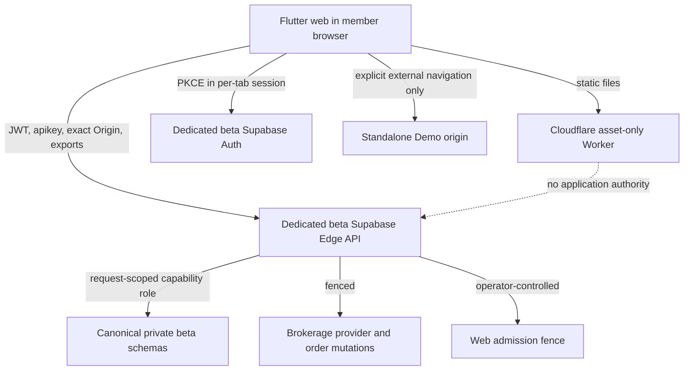
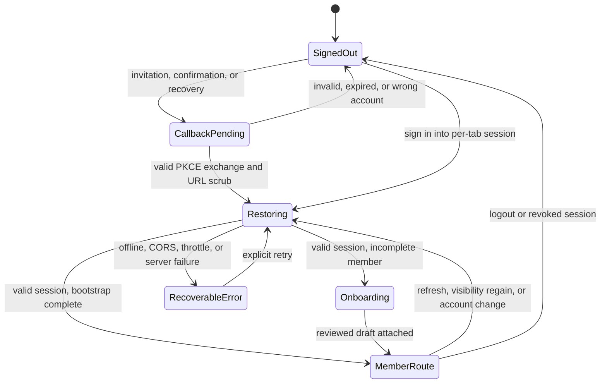
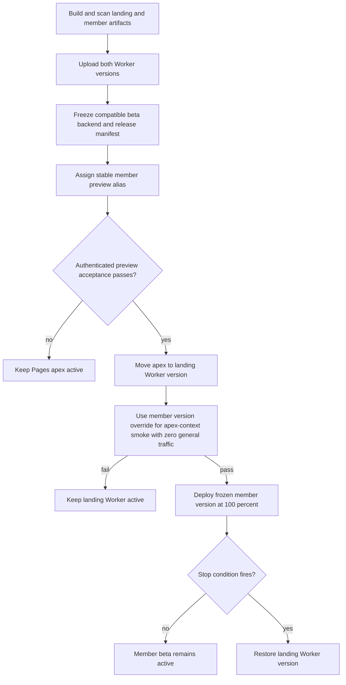

# Public Beta Mobile Web Launch - Plan

## Goal Capsule

- **Objective:** Invited beta members can use the supported Ritual Investing member experience at `https://just-build-this.app` without waiting for the iOS or Android store releases and without gaining access to production data, live brokerage, or order execution.
- **Means:** Ship the Flutter member app as an asset-only Cloudflare Worker and bind it fail-closed to a dedicated non-production beta Supabase Auth, Edge API, and canonical private tables (KTD1, KTD3, KTD4, KTD10).
- **Authority:** Product Requirements in this plan govern launch behavior. `CONCEPTS.md` and the current Ritual Investing product contracts govern domain and security boundaries. KTDs govern implementation within those constraints.
- **Execution profile:** Code changes across Flutter, the retained Edge API, Supabase migrations and hosted configuration, Cloudflare packaging, CI, browser tests, and runbooks.
- **Stop conditions:** Stop the release if the artifact contains a production project reference or elevated key, the browser can query application tables directly, Auth recovery or deletion is unavailable for enabled signup modes, brokerage egress or order mutations are enabled, or the prior landing version cannot be restored.
- **Tail ownership:** The release operator owns artifact promotion and rollback. The Supabase operator owns beta schema, Auth, backup, and Edge configuration. Product/support owns invite eligibility, beta disclosures, feedback, and incident communication.

---

## Product Contract

### Summary

Replace the apex landing experience with the mobile-shaped Flutter member app as a clearly labeled public beta. The browser app uses a dedicated non-production beta Supabase project only. Supported member journeys remain API-backed, while unfinished brokerage journeys stay unavailable or link deliberately to the separately labeled standalone Demo.

### Problem Frame

Waiting for both mobile-store releases delays access to an already substantial member experience. The current member package is native-only, the apex is a static landing page, and the hosted backend still fences live provider and order capabilities. A web launch can shorten the path to users only if it preserves those boundaries and moves real beta identities and privacy requests out of replaceable branch infrastructure.

### Key Decisions

- **Launch mobile web before the native-store releases.** (session-settled: user-directed — chosen over waiting exclusively for iOS and Android approval: release timing is the primary risk.) Governs R1, R3, R12.
- **Use beta services and data only.** (session-settled: user-directed — chosen over production endpoints or tables: the product is incomplete.) Governs R4, R9, R10, R11.
- **Expose the member app at the apex through normal member authentication.** (session-settled: user-approved — chosen over keeping the landing as the apex authority: the confirmed scope makes the website the usable beta entry point.) Governs R1, R7, R11, R13.
- **Keep incomplete capability boundaries visible.** (session-settled: user-approved — chosen over delaying every route or silently substituting fixtures: supported routes can launch while unfinished financial authority remains fenced.) Governs R2, R5, R6.
- **Launch invite-first if open-signup operations are not ready.** This preserves the schedule without exposing an unrecoverable or abuse-prone account flow. Governs R7, R8.

### Requirements

**Delivery and experience**

- R1. `https://just-build-this.app` shall serve the Flutter member beta as static assets with no Cloudflare compute, storage, authentication, or business-state authority.
- R2. Every authenticated surface shall identify the experience as a public beta and state that live brokerage connections, funding, and orders are unavailable.
- R3. The web app shall support mobile Safari and Chrome interaction, browser history, refresh, direct links, virtual keyboards, reduced motion, and a centered mobile-width envelope on wider screens.
- R4. The browser shall use Supabase directly only for Auth in the dedicated beta project, and all application data and export bytes shall traverse the versioned beta Edge API to canonical tables in private schemas.

**Incomplete capability behavior**

- R5. A single reviewed capability matrix shall distinguish beta-backed routes, unavailable routes, and explicit external handoffs to `demo.just-build-this.app`.
- R6. Authentication, authorization, CORS, network, or server failures shall remain failures and shall never trigger fixture data, a simulated repository, a legacy backend, or an automatic Demo redirect.

**Identity and privacy**

- R7. Eligible members shall be able to confirm an invitation, sign in, refresh a same-tab PKCE session, recover a password, sign out across tabs, and complete or resume onboarding through purpose-bound, single-use, exact same-origin callbacks.
- R8. Invite-only launch shall require server-enforced invitation restriction, custom SMTP, invitation delivery, resend, enumeration-resistant recovery, rate limits, deletion, and support ownership; self-service signup additionally requires hosted email confirmation and CAPTCHA or equivalent abuse protection.
- R9. The dedicated beta project shall be treated as non-disposable user infrastructure, with forward-only migrations, documented retention, dated backup and restore evidence, idempotent deletion, session revocation, privacy notice, and incident handling.

**Data and financial safety**

- R10. Beta application tables shall preserve least-privilege roles, RLS defense in depth, indexed ownership and lifecycle predicates, cross-tenant denial, and no `anon` or `authenticated` Data API grants.
- R11. The web artifact, publishable-key fingerprint, hosted Auth settings, Edge secrets, CORS origins, migrations, functions, and seed/content checks shall be exact-target guarded against the dedicated beta project and reject branch or production references.
- R12. Provider egress, brokerage connection mutation, funding, and order mutation shall remain fenced; the existing native member lanes and standalone Demo authority shall remain independent.

**Release and support**

- R13. The exact reviewed member artifact shall pass authenticated preview acceptance before atomic apex promotion, while the prior landing version remains a tested Worker rollback target and the Pages project remains recoverable on its `pages.dev` host during the observation window.
- R14. Privacy, support, about, beta-feedback, and legal information currently reachable from the landing shall remain reachable from the member web experience.
- R15. Release telemetry shall record version, environment, route template, status class, and correlation data without query strings, fragments, tokens, callback codes, signed URLs, user identifiers, financial payloads, or personal onboarding content.

### Success Criteria

- An invited member can confirm access, sign in, finish or resume onboarding in the same tab, complete `/v1/session/bootstrap`, refresh the browser, and return to the intended supported route on current mobile Safari and Chrome.
- A browser network trace contains only the apex, the exact beta Supabase origin, and approved first-party static resources; it contains no production, Webull, legacy API, third-party analytics, or resource-CDN request.
- Hosted beta acceptance proves tenant isolation, private-schema grants, RLS, content readiness, Auth redirects, CORS preflight, bodyless bootstrap, privacy export, completed deletion or a verified manual completion SLA, and all financial fences.
- The release operator can restore the recorded landing Worker version without changing Supabase data or reintroducing a legacy backend.

### Actors

| ID | Actor | Responsibility |
|---|---|---|
| A1 | Beta member | Authenticates, onboards, uses supported routes, manages privacy, and sees accurate capability status. |
| A2 | Release operator | Builds, scans, previews, promotes, observes, and rolls back an immutable web artifact. |
| A3 | Supabase operator | Owns the dedicated beta project, Auth settings, secrets, migrations, backups, and hosted acceptance. |
| A4 | Product/support owner | Controls invitations or signup readiness, beta disclosures, support, and incident communication. |
| A5 | Cloudflare | Serves versioned static assets and the apex custom domain without application authority. |

### Key Flows

- F1. New invited member entry
  - **Trigger:** A1 opens an exact invitation or confirmation link.
  - **Steps:** Worker serves the SPA; the app validates callback purpose and single-use transaction state; Supabase exchanges the PKCE code; the app replaces the callback URL; the member completes or resumes onboarding; the Edge API bootstraps the member.
  - **Outcome:** A1 reaches the supported member shell or a specific recoverable error.
  - **Covered by:** R1, R2, R4, R7, R8, R11.
- F2. Returning member restore and direct link
  - **Trigger:** A1 opens the apex, refreshes, or follows a supported route bookmark.
  - **Steps:** The app restores then refreshes the same-tab session; resolves an allowlisted route identifier rather than a callback URL; bootstraps against the beta API; routes to onboarding or the intended member screen.
  - **Outcome:** The direct route survives auth or the member receives a clear signed-out, offline, forbidden, or retryable state.
  - **Covered by:** R3, R4, R6, R7.
- F3. Supported and unavailable capabilities
  - **Trigger:** A1 opens a product route after bootstrap.
  - **Steps:** The capability matrix selects an API-backed route or a labeled unavailable state; an optional Demo handoff requires an explicit action and origin change.
  - **Outcome:** No incomplete financial control appears executable and no failure becomes simulation.
  - **Covered by:** R2, R5, R6, R12.
- F4. Privacy lifecycle
  - **Trigger:** A1 requests an export or deletion.
  - **Steps:** The Edge API streams authorized export bytes or owns an idempotent deletion state machine; the web adapter downloads verified bytes or reports a blocked download; fresh authentication protects both actions.
  - **Outcome:** A1 sees an accurate terminal state and browser resources are released.
  - **Covered by:** R4, R7, R9, R15.
- F5. Preview, apex promotion, and rollback
  - **Trigger:** A2 receives a passing immutable artifact and compatible beta backend revision.
  - **Steps:** A2 verifies the member version and frozen release manifest at the stable preview alias; migrates the landing to the asset-only Worker; uses an apex version override with zero general member traffic for domain-context smoke; promotes the same member version at 100%; observes; contains backend traffic or restores the landing version if a stop condition fires.
  - **Outcome:** The apex runs one coherent asset version, and rollback does not mutate Supabase.
  - **Covered by:** R1, R11, R13, R15.

### Acceptance Examples

- AE1. **Covers R4, R7, R11.** Given an invited beta member on the stable preview origin, when a purpose-matched, unexpired, single-use confirmation callback succeeds, then history replacement removes all auth parameters and the member reaches onboarding or an allowlisted safe route using the dedicated beta session.
- AE2. **Covers R6.** Given a valid member session and a beta API `403`, when a supported route loads, then the UI shows the forbidden state and makes no fixture, Demo, production, or legacy request.
- AE3. **Covers R5, R12.** Given provider egress and order mutation are fenced, when the member opens an investing route, then connect and order controls are absent or disabled with a beta explanation and any Demo link is explicit and external.
- AE4. **Covers R7.** Given a tab has slept beyond the 900-second JWT lifetime or returns from back/forward cache, when the member resumes, then the session is revalidated before private UI paints and the current token is used for the next API request.
- AE5. **Covers R3, R7.** Given a signed-out member opens a supported deep link, when authentication completes, then an allowlisted route identifier is restored; a foreign, scheme-relative, encoded, oversized, or malformed destination resolves to a safe default.
- AE6. **Covers R4, R10.** Given two beta members, when either attempts to access the other's record through the Edge API or Supabase Data API, then the Edge request is denied and browser roles have no application-schema table privilege.
- AE7. **Covers R11, R13.** Given a reviewed member version is live at the apex, when rollback is invoked, then the recorded landing Worker version becomes active and remains compatible with the unchanged beta backend.
- AE8. **Covers R8.** Given invite-only mode, when an uninvited visitor calls signup directly or opens account creation, then Supabase and the UI reject account creation without disclosing whether an email is registered and offer an invitation or waitlist path.
- AE9. **Covers R9, R14.** Given a beta member completes deletion, when any old tab resumes or bootstrap retries, then all sessions and browser state are cleared, member recreation is denied, and retention or backup exceptions remain visible through the documented support path.

### Scope Boundaries

**In scope**

- The member Flutter web target, browser-specific platform adapters, auth lifecycle, mobile-browser usability, and supported-route capability composition.
- Persistent beta Supabase configuration, additive database/API readiness, private-table security proof, hosted synthetic content readiness, and real-user operational safeguards.
- An asset-only Cloudflare Worker, stable preview, apex migration, release automation, rollback, browser acceptance, and updated product/runbook authority.

**Outside this product's identity**

- Direct browser access to application or brokerage tables.
- Cloudflare application compute, session authority, queues, storage, or business logic.
- Embedded or automatic standalone Demo behavior inside the authenticated member app.
- Live brokerage credentials, provider egress, funding, or order execution.

### Deferred to Follow-Up Work

- Open self-service signup if the invite-first launch ships before every R8 gate passes.
- Installable PWA behavior, offline mutation support, push notifications, a service worker, and a desktop-specific information architecture.
- Production Supabase promotion, production brokerage enablement, and the iOS or Android store release work.

### Sources / Research

- `CONCEPTS.md`
- `ritual-investing-app/PRODUCT.md`
- `ritual-investing-site/PRODUCT.md`
- `docs/ritual-investing/member-data-inventory.md`
- `docs/ritual-investing/member-release-gates.md`
- `docs/ritual-investing/production-launch-gates.md`
- `docs/solutions/architecture-patterns/ritual-investing-app-current-intent-and-architecture.md`
- `docs/solutions/integration-issues/empty-bootstrap-post-rejected-at-cloudflare-edge.md`
- [Cloudflare Pages-to-Workers migration](https://developers.cloudflare.com/workers/static-assets/migration-guides/migrate-from-pages/)
- [Cloudflare SPA routing](https://developers.cloudflare.com/workers/static-assets/routing/single-page-application/)
- [Cloudflare versions and deployments](https://developers.cloudflare.com/workers/versions-and-deployments/)
- [Cloudflare static asset headers](https://developers.cloudflare.com/workers/static-assets/headers/)
- [Supabase branch isolation for staging](https://supabase.com/docs/guides/deployment/branching/working-with-branches)
- [Supabase redirect URLs](https://supabase.com/docs/guides/auth/redirect-urls)
- [Supabase PKCE flow](https://supabase.com/docs/guides/auth/sessions/pkce-flow)
- [Supabase Edge Function CORS](https://supabase.com/docs/guides/functions/cors)
- [Supabase API security](https://supabase.com/docs/guides/api/securing-your-api)
- [Supabase RLS guidance](https://supabase.com/docs/guides/database/postgres/row-level-security)
- [Supabase Data API exposure change](https://supabase.com/changelog/45329-breaking-change-tables-not-exposed-to-data-and-graphql-api-automatically)
- [Supabase OpenAPI access change](https://supabase.com/changelog/42949-breaking-change-removing-access-to-openapi-spec-via-the-anon-key)

---

## Planning Contract

### Key Technical Decisions

- KTD1. **Use Cloudflare Workers Static Assets for the apex.** Configure an asset-only Worker with SPA fallback and no `main`, `ASSETS` binding, Pages Function, or other compute. Accept SPA fallback for unmatched asset paths and prove a complete atomic asset set instead of adding routing compute. Migrate the landing to a Worker version before member promotion so frontend rollback remains a Worker version operation. This implements R1 and R13.
- KTD2. **Build in GitHub Actions with pinned toolchains.** Cloudflare's build image does not include Flutter, so CI shall produce and scan the Flutter artifact with the repository's pinned Flutter and Wrangler versions before any upload. This implements R11 and R13.
- KTD3. **Make the beta binding fail closed.** Runtime and release validation shall require an explicit beta environment identity, the exact dedicated Supabase project URL and publishable-key fingerprint, the same host for Auth and Edge API, the exact `/functions/v1/api` path, and the absence of branch and production references. This implements R4 and R11. (session-settled: user-directed — chosen over environment-agnostic HTTPS values: the incomplete release must not mix beta and production resources.)
- KTD4. **Keep all application data behind the Edge API.** The web browser may use Supabase directly only for Auth. Export bytes and every application read or write use the Edge API, whose request-scoped non-`BYPASSRLS` roles retain access to canonical relations in private schemas; browser roles receive no application grants. This implements R4 and R10.
- KTD5. **Add conditional web platform composition with a per-datum persistence policy.** Preserve native adapters. Store the Supabase session and PKCE verifier in per-tab session storage, keep private UI state in memory except for the explicitly minimal onboarding draft retained in that same-tab store, and use cross-tab messages only as logout or account-change signals. Retained consent state requires review and never restores consent authority; the installation identifier is a cleanup namespace, not a security boundary. This implements R3, R7, R9, and R12.
- KTD6. **Bind callbacks and CORS to exact transactions and origins.** Web confirmation and recovery use separate SPA routes with purpose, issued-at, single-use state, and an allowlisted route identifier before history replacement. Edge CORS reflects only the matched apex or stable preview origin while preserving authenticated originless native clients; bearer credentials are never accepted in cookies, query parameters, or bodies. This implements R7, R8, and R11.
- KTD7. **Centralize incomplete capability state.** A reviewed capability manifest controls route visibility and financial affordances. Beta-backed flows retain production repositories; unavailable flows do not instantiate simulated providers. This implements R5, R6, and R12. (session-settled: user-approved — chosen over a blanket delay or error-driven simulation: incomplete scope must remain visible without becoming false authority.)
- KTD8. **Generate a member-specific static policy.** The artifact assembler shall allow only the exact beta public origin and key fingerprint, keep entry assets revalidating, and reject source maps, service workers, remote Flutter resources, third-party scripts, and direct provider hosts. Enforced CSP starts from `default-src 'none'`, denies base, object, and frame authority, and adds only hash- or trace-proven directives. Callback responses use `no-store` and `Referrer-Policy: no-referrer`. This implements R1, R11, R13, and R15.
- KTD9. **Freeze and promote one release manifest.** Bind the artifact digest and Worker version to the beta project, schema, Edge, Auth, CORS, content, fence, backup, and Git fingerprints. Accept it on the stable preview alias, use an apex version override with zero general member traffic for domain-context smoke, then atomically deploy that version at 100 percent. Any bound change invalidates acceptance. This implements R13 and R15.
- KTD10. **Use a dedicated beta project for real members.** Persistent branches remain replaceable staging infrastructure. Provision a dedicated non-production project before invitations, apply the same migration-owned schema and beta records, and require dated database and configuration recovery evidence. This implements R9 through R11.
- KTD11. **Keep a server-side web admission fence.** Independently of the static artifact, operators can stop new web bootstrap and non-privacy mutations while retaining authenticated export, deletion, support, and logout paths. This implements R9, R12, R13, and R15.

### Assumptions and Resolved Defaults

- The configured hosted branch reference `zbgjjufjkhfhirbuuolv` is a staging and migration-validation source only. Implementation must allocate and verify the exact dedicated beta project before any invitation is sent.
- The Cloudflare zone for `just-build-this.app` is managed in the account that owns the current Pages custom domain.
- The stable Worker preview alias is the only non-apex origin allowed to perform authenticated integration. Generic per-version preview URLs remain backend-disabled.
- Invite-only access is sufficient for the first apex release, but it does not defer SMTP, invitation, resend, recovery, support, deletion, or abuse-rate acceptance. Open signup may activate only if the additional R8 gates pass.
- Realtime is not required for this launch. Do not add a WebSocket CSP origin unless an observed supported flow proves it necessary.
- The beta database uses canonical schema and table names with beta-only records. It does not create parallel `*_beta` tables.

### High-Level Technical Design

The component topology keeps Cloudflare as a static origin and Supabase as the only backend authority.

The browser session and route lifecycle prevents callbacks or stale tokens from bypassing the entry coordinator.

The rollout separates the domain migration from the member application promotion.

### System-Wide Impact

- **Authority:** The apex changes from acquisition-only landing authority to member delivery, but backend authority remains in Supabase.
- **Identity:** Per-tab session persistence, purpose-bound callback routing, recovery, back/forward-cache revalidation, and signal-only cross-tab events become first-class alongside native links.
- **Data lifecycle:** A dedicated beta project stores durable member identities, onboarding choices, exports, and deletion requests; the persistent branch remains replaceable staging infrastructure.
- **Network security:** The current single consumer origin becomes a bounded exact-origin set for apex and stable preview only.
- **Release engineering:** CI gains a protected web artifact and version-promotion lane while native and Demo jobs remain mandatory regressions.
- **Operations:** Rollback restores static assets only. It never reverses schema, Edge Function, Auth, or user-data changes.

### Alternatives Considered

| Alternative | Decision | Reason |
|---|---|---|
| Keep the member app on Cloudflare Pages | Rejected for the new member surface | Pages remains supported, but current Cloudflare guidance directs new static apps to Workers Static Assets and Workers versions give the desired preview and promotion model. |
| Cut directly from Pages landing to the member Worker | Rejected | Migrating the landing to a Worker version first creates a same-platform rollback target and isolates domain risk from application risk. |
| Expose beta tables to the browser | Rejected | It would violate existing private-schema, request-transaction, and tenant boundaries. |
| Embed standalone Demo fixtures in the member app | Rejected | It would blur synthetic and authoritative data and weaken existing dependency-boundary tests. |
| Wait for open-signup readiness before any web launch | Rejected | Invite-first access delivers the requested schedule while keeping account-lifecycle gates intact. |
| Store real beta members in the persistent Supabase branch | Rejected | Persistent branches are replaceable staging infrastructure; a dedicated beta project provides an appropriate durable target and recovery posture. |

### Risks and Mitigations

| Risk | Mitigation |
|---|---|
| Pages-to-Worker custom-domain cutover causes apex downtime | Move the tested landing version first, record DNS and domain state, keep Pages on `pages.dev`, and define a bounded maintenance window. |
| Browser artifact mixes beta and production values | Cross-field runtime validation plus binary/string artifact scans reject mismatched hosts, production refs, and elevated keys. |
| Invite or recovery email strands members | Block all member promotion until hosted custom SMTP, invitation, resend, recovery, and support acceptance passes; invite-only defers only open-signup gates. |
| Browser storage exposes a shared-device session | Use per-tab session storage, in-memory private state, strict CSP, no third-party script, account-scoped clearing, signal-only cross-tab logout, and shared-device disclosure. |
| SPA fallback turns missing assets into HTML | Preserve the asset-only boundary and require a complete manifest, correct MIME for every referenced asset, atomic version promotion, entry revalidation, and critical-load-failure monitoring. |
| A rollback web version cannot use the evolved beta API | Keep schema and Edge changes additive and compatible through the observation window; exercise rollback before promotion. |
| Public-beta data is lost with replaceable branch infrastructure | Provision a dedicated beta project and enforce exact-target, forward-only, backup, retention, restore, and emergency admission controls. |
| Callback or signed-URL data leaks through requests or logs | Use purpose-bound callbacks, history replacement, no-referrer/no-store headers, Edge-streamed exports, route-template telemetry, and log-retention proof. |
| Financial capability appears live | Central capability matrix, visible disclosures, provider fences, network allowlist, and mutation-denial tests remain launch gates. |

---

## Implementation Units

### U1. Establish public-beta product and capability authority

- **Goal:** Align product contracts and operating documentation on the apex member beta, invite-first entry, supported routes, and unavailable financial authority.
- **Requirements:** R2, R5, R6, R8, R12, R14.
- **Dependencies:** None.
- **Files:**
  - `ritual-investing-app/PRODUCT.md`
  - `ritual-investing-app/README.md`
  - `ritual-investing-site/PRODUCT.md`
  - `docs/ritual-investing/member-data-inventory.md`
  - `docs/ritual-investing/member-release-gates.md`
  - `docs/ritual-investing/production-launch-gates.md`
- **Approach:**
  1. Amend the delivery authority so Cloudflare may host the static member beta without gaining backend authority.
  2. Publish the capability matrix terms used by KTD7: beta-backed, unavailable, and explicit standalone Demo handoff.
  3. Define invite-first entry and the R8 evidence required before self-service signup is enabled.
  4. Preserve the production NO-GO for provider egress, funding, and order execution.
- **Patterns to follow:** `CONCEPTS.md`; `docs/solutions/architecture-patterns/ritual-investing-app-current-intent-and-architecture.md`.
- **Test scenarios:** Test expectation: none -- this unit changes normative documentation; enforcement tests land with U2, U5, and U6.
- **Verification:** Product, app, site, data inventory, and release-gate documents name one consistent web, beta, Demo, and brokerage authority model.

### U2. Prepare the exact beta API and private database boundary

- **Goal:** Make the hosted beta API callable from the apex and stable preview while preserving private-table access, tenant isolation, content readiness, and financial fences.
- **Requirements:** R4, R6, R9 through R12, R15.
- **Dependencies:** U1.
- **Files:**
  - `ritual-investing-api/src/domains/retained-http/types.ts`
  - `ritual-investing-api/src/retained-app.ts`
  - `ritual-investing-api/test/edge/api-edge-integration.test.ts`
  - `supabase/functions/api/index.ts`
  - `supabase/tests/architecture_contract.test.sql`
  - `supabase/tests/grants_and_rls.test.sql`
  - `supabase/tests/hosted_readiness.test.sql`
  - `supabase/migrations/YYYYMMDDHHMMSS_public_beta_readiness.sql`
  - `.github/workflows/ritual-investing-supabase-remediation.yml`
- **Approach:**
  1. Provision the dedicated beta project from migration-owned schema and synthetic beta records; keep the persistent branch as staging and reject both branch and production refs in public release inputs.
  2. Replace the single consumer origin input with a parsed, bounded set that accepts only the exact apex and stable preview origins and reflects only a matched origin.
  3. Keep `ARGUS_ADMIN_ORIGIN` independent; reject wildcard, `null`, foreign, and generic preview origins before web mutation while preserving authenticated originless native requests.
  4. Accept user credentials only as a verified beta JWT in `Authorization: Bearer`; validate issuer, audience, algorithm, expiry, not-before, subject, and account binding independently of CORS.
  5. Run database work in a request transaction under non-`BYPASSRLS` capability roles with local verified claims; add only forward-compatible grants, policies, or indexes and no parallel beta tables or browser grants.
  6. Add KTD11 admission control and keep privacy, support, and logout reachable during containment.
  7. Extend protected deployment checks so project, schema, Edge, Auth, CORS, content, role, RLS, index, backup, admission, and financial-fence fingerprints are evidenced together.
  8. Keep generated API contracts sourced from the committed spec or authorized CI retrieval rather than anonymous OpenAPI discovery.
- **Execution note:** Start with failing edge-shaped CORS and bodyless-bootstrap tests, then prove the same cases against the exact hosted beta target.
- **Patterns to follow:** `ritual-investing-api/test/edge/api-edge-integration.test.ts`; `supabase/migrations/20260828054740_argus_private_baseline.sql`; `supabase/tests/architecture_contract.test.sql`.
- **Test scenarios:**
  - Apex and stable preview `OPTIONS` requests receive the matched origin, allowed methods and headers, and `Vary: Origin`; credentials remain disabled.
  - Foreign, wildcard-like, `null`, missing-config, and generic version-preview origins fail closed without an allow-origin header.
  - A foreign-origin request with a bearer token and a foreign-origin simple-form mutation both fail; an originless native request with a valid token retains its existing behavior.
  - `/v1/session/bootstrap` accepts both a null body and an explicit zero-length stream, while non-empty invalid bodies retain contract behavior.
  - Missing, expired, not-yet-valid, wrong-issuer, wrong-audience, wrong-project, wrong-account, and request-body-substituted identities fail without application data.
  - Browser roles have no schema, table, view, RPC, or default privilege in application schemas; cross-user reads, mutations, exports, and deletion requests are denied.
  - Capability roles do not bypass RLS, `SECURITY DEFINER` objects have fixed safe search paths, and request-local claims cannot survive transaction scope.
  - Representative ownership, lifecycle, foreign-key, and policy predicates use the intended indexes under hosted data shape.
  - Hosted checks fail when required published beta content is absent, existing durable counts change unexpectedly, the project fingerprint drifts, or provider egress or order mutation is enabled.
  - The web admission fence blocks bootstrap and non-privacy mutations but preserves authenticated export, deletion, support, and logout.
- **Verification:** Local pgTAP, API tests, database lint, Security and Performance Advisors, and protected hosted acceptance all pass against the exact dedicated beta project without destructive seed or reset.

### U3. Add a web-safe Flutter platform composition

- **Goal:** Make the production member dependency graph compile and behave on web without weakening native storage, links, or export behavior.
- **Requirements:** R1, R3, R4, R9, R12.
- **Dependencies:** U1.
- **Files:**
  - `ritual-investing-app/web/index.html`
  - `ritual-investing-app/web/manifest.json`
  - `ritual-investing-app/lib/core/bootstrap/production_dependency_container.dart`
  - `ritual-investing-app/lib/features/onboarding/data/onboarding_draft_store.dart`
  - `ritual-investing-app/lib/features/onboarding/data/onboarding_installation_binding_io.dart`
  - `ritual-investing-app/lib/features/onboarding/data/onboarding_installation_binding_web.dart`
  - `ritual-investing-app/lib/features/privacy/data/private_export_files.dart`
  - `ritual-investing-app/lib/features/privacy/data/private_export_files_io.dart`
  - `ritual-investing-app/lib/features/privacy/data/private_export_files_web.dart`
  - `ritual-investing-app/test/onboarding_draft_store_test.dart`
  - `ritual-investing-app/test/private_export_files_test.dart`
  - `ritual-investing-app/test/web_platform_composition_test.dart`
- **Approach:**
  1. Add the Flutter web scaffold with no PWA service worker, remote resource CDN, or third-party bootstrap script.
  2. Move filesystem installation binding and file-sharing behavior behind conditional platform entry points.
  3. Give web a cleanup-only installation namespace, keep sensitive onboarding fields and consent in same-tab session state, and clear them after attachment, logout, account change, corruption, or tab close.
  4. Implement browser download for Edge-streamed export bytes with fixed safe attachment metadata, checksum and size verification, object-URL cleanup, blocked-download feedback, and retry while the server operation remains valid.
  5. Keep native adapter construction and existing native tests unchanged except for shared platform-neutral corrections.
- **Execution note:** Prove a web build with the production member composition before adding deployment packaging.
- **Patterns to follow:** Existing `InstallationBinding` and `PrivateExportFiles` ports; conditional Dart platform libraries already used elsewhere in the repository.
- **Test scenarios:**
  - A same-tab reload restores the minimal draft, while consent requires review; a new tab, browser restart, corrupt payload, logout, or user change cannot restore sensitive fields.
  - An export creates a downloadable browser object, releases its URL and memory after completion, and reports a blocked or canceled download without claiming success.
  - The web composition contains no `dart:io` path and constructs no native `AppLinks`, filesystem, or share adapter.
  - iOS and Android production composition retains its current secure-storage, app-link, temporary-file, and share behavior.
- **Verification:** Flutter analysis, native unit coverage, web-specific tests, and a release web build all pass from the production member entry point.

### U4. Complete browser auth, callbacks, session refresh, and routing

- **Goal:** Deliver a recoverable browser identity lifecycle that preserves safe route intent and never leaks callback credentials into history or logs.
- **Requirements:** R3, R7 through R9, R11, R15.
- **Dependencies:** U2, U3.
- **Files:**
  - `ritual-investing-app/lib/core/config/runtime_config.dart`
  - `ritual-investing-app/config/beta.json`
  - `ritual-investing-app/lib/core/auth/member_auth.dart`
  - `ritual-investing-app/lib/core/auth/supabase_session_repository.dart`
  - `ritual-investing-app/lib/core/auth/auth_controller.dart`
  - `ritual-investing-app/lib/core/navigation/app_router.dart`
  - `ritual-investing-app/lib/features/auth/presentation/member_sign_in_screen.dart`
  - `ritual-investing-app/test/runtime_config_test.dart`
  - `ritual-investing-app/test/supabase_session_repository_test.dart`
  - `ritual-investing-app/test/app_router_test.dart`
  - `ritual-investing-app/test/web_auth_config_test.dart`
- **Approach:**
  1. Enforce KTD3 across beta environment identity, Supabase URL, Edge URL, path, and publishable-key shape.
  2. Add exact web confirmation and recovery callback routes while preserving native callbacks; bind purpose, issue time, single-use state, and an allowlisted route identifier before history replacement.
  3. Remove the fixed browser initial location, reject arbitrary callback URLs, and provide a client not-found route.
  4. Make PKCE, per-tab session storage, URI detection, refresh serialization, refresh-token reuse failure, and auth-listener error handling explicit; never send tokens through cross-tab messages.
  5. Acquire the current access token for every generated API request or update it on `tokenRefreshed`; revalidate on persisted `pageshow`, visibility regain, logout, revocation, or account change before private UI paints.
  6. Clear all account-scoped caches before painting another account and use cross-tab events only to trigger each tab to re-read its own SDK session.
  7. Add invitation confirmation, resend, forgot-password, recovery, and set-new-password states; enforce invite-only status in hosted Auth rather than only hiding signup UI.
- **Execution note:** Implement callback, refresh, and direct-route behavior test-first because they cross browser, Auth, router, and API boundaries.
- **Patterns to follow:** `MemberNativeLinkPolicy`; `EntryCoordinator`; existing wrong-account and restored-session tests.
- **Test scenarios:**
  - Valid purpose-matched confirmation and recovery callbacks exchange once, replace the URL, and route by allowlisted identifier or safe default.
  - Duplicate keys, mixed purposes, replay, expiry, wrong account, scheme-relative, backslash, encoded, oversized, control-character, and foreign destinations fail without logging credentials.
  - A direct supported route survives sign-in, confirmation, refresh, and browser reload; an unknown route reaches the client not-found screen.
  - A cached expired startup session cannot authorize an API call; a refreshed token after more than 15 minutes succeeds.
  - Cloned tabs and simultaneous refresh either serialize safely or fail back to sign-in without token reuse; cross-tab messages contain no token or private payload.
  - Logout, revocation, deletion, or account change in one tab clears private state in every tab; Back, Forward, or suspended-tab resume shows no frame of the prior account.
  - In invite-only mode, direct unauthenticated signup is rejected without enumeration; when open signup is enabled, confirmation, CAPTCHA, resend, rate-limit, recovery, and deletion gates are all active.
- **Verification:** Hosted beta Auth configuration lists only exact apex, stable preview, and native callbacks; the complete browser lifecycle passes without token, code, or personal-data leakage.

### U5. Compose beta capabilities and mobile-browser behavior

- **Goal:** Present supported member routes as authoritative beta data and unfinished financial routes as visibly unavailable, with mobile-browser usability and privacy support.
- **Requirements:** R2, R3, R5, R6, R12, R14.
- **Dependencies:** U3, U4.
- **Files:**
  - `ritual-investing-app/lib/core/bootstrap/production_member_feature_scope_factory.dart`
  - `ritual-investing-app/lib/features/shell/presentation/app_shell.dart`
  - `ritual-investing-app/lib/core/navigation/app_router.dart`
  - `ritual-investing-app/test/feature_state_test.dart`
  - `ritual-investing-app/test/production_financial_boundary_test.dart`
  - `ritual-investing-app/test/demo_dependency_boundary_test.dart`
  - `ritual-investing-app/test/accessibility_test.dart`
  - `ritual-investing-app/integration_test/member_web_experience_test.dart`
- **Approach:**
  1. Implement KTD7 at the production feature-scope seam so route visibility and controls derive from one reviewed manifest.
  2. Keep supported Ritual, Discover, Coven, You, community, identity, and privacy repositories on the generated beta API path.
  3. Hide provider connection and order entry or render a non-actionable unavailable state with an optional explicit standalone Demo link.
  4. Add persistent public-beta, source, freshness, privacy, support, and no-live-brokerage disclosures without importing Demo dependencies.
  5. Require fresh authentication and a server-owned idempotent state machine for export and deletion; completed deletion revokes sessions, prevents bootstrap recreation, and clears pending exports and browser state.
  6. Constrain wide viewports to a centered mobile envelope and verify focus, keyboard, safe area, history, refresh, landscape, 200 percent text, and reduced motion.
- **Execution note:** Preserve the existing Demo and production-financial boundary tests before changing route composition.
- **Patterns to follow:** Existing retryable/stale/forbidden feature states; `AppShell` bottom navigation; `accessibility_test.dart` viewport and semantics coverage.
- **Test scenarios:**
  - A beta-backed route displays API data with source/freshness semantics and preserves empty, stale, offline, forbidden, throttle, and retry states.
  - A `401`, `403`, `429`, network failure, or `5xx` never imports fixtures, changes authority, or navigates to Demo.
  - Provider and order capabilities show no executable control while their server fences are closed.
  - An explicit Demo action announces the external synthetic experience and opens only `demo.just-build-this.app` after member action.
  - A stale or recovery-only session cannot export or delete; completion revokes sessions and later bootstrap cannot recreate the deleted member.
  - Sign-in and onboarding remain usable with a mobile keyboard, narrow landscape, safe-area change, 200 percent text, reduced motion, and browser back/forward.
  - Desktop Chrome and Safari render the centered mobile shell without a new desktop navigation model.
- **Verification:** Widget, boundary, accessibility, and Chrome integration coverage proves the reviewed matrix and mobile browser journeys while native member tests remain green.

### U6. Build the member-specific Cloudflare Worker artifact

- **Goal:** Produce a versioned, asset-only member bundle with exact network, CSP, cache, routing, and secret-scan policy while preserving independent landing and Demo policies.
- **Requirements:** R1, R3, R11, R13 through R15.
- **Dependencies:** U3 through U5.
- **Files:**
  - `ritual-investing-site/wrangler.jsonc`
  - `ritual-investing-site/scripts/build-assets.ts`
  - `ritual-investing-site/test/build-assets.test.ts`
  - `ritual-investing-site/test/config.test.ts`
  - `ritual-investing-site/test/browser/network-boundary.spec.ts`
  - `ritual-investing-site/test/browser/member-web.spec.ts`
  - `ritual-investing-site/package.json`
- **Approach:**
  1. Convert the apex configuration from `pages_build_output_dir` to asset-only Worker `assets.directory` and version-specific SPA fallback, without a Worker script or binding.
  2. Add a `member-beta` assembly surface that consumes the already-built Flutter output and keeps landing and Demo scans unchanged.
  3. Permit only the exact dedicated beta Supabase origin and key fingerprint; reject branch and production refs, other publishable keys, secret and service-role shapes, direct Webull hosts, legacy APIs, compute entry points, oversized assets, source maps, service workers, and remote Flutter resources.
  4. Generate member `_headers` with frame denial, `nosniff`, `no-referrer`, restrictive permissions, `noindex`, and a CSP that starts from KTD8's deny baseline before trace-proven additions move from report-only to enforcement.
  5. Keep HTML, bootstrap, manifest, JSON, WASM, and callback resources revalidating; make only verified content-fingerprinted assets immutable.
  6. Require SPA fallback for application routes and a complete asset manifest whose referenced files return the correct content type and digest; do not introduce routing compute solely for missing-asset `404` behavior.
  7. Normalize browser and infrastructure telemetry before collection so callback, recovery, export, CSP-report, and error flows never retain queries, fragments, identifiers, headers, bodies, or authorization material.
- **Execution note:** Treat packaging as an allowlist exercise driven by the built artifact and browser trace, not by broad exceptions to the existing provider scan.
- **Patterns to follow:** Existing landing/Demo artifact assembler, exact CSP generation, asset manifest, size cap, and no-source-map assertions.
- **Test scenarios:**
  - A valid beta member build passes with only the expected public beta URL, Edge path, and publishable key.
  - Production refs, elevated key shapes, direct provider hosts, unexpected origins, remote CanvasKit resources, service workers, source maps, `_worker.js`, and Pages Functions fail the build.
  - Entry and callback routes receive SPA HTML and security headers; every manifest-referenced asset returns its expected MIME type and digest from the same version.
  - Enforced CSP contains no wildcard, broad `data:`, `unsafe-inline`, or `unsafe-eval`; any required hash, `blob:`, worker, or WASM directive has a dedicated trace and test.
  - Callback, recovery, export, CSP-report, and failure traces leave no code, token, signed URL, query, fragment, email, or account identifier in browser, Cloudflare, Supabase, CI, or application telemetry.
  - Landing, Demo, and Demo-beta builds retain their previous stricter network and authority contracts.
- **Verification:** Site typecheck, unit tests, browser tests, Wrangler validation, artifact inventory, and a clean browser console prove the member surface without relaxing adjacent surfaces.

### U7. Add protected web build, preview, and promotion automation

- **Goal:** Make every member web release reproducible, exact-target bound, reviewable at a stable preview alias, and atomically promotable or rollbackable.
- **Requirements:** R11, R13, R15.
- **Dependencies:** U2, U4, U6.
- **Files:**
  - `.github/workflows/ritual-investing.yml`
  - `.github/workflows/ritual-investing-web-release.yml`
  - `ritual-investing-site/test/ci-workflow.test.ts`
  - `scripts/check-legacy-backend-removal.sh`
- **Approach:**
  1. Add a member-web CI job using the pinned Flutter 3.47.1 and Wrangler 4.125.0 toolchains and the checked-in beta define file.
  2. Build without source maps, remote web resources, PWA service worker, or WASM dry-run and pass the output through U6 policy before artifact upload.
  3. Keep Cloudflare and Supabase mutation credentials unavailable to pull requests.
  4. Add a manual, protected release workflow serialized with the Supabase workflow under one release-wide lock and accepting only the recorded artifact digest, exact Worker, dedicated beta project, and explicit upload or deploy action.
  5. Produce a checksum-bound release manifest covering Git revision, artifact, Worker, project, schema, Edge, Auth, CORS, content, fences, and backup evidence; any later change invalidates preview acceptance.
  6. Upload a stable `beta` preview alias, freeze its Worker version and manifest, and deploy only that version at 100 percent after the apex-context override smoke.
  7. Retain and revalidate the landing rollback version within Cloudflare's rollback window and prohibit unrelated uploads during observation.
  8. Resolve the existing CI contract mismatch around the absent hosted-development job without granting ordinary CI remote mutation authority.
- **Execution note:** The release workflow must promote an existing version; it must not rebuild during production deployment.
- **Patterns to follow:** `.github/workflows/ritual-investing-supabase-remediation.yml` exact-target guard, concurrency, environment protection, and evidence artifact.
- **Test scenarios:**
  - Pull requests build and scan the member artifact but cannot reach Cloudflare or mutate hosted Supabase.
  - A wrong Worker name, branch or production ref, unknown artifact digest, stale manifest fingerprint, unreviewed version, or concurrent backend/frontend release fails before mutation.
  - Preview upload records the stable alias and version without changing apex traffic.
  - Deployment promotes the recorded version at 100 percent and records the prior stable version for rollback.
  - Landing, member web, Demo web, Android, iOS, API, generated client, and local database regression jobs remain independently visible.
- **Verification:** CI workflow contract tests pass and a protected dry run produces checksum-bound evidence without mutating apex traffic.

### U8. Execute hosted acceptance, apex migration, observation, and rollback rehearsal

- **Goal:** Launch the tested member beta at the apex with a bounded domain migration, complete operational evidence, and a proven static rollback.
- **Requirements:** R7 through R15.
- **Dependencies:** U2 through U7.
- **Files:**
  - `docs/ritual-investing/cloudflare-runbook.md`
  - `docs/ritual-investing/site-demo-runbook.md`
  - `docs/ritual-investing/supabase-operations-runbook.md`
  - `docs/ritual-investing/deployment-handoff.md`
  - `docs/ritual-investing/member-release-gates.md`
- **Approach:**
  1. Record Pages custom-domain and DNS state, landing and member artifacts, dedicated beta project and schema fingerprints, Auth, CORS, content, durable counts, privacy queues, fence states, backup freshness, restore-drill validity, RPO/RTO, quotas, and named owners.
  2. Apply only additive backend changes and prove old-Edge/new-schema plus new-Edge/new-schema compatibility before admitting web traffic; any destructive rewrite or backfill requires a separate migration plan.
  3. Freeze the checksum-bound release manifest, assign the stable member preview alias, and run invited-member, recovery, bootstrap, privacy, tenant-denial, financial-fence, mobile-accessibility, cache, and network acceptance before any domain move.
  4. Upload and verify the landing Worker version, detach the Pages apex, attach the Worker custom domain, and keep the landing active through a domain soak that proves DNS, TLS, root, callback, legal, and support routes.
  5. Keep the Pages project reachable on `pages.dev`, but document that reattaching its custom domain is a separate propagation-sensitive domain rollback rather than an instant frontend rollback.
  6. Exercise the frozen member version on the apex through a zero-general-traffic version override, then promote it at 100 percent without rebuilding, moving the preview alias, or changing Supabase, Auth, or CORS.
  7. Observe Cloudflare availability, Supabase Auth, Edge/API status, database health, admission and financial fences, privacy queues, and support reports at immediate, +1h, +4h, and +24h checkpoints.
  8. Immediately contain any security, data, sensitive-leak, CORS, or financial-fence breach. Restore the landing version after two consecutive critical synthetic failures within five minutes, and use KTD11 plus fix-forward or managed restore for backend or data failures.
  9. Rehearse frontend rollback to the retained landing Worker version and separately document Pages-domain rollback and backend/Auth/data recovery limits.
- **Execution note:** Separate the landing-to-Worker domain migration from the later landing-to-member version promotion, with explicit go/no-go at each boundary.
- **Patterns to follow:** Existing Cloudflare and Supabase runbook evidence tables, immutable deployment identifiers, promotion manifests, and forward-only hosted policy.
- **Test scenarios:**
  - The landing Worker serves the apex before any member version is promoted, and the prior Pages project remains recoverable on its platform host.
  - The stable member preview completes invitation, recovery, refresh-after-expiry, onboarding, bodyless bootstrap, direct-link reload, supported route, export, deletion completion or verified manual SLA, and logout across tabs.
  - Old Edge with new schema and new Edge with new schema both satisfy bootstrap and supported read/write contracts before web admission opens.
  - Mobile Safari and Chrome pass focus, keyboard, history, refresh, 200 percent text, reduced motion, narrow landscape, and screen-reader checks.
  - Network inspection finds only approved origins and no source map, service worker, third-party analytics, Webull, legacy API, production ref, or sensitive log content.
  - Frontend rollback restores the retained landing Worker version; backend containment closes web bootstrap and non-privacy mutations without revoking privacy access or pretending to undo data.
  - Immediate, +1h, +4h, and +24h checkpoints contain no critical synthetic failure, invariant breach, sensitive leak, or financial egress.
- **Verification:** The handoff records the frozen release manifest, exact Worker versions, dedicated beta project and schema revisions, Auth and CORS evidence, recovery posture, hosted results, checkpoint owners, and separate frontend, domain, and backend recovery rehearsals.

---

## Execution Ledger

**Ledger status:** Reconciled on 2026-08-30 at
`3a712f6e7a54eab5fc66f6dc44a2852fff05bab9` on
`origin/codex/email-password-auth-only`.

**Plan status:** Active -- local product, API, and Flutter foundations are
present, but the public-beta launch Definition of Done is not satisfied.

**Release status:** **NO-GO for apex promotion.** The branch is pushed, but no
member Worker artifact, protected preview, hosted acceptance, domain migration,
or observation/rollback rehearsal has been completed. The current landing
remains the apex authority until the pre-promotion gates in U1-U8 close.

The ledger records observed repository and verification evidence. `Complete`
means the unit's stated exit signal is satisfied. `Partial` means useful work is
committed but at least one required exit signal remains open. `Not started`
means no implementation specific to that unit was found. P1 references point to
the durable follow-up register at
`docs/ritual-investing/public-beta-web-p1-follow-up-register.md`.

### Unit ledger

| Unit | Status | Committed or observed evidence | Open exit signals |
|---|---|---|---|
| U1 | Partial | `6299207` defines the public-beta delivery boundary, capability vocabulary, invite-first posture, Demo separation, and financial fences across the governing product and release documents. The user accepted preserving the current website while tracking incomplete rollout work as P1. | Reconcile whether privacy export and deletion are launch requirements: the plan requires those journeys and evidence, while the current governing documents classify them as unavailable. Revise the plan or governing documents before U1 can be Complete; capability enforcement remains owned by U2, U4, U5, and U6. |
| U2 | Partial | `5c15e29` adds exact apex and stable-preview CORS, an independent admin origin, credential-free CORS responses, authenticated originless-native preservation, browser-sensitive-route fencing, bodyless bootstrap coverage, beta admission configuration, and protected-workflow beta bindings. Focused API tests, type checking, Deno function tests, formatting, and diff checks passed locally. | Exact hosted-beta acceptance, project/schema fingerprints, Auth configuration, private grants and RLS evidence, representative hosted query plans, advisors, backup/restore evidence, and non-destructive recovery proof have not been recorded. P1-10, P1-13, P1-16, P1-18, and P1-20 remain relevant. |
| U3 | Partial | `f73cbfb` adds the Flutter web scaffold and conditional IO/web production adapters. Web composition avoids native App Links, filesystem, path-provider, and share construction; the onboarding draft uses same-tab browser storage; native adapters remain present. Focused Flutter analysis and tests passed, and the release web build completed with a successful Wasm dry run. | The planned browser privacy-export download adapter is still unavailable rather than implemented; browser-runtime evidence could not run because Chrome was absent; storage enumeration and cleanup evidence remain open. P1-04 and P1-19 apply. |
| U4 | Partial | `93844b9` and `e54dbdf` include the cohesive Supabase email/password repository, credential UI, router/coordinator integration, explicit test dependency, and focused auth/router tests. The production web build compiles against `config/beta.json`. | Purpose-bound confirmation/recovery callbacks, exact `emailRedirectTo`, invite enforcement, recovery UI, safe direct/path routing, cross-tab account clearing, refresh serialization, current-token and back-forward-cache revalidation, callback redaction, and bounded Auth timeouts are not complete. P1-01, P1-02, P1-03, P1-08, P1-09, P1-11, and P1-22 apply. |
| U5 | Not started | No U5-specific implementation commit was found. The generated beta API path and existing Demo/financial-boundary tests are preserved behavior; the server-side browser fence belongs to U2 and is not evidence that browser capability composition has started. | Implement the reviewed route-capability manifest, web-specific unavailable UI, disclosures, privacy lifecycle, accessibility matrix, and Safari/Chrome integration evidence. The current browser still composes live brokerage and privacy controllers, so unsupported routes can issue requests instead of rendering unavailable states; generic signup also remains reachable. P1-12, P1-14, P1-15, and P1-17 apply. |
| U6 | Not started | No member-specific asset-only Worker assembly, member artifact policy, generated security headers, exact CSP/cache policy, SPA asset manifest, or member browser network test was found. Existing landing and Demo Wrangler configurations are not U6 completion evidence. | Implement and verify the entire U6 artifact boundary. P1-05, P1-06, and P1-20 apply. |
| U7 | Not started | No `.github/workflows/ritual-investing-web-release.yml`, frozen member release manifest, stable member preview-alias workflow, or existing-version promotion path was found. | Implement the protected build, preview, immutable promotion, concurrency, evidence, and rollback-version workflow. P1-07 and P1-10 apply. |
| U8 | Not started | No hosted member preview acceptance, landing-to-Worker domain migration, apex version-override smoke, member promotion, observation checkpoints, or frontend/domain/backend recovery rehearsal has been executed or recorded. | Before changing apex traffic, complete U8's inventory, compatibility, preview acceptance, landing-Worker/domain soak, rollback-readiness, and zero-general-traffic member smoke gates. After promotion, complete the immediate, +1h, +4h, and +24h observation checkpoints plus frontend/domain/backend recovery rehearsals before release closure. P1-08, P1-13, P1-18, and P1-21 apply. |

### Verification ledger

| Verification contract row | Status | Observed evidence | Remaining evidence |
|---|---|---|---|
| Flutter static analysis | Partial pass | Focused analysis of the changed auth, bootstrap, config, navigation, auth UI, onboarding, and related tests completed with no issues after `e54dbdf`. | Run and retain the plan's full-package `flutter analyze` result after U4-U5 are complete. |
| Flutter unit and widget behavior | Partial pass | The corrected focused auth, router, bootstrap, platform, financial-boundary, and brokerage-scope suite passed 107 tests. | Run the complete Flutter suite plus the missing browser and accessibility cases. |
| Flutter web artifact | Partial pass | `flutter build web --release --no-pub --pwa-strategy=none --dart-define-from-file=config/beta.json` succeeded; the Wasm dry run succeeded. | Rebuild with every plan-required release flag, scan the final U6 artifact, and exercise it in installed mobile Safari and Chrome. |
| Retained API | Partial pass | The focused public-beta API suite passed 61 tests, type checking passed, and the Supabase Edge-function Deno suite passed 12 tests. | Retain full `npm test`, OpenAPI, drift, and exact hosted-target results on the final U2/U4 revisions. |
| Local database | Open | Existing migration and database architecture work was preserved; no new destructive reset was performed. | Run and retain `supabase test db`, database lint, grants/RLS denial, index, and migration-contract evidence for the exact beta revision. |
| Static artifact and browser | Open | The Flutter artifact compiles. No U6 member assembly or live browser trace exists. | Run site typecheck, unit tests, member browser tests, network policy, CSP/cache, SPA fallback, and console checks. Chrome was unavailable during the current run. |
| Hosted beta | Open | Protected workflow bindings for the beta inputs are committed. | Execute the exact-project hosted acceptance for Auth, CORS, bootstrap, content, roles, RLS, privacy, backup/restore, admission, and financial fences. |
| Cloudflare release | Open | No member release workflow or promoted Worker version exists. | Create and exercise the frozen preview/promotion manifest, zero-general-traffic apex smoke, 100 percent promotion, and retained landing rollback path. |

The local test counts above are observations from the implementation session,
not retained CI or hosted evidence. They support the recorded partial statuses
only; rerun and retain the complete verification-contract results before any
unit is promoted to Complete.

### Recorded commits

| Commit | Ledger contribution |
|---|---|
| `6299207` | U1 public-beta product and capability authority foundation; privacy launch authority remains unresolved. |
| `5c15e29` | U2 local beta API and browser-request boundary. |
| `f73cbfb` | U3 web-safe Flutter composition foundation. |
| `be0fa7a` | Integrates the already-ahead SPY Demo branch; it does not close a mobile-beta unit. |
| `93844b9` | U4 partial email/password member flow. |
| `e54dbdf` | Declares the direct HTTP dependency used by U4 Auth tests. |
| `bc591d1`, `3a712f6` | Extend the P1 register with callback, capability-composition, and Auth-timeout follow-ups. |

### Next executable boundary

First reconcile U1's privacy launch authority. Continue with unresolved U3
browser-platform work, the U4 browser identity lifecycle, and U5 web-specific
capability composition; U6 packaging cannot start until U3-U5 are Complete. U2
hosted evidence may proceed in parallel where it does not mutate or reset the
dedicated beta project. U7 remains dependency-blocked by U2, U4, and U6; U8
remains blocked by U2-U7.

---

## Verification Contract

| Layer | Verification | Applies to | Exit signal |
|---|---|---|---|
| Flutter static analysis | `cd ritual-investing-app && flutter analyze` | U3-U5 | No analyzer errors on native or web paths. |
| Flutter unit and widget behavior | `cd ritual-investing-app && flutter test` | U3-U5 | Platform, auth, route, capability, accessibility, and boundary tests pass. |
| Flutter web artifact | `cd ritual-investing-app && flutter build web --release --dart-define-from-file=config/beta.json --no-web-resources-cdn --no-source-maps --no-wasm-dry-run --pwa-strategy=none` | U3-U7 | Production member entry builds with beta-only public values and no service worker. |
| Retained API | `cd ritual-investing-api && npm run typecheck && npm test && npm run openapi:check && npm run drift:check` | U2, U4 | CORS, bootstrap, auth, OpenAPI, and generated-contract checks pass. |
| Local database | `supabase test db` and `supabase db lint --local --level error --fail-on error` | U2 | Grants, RLS, tenant denial, indexes, and migration contracts pass. |
| Static artifact and browser | `cd ritual-investing-site && npm run typecheck && npm test && npm run test:browser` | U5-U7 | Asset policy, CSP/cache, SPA routes, network allowlist, mobile flow, and CI contracts pass. |
| Hosted beta | Protected hosted acceptance in `.github/workflows/ritual-investing-supabase-remediation.yml` | U2, U4, U8 | Exact dedicated beta project passes Auth, CORS, bootstrap, content, RLS/grants, privacy, backup/restore, admission, and fence evidence. |
| Cloudflare release | Protected preview and promotion workflow in `.github/workflows/ritual-investing-web-release.yml` | U6-U8 | The frozen manifest is previewed and apex-smoked before 100 percent promotion, with retained frontend and documented domain/backend recovery. |

Release validation must also inspect Supabase Security and Performance Advisors and representative query plans for ownership, lifecycle, foreign-key, and RLS predicates. Any unexpected browser origin, unredacted sensitive value, native regression, or rollback incompatibility fails the release.

---

## Definition of Done

### Global Completion

- All R1-R15 requirements have passing automated or hosted evidence, with AE1-AE9 represented in browser or boundary acceptance.
- The apex serves the reviewed member beta from an asset-only Worker and the Pages landing remains recoverable during the observation window.
- The browser artifact contains only beta public configuration and cannot query application tables through the Data API.
- Invite confirmation, sign-in, recovery, refresh, cross-tab logout, onboarding, privacy, support, and supported routes work on current mobile Safari and Chrome.
- Unavailable brokerage capabilities remain visibly fenced and no failure path becomes simulation.
- The dedicated beta project is documented and enforced as non-disposable user infrastructure; the persistent branch remains staging-only.
- The exact landing rollback version has been exercised against the unchanged compatible backend.
- The immediate, +1h, +4h, and +24h observation checkpoints pass before the release is closed.
- Native member and standalone Demo release boundaries remain green.
- Abandoned experiments, generated scratch artifacts, unused adapters, broad CSP exceptions, and superseded deployment files are removed from the final diff.

### Unit Completion

| Unit | Done when |
|---|---|
| U1 | Product and operational authorities agree on public beta, invite-first access, capability classes, and financial fences. |
| U2 | Dedicated-project guards, exact-origin CORS, verified JWT roles, bodyless bootstrap, private grants, RLS, indexes, admission, content, and recovery evidence pass. |
| U3 | The production member graph builds for web through conditional adapters while native behavior remains unchanged. |
| U4 | Purpose-bound callbacks, per-tab sessions, safe routing, current-token use, back/forward-cache revalidation, recovery, account clearing, and signup gating pass. |
| U5 | Supported routes remain API-backed, incomplete financial routes remain unavailable, and mobile-browser accessibility passes. |
| U6 | The asset-only Worker bundle passes exact network, key, CSP, cache, SPA manifest, telemetry, size, and neighboring-surface policy tests. |
| U7 | CI binds one immutable artifact and both platform revisions into a frozen manifest that protected automation can preview, promote, and recover without PR credentials. |
| U8 | Backend, preview, domain, and member gates plus four observation checkpoints and separate frontend, domain, and backend recovery rehearsals are complete. |
