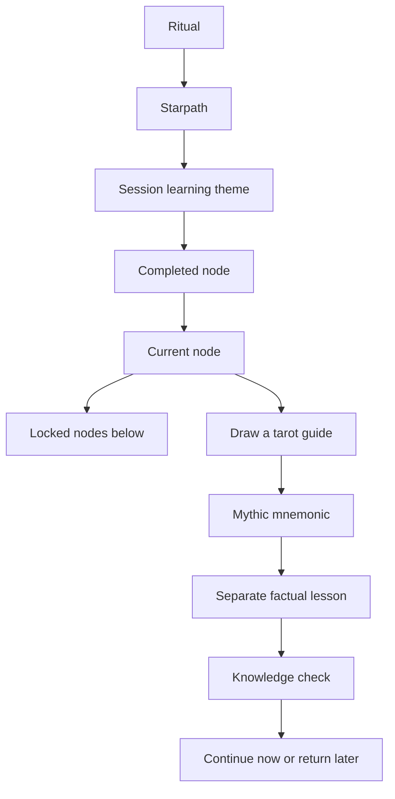
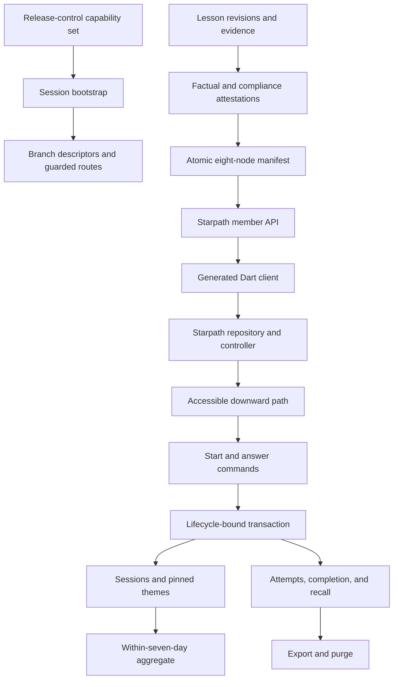
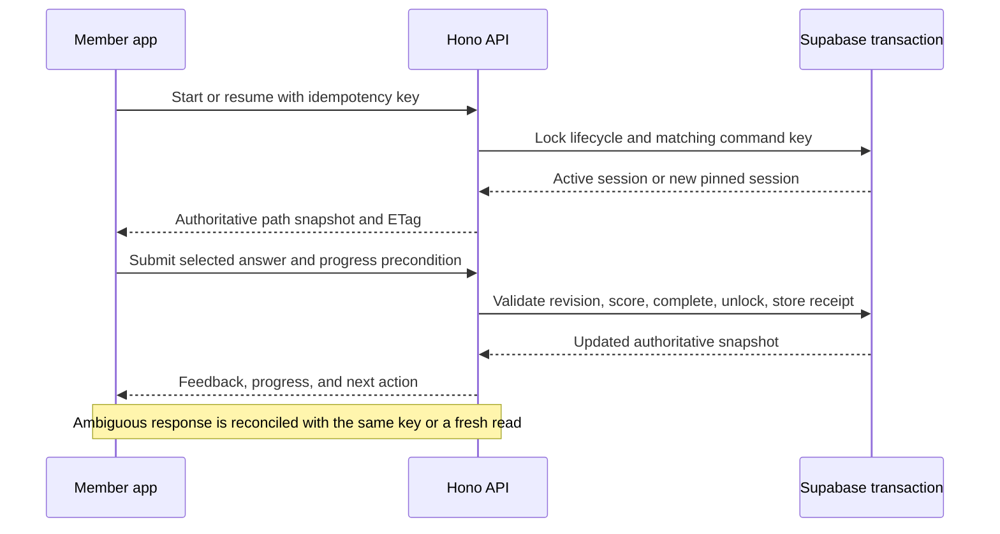
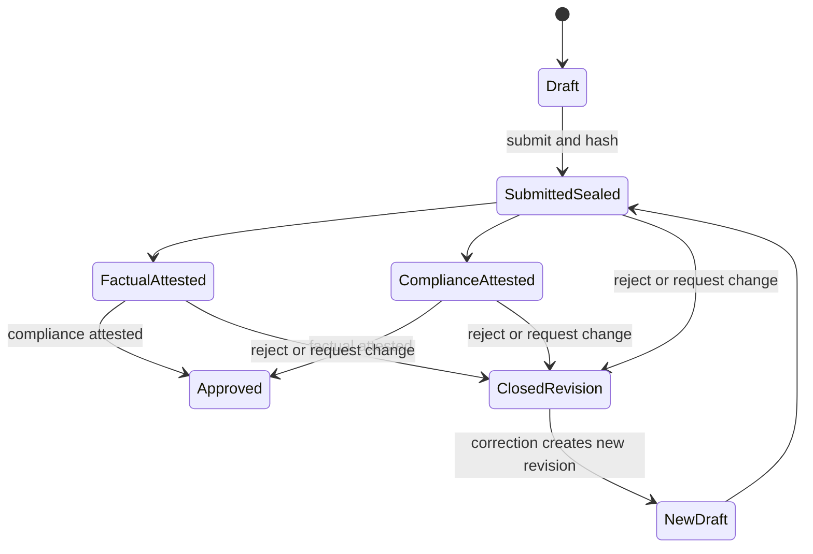
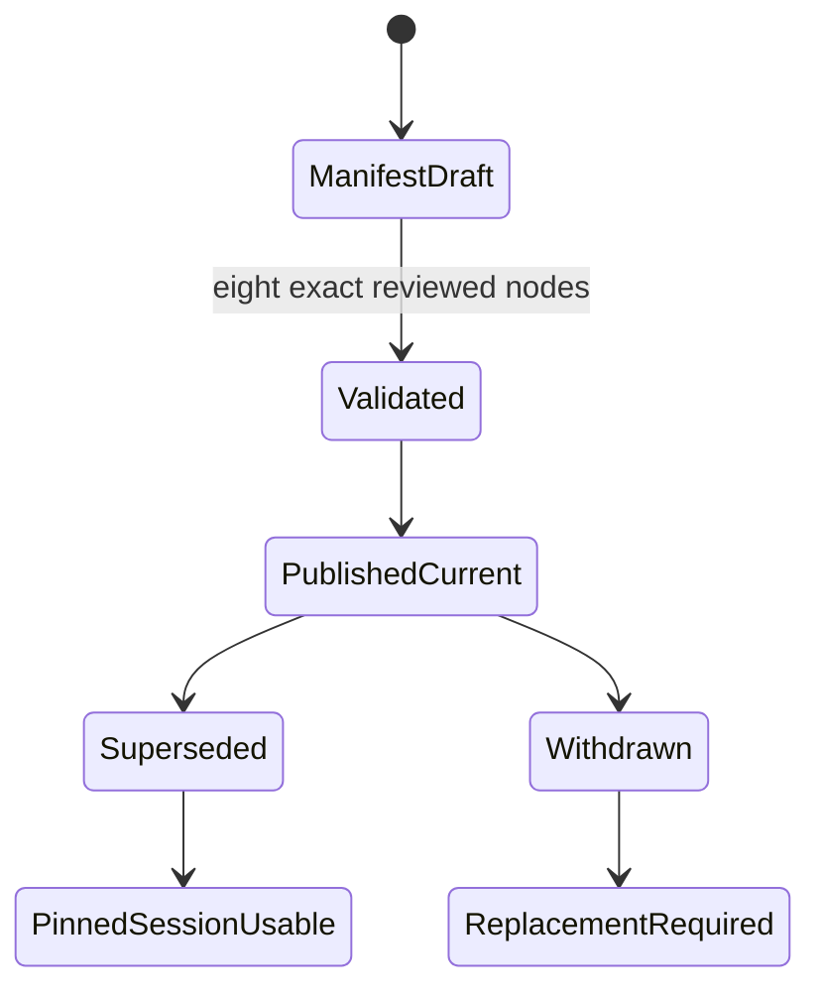
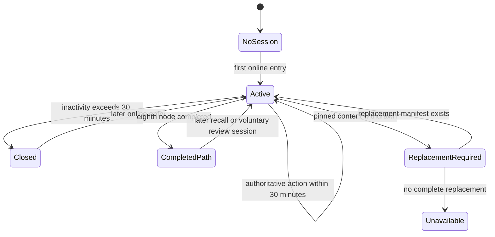

# Starpath Investment Lessons - Plan

## Goal Capsule

- **Objective:** Signed-in beginners can build factual investing literacy through an inviting mystical learning journey without receiving subjective guidance about what to invest in.
- **Means:** Add a Starpath-specific curriculum manifest, server-owned learning state, generated API boundary, typed editorial workflow, and accessible Flutter feature slice (KTD2-KTD10).
- **Authority:** The Product Contract governs member and editorial behavior. Key Technical Decisions govern implementation mechanisms. Implementation Units cannot weaken either contract. Product Contract unchanged from the confirmed brainstorm.
- **Execution profile:** Code changes span Supabase migrations, the Hono Edge API, generated OpenAPI/Dart artifacts, the Flutter member app, the staff dashboard, privacy inventories, and launch documentation.
- **Stop conditions:** Stop production enablement if release controls do not supply the required branch capability set, the legal content-policy approval is absent, any curriculum manifest contains other than eight reviewed nodes, or a direct Data API, recommendation, personalization, cross-member access, incomplete purge, or hidden-route bypass remains possible.
- **Tail ownership:** Content owns the eight lessons and corrections. Factual/compliance reviewers own per-revision attestations. Legal owns the production policy approval. The release operator owns environment capability evidence and rollback. Engineering owns schema, API, client, accessibility, and privacy evidence.

---

## Product Contract

### Summary

Add Starpath as a top-level factual investment-learning journey in beta and production. Tarot, astrology, and horoscope provide narrative memory aids while financial facts remain visibly separate, sourced, non-personalized, and free of investment recommendations.

### Problem Frame

The intended members are complete beginners who do not currently seek out investment education. A conventional lesson library would ask them to develop motivation before the product earns their attention, while mystical framing without a structured curriculum could feel entertaining without building durable understanding. The product therefore needs an activation-first learning loop that rewards curiosity, demonstrated learning, and return behavior without creating financial urgency or steering investment choices.

### Key Decisions

- **Use factual education without subjective investment guidance** (session-settled: user-directed — chosen over recommendations or personalized investing direction: the user requires factual information that minimizes licensing and regulatory exposure). Governs R12-R18.
- **Make Starpath a tarot-led downward learning journey** (session-settled: user-approved — chosen over a static lesson library, horoscope-led daily missions, or a freeform constellation map: the converged prototype best addresses activation and return). Governs R3-R11.
- **Launch with eight nodes across four pathways** (session-settled: user-approved — chosen over a broader beta curriculum: two nodes per pathway are the smallest credible end-to-end test). Governs R4-R5 and R12.
- **Open each session with one horoscope-framed theme** (session-settled: user-approved — chosen over repeating horoscope framing before every node: the session cadence keeps the identity without making each lesson repetitive or forecast-like). Governs R6-R8.
- **Place Starpath directly after Ritual in the top-level navigation** (session-settled: user-directed — chosen over nesting lessons or preserving the prior four-destination contract: Starpath must be first-class in beta and production). Governs R1-R2.
- **Make Starpath available to every signed-in member** (session-settled: user-approved — chosen over a premium gate for the beta: broad access supports the activation test). Governs R2 and R21.
- **Measure another learning session rather than investment activity** (session-settled: user-directed — chosen over lesson completion or investment actions as the primary behavior: the user selected return as the success signal). Governs R10-R11 and R21.
- **Use internal review with risk-triggered legal review** (session-settled: user-approved — chosen over mandatory lawyer approval of every lesson: factual and compliance review covers routine publication while legal counsel validates the policy and material expansions). Governs R19-R20.

<!-- ce-section: work-relationships -->
### How This Work Fits Together

This plan owns Starpath as one coherent product area. The broader breakdown is the current understanding, not a committed roadmap.

- **Environment release controls** depend on R1's visible beta and production contract.
  - They will define the server-authoritative feature-flag capability and the Supabase representation that enables Starpath in both environments while limiting Discover and Coven to beta.
  - They can proceed independently once this product contract is accepted and must not redefine Starpath's learning behavior.
- **Curriculum expansion** depends on evidence from R21.
  - It may add pathways, nodes, or recall patterns after the eight-node beta establishes a behavioral baseline.
- **Personalized learning** remains undecided future work.
  - It must receive renewed legal review and a separate product contract before using holdings, brokerage state, or security preferences.

### Requirements

**Destination and progression**

- R1. Beta navigation must read Ritual, Starpath, Discover, Coven, You, while production navigation must read Ritual, Starpath, You.
- R2. Starpath must be available to every signed-in member in beta and production without requiring a paid entitlement, astrology opt-in, or birth information.
- R3. Starpath must present a vertically descending celestial path with clear completed, current, and locked states using original Argus visuals, terminology, copy, and interactions.
- R4. The initial Starpath path must contain exactly eight functional nodes in beta and production, with two nodes assigned to each pathway in the order defined by R12.
- R5. Each node must be designed for three to five minutes, and completion may unlock immediate continuation without a daily lock.

**Learning ritual**

- R6. Each learning session must open with one horoscope-framed learning theme that does not predict market or portfolio outcomes.
- R7. Each node must sequence a tarot guide draw, a mythic mnemonic, a visibly separate factual lesson, and a knowledge check.
- R8. Tarot, astrology, and horoscope must function only as narrative or mnemonic framing and must never be presented as evidence, causation, or predictive market information.
- R9. Starpath must remain fully usable when a member declines astrology personalization, reduces motion, enlarges text, or uses a screen reader.
- R10. Starpath must preserve completed nodes, the current node, and recall needs so a returning member can resume without replaying the entire path.
- R11. Progress, celebrations, and prompts must respond only to learning behavior and must never reward deposits, trades, portfolio performance, security selection, or any other investment action.

**Curriculum and factual boundary**

- R12. The four pathways must appear in this order: core terms and how markets work; risk, diversification, and fees; reading factual company, stock, ETF, and bond information; scams and misleading claims.
- R13. Every factual claim must have a reviewable source, and time-sensitive claims must expose their observation date or effective date.
- R14. Lessons must distinguish facts from examples and must surface material uncertainty, limitations, and risk context when omission could mislead a beginner.
- R15. Starpath must not personalize security selection or provide rankings, forecasts, model portfolios, best-or-worst claims, buy/sell/hold language, outcome promises, or recommendations about a security or investment strategy.
- R16. Real companies, stocks, ETFs, and bonds may appear only as neutral teaching examples that do not imply desirability, suitability, expected performance, or a call to action.
- R17. Knowledge checks must assess comprehension of the presented facts and must not ask the member to choose an investment or reveal an investment preference.
- R18. Rowan may explain the lesson's factual content and uncertainty but must not decide, recommend, pressure, or use intimacy to influence an investment decision.

**Content governance and measurement**

- R19. Every lesson must pass documented factual and compliance review before publication, and corrections must remain attributable to a reviewed content revision.
- R20. Legal counsel must validate the no-advice content policy before production publication and review it again before personalization, security comparisons, monetization, brokerage integration, new jurisdictions, or investment-action prompts enter scope.
- R21. The primary beta success signal must be the proportion of members who start Starpath and return within seven days to begin another learning session; node completion and knowledge-check performance are supporting diagnostics.
- R22. Starpath measurement must not infer investment intent from lesson behavior or optimize prompts toward a security, product, deposit, trade, or portfolio outcome.

### Actors

- A1. **Beginner member** enters Starpath, completes short lessons, and returns to continue learning without being asked to make an investment choice.
- A2. **Content owner** authors sourced factual lessons and keeps the mystical frame distinct from the educational claim.
- A3. **Factual and compliance reviewer** approves, rejects, or returns each lesson before publication under R19.
- A4. **Legal counsel** validates the no-advice policy and re-enters only when an R20 trigger occurs.
- A5. **Starpath experience** presents the session theme, progression state, node ritual, knowledge checks, and recall loop.

### Key Flows



- F1. **Begin a Starpath session**
  - **Trigger:** A1 selects Starpath from the member navigation.
  - **Actors:** A1, A5
  - **Steps:** A5 opens the session theme, restores progression and recall state, and places A1 at the current node.
  - **Outcome:** A1 can begin learning without astrology personalization or an investment decision.
  - **Covered by:** R1-R6 and R9-R10.
- F2. **Complete a learning node**
  - **Trigger:** A1 opens the current node.
  - **Actors:** A1, A5
  - **Steps:** A1 draws a guide, reads the mnemonic and separate factual lesson, answers the knowledge check, and sees the resulting learning progress.
  - **Outcome:** The next node becomes available without a trade, deposit, or artificial daily wait.
  - **Covered by:** R5, R7-R8, R11-R18.
- F3. **Return for another session**
  - **Trigger:** A1 re-enters Starpath after a prior session.
  - **Actors:** A1, A5
  - **Steps:** A5 opens one new session theme, presents a brief recall prompt when due, and resumes the current path position.
  - **Outcome:** A1 reinforces prior learning and continues downward without replaying completed content.
  - **Covered by:** R6, R10-R11 and R21-R22.
- F4. **Publish or revise a lesson**
  - **Trigger:** A2 submits a new or corrected lesson for release.
  - **Actors:** A2, A3, A4
  - **Steps:** A3 checks factual support and the content boundary, returns failures for correction, and approves a traceable revision; A4 participates when R20 requires it.
  - **Outcome:** Only reviewed factual content becomes available to members.
  - **Covered by:** R13-R20.

### Acceptance Examples

- AE1. **Covers R1-R2.** Given the beta application, when a signed-in member views the top-level navigation, then Starpath appears directly after Ritual and before Discover, Coven, and You; given production, Discover and Coven are absent and You follows Starpath.
- AE2. **Covers R6-R9.** Given a member who declined astrology personalization, when they open Starpath, then they receive a non-personalized learning theme and can complete the tarot-led node with all factual content accessible.
- AE3. **Covers R7-R8 and R13-R14.** Given a node framed by The Fool, when the lesson explains diversification, then the card supplies only the memory metaphor and the separate lesson supplies sourced facts, uncertainty, and limitations.
- AE4. **Covers R10 and R21.** Given a member who completed one node and returns three days later, when they open Starpath, then a due recall prompt appears before the preserved current node and the visit counts toward the seven-day return signal.
- AE5. **Covers R15-R20.** Given draft copy stating that an ETF is the best choice for a beginner, when it enters review, then it is rejected because it expresses desirability and a recommendation rather than neutral factual education.
- AE6. **Covers R16-R17.** Given a lesson that uses a real ETF to explain expense ratios, when the member reaches the check, then the example is sourced and neutral and the question tests how to read the ratio rather than whether to buy the ETF.
- AE7. **Covers R5 and R11.** Given a member who passes a node, when completion is shown, then the experience may celebrate learning and unlock the next node but must not ask the member to fund, trade, or select a security.
- AE8. **Covers R20.** Given a proposal to tailor lessons from brokerage holdings, when product review begins, then production work pauses for a new product contract and renewed legal review.

### Success Criteria

- The eight-node path is understandable and completable in the intended order by a beginner without outside investing knowledge.
- The primary beta report establishes the seven-day return-to-another-session baseline defined by R21.
- Supporting diagnostics distinguish initial entry, node completion, knowledge-check comprehension, recall participation, and path continuation without measuring investment actions.
- Every published lesson has a traceable factual/compliance approval, and every sampled lesson satisfies R13-R18.
- User testing can distinguish the mystical mnemonic from the financial fact without prompting.

### Scope Boundaries

**Deferred for later**

- The Supabase feature-flag table, environment evaluation rules, caching behavior, administration, and rollout operations are separate release-control work governed by R1.
- Curriculum beyond eight nodes, additional pathways, social learning, paid entitlements, and personalized learning require new evidence and scope decisions.
- Brokerage-derived personalization, security comparisons, monetization, and additional jurisdictions require R20 review before they can be planned.

**Outside Starpath's identity**

- Subjective investment guidance, individualized suitability, forecasts, rankings, model portfolios, trade ideas, or investment calls to action are prohibited per R15-R18.
- Astrology or tarot presented as financial evidence, causal analysis, or predictive signal is prohibited per R8.
- Streak punishment, artificial daily locks, and rewards tied to investment behavior are prohibited per R5 and R11.
- Copied Duolingo, Alinea, or third-party visual expression, copy, characters, lesson content, or interaction details are not permitted; only general behavioral inspiration may carry forward.

### Dependencies and Assumptions

- Starpath extends the current member product and versioned editorial capability rather than replacing either one.
- Existing evidence, accessibility, generated-client, and server-authority contracts remain binding except for the explicit navigation change in R1.
- The eight-node beta is available to all signed-in members without a premium paywall.
- The beta establishes a return-rate baseline; a later product decision sets the numerical target for wider rollout.
- This product contract reduces advisory risk but does not determine Argus's regulatory status or replace jurisdiction-specific legal advice.

### Sources and Research

- `ritual-investing-app/PRODUCT.md` defines the audience, authority model, evidence adjacency, Rowan boundaries, accessibility, and optional astrology contract.
- `ritual-investing-app/DESIGN.md` defines the existing four-destination design contract that R1 intentionally supersedes.
- `docs/plans/2026-08-24-1917-feat-simulated-member-experience-plan.md` documents the existing member navigation and factual-versus-interpretive boundary.
- `docs/solutions/architecture-patterns/ritual-investing-app-current-intent-and-architecture.md` records Supabase authority, generated API boundaries, and Rowan's non-advisory role.
- SEC Investment Adviser Marketing Rule adopting release, footnote 101: general educational information about investing is distinguished from offering advisory services regarding securities: https://www.sec.gov/files/rules/final/2020/ia-5653.pdf
- FINRA Rule 2210 establishes fair, balanced, non-misleading standards and review obligations for covered member communications: https://www.finra.org/rules-guidance/rulebooks/finra-rules/2210
- SEC Rule 206(4)-7 materials describe risk-based compliance policies and review obligations for registered advisers: https://www.sec.gov/rules-regulations/2003/12/compliance-programs-investment-companies-investment-advisers
- Investor.gov explains stock ownership and the distinction between primary and secondary markets: https://www.investor.gov/introduction-investing/investing-basics/investment-products/stocks
- Investor.gov explains market and limit order behavior without recommending either order type: https://www.investor.gov/introduction-investing/investing-basics/how-stock-markets-work/types-orders
- Investor.gov describes asset allocation, diversification, and the fact that diversification cannot guarantee against loss: https://www.investor.gov/introduction-investing/getting-started/asset-allocation
- Investor.gov explains investment fees and their effect over time: https://www.investor.gov/introduction-investing/getting-started/understanding-fees
- Investor.gov documents EDGAR research and how to read Form 10-K: https://www.investor.gov/introduction-investing/getting-started/researching-investments/using-edgar-research-investments and https://www.investor.gov/introduction-investing/getting-started/researching-investments/how-read-10-k
- Investor.gov provides neutral primers for ETFs and bonds: https://www.investor.gov/introduction-investing/investing-basics/investment-products/mutual-funds-and-exchange-traded-2 and https://www.investor.gov/introduction-investing/investing-basics/investment-products/bonds-or-fixed-income-products/bonds
- Investor.gov and FINRA provide fraud-warning and registration-checking material for the final pathway: https://www.investor.gov/protect-your-investments/fraud/red-flags-investment-fraud-checklist and https://www.finra.org/investors/investing/working-with-investment-professional/about-brokercheck
- Supabase documents row-level-security behavior, including the need to enable policies on exposed tables: https://supabase.com/docs/guides/database/postgres/row-level-security
- Flutter documents reduced-motion state through `MediaQuery.disableAnimationsOf`: https://api.flutter.dev/flutter/widgets/MediaQuery/disableAnimationsOf.html
- `go_router` documents declarative route construction used by the capability-derived shell: https://pub.dev/documentation/go_router/latest/
- WCAG 2.3.3 defines the motion-from-interaction accommodation used by KTD10: https://www.w3.org/WAI/WCAG22/Understanding/animation-from-interactions.html

### Planning Resolution

- KTD4 and U1 extend the existing editorial review workflow with exact-revision factual and compliance attestations.
- KTD9 and U8 use the app's current semantic-order, large-text, reduced-motion, and platform-target patterns.
- KTD11 and U2 derive the R21 report from purpose-limited Starpath domain rows instead of a new general analytics sink.

---

## Planning Contract

### Key Technical Decisions

- KTD1. **Consume a concrete release-control capability contract as an external prerequisite.** The separate release-control work must add a required server-authoritative member-branch capability set to authenticated bootstrap and enforce the same decision at protected API boundaries. Its minimum consumer contract is a versioned schema containing stable branch codes, trusted environment, evaluated-at and expiry timestamps, a monotonic capability version, protected-route mappings, environment availability, and explicit rollback behavior. Unknown, missing, expired, or downgraded data fails closed; cached bootstrap may shape navigation but never authorizes an API. Starpath adds a stable `MemberBranch.starpath` identity and one deployment fixture shared by RC1 and U7, but does not own the Supabase flag table, evaluation engine, administration, or cache implementation. This implements R1-R2. (session-settled: user-directed — chosen over implementing release controls inside Starpath: release controls remain independently owned while navigation behavior stays consistent.)
- KTD2. **Publish one immutable atomic eight-node curriculum manifest.** A versioned manifest binds exactly eight stable lesson IDs to exact immutable lesson, question, option, evidence, theme, recall, and Rowan revisions, with two lessons in each ordered R12 pathway. Parent-qualified composite foreign keys prevent content from another node or manifest from being grafted into a session. Published manifests and referenced revisions use immutable rows and `RESTRICT` deletion; new sessions pin the latest complete valid manifest rather than following an editorial “current” pointer. This implements R4, R10, R12-R14, and R19.
- KTD3. **Give Starpath a typed editorial model.** Add the `starpath_lesson` editorial kind and normalized lesson, session-theme, knowledge-check, evidence, and manifest relations. Keep bounded presentation output in the existing immutable render document. Each lesson revision owns its tarot key and accessible label, mnemonic, visibly separate factual sections, material limitations and risks, check options and explanations, recall prompt, deterministic Rowan explanation, and `education_general` classification. The manifest exposes a non-empty reviewed session-theme pool; the server selects one without birth data or market inputs. Bond examples remain sourced lesson content rather than extending the asset catalog. This implements R4-R8 and R12-R18. (session-settled: user-approved — chosen over a generic lesson payload or Ritual reuse: the eight-node factual curriculum needs a distinct reviewable shape.)
- KTD4. **Require two exact-revision attestations before publication.** Starpath revisions are always high trust. Submission seals the revision hash; factual and compliance decisions bind that hash plus the exact policy version. A rejection or change request closes the sealed revision, and correction creates a new revision rather than returning approved content to draft. Publication fails unless separate authorized non-author reviewers approve both disciplines, evidence is current, risk and limitation text is present, and classification is `education_general`. Use distinct factual-review and compliance-review permission scopes; one non-author may record both only when authorized for both. The generic editorial workflow retains its existing behavior for other kinds. This implements R13-R20.
- KTD5. **Keep legal review at the policy and production-gate boundary.** Add a versioned Starpath no-advice content policy and durable production-gate evidence. Every lesson revision, review decision, and manifest binds the exact policy version. The production capability evaluator enables only a manifest approved for the trusted environment and supported jurisdiction under a current policy; absent, expired, replaced, or trigger-invalidated policy evidence fails production closed without rewriting beta history. Any R20 trigger requires a new policy approval before production expansion. This implements R15-R20. (session-settled: user-approved — chosen over lawyer approval of every lesson: routine factual/compliance review stays workable while production policy changes fail closed.)
- KTD6. **Make sessions, progress, attempts, and recall server-owned lifecycle data.** Maintain at most one active Starpath session per member lifecycle with a lifecycle-scoped transaction lock and partial unique constraint, even when concurrent starts use different idempotency keys. A start call within exactly 30 minutes of the last authoritative Starpath action resumes it; a call later than 30 minutes atomically closes it and creates a distinct session. The session pins one manifest and one reviewed theme from its pool. Completion belongs to the lifecycle plus stable lesson ID, while attempts retain the exact session, manifest, lesson revision, question, and option shown. This implements R2, R6, R10-R11, and R21.
- KTD7. **Use idempotent, versioned learning commands.** Start/resume and answer submission extend the existing member idempotency pattern through a staged lifecycle-qualified cutover that preserves onboarding and intention consumers. Answer submission carries session, manifest, exact lesson revision, question, option, and canonical `If-Match` progress version. The transaction uses one documented lock order, revalidates capability and content lifecycle, derives correctness and unlocks, conditionally advances progress once, and stores a typed receipt. An exact retry creates no new effect and returns a freshly validated current authoritative snapshot; key reuse with another payload, stale versions, closed lifecycles, locked nodes, invalid content lineage, and withdrawn content fail closed. This implements R5, R7, R10-R11, and R17.
- KTD8. **Use forgiving checks and non-blocking recall.** A wrong answer receives factual feedback and may retry without lives, delay, or penalty. Only a correct node check completes that lesson and unlocks the next. Preserve first-attempt correctness as a diagnostic. At the next distinct session, present at most one recall check from the most recently completed unrecalled lesson. Recall can be skipped, never relocks progress, and never blocks the current node. This implements R5, R7, R10-R11, R17, and R21.
- KTD9. **Treat stale and offline state as read-only and replace withdrawn sessions atomically.** The member app may cache reviewed content for labeled read-only display; offline entry creates no session or retention event, and attempts stay disabled until reconciliation. Superseded content remains usable in its pinned session. Withdrawal never mutates the active session's manifest: the next read or command rejects use of that session, atomically creates a replacement session pinned to the latest complete valid manifest, records replacement lineage, and carries forward only compatible stable-lesson completions. If no replacement exists, return unavailable; prior completion is never silently relocked. This implements R10-R14 and R19.
- KTD10. **Build the celestial path as an ordered accessible feature slice.** Follow the existing generated-service to repository to controller to presentation pattern. Build the path in logical node order with decorative connectors behind it. Use explicit completed, current, and locked labels, stable ordinal semantics, 48dp controls, large `TextScaler` coverage, and `MediaQuery.disableAnimationsOf`. Reduced-motion mode removes flips, parallax, bounce, shimmer, pulsing, and animated auto-scroll without removing content or controls. This implements R3, R5, and R9. (session-settled: user-approved — chosen over a static lesson library: the downward Starpath progression remains the primary learning surface.)
- KTD11. **Use Rowan only as reviewed lesson copy.** The initial Starpath release exposes an “Explain with Rowan” action that reveals the deterministic explanation stored on the pinned lesson revision. It does not invoke the current generic Rowan lookup, accept open-ended questions, select answers, mutate progress, or receive brokerage, profile, intent, astrology, or security-preference context. Rowan actions receive no completion or retention credit. This implements R8, R11, R15, R18, and R22.
- KTD12. **Measure explicit learning retention from versioned aggregate snapshots.** The metric `learning_retention_within_7d_v1` starts a cohort only when a member explicitly selects Starpath and the online start endpoint returns a reviewed session theme; bootstrap, background refresh, cached display, and idempotent replay do not qualify. It counts a second persisted session beginning more than 30 minutes and no later than 168 hours after the first, including voluntary review or recall after path completion. A repeatable-read snapshot fixes one server `as_of`, matured denominator, retained count, window bounds, definition version, and checksum; access requires `operations:read` and exposes no arbitrary member filters. Lawful deletion may make later live recomputation differ from the recorded aggregate, which remains non-identifying evidence. This implements R11 and R21-R22. (session-settled: user-directed — chosen over completion or investment activity as the primary signal: the product must measure return to learning.)
- KTD13. **Keep all member data behind the generated API.** Flutter uses the canonical Hono/OpenAPI/generated Dart boundary for every Starpath read and command. No direct application-table Data API access, hand-written parallel client, client-supplied member identity, client-supplied score, or optimistic authoritative progress is permitted. This implements R2, R10-R11, R17, and R21-R22.

### High-Level Technical Design

The architecture has three authorities: release controls decide which top-level branches exist, editorial publication decides which exact curriculum can be served, and the Starpath transaction decides a member's learning state.



The member command flow prevents duplicate sessions and duplicate completion while keeping the UI recoverable after ambiguous network responses.



Authority is versioned at every boundary; no client cache or editorial pointer can override a live server decision.

| Authority | Required identity or precondition | Revalidated when |
|---|---|---|
| Release control | schema version, capability version, environment, evaluated-at, expiry, stable branch code | Bootstrap for display; every protected read and mutation for authorization |
| Legal policy | policy version, approval state, environment and jurisdiction applicability | Manifest publication and every production capability evaluation |
| Curriculum | immutable manifest ID/version and eight exact node bindings | Session creation, replacement, recall, and answer transaction |
| Lesson content | stable lesson ID plus immutable revision, question, option, evidence, theme, recall, and Rowan identities | Publication, session materialization, and answer transaction |
| Member state | lifecycle ID, deletion epoch, session ID, progress version | Every read and mutation; `If-Match` is the command precondition |

Editorial revision and manifest lifecycles are intentionally separate. A submitted revision is sealed; corrections never reopen it.







### Initial Curriculum Map

The content owner may refine mythic copy during review, but the factual scope and order below are fixed for the initial manifest.

| Node | Pathway | Working title | Factual scope |
|---|---|---|---|
| 1 | Core terms and markets | The Share Sigil | What a stock represents; company issuance; primary and secondary markets; ownership does not guarantee gain or dividends. |
| 2 | Core terms and markets | The Market Lantern | Bid, ask, spread, last trade, market order, and limit order; execution and price are distinct facts. |
| 3 | Risk, diversification, and fees | The Many-Star Shield | Concentration and diversification; diversification can reduce some concentration risk but cannot prevent loss. |
| 4 | Risk, diversification, and fees | The Fee Eclipse | Transaction fees, fund expense ratios, advice fees, and how recurring costs reduce retained value over time without ranking products. |
| 5 | Reading factual information | The Filing Grimoire | EDGAR, Form 10-K, business description, risk factors, income statement, balance sheet, and cash-flow statement. |
| 6 | Reading factual information | The Fund and Bond Map | ETF holdings, objective, index method, prospectus, and expense ratio; bond issuer, face value, coupon, maturity, yield, credit, interest-rate, inflation, and liquidity risk. |
| 7 | Scams and misleading claims | The False Sun | Guaranteed-return claims, little-or-no-risk promises, urgency, fake social proof, exaggerated credentials, and unsolicited pitches. |
| 8 | Scams and misleading claims | The Verification Compass | Check official filings, registration and disciplinary sources, source dates, conflicts, and reporting paths without telling the member what to buy. |

### Output Structure

```text
ritual-investing-api/src/domains/starpath/
  ports.ts
  repository.ts
  routes.ts
  schemas.ts
ritual-investing-app/lib/features/starpath/
  application/
  data/
  domain/
  presentation/
  starpath_routes.dart
ritual-investing-admin/lib/features/starpath/
  application/
  data/
  domain/
  presentation/
```

Generated API-client files remain generator-owned and are not hand-edited.

### Dependencies and Prerequisites

- RC1. The separately planned release-control work must expose the KTD1 schema/version/freshness/expiry/rollback contract through authenticated bootstrap, enforce it at protected APIs, and ship one beta/production/expired/unknown deployment fixture. U3 cannot complete its route guards, U4 cannot freeze the client contract, and U7 cannot complete navigation until that fixture passes unchanged in all three units.
- RC2. The content owner, publisher, and non-author factual/compliance reviewers must be provisioned with distinct author, publish, factual-review, and compliance-review scopes plus AAL2 before initial publication. One dual-qualified reviewer is permitted only when both review scopes are independently present.
- RC3. Legal counsel must approve the exact versioned no-advice policy for the production environment and supported jurisdiction before Starpath is enabled there. Beta engineering and factual/compliance review can proceed before this gate; policy expiry, replacement, or any R20 trigger makes production capability evaluation fail closed.
- The verified local toolchain is Flutter 3.47.1 with Dart 3.13.1, which satisfies the current `go_router 17.5.0` requirement.
- Supabase migrations remain the sole schema authority and must be created with `supabase migration new`; the plan uses wildcard migration paths because filenames are CLI-generated.

### System-Wide Impact

- **Data model:** New editorial projections, manifest relations, member sessions, progress, attempts, and recall state extend the canonical Supabase model. Parent-qualified keys, immutable publication, deletion restrictions, and lifecycle-scoped uniqueness preserve manifest/session lineage.
- **Privacy lifecycle:** Every member-owned Starpath relation enters export, deletion-epoch fencing, purge, role/grant, and inventory parity in the same schema change.
- **API contract:** Hono schemas and routes become OpenAPI authority, which regenerates the Dart package consumed by both member and admin Flutter apps.
- **Navigation:** Static branch positions become stable branch identities mapped through one ordered capability-derived descriptor list.
- **Editorial operations:** The generic single-decision review changes to support sealed revisions and independent discipline attestations without weakening current non-Starpath workflows. Starpath-specific staff API and UI code live in Starpath-owned feature folders; shared admin code changes only for generic cross-kind review behavior and workspace composition.
- **Accessibility:** The primary path adds a complex scrollable surface that must preserve logical semantic order independent of its alternating visual geometry.
- **Compliance:** Starpath content and its deterministic Rowan explanation become attributable, immutable communication records with evidence and use history.

### Alternative Approaches Considered

| Alternative | Decision | Reason |
|---|---|---|
| Store eight independent current lesson pointers | Rejected | It can expose a mixed or incomplete path while corrections publish. |
| Reuse Daily Ritual content and assignment tables | Rejected | Ritual requires recommendation-shaped ideas and a daily schedule that conflict with R5 and R15. |
| Store the whole lesson only as JSON | Rejected | Checks, evidence, classifications, and publication gates need typed relational validation. |
| Query Supabase directly from Flutter | Rejected | It bypasses the generated API, request transaction, and server-owned command rules. |
| Generate horoscope or Rowan copy at request time | Rejected | Unreviewed output cannot stay pinned to the factual/compliance-approved revision. |
| Add bonds to the shared asset catalog now | Deferred | The initial lesson can teach bond fields from sourced content without widening shared catalog and API scope. |
| Count exact-day-seven return | Rejected | R21 says within seven days, so KTD12 uses a 168-hour window rather than changing the product metric. |

### Risks and Mitigations

| Risk | Mitigation |
|---|---|
| Mystical framing is mistaken for financial evidence | Store, render, preview, and test the mythic and factual sections as visibly separate revision fields under R8. |
| Neutral education becomes a recommendation through examples or sequencing | Enforce `education_general`, prohibit member investment inputs, require dual review, and test adversarial copy under R15-R18. |
| Partial publication exposes fewer than eight valid nodes | Pin sessions to an atomic manifest and fail closed when no complete valid manifest exists. |
| Retries inflate attempts, completion, or retention | Reuse lifecycle-scoped idempotency records and transaction locks, and count distinct server sessions only. |
| A withdrawn lesson strands the member | Keep the same stable lesson only when it remains compatible; otherwise render the server-provided replacement position and disclose the progress-position change. Show an unavailable state when no complete replacement exists. |
| Concurrent starts or answers create divergent state | Lock in the documented lifecycle → session → progress → semantic-attempt → receipt order, back it with partial and semantic unique constraints, and test same-key and different-key races. |
| Cross-manifest IDs graft unrelated content into an attempt | Use parent-qualified composite foreign keys, immutable published relations, `RESTRICT` deletion, and negative lineage tests. |
| A semantic recommendation escapes a keyword filter | Treat the versioned structural/lexical validator only as defense in depth, scan every member-facing field with allow/deny contrast fixtures, and retain mandatory human factual and compliance review. |
| Hidden production destinations remain deep-linkable | Build and guard routes from the same capability-derived branch configuration and replace disabled destinations with Starpath or Ritual. |
| New member tables escape export or deletion | Land table creation, inventory, export, purge, grants, and parity tests together in U2. |
| Rolling back application code strands member rows or breaks privacy handling | Disable Starpath through release controls, preserve schema and member rows, keep backward-compatible export/purge/read paths, and never reverse the schema after member data exists. |
| Decorative motion blocks accessibility | Preserve ordered semantics and controls, remove non-essential motion under platform settings, and require manual assistive-technology evidence. |
| The initial curriculum copies a competitor's protected expression | Use original Argus names, art, copy, layout, and interactions; use only general progression and short-session patterns. |

### Deferred Implementation Notes

- Exact SQL helper and index names may follow the current migration's local naming context, but their authorities and constraints cannot change KTD2-KTD7.
- Final celestial connector geometry, card-reveal easing, and copy line breaks are tuned during widget implementation within KTD10.
- A numerical target for `learning_retention_within_7d_v1` is set only after the beta establishes its baseline.
- Additional recall algorithms, adaptive sequencing, and curriculum expansion remain follow-up work under the Product Contract.
- Automated semantic classification of all possible advisory language remains out of scope; KTD4's human review is authoritative and any lexical check is deliberately a bounded defense-in-depth control.

---

## Implementation Units

### U1. Extend editorial authority for reviewed Starpath lessons

- **Goal:** Add the typed Starpath lesson and curriculum publication model with factual and compliance evidence that fails closed.
- **Requirements:** R4, R6-R8, R12-R20; F4; AE3, AE5, AE6, AE8; KTD2-KTD5.
- **Dependencies:** None.
- **Files:**
  - `supabase/migrations/*_starpath_editorial.sql`
  - `supabase/tests/editorial_publication.test.sql`
  - `supabase/tests/u11_admin_supabase_auth.test.sql`
  - `supabase/tests/argus_domain_model.test.sql`
  - `supabase/tests/architecture_contract.test.sql`
  - `supabase/tests/grants_and_rls.test.sql`
  - `ritual-investing-api/src/domains/admin/schemas.ts`
  - `ritual-investing-api/src/domains/admin/ports.ts`
  - `ritual-investing-api/src/domains/admin/repository.ts`
  - `ritual-investing-api/src/domains/admin/routes.ts`
  - `ritual-investing-api/src/domains/starpath/editorial-schemas.ts`
  - `ritual-investing-api/src/domains/starpath/editorial-repository.ts`
  - `ritual-investing-api/src/domains/starpath/editorial-routes.ts`
  - `ritual-investing-api/test/domains/admin.test.ts`
  - `ritual-investing-api/test/contracts/product-authority.test.ts`
  - `docs/ritual-investing/member-data-inventory.md`
  - `docs/ritual-investing/supabase-migration-inventory-v1.txt`
- **Approach:**
  1. Create the migration with the repository-pinned Supabase CLI and append its exact hash to the migration inventory.
  2. Add `starpath_lesson` to editorial-kind constraints and create normalized stable lesson, lesson-revision, reviewed session-theme, ordered factual-section, knowledge-check option, evidence-binding, curriculum-manifest, and manifest-node relations under KTD2-KTD3.
  3. Enforce parent-qualified composite foreign keys across manifest → node → revision → question → option/evidence/theme, immutable published rows, `RESTRICT` deletion, and an orphan-detection invariant.
  4. Extend review requests and decisions with bounded disciplines and distinct authorization scopes. Submission seals the revision hash; reject/change-request closes that revision, while correction creates a successor.
  5. Make Starpath submission open factual and compliance work and mark the sealed revision approved only when both attestations bind its hash and policy version.
  6. Make curriculum publication validate eight distinct stable lessons, exact pathway and ordinal cardinality, a non-empty theme pool, current evidence, render-document sealing, `education_general`, exact policy version, and no withdrawn revision.
  7. Add a versioned structural/lexical validator over every member-facing field as defense in depth; use contrasting allowed and denied fixtures and never substitute it for semantic human review.
  8. Record revision, manifest publication, supersession, and withdrawal history without mutating prior decisions or evidence; update exact architecture, domain, migration, and data inventories in the same unit.
- **Execution note:** Add failing pgTAP publication and authorization cases before changing the admin repository workflow.
- **Patterns to follow:** `argus_app.editorial_revisions`; `argus_app.editorial_render_documents`; `argus_private.publish_editorial_revision`; current normalized Ritual and Asset Codex projection checks.
- **Test scenarios:**
  - Covers AE3. A complete lesson with separate mythic and factual sections, dated evidence, risks, limitations, check, recall, and Rowan explanation materializes into typed rows and a sealed render document.
  - Covers AE5. Copy that classifies an ETF as best, contains buy/sell/hold language, omits material risk, or lacks a source is rejected before publication.
  - Covers AE6. A neutral real-security example with source date and comprehension-only check can pass review without entering the asset catalog.
  - A factual approval alone, compliance approval alone, author self-approval, duplicate discipline decision, or decision against another revision cannot make a Starpath revision publishable.
  - The same authorized non-author reviewer can record both distinct attestations only with both discipline scopes, and both identities, disciplines, sealed hashes, policy versions, reasons, and timestamps remain queryable.
  - A manifest with seven or nine nodes, duplicate stable lessons, wrong pathway order, missing pair, draft revision, or withdrawn revision fails atomically.
  - Cross-manifest revisions, cross-question options, mutation or deletion of referenced published content, and orphaned content all fail at the database boundary.
  - Quoted scam-warning phrases may pass when their surrounding educational context is allowed, while actionable or predictive uses of the same words fail; both still require human review.
  - Existing Ritual, Rowan, Asset Codex, Coven, Grimoire, circle-template, and briefing-template review and publication tests retain their current behavior.
  - `anon`, `authenticated`, member, runtime, and staff roles receive only their intended grants and RLS results for every new editorial relation.
- **Verification:** Local reset and pgTAP prove schema, review, manifest, immutable-history, grant, and RLS contracts without weakening existing editorial kinds.

### U2. Add lifecycle-bound learning state, privacy parity, and retention reporting

- **Goal:** Persist retry-safe Starpath sessions, progress, attempts, completions, and recall state as exportable and purgeable member data.
- **Requirements:** R2, R5-R7, R10-R11, R17, R19, R21-R22; F1-F3; AE4, AE7; KTD6-KTD9, KTD12-KTD13.
- **Dependencies:** U1.
- **Files:**
  - `supabase/migrations/*_starpath_member_state.sql`
  - `supabase/tests/starpath_member_state.test.sql`
  - `supabase/tests/privacy_inventory.test.sql`
  - `supabase/tests/application_purge_owner.test.sql`
  - `supabase/tests/member_lifecycle.test.sql`
  - `supabase/tests/architecture_contract.test.sql`
  - `supabase/tests/grants_and_rls.test.sql`
  - `docs/ritual-investing/member-data-inventory.md`
  - `docs/ritual-investing/supabase-migration-inventory-v1.txt`
  - `docs/ritual-investing/privacy-runbook.md`
  - `ritual-investing-api/src/jobs/privacy-export.ts`
  - `ritual-investing-api/test/jobs/privacy-export-inventory.test.ts`
  - `supabase/functions/_shared/jobs/privacy-export.ts`
  - `supabase/functions/_shared/jobs/purge.ts`
  - `supabase/functions/worker/privacy_export_test.ts`
  - `supabase/tests/u10_privacy_jobs.test.sql`
  - `scripts/check-supabase-migration-inventory.sh`
- **Approach:**
  1. Add lifecycle-qualified session, progress-state, lesson-completion, attempt, and recall relations with tenant, immutable lifecycle, user, and deletion-epoch bindings derived from trusted request context.
  2. Cut over `member_idempotency_records` in stages: add nullable tenant/lifecycle and typed-result columns, preflight orphans and duplicates, backfill deterministically from `members`, validate lifecycle foreign keys, then enforce non-null lifecycle-scoped uniqueness while retaining onboarding and intention compatibility.
  3. Implement one lock order across lifecycle, active session, progress, semantic attempt, and receipt; add a partial unique active-session constraint, lifecycle-plus-stable-lesson completion uniqueness, conditional progress-version advancement, and semantic accepted-answer uniqueness so different command keys still converge.
  4. Pin one immutable manifest per session and require every attempt identity to belong to its node. Implement atomic 30-minute expiry, theme selection, progress, completion, and recall under KTD6-KTD8.
  5. Add an `operations:read`-protected repeatable-read aggregate snapshot under KTD12 with fixed `as_of`, bounds, matured denominator, retained count, definition version, and checksum but no member filters.
  6. Extend the database export registry, API worker inventory, sealed normalized projection, member-data inventory, privacy runbook, purge policy matrix, and child-first crash-resumable purge for every Starpath member relation exactly once. Keep idempotency secrets and internal request hashes excluded.
  7. Verify purge while Auth still exists, fence stale commands by deletion epoch, and preserve the schema/export/purge path for release-control rollback.
- **Execution note:** Treat table creation and privacy/export/purge parity as one release gate; do not land member tables without their deletion path.
- **Patterns to follow:** `briefing_read_states`; `onboarding_step_completions`; `member_idempotency_records`; privacy export collection registry; `purge_member_application_data`.
- **Test scenarios:**
  - Covers AE4. Completing a node persists its stable lesson completion, current node, version, and due recall across a new session three days later.
  - Concurrent start calls with the same or different idempotency keys within the 30-minute window resolve to one active session and one retention event.
  - A call at exactly 30 minutes resumes; a call just after closes the old session, opens one new session, and makes at most one recall due.
  - Same-key and different-key correct submissions, answer/answer races, and command/deletion races create one accepted attempt effect, one completion, and one conditional progress transition; wrong answers remain separate attempts and do not unlock.
  - Existing onboarding and intention idempotency records survive the staged backfill and retain their current replay behavior.
  - A closed or purged lifecycle rejects first-time commands and idempotent replays, while a recreated identity cannot replay the prior deletion epoch.
  - Two member lifecycles cannot read or mutate each other's sessions, progress, attempts, completions, or recall through member, runtime, or direct database roles.
  - Privacy export seeds and includes every normalized Starpath relation exactly once with deterministic counts/checksums and without answer rationale, receipt secrets, request hashes, or unrelated profile/brokerage data.
  - The real crash-resumable deletion saga purges every Starpath row before lifecycle closure, leaves schema/inventory parity exact, and prevents stale commands from recreating rows.
  - The retention snapshot counts a qualifying second session just after 30 minutes and at 168 hours, excludes one after 168 hours, excludes unmatured cohorts, uses UTC server time, and documents why live recomputation after deletion can differ from the recorded aggregate.
- **Verification:** Reset, pgTAP, inventory checks, and lifecycle tests prove atomic progress, cross-member denial, complete export/purge coverage, and the within-seven-day metric definition.

### U3. Build the server-authoritative Starpath member API

- **Goal:** Expose reviewed path snapshots and idempotent learning commands through the canonical Hono request transaction.
- **Requirements:** R2, R4-R7, R10-R18, R21-R22; F1-F3; AE2, AE4, AE7; KTD6-KTD9, KTD11-KTD13.
- **Dependencies:** U1, U2, RC1.
- **Files:**
  - `ritual-investing-api/src/domains/starpath/schemas.ts`
  - `ritual-investing-api/src/domains/starpath/ports.ts`
  - `ritual-investing-api/src/domains/starpath/repository.ts`
  - `ritual-investing-api/src/domains/starpath/routes.ts`
  - `ritual-investing-api/src/db/supabase-repositories.ts`
  - `ritual-investing-api/src/db/retained-supabase-relations.ts`
  - `ritual-investing-api/src/retained-app.ts`
  - `supabase/functions/api/index.ts`
  - `supabase/functions/api/api_test.ts`
  - `ritual-investing-api/test/domains/starpath.test.ts`
  - `ritual-investing-api/test/db/supabase-repository-integration.test.ts`
  - `ritual-investing-api/test/contracts/product-authority.test.ts`
  - `docs/ritual-investing/member-data-inventory.md`
- **Approach:**
  1. Define strict schemas for the path snapshot, pinned theme, node state, factual sections, evidence, check, recall, deterministic Rowan explanation, start/resume command, and answer command.
  2. Add authenticated read, start/resume, and answer routes under the existing no-store, request-ID, error-envelope, ETag, `If-Match`, and idempotency conventions.
  3. Derive member identity, server time, score, progress, manifest selection, and unlock state inside the request transaction.
  4. Consume RC1's evaluator and shared beta/production/expired/unknown fixture; revalidate live capability version/freshness, policy applicability, lifecycle/deletion epoch, manifest state, and content lineage inside every mutation, using `If-Match` as the only progress precondition.
  5. Return the freshly validated current authoritative snapshot after each successful command or exact retry so clients reconcile ambiguous outcomes without local state invention.
  6. On withdrawal, reject the old command and atomically replace its session under KTD9; map absent replacements, locked nodes, stale progress, duplicate-key mismatches, and closed lifecycles to stable non-revealing errors.
  7. Keep profile, investor questionnaire, astrology, holdings, balances, orders, and security preferences out of Starpath repository queries and response schemas; register `api-domain:starpath` in the exact member-data inventory.
- **Execution note:** Start with failing edge-shaped contract and repository integration tests for start, answer, retry, and stale-revision behavior.
- **Patterns to follow:** `ritual-investing-api/src/domains/rituals/`; `ritual-investing-api/src/domains/session/repository.ts`; generated ETag/idempotency routes in intentions and briefing read state.
- **Test scenarios:**
  - Covers AE2. A signed-in member with no astrology profile starts Starpath and receives the same non-personalized curriculum contract as an opted-in member.
  - Covers AE7. A correct answer returns completion and the next unlocked node without any funding, trade, security-selection, or daily-lock field.
  - Exact retry creates no new effect and returns a freshly validated current authoritative snapshot; the same key with a changed answer conflicts without another attempt.
  - Concurrent correct answers serialize, complete once, and return one progress version.
  - A stale ETag, wrong session, wrong revision, wrong question, locked lesson, unpublished manifest, and withdrawn revision fail without progress mutation.
  - A superseded but not withdrawn pinned revision can finish in its active session, while the next distinct session uses the latest valid manifest.
  - Both commit orders for manifest publication versus session start and withdrawal versus answer are deterministic; a withdrawn session is lineage-linked to one replacement or becomes unavailable, and removed or reordered stable lessons carry only compatible completions.
  - Forged member ID, correctness, score, completion, unlock, timestamp, intent, or investment-preference fields are rejected by strict schemas before repository execution; legitimate omitted optional fields remain absent from the parsed command.
  - Responses and telemetry contain no bearer token, free-form answer rationale, member profile, holdings, balances, orders, or investment-intent inference.
- **Verification:** API unit, edge, contract, database integration, and `deno task check && deno task test` in `supabase/functions/api/` prove authoritative session, revision, command, and privacy behavior through the same Edge Function transaction path.

### U4. Regenerate and lock the OpenAPI and Dart client contract

- **Goal:** Make the Starpath API consumable through generator-owned Dart types without contract drift or hand-written parallel models.
- **Requirements:** R2, R7, R10, R13-R18, R21-R22; KTD7, KTD11-KTD13.
- **Dependencies:** U3, RC1.
- **Files:**
  - `ritual-investing-api/openapi/ritual-investing-v1.yaml`
  - `ritual-investing-api/test/contracts/retained-openapi.test.ts`
  - `ritual-investing-api-client/.ritual-contract.json`
  - `ritual-investing-api-client/.openapi-generator/FILES`
  - `ritual-investing-api-client/README.md`
  - `ritual-investing-api-client/openapitools.json`
  - `ritual-investing-api-client/lib/generated/`
  - `ritual-investing-api-client/doc/`
  - `ritual-investing-api-client/test/contract_client_test.dart`
- **Approach:**
  1. Generate the canonical OpenAPI document from Hono route schemas.
  2. Regenerate the Dart package with the pinned OpenAPI generator recorded in `.ritual-contract.json`.
  3. Verify the finalized RC1 bootstrap schema plus Starpath idempotency and `If-Match` headers, authority versions, revision IDs, evidence dates, node states, and error envelopes in the generated surface.
  4. Preserve the generator's `unknownDefaultOpenApi` enum sentinel. Deserialization remains forward-compatible; U6 owns unknown node, lifecycle, and Starpath API error handling, while U7 owns unknown bootstrap branch capabilities.
  5. Keep all generated output untouched by hand, including file inventories and README, and update adapter code only after a clean second-generation drift check.
- **Patterns to follow:** `docs/ritual-investing/api-consumer-guide.md`; current Ritual and Session generated contracts.
- **Test scenarios:**
  - The generated Starpath API serializes and deserializes a complete eight-node snapshot with theme, evidence, check, recall, and Rowan explanation.
  - Start/resume and answer operations require their intended idempotency and version headers in both OpenAPI and Dart.
  - Unknown enum values deserialize to `unknownDefaultOpenApi`; the generated contract still rejects missing revision identity, malformed timestamps, and incomplete evidence.
  - Regeneration is deterministic and leaves no diff after a second generation pass.
- **Verification:** OpenAPI checks, generated-client drift checks, and Dart contract tests pass with no hand-edited generated files.

### U5. Add typed staff authoring, dual review, and initial curriculum publication

- **Goal:** Let authorized staff create, preview, review, correct, and atomically publish the eight-node curriculum through the existing dashboard.
- **Requirements:** R4, R6-R8, R12-R20; A2-A4; F4; AE3, AE5, AE6, AE8; KTD2-KTD5.
- **Dependencies:** U1, U4, RC2.
- **Files:**
  - `ritual-investing-admin/lib/features/starpath/domain/starpath_editorial_models.dart`
  - `ritual-investing-admin/lib/features/starpath/data/starpath_admin_gateway.dart`
  - `ritual-investing-admin/lib/features/starpath/application/starpath_workspace_controller.dart`
  - `ritual-investing-admin/lib/features/starpath/presentation/starpath_workspace.dart`
  - `ritual-investing-admin/lib/application/workspace_controller.dart`
  - `ritual-investing-admin/lib/ui/workspace_screen.dart`
  - `ritual-investing-admin/test/admin_app_test.dart`
  - `ritual-investing-admin/test/admin_gateway_test.dart`
  - `ritual-investing-admin/integration_test/admin_browser_workflows_test.dart`
  - `docs/ritual-investing/starpath-curriculum-v1.md`
  - `docs/ritual-investing/starpath-content-policy.md`
  - `docs/ritual-investing/admin-operations-runbook.md`
  - `docs/ritual-investing/production-launch-gates.md`
- **Approach:**
  1. Add a typed Starpath editor for the KTD3 fields and an ordered eight-node manifest workspace rather than using the current flat free-form payload editor.
  2. Render a staff preview that separates the horoscope/tarot mnemonic, factual lesson, risks and limitations, evidence, check, recall, and Rowan explanation exactly as the member will receive them.
  3. Expose factual and compliance review queues and require the matching reviewer scope, explicit discipline, reason, sealed revision hash, exact policy version, and non-author identity for each decision.
  4. Add manifest validation and publication controls that list all eight exact revisions and refuse partial publication.
  5. Author the Initial Curriculum Map as a versioned eight-lesson curriculum/evidence artifact using primary official sources and neutral or synthetic examples where possible; record content hashes and import evidence linking that artifact to the database revisions.
  6. Document the no-advice policy, its defense-in-depth lexical validator, R20 review triggers, correction/withdrawal process, production legal gate, and evidence retained for each published revision.
  7. Track two milestones: dashboard code complete when authoring/review/publication workflows pass; initial content publication complete only when RC2 principals have recorded all eight dual attestations.
- **Execution note:** Build the typed preview and failing publication tests before entering final lesson copy so reviewers inspect the same structure members will see.
- **Patterns to follow:** Existing Asset Codex evidence editor; current editorial review actions; `docs/ritual-investing/admin-operations-runbook.md`.
- **Test scenarios:**
  - Covers AE3. Staff preview presents a tarot mnemonic and a visibly separate sourced diversification lesson with limitations.
  - Covers AE5. The UI and API refuse publication when prohibited recommendation copy, missing risks, missing evidence date, or missing discipline approval is present.
  - Covers AE6. A neutral ETF or bond example previews its source, observation date, field explanation, and comprehension-only question without a purchase affordance.
  - Author, factual reviewer, compliance reviewer, and publisher permissions fail closed when a staff principal lacks the required distinct scope or AAL2 session; a dual-qualified reviewer can record both attestations but an author cannot self-review.
  - A correction creates a new revision, preserves prior review/publication history, and requires fresh factual and compliance attestations.
  - A manifest preview with an incorrect pathway pair, duplicate node, withdrawn revision, or fewer than eight nodes cannot publish.
  - The initial eight lessons each contain three-to-five-minute reviewed content, correct factual answers, non-blocking recall, original Argus copy, content hashes, and evidence that the published database projection matches the reviewed curriculum artifact.
- **Verification:** Admin analysis and tests prove typed authoring, exact-revision review, manifest publication, correction history, and the production policy gate; content owners record approval evidence for all eight lessons.

### U6. Implement the Starpath Flutter domain, repository, and controller

- **Goal:** Consume the generated contract, cache safe reads, reconcile commands, and expose one authoritative Starpath state model to presentation.
- **Requirements:** R2, R4-R11, R13-R18, R21-R22; F1-F3; AE2, AE4, AE7; KTD6-KTD9, KTD11-KTD13.
- **Dependencies:** U4.
- **Files:**
  - `ritual-investing-app/lib/features/starpath/domain/starpath.dart`
  - `ritual-investing-app/lib/features/starpath/data/generated_starpath_api_service.dart`
  - `ritual-investing-app/lib/features/starpath/data/starpath_repository.dart`
  - `ritual-investing-app/lib/features/starpath/application/starpath_controller.dart`
  - `ritual-investing-app/lib/core/bootstrap/production_member_feature_scope_factory.dart`
  - `ritual-investing-app/lib/core/bootstrap/member_feature_scope.dart`
  - `ritual-investing-app/test/starpath_controller_test.dart`
  - `ritual-investing-app/test/retained_content_generated_adapter_test.dart`
- **Approach:**
  1. Map generated types into strict local domain states for loading, ready, cached-stale, offline-read-only, conflict-reloading, unavailable, forbidden, and failure.
  2. Compose the generated service, repository, and controller in the production member feature scope and lazy-load it by stable branch identity.
  3. Generate one idempotency key per intentional start or answer command and retain it across transport retry.
  4. Send the last authoritative progress version with answer commands and replace local state only from the returned or reconciled snapshot.
  5. Cache only reviewed presentation data and progress for read-only display; never queue an offline answer or synthesize an unlock.
  6. Expose deterministic Rowan copy as local presentation state without calling the generic Rowan service.
  7. Preserve generated unknown enum sentinels at deserialization, then map every unknown Starpath node, lifecycle, or API error code to a fail-closed unavailable/reload state rather than guessing a supported value; U7 owns unknown bootstrap branches.
- **Execution note:** Implement controller transitions test-first, including ambiguous transport recovery before presentation consumes the controller.
- **Patterns to follow:** `daily_ritual_repository.dart`; `generated_ritual_api_service.dart`; `daily_ritual_controller.dart`; current briefing stale-state handling.
- **Test scenarios:**
  - Covers AE2. A member with astrology disabled receives and completes the same Starpath state sequence without accessing astrology profile data.
  - Covers AE4. A returning snapshot exposes one due recall and the preserved current node without replaying completed lessons.
  - A transport timeout after start or correct answer retries with the same key or fetches state and resolves to one authoritative session/completion.
  - A stale precondition enters conflict-reloading and replaces the view with the server result without optimistic unlock.
  - Cached reviewed content renders read-only when offline, marks itself stale, creates no session, disables checks, and resumes after online reconciliation.
  - Withdrawn content clears the unavailable pinned revision and uses the server-provided replacement position; it stays at the same stable lesson only when compatible, discloses any position change, and becomes unavailable when no complete replacement exists.
  - Every `unknownDefaultOpenApi` Starpath value fails closed in the adapter/controller while known future-safe non-Starpath values remain generator-compatible.
  - Rowan reveal reads only the pinned explanation and cannot submit an answer, advance progress, or emit a learning-completion action.
- **Verification:** Controller and adapter tests prove generated-only I/O, retry-key retention, stale/offline recovery, lifecycle-safe state, and absence of direct Supabase application access.

### U7. Insert Starpath into capability-derived member navigation

- **Goal:** Render the exact beta and production branch order and block every hidden-route entry path.
- **Requirements:** R1-R2, R9; F1; AE1; KTD1, KTD10.
- **Dependencies:** RC1, U6.
- **Files:**
  - `ritual-investing-app/lib/core/bootstrap/member_feature_scope.dart`
  - `ritual-investing-app/lib/core/navigation/member_routes.dart`
  - `ritual-investing-app/lib/core/navigation/member_app_router.dart`
  - `ritual-investing-app/lib/features/shell/presentation/app_shell.dart`
  - `ritual-investing-app/lib/features/starpath/starpath_routes.dart`
  - `ritual-investing-app/test/app_router_test.dart`
  - `ritual-investing-app/test/bootstrap_test.dart`
- **Approach:**
  1. Consume RC1/U4's already-generated bootstrap capability types and add Starpath's stable branch and route definitions without using enum ordinals as navigation indices.
  2. Build one ordered branch descriptor list from the server-authoritative capability set and derive both `StatefulShellRoute` branches and Cupertino/Material destinations from it.
  3. Recreate router configuration when the capability version changes and preserve only navigator/restoration state for retained branches.
  4. Replace a disabled Discover or Coven deep link, restored location, or mid-session revocation with Starpath; use Ritual only when Starpath itself is unavailable during rollback.
  5. Verify that deep links and route permutations receive the denial enforced by RC1/U3 so hidden UI and protected backend capability cannot diverge.
- **Execution note:** Add route-permutation characterization tests before replacing the current fixed four-branch arrays.
- **Patterns to follow:** Current `MemberRouteDefinition`; `StatefulShellRoute.indexedStack`; feature-scope lazy loading; release-control bootstrap contract from RC1.
- **Test scenarios:**
  - Covers AE1. Beta renders Ritual, Starpath, Discover, Coven, You in that order on iOS and Material shells; production renders Ritual, Starpath, You.
  - Starpath-only, Discover-only, Coven-only, both-hidden, and unknown-capability fixtures map logical branch selection to the correct positional index.
  - Repeated tab selection resets only the selected logical branch and never loads a different branch because its positional index changed.
  - Production deep links and restored locations for Discover, Coven, and nested resources replace to Starpath and receive no protected resource data.
  - A capability update that removes the current branch rebuilds safely, preserves retained branch state, and chooses the documented fallback without an out-of-range index.
  - Missing or malformed capability state fails closed rather than restoring the legacy four-destination shell.
  - An unknown bootstrap branch capability fails closed in the branch mapper and never creates, selects, or authorizes a route.
- **Verification:** Router, bootstrap, and shell tests prove branch identity, order, deep-link denial, restoration, lazy loading, and Cupertino/Material parity for all capability permutations.

### U8. Build the accessible downward Starpath and lesson ritual

- **Goal:** Deliver the original celestial progression, node ritual, recall, completion, and deterministic Rowan experience across supported accessibility modes.
- **Requirements:** R3-R11, R13-R18; A1, A5; F1-F3; AE2-A4, AE7; KTD8-KTD11.
- **Dependencies:** U5-U7.
- **Files:**
  - `ritual-investing-app/lib/features/starpath/presentation/starpath_screen.dart`
  - `ritual-investing-app/lib/features/starpath/presentation/starpath_path.dart`
  - `ritual-investing-app/lib/features/starpath/presentation/starpath_lesson_screen.dart`
  - `ritual-investing-app/lib/features/starpath/presentation/starpath_recall.dart`
  - `ritual-investing-app/lib/features/starpath/presentation/starpath_tarot_art.dart`
  - `ritual-investing-app/test/starpath_presentation_test.dart`
  - `ritual-investing-app/test/accessibility_test.dart`
  - `ritual-investing-app/integration_test/starpath_member_flow_test.dart`
- **Approach:**
  1. Render the theme once per server session, then the eight-node chronological path with alternating original celestial geometry and decorative connectors excluded from semantics.
  2. Label every node with ordinal, pathway, title, and completed/current/locked state; allow review of completed nodes and activation only of the current node.
  3. Sequence the button-based tarot reveal, mnemonic, clearly delineated factual sections, evidence and dates, limitations and risk, knowledge check, factual feedback, and continuation.
  4. Present at most one optional recall before the current node and a stable completed-path state after node eight with voluntary review and later recall.
  5. Reveal the reviewed Rowan explanation in a bounded sheet or panel that cannot accept free-form input or change progress.
  6. Respect `MediaQuery.disableAnimationsOf`, accessible navigation, large text, focus order, platform tap targets, screen-reader labels, and preserved scroll position under KTD10.
- **Execution note:** Build semantic-order and reduced-motion widget tests alongside the first path component, then verify visual polish on the local browser and iOS Simulator.
- **Patterns to follow:** `daily_ritual_screen.dart`; `ritual_tarot_art.dart`; existing sliver composition; `accessibility_test.dart` accessibility-feature fixtures.
- **Test scenarios:**
  - Covers AE3. Mythic mnemonic and factual diversification text are visually and semantically separate, while evidence, limitations, and risk remain adjacent to the claim.
  - Covers AE4. A three-day return displays one recall before the preserved current node and keeps completed nodes reviewable.
  - Covers AE7. Correct completion celebrates learning, unlocks the next node, and contains no deposit, trade, performance, security-choice, streak punishment, or daily-wait affordance.
  - Wrong answers show factual feedback, retain all controls, allow retry, and do not consume a life or alter unlock state.
  - The eighth node ends in a stable completed state with voluntary review and no invented ninth node.
  - VoiceOver/TalkBack traversal follows nodes one through eight regardless of left/right geometry, and decorative stars/connectors produce no semantic noise.
  - `disableAnimations`, accessible navigation, 200 percent text, narrow landscape, and keyboard/switch navigation preserve every action with no overflow, hidden content, looping ticker, flip, bounce, parallax, shimmer, or auto-scroll.
  - Offline read-only and withdrawn-content states explain the limitation and offer retry without falsely showing completion.
- **Verification:** Widget, accessibility, golden, local-browser, and iOS Simulator evidence prove the complete path and node flow with original Argus expression across normal and reduced-motion modes.

### U9. Integrate content, privacy, measurement, and release gates end to end

- **Goal:** Prove the reviewed eight-node experience in beta and production-shaped configurations without enabling unfinished release controls or bypassing legal gates.
- **Requirements:** R1-R22; F1-F4; AE1-AE8; KTD1-KTD13.
- **Dependencies:** U1-U8, RC1-RC3.
- **Files:**
  - `ritual-investing-app/integration_test/starpath_member_flow_test.dart`
  - `ritual-investing-app/integration_test/member_experience_test.dart`
  - `ritual-investing-api/test/edge/api-edge-integration.test.ts`
  - `ritual-investing-api/test/contracts/product-authority.test.ts`
  - `supabase/tests/starpath_member_state.test.sql`
  - `supabase/tests/editorial_publication.test.sql`
  - `.github/workflows/ritual-investing.yml`
  - `.github/workflows/ritual-investing-supabase-remediation.yml`
  - `ritual-investing-app/PRODUCT.md`
  - `ritual-investing-app/DESIGN.md`
  - `docs/ritual-investing/member-release-gates.md`
  - `docs/ritual-investing/production-launch-gates.md`
  - `docs/ritual-investing/staging-evidence-template.md`
  - `docs/ritual-investing/supabase-boundary-manifest-v1.txt`
  - `docs/ritual-investing/supabase-remediation-register.md`
- **Approach:**
  1. Add beta and production-shaped integration fixtures that use the real generated API boundary and capability-derived routes.
  2. Exercise first entry, wrong answer, same-key and different-key retry, completion, immediate continuation, distinct return, recall, correction, both answer/withdrawal commit orders, replacement/unavailable outcomes, offline recovery, and path completion.
  3. Produce the fixed-`as_of` aggregate retention snapshot, record its checksum and definition, and prove that it uses only qualifying persisted sessions without setting a target or joining financial/profile data.
  4. Update product and design authority for the new branch order, Starpath identity, factual boundary, Rowan limit, and original-expression requirement.
  5. Add CI coverage for new pgTAP, API, generated-client, Flutter, admin, and integration suites.
  6. Require hosted beta evidence for migration history, exact boundary/remediation inventories, RLS/grants, dual review, eight-node manifest, export/purge, route visibility, and rollback/re-enable before rollout.
  7. Require RC3 evidence before production enablement and keep Discover/Coven production-hidden under RC1.
- **Execution note:** Use synthetic member accounts and reviewed non-brokerage content for hosted acceptance; do not reset or destructively seed a durable beta or production project.
- **Patterns to follow:** `.github/workflows/ritual-investing.yml`; `docs/ritual-investing/staging-evidence-template.md`; `ritual-investing-app/AGENTS.md` for XcodeBuildMCP execution.
- **Test scenarios:**
  - A new signed-in member completes all eight nodes in order across multiple sessions and returns within 168 hours without astrology or brokerage data.
  - Beta and production-shaped configurations expose the exact R1 destinations and deny hidden deep links and APIs.
  - A lesson correction publishes only after fresh dual review; a withdrawal invalidates active use and resolves to a complete replacement manifest or unavailable state.
  - Account export contains every Starpath learning relation exactly once, the real deletion saga removes it, and an old client cannot replay progress after lifecycle closure.
  - The baseline snapshot has fixed bounds, counts, version and checksum, no member-level output, and a documented deletion-respecting recomputation rule.
  - Hosted Security and Performance Advisors report no unresolved issue attributable to the new schema, functions, policies, or indexes.
  - Production promotion is blocked when the legal policy evidence or release-control capability evidence is missing or stale.
  - Rollback disables Starpath through release controls while schema, historical rows, export, purge, and backward-compatible reads remain intact; re-enable restores the same valid manifest without dangling references.
- **Verification:** Protected CI, hosted beta acceptance, local-browser review, XcodeBuildMCP iOS review, privacy lifecycle proof, and production-gate documentation agree on one manifest, API revision, and branch capability set.

---

## Verification Contract

| Gate | Command or evidence | Units | Passing signal |
|---|---|---|---|
| Migration inventory | `scripts/check-supabase-migration-inventory.sh --check-cli` and `scripts/check-supabase-migration-inventory.sh` | U1-U2, U9 | Pinned CLI version, forward migration set, hashes, exact data inventory, boundary manifest, and remediation register match. |
| Local database replay | `supabase db reset` | U1-U2 | A clean database applies every migration and produces the reviewed local fixture state. |
| Database behavior | `supabase test db` | U1-U3, U9 | Starpath schema, publication, member state, privacy, RLS, grants, and lifecycle pgTAP suites pass. |
| Database lint | `supabase db lint --local --level error --fail-on error` | U1-U2 | No local database error remains. |
| API behavior | `npm test` and `npm run typecheck` in `ritual-investing-api/` | U1-U5, U9 | Editorial, Starpath, edge, authority, privacy worker, and repository tests pass. U1/U3 may intentionally leave the generated snapshot pending until U4, but runtime schema tests must pass. |
| Edge Function | `deno task check` and `deno task test` in `supabase/functions/api/` | U3, U9 | The deployed composition root type-checks and its API/environment tests pass. |
| OpenAPI contract | `npm run openapi:check` and `npm run drift:check` in `ritual-investing-api/` | U4, U9 | RC1 bootstrap plus Starpath OpenAPI are frozen and generated output has no drift. |
| Generated client | `dart test` in `ritual-investing-api-client/` plus a second generator pass | U4 | Generated OpenAPI/Dart artifacts, README, and file inventory are deterministic; unknown sentinels remain intact. |
| Member Flutter | `flutter analyze` and `flutter test` in `ritual-investing-app/` | U6-U9 | Controller, router, presentation, accessibility, boundary, and regression suites pass. |
| Staff Flutter | `flutter analyze`, `flutter test`, and `flutter test integration_test/admin_browser_workflows_test.dart -d <device-id>` in `ritual-investing-admin/` | U5, U9 | Typed editor, scoped dual review, manifest, permissions, browser workflow, and regression suites pass. |
| Integrated member flow | `flutter test integration_test/member_experience_test.dart -d <device-id>` in `ritual-investing-app/` | U8-U9 | The CI aggregator includes Starpath and the real generated-client flow completes start, answer, retry, return, recall, withdrawal/replacement, and completion scenarios. |
| Local browser | Interactive beta-shaped review at the local app URL | U7-U9 | The downward path, exact beta navigation, keyboard, wide/narrow layout, reduced motion, and hidden routes match the contract. |
| iOS accessibility | XcodeBuildMCP build, launch, fresh snapshots, VoiceOver, largest text, and Reduce Motion review | U8-U9 | The current iOS artifact preserves semantic order, controls, focus, and completion without motion dependence. |
| Privacy lifecycle | Seed-every-relation export plus the real crash-resumable deletion saga | U2, U9 | Database registry, API worker, sealed projection, inventory, runbook, and purge matrix agree; checksums/counts are deterministic, every Starpath row is removed, and stale commands cannot recreate it. |
| Hosted beta | Protected linked migration list, `supabase test db --linked`, Security Advisor, Performance Advisor, and staging evidence | U1-U3, U5, U9 | The exact beta project proves schema history, policies, content manifest, referential integrity, privacy, performance, and release-control bindings. |
| Rollback and re-enable | Disable Starpath with RC1, repeat reads/export/purge, then re-enable the same approved capability/manifest | U9 | No schema reversal occurs, historical/member rows remain valid, privacy duties continue, old writers fail closed, and no dangling manifest/session references exist. |
| Compliance release | Eight dual-review records plus current legal content-policy approval | U5, U9 | Beta content is attributable and production enablement satisfies R19-R20. |

Verification must include adversarial copy fixtures containing rankings, guarantees, urgency, best/worst phrasing, buy/sell/hold language, personalized holdings references, unsupported numerical claims, and mythic language presented as causation. Every fixture must fail before publication.

No product success threshold is invented. U9 records the first `learning_retention_within_7d_v1` baseline and hands it to the product owner for a later target decision.

---

## Definition of Done

### Global Completion Criteria

- Every R1-R22 behavior is implemented or evidenced through its cited U-ID without weakening the confirmed Product Contract.
- One fully reviewed manifest exposes exactly eight functional nodes in the required order in beta and production.
- Beta and production navigation match R1, and Discover/Coven are inaccessible through production tabs, deep links, restoration, and protected APIs.
- Every lesson revision retains sources, dates, facts, uncertainty, limitations, risks, mythic copy, check, recall, Rowan explanation, factual approval, compliance approval, publication history, and correction history.
- Every session pins one immutable manifest; every attempt is parent-qualified to a node, revision, question, and option in that manifest; published history cannot be mutated or deleted while referenced.
- No Starpath query, response, prompt, event, report, or Rowan explanation uses holdings, balances, orders, onboarding investment answers, astrology profile, security preference, or inferred investment intent.
- Start, answer, same-key and different-key retry, exact boundary timing, concurrency, stale version, supersession, both withdrawal race orders, replacement lineage, offline, lifecycle closure, export, and purge behaviors pass at database, API, generated-client, and Flutter boundaries.
- The path remains complete with screen readers, keyboard and switch input, 200 percent text, Reduce Motion, accessible navigation, and no animation dependence.
- The within-seven-day baseline is a checksummed fixed-`as_of` aggregate over explicit persisted session starts and carries the versioned definition and deletion-recomputation note in KTD12.
- Beta evidence passes before beta enablement. RC1 and RC3 evidence passes before production enablement.
- Rollback disables Starpath without reversing schema or weakening export/purge, and re-enable evidence proves zero dangling manifest/session references.
- Product, design, content-policy, privacy inventory, migration inventory, admin runbook, staging evidence, and production launch gates match the shipped contract.
- Abandoned approaches, temporary flags, hand-edited generated output, unused Starpath stubs, copied prototype artifacts, debug fixtures, and dead code are removed from the final diff.

### Per-Unit Completion

| Unit | Done when |
|---|---|
| U1 | Typed lesson, sealed dual review, policy binding, parent-qualified exact eight-node manifest, history, grants, and publication denial tests pass. |
| U2 | Lifecycle state, staged idempotency cutover, concurrency constraints, retention snapshot, export, purge, inventory, and cross-member denial tests pass. |
| U3 | Authenticated Starpath reads and commands revalidate all authorities and return strict current snapshots under retry, conflict, withdrawal, and replacement races. |
| U4 | OpenAPI and Dart regeneration is deterministic, generated-only, and drift-free. |
| U5 | Staff code passes; then provisioned scoped reviewers author, preview, dual-review, correct, withdraw, and publish all eight curriculum hashes under the content policy. |
| U6 | The Flutter controller reconciles online commands and exposes safe cached/offline states without optimistic authority. |
| U7 | One capability-derived branch map produces exact beta/production order and blocks hidden routes and resources. |
| U8 | The full downward path, lesson ritual, recall, completion, and Rowan reveal pass presentation and accessibility evidence. |
| U9 | Protected CI and hosted acceptance prove the integrated beta and production-shaped contract, checksummed baseline, privacy parity, rollback/re-enable, and launch gates. |
