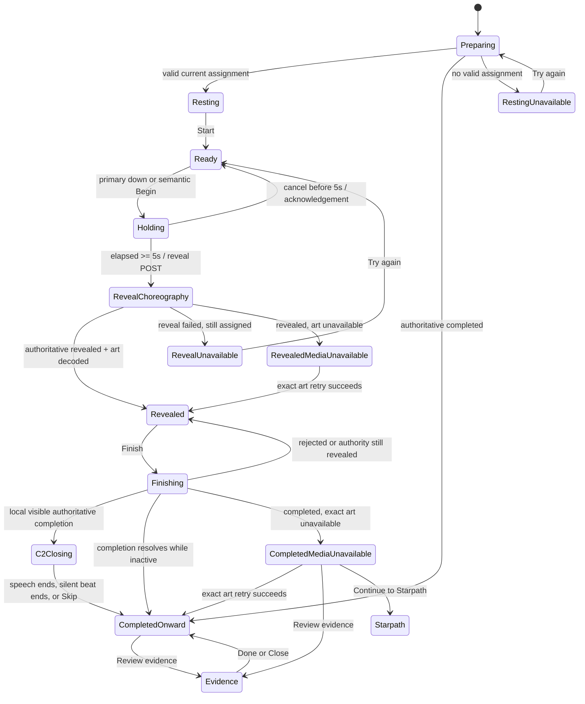
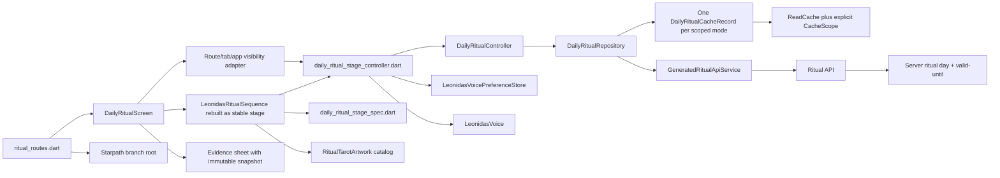

# Daily Ritual Rebuild - Implementation Plan

## Goal Capsule

- **Objective:** Rebuild Daily Ritual as an optional, stable, Leonidas-guided daily experience: explicit Start, an honest five-second hold, authoritative reveal, one Finish, the selected C2 expanding-card close, and an Evidence-first onward handoff.
- **Means:** Enforce the existing three-state transition graph and expose server-owned ritual-day validity, add a ritual-owned stale-while-revalidate read path, put transient choreography in a deterministic presentation coordinator, reuse one validated card-art surface through reveal and C2, and certify the result with behavioral tests plus approved iOS simulator evidence.
- **Authority:** `ritual-investing-app/docs/reviews/daily-ritual-rebuild.md` is the product and visual source of truth. `axio7-model-review/PROJECT_CONTRACT.md`, `ritual-investing-app/PRODUCT.md`, and `ritual-investing-app/AGENTS.md` continue to govern financial, data, accessibility, and release boundaries.
- **Execution profile:** Deep, test-first Flutter feature work with six dependency-ordered implementation units. No application code is authorized until this plan is approved.
- **Stop conditions:** Stop implementation if a reveal could commit before the hold and matching preflight are accepted, authoritative ritual-day/mode context cannot be established, assignment/art identity cannot be proven, a stale response can regress authoritative state, the card or effects intersect Leonidas's face-clear zone, the selected iPhone 17 composition cannot be matched without a global shell rewrite, or a required simulator/golden change lacks product-owner approval.
- **Tail ownership:** The Ritual feature owns transient state, cache validation, voice preference, and presentation. The generated API remains authoritative for `assigned → revealed → completed`. The product owner approves the first simulator baseline before it becomes regression goldens.

---

## Product Contract

### Summary

Opening Ritual remains passive. After the member chooses **Start your daily ritual**, Leonidas guides a continuous five-second seal hold. Touch-down quietly revalidates the current assignment and decodes the exact assigned artwork; it does not mutate the ritual. At five seconds, one authoritative reveal transition begins. The real card and one interpretation appear only after a valid reveal response. One **Finish today’s ritual** action authoritatively completes the assignment, then the same card expands below Leonidas while he delivers one short, skippable close. The card settles into the completed keepsake state with **Review evidence** followed by **Continue to Starpath**.

### Problem Frame

The current screen clears valid content during loading, exposes a tap/replay choreography, duplicates reading content, conflates revealed and completed presentation, and adds History, Coven, practice, and other competing exits. Its cache is network-first rather than stale-while-revalidate, its missing-art mapper silently invents a fallback, and its retained tab can keep speech or animation alive offscreen. These behaviors create the visible jank and double-ending ambiguity the rebuild must remove.

One source requirement is unsafe against the current API: DR-DATA-04 asks for the reveal mutation on touch-down, while DR-HOLD-05 and DR-DATA-09 require early release not to advance the server. The existing transition endpoint commits `assigned → revealed` immediately; client cancellation cannot undo it. Approval of this plan approves the narrow correction described in KTD2: touch-down starts non-mutating revalidation and exact-art predecode; at five seconds the hold is accepted, and the reveal POST starts once matching preflight proves the assignment is still current. A literal touch-down mutation is out of scope unless a separate two-phase backend contract is approved.

Two existing server contracts also need narrow enforcement rather than new product behavior. The transition route currently admits skipping/self edges that the declared graph forbids, and an assignment-ID transition does not prove that assignment is still the member's current ritual day/mode. U1 adds adjacency/current-lineage guards and server-owned day-validity metadata; it introduces no new lifecycle state or edge.

### Actors

- A1. **Member:** Decides whether to begin, performs the hold or accessible equivalent, reads the card, finishes, and chooses Evidence or Starpath.
- A2. **Leonidas:** Remains visibly present, gives instructions, acknowledges an early release without pressure, and supplies one short post-Finish message.
- A3. **Flutter Ritual feature:** Owns layout, transient choreography, accessibility semantics, local voice preference, validated caching, and lifecycle cancellation.
- A4. **Ritual API:** Owns the daily assignment and the `assigned → revealed → completed` lifecycle.
- A5. **Product owner/reviewer:** Approves the numerical composition and first real simulator frames before permanent goldens change.

### Key Decisions

- **Use an explicit Start before the seal every day** (session-settled: user-directed — chosen so opening the app or Ritual tab never coerces the interaction). Governs R1-R2.
- **Use a five-second continuous hold that cancels on release** (session-settled: user-directed — chosen over tap-to-reveal to make the daily interaction deliberate; the illustrative finger is never rendered). Governs R3-R4.
- **Let Leonidas guide without obstructing his face** (session-settled: user-directed — at least the upper face remains visible throughout every state and keyframe). Governs R2-R3, R7-R9.
- **Use one Finish followed by C2, the Expanding Card** (session-settled: user-directed — chosen because the real card art remains the ritual’s visual anchor). Governs R5-R7.
- **Use one short optional Leonidas message with persistent Skip** (session-settled: user-directed — chosen to avoid duplicate interpretation and a second forced ending). Governs R6-R8.
- **End with Evidence primary and Starpath secondary** (session-settled: user-directed — chosen over Replay, History, Coven, practice, Ask Leonidas, and action pileup). Governs R7-R8.
- **Certify visual parity from real simulator frames** (session-settled: user-directed — generated probes establish direction; annotated geometry, comparisons, and approved goldens establish implementation acceptance). Governs R9-R12.

### Requirements

**Voluntary entry and Leonidas guidance**

- R1. Opening the app or Ritual tab is passive: no ritual start, speech, reveal animation, lifecycle mutation, or blocking modal. A current assigned ritual exposes one primary **Start your daily ritual** action; a restored completed assignment goes directly to onward state.
- R2. Leonidas remains the primary human focal point. His face-clear zone remains unobstructed, and all copy stays inviting, time-neutral, non-predictive, and non-coercive.

**Hold and preparation**

- R3. Start changes the same stage to Ready. A first primary pointer owns a forgiving seal region; exactly five uninterrupted seconds accepts once. Earlier up, cancel, material exit, tab loss, route loss, date invalidation, or app inactivity cancels and shows the approved acknowledgement once.
- R4. The progress ring reports elapsed hold time only. Touch-down may revalidate the assignment, decode exact art, and emit one soft haptic; it may not mutate reveal. At elapsed `>= 5.000 s`, the hold accepts once and emits one confirmation haptic. The reveal transition dispatches once matching preflight confirms the same current server day/mode/assignment lineage; until then the accepted stage remains concealed.

**Authoritative reveal and reading**

- R5. Cached data is scope/server-day/mode/assignment/version/revision/art-identity validated, valid visible state never blanks during refresh, and stale responses never regress state within one lineage or overwrite a newer lineage. Reveal/Finish remain authoritative with operation-aware coalescing, typed outcomes, server graph/current-lineage guards, and reconciliation after every potentially post-dispatch failure.
- R6. A valid reveal displays **Reading revealed**, the exact uncropped assigned card, title, one interpretation, and only **Finish today’s ritual**. Lifecycle truth remains representable when art is invalid, missing, mismatched, or undecodable; presentation fails closed for both revealed and completed authority, and blocks Finish/C2 until the exact art is available.

**Completion and onward handoff**

- R7. Finish remains a single stable action. Pending and failed completion preserve the confirmed reading. C2 begins only after a locally initiated Finish is authoritatively completed while Ritual is visible; restored or offscreen completion goes directly to Completed onward.
- R8. C2 expands the same card below Leonidas, shows **Today’s ritual is complete.**, presents the complete short caption, supports saved voice preference and persistent Skip, then automatically settles to Evidence primary and Starpath secondary. It never replays on return.

**Accessibility, motion, trust, and fidelity**

- R9. Mainstream interaction remains hold-only after Start. Assistive semantic activation exposes **Begin ritual**, uses the same five-second state machine, offers semantic cancellation/navigation, and does not invoke the raw pointer recognizer.
- R10. All controls meet 44-point targets, contrast and type floors pass, logical semantics omit decorative/preloaded content, 2× text and supported portrait sizes remain reachable, safe areas are respected, and Reduced Motion preserves timing and meaning without travel, particles, scale, or glow motion.
- R11. Evidence, uncertainty, limitations, freshness, observation window, and risk stay inspectable. Flutter renders validated data only and performs no financial calculation, prediction, or personalized recommendation.
- R12. The implementation matches the approved measured composition within ±4 logical points at the reference viewport, contains real app assets and typography, and is accepted through simulator side-by-side, overlay, heatmap, reviewed goldens, accessibility checks, lifecycle checks, and logs.

### Key Flows

- F1. **Passive entry and preparation**
  - **Trigger:** A1 opens the current Ritual tab.
  - **Steps:** A3 mounts a stable stage, reads one fully validated scoped record only while its server-issued day-validity window remains current, silently revalidates through the application controller, and predecodes only the assigned image bytes without painting or exposing semantics.
  - **Outcome:** Resting with Start, Completed onward, or a concealed retry state; never an automatic ritual action.
  - **Covered by:** R1-R2, R5-R6, R10-R11.
- F2. **Start and hold cancellation**
  - **Trigger:** A1 taps Start and touches the seal.
  - **Steps:** A3 enters Ready then Holding, owns one pointer, fills the ring from monotonic elapsed time, reuses/starts non-mutating preparation, and cancels on any pre-boundary release or invalidation.
  - **Outcome:** Ready with Leonidas's approved acknowledgement, no reveal mutation, and immediate retry available.
  - **Covered by:** R2-R5, R9-R10.
- F3. **Hold acceptance and reveal**
  - **Trigger:** The owned hold reaches `>= 5.000 s` without an earlier cancellation event.
  - **Steps:** A3 accepts the hold once, holds the completed ring in a concealed ambient state until matching preflight is valid, requests reveal through the application controller, validates the typed authoritative outcome separately from art renderability, and crossfades without a blank frame.
  - **Outcome:** Revealed reading or a fail-closed concealed/media-unavailable retry state.
  - **Covered by:** R3-R6, R9-R10.
- F4. **Finish and C2 close**
  - **Trigger:** A1 taps the only Finish control.
  - **Steps:** A3 coalesces submission, preserves the reading, reconciles the response, and enters C2 only for a visible, locally initiated, authoritatively completed action. Leonidas's caption is visible before optional speech starts; Skip is immediately available.
  - **Outcome:** The same card expands, one closing message completes or is skipped, then the card settles automatically.
  - **Covered by:** R6-R10.
- F5. **Evidence and Starpath**
  - **Trigger:** A1 reaches Completed onward.
  - **Steps:** A3 presents the vertical keepsake plus ordered actions. Evidence opens against an immutable completed-assignment snapshot and visibly closes back to Ritual; Starpath opens its branch root.
  - **Outcome:** Trust remains adjacent and navigation remains predictable.
  - **Covered by:** R7-R11.
- F6. **Interruption and restoration**
  - **Trigger:** The tab loses visibility, the app backgrounds, the date/timezone changes, a request completes late, or the process restarts.
  - **Steps:** A3 cancels local transients, stops speech, ignores stale UI callbacks, and re-derives presentation from a fresh authoritative assignment. Assigned restores Resting, revealed restores Revealed, and completed restores Completed onward.
  - **Outcome:** No resumed hold, speech, C2, stale card flash, or state regression.
  - **Covered by:** R1, R3, R5-R10.

### Acceptance Examples

- AE1. **Given** a fresh assigned ritual, **when** Ritual opens, **then** Start is the only ritual-specific primary action and no speech, animation, reveal request, or lifecycle mutation occurs.
- AE2. **Given** Ready, **when** the member releases at 0.1 or 4.9 seconds, leaves the hit region, backgrounds, or changes tabs, **then** the attempt cancels, remains server-assigned, and shows the early-release line once.
- AE3. **Given** a valid hold and matching preflight, **when** elapsed time reaches exactly five seconds, **then** acceptance and confirmation haptic occur once and only one reveal transition is issued.
- AE4. **Given** preparation completes before five seconds, **when** the ring is still below completion, **then** no visual or semantic outcome leaks and reveal does not begin early. Given the hold accepts before preparation completes, the full ring waits concealed and issues zero POSTs until matching preflight succeeds.
- AE5. **Given** reveal is slower than five seconds, **when** the accepted preflight-matched hold dispatches it, **then** the full ring remains stable in a concealed ambient state until a valid response arrives.
- AE6. **Given** an offline, malformed, conflicted, stale-identity, or undecodable-art result, **when** reveal is attempted, **then** no wrong card appears, Finish stays unavailable, and a calm retry is offered.
- AE7. **Given** a confirmed reveal, **when** Finish is pending or fails, **then** the card and reading remain visible, duplicate submission is blocked, and no completed wording appears.
- AE8. **Given** local Finish succeeds while Ritual is visible, **when** completion is confirmed, **then** the same card enters C2 once; a completed value restored from startup, another device, or an offscreen response skips C2 and opens Completed onward.
- AE9. **Given** C2 with voice enabled, **when** native speech completes or Skip is chosen, **then** speech stops or ends once and the onward state appears automatically. Voice disabled/unavailable uses a fixed 1.2-second visual beat with Skip available.
- AE10. **Given** a completed ritual, **when** Evidence opens and Done/Close is chosen, **then** the same completed Ritual context returns; Starpath navigates to the Starpath branch root.
- AE11. **Given** 2× text, Reduced Motion, VoiceOver, or the smallest/largest supported portrait viewport, **when** every key state is exercised, **then** content remains reachable, semantics are ordered, and no painted or animated bound intersects the face-clear rectangle.
- AE12. **Given** a cached assigned response completes after a newer reveal, completion, assignment version, or date has been observed, **when** it returns, **then** the stale response is discarded and the UI never regresses or flashes old content.
- AE13. **Given** missing or invalid `art_key` in any supported mode, **when** the mapper validates it, **then** no default card is substituted and the feature fails closed with diagnostic test/log evidence.

### Success Criteria

- A member can complete the entire happy path with Start → five-second hold → actual card → one Finish → C2 → Evidence/Starpath and no extra ritual-specific action.
- Valid stale content renders without stage blanking while the current-day assignment revalidates; lifecycle claims always match an authoritative response.
- Early release and every visibility/lifecycle cancellation leave the assignment unchanged unless the five-second acceptance already occurred.
- The real assigned card remains uncropped and visually continuous through Revealed, C2 Expanded, and Completed onward.
- Leonidas's face-clear region has zero intersection with content/effects at all named checkpoints, themes, 2× text, and supported portrait viewports.
- Every source requirement ID is mapped to implementation and executable evidence in the traceability table.
- The iPhone 17 reference captures are accepted by the product owner before golden baselines change, and the final simulator report is overall PASS.

### Scope Boundaries

**In scope**

- Daily Ritual Flutter controller/repository behavior, presentation substates, layout, animation, semantics, voice playback preference, evidence sheet continuity, and Starpath handoff.
- Ritual-specific scoped-record validation and deterministic server-owned ritual-day handling using existing cache and storage boundaries.
- Generated-response validation needed to fail closed on missing/unsupported art.
- Narrow Ritual API hardening: enforce the existing adjacent/current-assignment transition contract and add server-issued current ritual-day validity metadata to the retained response/OpenAPI/generated client.
- Relevant widget, controller, repository, integration, golden, accessibility, and iOS simulator evidence.
- Updating durable Daily Ritual design/prototype/readme authority that currently describes the rejected flow.

**Deferred to follow-up work**

- Strict server replay-as-2xx idempotency or a two-phase prepare/commit reveal protocol.
- Persistent cross-process ritual response caching; process restart re-fetches server authority.
- Cross-device synchronization of the voice-on/off preference.
- Android visual certification after the iOS-approved Flutter implementation exists.
- Hardware performance profiling if simulator and representative manual checks still show unexplained jank.

**Out of scope**

- Global shell, navigation-bar, Starpath, Coven, Discover, You, onboarding, rewards, streaks, badges, analytics, or new destination redesign.
- New server lifecycle states/edges, quantitative calculations, recommendations, prediction, free-form Leonidas advice, or weakened trust content.
- New packages, parallel design systems, broad theme rewrites, unrelated refactors, or blind golden regeneration.

---

## Planning Contract

### Key Technical Decisions

- KTD1. **Keep transient ritual phases presentation-owned.** `DailyRitualState` remains only `assigned`, `revealed`, `completed`, and fail-closed `unknown`. A feature-owned `DailyRitualStageController` maps local phases onto authoritative values and uses a generation token to ignore stale timer, speech, image, load, and mutation completions. Implements R1-R10.
- KTD2. **Correct DR-DATA-04 to a safe, lineage-matched preflight model.** Touch-down starts/reuses non-mutating assignment revalidation plus exact-art predecode. At `>= 5.000 s`, the hold accepts once; the reveal POST dispatches only after preflight confirms the same scope, server day, mode, assignment, version, revision, and immutable-content identity. A slow preflight leaves a concealed accepted-wait state with zero POSTs; changed or failed lineage returns to a concealed retry/remapped state. This is the only implementation compatible with DR-HOLD-05 and the immediate-commit endpoint. Approval supersedes “reveal response ready before five seconds” with “preparation ready before five seconds”; U1 records the correction before application code changes. Implements R3-R6.
- KTD3. **Use one scoped Ritual SWR record with server-owned day validity.** Do not rewrite the generic cache helper or create a non-atomic index/envelope pair that `ReadCache` cannot delete. Pass `CacheScope` as explicit data to the Ritual repository and store one namespaced, replaceable, versioned record per resolved mode lane containing scope generation, server-issued `serverEvaluatedAt`, ritual local date and `validUntil`, mode, assignment ID, assignment version, revision/content identity, art identity, and payload. Derive remaining validity from `validUntil - serverEvaluatedAt` and a monotonic elapsed clock; force revalidation after resume or detected wall-clock discontinuity. Same-lineage merges require nondecreasing assignment version/state rank and identical immutable content. Cross-lineage replacement is accepted only from the latest serialized authority-read generation after prior generations were invalidated; transition results for an obsolete lineage may settle its cache record but cannot become visible. Missing/expired authority preserves stable geometry but disables Start/Finish and cold-revalidates. Production response caching remains same-process memory; process restart re-fetches authoritative state from the Ritual API. Implements R1, R5-R6.
- KTD4. **Enforce the transition graph and return typed controller outcomes.** U1 guards the existing server graph/current assignment so only current-lineage `assigned → revealed` and `revealed → completed` can change state/version/timestamps. The controller alone owns reads, cache writes, and lineage-specific monotonic merge. Replace untyped `Future<void>` polling with an immutable operation result containing operation/lineage, target, authoritative assignment, and disposition: committed, reconciled-to-target, proven-not-reached, or authority-unavailable. Coalesce by operation plus lineage and reconcile every failure that may have occurred after dispatch, including malformed 2xx mapping; never compensate or blindly replay. The stage token suppresses obsolete choreography only and never blocks authoritative controller/cache settlement. Implements R5-R8.
- KTD5. **Separate lifecycle authority from media renderability and preserve server ownership.** Transport/domain mapping must preserve and validate server `user_id`/deletion epoch against `CacheScope`, plus assignment ID, state, version, timestamps, and revision, even when an art reference is missing or unsupported; the data layer must not import presentation-owned `ritual_tarot_art.dart`. Represent exact art identity/availability explicitly in the Ritual domain, remove the `the-fool` fallback, and let the presentation catalog/decode boundary resolve it for all supported modes, including astrology assignments with a tarot key. A confirmed revealed or completed assignment with invalid media maps to a media-unavailable presentation without regressing authority or substituting a card. Revealed media failure blocks Finish; completed media failure skips C2 but never blocks Evidence/Starpath. Predecode is keyed by scope, assignment, revision/content identity, art key, and asset path. Implements R5-R6, R8, R11.
- KTD6. **Model tab, route, and app visibility through a presentation adapter.** Keep `DailyRitualStageController` widget/route-owned; it imports no GoRouter or shell type and is never placed in long-lived `MemberFeatureScope`. A small presentation adapter combines branch `TickerMode`, `ModalRoute.isCurrent`, and resumed `WidgetsBindingObserver` state into a plain visibility input. Visibility loss permanently invalidates local hold/C2 provenance, stops animation/semantics/speech, and leaves accepted controller work free to settle authority/cache. On return, revalidate and map authority directly. Implements R1, R3, R5, R7-R10.
- KTD7. **Use one pointer owner and one deterministic event arbiter.** A `Listener`-level interaction owns the first primary pointer; additional pointers are ignored. Exit cancels permanently for that attempt, and re-entry requires a new down. Pointer up/cancel/exit, tab or route loss, app inactivity, day/identity invalidation, dispose, and the five-second timer all enter one monotonic arbiter. An invalidation timestamp `<= 5.000 s` wins ties; acceptance requires the attempt still valid at elapsed `>= 5.000 s` and occurs once. Tests pump virtual time rather than waiting and exercise each cancellation source at 4.999, 5.000, and 5.001 seconds. Implements R3-R4, R9-R10.
- KTD8. **Use existing native speech completion and a scope-versioned, device-local playback preference.** Construct one Ritual voice store over existing `ProtectedStorage` at the production composition root and pass only its narrow abstraction through runtime/scope/route composition. Its envelope is keyed by `CacheScope`, is isolated across account/reset generations, and never logs identity/value. Preference state is pending/enabled/disabled: pending, corrupt, locked, failed, or scope-mismatched reads are captions-only; only genuine absence resolves to enabled. A late restore cannot overwrite a newer toggle or start/restart speech during active C2. Caption precedes speech; native `speak()` completion drives voice-on duration; disabled/unavailable playback uses a fixed 1.2-second beat. Turning voice off stops the current utterance and completes the remaining fixed beat; turning it on during an active caption applies only to the next ritual. Skip and interruption invalidate the run token. Confirmed account deletion clears the scoped preference before logout; a new reset generation cannot read a retired record even if cleanup fails. Implements R2, R7-R10.
- KTD9. **Keep one always-mounted card surface through the selected C2 flow.** Do not reparent duplicate keyed card widgets across overlapping transitions. One surface inside the stable stage owns a shared image provider; its bounds and opacity change from Revealed to Expanded to Keepsake only after the exact image stream produces a ready frame. Concealed content remains absent from paint and semantics. C2 runs once only for a locally initiated, visible Finish success; all other completed-state provenance opens Completed onward directly. Implements R6-R8, R10, R12.
- KTD10. **Use feature-local measured layout and accessible colors.** Encode the approved viewport geometry, keys, timing, curves, and face-clear rectangle in `daily_ritual_stage_spec.dart`. Reuse existing theme tokens that pass contrast on their actual backgrounds; do not change the global theme unless implementation proves no feature-local combination can comply. Lower content reflows/scrolls at larger text while the portrait/face-clear region remains fixed. Implements R2-R3, R6-R10, R12.
- KTD11. **Freeze Evidence context and reject cross-assignment responses.** The application controller loads Evidence by explicit assignment lineage and generation rather than whichever mutable ritual value is current. The sheet receives an immutable completed snapshot, immediately renders its validated trust fields, keeps a visible 44-point Done/Close during localized detail loading, and rejects late detail from another assignment after refresh/rollover. Detail failure preserves the summary, uncertainty, limitations, freshness, observation window, and risk, announces the failure once, and offers retry without emptying or dismissing the sheet. Starpath opens its branch root with no inferred lesson mapping. Implements R8, R10-R11.
- KTD12. **Use an early composition gate, then approve final simulator evidence before goldens.** After U4 produces the complete happy-path composition, capture the real iPhone 17 Resting, Holding, Revealed, C2, and Completed frames; compare them with the selected probes using side-by-side, 50% overlay, heatmap, and anchor measurements; and require product-owner approval before U5 expands the exhaustive interaction matrix around that composition. After U5 passes, U6 repeats the comparison across the final failure/accessibility/native matrix. Only final approved implementation frames replace committed Flutter goldens. Existing old-flow goldens are characterization evidence, not authority. Implements R12.

### High-Level Technical Design

**Authoritative state and local choreography**



`Preparing` is pre-resolution and may exit to assigned, completed, or unavailable authority. `Resting`, `Ready`, `Holding`, `RevealChoreography`, and `RevealUnavailable` require authoritative `assigned`. `RevealedMediaUnavailable`, `Revealed`, and `Finishing` require `revealed`. `CompletedMediaUnavailable`, `C2Closing`, and `CompletedOnward` require `completed`. Any contradictory server value cancels local choreography and remaps immediately without regressing lifecycle truth.

**State content and recovery contract**

| State | Visible/semantic treatment | Available exits |
|---|---|---|
| Preparing | Stable Leonidas portrait/stage; lower area says **Preparing today’s ritual…** with a contained progress status announced once; no seal, card, speech, or lifecycle action | Automatic valid result → Resting/Revealed/Completed; failed/no authority → Resting unavailable; global navigation |
| Resting unavailable | Same scaffold; **Your ritual is not available yet.** and **Try again**; error receives focus/one announcement without exposing assignment content | Retry → Preparing; global navigation |
| Reveal unavailable | Approved reveal-failure copy and Try again; card remains absent from paint/semantics | Retry matching preflight/reveal; global navigation |
| Revealed media unavailable | **Reading revealed** may reflect server truth, but card/title/interpretation remain concealed; **Card art is unavailable. Try again.**; Finish absent | Exact-asset retry; global navigation |
| Completed media unavailable | **Today’s ritual is complete.** plus media error/retry; no C2 or closing replay; Evidence and Starpath remain available in required order | Exact-asset retry may upgrade keepsake; Evidence; Starpath; global navigation |
| Evidence loading | Immutable completed summary/trust fields render immediately; detail area uses localized progress; Done/Close remains visible | Done/Close; detail success/error |
| Evidence detail error | Preserve summary, uncertainty, limitations, freshness, observation window, and risk; announce **More evidence could not be loaded.** and expose **Try again**; never empty the sheet | Retry detail; Done/Close |

**Data, hold, reveal, and Finish ordering**

```mermaid
sequenceDiagram
  participant M as Member
  participant S as Stable Ritual Stage
  participant P as Stage Coordinator
  participant C as DailyRitualController
  participant R as Ritual Repository/Cache
  participant A as Ritual API
  participant V as LeonidasVoice

  S->>C: load/revalidate
  C->>R: read one scoped mode record
  R-->>C: identity + server validity checked candidate
  C->>R: fetchDaily
  R->>A: GET current daily
  A-->>R: authoritative assignment + day validity
  R-->>C: validated candidate
  C->>C: lineage-specific merge + cache write-through
  M->>S: Start, then pointer down
  S->>P: begin five-second attempt
  P->>C: reuse/start non-mutating revalidation
  P->>S: predecode exact concealed art
  alt release/cancel before 5s
    M->>S: up, exit, navigation, or lifecycle loss
    P->>P: invalidate attempt; no mutation
  else elapsed >= 5s
    P->>P: accept hold; wait concealed for matching preflight
    P->>C: reveal once after match
    C->>R: reveal operation for matching lineage
    R->>A: POST assigned→revealed with If-Match
    A-->>R: response or ambiguous outcome
    C->>R: fetchDaily when reconciliation required
    C->>C: merge authority + write cache
    C-->>P: typed outcome + authoritative value
    P->>S: reveal same decoded card or fail closed
    M->>S: Finish
    P->>C: complete once
    C->>R: complete operation for matching lineage
    R->>A: POST revealed→completed with If-Match
    C-->>P: authoritative completed
    alt visible local completion
      P->>S: expand same card and show caption
      P->>V: speak when saved preference allows
      V-->>P: natural completion
      P->>S: settle to onward
    else restored or offscreen completion
      P->>S: completed onward directly
    end
  end
```

**Component and ownership boundaries**



### Annotated Numerical Layout and Motion Specification

All coordinates below use the full **iPhone 17 portrait viewport, 402×874 logical points**. Runtime safe areas remain authoritative; the reference expectation is approximately 59 points at top and 34 at bottom. The existing Cupertino tab bar remains global-shell owned. Major anchors tolerate ±4 points. The implementation uses the canonical Leonidas portrait, real app typography/tokens, no board/device chrome, no finger, and time-neutral **Today** copy.

| Element/state | Reference bounds or rule |
|---|---|
| Page content inset | 16 points horizontal |
| Header | `x: 16–386`, `y: 65–119`, target height 48 |
| Daily signal label | `y: 126–141`; 11 points minimum and passing contrast |
| Stable stage | `Rect(16, 142, 370, 632)`, radius 16; never removed during refresh/mutation |
| Stage top metadata | leading `x: 28`, `y: 156`; voice `Rect(298, 152, 76, 44)` |
| Portrait focus | `Rect(34, 168, 334, 330)` |
| Face-clear zone | `Rect(132, 210, 138, 178)`, bottom 388; zero intersection with nondecorative paint/hit/semantic bounds |
| Main content width | maximum 338 points, normally `x: 32–370`; reading copy maximum 318 |
| Resting seal | visual `Rect(136, 444, 130, 130)`; hit `Rect(121, 429, 160, 160)` |
| Resting guidance | `x: 36`, `y: 627`, width 330 |
| Resting Start | `Rect(32, 698, 338, 52)` |
| Ready/Holding seal | visual `Rect(126, 430, 150, 150)`; effective hit `Rect(111, 415, 180, 180)` |
| Revealed card | `Rect(142, 390, 118, 206)`, contain scaling; title/interpretation below |
| Revealed Finish | `Rect(32, 711, 338, 52)` |
| C2 expanded card | `Rect(115, 397, 172, 300)`; completion heading `y: 356–385`; closing caption begins near `y: 704`; Skip remains a 44-point target |
| Completed keepsake | card `Rect(36, 414, 118, 206)`; copy starts `x: 174`, maximum width 196 |
| Completed actions | Evidence `Rect(32, 646, 338, 52)`; Starpath `Rect(32, 708, 338, 52)` |
| Dynamic Type | Absolute y-anchors apply at 1× only. At 2×, portrait/face-clear remains fixed and the lower content region reflows or scrolls; all actions stay reachable and no lower content traverses the face-clear zone. |
| Supported sizes | Certify the smallest and largest iPhone portrait simulators available in the selected current Xcode runtime in addition to iPhone 17; record exact model names, OS, logical sizes, and safe areas in the simulator report before approval. |

Geometry tests inspect actual transformed/paint bounds at named animation checkpoints, including glows and particles, rather than only the static widget rectangles. Decorative painting may surround the lower shoulders but may not cross the face-clear rectangle.

The 76×44 voice pill occupies the stage’s top-right metadata slot in every stable Ritual state and never overlaps the portrait focus. Its visible values are **Voice on** and **Voice off**; VoiceOver exposes a toggle named **Leonidas voice** with selected state. While preference restore is pending or native voice is unavailable, it is nonactionable and announces **Leonidas voice unavailable**; captions remain authoritative. Changing it during C2 follows KTD8 and never restarts an utterance.

| Motion | Numerical contract |
|---|---|
| Start transition | 180 ms same-stage crossfade |
| Touch-down | ring begins at `t=0`; seal compression approximately 120 ms; one soft haptic; revalidation/predecode begins |
| Holding checkpoint | 60% at 3,000 ms; ring derives only from elapsed time |
| Acceptance | elapsed `>= 5,000 ms`, once; one confirmation haptic |
| Early cancellation | return to zero over 200 ms, `easeOutCubic`, no bounce or cancel haptic |
| Concealed wait | completed ring may remain static after acceptance; network state never changes its percentage |
| Reveal | 480 ms bounded concealed-to-card crossfade/contained transform with no blank frame |
| C2 expand | 450 ms, `easeOutCubic` |
| Voice-disabled/unavailable close | fixed 1,200 ms visual beat; Skip active from frame one |
| C2 settle | 420 ms, `easeOutCubic` |
| Reduced Motion | Keep five-second elapsed hold; replace travel, scale, particles, and moving glow with static states and crossfades no longer than 120 ms or immediate transitions. |

### Output Structure

```text
ritual-investing-api/
├── src/domains/rituals/{routes,repository}.ts # graph/current-lineage guards
├── src/domains/engagement/schemas.ts          # ritual-day validity
├── test/domains/ritual-transitions.test.ts
└── openapi/ritual-investing-v1.yaml           # regenerated
ritual-investing-api-client/
└── generated Daily Ritual model/API/docs       # regenerated from OpenAPI
ritual-investing-app/
├── lib/features/ritual/
│   ├── application/
│   │   └── daily_ritual_controller.dart
│   ├── data/
│   │   ├── daily_ritual_cache_record.dart          # new scoped single-record model
│   │   ├── daily_ritual_repository.dart
│   │   ├── generated_ritual_api_service.dart
│   │   └── leonidas_voice_preference_store.dart    # new device-local setting
│   ├── presentation/
│   │   ├── daily_ritual_screen.dart
│   │   ├── daily_ritual_stage_controller.dart      # new transient coordinator
│   │   ├── daily_ritual_stage_spec.dart            # new geometry/timing/keys
│   │   ├── leonidas_ritual_sequence.dart
│   │   └── ritual_tarot_art.dart
│   └── ritual_routes.dart
├── test/
│   ├── daily_ritual_cache_test.dart                # new
│   ├── daily_ritual_stage_layout_test.dart         # new
│   └── existing focused ritual, a11y, integration, and golden tests
└── docs/evidence/daily-ritual-rebuild/
    ├── layout-spec.md
    ├── ios-simulator-report.md
    ├── simulator/iphone-17/
    ├── comparison/
    └── logs/
```

Composition-root files change only to pass explicit `CacheScope`, authoritative day context, and the narrow voice store. `app_theme.dart`, the global shell, and the three lifecycle enum values remain inspect-only. The retained Ritual response/OpenAPI/generated client and server transition guard change narrowly as specified; no new endpoint or lifecycle edge is added.

### Sequencing

```text
U1 contract characterization/correction
  └──> U2 authoritative data + SWR/cache
          └──> U3 deterministic stage coordinator
                  └──> U4 measured UI + C2 + routes
                          └──> G1 early iPhone 17 composition approval
                                  └──> U5 behavioral/accessibility verification
                                          └──> U6 final simulator approval, goldens, durable docs
```

U1-U5 are test-first: add or amend the narrow failing characterization before implementation, make it pass, and refactor only within the touched feature. U1's additive authority metadata and stricter transition guards deploy before the rebuilt mobile client and remain compatible for the full supported lifetime of that client. G1 freezes the reference composition before exhaustive U5 coverage makes visual changes costly. U6 does not approve its own visual output; permanent goldens wait for product-owner acceptance of the final real simulator frames.

### System-Wide Impact

- **Interaction path:** Ritual receives a local presentation state machine; the three-state domain and global navigation remain unchanged.
- **Data lifecycle:** The repository gains ritual-specific stale-while-revalidate around one namespaced record per explicit scope/mode. A server-issued local day and validity boundary make offline eligibility deterministic; lineage-specific merge and transition write-through prevent regression.
- **Storage:** One non-sensitive, scope-versioned device-local voice boolean is saved through existing `ProtectedStorage`; no member content, card payload, credential, or financial data is persisted by the new preference store. Missing defaults on; invalid/unreadable fails quiet.
- **API:** The existing response schema gains additive server-owned ritual-day validity, and the existing transition path enforces adjacency plus current member day/mode. No endpoint or lifecycle state is added. Deploy this server-compatible slice before the rebuilt client and retain the added fields/guards while any rebuilt client remains supported; feature rollback is client-only. The client retains `If-Match`, gains regenerated fields, and reconciles any possibly post-dispatch failure. Mapper/domain representation preserves lifecycle truth separately from media validity.
- **App lifecycle:** Ritual now listens for retained-tab visibility and app lifecycle. Accepted mutations may settle server-side while hidden, but no hidden UI choreography or speech continues.
- **Navigation:** Ritual removes feature-owned Coven/history/replay/practice exits; global tabs remain. Starpath handoff uses the existing branch root.
- **Accessibility:** The seal adds a semantic-only timed activation and cancellation path; captions, focus moves, error announcements, touch targets, contrast, and 2× reflow become explicit release evidence.
- **Failure propagation:** Reads may warm cache without revealing. Failed/mismatched preflight produces zero mutation. Reveal failure remains concealed; media failure preserves revealed/completed server truth without a wrong card; Finish failure preserves the reading; stale presentation callbacks are discarded while authoritative operation results still settle controller/cache state.
- **Observability:** Deterministic fakes and simulator logs distinguish offline, timeout, malformed response, conflict, decode failure, and rejection even when member copy remains calm.

### Risks and Dependencies

| Risk/dependency | Mitigation and stop/rollback condition |
|---|---|
| Source requirement still interpreted as touch-down mutation | U1 edits DR-DATA-04 and the related scenario only after this plan is approved. Stop if the owner requires literal mutation; write a separate backend two-phase plan. |
| Astrology assignment lacks catalog-resolvable tarot art | Add fixture/service contract proof for every supported mode. Stop rollout for any mode that cannot supply the exact assigned asset; never substitute. |
| Indexed-stack keeps hold/speech alive offscreen | Branch visibility and app lifecycle invalidate the coordinator run token; integration tests cover every transient state. |
| Current ritual day differs from device timezone | Server emits local day plus validity boundary and transition enforces current preference day/mode; expired/absent authority disables lifecycle action and revalidates. Stop if this retained schema hardening cannot be delivered safely. |
| Rebuilt client ships before, or outlives, required API metadata | Deploy U1's additive response fields and stricter guards first; retain them for the rebuilt client's supported lifetime. Roll back only the client presentation/data feature, not the compatible server contract. Stop mobile rollout if the fields are absent. |
| Cache identity is unknown before fetch | Store one replaceable record per explicit scoped/effective-mode lane and validate all contained identity; use a new versioned namespace so rollback cold-fetches instead of reinterpreting legacy values. |
| Late response regresses current state or date | Apply version/state monotonicity only within the same lineage, permit one validated atomic lineage replacement, and reject equal-version divergent content or late prior-lineage results. |
| Dynamic Type pushes lower content into Leonidas | Fix portrait/face-clear area and make only the lower region reflow/scroll; geometry assertions use painted bounds at 1× and 2×. |
| Gold/faint token fails contrast in light theme | Use passing existing foregrounds feature-locally; global theme change requires a separately reviewed impact. |
| Native speech completion/Skip race duplicates C2 exit | One run token owns speak, toggle, Skip, lifecycle, and completion callbacks; every exit is idempotent. |
| Preference storage crosses accounts or fails open | Scope and version the envelope, fail quiet on corruption/read failure, test account/reset switches, and keep orphaned rollback data inert under the versioned key. |
| API mutation commits but response/art mapping fails | Preserve lifecycle metadata independently, classify all post-dispatch failures as ambiguous, reconcile authority, and show media-unavailable rather than regressing state. |
| Product probe and runtime system chrome differ | Compare matched app-content crops, mask only documented dynamic/system regions, record intentional deviations, and require owner approval. |
| Existing dirty worktree is overwritten | Touch only files named by the active unit, inspect status before edits, and never reset/reformat unrelated files. |

### Alternative Approaches Considered

- **POST reveal on touch-down and cancel the client request:** rejected because cancellation cannot undo an already committed server transition and violates early-release safety.
- **Add a two-phase reveal API:** technically valid but rejected for this rebuild because it expands backend/OpenAPI/generated-client scope solely to hide latency already addressable by preflight and predecode.
- **Optimistically show assigned content before server reveal:** rejected because assigned payload concealment and authoritative lifecycle are product and safety requirements.
- **Rewrite the shared `cachedRead` helper:** rejected because other features depend on its network-first semantics; a ritual-owned SWR path is smaller and safer.
- **Persist complete ritual payloads across process death:** rejected because the product requires authoritative restoration and existing production cache is memory-only; persisting member content adds avoidable invalidation and privacy surface.
- **Add a mainstream accessibility bypass button:** rejected by the settled interaction; the alternative is semantic-only for assistive use.
- **Rebuild global theme/shell to match the probes:** rejected because probes are composition references and existing feature-local tokens/layout can satisfy the design without broad regression risk.

---

## Implementation Units

### U1. Lock the corrected contract and characterization baseline

- **Goal:** Make the implementation boundary unambiguous before changing runtime behavior.
- **Requirements:** R1-R12; DR-DATA-04 correction; AE1-AE13.
- **Dependencies:** Plan approval.
- **Files to inspect:**
  - `ritual-investing-app/docs/reviews/daily-ritual-rebuild.md`
  - `ritual-investing-app/DESIGN.md`
  - `docs/prototypes/leonidas-daily-ritual/decisions.md`
  - `ritual-investing-app/lib/features/ritual/application/daily_ritual_controller.dart`
  - `ritual-investing-app/lib/features/ritual/data/daily_ritual_repository.dart`
  - `ritual-investing-api/src/domains/rituals/routes.ts`
  - `ritual-investing-api/src/domains/rituals/repository.ts`
  - `ritual-investing-api/src/domains/engagement/schemas.ts`
  - `ritual-investing-api/openapi/ritual-investing-v1.yaml`
  - `ritual-investing-app/test/ritual_lifecycle_test.dart`
  - `ritual-investing-app/test/leonidas_ritual_sequence_test.dart`
- **Files expected to change:**
  - `ritual-investing-app/docs/reviews/daily-ritual-rebuild.md`
  - `ritual-investing-api/src/domains/rituals/routes.ts`
  - `ritual-investing-api/src/domains/rituals/repository.ts`
  - `ritual-investing-api/src/domains/engagement/schemas.ts`
  - `ritual-investing-api/openapi/ritual-investing-v1.yaml` (regenerated)
  - `ritual-investing-api/test/domains/ritual-transitions.test.ts` (new)
  - `ritual-investing-api/test/contracts/retained-openapi.test.ts`
  - regenerated Daily Ritual model/API/docs under `ritual-investing-api-client/`
  - `ritual-investing-api-client/test/contract_client_test.dart`
  - `ritual-investing-app/test/ritual_lifecycle_test.dart`
  - `ritual-investing-app/test/leonidas_ritual_sequence_test.dart`
  - `ritual-investing-app/test/ritual_tarot_art_test.dart`
- **Approach:**
  1. Replace DR-DATA-04 with the KTD2 non-mutating touch-down preflight and replace the impossible pre-five-second reveal-response scenario with preparation-ready-before-five-seconds.
  2. Record that strict replay-as-2xx idempotency and a two-phase endpoint are deferred; preserve `If-Match` and reconciliation semantics.
  3. Constrain transition input/SQL so only adjacent edges are accepted and the assignment must match the member's current preference-derived local day and effective mode. Invalid/self/skipping/stale-lineage requests fail before any state, version, or timestamp update.
  4. Add server-owned authority metadata (`serverEvaluatedAt`, local ritual date, and next validity boundary) to the retained assignment response, regenerate OpenAPI and the Dart client, and prove the boundary across configured timezone/DST cases. The client derives only a duration and tracks it monotonically; it never calculates the business day.
  5. Preserve the retained bearer/member-transaction/trusted-owner/active-member boundary while changing the route. Add denial coverage for missing auth, another member's assignment UUID, deletion-epoch mismatch, and inactive/closed lifecycle; every denial leaves state, version, and timestamps unchanged.
  6. Add failing Flutter characterization for passive entry, exact five-second boundary, no mutation on every early cancellation, preflight delayed beyond acceptance, one transition only after matching preflight, supported-mode art resolution, and no silent art fallback.
  7. Add test fakes that count read/reveal/Finish requests and expose deterministic timeout, malformed, conflict, rejection, and image-decode outcomes without live services or wall-clock delay.
  8. Preserve the historical screenshots and selected probes; do not update durable old-flow guidance until the new implementation is accepted in U6.
- **Test scenarios:** AE1-AE6, AE13; valid edges increment version once and stamp only the appropriate time; invalid/self/skipping/stale-day/stale-mode edges leave state/version/timestamps unchanged; unauthenticated, cross-member UUID, deletion-epoch mismatch, and inactive-member calls are denied without mutation; server evaluation/day validity spans member-timezone midnight and DST; preparation may finish early or late without a preacceptance/mismatched POST.
- **Verification:** The corrected source contract, retained schema/generated client, server guards, and failing Flutter tests agree on safe ordering. OpenAPI drift checks pass. No application implementation begins before plan approval.
- **Rollback:** Before any rebuilt client ships, U1 may be reverted as one contract/test slice. After a rebuilt client ships, retain the additive validity fields and stricter transition guards for that client's supported lifetime and roll back only the client feature. If the product owner rejects KTD2, stop and produce a separate two-phase backend plan instead of implementing this one.

### U2. Add validated Ritual SWR, monotonic authority, and exact-art handling

- **Goal:** Remove loading blank/jank while keeping every lifecycle and artwork claim authoritative.
- **Requirements:** R1, R4-R6, R11; AE1, AE4-AE7, AE12-AE13.
- **Dependencies:** U1.
- **Files to inspect:**
  - `ritual-investing-app/lib/core/cache/cached_read.dart`
  - `ritual-investing-app/lib/core/cache/read_cache.dart`
  - `ritual-investing-app/lib/core/api/pending_command_store.dart`
  - `ritual-investing-app/lib/features/starpath/application/starpath_controller.dart`
  - `ritual-investing-app/lib/features/portfolio/application/brokerage_controller.dart`
  - `ritual-investing-app/lib/features/ritual/domain/daily_ritual.dart`
  - `ritual-investing-app/lib/core/bootstrap/member_bootstrap.dart`
  - `ritual-investing-app/lib/core/bootstrap/member_feature_scope.dart`
  - `ritual-investing-app/lib/core/bootstrap/production_member_feature_scope_factory.dart`
  - `ritual-investing-app/lib/core/bootstrap/member_feature_scope.dart`
  - `ritual-investing-app/lib/core/bootstrap/member_shell_runtime.dart`
  - `ritual-investing-app/lib/core/bootstrap/app_runtime.dart`
  - `ritual-investing-app/lib/features/ritual/data/daily_ritual_repository.dart`
  - `ritual-investing-app/lib/features/ritual/data/generated_ritual_api_service.dart`
  - `ritual-investing-app/lib/features/ritual/presentation/ritual_tarot_art.dart`
- **Files expected to change:**
  - `ritual-investing-app/lib/features/ritual/application/daily_ritual_controller.dart`
  - `ritual-investing-app/lib/features/ritual/data/daily_ritual_cache_record.dart` (new)
  - `ritual-investing-app/lib/features/ritual/data/daily_ritual_repository.dart`
  - `ritual-investing-app/lib/features/ritual/data/generated_ritual_api_service.dart`
  - `ritual-investing-app/lib/features/ritual/domain/daily_ritual.dart`
  - `ritual-investing-app/lib/features/ritual/presentation/ritual_tarot_art.dart`
  - `ritual-investing-app/lib/core/bootstrap/member_bootstrap.dart`
  - `ritual-investing-app/lib/core/bootstrap/member_feature_scope.dart`
  - `ritual-investing-app/lib/core/bootstrap/production_member_feature_scope_factory.dart`
  - `ritual-investing-app/test/daily_ritual_cache_test.dart` (new)
  - `ritual-investing-app/test/api_repository_test.dart`
  - `ritual-investing-app/test/offline_state_test.dart`
  - `ritual-investing-app/test/ritual_lifecycle_test.dart`
  - `ritual-investing-app/test/ritual_tarot_art_test.dart`
- **Approach:**
  1. Pass `CacheScope` and effective mode explicitly from the feature-scope factory. Preserve server `user_id` and deletion epoch in the internal/domain lineage and require exact equality with `CacheScope.accountId` and reset generation before merge, cache, or display. Add one immutable, versioned, namespaced Ritual record per scoped/effective-mode lane; validate server evaluation/day/validity, mode, assignment/version, revision/content identity, art identity, state/timestamp coherence, and payload equality.
  2. Return a valid unexpired cached assignment immediately, mark background refresh without nulling it, and fetch authority. With no valid server-day context/cache, keep the stable screen scaffold in Preparing and lifecycle actions disabled rather than assuming device date.
  3. Propagate bootstrap personalization changes into the Ritual controller/repository so effective mode changes invalidate the lane. Server validity, not device timezone, schedules retained-tab revalidation; missing/expired validity forces a cold authoritative read.
  4. Give each operation a lineage and generation. Serialize authority reads; only the latest noninvalidated read generation may replace the visible lineage. Within one lineage, require nondecreasing assignment version/state rank and identical immutable content at equal version. Obsolete-lineage mutation results may settle that record but never replace the visible lineage. On contradiction, retain the last valid display, disable mutation, and force authority refresh.
  5. Write authoritative reveal/complete and reconciliation results through to the single record. Use a new namespace so rollback or older clients cannot reinterpret the legacy cached `DailyRitual` shape.
  6. Replace untyped mutation completion with KTD4 outcomes; coalesce by operation/lineage and resolve after authority merge/cache write, not after legacy History loading. Classify proven pre-dispatch rejection separately from every possibly post-dispatch failure, and reconcile the latter before any choreography decision.
  7. Preserve lifecycle metadata when payload/art validation fails. Represent media identity/availability in the domain without importing presentation into data; the presentation catalog resolves exact art. Add assignment-keyed Evidence requests and reject late cross-lineage responses.
  8. Keep production Ritual response caching same-process only. Process-restart tests create fresh cache/repository/controller/stage instances and fetch authority before lifecycle actions; no local-Finish provenance survives.
- **Test scenarios:** Valid record renders before fetch; corrupt/wrong `user_id`/deletion epoch/scope/day/mode/assignment/version/revision/art is rejected; device clock/timezone differs from member timezone; server-evaluated duration, DST, resume, wall-clock discontinuity, and midnight expire validity correctly; mode changes invalidate retained state; late/obsolete generations cannot regress or replace current lineage; equal-version divergent payload fails closed; offline without valid authority stays concealed; every pre/post-dispatch outcome reconciles correctly; missing/invalid/astrology art preserves authority without fallback; Evidence ignores late prior-assignment detail.
- **Verification:** All U2 focused repository/controller/domain/art tests pass. Instrumented state never nulls a valid display during refresh, never regresses within a lineage, performs exactly one validated lineage switch, and never hides an authoritative lifecycle transition merely because media is unavailable.
- **Rollback:** Remove the ritual-owned scoped record and restore the previous repository/controller together. Leave its versioned cache key inert for eventual existing scope cleanup; `ReadCache` has no feature-delete primitive and older code cannot interpret the new namespace. Do not leave strict mapper/domain behavior without matching UI recovery.

### U3. Build the deterministic stage coordinator, lifecycle cancellation, and media preference

- **Goal:** Own the hold, interruption, speech, and C2 provenance as testable local state without changing the server domain.
- **Requirements:** R1-R5, R7-R10; AE1-AE3, AE7-AE9, AE12.
- **Dependencies:** U2.
- **Files to inspect:**
  - `ritual-investing-app/lib/features/ritual/application/leonidas_voice.dart`
  - `ritual-investing-app/lib/features/ritual/presentation/leonidas_ritual_sequence.dart`
  - `ritual-investing-app/lib/core/navigation/member_app_router.dart`
  - `ritual-investing-app/lib/features/shell/presentation/app_shell.dart`
  - `ritual-investing-app/lib/core/bootstrap/production_dependency_container.dart`
  - `ritual-investing-app/lib/core/bootstrap/production_member_feature_scope_factory.dart`
  - `ritual-investing-app/lib/core/bootstrap/member_feature_scope.dart`
  - `ritual-investing-app/lib/core/bootstrap/member_shell_runtime.dart`
  - `ritual-investing-app/lib/core/bootstrap/app_runtime.dart`
  - `ritual-investing-app/test/daily_ritual_stage_controller_test.dart` (new)
- **Files expected to change:**
  - `ritual-investing-app/lib/features/ritual/presentation/daily_ritual_stage_controller.dart` (new)
  - `ritual-investing-app/lib/features/ritual/data/leonidas_voice_preference_store.dart` (new)
  - `ritual-investing-app/lib/core/bootstrap/production_dependency_container.dart`
  - `ritual-investing-app/lib/core/bootstrap/production_member_feature_scope_factory.dart`
  - `ritual-investing-app/lib/core/bootstrap/member_feature_scope.dart`
  - `ritual-investing-app/lib/core/bootstrap/member_shell_runtime.dart`
  - `ritual-investing-app/lib/core/bootstrap/app_runtime.dart`
  - `ritual-investing-app/test/daily_ritual_stage_controller_test.dart` (new)
  - `ritual-investing-app/test/leonidas_ritual_sequence_test.dart`
  - `ritual-investing-app/test/daily_ritual_leonidas_integration_test.dart`
- **Approach:**
  1. Implement the KTD1 local phase model with one generation/run token, injected monotonic time, image preparation, controller, voice, haptic seams, and visibility/lifecycle input.
  2. Accept Start only for a validated current assignment. Ready owns no timer. First primary pointer down owns one attempt; repeated/multitouch activation is ignored until the attempt ends.
  3. Cancel on pointer up/cancel, first exit from the padded region, app inactivity, route/tab invisibility, date/identity change, or disposal. A canceled pointer cannot resume by re-entering; the approved early-release copy appears once and clears on a new attempt.
  4. Route every acceptance/cancellation source through the KTD7 monotonic arbiter and coalesce callbacks. An invalidation at or before 5.000 seconds wins; at 5.001 seconds an already accepted attempt is not rolled back, though visibility loss still suppresses choreography. At acceptance, wait concealed for matching preflight; issue zero POSTs if it fails or returns a new lineage. Emit soft touch-down and acceptance haptics only; omit the optional midpoint cue.
  5. Provide a semantic **Begin ritual** action only after Start when accessible navigation/assistive semantics are active. It runs the same five-second coordinator without a raw pointer and exposes semantic Cancel/global navigation. Quantize progress semantics to whole-second milestones.
  6. Distinguish completed-state provenance. Enter C2 only for the current visible local Finish generation. Startup/revalidation/another-device/offscreen completion bypasses C2. Ambiguous local Finish may enter C2 once only if reconciliation completes while still visible.
  7. Construct the narrow voice store once at the production dependency root and pass it through app runtime/member scope/route composition without exposing raw `ProtectedStorage` to presentation. Scope and version the preference by `CacheScope`; pending/invalid/locked/read failure is captions-only and only genuine absence resolves enabled. A late restore cannot overwrite a newer toggle or start current C2. Add `clearScope` to the store and invoke it on confirmed account deletion before logout; reset-generation mismatch is fail-quiet even when cleanup fails. Start speech only after the C2 caption is visible. One token handles Skip before start, during speech, after completion, toggle-off, interruption, navigation, and late Future completion.
  8. On return from invisibility, discard local transients and revalidate; never resume a hold, reveal animation, C2, or speech.
- **Test scenarios:** Exact 0.1/4.9/5.0 timing and every cancellation source at 4.999/5.000/5.001 seconds; preflight slower than acceptance; pointer exit/re-entry; multiple pointers; semantic repeated activation/cancel; tab/nested-route/background/date cancellation; late reveal/Finish; restored state mapping; C2 once-only provenance; delayed preference restore; write/read/corruption failure; account/reset switch and confirmed-deletion cleanup; voice toggles/unavailable; and all Skip races.
- **Verification:** Coordinator tests use fake time only; request/speech/haptic counters prove at-most-once behavior; no timer, speech, or presentation callback survives visibility loss or disposal.
- **Rollback:** Remove the coordinator and preference injection as one unit. Do not retain a stored voice setting that no runtime consumer honors.

### U4. Implement the measured Leonidas Seal, reveal, C2, and onward surface

- **Goal:** Produce the selected visual direction with stable geometry, actual art, one action at a time, and no face obstruction.
- **Requirements:** R1-R12; AE1-AE11, AE13.
- **Dependencies:** U3.
- **Files to inspect:**
  - `ritual-investing-app/lib/features/ritual/presentation/daily_ritual_screen.dart`
  - `ritual-investing-app/lib/features/ritual/presentation/leonidas_ritual_sequence.dart`
  - `ritual-investing-app/lib/features/ritual/presentation/ritual_tarot_art.dart`
  - `ritual-investing-app/lib/features/ritual/ritual_routes.dart`
  - `ritual-investing-app/lib/app/theme/app_theme.dart`
  - `ritual-investing-app/pubspec.yaml`
  - `ritual-investing-app/docs/reviews/assets/daily-ritual-rebuild/06-selected-leonidas-seal-probe.png`
  - `ritual-investing-app/docs/reviews/assets/daily-ritual-rebuild/07-selected-post-reveal-c2-expanding-card.png`
- **Files expected to change:**
  - `ritual-investing-app/lib/features/ritual/presentation/daily_ritual_stage_spec.dart` (new)
  - `ritual-investing-app/lib/features/ritual/presentation/daily_ritual_screen.dart`
  - `ritual-investing-app/lib/features/ritual/presentation/leonidas_ritual_sequence.dart`
  - `ritual-investing-app/lib/features/ritual/presentation/ritual_tarot_art.dart`
  - `ritual-investing-app/lib/features/ritual/ritual_routes.dart`
  - `ritual-investing-app/test/daily_ritual_stage_layout_test.dart` (new)
  - `ritual-investing-app/test/leonidas_ritual_sequence_test.dart`
  - `ritual-investing-app/test/u4_presentation_test.dart`
  - `ritual-investing-app/test/accessibility_test.dart`
  - provisional G1 captures and comparisons under `ritual-investing-app/docs/evidence/daily-ritual-rebuild/`
- **Approach:**
  1. Replace the current phase-merging, tap/replay, fixed-stack implementation with one stable stage scaffold and the state/spec boundaries above. Keep a Preparing/error surface inside the same stage dimensions.
  2. Build the seal from app-owned shapes/effects with no anatomy, fingerprint, scanner, waveform, meter, score, or sensor claim. The ring derives solely from elapsed time and the hit region is larger than the visual seal.
  3. Keep the canonical portrait in its fixed focus region. Give the face-clear rectangle a stable key and assert zero intersection against content, hit, semantic, glow, particle, and transformed card bounds at every checkpoint.
  4. Keep one card surface mounted inside the stable stage with a shared image provider; change only its bounds/opacity across phases and assert exactly one image exists. Gate the first visible frame on the exact keyed image stream, keep it excluded from paint and semantics while concealed, and render with `BoxFit.contain`. In revealed/completed media-unavailable states, preserve server truth, hide the card face, block Finish/C2 as applicable, and expose exact-asset retry.
  5. Render title and interpretation once. Remove the current long duplicate narration. While Finish is pending or failed, leave portrait, card, title, and interpretation fixed; progress/error belongs to the one Finish control.
  6. Animate the one always-mounted card surface through Revealed → C2 Expanded → Completed Keepsake. Caption the exact closing copy, keep Skip persistent from C2 entry, and settle automatically with Evidence then Starpath.
  7. Remove ritual-owned practice, constellation, Coven, Rowan/Ask Leonidas, replay, history, demo phase controls, and competing actions from the screen. Preserve global navigation.
  8. Make the portrait region fixed and the lower content region adaptive/scrollable at 2× text. Use feature-local passing colors and stable semantic focus/announcements for Reveal error, Reading revealed, Finish error, and Completed onward.
  9. Evidence uses an immutable completed snapshot, assignment-keyed detail request, stale-response rejection, and visible Done/Close; Starpath calls the existing branch-root route.
  10. Once the full happy path is functional, capture real iPhone 17 Resting, Holding, Revealed, C2, and Completed frames. Produce matched side-by-side, 50% overlay, heatmap, and anchor measurements against the selected probes and obtain explicit product-owner approval before starting U5. Iterate only the feature-local spec/composition if this gate fails; do not update permanent goldens yet.
- **Test scenarios:** Every named UI state/copy/action; no outcome leak; actual uncropped asset; delayed decode/cache eviction; exactly one card image through reveal/C2/keepsake; revealed and completed media-unavailable; no duplicate interpretation; Finish stability; action exclusions; geometry at animation checkpoints; 1×/2×; light/dark; Reduced Motion; semantic order/focus; Evidence rollover/late-response/return and Starpath route.
- **Verification:** U4 widget/layout/accessibility tests pass; every zero-tolerance fidelity check is machine-asserted where possible; the G1 iPhone 17 happy-path comparison is explicitly approved; and no global theme/shell file changes unless a recorded stop-condition review approves them.
- **Rollback:** If G1 fails, keep existing committed goldens and revise or revert the feature-local stage/spec before U5. Revert the stage, route callback, and matching tests together; no partially removed old action may remain reachable.

### U5. Close data, interaction, accessibility, and integration coverage

- **Goal:** Prove all interruption/failure/restoration paths before treating visual output as approvable.
- **Requirements:** R1-R12; all acceptance examples; all 67 source IDs.
- **Dependencies:** U4 and explicit G1 approval of the reference composition.
- **Files to inspect and expected to change:**
  - `ritual-investing-app/test/ritual_lifecycle_test.dart`
  - `ritual-investing-app/test/leonidas_ritual_sequence_test.dart`
  - `ritual-investing-app/test/offline_state_test.dart`
  - `ritual-investing-app/test/api_repository_test.dart`
  - `ritual-investing-app/test/daily_ritual_cache_test.dart`
  - `ritual-investing-app/test/daily_ritual_stage_layout_test.dart`
  - `ritual-investing-app/test/daily_ritual_stage_controller_test.dart`
  - `ritual-investing-app/test/daily_ritual_leonidas_integration_test.dart`
  - `ritual-investing-app/test/u4_presentation_test.dart`
  - `ritual-investing-app/test/accessibility_test.dart`
  - `ritual-investing-app/test/ritual_tarot_art_test.dart`
  - `ritual-investing-app/integration_test/u4_member_flow_test.dart`
  - `ritual-investing-app/integration_test/support/u4_http_harness.dart`
- **Approach:**
  1. Build a deterministic matrix for assigned/revealed/completed restoration; valid/invalid scoped record; early/late/stale reads; reveal and Finish success, proven pre-dispatch rejection, post-dispatch ambiguity, malformed 2xx, reconciliation unavailable, and conflict; missing/decode-failed art; server-day/mode rollover; and app/tab/route visibility.
  2. Assert interaction timing with `TestGesture` and virtual pumps. Do not sleep for five wall-clock seconds or depend on real speech/network.
  3. Assert no hidden art paint/semantics before reveal, no speech on open, no duplicate transition/speech/C2, no stale content flash, no wrong-card fallback, and no state regression.
  4. Exercise semantic-only activation/cancel separately from the pointer path. Add target size, contrast, labels, focus order, coarse progress, error announcement, Reduced Motion, and 2× text checks.
  5. Exercise Evidence snapshot/Done return, late detail after lineage change, Starpath routing, global tab availability, and speech cancellation on tab change through the integration harness.
  6. Model real restoration with fresh dependency container, `MemoryReadCache`, repository, controller, and stage instances while retaining only scoped protected voice storage. Cover process death before dispatch, after dispatch/before response, and after server commit; cover account-A retirement followed by late A read/mutation while account B is active.
  7. Run narrow tests after each slice, then the complete non-golden suite. Fix the feature only; do not broaden into unrelated cleanup.
- **Verification:** Every traceability row has a passing named test or evidence target; the complete non-golden Flutter suite passes; no live API, nondeterministic clock, or unbounded voice timing enters tests.
- **Rollback:** Do not advance to U6 with any residual failing or skipped behavioral/accessibility requirement.

### U6. Approve simulator fidelity, adopt goldens, and reconcile durable guidance

- **Goal:** Turn the selected direction into reviewed, durable, reproducible implementation evidence.
- **Requirements:** R1-R12; especially R2, R6-R10, R12.
- **Dependencies:** U1-U5.
- **Files to inspect:**
  - `.xcodebuildmcp/config.yaml`
  - `ritual-investing-app/test/visual_reference_test.dart`
  - `ritual-investing-app/test/goldens/`
  - `ritual-investing-app/README.md`
  - `ritual-investing-app/DESIGN.md`
  - `docs/prototypes/leonidas-daily-ritual/decisions.md`
- **Files expected to change/create:**
  - `ritual-investing-app/test/visual_reference_test.dart`
  - approved files under `ritual-investing-app/test/goldens/`
  - `ritual-investing-app/docs/evidence/daily-ritual-rebuild/layout-spec.md` (new)
  - `ritual-investing-app/docs/evidence/daily-ritual-rebuild/ios-simulator-report.md` (new)
  - `ritual-investing-app/docs/evidence/daily-ritual-rebuild/simulator/iphone-17/*.png` (new)
  - `ritual-investing-app/docs/evidence/daily-ritual-rebuild/comparison/*-side-by-side.png` (new)
  - `ritual-investing-app/docs/evidence/daily-ritual-rebuild/comparison/*-overlay-50.png` (new)
  - `ritual-investing-app/docs/evidence/daily-ritual-rebuild/comparison/*-heatmap.png` (new)
  - `ritual-investing-app/docs/evidence/daily-ritual-rebuild/logs/iphone-17.log` (new, sanitized)
  - `ritual-investing-app/README.md`
  - `ritual-investing-app/DESIGN.md`
  - `docs/prototypes/leonidas-daily-ritual/decisions.md`
- **Approach:**
  1. Use the persisted XcodeBuildMCP profile for `ios/Runner.xcworkspace`, scheme `Runner`, Debug, current iPhone 17 simulator, and bundle `com.ritualinvesting.ritualInvestingApp`; inspect defaults and never read the credentials file.
  2. Record exact OS, logical viewport, safe areas, smallest/largest supported simulator models, build artifact, and app revision. Capture a fresh screenshot before and after every interaction; verify the visible result and inspect logs.
  3. Exercise all required native flows: resting/start/success, early release/retry, slow reveal, reveal error/retry, Finish success/failure, Skip/natural close, background/foreground in each transient, navigation during speech, voice off/interrupted, VoiceOver activation, Reduced Motion, 2× text, Evidence return, Starpath, and relaunch restoration.
  4. For each reference key state, crop simulator and probe to matching app-content bounds, create side-by-side, 50% overlay, and heatmap, mask only documented dynamic/system chrome, measure anchors, and explain every intentional difference.
  5. Present the real frames to the product owner. Do not update permanent goldens until approval is explicit. After approval, make the real implementation states—not generated probes—the baseline and run the explicit golden test.
  6. Add visually distinct Preparing/offline-without-cache and revealed-media-unavailable coverage to widget/geometry tests and goldens where their visual treatment warrants it, in addition to the required matrix below.
  7. Update `DESIGN.md`, README visual authority, and the old prototype decision record to mark the former standing/flip/close-up flow superseded by this rebuild and link the approved evidence.
  8. Produce the final PASS/FAIL/SKIP simulator report with screenshot references, log/error count, human review outcomes, residuals, and overall status.
- **Verification:** Product owner approves the reference simulator frames; anchor measurements pass ±4 points; explicit golden suite passes; simulator report is overall PASS; durable docs no longer call the rejected experience canonical.
- **Rollback:** If visual approval fails, keep old committed goldens, preserve comparison artifacts as review evidence, and iterate only the Ritual feature. If a new golden was committed prematurely, restore the previously approved baseline without discarding unrelated work.

---

## Requirement Traceability

The source IDs below remain individually binding. DR-DATA-04 is implemented only through the KTD2 correction that this plan asks the product owner to approve.

| Source requirement | Implementation ownership | Primary verification |
|---|---|---|
| DR-ENTRY-01 | U3-U4 passive Resting/visibility coordinator | `leonidas_ritual_sequence_test.dart`, `daily_ritual_leonidas_integration_test.dart` |
| DR-ENTRY-02 | U4 single Start state/action | `u4_presentation_test.dart` |
| DR-ENTRY-03 | U4 preserves global shell navigation | `u4_member_flow_test.dart` |
| DR-ENTRY-04 | U2 authority restore; U3 provenance mapping | `ritual_lifecycle_test.dart`, `daily_ritual_leonidas_integration_test.dart` |
| DR-ENTRY-05 | U2 exact-art concealment; U4 paint/semantics exclusion | `ritual_tarot_art_test.dart`, `leonidas_ritual_sequence_test.dart` |
| DR-ENTRY-06 | U4 required time-neutral copy | `u4_presentation_test.dart` |
| DR-LEO-01 | U4 fixed portrait composition | `daily_ritual_stage_layout_test.dart`, approved simulator capture |
| DR-LEO-02 | U4 face-clear measured rectangle | geometry tests at all checkpoints, 2×, simulator matrix |
| DR-LEO-03 | U4 transformed/effect-bound exclusion | geometry tests, overlay/heatmap review |
| DR-LEO-04 | U3-U4 one post-Finish caption/speech | `leonidas_ritual_sequence_test.dart` |
| DR-LEO-05 | U4 approved bounded copy only | copy assertions and human content review |
| DR-HOLD-01 | U3-U4 same-stage Start→Ready | `leonidas_ritual_sequence_test.dart` |
| DR-HOLD-02 | U4 exact instructions/labels/duration | `u4_presentation_test.dart`, semantics test |
| DR-HOLD-03 | U3 pointer ownership and five-second clock | `leonidas_ritual_sequence_test.dart` |
| DR-HOLD-04 | U3 elapsed-only progress | virtual-time progress assertions |
| DR-HOLD-05 | U1 KTD2 correction; U3 cancellation | request counter + server-state assertions at 0.1/4.9 s |
| DR-HOLD-06 | U3 single cancellation acknowledgement | `leonidas_ritual_sequence_test.dart` |
| DR-HOLD-07 | U3 acceptance/haptic once | exact-boundary fake-haptic test |
| DR-HOLD-08 | U4 seal/effect vocabulary | widget absence assertions + simulator review |
| DR-HOLD-09 | U4 copy/content boundary | copy assertions + human review |
| DR-DATA-01 | U2 SWR; U3/U4 hidden predecode | `daily_ritual_cache_test.dart`, no-paint test |
| DR-DATA-02 | U2 retained value; U4 stable scaffold | controller sequence + geometry identity tests |
| DR-DATA-03 | U1 server day metadata; U2 scoped single-record validation | `daily_ritual_cache_test.dart` scope/day/identity matrix |
| DR-DATA-04 | U1 source correction; U2/U3 touch-down revalidation/predecode, accepted-wait, matched dispatch | early/late-preparation and zero-mismatched/preaccept-mutation tests |
| DR-DATA-05 | U1 graph/current-lineage guards; U2 typed outcomes/reconciliation | API transition tests, `ritual_lifecycle_test.dart`, `api_repository_test.dart` |
| DR-DATA-06 | U3 five-second acceptance; U4 bounded reveal | virtual-time state test + checkpoint golden |
| DR-DATA-07 | U3 concealed wait | slow-service widget/integration test |
| DR-DATA-08 | U2 fail-closed mapping; U4 stable retry states | offline/malformed/conflict/art tests |
| DR-DATA-09 | U3 canceled run token with cache warming only | late-read-after-cancel test |
| DR-READ-01 | U4 revealed vs completed copy states | copy/state assertions |
| DR-READ-02 | U2 authority/media separation; U4 contained real asset | art catalog/domain tests + pixel/simulator review |
| DR-READ-03 | U4 one title/interpretation, no narration duplication | widget text-count assertion |
| DR-READ-04 | U4 measured contain card below chin | geometry and image-fit assertions |
| DR-READ-05 | U4 single Finish action and exclusions | action inventory widget test |
| DR-READ-06 | U2 coalescing; U4 preserved pending reading | double-tap/pending snapshot test |
| DR-READ-07 | U2/U4 newest reading retained on failure | rejection/conflict widget + semantics test |
| DR-C2-01 | U3 completion provenance and authority | local/offscreen/restored completion tests |
| DR-C2-02 | U4 one always-mounted card surface | single-image identity + animation checkpoint tests |
| DR-C2-03 | U4 expanded path outside face-clear zone | transformed-bounds geometry + overlay review |
| DR-C2-04 | U4 completed copy only after authority | state/copy assertions |
| DR-C2-05 | U3-U4 exact complete caption/speech | caption and fake-voice argument assertions |
| DR-C2-06 | U3-U4 persistent immediate Skip | Skip timing/race tests + target-size check |
| DR-C2-07 | U3 native completion or fixed 1,200 ms beat | fake-voice completion and virtual-time tests |
| DR-C2-08 | U3 automatic C2 exit; U4 settle | no-extra-tap widget test |
| DR-C2-09 | U4 Evidence then Starpath order | semantics/widget order assertion |
| DR-C2-10 | U4 removes competing actions | action absence assertions |
| DR-C2-11 | U2-U3 completed restore bypasses C2 | process-restart/revalidation integration test |
| DR-C2-12 | U4 immutable Evidence sheet with Done/Close | evidence open/dismiss integration test |
| DR-MEDIA-01 | U3 scope-versioned device-local saved voice preference; no auto-speech | preference restore/isolation/fail-quiet + passive-open tests |
| DR-MEDIA-02 | U4 full caption independent of voice | disabled/interrupted/unavailable tests |
| DR-MEDIA-03 | U3 visibility/run-token stop | tab/background/Skip/dispose voice tests |
| DR-MEDIA-04 | U3 soft-down + acceptance haptics only | fake-haptic call-sequence test |
| DR-MOTION-01 | U3 elapsed ring; U4 supporting seal/light | 0/3/5-second checkpoint tests/goldens |
| DR-MOTION-02 | U3/U4 200 ms ease-out reset | animation-controller checkpoint test |
| DR-MOTION-03 | U4 480 ms no-blank reveal | frame-by-frame paint/geometry test |
| DR-MOTION-04 | U4 450/420 ms C2 paths | transformed-bounds tests + goldens |
| DR-MOTION-05 | U3/U4 Reduced Motion branch | reduced-motion widget/golden/simulator evidence |
| DR-A11Y-01 | U3 semantic-only timed Begin/Cancel | accessibility action test |
| DR-A11Y-02 | U4 minimum 44-point hit targets | Flutter tap-target guideline + geometry tests |
| DR-A11Y-03 | U4 feature-local passing colors | contrast guideline test + measured evidence |
| DR-A11Y-04 | U4 11-point informative-text floor | text-style inspection/assertion |
| DR-A11Y-05 | U4 fixed portrait/adaptive lower region | 2× layout/semantics/golden/simulator evidence |
| DR-A11Y-06 | U3-U4 logical/coarse semantics and focus | `accessibility_test.dart` + VoiceOver evidence |
| DR-A11Y-07 | U4 runtime safe-area constraints | smallest/reference/largest geometry + simulator captures |
| DR-A11Y-08 | U4 adaptive portrait layout | smallest/largest simulator and widget viewport matrix |
| DR-CONTENT-01 | U4 immutable Evidence continuity | evidence widget/integration + offline detail test |
| DR-CONTENT-02 | U1-U6 render-only boundary | source review, no-calculation diff audit, content review |

---

## Verification Contract

### Commands and evidence

Run root-prefixed API commands from the repository root, Flutter commands from `ritual-investing-app`, and generated-client tests from `ritual-investing-api-client`. Replace the changed-file placeholder with the exact touched Dart files; do not format unrelated files.

| Scope | Command or evidence | Completion signal |
|---|---|---|
| Ritual API type safety | `npm --prefix ritual-investing-api run typecheck` | Transition/day-authority changes typecheck |
| Ritual API focused contract | `npm --prefix ritual-investing-api test -- test/domains/ritual-transitions.test.ts test/contracts/retained-openapi.test.ts` | Adjacent/current-lineage transitions and retained schema pass |
| OpenAPI drift | `npm --prefix ritual-investing-api run openapi:check` and `npm --prefix ritual-investing-api run drift:check` | Checked-in spec and generated client contract are current |
| Generated Dart client | `dart test` from `ritual-investing-api-client` | Regenerated Daily Ritual model/API contract passes |
| Changed Dart formatting | `dart format --output=none --set-exit-if-changed <changed Dart files>` | Exit 0 and no unrelated formatting diff |
| Static analysis | `flutter analyze` | Exit 0 with no errors or warnings introduced |
| Lifecycle/controller | `flutter test --no-pub test/ritual_lifecycle_test.dart` | Assigned/revealed/completed, dedupe, reconciliation, and restoration pass |
| Stage interaction | `flutter test --no-pub test/daily_ritual_stage_controller_test.dart test/leonidas_ritual_sequence_test.dart` | Hold/preflight boundary, cancel, reveal, Finish, C2, voice, and Skip pass with fake time |
| Cache/SWR | `flutter test --no-pub test/daily_ritual_cache_test.dart test/api_repository_test.dart test/offline_state_test.dart` | Identity, SWR, rollover, offline, stale-race, and write-through pass |
| Artwork | `flutter test --no-pub test/ritual_tarot_art_test.dart` | Every supported fixture maps exactly; missing/unknown data fails closed |
| Layout and accessibility | `flutter test --no-pub test/daily_ritual_stage_layout_test.dart test/accessibility_test.dart test/u4_presentation_test.dart` | Geometry, face-clear, target, semantics, contrast, 2×, and Reduced Motion pass |
| Feature integration | `flutter test --no-pub test/daily_ritual_leonidas_integration_test.dart` | Controller/stage/voice/navigation integration passes |
| Non-golden suite | `flutter test --no-pub --exclude-tags golden` | All applicable non-golden tests pass |
| Golden suite after approval | `flutter test --no-pub test/visual_reference_test.dart` | Approved baselines match; no blind update |
| Native integration | `flutter test integration_test/u4_member_flow_test.dart -d <approved-simulator-id>` | Required member flow passes on the recorded simulator |
| iOS runtime | XcodeBuildMCP build/install/launch/snapshot/log workflow using the persisted Ritual profile | Build succeeds; every required flow has fresh before/after evidence and no attributable crash/exception |
| Visual parity | Side-by-side, 50% overlay, heatmap, and anchor measurement for each key state | Zero-tolerance rules pass; major anchors within ±4 points; product owner approves |
| Secret/data safety | Review diff, fixtures, screenshots, and sanitized logs | No credential, member data, hidden card payload, or secret enters artifacts |

### Required golden-state matrix

| State | Light | Dark | 2× text | Reduced Motion |
|---|---:|---:|---:|---:|
| Resting | Required | Required | Required | — |
| Ready to hold | Required | Required | Required | — |
| Holding at 60% | Required | Required | — | Required |
| Early-release response | Required | Required | Required | Required |
| Reading revealed | Required | Required | Required | — |
| Finish pending | Required | Required | — | — |
| C2 card expanded + closing | Required | Required | Required | Required |
| Completed onward | Required | Required | Required | Required |
| Reveal error | Required | Required | Required | — |
| Finish error | Required | Required | Required | — |

Preparing/offline-without-cache and `revealedMediaUnavailable` require deterministic widget/geometry coverage and a golden when their final visual treatment differs materially from an already listed error state.

### Native evidence artifacts

- `ritual-investing-app/docs/evidence/daily-ritual-rebuild/simulator/iphone-17/<state>.png`
- `ritual-investing-app/docs/evidence/daily-ritual-rebuild/comparison/<state>-side-by-side.png`
- `ritual-investing-app/docs/evidence/daily-ritual-rebuild/comparison/<state>-overlay-50.png`
- `ritual-investing-app/docs/evidence/daily-ritual-rebuild/comparison/<state>-heatmap.png`
- `ritual-investing-app/docs/evidence/daily-ritual-rebuild/logs/iphone-17.log`
- `ritual-investing-app/docs/evidence/daily-ritual-rebuild/ios-simulator-report.md`

The report records project/workspace, scheme, simulator and OS, logical size and safe areas, build result, source revision, screens exercised, per-flow PASS/FAIL/SKIP, screenshot links, console-error count, human verification, residuals, and overall result. Fresh snapshots are taken before and after each action; a successful automation action without a verified visible outcome is not evidence.

### PASS, FAIL, rollback, and approval rules

- **PASS:** The required check completed successfully with retained evidence.
- **FAIL:** A required behavior or comparison failed. It remains FAIL until a completed retest replaces it.
- **SKIP:** No completed result exists. Any SKIP makes the overall result PARTIAL.
- **Overall PASS:** Every required check passes, no unexplained golden change remains, simulator report is PASS, and the product owner approves the reference frames.
- **Rollback trigger:** Wrong art, premature reveal/completion, stale state regression, offscreen speech, face-clear intersection, trapped navigation, or unexplained high-salience visual difference blocks release and rolls back the Ritual feature as a coherent unit.
- **Golden approval:** Updating files is never approval. Keep old baselines until reviewed simulator comparison is accepted explicitly.

---

## Definition of Done

- This plan is approved, and U1 records the safe DR-DATA-04 correction before runtime implementation.
- The API enforces adjacent current-lineage transitions, emits server-owned ritual-day validity, and the checked-in OpenAPI/generated client are drift-free.
- Every one of the 67 Daily Ritual source requirement IDs is implemented or explicitly removed by the product owner and remains traceable to code plus test/evidence.
- Start is voluntary, hold is exactly five seconds, every preacceptance cancellation stays assigned, and reveal/Finish never claim success before authority.
- Valid SWR content never blanks, strict identity rejects wrong/stale data, state never regresses, and process/date/tab restoration maps directly from server truth.
- The assigned real card is exact, uncropped, concealed before reveal, continuous through C2, and never replaced by a fallback or imitation.
- Leonidas remains visible with zero face-clear intersection at every required viewport, theme, text scale, motion mode, and animation checkpoint.
- Revealed has one interpretation and one Finish; completed C2 has one short skippable close; onward has Evidence primary and Starpath secondary with no competing Ritual actions.
- Captions, persisted local voice preference, speech stopping, semantic activation/cancel, focus order, touch targets, contrast, 2× text, safe areas, and Reduced Motion all pass.
- All focused analysis/tests, the complete non-golden suite, approved golden suite, native integration, and iOS simulator flows pass.
- The product owner accepts the first real iPhone 17 simulator frames and the measured comparisons before they become permanent goldens.
- `DESIGN.md`, README, and the prototype decision record identify the rebuild and approved evidence as current authority; rejected choreography is marked historical.
- The final diff contains no unrelated refactor, dependency, server lifecycle change, global shell/theme rewrite, quantitative calculation, secret, member data, or unapproved golden update.

---

## Appendix

### Assumptions Requiring Plan Approval

- Approving this plan approves the KTD2 correction to DR-DATA-04 and the related error-scenario wording; it does not authorize a two-phase backend protocol.
- The API continues to provide a catalog-resolvable tarot `art_key` for every supported daily mode. U1/U2 contract tests must prove this; otherwise the affected mode is blocked rather than given substitute art.
- Voice enabled/disabled is saved device-locally through existing protected storage, scoped to account/reset generation, and does not sync across devices. Genuine absence defaults enabled; invalid/unreadable storage fails quiet. The existing ritual “voice” content-tone field remains unrelated.
- The 402×874-point iPhone 17 viewport is the reference composition. Runtime-measured safe areas and the currently installed Xcode simulator list determine exact smallest/largest adaptation targets during U6.
- Canceled early-release acknowledgement is caption-only; the single spoken Leonidas event remains the post-Finish closing.
- Global navigation can cancel the semantic timed alternative; a semantic Cancel action is additionally exposed while it runs.

### Local Sources

- `ritual-investing-app/docs/reviews/daily-ritual-rebuild.md` — authoritative product requirements, selected probes, copy, visual fidelity, tests, and non-goals.
- `axio7-model-review/PROJECT_CONTRACT.md` — financial calculation, evidence, secrets, and fail-closed boundaries.
- `ritual-investing-app/PRODUCT.md` — Argus/server authority and member product boundaries.
- `ritual-investing-app/AGENTS.md` — Flutter architecture, accessibility, Native Links, XcodeBuildMCP, and verification rules.
- `ritual-investing-app/DESIGN.md` — current theme and old Daily Ritual flow that U6 must supersede.
- `ritual-investing-app/lib/features/ritual/application/daily_ritual_controller.dart` — current blank-on-load, transition coalescing, and reconciliation behavior.
- `ritual-investing-app/lib/features/ritual/data/daily_ritual_repository.dart` — current network-first cache key and ambiguous-result reconciliation.
- `ritual-investing-app/lib/core/cache/cached_read.dart` and `ritual-investing-app/lib/core/cache/read_cache.dart` — generic cache semantics and member/reset scoping.
- `ritual-investing-app/lib/features/ritual/data/generated_ritual_api_service.dart` — current mapper and unsafe missing-art fallback.
- `ritual-investing-app/lib/features/ritual/presentation/leonidas_ritual_sequence.dart` — current tap/replay choreography, duplicated narration, fixed stack, and speech path.
- `ritual-investing-app/lib/features/ritual/presentation/ritual_tarot_art.dart` — approved card asset catalog.
- `ritual-investing-app/lib/features/ritual/ritual_routes.dart` and `ritual-investing-app/lib/core/navigation/member_app_router.dart` — feature route callbacks and retained indexed-stack shell.
- `ritual-investing-api/src/domains/rituals/routes.ts` and `ritual-investing-api/src/domains/rituals/repository.ts` — immediate-commit transition behavior and `If-Match` authority.
- `ritual-investing-api/src/domains/engagement/schemas.ts` and `ritual-investing-api/openapi/ritual-investing-v1.yaml` — retained assignment response and generated-client contract.
- `ritual-investing-app/lib/core/bootstrap/member_bootstrap.dart`, `member_feature_scope.dart`, and `member_shell_runtime.dart` — scope/personalization updates and account-lifetime boundaries.
- `docs/solutions/conventions/narrow-plans-and-simple-solutions.md` — narrow feature-owned planning convention.
- `docs/solutions/architecture-patterns/ritual-investing-app-current-intent-and-architecture.md` — server/client ownership precedent.
- `docs/solutions/developer-experience/xcodebuildmcp-ios-simulator-auth0-workflow.md` — fresh snapshot and visible-outcome evidence discipline; Auth0-specific content is obsolete.
- `docs/solutions/integration-issues/empty-bootstrap-post-rejected-at-cloudflare-edge.md` — deterministic failure evidence and diagnostic logging lesson.
- `docs/prototypes/leonidas-daily-ritual/decisions.md` — former choreography that must be marked superseded.

### External Source

- [Apple Human Interface Guidelines: Layout](https://developer.apple.com/design/human-interface-guidelines/layout?changes=_____7&language=objc) — iPhone 17 logical reference dimensions and safe-area-aware layout guidance.
