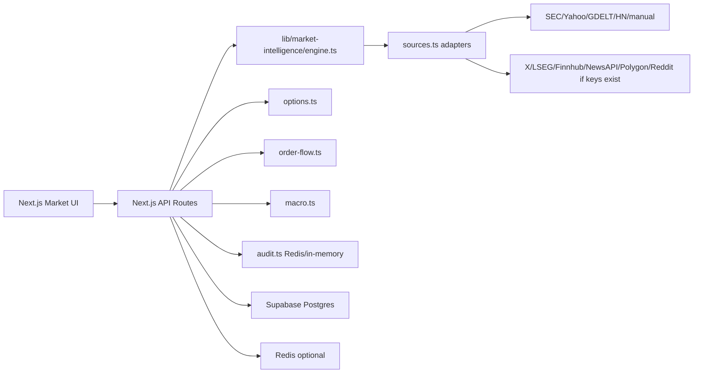
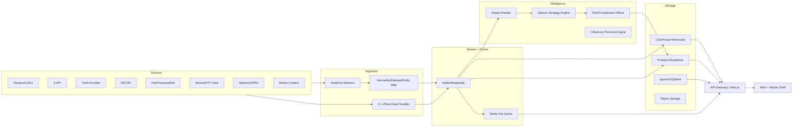

# AXIO7 Market Intelligence & Options Strategy Platform

唯一权威文档：PRD + Architecture + Data Sources + MCP Plan  
版本：v1.0  
日期：2026-05-24  
状态：可执行设计稿。后续实现、拆票、评审都以此文件为准。

---

## 0. Executive Decision

AXIO7 要做的是一个面向美股和期权交易者的实时市场情报与策略分析平台。

产品核心不是“新闻聚合”，而是：

```text
市场事件 -> 可信来源 -> 影响资产 -> 行情确认 -> 期权链/OI/Gamma确认
-> 概率分布 -> 策略候选 -> 风险/失效条件 -> 审计留痕
```

当前最优路线：

1. 保留现有 Next.js + market-intelligence 模块，不重写。
2. 免费/低成本先跑通：SEC、manual X/Truth、GDELT/Hacker News、Yahoo fallback、现有 API routes、fixture replay。
3. X 不先重金接。先用 `fixture/manual/search_adapter`，验证有效后再接 official API，并做预算硬拦截。
4. Truth/Trump 不乱爬。先 manual/provider stub；RSS 只作为候选，必须确认 ToS 和稳定性后再启用；生产用授权 vendor。
5. MCP 可以接，但不当主后端。MCP 是 AI agent 调用 AXIO7 能力的工具层，先做 read-only 本地 MCP，后续再做 remote MCP/OAuth。
6. Kafka、ClickHouse、C++/Rust feed handler 是 Phase 4+，不是 MVP 必需项。

---

## 1. Single Source Of Truth

本文件取代临时拆分的 `docs/PRD.md` 和 `docs/ARCHITECTURE.md`。原因：

- 拆成多份会让 PRD、架构、数据源、实现 delta 互相冲突。
- 当前仓库已经有不少市场情报代码，不能写成 green-field 项目。
- 后续工程师只需要看一份文件，就能知道“已有能力、缺口、怎么接数据、怎么上线”。

保留的相关文档：

| 文件 | 作用 |
|---|---|
| `docs/market-intelligence-prd-architecture.md` | 唯一权威产品和架构文档 |
| `docs/market-intelligence.md` | 当前运行模块说明，可作为 implementation note |
| `docs/SUPABASE_SETUP.md` | Supabase 设置 |
| `docs/PHASE2_AUTONOMY_BRIEF.md` | 另一个产品方向，不作为本系统权威文档 |

---

## 2. Product Definition

### 2.1 产品一句话

AXIO7 是一个实时市场情报和期权策略分析工作台，帮助用户在新闻、宏观、社交信号、行情和期权链之间建立证据链，而不是凭感觉追涨杀跌。

### 2.2 用户

目标用户：

- 关注美股科技成长股、AI、半导体、电力、数据中心、软件、加密和宏观政策的交易者。
- 以 NVDA、AMD、AVGO、MSFT、GOOGL、META、TSLA、PLTR、ORCL、SMH、QQQ 为核心 watchlist 的期权交易者。
- 需要追踪 Trump、White House、Fed、Reuters/LSEG、SEC、公司 IR、X influencer、Truth Social 和 options flow 的信息密集型交易者。

非目标用户：

- 只想看营销式日报的人。
- 想让系统自动托管资金和自动交易的人。
- 想绕过授权源、爬私有内容、使用非公开信息的人。

### 2.3 Jobs To Be Done

| 场景 | 用户问题 | 产品输出 |
|---|---|---|
| 突发新闻 | “这条 Trump / Reuters / Fed 新闻影响什么？” | 影响 ticker、方向、置信度、证据源、后续验证点 |
| 个股分析 | “NVDA 今天到底能不能追？” | 新闻催化、价格状态、订单流、期权链、概率分布、策略候选 |
| 期权策略 | “该用单腿、vertical、butterfly 还是 broken-wing？” | 适用场景、腿、最大亏损、最大盈利、breakeven、失效条件 |
| 信息源管理 | “现在数据可靠吗？” | Source health、额度、延迟、最近错误、是否生产可用 |
| AI 辅助研究 | “让 Claude/Codex 帮我分析但别瞎编” | MCP tools 从 AXIO7 API 拉真实数据，输出带来源的分析 |

### 2.4 非目标和硬边界

AXIO7 不做：

- 不自动执行 live trade。
- 不保证收益。
- 不提供个性化投资建议、法律建议、税务建议。
- 不使用内幕信息、泄露文件、私信、私有群聊。
- 不绕过登录、付费墙、验证码、robots.txt 或 API 条款。
- 不用未授权爬虫抓 X、Truth、券商、新闻付费内容。

允许做：

- 聚合公开、官方、授权、商业许可或用户自带 key 的数据。
- 生成研究参考、纸面策略、风险框架和证据链。
- 在用户明确确认和合规开关开启后，扩展 broker read-only 或 paper execution。

---

## 3. Existing Code Inventory

这个项目不是从 0 开始。文档和后续工程必须复用以下现有代码。

### 3.1 已有后端模块

| 模块 | 当前能力 | 保留方式 | 缺口 |
|---|---|---|---|
| `lib/market-intelligence/sources.ts` | 已有 10 类 source status 和 adapters：Reuters/LSEG、X、Truth vendor、market tape、SEC、Finnhub、NewsAPI、options flow、Polygon、Reddit | 保留为 source adapter v0 | 补 source mode、budget gate、source health 持久化 |
| `lib/market-intelligence/engine.ts` | 合规检查、事件排名、strategy signal、agent findings、brief | 保留为 MVP brain | 增强 options strategy 输出和 event scoring |
| `lib/market-intelligence/types.ts` | MarketEvent、SourceStatus、StrategySignal 等类型 | 保留 | 增加 normalized event、source usage、strategy candidate 类型 |
| `lib/market-intelligence/options.ts` | Polygon/Yahoo options chain、Max Pain、GEX、概率分布 | 保留 | 增强 IV surface、expiry selector、strategy legs |
| `lib/market-intelligence/order-flow.ts` | Polygon/Yahoo quote、last trades、intraday bars、VWAP、volume spike | 保留 | 接真实 order flow vendor，添加 trade classification |
| `lib/market-intelligence/market-signal.ts` | Yahoo + CNN Fear & Greed，指数、watchlist、sector、theme 指标 | 保留 | 修复中文编码，扩展市场宽度 |
| `lib/market-intelligence/news-pulse.ts` | 免费新闻 pulse：Hacker News + GDELT | 保留 | 接入 market event pipeline，不直接孤立展示 |
| `lib/market-intelligence/macro.ts` | FRED 宏观指标 | 保留 | 加 Fed calendar、Treasury、EIA |
| `lib/market-intelligence/insider.ts` | Insider / filing 相关能力 | 保留 | 跟 SEC event model 对齐 |
| `lib/market-intelligence/compliance.ts` | 合规 gate 和 disclaimer | 保留 | 扩展到 MCP/broker/tools 权限 |
| `lib/market-intelligence/audit.ts` | in-memory + Redis audit log | 保留 | 增加 Postgres append-only audit |
| `lib/market-intelligence/broker.ts` | Paper broker、live disabled、order planning | 保留 | live execution 继续默认关闭 |
| `lib/market-intelligence/brokers/alpaca.ts` | Alpaca adapter | 保留 | read-only/paper 优先 |
| `lib/market-intelligence/brokers/ibkr.ts` | IBKR Client Portal adapter | 保留 | read-only/paper 优先 |
| `lib/market-intelligence/broker-keys.ts` | BYO broker key AES-256-GCM | 保留 | 增加 key rotation 和 access audit |

### 3.2 已有 API routes

| Route | 当前作用 |
|---|---|
| `POST /api/market/research` | 市场研究 agent 主入口 |
| `GET /api/market/signals` | 市场抄底/风险信号 dashboard |
| `GET /api/market/news-pulse` | 免费新闻 pulse |
| `GET /api/market/options` | options chain / Max Pain / GEX / probability |
| `GET /api/market/order-flow` | order-flow / quote / bars |
| `GET /api/market/macro` | macro data |
| `GET /api/market/insider` | insider/filing signal |
| `GET /api/market/x-user` | X user helper |
| `POST /api/strategy/run` | strategy run alias |
| `POST /api/strategy/execute` | paper execution only |
| `POST /api/strategy/confirm-execute` | user-confirmed broker path, live gated |
| `GET/POST/DELETE /api/strategy/broker-keys` | BYO broker credentials |
| `GET /api/strategy/account` | paper account status |
| `GET /api/cron/market-strategy` | scheduled market strategy runner |

### 3.3 已有数据库

当前与本系统直接相关的 migration：

| Migration | 表 | 状态 |
|---|---|---|
| `014_user_broker_keys.sql` | `user_broker_keys` | 已有，RLS，AES payload |

注意：

- 当前没有完整的 market event 持久化表。
- `audit.ts` 现在主要是内存 + Redis，不是永久数据库审计。
- `paper broker` 当前是进程内存，不是多实例持久化账户。
- `007_events.sql` 是城市/校园 event 聚合，不是市场事件表，不能混用。

---

## 4. MVP Scope

### 4.1 MVP 必须做到

| 模块 | 必须有 |
|---|---|
| Source Registry | 10 类 source、mode、enabled、health、cost、quota |
| Manual Event | 用户粘贴 Trump X/Truth、Reuters headline、SEC URL 后能跑完整链路 |
| News/Event Ranking | source trust、freshness、materiality、ticker relevance、price/options confirmation |
| Ticker Console | ticker 视图：新闻催化、价格、order flow、options、概率分布、策略候选 |
| Options Lab | long call/put、vertical、butterfly、broken-wing butterfly 教学和数据化候选 |
| Source Health | 显示数据源是否可用、额度、最近错误、延迟 |
| Budget Gate | 特别是 X API，任何 paid source 调用前先预估成本并拦截 |
| Audit Trail | 每次研究、事件 ingestion、策略输出都记录来源和参数 |
| MCP v0 | read-only local MCP，让 Claude/Codex 调 AXIO7 API，而不是编数据 |

### 4.2 MVP 不做

- 不做 live auto trading。
- 不全量接 OPRA tick feed。
- 不上 Kafka/ClickHouse/C++ feed handler。
- 不承诺 X/Truth 低延迟，除非已经接官方/授权 provider。
- 不做移动端 native 优先，先做 responsive web；Capacitor 作为后续 alert/mobile shell。

---

## 5. Data Sources

### 5.1 十源矩阵

| # | Source | 目的 | 免费/试跑 | 生产接入 | 当前代码状态 |
|---:|---|---|---|---|---|
| 1 | Reuters / LSEG | 机构级突发新闻、公司新闻、宏观 | fixture/manual only | LSEG Data Platform / Machine Readable News | `sources.ts` 已有 LSEG adapter |
| 2 | 主流财经新闻 | CNBC、MarketWatch、Yahoo、AP、WSJ/Bloomberg 摘要 | NewsAPI/Finnhub/GDELT/手动 | 付费新闻 API 或授权 feed | Finnhub、NewsAPI、GDELT/HN 已有 |
| 3 | 官方政府/宏观 | White House、Fed、Treasury、BLS、BEA、EIA、CME | official RSS/API | 官方 API + calendar worker | FRED/macro 已有，其他待补 |
| 4 | SEC / 公司 IR | 8-K、10-Q、10-K、S-3、424B、insider | SEC EDGAR public API | SEC polling + IR RSS/vendor | SEC adapter 已有 |
| 5 | X 关键账号 | Trump X、Elon、influencer、政策/科技信号 | fixture/manual/search_adapter | Official X API recent search / filtered stream | X adapter 已有，需 mode/budget |
| 6 | Truth Social | Trump Truth、政治/关税/地缘 | manual/provider stub | 授权 provider/webhook | Truth vendor adapter 已有 |
| 7 | 美股行情 | price、volume、VWAP、pre/after market | Yahoo fallback、Finnhub/Polygon free tier | Nasdaq/IEX/Polygon/Massive/SIP/Databento | market/order-flow 已有 |
| 8 | 期权链 / OPRA | OI、IV、Greeks、volume、NBBO、gamma | Polygon/Massive free/low tier、Yahoo fallback | OPRA via Databento/Massive/ORATS/LiveVol/Cboe | options.ts 已有 |
| 9 | Broker Context | watchlist、paper、持仓、用户确认订单 | paper broker | IBKR/Alpaca/Tradier BYO key | paper/IBKR/Alpaca 已有 |
| 10 | 社区/另类信号 | Reddit、Stocktwits、Substack、YouTube、Google Trends | Reddit OAuth、manual、GDELT/HN | commercial social listening | Reddit/HN/GDELT 已有 |

### 5.2 成本梯度

下面是工程预算层，不是 vendor 报价单。实际价格以各供应商合同和 dashboard 为准。

| Tier | 月成本 | 能力 | 适合阶段 |
|---|---:|---|---|
| T0 Free | $0 | manual X/Truth、SEC、Yahoo fallback、GDELT/HN、paper broker、fixture replay | 先验证产品有效 |
| T1 Low-cost | $10-$250 | X 少量 credits、Polygon/Massive low tier、Finnhub/NewsAPI lower tier、Redis basic | MVP alpha |
| T2 Pro | $500-$2,000 | 更高频行情、更多 options snapshots、可靠 alerts、Sentry/observability、paid LLM budget | private beta |
| T3 Institutional Data | $5,000-$25,000+ | LSEG/Reuters、OPRA/Databento、ORATS/LiveVol、commercial social listening | paid users / production |
| T4 Trading Infrastructure | $50,000+ | exchange agreements、colocation、full OPRA firehose、strict compliance ops | 如果以后做专业 trading desk |

原则：

- 先用 T0/T1 证明“信号真的有用”。
- 不为了显得专业过早上 T3/T4。
- 每个 paid source 都必须有 usage meter、quota、budget limit、kill switch。

### 5.3 X 免费/低成本方案

官方 X API 当前是 pay-per-use：按读取的 resource 计费，官方文档写明可以在 Developer Console 购买 credits、实时监控 usage，并设置 spending limit。Posts read 的公开文档价格在 2026-05-24 查询为 `$0.005/resource`，但价格可能变化，系统必须以 dashboard/usage API 为准。

配置：

```env
X_SOURCE_MODE=fixture
# fixture | manual | search_adapter | official_api

X_BEARER_TOKEN=
X_SPEND_LIMIT_USD=10
X_DAILY_SPEND_LIMIT_USD=1
X_WATCHLIST=realDonaldTrump,elonmusk,zerohedge,unusual_whales
X_POLL_INTERVAL_SECONDS=60
X_MAX_POSTS_PER_POLL=10
```

模式：

| Mode | 成本 | 延迟 | 用途 |
|---|---:|---:|---|
| `fixture` | 0 | 本地 | 用历史/假设事件 replay 全链路 |
| `manual` | 0 | 人工 | 用户粘贴 X URL/text，系统做分析 |
| `search_adapter` | 低/不稳定 | 分钟级 | 搜索网页中引用的 X post，不承诺实时 |
| `official_api` | 按量 | 秒到分钟 | 生产使用，必须预算拦截 |

X 预算硬上限机制：

```text
preflight:
  estimated_resources = handles * max_posts_per_poll
  estimated_cost = estimated_resources * current_configured_unit_cost
  if month_spend + estimated_cost > X_SPEND_LIMIT_USD: block
  if day_spend + estimated_cost > X_DAILY_SPEND_LIMIT_USD: block

request:
  call X API
  store returned post ids
  dedupe by post id for 24h

reconcile:
  call X usage endpoint when available
  update provider_usage table/Redis counter
  alert at 50%, 80%, 95%
```

新增表：

```sql
provider_usage(
  id uuid primary key,
  provider text not null,
  period text not null, -- daily | monthly
  period_start timestamptz not null,
  resource_count bigint not null default 0,
  estimated_cost_usd numeric not null default 0,
  vendor_reported_cost_usd numeric,
  last_reconciled_at timestamptz,
  created_at timestamptz not null default now(),
  updated_at timestamptz not null default now()
)
```

验收：

- 没有 `X_BEARER_TOKEN` 时系统仍可完整运行。
- `manual` 粘贴一条 Trump tariff post 后，能输出影响资产、方向、置信度、需要验证的二级信号。
- `official_api` 模式下，超过预算会返回明确错误，不会继续烧钱。

### 5.4 Truth / Trump 方案

Truth Social 不能假设有稳定官方公开 API。生产规则：

允许：

- Manual paste：用户粘贴 Truth URL/text。
- Authorized provider：Dataminr、Factal、Meltwater、Sprinklr、NewsWhip 等同类 vendor，前提是合同明确覆盖 Truth 数据。
- Provider webhook：供应商推送事件到 AXIO7。
- Public RSS：只作为候选，必须确认该 URL 稳定、可公开访问、ToS 允许、频率克制，才能启用。

禁止：

- 模拟登录。
- 绕过限制。
- 批量抓受限页面。
- 把受限内容再分发。

配置：

```env
TRUTH_SOURCE_MODE=manual
# manual | provider_webhook | provider_polling | public_rss_verified

TRUTH_PROVIDER_URL=
TRUTH_PROVIDER_KEY=
TRUTH_WATCHLIST=realDonaldTrump
TRUTH_POLL_INTERVAL_SECONDS=60
```

MVP 决策：

- `manual` 是默认。
- `provider_webhook` 是生产标准。
- `public_rss_verified` 只有在 legal/ToS review 后开启。

### 5.5 Reuters / LSEG 方案

Reuters/LSEG 是高可信源，应放在 source trust 最高层。

MVP：

- 不购买前用 fixture/manual。
- 保留现有 `LSEG_CLIENT_ID`、`LSEG_CLIENT_SECRET` adapter。
- UI 显示“未连接，不使用模拟实时数据”。

Production：

- 接 LSEG Data Platform / Machine Readable News。
- 严格遵守 redistribution 权限。
- 原文不长段复制，只保存必要 metadata、headline、link、timestamp、entitlement id。

### 5.6 期权/OPRA 方案

MVP：

- 使用现有 `options.ts`。
- 优先 Polygon/Massive snapshot。
- 没 key 时 fallback Yahoo options JSON，仅用于研究展示，标记 reliability。

Production：

- 评估 Massive/Polygon paid options、Databento OPRA、ORATS、LiveVol、Cboe DataShop。
- 期权链必须包含：expiration、strike、call/put、bid、ask、mid、last、volume、OI、IV、delta、gamma、theta、vega、underlying price、asOf。
- OPRA full firehose 不进 MVP；先 snapshots + selected symbols。

---

## 6. Event Intelligence Model

### 6.1 事件标准化

每个事件进入系统后都变成 `NormalizedMarketEvent`：

```ts
type NormalizedMarketEvent = {
  id: string;
  sourceId: string;
  sourceKind: string;
  sourceAccess: 'public' | 'authorized' | 'vendor' | 'manual' | 'demo';
  headline: string;
  summary: string;
  sourceUrl?: string;
  publishedAt: string;
  receivedAt: string;
  tickers: string[];
  assetClasses: string[];
  tags: string[];
  sentiment: 'bullish' | 'bearish' | 'neutral' | 'mixed';
  materialityScore: number;
  confidence: number;
  verificationStatus: 'single_source' | 'corroborated' | 'price_confirmed' | 'options_confirmed' | 'invalidated';
  riskFlags: string[];
  evidence: Array<{ label: string; value: string; url?: string }>;
};
```

### 6.2 评分

```text
marketImpactScore =
  sourceTrust * 0.20
+ freshness * 0.15
+ materiality * 0.25
+ affectedAssetRelevance * 0.10
+ corroboration * 0.10
+ priceConfirmation * 0.10
+ optionsConfirmation * 0.10
```

| 维度 | 说明 |
|---|---|
| sourceTrust | SEC/Fed/White House/Reuters/LSEG > 公司 IR > 价格数据 > 主流新闻 > influencer > Reddit |
| freshness | 突发事件越新越高，半衰期按事件类型调整 |
| materiality | 是否影响收入、利润、供应链、关税、利率、监管、地缘 |
| affectedAssetRelevance | 是否命中用户 watchlist |
| corroboration | 是否多源确认 |
| priceConfirmation | 价格/成交量是否响应 |
| optionsConfirmation | IV/OI/volume/gamma 是否异常 |

### 6.3 状态

| 状态 | 含义 |
|---|---|
| `new` | 新事件，未确认 |
| `corroborated` | 多源确认 |
| `price_confirmed` | 行情确认 |
| `options_confirmed` | 期权确认 |
| `invalidated` | 被更高可信来源推翻 |
| `stale` | 已过期 |

---

## 7. Options Strategy Lab

### 7.1 分析顺序

每次分析 ticker，顺序必须固定：

1. 新闻和宏观：是否有真正改变预期的事件。
2. 价格：是否突破/跌破关键位，成交量是否确认。
3. 订单流：是否有大单、VWAP 偏离、买卖压力。
4. 期权链：OI、volume、IV、skew、gamma、call wall、put wall。
5. 做市商行为：pin、kill premium、gamma squeeze、vol crush、short squeeze。
6. 概率分布：未来一周/到期价格区间。
7. 策略选择：方向强则 directional，目标价明确则 butterfly，横盘则 credit spread。

### 7.2 支持策略

| 策略 | 场景 | 输出 |
|---|---|---|
| Long Call | 强看涨，有催化，有突破 | premium、breakeven、IV crush 风险 |
| Long Put | 强看跌，有利空/破位 | premium、breakeven、下方目标 |
| Bull Call Spread | 温和看涨，目标上沿明确 | buy lower call / sell higher call |
| Bear Call Spread | 温和看跌或上方受限 | sell lower call / buy higher call |
| Bull Put Spread | 温和看涨或守支撑 | sell higher put / buy lower put |
| Bear Put Spread | 温和看跌，目标下沿明确 | buy higher put / sell lower put |
| Long Butterfly | 到期接近某价格点 | 成本低，收益集中 |
| Broken-Wing Butterfly | 偏方向，想降低成本 | 一侧翼更宽，风险不对称 |

每个策略候选必须输出：

- 交易腿。
- net debit/credit。
- max profit。
- max loss。
- breakeven。
- 到期最佳价格区间。
- 适用原因。
- 不适用原因。
- 失效条件。
- 数据来源和 asOf。
- 数据不足时写“暂无可靠数据”。

### 7.3 概率分布

输入：

- spot。
- historical volatility。
- implied volatility。
- option implied move。
- event impact score。
- earnings / macro calendar。
- OI/gamma map。
- 支撑/压力。

MVP：

- 使用 lognormal distribution + ATM IV + days to expiry。
- 在现有 `options.ts` 基础上输出 price buckets。

Production：

- 加 Monte Carlo。
- 加 jump diffusion for event risk。
- 加 order-flow adjusted distribution。
- 加 regime model：trend / chop / panic / squeeze。

---

## 8. Architecture

### 8.1 MVP 架构

MVP 不需要 Kafka、ClickHouse、C++。当前仓库已经足够跑一个可用 alpha：



MVP 实现原则：

- 继续使用 Next.js route handlers。
- 所有 provider 都走 adapter interface。
- paid source 调用前先 budget preflight。
- 所有 UI 显示 source reliability，不用假数据补空。
- Source mode 可通过 env 切换。

### 8.2 Target Production 架构

Phase 4+ 才上：



### 8.3 为什么不是一开始 C++/Kafka

低延迟不是一开始就堆技术。AXIO7 当前瓶颈不是 CPU，而是：

- 数据授权。
- 数据质量。
- source reliability。
- 策略逻辑是否真的有用。
- UI 是否能清楚呈现。

C++/Rust feed handler 适合处理 OPRA/full tape hot path；MVP 的新闻、策略、ticker analysis 用 Next.js workers 已经够用。

---

## 9. Data Model Reconcile

### 9.1 已有表

已存在：

```sql
user_broker_keys(user_id, kind, env, encrypted_payload, created_at, updated_at)
```

保留，不重复建。

### 9.2 新增市场情报表

```sql
market_sources(
  id uuid primary key,
  name text not null,
  kind text not null,
  access_mode text not null,
  source_mode text not null default 'disabled',
  trust_score int not null default 50,
  enabled boolean not null default false,
  credential_ref text,
  terms_notes text,
  created_at timestamptz not null default now(),
  updated_at timestamptz not null default now()
)

raw_market_events(
  id uuid primary key,
  source_id uuid references market_sources(id),
  source_event_id text,
  raw_payload jsonb,
  raw_text text,
  source_url text,
  published_at timestamptz,
  received_at timestamptz not null default now(),
  payload_hash text not null
)

normalized_market_events(
  id uuid primary key,
  raw_event_id uuid references raw_market_events(id),
  headline text not null,
  summary text,
  language text default 'en',
  event_type text,
  sentiment text,
  materiality_score int not null,
  confidence int not null,
  verification_status text not null,
  expires_at timestamptz,
  created_at timestamptz not null default now()
)

market_event_tickers(
  id uuid primary key,
  event_id uuid references normalized_market_events(id) on delete cascade,
  ticker text not null,
  asset_type text not null default 'equity',
  relevance_score int not null,
  direction text,
  reason text
)

provider_usage(
  id uuid primary key,
  provider text not null,
  period text not null,
  period_start timestamptz not null,
  resource_count bigint not null default 0,
  estimated_cost_usd numeric not null default 0,
  vendor_reported_cost_usd numeric,
  last_reconciled_at timestamptz,
  created_at timestamptz not null default now(),
  updated_at timestamptz not null default now()
)

strategy_runs(
  id uuid primary key,
  user_id uuid,
  ticker text not null,
  thesis text,
  horizon text not null,
  event_ids uuid[] not null default '{}',
  created_at timestamptz not null default now(),
  status text not null default 'completed'
)

strategy_candidates(
  id uuid primary key,
  run_id uuid references strategy_runs(id) on delete cascade,
  strategy_type text not null,
  legs jsonb not null,
  max_profit numeric,
  max_loss numeric,
  breakevens jsonb,
  probability_estimate numeric,
  rationale text,
  invalidation text,
  risk_notes text,
  source_refs jsonb not null default '[]'::jsonb
)

market_audit_logs(
  id uuid primary key,
  actor text,
  action text not null,
  entity_type text,
  entity_id text,
  source_refs jsonb not null default '[]'::jsonb,
  meta jsonb not null default '{}'::jsonb,
  created_at timestamptz not null default now()
)
```

### 9.3 Later 表

这些先不建，Phase 3/4 再上：

- `option_snapshots`
- `order_flow_snapshots`
- `influencer_profiles`
- `influencer_posts`
- `source_health_checks`
- `alert_rules`
- `alert_deliveries`

---

## 10. API Contract

### 10.1 现有 API 保留

不破坏当前 route。新增字段保持 backward compatible。

### 10.2 新增 API

```http
GET /api/market/sources
GET /api/market/sources/health
GET /api/market/events?limit=50&severity=P0
POST /api/market/events/manual
POST /api/market/ticker/analyze
POST /api/market/options/strategy
GET /api/market/provider-usage
POST /api/market/provider-usage/reconcile
```

Manual event：

```json
{
  "sourceType": "x_manual",
  "sourceUrl": "https://x.com/...",
  "text": "Trump says ...",
  "publishedAt": "2026-05-24T12:00:00Z",
  "tickersHint": ["NVDA", "QQQ", "FXI"]
}
```

Strategy request：

```json
{
  "ticker": "NVDA",
  "horizon": "1w",
  "bias": "bullish",
  "maxRiskUsd": 500,
  "preferredStrategies": ["bull_call_spread", "broken_wing_butterfly"],
  "eventIds": ["evt_123"]
}
```

---

## 11. MCP Plan

### 11.1 MCP 是什么

MCP 是 Model Context Protocol。它让 AI assistant 用统一协议连接外部工具和数据源。Claude 官方文档把 MCP 分为：

- Local MCP：跑在用户设备上，适合桌面工具、本地 API、开发环境。
- Remote MCP：跑在互联网上，适合 SaaS、云服务、OAuth 连接器。

MCP 的组成：

- Tools：AI 可以执行的动作。
- Resources：AI 可以读取的数据。
- Prompts：预定义任务模板。

### 11.2 AXIO7 要不要接 MCP

结论：要接，但不要把 MCP 当生产主后端。

正确位置：

```text
Claude/Codex/AI Agent
        |
        v
AXIO7 MCP Server  ->  AXIO7 API  ->  Market Engine / DB / Vendor Adapters
```

错误位置：

```text
用户 Web App -> MCP -> vendor
```

原因：

- Web 产品需要稳定 API、鉴权、审计、缓存、限流。
- MCP 主要给 AI agent 调工具，不适合承载所有用户流量。
- 工业级系统必须把 source adapters、budget、audit、compliance 放在自己的 backend。

### 11.3 第一版 AXIO7 MCP

先做 local read-only MCP，名称：

```text
axio7-market-mcp
```

工具：

| Tool | Read/Write | 作用 |
|---|---|---|
| `get_source_health` | read | 返回 source 状态、quota、latency、errors |
| `search_market_events` | read | 搜索 normalized events |
| `get_ticker_brief` | read | 拉 ticker 价格、新闻、宏观、风险摘要 |
| `get_options_chain` | read | 拉指定 ticker/expiry options chain |
| `get_open_interest_map` | read | 返回 top OI、call wall、put wall、max pain |
| `get_order_flow` | read | 返回 quote、VWAP、bars、large prints |
| `analyze_probability_distribution` | read | 返回价格分布 |
| `suggest_options_strategy` | read | 返回策略候选，不下单 |
| `run_strategy_replay` | read | 用 fixture/historical event 复盘 |
| `ingest_manual_event` | write-limited | 只允许用户手动粘贴事件，写入 manual source |

禁止放进 MCP v1：

- `execute_live_order`
- `store_raw_api_key`
- `delete_database_rows`
- `scrape_x_or_truth`
- `bypass_paywall`

### 11.4 MCP 安全策略

- 默认 read-only。
- 写操作只允许 `ingest_manual_event` 和后续 `create_alert_rule`。
- 所有 tool 调用写 audit。
- MCP server 不保存 vendor secrets，只调用 AXIO7 API。
- 本地 MCP 用 `.env.local` 指向 `AXIO7_API_BASE_URL` 和一个本地 token。
- Remote MCP 必须 OAuth + per-user permissions。
- Live broker order 不通过 MCP 暴露。

### 11.5 工业级可接 MCP/Connector

| 类别 | 是否建议 | 原因 |
|---|---|---|
| AXIO7 自研 Market MCP | 强烈建议 | 让 AI 读真实 AXIO7 数据 |
| GitHub MCP/Connector | 建议 | PR、issue、CI、部署协同 |
| Vercel Connector | 建议 | 部署、env、logs |
| Sentry/Observability MCP | 建议 | 生产错误诊断 |
| Postgres/Supabase MCP | 谨慎 | 只读优先，避免 AI 误写生产 DB |
| Redis MCP | 谨慎 | 只读 health/cache keys |
| Broker MCP | 不建议 v1 | 风险太高，先走 AXIO7 后端强 gate |
| Vendor data MCP | 视情况 | 多数 vendor 没 MCP，需要自己封装 API |

---

## 12. UI Information Architecture

不要放首页。放在交易/分析侧栏。

```text
Market
  Overview
  News Pulse
  Source Radar
  Influencer Desk
  Ticker Console
  Options Strategy Lab
  Alerts
  Source Health
```

视觉原则：

- 黑白为主体。
- 参考 Interactive Brokers：专业、密集、表格清楚。
- 颜色只表达状态：红跌、绿涨、蓝信息、黄风险、灰中性。
- 不用花哨渐变、大 hero、营销式卡片。
- 每个字高对比度可读。
- 数字、ticker、strike、expiry 使用等宽字体。
- 表格列宽固定，移动端允许横向滚动。

---

## 13. SLO

分层，不把付费生产指标强压到免费 MVP。

| 项目 | Free MVP | Paid MVP | Production |
|---|---:|---:|---:|
| Manual event analysis | p95 < 5s | p95 < 3s | p95 < 2s |
| News/free source ingest | p95 < 120s | p95 < 30s | p95 < 5-10s with vendor feed |
| X ingest | manual only | p95 < 60s | p95 < 10s with official/provider |
| Truth ingest | manual only | provider-dependent | p95 < 10s with webhook |
| SEC filing detection | p95 < 180s | p95 < 60s | p95 < 30s |
| Quote API | provider-dependent | p95 < 800ms cached | p95 < 250ms hot cache |
| Options snapshot | provider-dependent | p95 < 1500ms | p95 < 500ms hot cache |
| Dashboard load | p95 < 2.5s | p95 < 1.5s | p95 < 1s |
| Alert fanout | p95 < 30s | p95 < 10s | p95 < 3s |

---

## 14. Compliance And Risk

硬规则：

- 每个重要结论必须带 source refs。
- 无可靠数据写“暂无可靠数据”。
- 数据冲突要显示冲突，不强行合成。
- 不输出保证收益。
- 不把 influencer 当事实源，只作为 social signal。
- 任何 broker/live 相关动作必须用户确认、审计、默认关闭。
- Paid source 遵守 redistribution 许可。
- MCP 不暴露危险工具。

风险标签：

| 标签 | 含义 |
|---|---|
| `demo_source` | fixture/manual，不能当实时事实 |
| `social_uncorroborated` | 社交信号未确认 |
| `vendor_limit` | provider quota/latency 影响 |
| `redistribution_limited` | 付费内容不可再分发 |
| `market_data_delayed` | 行情可能延迟 |
| `options_liquidity_risk` | bid/ask 太宽或成交稀疏 |
| `iv_crush_risk` | 事件后波动率塌缩 |
| `gamma_pin_risk` | 到期 pin risk |

---

## 15. Roadmap

### Phase 0：文档和清理

- 本文件成为唯一权威文档。
- 删除重复 PRD/ARCHITECTURE 临时稿。
- 列出现有代码和 delta。

### Phase 1：Free/Low-Cost Signal Chain

- Source mode：fixture/manual/search_adapter/official_api。
- Manual event ingestion。
- X budget gate。
- Truth manual/provider stub。
- Source health UI。
- 修复 market-signal 中文编码。

### Phase 2：Ticker Console + Options Lab

- Ticker detail 页面。
- 新闻催化 + order flow + options + probability。
- Strategy candidates：vertical、butterfly、broken-wing butterfly。
- 策略教学和案例放在分析侧栏，不放首页。

### Phase 3：AXIO7 Market MCP

- 本地 read-only MCP。
- Claude/Codex 可调用 AXIO7 API 做真实数据分析。
- `ingest_manual_event` 作为唯一 write-limited tool。
- 所有 MCP 调用审计。

### Phase 4：Paid Production Data

- X official API with budget enforcement。
- LSEG/Reuters。
- Polygon/Massive or Databento options。
- Commercial social provider。
- Postgres event persistence。
- Alert rules。

### Phase 5：Industrial Hot Path

- Kafka/Redpanda。
- Redis hot cache。
- ClickHouse/Timescale。
- C++/Rust feed handler for selected market/options feeds。
- Observability and incident runbooks。

---

## 16. Acceptance Criteria

### 16.1 数据源

- 没有 paid key 时，系统仍可通过 manual/fixture/free sources 跑通。
- Source Health 能清楚显示 enabled、mode、quota、cost、last error。
- Paid source 超预算时硬拦截。
- Truth 默认不自动抓取，除非 provider 或 legal-reviewed public feed。

### 16.2 事件分析

- 粘贴一条 Trump tariff 相关文本，系统输出 affected assets、方向、置信度、风险标签。
- 粘贴一条 NVDA H200 export 相关新闻，系统映射 NVDA、AMD、AVGO、SMH、QQQ、FXI/KWEB。
- 每条事件可追溯 source URL、timestamp、raw payload hash。

### 16.3 期权分析

- 输入 NVDA + expiry，能输出 options chain、top OI、Max Pain、GEX、概率分布。
- 能生成至少 4 类策略候选：long call/put、vertical、butterfly、broken-wing butterfly。
- 每个策略都有 max loss、max profit、breakeven、适用/不适用场景和失效条件。

### 16.4 MCP

- Claude Desktop 能通过 local MCP 调 `get_ticker_brief`。
- MCP 不接触 vendor secrets。
- MCP 不暴露 live execution。
- MCP 调用有 audit。

---

## 17. Immediate Engineering Tasks

优先级从高到低：

1. 增加 `source_mode` 和 provider usage/budget gate。
2. 增加 manual event API 和 UI。
3. 重构 Source Health 页面。
4. 修复 market-signal 中文编码。
5. 把 `news-pulse` 接入 normalized event model。
6. 增强 options strategy candidate 输出。
7. 新增 market event persistence migrations。
8. 新增 local `axio7-market-mcp`。
9. 评估 X official API 小额 credits。
10. 评估 Truth provider 或 legal-reviewed RSS。

---

## 18. Reference Links

- Claude MCP docs: https://claude.com/docs/connectors/building/mcp
- Claude local MCP help: https://support.anthropic.com/en/articles/10949351-getting-started-with-local-mcp-servers-on-claude-desktop
- X API pricing: https://docs.x.com/x-api/getting-started/pricing
- X API rate limits: https://docs.x.com/x-api/fundamentals/rate-limits
- SEC EDGAR APIs: https://www.sec.gov/search-filings/edgar-application-programming-interfaces
- SEC developer resources: https://www.sec.gov/about/developer-resources
- LSEG news pagination example: https://developers.lseg.com/en/article-catalog/article/lseg-data-library-for-python--news-pagination
- LSEG machine-readable news factsheet: https://www.lseg.com.cn/content/dam/data-analytics/en_us/documents/fact-sheets/machine-readable-news-real-time-optimized-and-tick-history-factsheet.pdf
- Massive/Polygon options overview: https://www.polygon.io/docs/options
- Massive/Polygon unified snapshot: https://polygon.io/docs/rest/options/snapshots/unified-snapshot
- Databento OPRA pricing notes: https://databento.com/blog/introducing-new-opra-pricing-plans
- Truth Social terms: https://help.truthsocial.com/legal/terms-of-service/
