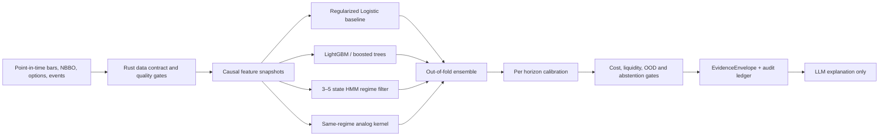

# AXIO7 模型系统审计与窄标的路线图

状态：设计基线
审计日期：2026-07-25
适用范围：短周期市场研究、动量/VWAP 转折、潜在 gamma feedback 结构
产品边界：研究候选，不下单，不做个性化建议，不把方向性 setup 称为无风险套利

## 1. 结论先行

AXIO7 现在不是“没有模型”，而是模型、研究代码和数据资产已经很多，但生产链路尚未形成一个经过独立样本外验证的统一系统。

当前真正被冻结并能由 Rust 读取的在线预测器，是：

1. 因果 HMM regime 模型；
2. 同 regime 的历史相似核（analog kernel）；
3. 独立的校准注册表和数据质量门控。

Logistic、梯度提升、TVTP-HMM、pattern mining、market memory、短周期随机过程等也存在，但分别处于 Python 研究、Rust CLI、shadow、测试或实验状态，不能写成“都已在生产组合里运行”。

更关键的是，现有负对照报告的结论是 `NO_EDGE`：方向准确率看起来约 52%–55%，但 log loss 没有稳定优于无条件基准。冻结候选也标记为 `RESEARCH_ONLY / REJECTED_NO_INDEPENDENT_OOS_EVIDENCE`。因此当前系统可以发布可复现的描述统计和研究候选，不能发布“已验证上涨概率”。

第一版正确目标不是覆盖全市场，而是：

> 对 5–15 个高流动性标的，持续计算一致的实时特征，识别动量延续、VWAP 转折风险和潜在 gamma feedback 结构，并给出数据时效、反向证据、历史条件分布和明确失效条件。

所谓“更像机构”，重点不在使用更大的神经网络，而在研究治理：

- 多个弱而独立的模型形成共识；
- 每个预测都能追溯到 point-in-time 数据；
- 训练、校准和最终测试严格隔离；
- 成本、流动性、数据缺失和模型不确定性都能让系统 abstain；
- 只有不可变、已晋升的 artifact 能进入生产。

## 2. 当前系统到底用了什么

### 2.1 运行时分工

| 层 | 当前内容 | 实际状态 | 应有边界 |
| --- | --- | --- | --- |
| Rust `quant_engine_rs/` | 数据门控、查询、因果特征、HMM、analog、gamma 结构、审计、API | 生产主引擎；部分模块仍属实验 | 唯一在线定量推理服务 |
| Python `intraday_quant/` | 特征研究、Logistic、HistGradientBoosting、analog、校准、walk-forward | 离线研究；默认流程仍含 synthetic 配置 | 训练、验证、导出 artifact |
| C++ `quant_core_cpp/` | 特征、标签、baseline、Logistic、HMM、analog、校准、paper OMS | 与 Rust 大量重复；尚未完成本机 CMake 检查 | 只保留确有性能价值的 native kernel，或退役 |
| TypeScript `app/ components/ lib/` | UI、鉴权、自然语言约束解析、Rust 代理 | 新路径符合边界；旧定量代码仍留在 `lib/quant/` | 不计算概率、Greeks、GEX 或收益 |
| LLM | 问题到 allow-listed DSL；解释 EvidenceEnvelope | 应为可选解释层 | 不读取不存在的数据，不自行计算市场结论 |

### 2.2 当前在线冻结模型

冻结 artifact 的模型标识为 `same-regime-kernel+cv-selected-hmm-frozen-v1`。

#### HMM regime

当前 HMM 特征：

- 5 分钟收益；
- 距 session VWAP；
- 实现波动率；
- 成交量 z-score。

状态数从 2–10 个候选中按时间顺序验证似然选择，最后选择了 10。问题是最优点落在搜索边界，artifact 自己也记录了 `STATE_COUNT_OPTIMUM_IS_NOT_ESTABLISHED`。这说明“10 个状态最合适”并未被证明。多数状态又被启发式标成 mean reversion，状态解释性和跨窗口稳定性不足。

#### Same-regime analog kernel

当前相似日特征：

- 1/5/15 分钟收益；
- VWAP 距离；
- 实现波动率与 bar range；
- volume z-score 与 RVOL；
- session range position；
- cross-asset breadth；
- 15 分钟斜率；
- minute-of-session。

相似度使用 shrinkage covariance / Mahalanobis 类距离和 Gaussian kernel，并要求：

- dominant regime 一致；
- posterior cosine 相似；
- 有足够有效样本；
- 不处于 OOD；
- 权重不能过度集中。

它输出的本质是带权历史频率和条件分布。未经独立校准晋升时，只能叫 `raw analog frequency`，不能叫经过验证的概率。

#### 校准与决策

- 校准 artifact 与预测 artifact 分离；
- 缺少匹配的已晋升校准器时 fail closed；
- 当前 decision policy 保持 `NO_TRADE`；
- 每次预测可写入 ledger/audit。

这个方向是正确的，但还缺一个强制的 production promotion registry：API 必须确认“模型、特征、标签、数据和校准”整套组合已晋升，不能因为文件名叫 frozen 就默认可公开。

### 2.3 已实现但没有成为正式在线 ensemble 的模型

| 模型/模块 | 所在位置 | 当前用途 | 结论 |
| --- | --- | --- | --- |
| Logistic classifier | Python/C++，Rust nonlinear tests | baseline / 研究 | 应保留为必须击败的透明基准 |
| HistGradientBoosting | Python | 离线分类与回归 | 尚未形成可由 Rust 验证加载的不可变 artifact |
| Boosted/nonlinear comparison | Rust | 测试与模型比较代码 | 未接生产推理链 |
| TVTP-HMM、Gaussian/Student-t/HSMM competition | Rust CLI | regime 研究 | 未接 API，不应宣传为在线模型 |
| 短周期 diffusion + VWAP residual OU + momentum head | Rust shadow/batch | 研究输出 | 冻结推理时明确不参与生产决策 |
| Closing short-cover hazard | Rust shadow | 研究 | 暂不公开排名 |
| Pattern factory / motif discovery / FDR | Rust research | 假设挖掘 | 需要独立 OOS 和多重检验后才能晋升 |
| Market memory / event atlas | Rust research | 事件相似性 | 可作为证据，不应代替预测验证 |

### 2.4 当前 setup 检测器

已有 allow-listed setup：

- `gamma_squeeze`；
- `vwap_reversal`；
- `opening_turn`；
- `closing_short_cover`；
- `statistical_dislocation`。

其中 opening turn 和 VWAP 当前更接近“因果事件检测 + 无条件历史描述”。已有一次本地历史运行覆盖 504 个 session，421 次符合事件，event bar 中位数为第 6 根，15 分钟向下延续 raw frequency 为 45.13%。这不是预测优势。

现有 gamma scanner 是一个未校准的结构评分，主要由以下手工权重组成：

- 近 ATM unsigned gamma 集中度：25%；
- call gamma share：20%；
- call volume share：20%；
- 关键 strike 距离：15%；
- call volume/OI：10%；
- spread：10%。

这可以叫 `potential gamma-convexity structure score`，不能叫 squeeze 概率。它仍缺少：

- 标的价格动量、RVOL、VWAP 与市场相对强度；
- trade-level flow 及其不确定性；
- IV 变化、skew、term structure；
- volume/OI 的历史分位数；
- earnings/event calendar；
- float 和 short-interest 时效；
- 条件历史表现；
- 对 dealer sign 假设的情景化表达。

公开 OI 不能告诉系统 dealer 是买方还是卖方，也不能可靠区分开仓和平仓。正确说法是：

> Under the stated positioning scenario, estimated gamma exposure is negative/positive.

而不是：

> Dealers are definitely short gamma.

## 3. 当前证据说明了什么

### 3.1 数据

- 仓库中约有 154 万行 Massive 一分钟股票 aggregates；
- 大致覆盖 2024-07-18 至 2026-07-22；
- 覆盖标的和行数在多次同步中扩展；
- 多个 manifest 指向同一个被覆盖的 `market_bars.csv`；
- 模型训练引用若干互相重叠的同步 hash。

这些数据足以做基础分钟级股票研究，但不足以做可信的历史 gamma 回放，因为缺少 point-in-time 的完整期权定义、OPRA NBBO、size、trade、OI availability 和标的对齐。

当前 Massive readiness receipt 显示：

- 股票 WebSocket 无实时 entitlement；
- SIP snapshot 返回 403；
- OPRA chain probes 返回 403；
- `production_ready=false`。

因此网站现在必须返回 `DATA_UNAVAILABLE`，不能用 Yahoo、synthetic 或延迟数据冒充实时结果。

### 3.2 模型验证

当前候选 artifact 标记为：

- `CONTAMINATED_EXPLORATORY`；
- `RESEARCH_ONLY`；
- `REJECTED_NO_INDEPENDENT_OOS_EVIDENCE`；
- source commit 为未提交 worktree。

负对照最新结果：

- 两个 fold；
- 30 分钟 horizon；
- full model log loss 约 0.6944 / 0.6909；
- 未稳定击败 unconditional baseline；
- cross-asset 增量极小或更差；
- 状态为 `NO_EDGE`。

这也解释了为什么 52%–55% accuracy 不足以证明模型有效：如果类别本身不平衡，或概率排序与校准没有改善，accuracy 可以看起来不错而没有可交易信息。

### 3.3 部署

- 网站前端已部署；
- Rust 引擎还没有稳定、认证的生产 HTTPS 服务；
- 没有能通过 readiness 的实时 consolidated stocks + options 数据 entitlement；
- 所以当前生产闭环尚未完成。

## 4. 技术债清单

### P0：不修就可能产生伪结果或错误生产声明

1. **Python 测试目标泄漏**

   `_fit_family` 的 uncertainty 使用了 `test["target_return"].mean()`。预测时引用 test label，必须删除并重做全部相关指标。

2. **未晋升 artifact 可能被当作 frozen 在线读取**

   `frozen` 只表示文件被冻结，不表示模型通过独立 OOS。所有公开预测端点必须先验证 promotion registry 中完整 tuple：

   `data_manifest + feature_schema + label + model + calibration + cost_model + code_commit`

3. **OI 时间语义错误**

   当前 options snapshot 容易把“本次拉取时间”当成 OI 观测时间。必须分开：

   - `oi_observation_date`；
   - `oi_available_at`；
   - `quote_observed_at`；
   - `provider_received_at`。

   日频 OI 不能按数秒 freshness 处理。

4. **mutable latest 文件与重叠 manifest**

   一个不断被覆盖的 CSV 和大量 `*_latest.json` 不足以提供 point-in-time 可复现性。需要按 provider/date/symbol 分区、content-addressed hash、append-only manifest 和对象存储。

5. **生产 profile 必须禁止 synthetic**

   synthetic 只允许测试。生产/预生产启动时若 source 为 synthetic，应直接失败。

6. **实时数据尚未通过 entitlement**

   Rust backend 部署和 live data readiness 是生产激活的外部阻断项。未通过时继续 fail closed。

### P1：第一版窄标的系统需要完成

1. 每个 horizon 单独定义标签和模型，不再用一个最大 horizon 代表 15/30/60 分钟。
2. setup/direction 必须进入特征或拆成独立模型，不能把异质 setup 混在一个目标里。
3. 修复跨 session rolling：
   `price_volume_divergence` 等窗口必须按 session 分组。
4. 修正单位不一致的 trend 定义：
   15 分钟 return 应与同 horizon volatility 比较。
5. 接入 point-in-time earnings、FOMC、CPI、NFP、OPEX 等日历；缺失不能默认为 false。
6. 建立真正的条件历史查询：
   gamma、momentum、VWAP 的当前筛选条件必须能原样 replay。
7. gamma scanner 加入 underlying confirmation、IV/skew/term、历史异常分位和 contrary evidence。
8. HMM 状态数按跨 fold 稳定性和下游预测效用选择，第一版建议限制为 3–5，而非追求更高 likelihood 的 10。
9. 将 TypeScript 旧量化模块隔离到 retired/legacy，并在 CI 禁止 UI/API 导入定量计算模块。
10. C++ 二选一：
    - 只保留 OPRA decoder、特征 kernel 等明确的性能热点，加入 Rust parity tests；
    - 或退役重复的模型/OMS。
11. 研究产品中移除 paper OMS/broker 的默认编译和运行路径；至少放到单独 feature/crate。

### P2：基础模型有真实 OOS 证据后再做

- schema-constrained LLM query compiler；
- 自动 motif/pattern hypothesis factory；
- FDR 控制和 hypothesis registry；
- drift-aware champion/challenger；
- alert/monitor；
- Transformer、深度序列模型或强化学习。

在只有约两年、十几个标的的分钟数据时，复杂神经网络大概率首先学习到 regime 和日期特征，不会自动产生稳定优势。

## 5. 第一版模型：5–15 个标的

### 5.1 默认研究宇宙

在用户给出最终 ticker 前，建议用 10 个高流动性标的作为默认 target：

`SPY, QQQ, NVDA, AAPL, MSFT, META, AMZN, TSLA, AMD, AVGO`

context-only 可增加：

`IWM, SMH/SOXX, HYG, TLT, VIX/VXX, ES, NQ`

context 不等于可被推荐的 target。这样能保持目标数量小，同时保留市场宽度、风险偏好、利率和半导体联动。

### 5.2 只做四类输出

#### A. Momentum continuation

输出未来 5/15/30/60 分钟：

- 净收益超过成本阈值的校准概率；
- return quantiles；
- MFE/MAE 条件分布；
- 失效条件；
- 数据质量与流动性门控。

#### B. VWAP reversal hazard

不要声称“第 9 根一定转折”。输出：

- 当前是第几根 finalized 5-minute bar；
- 未来 1/3/6 根 bar 内出现定义明确的 reclaim/rejection/exhaustion 的 hazard；
- 最常见窗口及分位区间；
- 条件失效状态。

#### C. Potential gamma feedback structure

输出：

- 确定性的结构评分；
- 关键 strike 和距离；
- unsigned gamma concentration；
- call/put volume、OI 和历史异常分位；
- IV/skew/term 变化；
- underlying momentum/RVOL/VWAP confirmation；
- scenario-based GEX；
- 反向证据；
- 条件历史 forward distribution。

这不是 arbitrage，也不是 dealer positioning 的直接观测。

#### D. Volatility expansion

预测未来窗口内实现 range 超过明确阈值的概率，而非只预测方向。对期权研究，先把“是否发生足够大的 move”预测好，通常比猜涨跌更有用。

### 5.3 推荐模型组合

具体顺序：

1. Logistic 是透明、稳定、必须击败的 baseline；
2. LightGBM/boosted trees 捕捉非线性和交互；
3. HMM 只负责 regime/context，不单独决定交易方向；
4. analog 给出可解释的历史条件分布和 OOD；
5. ensemble 权重只能由 out-of-fold 结果确定；
6. calibration 按 horizon，必要时按 universe bucket，而不是在极少样本上为每个 symbol/regime 单独拟合；
7. 所有模型不确定时 abstain。

### 5.4 特征最小集合

#### 标的与 cross-asset

- 1/5/15/30 分钟 return 与 slope；
- session VWAP distance/slope/reclaim；
- opening range 与 session range position；
- realized volatility、ATR、bar range；
- volume z、RVOL、signed volume proxy；
- QQQ/IWM/SMH/HYG/TLT/VIX/ES/NQ 的 breadth、lead-lag 和相对强弱。

#### Microstructure

- NBBO spread 与 quoted size；
- microprice / queue imbalance；
- trade direction proxy 及不确定性；
- quote/trade staleness；
- 短窗口 realized impact。

#### Options

- near-ATM gamma concentration；
- OI、volume 和 volume/OI 历史分位；
- key strike distance；
- call/put volume 与 premium；
- IV level/change、skew、term structure；
- DTE、spread、quote coverage；
- earnings/event risk；
- OI observation date。

short interest 和 float 可作慢变量，但必须显示发布日期和 age，不能伪装为实时。

## 6. 验证设计

### 6.1 数据切分

必须使用按 session 的 purged walk-forward：

1. expanding/rolling train；
2. validation 用于模型与阈值选择；
3. 独立 calibration；
4. untouched test；
5. 上线后 60–90 个交易日 forward shadow。

重叠 horizon 标签之间要 embargo。一个被研究人员反复查看过的日期，不能再叫 untouched OOS。

### 6.2 必须比较的基准

- unconditional frequency；
- always-up / always-down；
- time-of-day baseline；
- Logistic；
- no-regime；
- shuffled labels；
- no-options / no-cross-asset ablation；
- analog-only；
- current ensemble。

### 6.3 指标

概率模型：

- log loss；
- Brier score；
- calibration curve / ECE；
- ROC-AUC 与 PR-AUC；
- coverage / abstention rate。

连续分布：

- pinball loss；
- interval coverage；
- MAE；
- MFE/MAE quantile calibration。

研究经济性：

- after-cost expectancy；
- spread/slippage sensitivity；
- fill assumptions；
- turnover；
- drawdown；
- regime/year concentration；
- worst-fold 和 bootstrap confidence interval。

概率不应仅仅通过硬截断到 1%–99% 来“校准”。需要 prior smoothing、out-of-fold calibration 和最小有效样本门槛。接近 0%/100% 的值在金融场景中应极其罕见，并仍不表示逻辑必然。

### 6.4 晋升标准建议

第一版模型只有同时满足以下条件才可以从 `RESEARCH_ONLY` 晋升：

- untouched test 的 log loss/Brier 稳定优于无条件与 Logistic baseline；
- 不止一个市场阶段有效；
- 扣除保守成本后 expectancy 为正；
- calibration 没有严重过度自信；
- 至少 1,000 个独立预测，且 forward shadow 不少于 60 个交易日；
- 数据/feature/model/calibration artifact 全部不可变、可复现；
- readiness、drift 和 rollback receipt 通过。

这不是保证赚钱的门槛，只是允许产品公开“validated model estimate”的最低治理条件。

## 7. 专业免费或低成本数据

价格截至 2026-07-25，仅用于预算比较；资格、非专业身份、交易所费用、API 限制和商业展示权以供应商合同为准。

| 数据源 | 大致成本 | 能解决什么 | 主要限制 | 适合 AXIO7 |
| --- | ---: | --- | --- | --- |
| OCC daily OI | 免费 | 官方日度 OI 文件 | 非实时、无 quote/trade、无 dealer sign | OI 基础与交叉核验 |
| Massive Stocks Basic | $0 | 2 年 EOD/分钟 aggregates | 5 calls/min，无实时 SIP | 现有股票历史 baseline |
| Massive Options Basic | $0 | 2 年 EOD/分钟 aggregates | 无实时 OPRA | 粗粒度研究，不够做 NBBO 回放 |
| Tradier brokerage market data | 合资格账户通常可低成本获得 | 实时 consolidated equities/options、chains；ORATS Greeks 定期更新 | sandbox 延迟；rate/许可/商业展示需确认 | 最便宜的私人窄标的 live MVP 候选 |
| IBKR | 非专业行情订阅通常为每项几美元级 | 实时股票/OPRA、Greeks、账户内验证 | TWS/Gateway、默认 100 lines、整链不适合大规模订阅、不可默认用于公开网站 | 第二实时源或 selected-strike 验证 |
| ThetaData Options Standard | 约 $80/月 | 约 8 年期权历史、chain snapshot、NBBO/trades | 本地 terminal；个人/商业许可需确认 | 5–15 标的低成本期权研究首选候选 |
| Alpaca Algo Trader Plus | 约 $99/月 | 全 SIP/OPRA，options WebSocket 配额约 1,000 | 免费层只是 IEX + indicative options；历史深度较短 | 过滤后 near-ATM 订阅 |
| Databento | 历史有 $125 credit；live 通常按 dataset 订阅 | 高质量 point-in-time OPRA/期货历史与 live | live 多数据集成本上升 | 用 credit 做小范围严谨样本与 parity 验证 |
| Cboe DataShop | 按 symbol/date/product 报价 | 官方历史 1-minute NBBO、size/volume，可选 Greeks/OI | 全历史和指数底层可能昂贵 | 购买小样本做金标准验证 |
| Massive Advanced stocks + options | 约 $199 + $199/月（个人计划） | 简单的一站式实时 stocks/options | 个人/非专业条款；公开网站商业许可远高于个人价 | 预算充足的私人 MVP |

官方参考：

- [Massive stocks pricing](https://massive.com/pricing?product=stocks)
- [Massive options pricing](https://massive.com/pricing?product=options)
- [Tradier market data](https://docs.tradier.com/docs/market-data)
- [IBKR market-data pricing](https://investors.interactivebrokers.com/en/pricing/market-data-pricing.php)
- [IBKR TWS API documentation](https://www.interactivebrokers.com/campus/ibkr-api-page/twsapi-doc/)
- [ThetaData subscriptions](https://www.thetadata.net/subscribe)
- [Alpaca market-data plans](https://docs.alpaca.markets/us/v1.1/docs/about-market-data-api)
- [Databento pricing](https://databento.com/pricing-preview)
- [Cboe option quote intervals](https://datashop.cboe.com/option-quote-intervals)
- [OCC daily open interest](https://www.theocc.com/market-data/market-data-reports/other-market-data-info/batch-processing/daily-open-interest)

### 7.1 三档建议

#### 最低成本私人研究版

- 现有 Massive 免费/已下载历史用于 underlying；
- Tradier 合资格账户用于实时股票和期权；
- OCC OI 交叉核验；
- Databento 免费 credit 购买少量 OPRA 历史做验证；
- 从现在开始自建 append-only forward archive。

优点是几乎不增加固定数据费。缺点是不能立即拥有多年完整 OPRA 回放，gamma 模型必须先作为结构扫描器并累积 forward shadow。

#### 推荐的低成本研究版

- ThetaData Options Standard：约 $80/月；
- Tradier 或 IBKR：实时 underlying/第二来源验证；
- 现有 Massive underlying 历史；
- OCC OI 交叉核验。

这是当前最适合 5–15 个标的、又不直接花数百美元/月的组合。购买前必须书面确认网站使用和 derived-data 展示权。

#### 最简单的一站式私人版

- Massive Stocks Advanced + Options Advanced：约 $398/月。

接入最省工程时间，但个人计划不等于可把实时数据喂给公开 SaaS。Massive 的 business options 页面起价已是约 $1,999/月级别，完整实时商业授权可能更高。

### 7.2 网站许可边界

“自己账户内研究”和“在 axio7.com 向用户展示实时数据/derived output”是两种授权。

第一阶段建议：

- 模型和数据服务仅在 owner-only/private beta 使用；
- 公共页面只展示延迟研究、方法和明确的数据不可用状态；
- 在拿到供应商商业条款前，不向公共用户再分发现行 OPRA/SIP 原始值；
- derived analytics 是否需要额外授权，必须让供应商书面确认。

## 8. 推荐的实施顺序

### Phase A：可信基线

1. 修复 Python leakage、session rolling 和 horizon 标签；
2. 建立 immutable data/artifact registry；
3. promotion registry 强制接入 Rust API；
4. 将 HMM 降为 3–5 state 候选，并按稳定性/下游效用比较；
5. 对 10 个默认标的训练 Logistic、boosted tree、analog；
6. 只输出 raw statistics，保持 `RESEARCH_ONLY`。

### Phase B：实时窄标的扫描

1. 选择 Tradier/ThetaData/Alpaca 之一；
2. 实现 provider adapter 和 entitlement/readiness receipt；
3. 订阅 targets + context，不订阅全市场；
4. 完成 momentum、VWAP hazard 和 gamma structure 的实时因果 snapshot；
5. 每个信号保存完整特征、cutoff 和后续真实 outcome。

### Phase C：历史条件验证

1. 购买/导入所需标的的 point-in-time options history；
2. 同一 DSL 在 live 和 backtest 中执行；
3. purged walk-forward + costs + negative controls；
4. 单独 calibration；
5. 开始 60–90 日 forward shadow。

### Phase D：受控产品化

1. champion/challenger 和 drift；
2. 只有晋升 artifact 才显示 calibrated probability；
3. LLM 只将自然语言编译成严格 DSL 并解释引擎证据；
4. owner-only beta 先行；
5. 商业数据授权完成后再扩大网站用户和标的。

## 9. 用户需要提供或确认的内容

启动窄标的版只需要四项：

1. 最终 5–15 个 ticker；
2. 主要关注优先级：momentum、VWAP turn、gamma feedback、volatility expansion；
3. 使用范围：仅自己/内部，还是对 axio7.com 的外部用户开放；
4. 月度数据预算上限。

如果暂时不提供，默认按：

- 10 个 target；
- 四类输出都做，优先 momentum + VWAP；
- owner-only/private beta；
- 固定数据预算不超过 $100/月。

## 10. 与机构式研究的差距

[Jane Street 对机器学习的公开说明](https://www.janestreet.com/join-jane-street/machine-learning/)强调噪声、非平稳性、低延迟训练/推理基础设施和快速 regime shift；[Two Sigma 的 regime 研究](https://www.twosigma.com/articles/a-machine-learning-approach-to-regime-modeling/)展示了概率式 regime 识别；其[投资管理说明](https://www.twosigma.com/businesses/investment-management/)则强调独立预测、共识、成本和风险。

AXIO7 可以学习的是这套过程：

- 不让 GPT 直接猜；
- 不迷信单一模型；
- 把小优势拆成独立预测器；
- 用共识、校准、成本和风险门控；
- 把每一次预测变成可审计实验；
- 自动知道什么时候没有足够证据。

“DreamFarmers”没有检索到对应的公开量化机构或模型资料，可能是语音识别或名称误差。本路线图按 Jane Street、Two Sigma 以及常见系统化研究流程理解；如有具体链接，应单独核对其真实方法。

## 11. 最终产品表述

建议网站写：

> Discover market dislocations and statistically unusual setups in real time.

中文：

> 用自然语言扫描实时市场条件，返回可复现的候选、支持与反向证据、历史条件表现和数据时效。

不要写：

> AI 自动找到无风险套利，准确预测下一根 K 线。

第一版成功的标准不是“每天给一个答案”，而是：

> 有可靠数据和经过验证的优势时给出有证据的候选；没有时明确 abstain。
