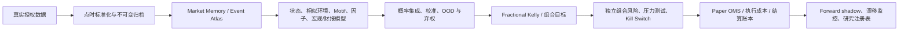

# AXIO7：公开可复现的 Simons-inspired 概率研究与风险系统

版本：2026-07-21
性质：非个性化、全市场数学研究与 forward shadow 基础设施；当前**不是生产/实盘就绪系统**，不是 Renaissance/Medallion 复刻，也不承诺准确预测未来或任何收益。生产配置不路由订单。

Regime 的规范实现见 [`regime-model-specification.md`](./regime-model-specification.md)：Two Sigma 四态 GMM、CV 选 K 的 HMM、八态 challenger 和同状态核回归是四个分层模块，不能混称为一个“Simons 八态公式”。

## 0. 先把证据边界说清楚

十张图片提供了很好的研究目录，但其中很多内容是传记摘录、二次摘要或轶事，不是 Renaissance 的公开源代码、参数或生产规则。可以实现的是公开数学方法与专业工程约束，不能声称知道其专有模型。

2014 年美国国会听证的一手记录支持的规模约为 **100 万行代码**，并提到约 25 年累计、约 1000 人年工作量；并非公开一手材料确认的 1000 万行。代码行数也不是模型质量指标。真正需要长期积累的是：点时数据、失败实验、执行仿真、风控、监控、数据授权和可重放审计。

公开资料能够确认的核心原则是：

1. 使用数学和统计方法处理大量不同类型的数据。
2. 同时研究很多微弱预测，而不是依赖一条“神奇公式”。
3. 单次预测只需略有优势，但必须大量重复、分散且控制相关性。
4. 人持续研究、修改模型和代码；系统不是脱离人的神秘自我进化机器。
5. 模型会失效，黑天鹅、杠杆、拥挤和流动性必须由独立风险系统控制。

因此 AXIO7 的目标不是“保证猜中未来”，而是：

> 在决策时刻只使用当时真实可见的数据，输出经样本外检验和校准的概率分布；当数据、证据、成本或风险不满足要求时，明确输出 `NO_TRADE`。

## 1. 十张图片逐张落地

| 图片 | 可用思想 | AXIO7 工程落点 | 不能直接采用的内容 |
|---|---|---|---|
| Photo 1 | 压力下的人类行为可能重复；恐慌、贪婪和过度反应 | 拥挤、流动性压力、快速抛售、反转和恢复时间；事件条件反应；HMM/变点状态 | “人类行为可预测”不能成为无条件结论；情绪只能用代理变量观察 |
| Photo 2 | 根据概率变化动态调整风险；系统持续修正 | 概率校准、贝叶斯更新、fractional Kelly、目标仓位与当前仓位差额 | 不能根据最近盈亏追涨杀跌；Kelly 不是预测器 |
| Photo 3 | 5 分钟序列中的非随机效应、日历效应和潜在趋势 | minute-of-session × weekday 假设、motif 检索、日块 bootstrap、FDR、多重负控 | 188/199、50/63、星期五尾盘等轶事不得硬编码为真理 |
| Photo 4 | 量化策略也会拥挤；Smart Beta、因子与风格风险 | gross/net、单票、行业、因子、相关性趋一、容量、ADV、尾部风险和 kill switch | “量化会稳定市场”不是始终成立；共同去杠杆时可能放大波动 |
| Photo 5 | 跟随数据；检索相似历史环境；核回归 | Market Memory、Event Atlas、Mahalanobis/核近邻、ESS、OOD、历史路径分布 | 公开材料不能证明某种具体核函数就是 Medallion 的实现 |
| Photo 6 | Kelly 信息论下注框架 | 对已校准情景分布求 log-growth 最优比例，再做 1/4 Kelly 和风险收缩 | “真实赔率”本身需要估计；概率失准时完整 Kelly 会放大损失 |
| Photo 7 | 多数时候略占优；SDE 风险/定价；黑箱也可使用 | selective ensemble、abstention、期权定价基线、数据血缘和解释卡 | 黑箱不能免除验证；GBM/Heston 不是现实价格的保证 |
| Photo 8 | 隐藏市场状态；不同状态释放不同信号 | forward-filtered HMM、状态转移、持续期、状态条件预测与风险预算 | 状态数不能因为图片写“8”就固定为 8 |
| Photo 9 | Baum–Welch、Markov/HMM、趋势阈值 | HMM 训练和在线过滤；简单趋势规则只作为基线对照 | Baum–Welch 是公开算法；不能据此声称知道 Renaissance 的 HMM |
| Photo 10 | 宏观变量、状态识别、数据驱动短期预测 | ALFRED vintage、宏观 nowcast、SEC 财报实际值、consensus surprise 和状态融合 | 50% 年化、8 状态等传记数字不是系统验收目标 |

## 2. 总体生产边界



任何 alpha 模块都不能绕过 E、G 和 H。`NO_TRADE` 是正式决策，不是错误或缺失数据。

## 3. 十二个详细工程 block

### Block 1：真实数据源、授权与数据能力

职责：只声明系统真正拥有、可使用并可重放的数据能力。

输入：

- Massive/Polygon 股票分钟聚合；
- Moomoo/OpenD 前向实时流；
- Databento 股票、CME、OPRA 等授权数据；
- SEC EDGAR submissions 与 CompanyFacts；
- FRED/ALFRED、BLS、BEA、EIA；
- 合法的 earnings consensus、新闻、逐字稿与期权数据。

输出：provider、dataset、schema、entitlement、时间/symbol 覆盖、缺口、staleness、display/model 权限、原始响应哈希、manifest 和成本估算。

失效闸门：只有 key 没有成功请求、历史覆盖和 entitlement 时不得显示 `READY`；Yahoo 等当前快照不得作为生产历史训练源；股票分钟聚合不得冒充 SIP quote、NBBO、L2/L3 或 OPRA。

当前状态：真实 Massive 1m 与 Moomoo 前向流已存在；SIP/OPRA/SPXW/完整期权曲面尚未就绪。

### Block 2：Point-in-time 标准化与不可变归档

统一记录必须包含：

```text
entity / symbol
field / event_type
event_time
available_time
received_time
provider / upstream_vendor
source_record_id
revision_id / supersedes_revision_id
payload_sha256
availability_precision
license_class / feature_use
```

`event_time` 是事实对应的经济或市场时间；`available_time` 是策略首次可以合法、技术上观察到该精确值的时间；`received_time` 是 AXIO7 实际收到的时间。模型连接只允许 `available_time <= decision_as_of`，修订值只能在自己的可用时间后替换旧 vintage。

当前实现：`quant_engine_rs/src/data/context.rs` 增加 domain、availability precision、license、feature use、source ID、SHA-256 和修订链校验；`latest_by_field_as_of` 是模型唯一允许使用的 context join；ingest-time-only、未知许可、缺少血缘或错误修订链会 fail closed。`restricted`、`licensed_display_only`、`display_only` 与 `prohibited` 行只进入不含数值的审计计数，不得出现在 `latest_features`；新的拒绝/限制记录也不会静默回退到旧的获许可值。

生产 context readiness 只读取 `model_eligible_domain_counts`：它按当前 as-of 下真正通过模型用途授权和点时审计的 `latest_features` 计数。更宽泛的 `domain_counts` 包含仅供审计、被策略排除的行，不能用来把 SEC、ALFRED、consensus、news 等域误判为模型已就绪。

`official-context-sync-v2` 的归档验证会从磁盘重新读取并重算 normalized 输出的 SHA-256，同时逐一重新读取、重算 manifest 引用的每个 raw SEC/ALFRED artifact；路径必须位于规定 data/raw 根目录，provider 集合、输出路径和所有哈希都必须一致。仅有 manifest 声明而文件缺失、内容变化或任一哈希不匹配时，官方 context 不具备模型 readiness。

### Block 3：财报实际值、基本面与 earnings surprise

这是两个不同问题：

1. 预测下一期 revenue、EPS、margin、FCF 的分布；
2. 在市场预期、估值、状态和拥挤条件下预测价格对 surprise 的反应。

公开实际值来自 SEC 10-K、10-Q、8-K、20-F/6-K：revenue、net income、diluted EPS、gross profit、operating income、operating cash flow、capex、assets、liabilities、equity、cash，并保留 amendment/XBRL revision chain。

严格可用时间是 SEC `acceptanceDateTime`。不得把 `filingDate` 人工设成开盘时间。

point-in-time analyst consensus、estimate dispersion/revision、guidance、transcript 与完整 earnings calendar 需要合法商业授权。没有 consensus 时只能建立“财务实际值/趋势模型”，不得计算所谓 earnings surprise。

当前实现：`scripts/sync-official-context.mjs` 连接 SEC ticker/CIK、submissions、历史附加 submissions 和 CompanyFacts，仅保留能够映射到精确 acceptance timestamp 的记录；每条记录保留 accession、source ID、SHA-256、修订链和原始响应归档。`lib/market-intelligence/sources.ts` 已删除人为 `13:30Z` filing time。

### Block 4：宏观 vintage、nowcast 与当前局势

宏观水平不是“从月初起就已知”。CPI、就业、GDP 等都有发布时间和后续修订。

模型输入包括 growth、inflation、labor、liquidity/financial conditions、yield curve、real yields、credit spreads、USD、oil、gold、VIX，以及 actual-consensus-prior surprise 和政策事件。

专业做法是混频 dynamic factor/Kalman nowcast，支持 ragged edge；地缘和政策局势应成为有来源、首次公开时间、置信度和修订记录的事件，不让 LLM 自由叙事直接控制交易。

当前实现：official sync 使用 FRED/ALFRED `output_type=4` 获取 initial release；FRED 只有日期精度时，保守地到当日 23:59:59.999Z 后才允许使用；当前修订后的 FRED 历史不会倒灌进历史训练样本。下一阶段仍需带精确时间的经济日历 consensus 数据。

### Block 5：Market Memory 与 Event Atlas

每个决策时刻保存不可变 Market Snapshot：收益、多尺度波动、VWAP/开盘/前日关键位、成交量、流动性、spread、cross-asset、breadth、state probability、当时已知事件、缺失/插补不确定性和完整 lineage。

标签与特征严格分离。5/15/30/60 分钟、barrier、next session 等 forward label 只能在成熟后追加。

Event Atlas 保存事件首次公开时间、类别、来源、实体、revision，以及事件后完整路径、MFE、MAE、恢复时间、条件分布、preregistered threshold 和 tail probability。

当前状态：schema/store 已实现，但正式 Market Memory archive 与 Event Atlas 仍未物化，UI 必须显示 BLOCKED/PENDING。

### Block 6：隐藏状态、变点与宏观状态

HMM 在线输出：

\[
P(S_t=k \mid X_{1:t})
\]

生产只能用 forward filter，不能在历史决策点使用包含未来数据的 smoother/Viterbi 结果。

候选包括 Gaussian/Student-t HMM、Hamilton Markov switching、HSMM、Bayesian online change-point 和 macro dynamic-factor state。状态数 K 通过滚动 OOS log loss、稳定性、持续时间、占比和下游增量选择，不能固定为 8。

当前实现已对 HMM artifact、概率单纯形、emission、transition、state permutation、schema hash 和 model hash fail closed；还需增加 Student-t 与无 HMM 对照的真实 OOS 评估。

### Block 7：相似环境、Kernel Analog 与 Motif 工厂

相似环境距离：

\[
d_i=\sqrt{(x-x_i)^T\Sigma_{shrink}^{-1}(x-x_i)}
\]

核权重与有效样本：

\[
w_i \propto \exp\left(-\frac{d_i^2}{2h^2}\right),\qquad
ESS=\frac{(\sum_iw_i)^2}{\sum_iw_i^2}
\]

输出方向概率、收益分位数、MFE/MAE、barrier 和历史 analog lineage。低 ESS、高 OOD、相似日期重叠或当前环境没有历史覆盖时必须弃权。

Motif/非随机效应只属于 research factory：minute-of-session × weekday、opening/close/holiday、sell-off/recovery、volume/spread motif、earnings/macro event 后路径。必须经过 discovery、purged validation、untouched test、forward shadow、FDR、day-block bootstrap、placebo、时间置换和成本翻倍。图片中的具体 5 分钟数字只作为候选 hypothesis，不作为生产参数。

### Block 8：因子、中性化与概率集成

因子首先用于解释和约束：market、size、value、quality、profitability、investment、momentum、low-vol、liquidity、industry、short-interest。

预测模型从简单基线开始：unconditional/market-implied、logistic/elastic net、kernel analog、tree/GBRT、HMM-conditioned、macro/fundamental/event。所有子模型输出同一预测合同：分布、时间戳、feature hash、model hash、训练截止、校准状态和证据等级。allocation 只接受**唯一一条**注册的 15 分钟 live forecast；`decision_as_of` 必须相对当前评估时刻新鲜且不在未来，`latest_input_available_at` 必须不晚于 `decision_as_of`、不在评估时刻之后且仍在新鲜度窗口内。重复的 15 分钟记录、缺失时间、未来输入或 post-decision 输入一律 `NO_TRADE`。

集成权重有 signal/group cap，错误高度相关的模型不能被当作独立证据。验收使用 log loss、Brier、calibration、coverage 和 risk-coverage，不只看涨跌 accuracy。

### Block 9：Bayesian Betting 与 Fractional Kelly

Kelly 回答“已知分布下投多少”，不回答“方向是什么”。AXIO7 对离散情景求：

\[
f^*=\arg\max_f \sum_i p_i\log(1+fr_i)
\]

工程流程：验证概率与收益；要求模型 promoted、数据新鲜、lineage 完整；要求 ESS、OOD、regime entropy、calibration 通过；扣 spread/fee/slippage/impact；默认只用 1/4 Kelly；再按 calibration/OOD/entropy/sample 收缩；最后受单票、gross、correlated exposure 和 minimum trade 限制；只输出 target proposal，不直接生成订单。稀疏分位数不能直接被离散成 Kelly 情景，因为这会把分位数以外的尾部截断；只有带显式上下尾部条件期望、概率和 OOS 校准状态的完整情景分布才可进入配置器。

进入 Kelly 前还要求三条独立证据同时成立：live forecast 必须与 append-only prediction ledger 中同一 `prediction_id` 的完整 JSON **精确相等**；`data_manifest_hash` 必须匹配当前数据能力检查所识别的 active manifest/normalized archive；模型晋级 registry 必须由外部配置的 `MODEL_PROMOTION_REGISTRY_SHA256` 固定文件哈希，并满足 active、有效期、reviewer、approval、模型/特征/数据哈希和 untouched forward-shadow 证据约束。只在 forecast 文件里自报 `PROMOTED` 不构成晋级。

当前实现：`quant_engine_rs/src/allocation.rs` 与 `quant_engine_rs/src/api.rs`。现有预测未晋级且成本后无优势，因此当前端点应保持 `NO_TRADE`。

### Block 10：独立组合风险、尾部与拥挤

风险输入来自真实头寸、市场价值、ADV、因子暴露、历史组合收益和压力情景，不能来自预测模型的“自信程度”。

指标包括 gross/net、单票、HHI、beta/factor exposure、historical VaR、Expected Shortfall、daily loss、drawdown、ADV participation、清算天数，以及相关性趋一、市场暴跌、利率/信用/波动冲击、策略拥挤、数据中断和 broker reject。

缺少历史收益、压力情景或 ADV 时不是“风险为 0”，而是“风险未知”，阻止新增风险。每一个压力场景都必须以非零 asset/factor shock 覆盖组合内**全部非零持仓**；空 shock、全零 shock、与持仓无交集或部分覆盖的任何场景都会使整套压力证据失败。至少需要 3 个可用场景，且至少 1 个必须对当前组合产生实际 adverse loss；symbol/factor 先规范化再匹配。组合、持仓、历史收益、ADV 和压力库都必须带 as-of 与非零 SHA-256 lineage，风险文件还必须相对当前评估时刻新鲜。

当前实现：`quant_engine_rs/src/portfolio_risk.rs`。没有真实 `portfolio_risk_input_latest.json`、快照陈旧或独立风险未批准时 API 返回 `BLOCK_NEW_RISK`，allocation 也保持 `NO_TRADE`。运行时 portfolio 是绑定 risk snapshot 与 allocation 的权威头寸源；如果 `portfolio_is_authoritative=false`，即使磁盘 risk 文件内部自洽也不得新增风险，allocation 明确 `NO_TRADE`。

### Block 11：执行、成本与订单状态机

执行层必须模拟或记录 spread、commission、fees、temporary/permanent impact、delay/queue/adverse selection、partial fill、cancel/reject、borrow/financing/halt。signal at t close，最早 t+1 执行。

期权 long 不能用 mid 假成交；至少用 ask+slippage 进入、bid-slippage 退出。没有历史 NBBO/OPRA 时，不得用 underlying P&L 冒充期权结果。

公网 Next gateway 只暴露明确 allowlist；所有经该 gateway 的量化控制面读取和写入都要求用户邮箱显式列入 `QUANT_ADMIN_EMAILS`，普通应用 admin 身份不会自动获得量化权限，并由服务端附加至少 32 字符的 control token。POST 还要求 same-origin、JSON content type 和流式 64 KiB body cap。Rust 控制面在未实现 TLS/mTLS 前强制绑定 numeric loopback，不开放 permissive CORS，只有 `/health` 可无 token 读取。解除 risk kill switch 除 control token 外还必须提供独立、至少 32 字符且不能与 control token 相同的 `RISK_APPROVAL_TOKEN`。broker live 默认关闭。

现有执行能力仍是研究/paper 合同；真正连接 broker 的 OMS、订单恢复与对账、实时 post-trade exposure/P&L/limit 监控、独立 risk service 和人工值守流程尚未完成，因此不能据此宣称实盘就绪。

### Block 12：研究注册、晋级、shadow 与监控

每个 hypothesis 保存 immutable specification/hash、discovery/validation/test/forward 分区、features/labels/cost/hyperparameters、所有失败和负控、code/data/model version 及晋级状态。

```text
RESEARCH_ONLY
  -> PURGED_VALIDATION_SUPPORTED
  -> UNTOUCHED_OOS_SUPPORTED
  -> FORWARD_SHADOW
  -> PAPER_ELIGIBLE
  -> LIMITED_LIVE（需要单独人工与合规授权）
```

校准漂移、数据陈旧、成本超标、OOD、风险异常或数据权利变化都应使策略降级为 `NO_TRADE/BLOCKED`。

## 4. 语言与系统分工

现代机构没有统一的“秘密语言”。公开资料显示，Jane Street 核心交易与风险大量使用 OCaml；HRT 研究侧大量使用 Python、交易技术侧更偏 C++；Citadel 量化研究公开强调 Python 与 C++。

| 语言/存储 | AXIO7 角色 | 原因 |
|---|---|---|
| Python | 离线研究、统计诊断、模型训练、XBRL/NLP、宏观 nowcast | 研究生态成熟，迭代快 |
| Rust | 数据校验、replay、在线特征、推理、组合风险、状态机、API | 内存安全、确定性、并发和低延迟 |
| C++ | 必须使用 C++ SDK 的券商/venue bridge；真正出现瓶颈时的 hot path | 生态与极致延迟 |
| TypeScript/Next.js | 研究与风险界面、server-side gateway | 产品交互；不承载核心交易判断 |
| Parquet/Arrow | 大规模不可变列式历史 | 压缩和研究扫描 |
| SQLite WAL | 预测、实验、修订和审计元数据 | 追加式事务与可重放 |

不需要为了“像机构”而盲目增加语言。只有明确的性能、SDK 或团队边界才应增加复杂度。

## 5. 当前真实数据闭环

已存在：Massive 1m 历史、Moomoo/OpenD 实时事件和 finalized bars、Rust predictor/settlement/ledger，以及 Market Memory/Event/Analog/HMM/Motif 严格合同。

本轮新增：SEC acceptance-time + CompanyFacts 同步、ALFRED initial-release 同步、context provenance/revision/license 与模型授权域计数、`official-context-sync-v2` normalized/raw 全链重哈希、context fusion API、因果且唯一 15 分钟 forecast gate、精确 ledger/当前 manifest/外部固定晋级 registry、fractional Kelly evidence gate、独立 portfolio risk、UI“策略与风险”工作区、Next allowlist 和分离的 control/risk-resume token。

仍缺少：point-in-time analyst consensus、exact-time macro consensus calendar、PIT news archive、SIP/NBBO/OPRA/SPXW、正式物化 Market Memory/Event Atlas、真实 portfolio risk snapshot、真正 broker-connected OMS 与 post-trade risk、足够长 untouched forward shadow 和可复现 OOS edge。

## 6. API 与 UI

新增只读端点：

- `GET /api/v1/context/fusion`
- `GET /api/v1/allocation/betting`
- `GET /api/v1/risk/portfolio-analytics`

界面新增“策略与风险”tab，展示七道生产边界、真实数据 readiness、PIT context、动态下注、gross/net/factor/liquidity/VaR/ES/stress、独立风险检查与 kill switch。缺失值显示 `—/UNAVAILABLE`，未通过显示 `BLOCKED/NO_TRADE`，不显示伪造准确率或收益。

## 7. 实际运行前需要的凭证和选择

1. `SEC_USER_AGENT`：真实产品名与联系邮箱；
2. `FRED_API_KEY`：32 字符 FRED/ALFRED key；
3. 确认 Databento 股票/期货/期权 dataset 与授权；
4. 选择带历史 PIT 权限的 earnings consensus 供应商；
5. 选择 exact-time 宏观 actual/consensus/prior 供应商；
6. 选择允许模型使用的实时/历史新闻供应商；
7. 明确最大日损、最大回撤、gross/net、单票、行业、因子和杠杆政策；
8. `INTRADAY_QUANT_TOKEN`：至少 32 个随机字符；
9. `QUANT_ADMIN_EMAILS`：显式列出的量化控制面管理员邮箱；
10. `RISK_APPROVAL_TOKEN`：与 control token 不同的至少 32 字符独立风险恢复凭证；
11. `MODEL_PROMOTION_REGISTRY_SHA256`：经外部审核固定的当前晋级 registry 文件 SHA-256。

同步命令：

```powershell
npm run quant:context:sync
```

同步成功后仍需运行 context audit、检查 raw/manifest hash、再将 `production.yaml` context `enabled` 改为 true。之后先做 bar-only vs +macro vs +fundamental ablation；只有 OOS 与 forward shadow 有稳定增量才允许进入 paper。

## 8. 最终验收标准

- OOS log loss/Brier 优于 unconditional、market-implied 和简单基线；
- calibration curve 与预测区间覆盖正确；
- 扣真实成本后仍有增量；
- 不依赖少数日期、标的、状态或单一事件；
- FDR、placebo、负控、未来泄漏哨兵通过；
- 低 ESS、高 OOD、陈旧数据自动 NO_TRADE；
- 运行时 portfolio 来源权威、新鲜，并与独立 risk snapshot 精确绑定；
- 每个压力场景完整覆盖非零持仓，可用场景不少于 3 个且至少 1 个产生 adverse loss；
- 组合风险、压力和流动性独立通过；
- live forecast 与 append-only ledger 精确相等，绑定当前 data manifest 和外部固定的有效晋级 registry；
- 至少一个完整 untouched forward-shadow 窗口；
- 每条预测可还原到当时真实可见的 snapshot；
- 数据许可允许该模型用途。

## 9. 公开方法与一手资料

- Renaissance 2014 Senate statement: https://www.hsgac.senate.gov/wp-content/uploads/imo/media/doc/STMT%20-%20Renaissance%20%28July%2022%202014%292.pdf
- U.S. Congress hearing transcript: https://www.congress.gov/event/113th-congress/senate-event/LC25241/text
- SEC EDGAR data APIs: https://www.sec.gov/search-filings/edgar-application-programming-interfaces
- FRED/ALFRED observations: https://fred.stlouisfed.org/docs/api/fred/series_observations.html
- FRED real-time periods: https://fred.stlouisfed.org/docs/api/fred/realtime_period.html
- Jane Street overview: https://www.janestreet.com/what-we-do/overview/
- HRT engineering: https://www.hudsonrivertrading.com/hrtbeat/engineering-and-interviewing-at-hrt/
- Kelly criterion: https://onlinelibrary.wiley.com/doi/abs/10.1002/j.1538-7305.1956.tb03809.x
- Baum et al. HMM: https://doi.org/10.1214/aoms/1177697196
- Hamilton regime switching: https://doi.org/10.2307/1912559
- Kernel pattern recognition: https://www.nber.org/papers/w7613
- New York Fed Staff Nowcast: https://www.newyorkfed.org/research/policy/nowcast
- Ledoit–Wolf shrinkage: https://ledoit.net/honey.pdf
- Rockafellar–Uryasev CVaR: https://uryasev.ams.stonybrook.edu/publications/
- Almgren–Chriss execution: https://doi.org/10.21314/JOR.2001.041

## 10. 当前结论

```text
REAL MARKET TAPE PARTIALLY AVAILABLE
OFFICIAL CONTEXT CONNECTORS IMPLEMENTED, CREDENTIAL/SYNC REQUIRED
MARKET MEMORY ARCHIVE NOT YET MATERIALIZED
TRUE OMS / POST-TRADE RISK NOT IMPLEMENTED
NO REPRODUCIBLE COST-AFTER EDGE CONFIRMED
NOT PRODUCTION OR LIVE-TRADING READY
NO_TRADE / FORWARD_SHADOW ONLY
```

正确顺序是先证明数据和概率，再决定仓位；不是先决定要交易，再找一个模型解释。这里没有“准确预测未来”的承诺，任何 live 使用都还需要真实 OMS/post-trade risk、长期 forward evidence、合规与人工授权。
