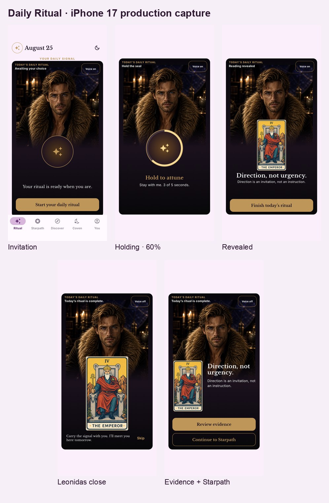

# Daily Ritual approved layout specification

**Approval:** Product owner approved the post-refinement iPhone 17 production frames on 2026-09-02.  
**Reference device:** iPhone 17, iOS 26.5, portrait, 402×874 logical pixels at 3× capture scale.  
**Implementation authority:** `DailyRitualStageSpec` and the measured geometry tests. Generated probes establish direction, not production pixels or copy.

## Shell and fullscreen boundary

- The assigned invitation is the only ceremony state shown inside the normal application shell. Its measured stage is `(x: 16, y: 142, w: 370, h: 632)`.
- Tapping **Start your daily ritual** pushes the root fullscreen ceremony route. Ready, Holding, Revealed, C2 closing, and Completed onward do not show the app utility header or bottom navigation.
- On the reference device, the fullscreen stage is `(x: 16, y: 135, w: 370, h: 632)`. It is vertically centered inside the iPhone 17 safe area with 8-point outer vertical padding. The observed safe-area insets are 62 points top and 34 points bottom.
- Ordinary text sizes do not scroll. At accessibility text sizes, only the adaptive lower content may scroll so that complete copy and every control remain reachable.
- System Back, edge dismissal, and the route's semantic dismiss return to the matching shell invitation. They do not mutate ritual authority.

## Stage-local geometry

All rectangles below are in logical points relative to the 370×632 stage. Reference anchors allow ±4 points in simulator review; deterministic geometry tests hold the implementation to ±0.1 point.

| Element | Bounds `(x, y, w, h)` | Constraint |
|---|---:|---|
| Metadata region | `12, 10, 346, 44` | Status remains clear of the face and voice control. |
| Voice control | `282, 10, 76, 44` | At least a 44-point target. |
| Portrait | `18, 26, 334, 330` | Leonidas remains the primary focal point. |
| Face-clear zone | `116, 68, 138, 178` | Zero overlap from cards, seals, copy, glows, or controls. |
| Resting seal visual | `120, 302, 130, 130` | Decorative visual only; no sensor metaphor. |
| Resting seal hit region | `105, 287, 160, 160` | Forgiving continuous-contact target. |
| Holding seal visual | `110, 288, 150, 150` | Ring reports elapsed hold time only. |
| Holding seal hit region | `95, 273, 180, 180` | Leaving early cancels. |
| Resting guidance | `20, 485, 330, 48` | Complete sentence, centered. |
| Start action | `16, 556, 338, 52` | Sole ritual-specific primary action. |
| Revealed card | `126, 248, 118, 206` | Actual assigned art, `BoxFit.contain`. |
| Revealed content | `16, 462, 338, 104` | One title and one interpretation. |
| Finish action | `16, 569, 338, 52` | Sole revealed-state primary action. |
| C2 expanded card | `99, 255, 172, 300` | Same assigned card, below the face. |
| C2 caption | `20, 562, 330, 60` | Complete Leonidas close plus persistent Skip. |
| Keepsake card | `20, 272, 118, 206` | Same assigned card in the left rail. |
| Completed copy | `158, 282, 196, 196` | Title and interpretation remain readable once. |
| Evidence action | `16, 504, 338, 52` | Primary onward action. |
| Starpath action | `16, 566, 338, 52` | Secondary onward action. |

## Timing and motion checkpoints

| Transition | Duration | Required behavior |
|---|---:|---|
| Start → Ready | 180 ms | Same stage; only the shell chrome leaves with the route transition. |
| Hold | exactly 5 s minimum | Progress is monotonic elapsed contact time. A release before 5.000 s cancels; 5.000 s accepts once. |
| Hold compression | 120 ms | Restrained seal response, never biometric-looking. |
| Early-release return | about 200 ms | Non-bouncy ease-out to Ready with one Leonidas acknowledgement. |
| Concealed reveal | 480 ms | Card remains hidden until verified authority is available. |
| C2 expansion | 450 ms | Actual art expands below the face-clear zone. |
| Keepsake settle | 420 ms | Card settles before Evidence and Starpath become the stable onward hierarchy. |
| Reduced Motion transition | 120 ms | Static progress and crossfades replace travel, particles, and scale motion. |

## Visual invariants

- Leonidas's eyes, forehead, nose, mouth, and upper face remain unobstructed in every approved state.
- The Emperor art in the approved fixture is unchanged through reveal, C2 expansion, and keepsake settlement; production always uses the authoritative assigned art.
- No finger, cursor, scanner, waveform, energy score, or other simulated anatomy/sensor appears.
- Completion copy appears only after server-confirmed Finish.
- The completion heading intentionally occupies the top-left metadata area. Centering it as in the generated C2 probe would intersect the face-clear zone.
- Evidence is primary and Starpath secondary. No Replay, History, Coven promotion, practice, or Ask Leonidas action competes with them.

## Evidence strategy

The original [`g1-probe-comparison.jpg`](g1-probe-comparison.jpg) contains the five probe/simulator side-by-sides, 50% overlays, and heatmaps used to validate stage composition. Those pre-refinement simulator frames used the same 370×632 stage geometry; their visible shell chrome is historical evidence of the refinement request, not the accepted final state.

The approved post-refinement source of truth is [`g1-fullscreen-approved-contact-sheet.jpg`](g1-fullscreen-approved-contact-sheet.jpg), backed by the individual logical-resolution simulator frames in [`simulator/iphone-17/`](simulator/iphone-17/). The individual files are normalized from the passing 1206×2622 capture to 402×874 to avoid retaining duplicate 3× artifacts.

## Automated enforcement

- `test/daily_ritual_stage_layout_test.dart` measures the stage, portrait, face-clear zone, cards, copy, and actions.
- `test/visual_reference_test.dart` owns the approved widget goldens.
- `test/accessibility_test.dart` and presentation tests cover 2× text, Reduced Motion, semantics, target sizes, and absence of ordinary-size ceremony scrolling.
- `integration_test/daily_ritual_g1_capture_test.dart` captures the five reference states from production widgets on iPhone 17 and then verifies the Evidence return and Starpath exit.

