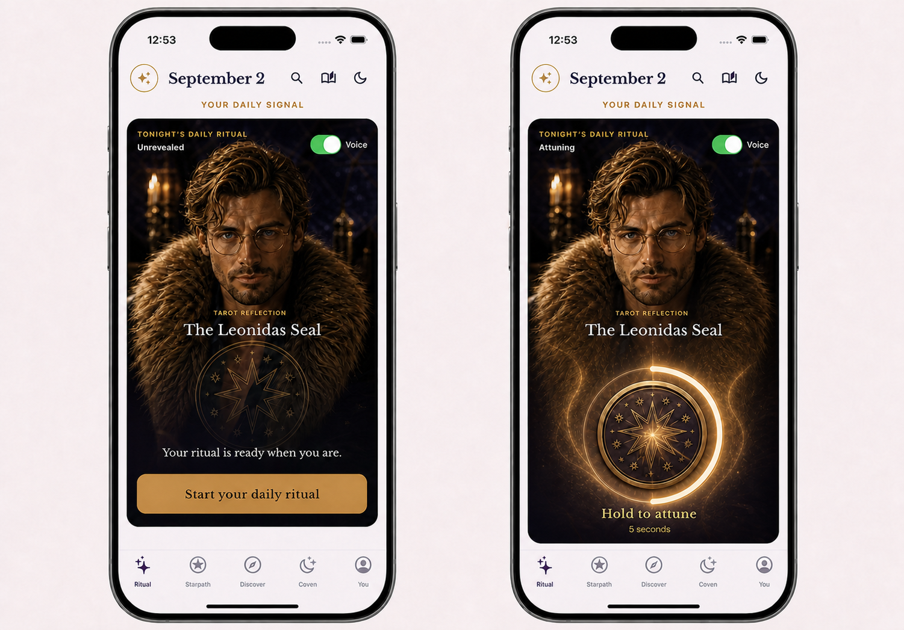
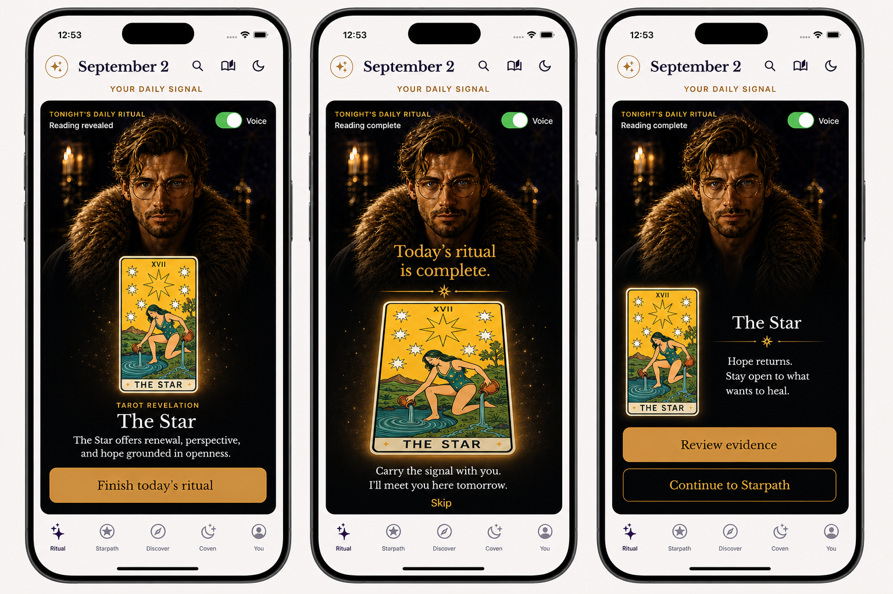
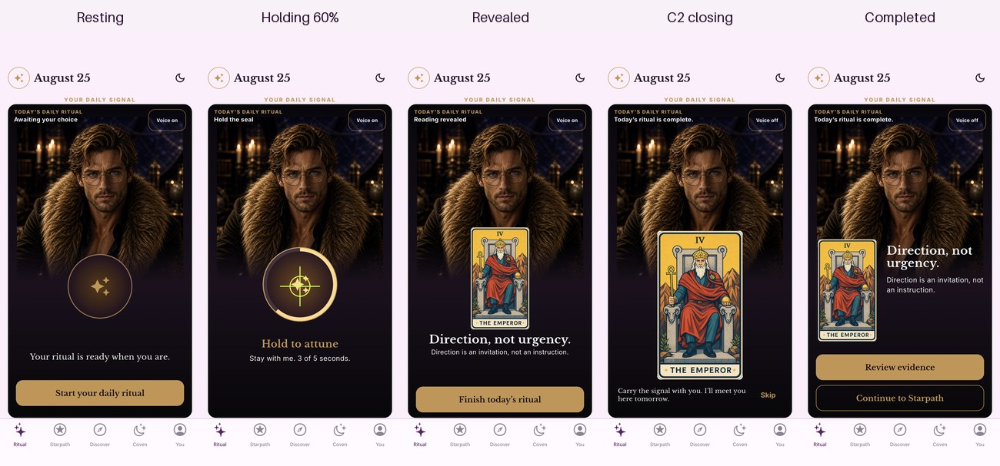
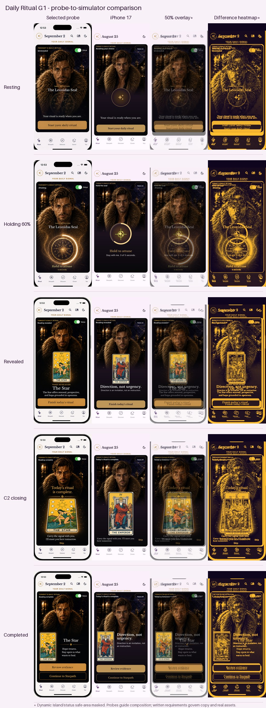
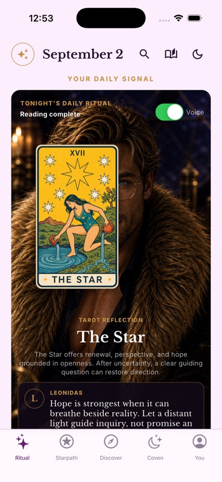
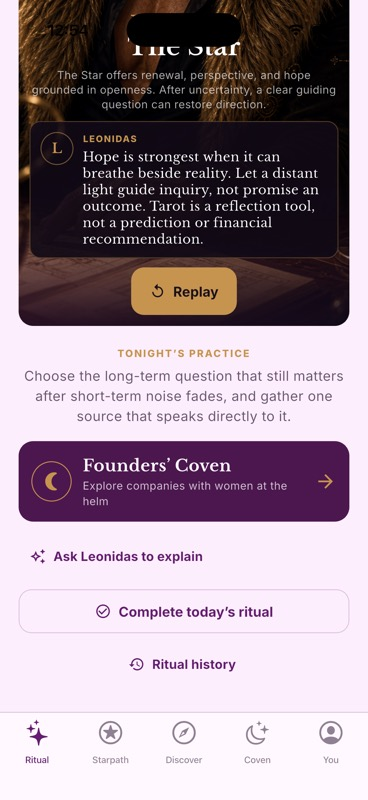
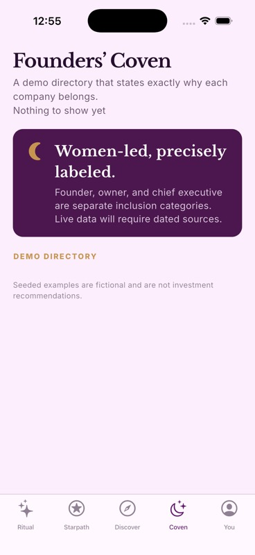
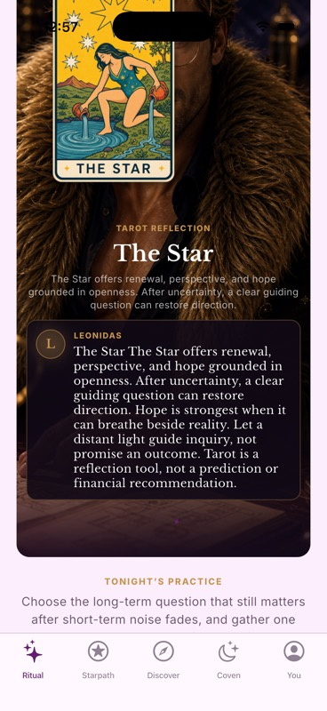
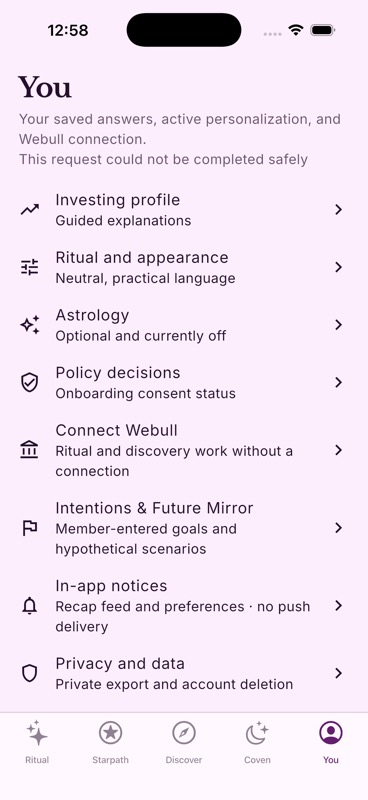

# Daily Ritual Rebuild

**Status:** G1 composition approved; immersive fullscreen refinement and implementation verification in progress  
**Owner decisions captured:** 2026-09-02  
**Platform:** Flutter application validated on iOS  
**Authoritative scope:** Daily Ritual entry, hold, reveal, Leonidas closing, completion, and onward handoff

## Document authority

This document is the source of truth for the Daily Ritual rebuild. An implementation plan and implementation must trace back to the requirement IDs here.

If an older critique, screenshot, generated probe, test, or existing implementation conflicts with this document, this document wins. Historical screenshots describe the problem being replaced; they are not implementation instructions. Generated images define composition and emotional direction, while the written requirements define behavior, content, accessibility, data safety, and acceptance.

Implementation is governed by the approved plan at [`../../../docs/plans/2026-09-02-1225-feat-daily-ritual-rebuild-plan.md`](../../../docs/plans/2026-09-02-1225-feat-daily-ritual-rebuild-plan.md). This requirements document remains authoritative when implementation details conflict with the approved product outcome.

## Product outcome

The Daily Ritual is an optional daily interaction with Leonidas. A member enters the Ritual tab, chooses whether to start, completes a deliberate five-second hold, receives the assigned reading, explicitly finishes the ritual, hears or reads one short closing message from Leonidas, and then chooses Evidence or Starpath.

The rebuild must feel ceremonial without becoming slow, coercive, deceptive, or cluttered. It must remove the current loading jank, duplicate interpretation, double-ending ambiguity, and post-reading action pileup while preserving server authority, evidence, risk, uncertainty, accessibility, and member agency.

## Confirmed direction

### Entry and hold — The Leonidas Seal

The member first taps **Start your daily ritual** from the navigable Ritual entry page. That action opens a fullscreen, app-chrome-free stage and asks for a five-second continuous hold on the Leonidas Seal. The seal responds with elapsed-time progress and restrained ritual animation while data is prepared behind the scene.



The rendered UI must never include the illustrative finger shown in an earlier discarded probe. The approved probe above contains app-owned visuals only.

### Post-reveal — C2, The Expanding Card

The revealed state displays the real illustrated card, its title, a concise interpretation, and one Finish action. After server-confirmed Finish, the actual card expands within the lower half while Leonidas delivers one short closing message. The card then settles into a vertical keepsake position and the Evidence → Starpath handoff appears.



The probes are not pixel specifications and their generated wording is not authoritative. Production uses the real application fonts, theme tokens, card assets, and approved copy defined below.

### G1 implementation evidence — composition approved with one refinement

The following frames come from the real production widget and application shell running on the iPhone 17 simulator with deterministic test authority. On 2026-09-02 the product owner approved their stage composition, face clearance, card continuity, and action hierarchy, with one binding refinement: after Start, the ceremony must occupy a fullscreen route with the global top utility row and bottom navigation removed. These pre-refinement frames remain decision evidence, not permanent golden baselines.



The comparison below places each selected probe beside the simulator result, a 50% overlay, and a difference heatmap. Dynamic Island/status chrome is masked only in the overlay and heatmap. Differences caused by real assigned artwork, production typography, and authoritative copy are expected; composition, hierarchy, face clearance, card continuity, and action order remain binding.



Current G1 evidence status:

- The iPhone 17 capture flow passes for Resting, Holding at 60%, Revealed, C2 closing, and Completed onward.
- Leonidas's face remains clear in every captured state.
- The bundled Emperor artwork remains the same assigned card through reveal, expansion, and keepsake settlement.
- The completion heading remains in the top-left metadata area because the generated probe's centered heading conflicts with the approved face-clear rectangle.
- The navigable pre-start invitation remains in the normal app shell. Ready, Holding, Revealed, C2, and Completed occupy a fullscreen route without global top icons or bottom navigation.
- Standard text sizes do not scroll during the immersive ceremony. Accessibility text sizes may scroll only the adaptive lower content needed to keep every control and complete string reachable.
- Permanent goldens remain gated on final post-refinement simulator approval in U6.

## Authoritative flow

```text
Open Ritual tab
  → Resting daily page
  → Start your daily ritual
  → Fullscreen ceremony (no global top icons or bottom navigation)
  → Hold Leonidas Seal for 5 seconds
      ↳ release early: cancel and retry when ready
      ↳ failure: remain concealed and offer retry
  → Reading revealed with actual card art
  → Finish today’s ritual
      ↳ failure: preserve reading and offer retry
  → Card expands + Leonidas closing message
      ↳ message ends or Skip is chosen
  → Card settles + Review evidence / Continue to Starpath
```

## Requirements

### Voluntary daily entry

- **DR-ENTRY-01 — No forced start.** Opening the app or Ritual tab must not begin the ritual, start speech, animate the seal, reveal content, change lifecycle state, or present a blocking modal.
- **DR-ENTRY-02 — Explicit daily entry.** A fresh assigned ritual presents **Start your daily ritual** as the only ritual-specific primary action.
- **DR-ENTRY-03 — Reversible entry and immersive boundary.** Global navigation remains available before the member starts. Start opens a fullscreen ceremony without the global top utility row or bottom navigation. System Back/edge dismissal and assistive semantic dismissal may leave safely; Completed provides Evidence and Starpath as the visible onward exits.
- **DR-ENTRY-04 — Once per day.** The entry state represents the current member's current daily assignment. Returning to an already completed daily ritual restores the completed onward state rather than offering Start again.
- **DR-ENTRY-05 — No outcome leak.** Before reveal, do not expose the assigned card face, title, interpretation, evidence summary, or another clue that reveals the outcome.
- **DR-ENTRY-06 — Neutral time language.** Use **Today’s daily ritual** or equivalent time-neutral wording. Do not hard-code **Tonight**.

### Leonidas composition and role

- **DR-LEO-01 — Leonidas is the guide.** His portrait remains the primary human focal point from resting through the completed handoff.
- **DR-LEO-02 — Face-clear zone.** Leonidas's eyes, forehead, nose, mouth, and at least the upper half of his face must remain fully visible and unobstructed at every supported viewport, text size, theme, and animation keyframe.
- **DR-LEO-03 — Effects stay below the face.** Cards, seals, text, progress, glows, particles, and light paths must remain below his chin or around the outside of his lower shoulders. They may not cross the face-clear zone.
- **DR-LEO-04 — One closing message.** Leonidas contributes one concise motivational message after Finish succeeds. He does not repeat the card title or interpretation.
- **DR-LEO-05 — No pressure.** Leonidas may invite, acknowledge, or encourage. He must not shame, threaten, predict, recommend a trade, imply certainty, or punish the member for stopping.

### Start and five-second hold

- **DR-HOLD-01 — Two-step entry.** Tapping Start opens the same visual stage as a fullscreen route in the ready-to-hold state. It does not reveal content, mutate lifecycle state, or present a dialog/sheet.
- **DR-HOLD-02 — Clear instruction.** Ready guidance is **Place your thumb on the seal and hold.** The control label is **Hold to attune** and the resting duration cue is **5 seconds**.
- **DR-HOLD-03 — Continuous contact.** The normal gesture succeeds only after five uninterrupted seconds of contact within a forgiving hit region around the seal.
- **DR-HOLD-04 — Honest progress.** The ring represents elapsed hold time only. Network progress must never cause it to jump, finish early, reverse, or imply data is ready.
- **DR-HOLD-05 — Early release cancels.** Releasing or moving materially outside the hit region before five seconds resets the gesture and does not reveal or advance server lifecycle state.
- **DR-HOLD-06 — Early-release response.** Leonidas responds once with **You let go. Was the moment not right?** The member may immediately retry or leave.
- **DR-HOLD-07 — Accepted at five seconds.** At five seconds, the gesture is accepted with one restrained confirmation haptic. The member may lift their real finger while the app continues the bounded reveal choreography.
- **DR-HOLD-08 — No simulated anatomy or sensor.** Do not render a finger, hand, cursor, fingerprint, scanner, waveform, energy meter, spiritual score, or biometric-looking UI.
- **DR-HOLD-09 — Theatrical, not factual.** Copy and visuals may suggest attunement as ritual theater but must not claim the device is measuring energy, health, spirituality, emotion, or physiology.

### Optimistic preparation and authoritative data

- **DR-DATA-01 — Silent preparation.** Begin a stale-while-revalidate read and required image predecode while the resting page is visible, without beginning the ritual.
- **DR-DATA-02 — Preserve layout.** Refreshing must preserve stable stage scaffolding and any valid visible value. Do not clear the surface to a full-stage spinner, blank card, or differently sized skeleton.
- **DR-DATA-03 — Strict cache identity.** Cached content must be scoped and validated by member, local ritual date, assignment ID, assignment version, mode, and any other server-required identity fields.
- **DR-DATA-04 — Non-mutating touch-down preparation.** On hold touch-down, start or reuse non-mutating assignment revalidation and exact assigned-art predecode. Do not issue the reveal mutation until the hold is accepted at five seconds and the preflight still matches the same member scope, server ritual day, mode, assignment, version, revision/content identity, and art identity.
- **DR-DATA-05 — No optimistic lifecycle claims.** Reveal and Finish remain server-authoritative, preserve `If-Match`, and reconcile every failure that may have occurred after dispatch. The UI may optimistically prepare assets but may not claim that reveal or completion succeeded before confirmation.
- **DR-DATA-06 — Reveal timing.** Five seconds is the minimum dramatic beat. At five seconds, begin the bounded reveal choreography. Show card content only when the authoritative response is valid.
- **DR-DATA-07 — Slow response.** If verified content is not ready, extend only the concealed ambient portion of the choreography. Never reveal stale, mismatched, fabricated, or partially validated content.
- **DR-DATA-08 — Fail closed.** Timeout, offline-without-valid-cache, stale identity, malformed response, version conflict, or rejected mutation leaves the card concealed or the prior confirmed reading intact and offers a retry.
- **DR-DATA-09 — Safe cancellation.** An in-flight read may finish and warm the cache after an early release, but it must not reveal content, play closing speech, or advance member-visible lifecycle state.

Strict replay-as-2xx idempotency and a two-phase prepare/commit reveal endpoint are deferred follow-up contracts. The immediate-commit transition endpoint remains in use; therefore client cancellation can cancel preparation and presentation only, never undo a dispatched mutation.

### Reveal and reading

- **DR-READ-01 — One revealed label.** Use **Reading revealed** after the reveal response succeeds. Do not use the word **complete** before Finish succeeds.
- **DR-READ-02 — Actual art.** Render the assigned real illustrated tarot card face from the application asset/data contract. Do not replace it with a card back, generic star, symbolic icon, or regenerated imitation.
- **DR-READ-03 — One interpretation.** Show the card title and interpretation once. Leonidas's narration or caption must not duplicate them.
- **DR-READ-04 — Card placement.** The card sits below Leonidas's chin at a useful, legible size and uses contain-style scaling so the artwork is not cropped.
- **DR-READ-05 — One next action.** **Finish today’s ritual** is the only ritual-specific primary action in the revealed state. Evidence, Starpath, Replay, History, Coven, practice, and Ask Leonidas do not interrupt this step.
- **DR-READ-06 — Stable Finish loading.** While Finish is pending, keep Leonidas, the actual card art, and the reading visible. Show progress only in the Finish control and prevent duplicate submission.
- **DR-READ-07 — Finish failure.** If Finish fails, return the button to an actionable retry state, preserve the confirmed reading, announce the error accessibly, and do not show completed copy.

### C2 closing and onward handoff

- **DR-C2-01 — Start only after confirmation.** The C2 closing begins only after the server confirms Finish.
- **DR-C2-02 — Expand the actual card.** Animate the same illustrated card into a larger lower-half presentation. Do not swap it for an icon, back, or alternate artwork.
- **DR-C2-03 — Keep Leonidas visible.** The expanding card and all transition paths remain below Leonidas's chin and outside the face-clear zone.
- **DR-C2-04 — Confirm completion.** Show **Today’s ritual is complete.** only after Finish succeeds.
- **DR-C2-05 — Closing copy.** Leonidas says **Carry the signal with you. I’ll meet you here tomorrow.** Captions remain complete whether voice is on or off.
- **DR-C2-06 — Always skippable.** A persistent **Skip** action ends the closing speech and advances to the onward state. The user is never trapped by narration.
- **DR-C2-07 — Natural duration.** With voice enabled, the closing beat lasts no longer than the actual short spoken message. It must not use a generic text-length delay. With voice disabled, use one short fixed visual beat with Skip available.
- **DR-C2-08 — Automatic onward transition.** When the message ends or Skip is chosen, no additional confirmation tap is required. The card settles into a vertical keepsake rail and the onward actions appear.
- **DR-C2-09 — Ordered handoff.** Show **Review evidence** as the primary action followed by **Continue to Starpath** as the secondary action.
- **DR-C2-10 — No competing actions.** Do not show Replay, History, Coven promotion, practice, Ask Leonidas, or another ritual-specific destination in the completed handoff.
- **DR-C2-11 — Restore completed state.** Returning later restores the keepsake/onward state directly. Do not replay Start, hold, reveal, Finish, or Leonidas's closing message.
- **DR-C2-12 — Evidence continuity.** Evidence opens in context with a visible Done/Close control. Dismissing it returns to the completed ritual rather than changing tabs unexpectedly.

### Voice, captions, haptics, and motion

- **DR-MEDIA-01 — Respect preference.** Use the member's saved voice preference. Opening Ritual must never start speech by itself.
- **DR-MEDIA-02 — Captions are authoritative.** Captions contain the complete spoken content and remain usable when audio is disabled, interrupted, unavailable, or stopped.
- **DR-MEDIA-03 — Stop safely.** Navigating away, backgrounding, interruption, lifecycle invalidation, or Skip stops ritual speech immediately.
- **DR-MEDIA-04 — Restrained haptics.** Use one soft touch-down impact, at most one restrained midpoint cue, and one confirmation at five seconds. Do not buzz continuously.
- **DR-MOTION-01 — Hold motion.** The progress ring fills continuously over exactly five seconds. Secondary light and seal compression support the gesture without becoming a fake sensor display.
- **DR-MOTION-02 — Cancellation motion.** Early release settles progress back in approximately 200 ms using a non-bouncy ease-out.
- **DR-MOTION-03 — Reveal motion.** Reveal uses a bounded concealed-to-card transition with no blank frame, sudden scroll, or layout collapse.
- **DR-MOTION-04 — C2 motion.** Card expansion and keepsake settlement use restrained ease-out movement. The card path never intersects Leonidas's face.
- **DR-MOTION-05 — Reduced Motion.** Replace particles, glow travel, and scale movement with static progress plus crossfades or immediate state changes. Preserve timing, meaning, and controls.

### Accessibility, layout, and content quality

- **DR-A11Y-01 — Accessible alternative.** When assistive technology invokes the seal's semantic action, expose a standard **Begin ritual** activation and run the same five-second visual sequence without requiring sustained physical contact. Do not add a second mainstream button for ordinary interaction.
- **DR-A11Y-02 — Touch targets.** Every actionable target is at least 44×44 logical points, including Skip, Voice, retry, Evidence dismissal, and the seal's effective hit region.
- **DR-A11Y-03 — Contrast.** Body and control text reaches at least 4.5:1; qualifying large text reaches at least 3:1. Muted copy and gold labels are not exempt.
- **DR-A11Y-04 — Type floor.** Informative interface text remains at or above the iOS 11-point floor and does not depend on tiny tracked uppercase labels.
- **DR-A11Y-05 — Dynamic Type.** At 2× text scaling, no title, interpretation, Leonidas caption, risk/evidence content, or control truncates, overlaps, clips, or covers the face-clear zone. Accessibility text sizes may scroll the adaptive lower content; ordinary text sizes must not expose a ceremony scroll surface.
- **DR-A11Y-06 — Semantics.** VoiceOver exposes logical reading order, button roles, hold progress, cancellation, errors, Reading revealed, completion, and onward actions without announcing decorative effects.
- **DR-A11Y-07 — Safe areas.** Content and controls remain clear of the Dynamic Island, home indicator, and system insets. The immersive ceremony has no tab bar.
- **DR-A11Y-08 — Orientation and supported sizes.** The required portrait layout works on the smallest and largest supported iPhone viewports without horizontal scrolling or loss of primary controls.
- **DR-CONTENT-01 — Evidence remains adjacent to trust.** Evidence, uncertainty, limitations, freshness, observation window, and risk remain inspectable and are not weakened by the ritual redesign.
- **DR-CONTENT-02 — Financial boundary.** Leonidas does not present predictions, personalized recommendations, certainty, or risk-free language. Flutter renders validated data and does not calculate financial quantities.

## UI and domain state contract

The server domain remains `assigned → revealed → completed`. The UI may use local substates but must never pretend the domain advanced.

| UI state | Server requirement | Entry | Exit |
|---|---|---|---|
| Resting | Assigned | Open fresh daily Ritual | Tap Start or leave |
| Ready to hold | Assigned | Tap Start and enter fullscreen ceremony | Touch down, dismiss, or lifecycle cancellation |
| Holding | Assigned | Continuous seal contact | Early release → Ready; five seconds → Reveal choreography |
| Reveal choreography | Assigned or reveal request pending | Hold accepted | Valid reveal → Revealed; failure → Reveal unavailable |
| Reveal unavailable | Assigned | Invalid/failed reveal | Retry or leave |
| Revealed | Revealed | Valid reveal response | Tap Finish |
| Finishing | Revealed with completion pending | Tap Finish | Confirmed completion → C2 closing; failure → Revealed with error |
| C2 closing | Completed | Confirmed Finish | Message ends or Skip → Completed onward |
| Completed onward | Completed | Closing exits or completed state restored | Evidence, Starpath, or safe fullscreen dismissal |

## Required copy

| Moment | Copy |
|---|---|
| Resting guidance | Your ritual is ready when you are. |
| Resting action | Start your daily ritual |
| Ready guidance | Place your thumb on the seal and hold. |
| Hold action | Hold to attune |
| Duration cue | 5 seconds |
| Holding guidance | Stay with me. |
| Early release | You let go. Was the moment not right? |
| Reveal failure | The ritual could not be opened. Try again when you're ready. |
| Retry | Try again |
| Revealed status | Reading revealed |
| Finish | Finish today’s ritual |
| Completed status | Today’s ritual is complete. |
| Leonidas closing | Carry the signal with you. I’ll meet you here tomorrow. |
| Closing escape | Skip |
| Primary onward action | Review evidence |
| Secondary onward action | Continue to Starpath |

Copy may be refined in the implementation plan only if the meaning, ordering, agency, and financial boundaries above remain unchanged and the product owner approves the change.

## Error and interruption requirements

The implementation plan and tests must cover every case below:

- Offline with a valid identity/date/version-scoped cache.
- Offline without valid cache.
- Initial read slower than five seconds.
- Non-mutating preparation ready before five seconds, with zero reveal requests before hold acceptance.
- Reveal response arriving during reveal choreography.
- Reveal timeout or malformed response.
- Finish response delayed, rejected, duplicated, or version-conflicted.
- Early release at 0.1 seconds, 4.9 seconds, and the five-second boundary.
- Pointer leaving and re-entering the effective hold region.
- App backgrounded or route changed during hold, reveal, Finish, and closing speech.
- Voice disabled, interrupted, unavailable, or toggled during the flow.
- Skip before speech begins, during speech, and after speech finishes.
- Daily assignment changes at local-day rollover while the page is retained.
- Restoring assigned, revealed, and completed server states after process restart.
- Missing or unavailable tarot art.
- Dynamic Type at 2×, Reduced Motion, VoiceOver, and supported assistive input.

No failure may expose a wrong card, fabricate completion, clear an already confirmed reading, trap navigation, or continue speech after the ritual loses visibility.

## Visual fidelity contract

The selected images communicate hierarchy and composition, not generated pixels. Production fidelity is judged using this source order:

1. Written requirements and state contract in this document.
2. Existing application theme tokens, typography, and real tarot/Leonidas assets.
3. Selected Leonidas Seal and C2 visual probes.
4. Historical screenshots, used only to prove regressions are removed.

### Zero-tolerance fidelity requirements

- Leonidas's face-clear zone is never violated.
- The actual assigned card artwork is used and remains uncropped.
- The UI never renders a finger or biometric/sensor metaphor.
- Action order and lifecycle copy match the authoritative flow.
- No extra post-reading actions appear.
- No pre-Finish state says complete.
- Ready through Completed contains no global utility header or bottom navigation and no ordinary-size scroll surface.

### Measured layout requirements

Before coding, the implementation plan must convert the selected probes into an annotated layout specification for the reference viewport. It must define stage bounds, portrait focus rectangle, face-clear rectangle, seal bounds and hit region, card bounds for revealed/expanded/keepsake states, text widths, button dimensions, safe-area offsets, spacing tokens, and motion checkpoints.

Major visual anchors must land within ±4 logical pixels of that approved specification at the reference viewport. Secondary spacing may vary only when needed for actual copy, accessibility, or supported viewport adaptation. Any intentional divergence from the probe must be identified in the implementation plan before coding.

### Approval baseline

The generated probe itself must not become a Flutter pixel golden because it contains presentation-board framing and synthesized rendering. The first acceptable simulator implementation is compared with the probe using side-by-side views, a 50% overlay, and a difference heatmap. After product-owner approval, the real simulator captures become the permanent golden baselines for regression testing.

## Strict testing guidance

Passing compilation is not visual acceptance. The rebuild is complete only when behavioral, visual, accessibility, lifecycle, and native simulator evidence all pass.

### 1. Static and focused Flutter checks

Run the narrowest relevant checks during development, then the complete applicable suite before handoff:

```text
dart format --output=none --set-exit-if-changed <changed Dart files>
flutter analyze
flutter test --no-pub test/ritual_lifecycle_test.dart
flutter test --no-pub test/leonidas_ritual_sequence_test.dart
flutter test --no-pub test/offline_state_test.dart
flutter test --no-pub test/api_repository_test.dart
flutter test --no-pub test/visual_reference_test.dart
flutter test --no-pub
```

The implementation plan must name any additional focused test files before coding. Tests may use fakes and deterministic clocks; they must not depend on live APIs, actual wall-clock waiting, or nondeterministic speech timing.

### 2. Required controller and repository tests

- Prefetch preserves a valid visible value rather than resetting to loading with no value.
- Cache keys reject wrong member, date, assignment, version, or mode.
- A valid cache renders immediately and revalidates in the background.
- Non-mutating assignment revalidation and exact-art predecode start or are reused on hold touch-down; reveal remains undispatched before an accepted, matching preflight.
- Early release does not advance UI or server lifecycle state.
- Reveal success is accepted only from a valid authoritative response.
- Duplicate or stale transitions resolve to the server-authoritative assignment.
- Finish is idempotent and completion never appears on rejection.
- Completed state restores directly to Completed onward.
- Backgrounding and navigation cancel speech and transient UI safely.

### 3. Required widget and interaction tests

- Opening Ritual leaves the page in Resting with no speech and no automatic reveal.
- Start enters the chrome-free fullscreen route and changes Resting to Ready without revealing or mutating the ritual.
- The pre-start invitation retains global navigation; the fullscreen ceremony contains neither global top utilities nor bottom navigation.
- Ready through Completed has no scroll surface at ordinary text sizes; accessibility scaling keeps complete content reachable through lower-region reflow/scroll only.
- Holding for 4.9 seconds and releasing cancels.
- Holding through five seconds accepts exactly once.
- Leaving the hit region cancels before acceptance.
- The semantic accessibility action runs the timed ritual without sustained contact.
- Progress semantics are meaningful and not announced continuously on every frame.
- Slow reveal preserves the concealed stage and stable geometry.
- Reveal failure keeps the card hidden and exposes retry.
- Revealed shows actual card art, one interpretation, and only Finish.
- Finish pending preserves the reading and disables duplicate submission.
- Finish failure preserves the reading and exposes retry.
- Confirmed Finish enters the C2 closing state.
- Skip stops speech and immediately exposes the onward handoff.
- Natural speech completion automatically exposes the onward handoff.
- Reopening a completed ritual does not replay closing speech.
- Evidence dismissal returns to Completed onward.
- Moving to another tab stops ritual speech immediately.

Add geometry assertions using stable widget keys: card, seal, labels, buttons, glows, and progress elements must not intersect the face-clear rectangle. These assertions must run at the reference viewport and 2× text.

### 4. Golden-state matrix

Capture deterministic goldens after the simulator implementation has been visually approved.

| State | Light | Dark | 2× text | Reduced Motion |
|---|---:|---:|---:|---:|
| Resting | Required | Required | Required | — |
| Ready to hold | Required | Required | Required | — |
| Holding at 60% | Required | Required | — | Required |
| Early-release response | Required | Required | Required | Required |
| Reading revealed | Required | Required | Required | — |
| Finish pending | Required | Required | — | — |
| C2 card expanded + closing | Required | Required | Required | Required |
| Completed onward | Required | Required | Required | Required |
| Reveal error | Required | Required | Required | — |
| Finish error | Required | Required | Required | — |

Golden tests must freeze clocks and animation controllers at named checkpoints. Updating a golden is never evidence that a change is acceptable; the update requires an accompanying simulator comparison and review of the changed pixels.

### 5. Visual comparison protocol

For each approved key state:

1. Capture the real app at the fixed reference viewport.
2. Crop the selected probe and simulator image to matching app-content bounds.
3. Produce a side-by-side comparison.
4. Produce a 50% opacity overlay.
5. Produce a difference heatmap with dynamic text, time, and system chrome explicitly masked.
6. Check every zero-tolerance requirement.
7. Check measured anchors against the annotated ±4-point specification.
8. Iterate until no unexplained high-salience difference remains.
9. Ask the product owner to approve the real simulator frames.
10. Store the approved simulator frames as the regression goldens.

Visual review must use the real card art and real app typography. A generally similar mood is not a pass if hierarchy, face visibility, card scale, action order, or spacing differs materially.

### 6. iOS simulator evidence

Use XcodeBuildMCP when available. Discover and build `ios/Runner.xcworkspace`, scheme `Runner`, install the successful artifact, launch it on the fixed reference simulator, and capture logs for the app bundle.

Reference device for direct comparison:

- iPhone 17
- iOS 26.5
- Portrait orientation
- Default text size

Also exercise the smallest and largest supported iPhone simulators for adaptation. For every required flow, save a descriptively named screenshot, record what was exercised, verify the visible result rather than trusting a successful tap, and inspect logs for crashes, exceptions, attributable error messages, and failed requests.

Required native flows:

- Resting → Start → hold success → reveal.
- Early release and immediate retry.
- Slow response at the five-second boundary.
- Reveal failure and retry.
- Reading → Finish success → C2 closing → Skip → onward.
- Reading → Finish success → natural closing completion → onward.
- Finish failure with preserved reading.
- Background and foreground during every transient state.
- Navigate away during speech.
- Voice disabled and Voice interrupted.
- VoiceOver semantic activation.
- Reduced Motion.
- 2× text.
- Evidence open and Done/Close return.
- Completed-state restoration after relaunch.

### 7. Performance and jank checks

- No full-stage blanking, geometry collapse, or skeleton swap during refresh or mutation.
- No layout jump when the card appears, expands, or settles.
- The hold ring remains visually continuous while network work runs.
- Image decode is completed before the relevant reveal frame whenever possible; a missed decode must remain concealed rather than flash an empty frame.
- Animation work must stay on paint/compositor-friendly properties where practical and avoid repeated synchronous decoding or layout churn.
- Profile the hold, reveal, expansion, and settlement sequence when observable jank remains. A simulator-only timing result is supporting evidence, not a substitute for visual review on representative hardware.

### 8. Accessibility verification

- Run Flutter accessibility guideline tests for label, target size, and contrast where supported.
- Manually verify VoiceOver focus order, labels, progress, errors, Skip, Finish, Evidence, and Starpath.
- Verify the accessible non-hold activation does not also trigger the raw hold recognizer.
- Verify captions when voice is disabled, interrupted, or skipped.
- Verify Reduced Motion removes nonessential travel, particle, scale, and glow effects.
- Verify 2× text without truncation, overlap, hidden actions, or face obstruction.
- Verify light-mode gold and muted text against their actual backgrounds; the historical failing colors must not be accepted unchanged for small text.

### 9. PASS, FAIL, and PARTIAL rules

- A required test with completed passing evidence is **PASS**.
- An observed failing behavior remains **FAIL** until a completed retest replaces it.
- A required check without a completed outcome is **SKIP**.
- Any residual FAIL makes the overall result **FAIL**.
- No FAIL but at least one SKIP makes the overall result **PARTIAL**.
- Only all required checks passing produces overall **PASS**.
- Build success, simulator action success, updated goldens, or subjective similarity alone cannot produce PASS.

The final simulator report must include project/workspace, scheme, simulator, build result, screens tested, a per-flow PASS/FAIL/SKIP table with screenshot evidence, console-error count, human-verification outcomes, residual failures, and overall result.

## Definition of done

The rebuild is done only when:

- Every requirement ID is implemented or explicitly removed by the product owner.
- The implementation plan's traceability table maps every requirement to code and tests.
- All static analysis and focused/full Flutter tests pass.
- All required golden states are approved and pass without unexplained updates.
- The reference simulator comparison is visually accepted by the product owner.
- The iOS simulator report is overall PASS.
- Accessibility, slow/failure behavior, restoration, and lifecycle cancellation pass.
- The final diff contains no unrelated refactor, dependency, infrastructure, or design-system rewrite.
- No secrets, generated test credentials, or member data appear in assets, fixtures, logs, or commits.

## Non-goals

- Do not change the server-authoritative ritual lifecycle solely to simplify the interface.
- Do not add destinations, onboarding, rewards, streaks, badges, or gamification.
- Do not turn Leonidas into a free-form adviser or a source of market direction.
- Do not weaken evidence, uncertainty, risk, freshness, Demo, or no-recommendation disclosures.
- Do not redesign the global application shell, Starpath, Coven, Discover, or You.
- Do not add dependencies or create a parallel design system unless the implementation plan proves the existing system cannot meet a confirmed requirement.
- Do not calculate probabilities, Greeks, GEX, expected return, risk, or arbitrage economics in Flutter or TypeScript.

## Implementation-plan receipt

The separate implementation plan was approved before code changes and is retained at [`../../../docs/plans/2026-09-02-1225-feat-daily-ritual-rebuild-plan.md`](../../../docs/plans/2026-09-02-1225-feat-daily-ritual-rebuild-plan.md). It includes:

1. Exact files to inspect and files expected to change.
2. A requirement-to-code-and-test traceability table covering every requirement ID.
3. The annotated numerical layout and motion specification derived from the selected probes.
4. The local UI-substate design mapped onto the existing assigned/revealed/completed domain states.
5. The stale-while-revalidate and authoritative mutation design, including cache identity and failure behavior.
6. Component boundaries that reuse existing feature-owned patterns without broad refactoring.
7. Exact focused, golden, accessibility, and simulator checks.
8. A screenshot and log evidence plan with artifact paths.
9. Pass/fail criteria, rollback conditions, and explicit non-goals.
10. The recorded approval gate that preceded implementation.

## Historical baseline evidence

The screenshots below document the interface being replaced. They remain useful for regression comparison but do not override the rebuild requirements.

**Baseline 1 — premature “Reading complete” state**



**Baseline 2 — post-reading action pileup**



**Baseline 3 — promoted empty Coven destination**



**Baseline 4 — duplicated Leonidas interpretation**



**Baseline 5 — broken theme-return continuity**



The detailed original critique is retained only as historical analysis:

`/Users/dickymicky/Documents/Argus/.impeccable/critique/2026-09-02T05-00-51Z__tures-ritual-presentation-daily-ritual-screen-dart.md`
